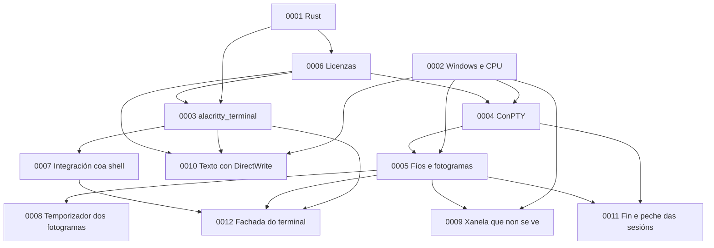

# ADR: rexistros de decisións de arquitectura

Un **ADR** (*Architecture Decision Record*) é un documento curto que garda unha decisión importante do proxecto: o contexto no que se tomou, a decisión, as alternativas descartadas e as súas consecuencias. Serve para entender, meses despois, por que o código é como é, e para cambiar unha decisión de forma consciente, sabendo que se perde e que se gaña.

## Regras

- Un ADR por decisión, cun número de catro cifras (`0001`, `0002`…) que nunca se reutiliza.
- Cada ADR segue o [modelo](0000-modelo.md): contexto, decisión, alternativas, consecuencias e referencias.
- Un ADR acéptase ao integrar o PR que o introduce.
- Un ADR aceptado non se reescribe. Se a decisión cambia, escríbese un ADR novo que a substitúe, e o antigo pasa ao estado *Substituído polo ADR NNNN*. Só se corrixen erratas e ligazóns.
- Se un ADR novo só precisa ou cambia unha parte dun anterior, normalmente ao implementalo, o anterior segue vixente e pasa ao estado *Aceptado; concretado polo ADR NNNN*. O ADR novo explica que parte concreta e por que.
- Estados posíbeis: *Proposto*, *Aceptado*, *Aceptado; concretado polo ADR NNNN*, *Substituído polo ADR NNNN* e *Descartado*.

## Índice

| ADR | Decisión | Estado |
|---|---|---|
| [0001](0001-rust.md) | Rust como linguaxe | Aceptado |
| [0002](0002-windows-e-renderizado-cpu.md) | Só Windows, con renderizado por CPU | Aceptado; concretado polos [0009](0009-xanela-que-non-se-ve.md) e [0010](0010-texto-con-directwrite.md) |
| [0003](0003-nucleo-vt-alacritty-terminal.md) | `alacritty_terminal` como núcleo, detrás dunha fachada | Aceptado; concretado polo [0012](0012-fachada-do-terminal.md) |
| [0004](0004-conpty-empaquetado.md) | ConPTY empaquetado con meiga | Aceptado; concretado polo [0011](0011-fin-e-peche-das-sesions.md) |
| [0005](0005-fios-e-fotogramas.md) | Modelo de fíos e fotogramas | Aceptado; concretado polos [0008](0008-temporizador-dos-fotogramas.md) e [0011](0011-fin-e-peche-das-sesions.md) |
| [0006](0006-licenzas-e-dependencias.md) | Licenzas e dependencias | Aceptado |
| [0007](0007-integracion-coa-shell.md) | Integración coa shell | Aceptado |
| [0008](0008-temporizador-dos-fotogramas.md) | Temporizador dos fotogramas | Aceptado |
| [0009](0009-xanela-que-non-se-ve.md) | Que se debuxa cando a xanela non se ve | Aceptado |
| [0010](0010-texto-con-directwrite.md) | Texto con DirectWrite e unha caché de glifos | Aceptado |
| [0011](0011-fin-e-peche-das-sesions.md) | Fin e peche das sesións de ConPTY | Aceptado |
| [0012](0012-fachada-do-terminal.md) | A fachada do terminal | Aceptado |

## Como se relacionan

Cada frecha significa «condiciona»: por exemplo, a política de licenzas (0006) limita que núcleo de terminal (0003) e que ConPTY (0004) se poden usar.
