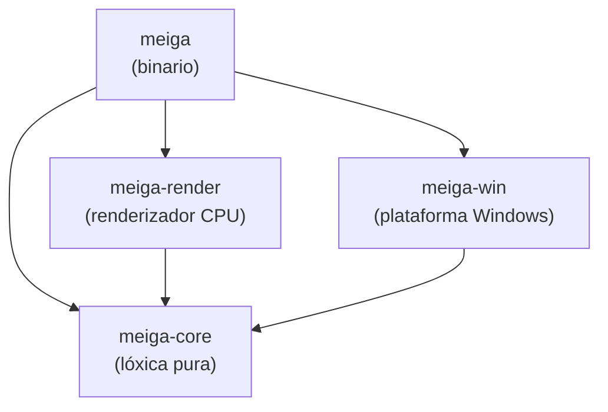
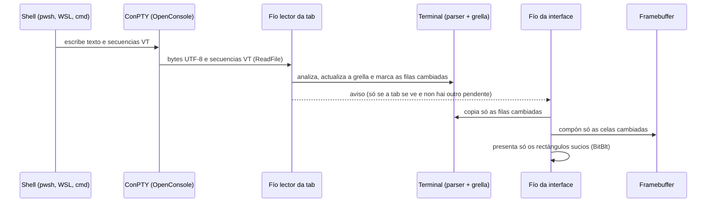
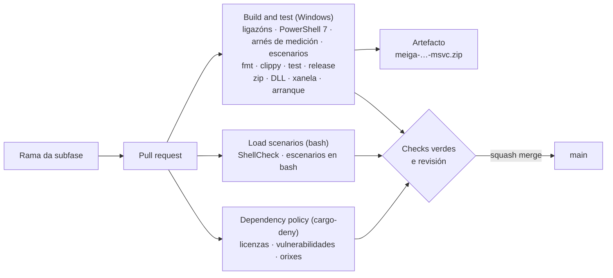
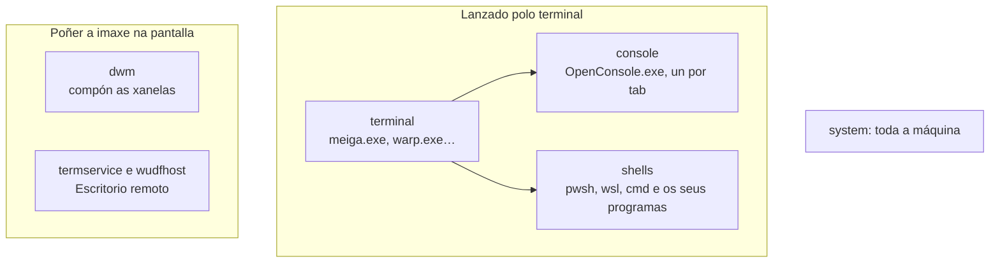
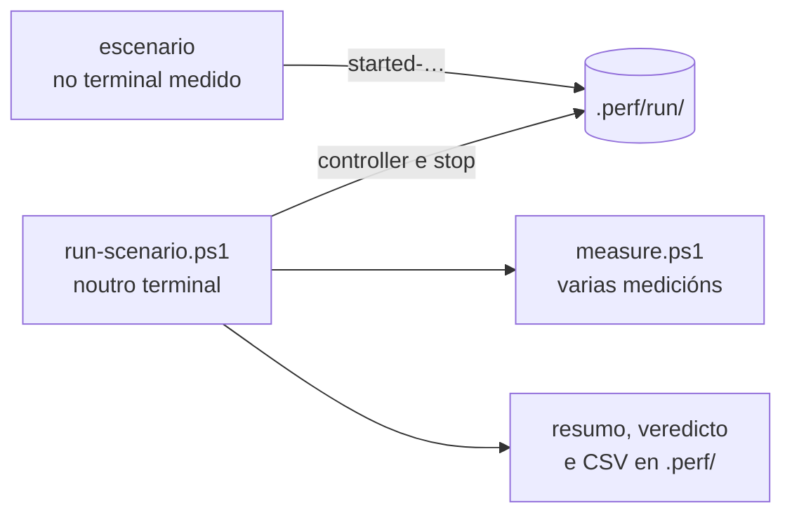

# Arquitectura

> Estado: subfase 1.1. Existen o esqueleto, a integración continua, as ferramentas de medición, os escenarios de carga e unha xanela baleira, co seu bucle de mensaxes. As seccións marcadas como *previsto* describen o deseño acordado, que se irá implementando nas subfases indicadas. O porqué de cada decisión importante está nos [ADR](adr/README.md).

## 1. Obxectivo e restricións

meiga é un terminal para Windows con tabs, grupos de tabs, explorador de cartafoles e restauración da sesión. A restrición que manda sobre todas as demais é o **rendemento**: o programa debe gastar o mínimo de CPU e de memoria, tamén en máquinas sen GPU ou que se usan por Escritorio remoto.

Nesas máquinas, un terminal que debuxa con DirectX ou Vulkan non ten tarxeta gráfica que faga o traballo, e Windows emula a GPU na CPU (o rasterizador por software WARP). Ademais, o Escritorio remoto ten que comprimir e enviar pola rede cada fotograma que cambia. Por iso meiga debuxa na CPU, pero só o que cambia ([ADR 0002](adr/0002-windows-e-renderizado-cpu.md)).

Deste obxectivo saen os principios de deseño:

| Principio | Que significa na práctica |
|---|---|
| Cero traballo en repouso | Sen temporizadores periódicos, sen *polling* e sen animacións. Se non pasa nada, o programa está durmido. |
| Debuxar só o que cambia | Lévase a conta das celas que cambiaron (*damage tracking*) e só se presentan eses rectángulos. |
| Non debuxar o que non se ve | As tabs en segundo plano só procesan a saída da shell; non se debuxan. |
| Agrupar en fotogramas | Como moito un fotograma por intervalo, aínda que a shell escriba miles de veces por segundo. |
| Poucos fíos, e bloqueados | Un fío para a interface e dous por tab. Cando non hai traballo, todos esperan bloqueados sen gastar CPU. |
| Sen *frameworks* pesados | Win32, DirectWrite e GDI directamente: nada de navegadores embebidos nin *runtimes* asíncronos. |
| Medir sempre | Cada fase pecha cunha porta de rendemento con medicións (ver a [sección 8](#8-medición-do-rendemento)). |

## 2. Estrutura do código: un *workspace* con catro *crates*

En Rust, un *crate* é a unidade de compilación: unha biblioteca ou un programa executábel. O código de meiga divídese en catro *crates* dentro dun mesmo *workspace* de Cargo (un conxunto de crates que se compilan xuntos; ver [Tecnoloxías](tecnoloxias.md#3-cargo-e-os-workspaces)).

| Crate | Tipo | Responsabilidade | Que pode usar |
|---|---|---|---|
| `meiga-core` | biblioteca | Toda a lóxica que non depende de Windows: modelo de xanelas, tabs e grupos; fachada do terminal; codificación do teclado e do rato; busca difusa; configuración. | Só bibliotecas portábeis. **`unsafe` prohibido** e sen APIs de Windows. |
| `meiga-render` | biblioteca | Renderizado por CPU: caché de glifos con DirectWrite, composición no *framebuffer* e presentación dos rectángulos que cambiaron. | `meiga-core` e as APIs gráficas de Windows. |
| `meiga-win` | biblioteca | Capa de plataforma: ConPTY, detección das shells, sistema de arquivos, portapapeis, xanela Win32 e DPI. | `meiga-core` e as APIs de Windows. |
| `meiga` | binario | Une as pezas: crea a xanela, o bucle de mensaxes e o fluxo de fotogramas. | Os tres anteriores. |

### Por que esta separación

- **Probas rápidas e fiábeis.** `meiga-core` non toca o sistema operativo, así que as súas probas son unitarias puras: non abren xanelas nin procesos e executan en milisegundos.
- **`unsafe` illado.** Chamar ás APIs de Windows desde Rust require bloques `unsafe`, nos que o compilador non pode garantir a seguridade da memoria e confía no programador. Concentralos en `meiga-win` e `meiga-render` fai que o resto do código teña todas as garantías de Rust e que os puntos delicados sexan fáciles de revisar. En `meiga-core`, o compilador prohíbeo con `#![forbid(unsafe_code)]`.
- **Compilación incremental máis rápida.** Un cambio nun crate só recompila ese crate e os que dependen del.
- **Preparado para o futuro.** Un renderizador con GPU (mellora futura F2) sería outra implementación dentro de `meiga-render`, sen tocar a lóxica de `meiga-core`.

A regra de dependencias é estrita: as frechas do diagrama só van cara abaixo, e `meiga-core` nunca depende dos outros tres. Esta regra xa está declarada nos `Cargo.toml` de cada crate, así que Cargo non deixaría compilar un ciclo. A elección de Rust explícase no [ADR 0001](adr/0001-rust.md).

## 3. Fluxo de datos (*previsto*)

Así viaxará a saída dunha shell ata a pantalla:

- **ConPTY** é a API de Windows que fai de "pseudoterminal": a shell cre que escribe nunha consola normal, e ConPTY tradúceo a un fluxo de texto con secuencias de escape VT, que é o que le meiga. meiga distribúe a súa propia copia de ConPTY ([ADR 0004](adr/0004-conpty-empaquetado.md)).
- **Secuencias VT** (ou ANSI): códigos que van mesturados co texto e indican cores, movementos do cursor, borrados… Por exemplo, `ESC[31m` cambia a cor do texto a vermello.
- **Parser e grella**: o *parser* interpreta as secuencias VT e a grella é a matriz de celas (carácter, cor, estilo) que representa a pantalla do terminal. Os dous veñen de `alacritty_terminal` ([ADR 0003](adr/0003-nucleo-vt-alacritty-terminal.md)), e un escáner propio detecta antes as secuencias da integración coa shell ([ADR 0007](adr/0007-integracion-coa-shell.md)).

| Peza | Subfase |
|---|---|
| Xanela e bucle de mensaxes | 1.1 (feita) |
| *Framebuffer* e presentación parcial | 1.2 |
| Fontes e caché de glifos | 1.3 |
| ConPTY | 1.4 |
| Fachada do terminal (parser e grella) | 1.5 |
| Da saída á pantalla | 1.6 |

## 4. Fíos (*previsto*)

| Fío | Cantos | Que fai | Cando esperta |
|---|---|---|---|
| Interface | 1 | Mensaxes de Windows, entrada do usuario, composición e presentación. | Só cando chega unha mensaxe (`GetMessageW`). |
| Lector | 1 por tab coa shell en marcha | Le a saída da shell e actualiza a grella. | Só cando a shell escribe. |
| Escritor | 1 por tab coa shell en marcha | Envía á shell o que se teclea. | Só cando hai algo que enviar. |

Un fío bloqueado nunha lectura ou nunha espera non consome CPU: o sistema operativo non o planifica ata que hai datos. Por iso o número de fíos non é un problema en si; o problema é que esperten sen motivo. O modelo completo, cos fotogramas e as tabs en segundo plano, está no [ADR 0005](adr/0005-fios-e-fotogramas.md).

O fío da interface xa existe desde a subfase 1.1: é o fío principal do programa, que dorme en `GetMessageW` mentres non chega ningunha mensaxe (ver [Tecnoloxías › Xanelas Win32](tecnoloxias.md#22-xanelas-win32-e-o-bucle-de-mensaxes)). Ao arrancar, Windows crea ademais algúns fíos auxiliares no proceso, por exemplo para cargar as DLL en paralelo, que rematan sós ao pouco tempo se non teñen traballo.

## 5. Compilación

- O perfil `release` optimiza ao máximo: LTO completo, unha soa unidade de xeración de código e `panic = "abort"`.
- O *runtime* de C vai ligado estaticamente, así que `meiga.exe` non necesita que estea instalado o *Visual C++ Redistributable*.
- As versións *release* usan o subsistema gráfico de Windows (sen xanela de consola). As de depuración manteñen a consola para ver diagnósticos.
- O **manifesto da aplicación** vai dentro de `meiga.exe`: escala por monitor (v2), Windows 10 e 11 sen modos de compatibilidade, e sen pedir permisos de administrador. Incrústao o ligador, a petición do `build.rs` de `meiga` (ver [Tecnoloxías › Manifesto](tecnoloxias.md#23-manifesto-da-aplicación-e-dpi)).

Os detalles explícanse en [Tecnoloxías](tecnoloxias.md) e, liña a liña, en [Código › configuración do workspace](codigo/workspace.md).

## 6. Integración continua

Ningún cambio chega a `main` sen pasar por un PR e pola CI:

- As regras da rama `main` (*ruleset*) fan obrigatorio este camiño, tamén para os administradores.
- Dependabot propón cada semana as versións novas dos crates, das actions e de Rust, como PR que pasan polo mesmo proceso.
- Cada luns, a CI revisa de novo as dependencias contra a base de datos de vulnerabilidades, aínda que non cambiase nada.

Os detalles están en [Tecnoloxías › GitHub Actions](tecnoloxias.md#15-github-actions) e en [Código › .github](codigo/github.md).

## 7. Decisións de arquitectura (ADR)

| ADR | Decisión |
|---|---|
| [0001](adr/0001-rust.md) | Rust como linguaxe. |
| [0002](adr/0002-windows-e-renderizado-cpu.md) | Só Windows, con renderizado por CPU do que cambia. |
| [0003](adr/0003-nucleo-vt-alacritty-terminal.md) | `alacritty_terminal` como núcleo, detrás dunha fachada. |
| [0004](adr/0004-conpty-empaquetado.md) | ConPTY empaquetado con meiga. |
| [0005](adr/0005-fios-e-fotogramas.md) | Fíos bloqueados e como moito un fotograma por intervalo. |
| [0006](adr/0006-licenzas-e-dependencias.md) | Só licenzas permisivas e dependencias mínimas. |
| [0007](adr/0007-integracion-coa-shell.md) | Integración coa shell mediante secuencias OSC. |

## 8. Medición do rendemento

O rendemento mídese desde fóra, sen tocar o código de meiga, co mesmo arnés para calquera terminal: `tools/perf/measure.ps1`. Cada certo tempo fai unha "fotografía" de todos os procesos e fíos do sistema e reparte o consumo en grupos:

- **Que conta como custo do terminal:** o propio terminal, os seus procesos de consola e o traballo que provoca en `dwm` e no Escritorio remoto ao debuxar. As shells son a carga de traballo, igual para todos os terminais.
- **Métricas:** CPU (en % dun núcleo e en ciclos), espertares por segundo, memoria privada e fíos. Explícanse en [Tecnoloxías › Medición do rendemento](tecnoloxias.md#19-medición-do-rendemento).
- **Onde:** en local, no equipo de desenvolvemento, e non na CI, porque as máquinas da CI son compartidas e darían cifras con moito ruído. Os resultados gárdanse en `.perf/`, fóra de Git. A CI só comproba que o arnés mide ben.
- **O arranque:** `tools/perf/measure-startup.ps1` mide o tempo desde que se crea o proceso de meiga ata que a súa xanela está pintada (ver [Tecnoloxías › Tempo ata o primeiro fotograma](tecnoloxias.md#tempo-ata-o-primeiro-fotograma)).

O código explícase en [Código › medición](codigo/perf.md).

### Escenarios de carga

Para comparar terminais, todos teñen que facer o mesmo traballo. Os escenarios imitan o uso diario dun terminal, e cada un existe en PowerShell e en bash, para medir a mesma carga nunha tab de pwsh e nunha de Ubuntu (WSL):

| Escenario | Que imita |
|---|---|
| `idle` | O terminal aberto sen facer nada, por exemplo con 5 tabs. Non arranca ningún script. |
| `spinner` | O indicador de progreso dunha ferramenta que traballa: unha liña que se redebuxa 10 veces por segundo. |
| `ai-stream` | Unha IA que pensa e responde palabra a palabra, con cores, emoji e unha zona de estado que se redebuxa 10 veces por segundo. |
| `bigfile` | Imprimir un arquivo de 50 MiB tan rápido como o acepte o terminal. |

- `run-scenario.ps1` corre **noutro terminal**, para que o seu traballo non se sume ao do terminal medido. Coordínase cos escenarios con arquivos baleiros nun cartafol que ven Windows e WSL, así que non fan falta portos nin procesos extra.
- Mide varias veces seguidas (por defecto, 3 medicións de 60 s) e di se os resultados son **estábeis**: se os ciclos do terminal varían pouco entre medicións ou, en bigfile, o tempo de imprimir. Se non o son, hai que voltar medir coa máquina máis tranquila.
- A CI comproba que os escenarios debuxan exactamente o esperado, en PowerShell e en bash, pero non mide nada.

O código explícase en [Código › escenarios de carga](codigo/escenarios.md). Na subfase 0.8 mediuse en local a liña base co Warp e o Windows Terminal, que fixou os orzamentos de rendemento de cada fase. Esas medicións non se publican, porque describen unha máquina concreta.

## 9. Estado actual (subfase 1.1)

- Existen os catro crates, coa regra de dependencias xa declarada. `meiga-core` ten o tipo das cores e `meiga-win`, a xanela e o bucle de mensaxes; `meiga-render` segue baleiro.
- `meiga.exe` abre unha xanela baleira co fondo escuro, que se pode mover, redimensionar e maximizar, e que aplica o tamaño que suxire Windows cando cambia a escala. En repouso non fai nada: o seu fío dorme en `GetMessageW`. Ao pechala, o programa remata co código 0.
- `meiga.exe` leva dentro o manifesto da aplicación, ocupa uns 210 KB e só depende de DLL do sistema. A CI compróbao en cada cambio: as DLL, que abre a xanela, a escala por monitor e que remata ben.
- Están activas as regras de calidade (*lints*), o formato automático, a política de licenzas (`cargo-deny`) e a xeración dos avisos de terceiros (`cargo-about`). A primeira dependencia externa é `windows-sys`.
- Cada PR valídase automaticamente en GitHub Actions, tamén as ligazóns da documentación, os scripts de PowerShell, o arnés de medición e os escenarios de carga, e produce un `.zip` descargábel con `meiga.exe`.
- As decisións de arquitectura están escritas en sete ADR.
- O arnés de medición mide calquera terminal e as partes de Windows que o poñen na pantalla, e `measure-startup.ps1` mide canto tarda meiga en abrir a súa xanela.
- Os escenarios de carga imitan o uso diario dun terminal, en PowerShell e en bash, e `run-scenario.ps1` mide un terminal mentres corren e di se os resultados son estábeis.
- Os scripts de `tools/` necesitan PowerShell 7. En Windows PowerShell 5.1 non se executan: só mostran o comando para facelo con `pwsh`.
