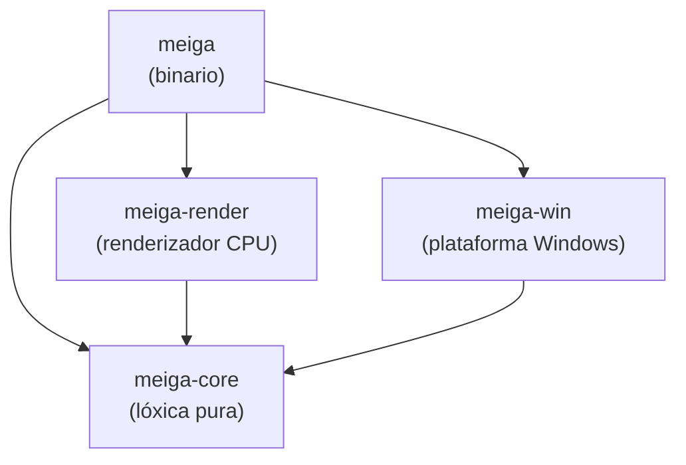
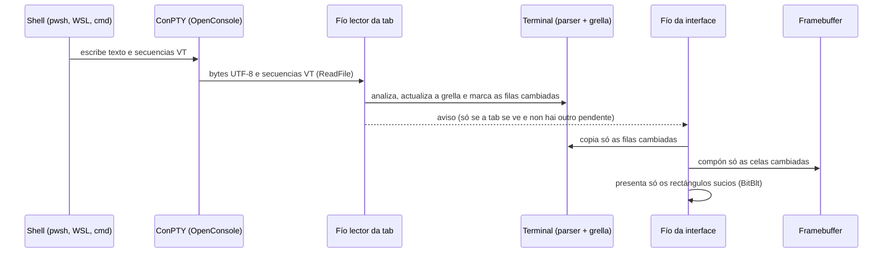

# Arquitectura

> Estado: subfase 0.3. Polo de agora só existe o esqueleto. As seccións marcadas como *previsto* describen o deseño acordado, que se irá implementando nas subfases indicadas.

## 1. Obxectivo e restricións

meiga é un terminal para Windows con tabs, grupos de tabs, explorador de cartafoles e restauración da sesión. A restrición que manda sobre todas as demais é o **rendemento**: o programa debe gastar o mínimo de CPU e de memoria, tamén en máquinas sen GPU ou que se usan por Escritorio remoto.

Nesas máquinas, un terminal que debuxa con DirectX ou Vulkan non ten tarxeta gráfica que faga o traballo, e Windows emula a GPU na CPU (o rasterizador por software WARP). Ademais, o Escritorio remoto ten que comprimir e enviar pola rede cada fotograma que cambia. Por iso meiga debuxa na CPU, pero só o que cambia.

Deste obxectivo saen os principios de deseño:

| Principio | Que significa na práctica |
|---|---|
| Cero traballo en repouso | Sen temporizadores periódicos, sen *polling* e sen animacións. Se non pasa nada, o programa está durmido. |
| Debuxar só o que cambia | Lévase a conta das celas que cambiaron (*damage tracking*) e só se presentan eses rectángulos. |
| Non debuxar o que non se ve | As tabs en segundo plano só procesan a saída da shell; non se debuxan. |
| Agrupar en fotogramas | Como moito un fotograma por intervalo, aínda que a shell escriba miles de veces por segundo. |
| Poucos fíos, e bloqueados | Un fío para a interface e dous por tab. Cando non hai traballo, todos esperan bloqueados sen gastar CPU. |
| Sen *frameworks* pesados | Win32, DirectWrite e GDI directamente: nada de navegadores embebidos nin *runtimes* asíncronos. |
| Medir sempre | Cada fase pecha cunha porta de rendemento con medicións. |

## 2. Estrutura do código: un *workspace* con catro *crates*

En Rust, un *crate* é a unidade de compilación: unha biblioteca ou un programa executábel. O código de meiga divídese en catro *crates* dentro dun mesmo *workspace* de Cargo (un conxunto de crates que se compilan xuntos; ver [Tecnoloxías](tecnoloxias.md#3-cargo-e-os-workspaces)).

| Crate | Tipo | Responsabilidade | Que pode usar |
|---|---|---|---|
| `meiga-core` | biblioteca | Toda a lóxica que non depende de Windows: modelo de xanelas, tabs e grupos; fachada do terminal; codificación do teclado e do rato; busca difusa; configuración. | Só bibliotecas portábeis. **`unsafe` prohibido** e sen APIs de Windows. |
| `meiga-render` | biblioteca | Renderizado por CPU: caché de glifos con DirectWrite, composición no *framebuffer* e presentación dos rectángulos que cambiaron. | `meiga-core` e as APIs gráficas de Windows. |
| `meiga-win` | biblioteca | Capa de plataforma: ConPTY, detección das shells, sistema de arquivos, portapapeis, xanela Win32 e DPI. | `meiga-core` e as APIs de Windows. |
| `meiga` | binario | Une as pezas: crea a xanela, o bucle de mensaxes e o fluxo de fotogramas. | Os tres anteriores. |

### Por que esta separación

- **Probas rápidas e fiábeis.** `meiga-core` non toca o sistema operativo, así que as súas probas son unitarias puras: non abren xanelas nin procesos e executan en milisegundos.
- **`unsafe` illado.** Chamar ás APIs de Windows desde Rust require bloques `unsafe`, nos que o compilador non pode garantir a seguridade da memoria e confía no programador. Concentralos en `meiga-win` e `meiga-render` fai que o resto do código teña todas as garantías de Rust e que os puntos delicados sexan fáciles de revisar. En `meiga-core`, o compilador prohíbeo con `#![forbid(unsafe_code)]`.
- **Compilación incremental máis rápida.** Un cambio nun crate só recompila ese crate e os que dependen del.
- **Preparado para o futuro.** Un renderizador con GPU (mellora futura F2) sería outra implementación dentro de `meiga-render`, sen tocar a lóxica de `meiga-core`.

A regra de dependencias é estrita: as frechas do diagrama só van cara abaixo, e `meiga-core` nunca depende dos outros tres. Esta regra xa está declarada nos `Cargo.toml` de cada crate, así que Cargo non deixaría compilar un ciclo.

## 3. Fluxo de datos (*previsto*)

Así viaxará a saída dunha shell ata a pantalla:

- **ConPTY** é a API de Windows que fai de "pseudoterminal": a shell cre que escribe nunha consola normal, e ConPTY tradúceo a un fluxo de texto con secuencias de escape VT, que é o que le meiga.
- **Secuencias VT** (ou ANSI): códigos que van mesturados co texto e indican cores, movementos do cursor, borrados… Por exemplo, `ESC[31m` cambia a cor do texto a vermello.
- **Parser e grella**: o *parser* interpreta as secuencias VT e a grella é a matriz de celas (carácter, cor, estilo) que representa a pantalla do terminal.

| Peza | Subfase |
|---|---|
| Xanela e bucle de mensaxes | 1.1 |
| *Framebuffer* e presentación parcial | 1.2 |
| Fontes e caché de glifos | 1.3 |
| ConPTY | 1.4 |
| Fachada do terminal (parser e grella) | 1.5 |
| Da saída á pantalla | 1.6 |

## 4. Fíos (*previsto*)

| Fío | Cantos | Que fai | Cando esperta |
|---|---|---|---|
| Interface | 1 | Mensaxes de Windows, entrada do usuario, composición e presentación. | Só cando chega unha mensaxe (`GetMessageW`). |
| Lector | 1 por tab coa shell en marcha | Le a saída da shell e actualiza a grella. | Só cando a shell escribe. |
| Escritor | 1 por tab coa shell en marcha | Envía á shell o que se teclea. | Só cando hai algo que enviar. |

Un fío bloqueado nunha lectura ou nunha espera non consome CPU: o sistema operativo non o planifica ata que hai datos. Por iso o número de fíos non é un problema en si; o problema é que esperten sen motivo.

## 5. Compilación

- O perfil `release` optimiza ao máximo: LTO completo, unha soa unidade de xeración de código e `panic = "abort"`.
- O *runtime* de C vai ligado estaticamente, así que `meiga.exe` non necesita que estea instalado o *Visual C++ Redistributable*.
- As versións *release* usan o subsistema gráfico de Windows (sen xanela de consola). As de depuración manteñen a consola para ver diagnósticos.

Os detalles explícanse en [Tecnoloxías](tecnoloxias.md) e, liña a liña, en [Código › configuración do workspace](codigo/workspace.md).

## 6. Estado actual (subfase 0.3)

- Existen os catro crates, baleiros, coa regra de dependencias xa declarada.
- `meiga.exe` compila, arranca e sae co código 0. Ocupa uns 200 KB e só depende de DLL do sistema.
- Están activas as regras de calidade (*lints*), o formato automático, a política de licenzas (`cargo-deny`) e a xeración dos avisos de terceiros (`cargo-about`).
