# Arquitectura

> Estado: mantemento M3, despois da subfase 2.10. Existen o esqueleto, a integración continua, as ferramentas de medición e os escenarios de carga, e `meiga.exe` xa é un terminal: lanza un programa nunha pseudoconsola, mostra a súa saída nunha xanela que presenta só o que cambia, cun *framebuffer* propio e texto con DirectWrite, envíalle as teclas coma unha consola de Windows, e o rato selecciona, copia e pega texto ou chega ao programa. A grella segue o tamaño e a escala da xanela, o historial vese coa roda, coas teclas e cunha barra de desprazamento, e o texto ten zoom. Con isto, o MVP pasou a súa porta de rendemento. Desde a 2.1 existe o modelo das tabs e, desde a 2.2, cada tab ten a súa sesión: as que non se ven só gastan o que custa ler a saída dos seus programas. Desde a 2.3, unha barra enriba do terminal mostra as tabs, cos títulos dos seus programas, e ábreas, móstraas e péchaas co rato; os atallos seguen. Desde a 2.4, o botón dereito nunha tab, a tecla de menú e Maiús+F10 abren o menú dunha tab, debuxado dentro da xanela, que a duplica ou pecha varias dunha vez. Desde a 2.5, cada tab corre un perfil: as shells que atopa meiga, que o `config.toml` pode cambiar, ocultar ou completar, e que abren o botón ▾, á dereita do +, e Ctrl+Maiús+Espazo. Desde a 2.6, as tabs e os perfís manéxanse tamén co teclado, con atallos que o `config.toml` pode cambiar ou liberar. Desde a 2.7, un programa que remata ben pecha a súa tab e, se era a última, a xanela; con outro fin, a tab queda co código de saída, e reiníciase ou péchase co teclado ou co menú. Desde a 2.8, as tabs teñen un ancho mínimo e, cando nin así caben, a barra desprázaas coa roda e cuns botóns aos seus lados; ao pechalas co rato, as outras quedan no seu sitio mentres o punteiro segue na barra; e unha tab di, antes do seu título, que o seu programa rematou ou, mentres está oculta, que tocou a campá ou escribiu algo. Desde o mantemento M2, ao pechar a xanela, meiga agarda a que rematen as sesións das súas tabs, tamén as que se bloquean ao pecharse, e non deixa ningún programa nin ningún ConPTY. Desde a 2.9, a barra de tabs é a barra de título da xanela, cos botóns de minimizar, maximizar e pechar de Windows 11, debuxados por meiga: as súas partes libres moven a xanela e abren o seu menú, e restaurada, unha banda enriba das tabs redimensiónaa. Na 2.10, as tabs pasaron a súa porta de rendemento, salvo abrir unha tab, que ás veces agardaba a que Windows crease o seu programa; e nun día enteiro de traballo, meiga gastou 636 veces menos CPU ca o Warp no seu uso real. Desde o mantemento M3, o fío escritor de cada sesión crea a súa pseudoconsola e o seu programa, e a xanela mostra a tab nova no momento, sen agardar por Windows. O que falta, como o explorador, descríbese co deseño acordado e a subfase na que chega. O porqué de cada decisión importante está nos [ADR](adr/README.md).

## 1. Obxectivo e restricións

meiga é un terminal para Windows con tabs, grupos de tabs, explorador de cartafoles e restauración da sesión. A restrición que manda sobre todas as demais é o **rendemento**: o programa debe gastar o mínimo de CPU e de memoria, tamén en máquinas sen GPU ou que se usan por Escritorio remoto.

Nesas máquinas, un terminal que debuxa con DirectX ou Vulkan non ten tarxeta gráfica que faga o traballo, e Windows emula a GPU na CPU (o rasterizador por software WARP). Ademais, o Escritorio remoto ten que comprimir e enviar pola rede cada fotograma que cambia. Por iso meiga debuxa na CPU, pero só o que cambia ([ADR 0002](adr/0002-windows-e-renderizado-cpu.md)).

Deste obxectivo saen os principios de deseño:

| Principio | Que significa na práctica |
|---|---|
| Cero traballo en repouso | Sen temporizadores periódicos, sen *polling* e sen animacións. Se non pasa nada, o programa está durmido. |
| Debuxar só o que cambia | Lévase a conta das celas que cambiaron (*damage tracking*) e só se presentan eses rectángulos. |
| Non debuxar o que non se ve | As tabs en segundo plano só procesan a saída da shell; non se debuxan. Coa xanela minimizada, non se debuxa nada ([ADR 0009](adr/0009-xanela-que-non-se-ve.md)). |
| Agrupar en fotogramas | Como moito un fotograma por intervalo, aínda que a shell escriba miles de veces por segundo. |
| Poucos fíos, e bloqueados | Un fío para a interface e dous por tab. Cando non hai traballo, todos esperan bloqueados sen gastar CPU. |
| Sen *frameworks* pesados | Win32, DirectWrite e GDI directamente: nada de navegadores embebidos nin *runtimes* asíncronos. |
| Medir sempre | Cada fase pecha cunha porta de rendemento con medicións (ver a [sección 8](#8-medición-do-rendemento)). |

## 2. Estrutura do código: un *workspace* con catro *crates*

En Rust, un *crate* é a unidade de compilación: unha biblioteca ou un programa executábel. O código de meiga divídese en catro *crates* dentro dun mesmo *workspace* de Cargo (un conxunto de crates que se compilan xuntos; ver [Tecnoloxías](tecnoloxias.md#3-cargo-e-os-workspaces)).

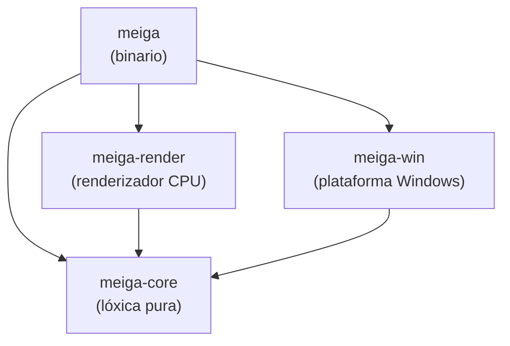

| Crate | Tipo | Responsabilidade | Que pode usar |
|---|---|---|---|
| `meiga-core` | biblioteca | Toda a lóxica que non depende de Windows: modelo de xanelas, tabs e grupos; fachada do terminal; codificación do teclado e do rato; busca difusa; configuración. | Só bibliotecas portábeis. **`unsafe` prohibido** e sen APIs de Windows. |
| `meiga-render` | biblioteca | Renderizado por CPU: caché de glifos con DirectWrite, composición no *framebuffer* e presentación dos rectángulos que cambiaron. | `meiga-core` e as APIs gráficas de Windows. |
| `meiga-win` | biblioteca | Capa de plataforma: ConPTY, detección das shells, sistema de arquivos, portapapeis, xanela Win32 e DPI. | `meiga-core` e as APIs de Windows. |
| `meiga` | binario | Une as pezas: crea a xanela, o bucle de mensaxes e o fluxo de fotogramas. | Os tres anteriores. |

### Por que esta separación

- **Probas rápidas e fiábeis.** `meiga-core` non toca o sistema operativo, así que as súas probas son unitarias puras: non abren xanelas nin procesos e executan en milisegundos.
- **`unsafe` illado.** Chamar ás APIs de Windows desde Rust require bloques `unsafe`, nos que o compilador non pode garantir a seguridade da memoria e confía no programador. Concentralos en `meiga-win` e `meiga-render` fai que o resto do código teña todas as garantías de Rust e que os puntos delicados sexan fáciles de revisar. En `meiga-core`, o compilador prohíbeo con `#![forbid(unsafe_code)]`.
- **Compilación incremental máis rápida.** Un cambio nun crate só recompila ese crate e os que dependen del.
- **Preparado para o futuro.** Un renderizador con GPU (mellora futura F2) sería outra implementación dentro de `meiga-render`, sen tocar a lóxica de `meiga-core`.

A regra de dependencias é estrita: as frechas do diagrama só van cara abaixo, e `meiga-core` nunca depende dos outros tres. Esta regra xa está declarada nos `Cargo.toml` de cada crate, así que Cargo non deixaría compilar un ciclo. A elección de Rust explícase no [ADR 0001](adr/0001-rust.md).

## 3. Fluxo de datos

Así viaxa a saída dun programa ata a pantalla:

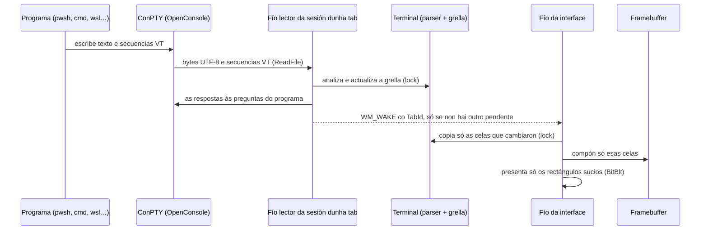

- **ConPTY** é a API de Windows que fai de "pseudoterminal": a shell cre que escribe nunha consola normal, e ConPTY tradúceo a un fluxo de texto con secuencias de escape VT, que é o que le meiga. meiga distribúe a súa propia copia de ConPTY ([ADR 0004](adr/0004-conpty-empaquetado.md)).
- **Secuencias VT** (ou ANSI): códigos que van mesturados co texto e indican cores, movementos do cursor, borrados… Por exemplo, `ESC[31m` cambia a cor do texto a vermello.
- **Parser e grella**: o *parser* interpreta as secuencias VT e a grella é a matriz de celas (carácter, cor, estilo) que representa a pantalla do terminal. Os dous veñen de `alacritty_terminal` ([ADR 0003](adr/0003-nucleo-vt-alacritty-terminal.md)), e un escáner propio detecta antes as secuencias da integración coa shell ([ADR 0007](adr/0007-integracion-coa-shell.md)).

| Peza | Subfase |
|---|---|
| Xanela e bucle de mensaxes | 1.1 (feita) |
| *Framebuffer* e presentación parcial | 1.2 (feita) |
| Fontes e caché de glifos | 1.3 (feita) |
| ConPTY | 1.4 (feita) |
| Fachada do terminal (parser e grella) | 1.5 (feita) |
| Da saída á pantalla | 1.6 (feita) |
| Teclado | 1.7 (feita) |
| Rato, selección e portapapeis | 1.8 (feita) |
| Historial, tamaño e zoom | 1.9 (feita) |
| Modelo das tabs | 2.1 (feita) |
| Varias sesións, unha por tab | 2.2 (feita) |
| Barra de tabs | 2.3 (feita) |
| Menús | 2.4 (feita) |
| Perfís e configuración | 2.5 (feita) |
| Atallos de teclado | 2.6 (feita) |
| Fin do programa e reinicio | 2.7 (feita) |
| Moitas tabs e indicadores | 2.8 (feita) |
| Barra de título | 2.9 (feita) |

### Sesións: a shell, o ConPTY e os dous fíos

Desde a subfase 1.4, `meiga-win` lanza un programa nunha pseudoconsola e fala con el ([Tecnoloxías › ConPTY](tecnoloxias.md#31-conpty-a-pseudoconsola-de-windows)); desde a 1.6, `meiga.exe` abre unha sesión ao arrancar, co programa da súa liña de comandos ou, sen el, PowerShell ([Código › meiga › `session.rs`](codigo/meiga.md#cratesmeigasrcsessionrs)); desde a 2.2, unha por tab ([As tabs](#as-tabs-unha-sesión-por-tab-e-as-tabs-en-segundo-plano)); desde a 2.5, cada unha co seu perfil, no seu cartafol e co contorno dun terminal ([Os perfís e a configuración](#os-perfís-e-a-configuración)); e desde o mantemento M3, o fío escritor de cada sesión crea a pseudoconsola e o programa, e a xanela xa non agarda por Windows ([ADR 0028](adr/0028-as-sesions-fora-do-fio-da-xanela.md)).

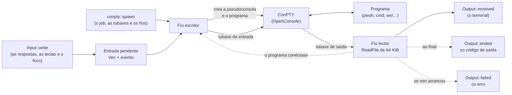

1. `conpty::spawn` comproba o que vai correr, crea os eventos, o *job* e as dúas tubaxes, e arranca os dous fíos da sesión, o escritor e o lector. Volta no momento cun `Pty` ([Código › meiga-win](codigo/meiga-win.md#cratesmeiga-winsrcconptyrs)). Ata a 2.10, `Conpty::spawn` creaba tamén a pseudoconsola e o programa, no fío que o chamaba, o da xanela.
2. Desde o mantemento M3, o escritor crea a pseudoconsola, coa última grella que recibiu a sesión, e lanza o programa nela e dentro do *job*; e dálles aos dous fíos o número do programa no seu nome. A primeira vez, carga o ConPTY. Desde a 2.5, o programa empeza no cartafol que lle dan, e co contorno que lle dan, coma un bloque. Se non pode crealos, apunta por que, e o lector dío ao final, no canto do fin ([ADR 0028](adr/0028-as-sesions-fora-do-fio-da-xanela.md)).
3. `Input::write` deixa os bytes na entrada pendente e esperta o escritor, que os escribe na tubaxe de entrada, tamén os que chegan mentres crea o programa. Nunca espera. O tamaño, igual: a pseudoconsola recíbeo en canto existe. `Input` pódese clonar e usar desde calquera fío: o `Pty` dá unha copia (`Pty::input`), coa que a vista do terminal envía as teclas desde a 1.7, e os informes do rato e o texto pegado desde a 1.8, e o lector recibe outra con cada bloque, para responder ao programa.
4. O lector le a saída en bloques de ata 64 KiB e pásaos a un `Output`: en `meiga.exe`, o lector da sesión, que llos dá ao terminal da súa tab. Desde a 2.2, a súa prioridade pódese cambiar mentres corre (`Pty::set_reader_priority`). Desde o mantemento M3, busca tamén, nos primeiros bytes, o `ESC [ ? 9001 h` que escribe o ConPTY cando se lle conecta o programa, e avisa o escritor.
5. O escritor espera á vez a entrada e o fin do programa. Cando o programa remata, ou cando se destrúe o `Pty`, pecha a pseudoconsola: o ConPTY remata, a tubaxe de saída péchase, e o lector avisa do fin co código de saída do programa. Desde o mantemento M3, se a sesión se pechou antes de que o lector vise a conexión do programa, o escritor agarda a que se conecte, como moito 1 s, e entón remata os programas do *job* e pecha a pseudoconsola sen eles: o ConPTY perde un peche que chega mentres se lle conecta o primeiro programa, tamén xusto despois de escribir esa secuencia, e a sesión bloquearíase; e o programa, normalmente, aínda non executou nada seu, pero, como o ConPTY lle responde sen agardar polo lector, se o lector se atrasa pode ter empezado, e remata igual ([ADR 0028](adr/0028-as-sesions-fora-do-fio-da-xanela.md)). Desde o mantemento M2, co ConPTY de Windows, péchaa nun fío propio, curto, que ninguén agarda: antes de Windows 11 24H2, ese peche agarda a que remate o ConPTY, e nunha sesión bloqueada o escritor quedaría nel para sempre. Mentres tanto, o escritor agarda a que remate a sesión, e vixía á vez os programas que tiña ao pechala, para saber cando remata cada un. Se pasan 10 s desde o último que rematou sen que remate outro, a sesión está bloqueada, e o escritor remata todos os do *job*: o programa e os que arrancou ([ADR 0011](adr/0011-fin-e-peche-das-sesions.md) e [ADR 0026](adr/0026-o-peche-das-sesions-ao-sair.md)).
6. Destruír un `Pty` non agarda: se o escritor aínda está a crear a pseudoconsola, o programa xa non arranca, e se o está a lanzar, arranca, e o escritor remátao en canto o lector o ve conectarse; e o `JoinHandle` do escritor pasa a unha lista, e `conpty::wait_for_closed_sessions` agarda por todos os da lista. Desde o mantemento M2, `meiga.exe` chámaa antes de saír, xa sen xanela: se saíse antes, os escritores rematarían con el, e unha sesión bloqueada quedaría así para sempre, co seu ConPTY e os seus programas ([ADR 0026](adr/0026-o-peche-das-sesions-ao-sair.md)). Agarda tamén polas que se estaban a crear.
7. meiga usa o ConPTY que leva ao lado de `meiga.exe` (`conpty.dll` e `OpenConsole.exe`) ou, se non está, o de Windows ([ADR 0004](adr/0004-conpty-empaquetado.md)).

### O terminal: da saída ao que se mostra

Desde a subfase 1.5, o terminal de `meiga-core` le a saída dun programa e garda o que hai que mostrar e o que hai que responder, en tipos de meiga ([ADR 0012](adr/0012-fachada-do-terminal.md)). Desde a 1.6, dálle a saída o fío lector da sesión; as probas danlle saída gravada do ConPTY, e un exemplo de consola mide a que velocidade a le.

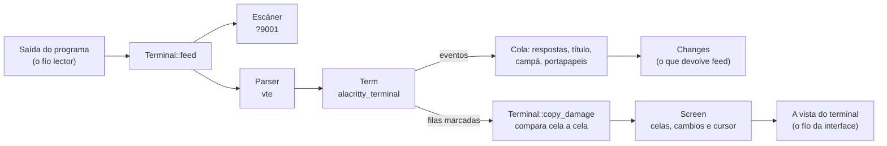

1. `Terminal::feed` dálle os bytes ao escáner, que segue os modos que `alacritty_terminal` ignora, e despois, os mesmos bytes, ao parser de `vte`, que actualiza o `Term` de `alacritty_terminal`: a grella, o historial, o cursor e os modos ([Tecnoloxías › `alacritty_terminal` e `vte`](tecnoloxias.md#34-alacritty_terminal-e-vte-o-núcleo-do-terminal)).
2. O que non é a grella chega como eventos a unha cola. `feed` devolve que pasou (`Changes`): hai respostas para o programa, que se recollen con `take_responses` e se lle envían con `Input`; cambiou o título; soou a campá; ou o programa copiou texto ao portapapeis ([Tecnoloxías › As secuencias de control](tecnoloxias.md#35-as-secuencias-de-control)). Desde a 1.6, o terminal responde tamén ás preguntas polas cores e polo tamaño en píxeles, coa súa paleta e o tamaño da cela, no mesmo lugar ca as outras respostas.
3. `Terminal::copy_damage` copia a un `Screen` as filas que marcou `alacritty_terminal`. Compara cada cela coa que había, e só as distintas quedan como cambiadas, xunto coas do cursor se se moveu. Tamén copia a paleta: se o programa a cambiou, todas as celas quedan como cambiadas ([Tecnoloxías › A paleta](tecnoloxias.md#37-a-paleta-e-os-estilos-das-celas)). A vista do terminal debuxa só as cambiadas.
4. Se o programa empeza unha actualización sincronizada, a saída espera ata que a remate ou ata que pase a súa hora límite, que o terminal di (`sync_deadline`): o temporizador dos fotogramas está programado para esa hora, e o fotograma remátaa (`end_sync`). Coa xanela minimizada, sen fotogramas, a interface remátaa igual a esa hora.
5. O exemplo `conpty` de `meiga-win` grava a saída dun programa (`--record`), e o exemplo `replay` de `meiga-core` dálla a un terminal, tan rápido como pode, e mide a velocidade ([Código › meiga-core](codigo/meiga-core.md#cratesmeiga-coreexamplesreplayrs)).

O terminal pasa dun fío a outro: o fío lector dálle a saída e o da interface copia o que cambiou, cada un collendo o mesmo `Mutex` ([ADR 0005](adr/0005-fios-e-fotogramas.md)).

### Da saída á pantalla: o aviso, a copia e o fotograma

Desde a subfase 1.6, as pezas anteriores xúntanse ([ADR 0013](adr/0013-da-saida-a-pantalla.md)):

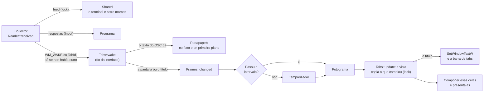

1. O fío lector dálle cada bloque ao terminal, baixo o *lock*, e envía as respostas fóra del. Se a pantalla, o título ou o portapapeis cambiaron e a súa marca non estaba posta, póna e envía `WM_WAKE` á xanela con `PostMessageW` ([Tecnoloxías › Avisar á xanela](tecnoloxias.md#36-avisar-á-xanela-desde-outro-fío-postmessage)). Faino tamén cando o programa deixa aberta unha actualización sincronizada, se a xanela aínda non sabe cando remata. Nunca hai máis dun aviso pendente de cada tipo e de cada tab; desde a 2.2, o aviso leva o identificador da súa tab.
2. A interface atende o aviso da tab que se ve: se o programa copiou texto (OSC 52), pono no portapapeis, só se a xanela ten o foco e está en primeiro plano ([O rato, a selección e o portapapeis](#o-rato-a-selección-e-o-portapapeis)); e se cambiou a pantalla ou o título, pide un fotograma, que o *pacer* fai no momento ou ao final do intervalo. Ata a 2.2, a interface collía o título co aviso, e poñíao na xanela. O aviso dunha tab oculta serve para as súas actualizacións sincronizadas ([As tabs](#as-tabs-unha-sesión-por-tab-e-as-tabs-en-segundo-plano)) e, desde a 2.3, para o seu título ([A barra de tabs](#a-barra-de-tabs)).
3. O fotograma empeza poñendo ao día a vista do terminal ([Código › meiga › `view.rs`](codigo/meiga.md#cratesmeigasrcviewrs)): baixo o *lock*, copia o que cambiou e quita a marca da pantalla. As zonas que cambiaron son as celas cambiadas de cada fila; se cambiou a paleta, a xanela enteira, marxes incluídas. Desde a 1.8, a copia marca as celas seleccionadas, e copia tamén as filas onde cambiou a selección. Desde a 2.3, o fotograma colle tamén os títulos novos e quita as súas marcas: o da tab que se ve vai á xanela ([Tecnoloxías › O título](tecnoloxias.md#39-o-foco-e-o-título-da-xanela)) e á barra de tabs, e os das ocultas, á barra. Mentres un título agarda polo fotograma, a súa marca segue posta, e os títulos novos non espertan a interface: un programa que cambia o título sen parar espértaa como moito unha vez por intervalo ([ADR 0020](adr/0020-a-barra-de-tabs.md)). E, se a interface remata unha actualización sincronizada que o programa deixou aberta, o texto que copiou dentro dela vai entón ao portapapeis, coas mesmas condicións ca no punto 2: nada máis a espertaría por el.
4. Despois compón esas zonas: o fondo, coa cor da selección nas celas seleccionadas, os glifos de cada tramo de celas co mesmo estilo, coa fonte normal, negra, cursiva ou negra cursiva, as liñas do subliñado e do riscado, e o cursor. E preséntaas.
5. A vista di tamén cando necesita outro fotograma aínda que non chegue saída: ao final dunha actualización sincronizada ou no seguinte cambio do pestanexo do cursor. O temporizador dos fotogramas vence entón. O cursor só pestanexa se a xanela ten o foco e Windows o permite, e para despois duns segundos sen actividade ([Tecnoloxías › O cursor](tecnoloxias.md#38-o-cursor-de-windows-pestanexo-tempo-e-grosor)): en repouso, non hai ningún temporizador.
6. Coa xanela minimizada, a interface non copia nada: a marca da pantalla segue posta e a saída non a esperta máis. Só remata á súa hora as actualizacións sincronizadas que o programa deixa abertas, sen copiar nin debuxar nada (`update_hidden`), e o temporizador dos fotogramas queda só para iso: mentres unha está aberta, o terminal garda tamén as preguntas do programa, que esperaría a resposta ata que se restaurase a xanela. Ao restaurala, compón todo coa pantalla ao día. Desde a 2.2, cada tab oculta compórtase igual, pola súa conta; e desde a 2.3, o título da tab que se ve segue chegando á xanela, que o mostra na barra de tarefas, como moito unha vez por intervalo.
7. Cando o programa remata, o lector apunta como rematou e esperta a xanela. Desde a 2.7, un fin limpo, co código 0, pecha a tab; con calquera outro, o terminal mostra unha liña co código de saída e o que se pode facer, e o lector desactiva o rato do programa e o *bracketed paste*, para que o rato volte seleccionar, e oculta o cursor ([O fin do programa e o reinicio](#o-fin-do-programa-e-o-reinicio)). Ata a 2.6, a xanela quedaba sempre aberta ata que se pechaba.

A grella enche a xanela, desde a 2.3 debaixo da barra de tabs, menos a franxa da barra de desprazamento, e o que sobra, menos dunha cela, pinta a cor do fondo. Desde a 1.9, cambia coa xanela ([O historial, o tamaño e o zoom](#o-historial-o-tamaño-e-o-zoom)).

### O teclado: da tecla ao programa

Desde a subfase 1.7, as teclas chegan ao programa da sesión coma eventos de tecla enteiros, os mesmos que le un programa da consola de Windows ([ADR 0014](adr/0014-o-teclado.md)):

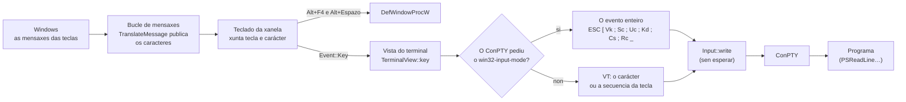

1. Windows envíalle á xanela unha mensaxe cando unha tecla baixa e outra cando sobe, e o bucle de mensaxes chama a `TranslateMessage`, que publica na cola o carácter da tecla, se escribe algún ([Tecnoloxías › O teclado en Windows](tecnoloxias.md#41-o-teclado-en-windows)).
2. O teclado da xanela xunta cada tecla co seu carácter nun evento: a tecla espera polo seu carácter, que é a seguinte mensaxe ([Código › meiga-win › `keyboard.rs`](codigo/meiga-win.md#cratesmeiga-winsrckeyboardrs)). Unha tecla morta baixa sen carácter, e o composto vai coa seguinte. Alt+F4 e Alt+Espazo van a Windows, que pecha a xanela e lle pide o seu menú, que desde a 2.9 abre meiga debaixo da barra ([As tabs na barra de título](#as-tabs-na-barra-de-título)); o resto, tamén Alt só, F10 e as teclas que soben, ao programa. As teclas de Windows e as que colle un IME non van a ningures.
3. A vista do terminal convérteo no que le o programa ([Código › meiga-core › `input.rs`](codigo/meiga-core.md#cratesmeiga-coresrcinputrs)): o evento enteiro en **win32-input-mode**, que o ConPTY pide ao arrancar, ou, antes diso ou se o desactiva, o que envía un terminal VT ([Tecnoloxías › As teclas no terminal](tecnoloxias.md#42-as-teclas-no-terminal-win32-input-mode-e-vt)). O ConPTY convérteo de novo nun evento para o programa: así o PSReadLine distingue Maiús+Intro de Intro, e chegan AltGr e as teclas mortas.
4. `Input::write` deixa os bytes na entrada da sesión e esperta o fío escritor, sen esperar: a xanela nunca queda bloqueada porque o programa non le ([Sesións](#sesións-a-shell-o-conpty-e-os-dous-fíos)). A tecla non pide ningún fotograma: o que escriba o programa en resposta chega coma calquera saída ([Da saída á pantalla](#da-saída-á-pantalla-o-aviso-a-copia-e-o-fotograma)).
5. Cando a xanela gaña ou perde o foco, o programa recibe `ESC [ I` ou `ESC [ O`, se o pediu.
6. O texto dun IME, do panel de emoji e do ditado de Windows chega coma caracteres sen tecla, e vai ao programa igual ([Tecnoloxías › O IME](tecnoloxias.md#43-o-ime-e-o-panel-de-emoji)).

Desde a 1.8, a vista colle antes algunhas teclas para a selección e o portapapeis: Ctrl+C e Ctrl+Maiús+C, se hai selección; Ctrl+V e Ctrl+Maiús+V; e Esc, se hai selección ([O rato, a selección e o portapapeis](#o-rato-a-selección-e-o-portapapeis)). Desde a 1.9, colle tamén as do historial, na pantalla principal, e as do zoom ([O historial, o tamaño e o zoom](#o-historial-o-tamaño-e-o-zoom)). O resto vai ao programa, e as que baixan quitan a selección e levan a vista á pantalla, salvo as modificadoras. Desde a 2.6, todas as teclas que colle meiga, tamén as das tabs e dos menús, son atallos, que o `config.toml` pode cambiar ou liberar ([Os atallos de teclado](#os-atallos-de-teclado)).

### O rato, a selección e o portapapeis

Desde a subfase 1.8, o rato selecciona texto, que vai ao portapapeis, ou chega ao programa, se o pediu ([ADR 0015](adr/0015-o-rato-a-seleccion-e-o-portapapeis.md)):

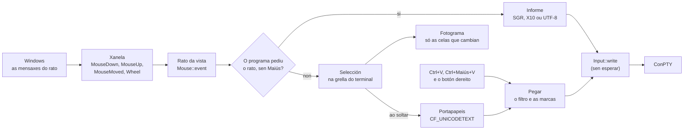

1. A xanela converte as mensaxes do rato en eventos, cos botóns e as teclas modificadoras, tamén Alt, e co punto da roda na área cliente ([Tecnoloxías › O rato en Windows](tecnoloxias.md#44-o-rato-en-windows)). Cando baixa o botón que selecciona, ou un que vai ao programa, a vista captura o rato, e sóltao cando sobe o último: así segue unha selección que se arrastra fóra da xanela. Se outra xanela colle o rato antes, a selección remata onde estaba, e o programa recibe entón a soltura dos botóns que premeu para el. Desde a 2.3, os eventos por riba do bordo de abaixo da barra de tabs son dela, e só os de debaixo chegan á vista, cos puntos subidos o alto da barra ([A barra de tabs](#a-barra-de-tabs)).
2. O rato da vista ([Código › meiga › `mouse.rs`](codigo/meiga.md#cratesmeigasrcmousers)) mira os modos do terminal. Se o programa pediu o rato e Maiús non está premido, o clic vai a el coma un informe, no formato que pediu ([Código › meiga-core › `mouse.rs`](codigo/meiga-core.md#cratesmeiga-coresrcmousers)), e o ConPTY pásallo tal cal ou convérteo nun evento do rato da consola ([Tecnoloxías › O rato nos programas](tecnoloxias.md#45-o-rato-nos-programas-modos-e-formatos)). A roda tamén; ou, na pantalla alternativa, a un programa sen o rato, frechas; e, desde a 1.9, na principal, despraza o historial.
3. Se non, o botón esquerdo selecciona: un clic, celas; dous, palabras; tres, liñas. A selección vive na grella de `alacritty_terminal`, que a move co texto ([Código › meiga-core › `term/selection.rs`](codigo/meiga-core.md#cratesmeiga-coresrctermselectionrs)). Cada movemento pide un fotograma, e a copia da vista marca as celas seleccionadas, que se debuxan co fondo da selección: só se debuxan as celas onde cambiou ([Da saída á pantalla](#da-saída-á-pantalla-o-aviso-a-copia-e-o-fotograma)).
4. Ao soltar o botón, o texto vai ao portapapeis de Windows ([Código › meiga-win › `clipboard.rs`](codigo/meiga-win.md#cratesmeiga-winsrcclipboardrs), [Tecnoloxías › O portapapeis](tecnoloxias.md#46-o-portapapeis-de-windows)). Ctrl+C e Ctrl+Maiús+C tamén o copian, e quitan a selección; sen ela, Ctrl+C vai ao programa.
5. Ctrl+V, Ctrl+Maiús+V e o botón dereito pegan: o texto do portapapeis pasa polo filtro e, se o programa pediu o *bracketed paste*, vai entre as súas marcas; se non o pediu e o texto ten varias liñas, meiga pregunta antes, nunha caixa de mensaxe ([Código › meiga › `clipboard.rs`](codigo/meiga.md#cratesmeigasrcclipboardrs), [Tecnoloxías › Pegar no terminal](tecnoloxias.md#47-pegar-no-terminal-o-filtro-e-o-bracketed-paste)). O texto vai á entrada da sesión, coma as teclas. Mentres a caixa está aberta, os eventos da xanela pérdense: ao pechala, a vista esquece as teclas que colleu e os botóns do rato, coma no punto 1, e, desde a subfase 1.9, colle a escala e o tamaño que ten entón a xanela ([O historial, o tamaño e o zoom](#o-historial-o-tamaño-e-o-zoom)).
6. Cando un programa copia texto (OSC 52), o fío lector esperta a xanela, que o pon no portapapeis só se ten o foco e está en primeiro plano ([Tecnoloxías › O foco](tecnoloxias.md#39-o-foco-e-o-título-da-xanela)).

O rato non engade ningún fío nin temporizador: en repouso, a xanela segue sen espertar.

### O historial, o tamaño e o zoom

Desde a subfase 1.9, a grella segue o tamaño e a escala da xanela sen deixar lixo, o historial vese coa roda, coas teclas e cunha barra de desprazamento, e o texto ten zoom ([ADR 0016](adr/0016-o-historial-o-tamano-e-o-zoom.md)):

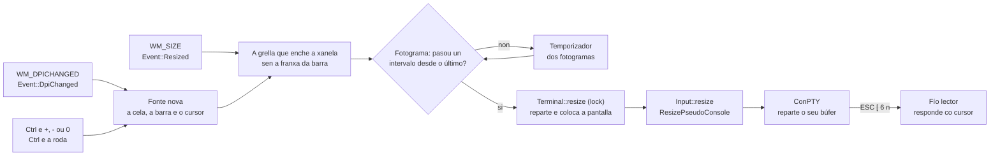

1. Cando a xanela cambia de tamaño, a vista calcula a grella que a enche, desde a 2.3 debaixo da barra de tabs: tantas columnas e filas enteiras como caben, sen a franxa da barra de desprazamento, polo menos 2 × 1 ([Código › meiga › `view.rs`](codigo/meiga.md#cratesmeigasrcviewrs)). Coa xanela minimizada, a grella non cambia.
2. A vista dálle a grella nova ao terminal e ao programa no seguinte fotograma, como moito unha vez por intervalo: mentres se arrastra o bordo da xanela, cada fotograma leva o último tamaño, e o temporizador dos fotogramas leva o último de todos ([Fotogramas](#fotogramas-do-cambio-á-pantalla)).
3. Baixo o *lock* do terminal, `Terminal::resize` reparte o texto e coloca a pantalla onde a pon o ConPTY ([Código › meiga-core › `term/resize.rs`](codigo/meiga-core.md#cratesmeiga-coresrctermresizers)), e despois `Input::resize` cambia o tamaño da pseudoconsola, sen esperar ([Código › meiga-win](codigo/meiga-win.md#cratesmeiga-winsrcconptyrs)): ningunha saída do programa chega entre os dous. O ConPTY reparte o seu búfer, avisa ao programa e, cando este pide a posición do cursor, pregúntalla ao terminal; o fío lector respóndelle coa que deixou `Terminal::resize` ([Tecnoloxías › Cambiar o tamaño do ConPTY](tecnoloxias.md#48-cambiar-o-tamaño-do-conpty-o-seu-reflow-e-a-pregunta-polo-cursor)).
4. Mentres se ve a pantalla alternativa, o terminal garda a principal á parte, sen repartila, e cando o programa volta a ela, dálle o tamaño do terminal, coma o ConPTY ([Tecnoloxías › O historial](tecnoloxias.md#49-o-historial-de-alacritty_terminal-a-vista-e-o-reflow)).
5. A vista do historial móvese coa roda, coas teclas e coa barra (`Terminal::scroll`). A saída non a move, tampouco cando o programa despraza unha rexión que non empeza na primeira fila ([Código › meiga-core › Manter a vista](codigo/meiga-core.md#manter-a-vista-view_to_keep-e-keep_view)); as teclas que van ao programa, e pegar, levana á pantalla. O fotograma copia as filas que se ven, e debuxa só as celas que cambian ([Da saída á pantalla](#da-saída-á-pantalla-o-aviso-a-copia-e-o-fotograma)).
6. A barra de desprazamento é do rato da vista ([Código › meiga › `scrollbar.rs`](codigo/meiga.md#cratesmeigasrcscrollbarrs)): o fotograma pon o seu polgar ao día coa vista, e só o debuxa cando cambia ([Tecnoloxías › A barra de desprazamento](tecnoloxias.md#52-a-barra-de-desprazamento-e-o-zoom)). Mentres un clic na franxa pasa páxinas, ou mentres unha selección arrastrada por riba ou por debaixo da grella despraza a vista, o fotograma di cando ten que seguir, co temporizador dos fotogramas.
7. O zoom cambia o tamaño da fonte, de 6 a 72 puntos, e `WM_DPICHANGED`, a escala: a xanela dálle o DPI novo á vista antes ca o seu tamaño novo ([Tecnoloxías › A escala cambia](tecnoloxias.md#50-a-escala-cambia-wm_dpichanged)). Nos dous casos, a vista crea a fonte nova e calcula a grella coas súas celas, e o fotograma debuxa a xanela enteira. Cun cambio de escala, ese fotograma non chega ata o tamaño novo, para que a grella non cambie dúas veces.
8. Mentres está aberta a caixa de mensaxe que pregunta antes de pegar, os eventos da xanela non chegan á vista; ao pecharse, a vista colle a escala e o tamaño que ten entón a xanela, por se cambiaron ([Código › meiga › `respond`](codigo/meiga.md#respond-o-que-pide-a-vista)).

Nada disto engade fíos nin temporizadores: os fotogramas fan todo o traballo, e en repouso a xanela segue sen espertar.

### Fotogramas: do cambio á pantalla

Desde a subfase 1.2, o final do camiño funciona igual para calquera contido; desde a 1.6, o que cambia é a saída do programa:

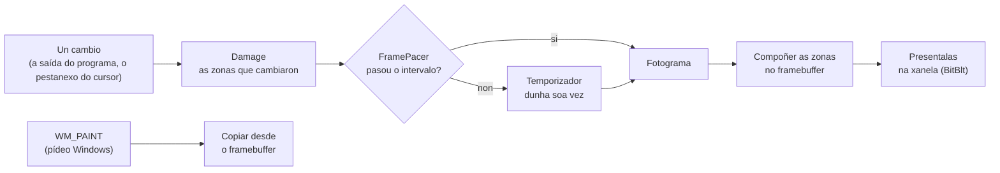

1. Cada cambio anota a súa zona no ***damage*** ([Código › meiga-core](codigo/meiga-core.md#cratesmeiga-coresrcdamagers)), que xunta as zonas próximas.
2. O ***pacer*** decide cando se debuxa ([Código › meiga-core](codigo/meiga-core.md#cratesmeiga-coresrcpacingrs)): se pasou o intervalo desde o último fotograma, 33,3 ms por Escritorio remoto e 16,7 ms en local, no momento; se non, cun temporizador dunha soa vez ao final do intervalo. Os cambios que chegan mentres tanto van no mesmo fotograma ([ADR 0005](adr/0005-fios-e-fotogramas.md), [ADR 0008](adr/0008-temporizador-dos-fotogramas.md), [ADR 0017](adr/0017-os-fotogramas-por-escritorio-remoto.md)). Desde a 2.3, tamén conta un fotograma que, ao poñer ao día a escena, non atopa nada que debuxar: así, a saída que non cambia nada na pantalla, coma o mesmo título ou o mesmo texto no mesmo sitio unha e outra vez, esperta a interface como moito unha vez por intervalo, e non con cada bloque ([ADR 0020](adr/0020-a-barra-de-tabs.md)).
3. O fotograma **compón** só esas zonas no *framebuffer*, unha *DIB section* ([Código › meiga-render](codigo/meiga-render.md)), e **preséntaas**: copia cada unha á xanela con `BitBlt` ([Tecnoloxías › DIB sections](tecnoloxias.md#24-dib-sections-e-gdi-o-framebuffer-e-a-súa-presentación)).
4. Cando Windows pide pintar (`WM_PAINT`), por exemplo cando a xanela medra ou se restaura, cópiase do *framebuffer*, sen compoñer nada ([Tecnoloxías › Pintar nunha xanela](tecnoloxias.md#25-pintar-nunha-xanela-wm_paint-e-dwm)).
5. Coa xanela minimizada, non se debuxa nada: os cambios esperan e, ao restaurala, píntase enteira unha vez ([ADR 0009](adr/0009-xanela-que-non-se-ve.md)).

O código que une as pezas explícase en [Código › meiga](codigo/meiga.md#cratesmeigasrcframesrs).

### Texto: da cela aos píxeles

Desde a subfase 1.3, meiga debuxa texto, e desde a 1.6, o da grella do terminal ([ADR 0010](adr/0010-texto-con-directwrite.md)):

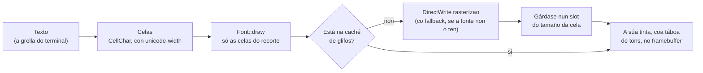

1. O texto divídese en celas ([Código › meiga-core](codigo/meiga-core.md#cratesmeiga-coresrctextrs)): cada carácter ocupa unha, ou dúas se é ancho, segundo `unicode-width`, o mesmo crate que usará o núcleo do terminal ([Tecnoloxías › O ancho dos caracteres](tecnoloxias.md#29-o-ancho-dos-caracteres-unicode-width)).
2. `Font::draw` debuxa unha fila de celas coas súas cores: primeiro o fondo e despois a tinta dos glifos, só das celas que caen dentro do recorte do lenzo, que son as das zonas que cambiaron ([Código › meiga-render](codigo/meiga-render.md#cratesmeiga-rendersrctextrs)).
3. Cada glifo búscase na caché. A primeira vez, DirectWrite rasterízao con antialiasing en grises e gárdase nun *slot* do tamaño dunha cela. Se a fonte non ten o carácter, o *fallback* do sistema escolle outra que o teña ([Tecnoloxías › DirectWrite](tecnoloxias.md#27-directwrite-fontes-e-glifos)).
4. A tinta do glifo, os píxeles con cobertura, convértese en cor cunha táboa cos 256 tons entre o fondo e o texto ([Tecnoloxías › Mesturar o texto co fondo](tecnoloxias.md#30-mesturar-o-texto-co-fondo-gamma-e-contraste)).

O tamaño da cela sae das métricas da fonte e do DPI da xanela: meiga usa Cascadia Mono a 12 puntos ou, se non está, Consolas. Desde a 1.9, o zoom cambia o seu tamaño, de 6 a 72 puntos, e un cambio de escala crea a fonte de novo ([O historial, o tamaño e o zoom](#o-historial-o-tamaño-e-o-zoom)). A negra, a cursiva e a negra cursiva son outras fontes da mesma familia, que se crean a primeira vez que se usan, coa cela e a liña base da normal, e comparten a súa caché de glifos ([Tecnoloxías › DirectWrite](tecnoloxias.md#27-directwrite-fontes-e-glifos)).

### As tabs: o modelo

Desde a subfase 2.1, `meiga-core` ten o modelo das xanelas e as súas tabs: que tabs ten cada xanela, en que orde, cal está activa, e que pasa ao abrir, pechar, mover ou activar unha ([ADR 0018](adr/0018-o-modelo-das-tabs.md)). É lóxica pura, sen interface. Desde a 2.2, `meiga.exe` úsao: o contido de cada tab é o seu terminal e a súa sesión ([seguinte sección](#as-tabs-unha-sesión-por-tab-e-as-tabs-en-segundo-plano)).

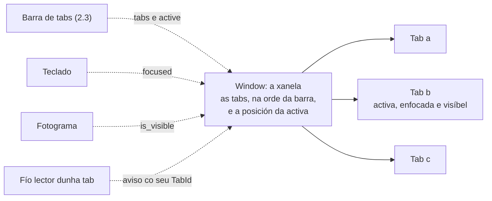

- **Cada tab leva o seu contido:** o modelo é xenérico, `Window<T>`, e o programa escolle que gardar en cada tab ([Tecnoloxías › Xenéricos e contadores atómicos](tecnoloxias.md#53-xenéricos-e-contadores-atómicos)). Así, a orde das tabs vive nun só sitio.
- **Identificadores que nunca se repiten:** cada tab ten un `TabId`, e cada xanela un `WindowId`, que saen de contadores atómicos. Desde a 2.2, o aviso do fío lector dunha tab leva o seu identificador: aínda que as tabs se movan ou se pechen, nunca chega a outra. Para iso, a sesión faise sabendo xa o identificador da súa tab (`try_open_with`).
- **Sempre unha tab activa:** a xanela nunca queda sen tabs, e pechar a única pide pechar a xanela. Ao pechar a activa, actívase a da dereita ou, se era a última, a da esquerda, coma en Chrome; e as tabs novas ábrense ao final.
- **A activa, a enfocada e as visíbeis:** a barra marca a activa, desde a 2.3, o teclado irá á enfocada, e o fotograma debuxará as visíbeis. Hoxe son a mesma tab, pero o programa preguntará cada unha polo seu nome: coa vista dividida (F1), esas preguntas seguirán valendo. O modelo gardará o *layout* e o foco, e o programa debuxará cada tab visíbel no seu rectángulo, dará a cada ConPTY o seu tamaño e levará o rato á tab que estea debaixo.

O código explícase en [Código › meiga-core › `model`](codigo/meiga-core.md#cratesmeiga-coresrcmodelmodrs).

### As tabs: unha sesión por tab e as tabs en segundo plano

Desde a subfase 2.2, cada tab ten a súa sesión, e a xanela mostra unha delas ([ADR 0019](adr/0019-varias-sesions-e-tabs-en-segundo-plano.md)):

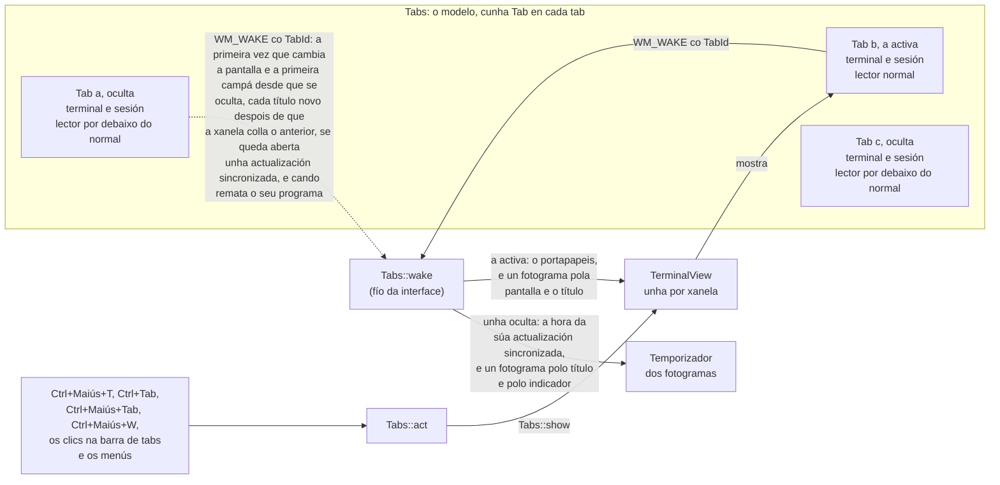

1. **Unha sesión por tab, e unha vista por xanela.** `Tabs` garda o modelo da 2.1, cunha `Tab` en cada tab: o terminal, que comparte co fío lector da súa sesión, e a sesión, que se pecha coa tab. A vista do terminal, coa copia da pantalla, o cursor, o rato, a barra e a fonte, é unha soa, e mostra a tab activa ([Código › meiga › `tabs.rs`](codigo/meiga.md#cratesmeigasrctabsrs)).
2. **O aviso leva a tab.** O fío lector de cada sesión esperta a xanela co número do `TabId` da súa tab no `wParam` de `WM_WAKE` ([Tecnoloxías › Avisar á xanela](tecnoloxias.md#36-avisar-á-xanela-desde-outro-fío-postmessage)). Se é a activa, a interface fai o mesmo ca cunha soa tab ([Da saída á pantalla](#da-saída-á-pantalla-o-aviso-a-copia-e-o-fotograma)); se é unha oculta, mira a súa actualización sincronizada, desde a 2.3 se cambiou o seu título, que colle o seguinte fotograma para a barra, desde a 2.7 se rematou o seu programa ([O fin do programa e o reinicio](#o-fin-do-programa-e-o-reinicio)), e desde a 2.8 se o seu programa escribiu algo ou tocou a campá, que a súa tab di na barra ([Moitas tabs e os indicadores](#moitas-tabs-e-os-indicadores)); e se xa non é de ningunha tab, porque a súa se pechou, ignórao.
3. **As tabs ocultas case non espertan a interface.** Mentres unha tab está oculta, a interface non copia a súa pantalla nin colle o seu portapapeis: as súas marcas seguen postas, e a saída do seu programa non a volta espertar por elas. Desde a 2.8, ao ocultar a tab, a interface esquece as marcas da súa pantalla e da súa campá: a primeira saída e a primeira campá despois diso espertan a interface unha vez cada unha, e a barra di na tab que o programa escribiu ou tocou a campá; as seguintes, non. Só traballa o seu fío lector, coa prioridade por debaixo do normal ([Tecnoloxías › A prioridade dos fíos](tecnoloxias.md#54-a-prioridade-dos-fíos-setthreadpriority)). Se o programa deixa aberta unha actualización sincronizada, a interface remátaa á súa hora, coma coa xanela minimizada, para que o programa reciba as respostas ás súas preguntas; mentres ten o *lock* do seu terminal para iso, o lector ten a prioridade normal, para que a interface nunca espere por un fío de menos prioridade ca ela. Unha actualización que se abre e se pecha no mesmo bloque da saída non avisa. O título, desde a 2.3, si: o seguinte fotograma cólleo para a barra, e un programa que o cambia sen parar esperta a interface como moito unha vez por intervalo ([A barra de tabs](#a-barra-de-tabs)). Ata a 2.2, tamén a súa marca quedaba posta.
4. **Cambiar de tab.** Os atallos e, desde a 2.3, os clics na barra de tabs chegan a `Tabs::act`, que abre, mostra ou pecha unha tab co modelo. Para mostrar outra, `Tabs::show` sobe primeiro o seu lector á prioridade normal, e despois a vista colle o seu terminal: o rato remata o que facía coa tab vella, o foco pasa á nova, a vista remata a actualización sincronizada que o seu programa deixase aberta, a xanela colle o seu título, descarta o que copiou ao portapapeis mentres estaba oculta, tamén dentro daquela actualización ([ADR 0020](adr/0020-a-barra-de-tabs.md), decisión 10), e dille ao seu terminal o tamaño da cela de agora. A vista esquece a pantalla que tiña (`Screen::forget`), e o seguinte fotograma copia enteira a da nova, coa grella que enche a xanela se o tamaño cambiou mentres estaba oculta, e debuxa a xanela enteira. Despois, o lector da tab vella baixa a prioridade. Desde a 2.8, a tab nova perde os seus indicadores de actividade e de campá, e a barra lévaa á vista, se as tabs non caben.
5. **Pechar.** Ctrl+Maiús+W pecha a tab que se ve; desde a 2.3, o × e o botón do medio, a súa tab; e desde a 2.4, o menú dunha tab pecha ela, as outras ou as da súa dereita ([Os menús](#os-menús)). A sesión péchase sen esperar ([ADR 0011](adr/0011-fin-e-peche-das-sesions.md)). Se se pecha a que se ve, a xanela mostra a tab da dereita ou, se era a última, a da esquerda; se a pechan *Close other tabs* ou *Close tabs to the right*, a tab do menú. Pechar a única tab pecha a xanela. Desde a 2.7, péchaa tamén o fin limpo do seu programa, e Ctrl+D, se o seu programa xa rematou ([O fin do programa e o reinicio](#o-fin-do-programa-e-o-reinicio)). Desde a 2.8, se o × ou o botón do medio pecha unha tab, as outras quedan no seu sitio mentres o punteiro segue na barra ([Moitas tabs e os indicadores](#moitas-tabs-e-os-indicadores)).
6. **A caixa de mensaxe.** Mentres está aberta, pérdense os avisos de todas as tabs, coma os outros eventos da xanela: ao pecharse, a interface atende o que cada tab tiña pendente.

Ata a 2.6, os atallos eran fixos, os do Windows Terminal; desde a 2.6, hai máis, e o `config.toml` pode cambialos ou liberalos ([Os atallos de teclado](#os-atallos-de-teclado)). Ctrl+T e Ctrl+W seguen chegando ao programa. Desde a 2.5, as tabs novas abren o perfil por defecto ou o que se escolla no menú dos perfís, e só a primeira corre o programa da liña de comandos de meiga, se a leva ([Os perfís e a configuración](#os-perfís-e-a-configuración)); na 2.2, abrían o shell por defecto.

### A barra de tabs

Desde a subfase 2.3, a xanela ten unha barra de tabs enriba do terminal, sempre visíbel, coas medidas do Windows Terminal ([ADR 0020](adr/0020-a-barra-de-tabs.md)); desde a 2.9, no sitio da barra de título de Windows, cos botóns da xanela á súa dereita ([As tabs na barra de título](#as-tabs-na-barra-de-título)):

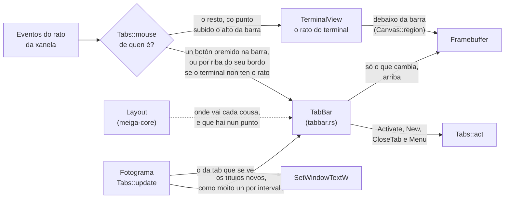

1. **O sitio de cada cousa.** `Layout`, en `meiga-core`, calcula onde van as tabs, os seus títulos, os seus × e o botón + e, desde a 2.5, o ▾, xunto a el, que abre o menú dos perfís, e que parte da barra hai baixo un punto, para un número de tabs, un ancho e un DPI ([Código › meiga-core › `ui/tabbar.rs`](codigo/meiga-core.md#cratesmeiga-coresrcuitabbarrs)). A escala 100 %, a barra ten 32 píxeles de alto, e as tabs, ata 240 de ancho, todas iguais, que se encollen por igual se non caben; o + vai despois da última. Desde a 2.8, encóllense como moito ata 100 píxeles e, se nin así caben, van nunha franxa que se despraza, entre dous botóns, e o + e o ▾ quedan á dereita da barra ([Moitas tabs e os indicadores](#moitas-tabs-e-os-indicadores)). Desde a 2.9, eses 32 píxeles son a fila das tabs: restaurada, a barra leva enriba dela unha banda do grosor do marco da xanela, 8 píxeles a escala 100 %, e á dereita da barra van os botóns da xanela, con sitio para arrastrala antes deles ([As tabs na barra de título](#as-tabs-na-barra-de-título)). É lóxica pura, e próbase con coordenadas exactas.
2. **O terminal, debaixo.** A vista recibe o tamaño da área cliente sen o alto da barra, e con el calcula a grella. Debuxa nun `Canvas` que empeza no bordo de abaixo da barra, coas súas propias coordenadas (`Canvas::region`, [Código › meiga-render › `canvas.rs`](codigo/meiga-render.md#cratesmeiga-rendersrccanvasrs)), e as zonas que cambian no terminal báixanse o alto da barra antes de presentalas.
3. **O rato.** `Tabs::mouse` decide de quen é cada evento: da barra, se ten un botón premido, ou se o punteiro está por riba do seu bordo de abaixo e o terminal non ten o rato; se non, do terminal, co punto subido o alto da barra. O terminal ten o rato mentres se arrastra unha selección ou o polgar da barra de desprazamento, ou mentres o programa ten un botón premido. Cando o punteiro entra na barra, o terminal recibe que o perdeu, e o punteiro pasa a ser a frecha. Mentres a barra ten un botón premido, a xanela captura o rato, tamén se un atallo mostra outra tab mentres tanto: o terminal só solta a captura que fixo el. Desde a 2.8, a roda sobre a barra despraza as tabs, se non caben.
4. **Os clics.** O botón esquerdo mostra unha tab ao premelo; o ×, o + e o ▾ actúan ao soltalo enriba do mesmo botón no que se premeu, e desde a 2.9 tamén os botóns da xanela; e o do medio pecha a tab ao soltalo enriba dela. Desde a 2.4, o dereito abre o menú da tab ao soltalo enriba dela ([Os menús](#os-menús)). A barra devolve a acción (`TabAction`), e `Tabs::act` faina coma un atallo: abre unha tab co perfil por defecto e móstraa, mostra unha, pecha unha coa súa sesión, e coa última, a xanela, ou abre o menú dunha tab ou o dos perfís; e desde a 2.9 minimiza, maximiza, restaura ou pecha a xanela.
5. **Os títulos.** Cada tab mostra o título do seu programa ou, sen el, o nome do seu perfil, ou o do programa da liña de comandos de meiga (desde a 2.5; antes, sempre o nome do programa), cortado con «…» se non cabe, en Cascadia Mono a 9 puntos, sen o zoom do terminal. Desde a 2.8, antes do título pode ir un indicador. O fotograma colle os títulos novos, como moito unha vez por intervalo: o da tab que se ve vai á xanela e á barra, e os das ocultas, á barra ([Da saída á pantalla](#da-saída-á-pantalla-o-aviso-a-copia-e-o-fotograma)). Coa xanela minimizada, o da tab que se ve segue indo á xanela, para a barra de tarefas, e os das ocultas agardan a que se restaure.
6. **O que se debuxa.** A barra apunta as zonas que cambian: a tab ou o botón que gaña ou perde o resalte, o rectángulo dun título novo, ou toda a barra se cambia o seu *layout*, ao abrir ou pechar unha tab, ou co tamaño ou a escala da xanela, e desde a 2.8 ao desprazar as tabs. Desde a 2.9, tamén os botóns da xanela: o que gaña ou perde o resalte e, cando a xanela perde ou colle o foco, os tres. O fotograma xúntaas coas do terminal. Cambiar de tab segue sendo un único fotograma completo, xa coa barra. A tab activa ten as cores do terminal, para verse unida a el ([Código › meiga › `tabbar.rs`](codigo/meiga.md#cratesmeigasrctabbarrs)).

A barra non engade ningún fío nin temporizador: en repouso, a xanela segue sen espertar. Desde a 2.8, os botóns que desprazan as tabs repiten co temporizador dos fotogramas, só mentres seguen premidos. O que fan Chrome e o Windows Terminal, do que saen estas regras, explícase en [Tecnoloxías › As barras de tabs](tecnoloxias.md#55-as-barras-de-tabs-chrome-e-o-windows-terminal).

### Os menús

Desde a subfase 2.4, a xanela ten menús, debuxados enriba da barra de tabs e do terminal, no mesmo *framebuffer*. O primeiro é o menú dunha tab ([ADR 0021](adr/0021-os-menus-e-o-menu-da-tab.md)):

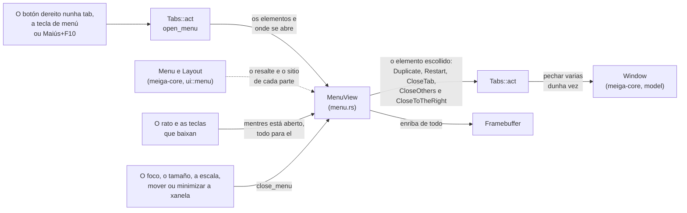

1. **Un compoñente para todos os menús.** `meiga-core` garda, sen Windows, o que é un menú: os seus elementos e as liñas que os separan, o elemento resaltado, que salta as liñas e os desactivados, o sitio de cada parte a calquera escala, coas medidas dos menús de WinUI, e onde se abre: no outro lado se non cabe, e sempre dentro da xanela, que corta un máis alto ca ela, e o que queda cortado non o resalta nin o escolle o punteiro ([Código › meiga-core › `ui/menu.rs`](codigo/meiga-core.md#cratesmeiga-coresrcuimenurs)). É lóxica pura, e próbase con coordenadas exactas. `MenuView`, no programa, debúxao e recibe o rato e as teclas ([Código › meiga › `menu.rs`](codigo/meiga.md#cratesmeigasrcmenurs)). Cada elemento leva a acción que lle dá quen abre o menú: no dunha tab, unha `TabAction`. Desde a 2.5, o menú dos perfís usa o mesmo compoñente, co elemento por defecto en negra ([Os perfís e a configuración](#os-perfís-e-a-configuración)), e o explorador (5.2) tamén o usará.
2. **Abrir.** O botón dereito abre o menú da tab onde se solta, se se premeu nela, coa esquina no punteiro e sen mostrar a tab; a tecla de menú e Maiús+F10, o da tab que se mostra, debaixo dela e co primeiro elemento resaltado; desde a 2.8, se a tab estaba fóra da franxa das tabs, antes desprázaa ata ela ([Moitas tabs e os indicadores](#moitas-tabs-e-os-indicadores)). `Tabs::open_menu` fai os elementos, cos desactivados: *Close other tabs* cunha soa tab, *Close tabs to the right* na última e, desde a 2.7, *Restart tab* mentres corre o programa da tab. E quítalles o rato á barra e ao terminal: a barra solta a súa captura, e desde a 2.8 deixa que as tabs que quedaran no seu sitio ao pechar outras co rato se recoloquen (`Tabs::leave_bar`), e o terminal esquece os seus botóns, coma cando outra xanela colle o rato: se o programa tiña un premido, recibe a súa soltura.
3. **Mentres está aberto**, recibe todo o rato e as teclas que baixan. O punteiro e as frechas moven o resalte. Un botón que baixa fóra do menú pécháo, e nin a barra nin o terminal o reciben; desde a 2.9, tamén nas partes libres da barra de título, que mentres tanto son área cliente e non moven a xanela, e nos botóns da xanela ([As tabs na barra de título](#as-tabs-na-barra-de-título)). O esquerdo ou o dereito escollen o elemento onde soben, se baixaron no menú, e mentres tanto a xanela captura o rato. As teclas que baixan non lle chegan ao programa, nin despois ao subir; as que xa baixaran para el, coma Maiús en Maiús+F10, sóbenlle, e as súas repeticións non fan nada.
4. **Escoller.** O elemento devolve a súa acción, e `Tabs::act` faina coma a dun atallo ou dun clic na barra. *Duplicate tab* abre unha tab co mesmo programa, xusto á dereita da orixinal, e móstraa; desde a 2.7, *Restart tab* lanza outra vez o programa da tab, se rematou ([O fin do programa e o reinicio](#o-fin-do-programa-e-o-reinicio)). *Close tab* pecha a tab do menú, e *Close other tabs* e *Close tabs to the right*, varias dunha vez: o modelo quítaas nun paso e di que tab queda activa ([Código › meiga-core › `model/window.rs`](codigo/meiga-core.md#cratesmeiga-coresrcmodelwindowrs)), e as súas sesións péchanse sen esperar. Se se mostra outra tab, un único fotograma completo; se non, só a barra.
5. **Pecharse.** O menú péchase ao escoller un elemento, con Esc ou cun clic fóra, e tamén cando a xanela perde o foco, cambia de tamaño ou de escala, empeza a moverse ou se minimiza (`Tabs::close_menu`). Se tiña o rato capturado, sóltao.
6. **O que se debuxa.** Abrir o menú debuxa só o menú; mover o resalte, os dous elementos; e pechalo, o que tapaba, desde o estado de agora da barra e do terminal. Mentres está aberto, o que cambia na barra ou no terminal debaixo del non se debuxa, se o menú o tapa enteiro; o que asoma polos seus lados debúxase, e o menú, despois, enriba.

O menú non engade ningún fío nin temporizador: aberto e sen cambios, a xanela non esperta. O que fan Windows, WinUI e Chrome cos seus menús, do que saen estas regras, explícase en [Tecnoloxías › Os menús](tecnoloxias.md#56-os-menús-windows-winui-e-chrome).

### Os perfís e a configuración

Desde a subfase 2.5, cada tab corre un perfil: unha shell que atopa meiga, ou unha que engade o arquivo de configuración, co seu nome, a súa liña de comandos e o cartafol onde empeza ([ADR 0022](adr/0022-os-perfis-e-a-configuracion.md)):

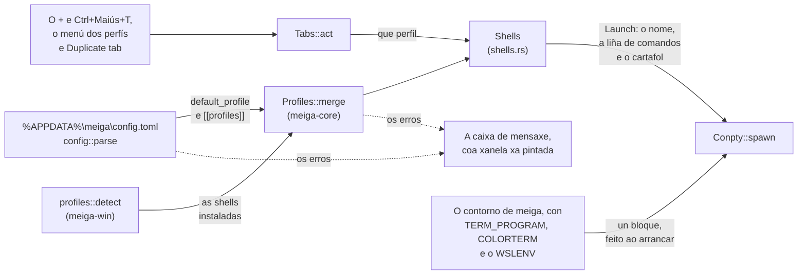

1. **O arquivo.** `%APPDATA%\meiga\config.toml` é opcional, e meiga leo unha vez, ao arrancar. `config::parse` le o TOML co parser do crate `toml`, sen serde, e colle a man o que coñece: `default_profile`, o nome do perfil por defecto, e as entradas `[[profiles]]`, con `name`, `command`, `directory` e `hidden` ([Código › meiga-core › `config.rs`](codigo/meiga-core.md#cratesmeiga-coresrcconfigrs)); e, desde a 2.6, a táboa `[shortcuts]` ([Os atallos de teclado](#os-atallos-de-teclado)). Un arquivo que non é TOML, que non é UTF-8 ou que pasa de 1 MiB ignórase enteiro; un valor mal, ou unha chave que meiga non coñece, só el. Cada erro leva a súa liña e a súa columna.
2. **As shells instaladas.** `profiles::detect` atópaas sen lanzar ningún proceso, coma o Windows Terminal: mira se están os programas nos cartafoles onde os deixan os seus instaladores, e le no rexistro as distribucións de WSL e o cartafol de Git for Windows ([Código › meiga-win › `profiles.rs`](codigo/meiga-win.md#cratesmeiga-winsrcprofilesrs)). Nesta orde: PowerShell, un só; Windows PowerShell; Command Prompt; as distribucións de WSL, a por defecto primeiro; e Git Bash.
3. **Os perfís.** `Profiles::merge` xunta as dúas cousas ([Código › meiga-core › `profile.rs`](codigo/meiga-core.md#cratesmeiga-coresrcprofilers)). Unha entrada do arquivo co nome dun perfil atopado cambia a súa liña de comandos ou o seu cartafol, ou ocúltao; unha cun nome novo e `command` engade un perfil despois dos atopados; e unha sen `command` e sen perfil do seu nome ignórase, para que o mesmo arquivo valla en equipos con outras shells. `command` e `directory` expanden as variábeis `%NOME%` co contorno de meiga. O perfil por defecto é o de `default_profile` ou, se non é un perfil visíbel, PowerShell, Windows PowerShell ou o primeiro.
4. **O que corre cada tab.** A primeira tab corre o programa da liña de comandos de meiga, se a leva, ou o perfil por defecto; o + e Ctrl+Maiús+T, o perfil por defecto; o menú dos perfís, o que se escolle; e, desde a 2.6, Ctrl+Maiús+1…9, o perfil N do menú ([Código › meiga › `shells.rs`](codigo/meiga.md#cratesmeigasrcshellsrs)). Un perfil dálle á sesión un `Launch`: o nome, que a tab mostra ata que o programa pon un título; a liña de comandos; e o cartafol, o persoal do usuario ou o do seu `directory`. Nos de WSL, o cartafol vai na liña de comandos, co `--cd` de `wsl.exe`, e `~` é o persoal de Linux. O programa da liña de comandos de meiga empeza no cartafol de meiga, e duplicar unha tab repite o seu `Launch`.
5. **O contorno.** Ao arrancar, meiga fai unha vez o bloque do contorno dos programas: o seu, con `TERM_PROGRAM=meiga`, `TERM_PROGRAM_VERSION` e `COLORTERM=truecolor`, eses tres nomes no `WSLENV`, para que WSL llos pase aos programas de Linux, e sen as variábeis do Windows Terminal, `WT_SESSION` e `WT_PROFILE_ID`, que herda se se abre desde el ([Código › meiga-core › `environment.rs`](codigo/meiga-core.md#cratesmeiga-coresrcenvironmentrs)). `Conpty::spawn` dállo a `CreateProcessW` xunto co cartafol.
6. **O menú dos perfís.** O botón ▾, á dereita do +, e Ctrl+Maiús+Espazo abren debaixo dos dous botóns o menú dos perfís, co mesmo compoñente ca o menú dunha tab ([Os menús](#os-menús)): un elemento por perfil, co por defecto en negra. Cada vez que se abre, meiga busca outra vez as shells, para mostrar as que se instalaron mentres tanto. As repeticións do Espazo de Ctrl+Maiús+Espazo non escollen nada: a vista lembra as teclas que colleu un atallo ata que soben.
7. **Os erros.** Os do arquivo e os dos perfís, coma un `default_profile` que non é un perfil visíbel, móstranse nunha caixa de mensaxe da xanela cando xa está na pantalla e pintada (`Event::Shown`): a ruta do arquivo, unha liña por erro, «Line N, column M: …», e o que fixo meiga. Mentres está aberta, a primeira tab xa corre; ao pecharse, a xanela pinta todo outra vez, coma despois da caixa que pregunta antes de pegar.

Os perfís non engaden ningún fío nin temporizador: atopar as shells só le uns poucos arquivos e claves do rexistro, ao arrancar e ao abrir o menú, e en repouso meiga non fai nada. O que fan o Windows Terminal, VS Code, WezTerm e os instaladores das shells, do que saen estas regras, explícase en [Tecnoloxías › Os perfís e a configuración](tecnoloxias.md#57-os-perfís-e-a-configuración-toml-o-contorno-e-as-shells-de-windows).

### Os atallos de teclado

Desde a subfase 2.6, todas as teclas que colle meiga son atallos: unha combinación de teclas e unha acción, que o `config.toml` pode cambiar ou liberar ([ADR 0023](adr/0023-os-atallos-de-teclado.md)):

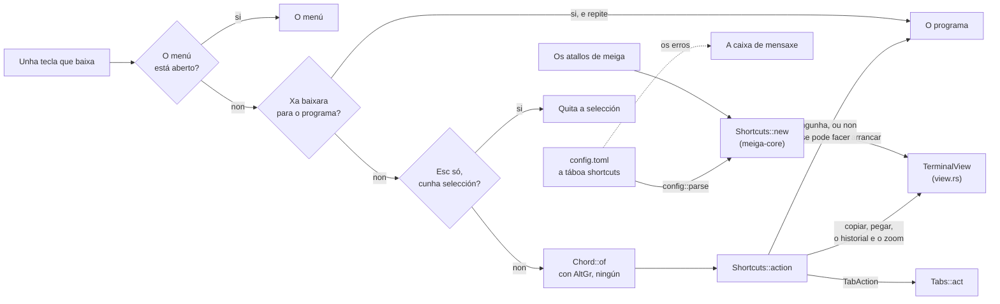

1. **Os atallos.** `meiga-core` garda, sen Windows, que é un atallo ([Código › meiga-core › `shortcut.rs`](codigo/meiga-core.md#cratesmeiga-coresrcshortcutrs)): unha combinación (`Chord`), coas modificadoras Ctrl, Alt e Maiús e a tecla virtual que baixa ([Tecnoloxías › O teclado en Windows](tecnoloxias.md#41-o-teclado-en-windows)), e unha acción (`Action`): as que xa facía meiga, e outras novas, mostrar a tab N ou a última, abrir o perfil N, e duplicar ou pechar tabs coma o menú da tab. `Shortcuts::new` fai a lista ao arrancar: os atallos de meiga, corenta e sete, e despois as entradas do arquivo, na súa orde. Cada unha quita da lista a súa combinación e, se non é `"none"`, engádea coa súa acción: así o arquivo engade, cambia ou libera calquera atallo, e os que non nomea quedan coma estaban.
2. **O arquivo.** A táboa `[shortcuts]` lese co resto do `config.toml`, ao arrancar ([Os perfís e a configuración](#os-perfís-e-a-configuración)). `config::parse` le cada combinación coa sintaxe do Windows Terminal, coma `ctrl+shift+t`, e cada acción polo seu nome ([Código › meiga-core › `config.rs`](codigo/meiga-core.md#cratesmeiga-coresrcconfigrs)). Unha entrada mal, ou a segunda coa mesma combinación, é un erro coa súa liña e a súa columna, na caixa dos outros erros, e só se ignora ela. `Shells::shortcuts` dálle a lista á vista ([Código › meiga › `shells.rs`](codigo/meiga.md#cratesmeigasrcshellsrs)).
3. **Unha tecla que baixa.** Co menú aberto, é para o menú ([Os menús](#os-menús)). Se non, `TerminalView::key` mira primeiro Esc só, sen Ctrl, Alt nin Maiús: cunha selección, quítaa, e non vai a ningures. Despois, `Chord::of` fai a combinación da tecla, e `Shortcuts::action` busca a súa acción na lista ([Código › meiga › `view.rs`](codigo/meiga.md#cratesmeigasrcviewrs)). AltGr, o Ctrl esquerdo e o Alt dereito sen os outros dous, escribe caracteres, e nunca é un atallo; calquera outra combinación de Ctrl e Alt é Ctrl+Alt. Os caracteres sen tecla dun IME tampouco son atallos.
4. **A acción.** A vista fai as súas: copiar, pegar, o historial e o zoom. As das tabs devólveas coma unha `TabAction`, e `Tabs::act` faias coma as da barra e as dos menús ([Código › meiga › `tabs.rs`](codigo/meiga.md#cratesmeigasrctabsrs)): abrir, pechar e duplicar a tab, pechar as outras ou as da súa dereita, mostrar a seguinte, a anterior, a N ou a última, abrir o perfil N, despois de buscar outra vez as shells, coma o menú dos perfís, e abrir os menús. Unha tab ou un perfil N que non existe non fai nada. Se a vista non pode facer a acción, coma copiar sen selección ou mover o historial na pantalla alternativa, que non ten historial, a tecla vai ao programa, coma antes da 2.6.
5. **Despois.** A tecla dun atallo queda collida ata que sobe: o programa non a recibe ao subir, nin mentres repite. Mentres repite, os atallos que mostran a tab seguinte ou a anterior, os do historial e os que fan o texto máis grande ou máis pequeno fan outra vez a súa acción; os outros, nada: unha tecla mantida non abre nin pecha varias tabs. Ao revés, unha tecla que baixou para o programa é súa ata que sobe, coma cos menús: as súas repeticións non buscan atallos, tamén cos modificadores que se premen mentres tanto, e o programa recibe a súa soltura. Unha tecla sen atallo vai ao programa, coma desde a 1.7 ([O teclado](#o-teclado-da-tecla-ao-programa)).

Os atallos non engaden ningún fío nin temporizador: buscar a acción dunha tecla é percorrer unha lista dunhas cincuenta entradas, só cando unha tecla baixa, e en repouso meiga non fai nada. Mostrar unha tab con Ctrl+1…9 fai o mesmo fotograma completo ca con Ctrl+Tab. O que fan o Windows Terminal, Chrome, o Warp e os programas coas súas teclas, do que saen estas regras, explícase en [Tecnoloxías › Os atallos de teclado](tecnoloxias.md#58-os-atallos-de-teclado-as-teclas-virtuais-altgr-e-os-doutros-programas).

### O fin do programa e o reinicio

Desde a subfase 2.7, cando remata o programa dunha tab, a tab péchase se rematou ben; se non, queda co que escribiu o programa e como rematou, e pódese pechar ou reiniciar ([ADR 0024](adr/0024-o-fin-do-programa-e-o-reinicio.md)):

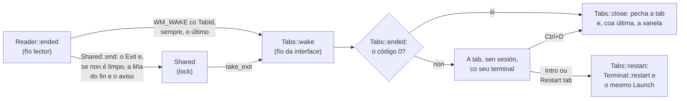

1. **O fin.** O fío lector avisa do fin despois do último byte da saída, co código de saída do programa ([Sesións](#sesións-a-shell-o-conpty-e-os-dous-fíos)) ou, se o programa segue vivo 11 s despois de que se peche a saída, sen el: iso só pasa se falla o ConPTY, porque a sesión remata cando remata o programa ([ADR 0011](adr/0011-fin-e-peche-das-sesions.md)). `Shared::end` apúntao, baixo o *lock*, nun `Exit` ([Código › meiga › `session.rs`](codigo/meiga.md#cratesmeigasrcsessionrs)). Só o código 0 é un fin limpo, coma no Windows Terminal. Se o fin non é limpo, dálle ao terminal, nunha fila súa, coas cores por defecto e despois de borrar desde ela ata o final da pantalla o que deixase o programa, `[process exited with code N (0x…)]` ou, sen código, `[process exited]`, e debaixo o que se pode facer: «You can now close this tab with Ctrl+D, or press Enter to restart.». E oculta o cursor, e desactiva o rato e o *bracketed paste* que deixase o programa, coma desde a 1.8. Un fin limpo non escribe nada: a tab vaise pechar.
2. **O aviso.** O último que fai o fío lector é espertar a xanela co seu `TabId`, sempre: tamén se xa había un aviso pendente pola pantalla, coma nunha tab oculta, que ata a 2.6 non espertaba a xanela polo fin ([As tabs](#as-tabs-unha-sesión-por-tab-e-as-tabs-en-segundo-plano)). `Tabs::wake` colle o fin (`take_exit`): o da tab que se ve, coa vista, e o dunha oculta, con `Tab::learn` ([Código › meiga › `tabs.rs`](codigo/meiga.md#cratesmeigasrctabsrs)). Unha tab oculta pode aprendelo antes, cando a xanela deixa de mostrala ou remata a súa actualización sincronizada, e gárdao ata que chega o seu aviso, que sempre chega despois: é o aviso o que pecha a tab ou esquece a súa sesión, tamén se a tab se mostra mentres tanto. Coa caixa de mensaxe aberta pérdense os avisos: ao pecharse, `catch_up_wakes` colle primeiro os fins de todas as tabs, e despois actúa sobre eles, porque pechar unha tab pode mostrar outra.
3. **Un fin limpo pecha a tab**, coma se a pechase quen a usa: `Tabs::ended` chama a `Tabs::close`, tamén se a tab está oculta, e tamén na primeira, co programa da liña de comandos de meiga. A última pecha a xanela, e meiga sae co código 0: `meiga cmd /c dir` abre e pecha. Se o menú da tab está aberto, péchase con ela: os seus elementos serían dunha tab que xa non está. O menú dos perfís e o doutra tab quedan abertos. Mentres hai un menú aberto, o teclado e o rato son del, así que só o fin dun programa pode pechar unha tab mentres tanto.
4. **Calquera outro fin deixa a tab.** A tab esquece a súa sesión, que se pecha sen esperar, coma cando se pecha a tab: os seus fíos xa remataron, ou rematan. O terminal queda, co que escribiu o programa e a liña do fin, e, se a tab é a que se ve, a vista sabe que xa non hai programa (`program_ended`). Un programa que non arranca deixa a tab igual: sen sesión, desde a 1.6, co erro e, desde a 2.7, co mesmo aviso debaixo.
5. **Sen programa**, as teclas que non son atallos non van a ningures ([Código › meiga › `view.rs`](codigo/meiga.md#cratesmeigasrcviewrs)). Intro, tamén con Maiús, reinicia o programa, e Ctrl+D pecha a tab, coma no Windows Terminal; con Alt ou AltGr, ningunha das dúas, nin Ctrl+Intro. Esc cunha selección quítaa, coma sempre, e as outras teclas non fan nada: nin quitan a selección nin levan a vista á pantalla. A vista colle as teclas que baixan mentres tanto ata que soben, coma as dun atallo: un programa que arranca mentres unha está abaixo non a recibe, nin mentres repite nin ao subir, e tampouco o Intro que o reinicia. Unha tecla que baixou para o programa antes de que rematase non fai nada mentres repite. Os atallos, o rato, a selección e copiar seguen coma sempre ([Os atallos de teclado](#os-atallos-de-teclado)).
6. ***Restart tab*.** O menú da tab ten *Restart tab* xusto despois de *Duplicate tab*, activo só mentres non corre ningún programa na tab ([Os menús](#os-menús)): o menú ten agora seis entradas. Coma os outros elementos, *Restart tab* nunha tab oculta non a mostra.
7. **O reinicio.** Intro e *Restart tab* chegan a `Tabs::restart`, que só reinicia unha tab sen sesión. `Tab::restart` deixa o seu terminal coma o espera un programa novo, con `Terminal::restart` ([Código › meiga-core › `term/mod.rs`](codigo/meiga-core.md#cratesmeiga-coresrctermmodrs)): remata a actualización sincronizada que deixase aberta o último programa, sen as súas respostas; volta á pantalla principal, cos modos, as cores, os xogos de caracteres, o cursor e o título coma nun terminal novo, e unha tabulación cada 8 columnas; e pasa ao historial o que se vía (`ESC [ 2 J`), cunha pantalla limpa e o cursor, tamén o gardado, arriba á esquerda, coma a do ConPTY, que empeza así. O historial queda, e a vista volta á pantalla. Despois, coa grella que enche a xanela agora, lanza o mesmo `Launch` ca antes, o perfil, a liña de comandos e o cartafol, coma *Duplicate tab*; a tab mostra o nome do seu perfil ata que o programa novo poña un título. Se a tab é a que se ve, a vista móstraa outra vez, cun fotograma completo; se está oculta, queda oculta, co seu lector coa prioridade baixa das ocultas.

O fin e o reinicio non engaden ningún fío nin temporizador: o fin chega co aviso que xa enviaba o fío lector, e unha tab sen programa non ten ningún fío, porque os da súa sesión xa remataron. Un programa que sae da súa consola (`FreeConsole`) e segue a correr non remata a súa sesión: a súa tab segue coma mentres estaba nela, ata que remata. O que fan o Windows Terminal, VS Code, WezTerm e Alacritty cando remata o programa, e o código de `exit` en cada shell, explícase en [Tecnoloxías › O fin do programa](tecnoloxias.md#59-o-fin-do-programa-o-código-de-saída-e-o-reinicio-noutros-terminais).

### Moitas tabs e os indicadores

Desde a subfase 2.8, a barra segue sendo manexábel con moitas tabs, e cada tab di antes do seu título se o seu programa rematou ou, mentres está oculta, se tocou a campá ou escribiu algo ([ADR 0025](adr/0025-moitas-tabs-e-os-indicadores.md)):

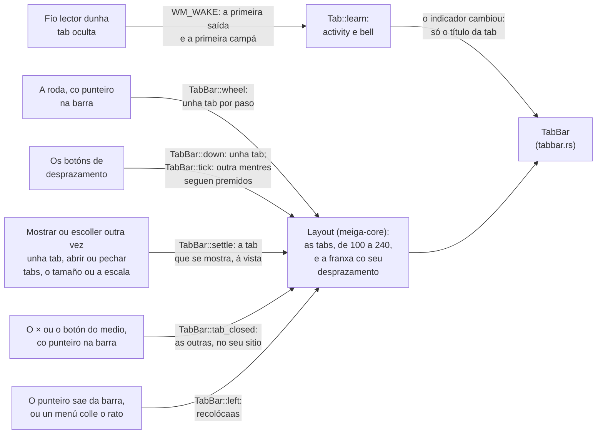

1. **O ancho mínimo.** `Layout` dálles ás tabs o ancho no que caben, todas iguais, entre 100 e 240 píxeles a escala 100 % ([Código › meiga-core › `ui/tabbar.rs`](codigo/meiga-core.md#cratesmeiga-coresrcuitabbarrs)). Con 100, cada tab ten o seu × e sitio para uns 8 ou 9 caracteres do título. Ata a 2.7, encollíanse sen mínimo.
2. **A franxa.** Se nin a 100 píxeles caben, as tabs van nunha franxa entre dous botóns de desprazamento, de 24 píxeles de ancho, que só aparecen entón; o + e o ▾ quedan á dereita da barra, sempre no mesmo sitio. A franxa mostra a parte da fila das tabs que di o seu desprazamento, en píxeles, e corta as dos seus lados; o punteiro só atopa nela as partes que se ven. Cada botón ten unha frecha que apunta ao seu lado e, mentres a franxa non se pode desprazar cara a el, é máis escuro, e o punteiro non o resalta.
3. **A roda.** Co punteiro na barra, e mentres as tabs non caben, cada paso da roda (`WHEEL_DELTA`, 120) despraza a franxa o ancho dunha tab: a vertical, adiante cara á primeira e atrás cara á última, e a horizontal, cara ao seu lado. As partes dun paso, coma as das rodas de alta precisión e as dos *touchpads*, desprazan os píxeles que lles tocan, e o que non chega a un píxel súmase ao seguinte. A roda non mostra ningunha tab, e mentres hai un botón premido na barra non fai nada ([Código › meiga › `tabbar.rs`](codigo/meiga.md#cratesmeigasrctabbarrs)).
4. **Os botóns de desprazamento.** O botón esquerdo nun deles despraza a franxa ata que a primeira tab que oculta por ese lado, aínda que sexa en parte, queda enteira á vista (`Layout::step`). Mentres segue premido, co punteiro enriba, despraza outra aos 250 ms e despois cada 100 ms, coma a franxa da barra de desprazamento do terminal ([O historial, o tamaño e o zoom](#o-historial-o-tamaño-e-o-zoom)): en cada fotograma, `TabBar::tick` di cando toca o seguinte paso, e a escena devólveo coma o momento do seguinte fotograma, así que o temporizador dos fotogramas só está activo mentres o botón segue premido ([Fotogramas](#fotogramas-do-cambio-á-pantalla)). Se o punteiro sae do botón, para, e segue cando volta; ao chegar ao final, ou ao soltar o botón, xa non pide máis.
5. **A tab que se mostra, á vista.** Cando se mostra outra tab, co rato, cun atallo ou porque pechou a que se mostraba, cando se abren ou se pechan tabs e cando cambia o tamaño ou a escala da xanela, a barra apúntao, e o seguinte fotograma (`TabBar::settle`) despraza a franxa o mínimo para que a tab que se mostra quede enteira nela (`Layout::reveal`). A roda e os botóns poden deixala fóra, e alí queda ata a seguinte vez, ou ata que se escolle outra vez: un atallo ou un clic na tab que xa se mostra apúntao, e despraza a franxa no momento (`Tabs::select`), sen agardar a un fotograma que ninguén pediría; se a tab xa se ve enteira, non se debuxa nada. O menú que abre o teclado vai debaixo da súa tab: `Tabs::open_menu` despraza antes a franxa ata ela, no momento ([Os menús](#os-menús)).
6. **Pechar co rato.** Se o × ou o botón do medio pecha unha tab co punteiro na barra, e non era a última, `TabBar::tab_closed` deixa as outras co seu ancho e a franxa co seu desprazamento (`Layout::keep_widths`): a tab da dereita ocupa o sitio da que pechou, co seu × debaixo do punteiro, e o que queda baleiro á dereita queda así. Mentres están así, tampouco as recolocan as tabs que pechan o teclado ou o fin limpo do seu programa. Cando o punteiro sae da barra ou da xanela, ou un menú colle o rato (`Tabs::leave_bar`), as tabs recolócanse no momento, sen temporizador; e tamén ao desprazar a franxa, ao cambiar o tamaño ou a escala da xanela, ao abrir tabs e ao pechar a última. Mentres están conxeladas, a tab que se mostra non se leva á vista: faise ao recolocalas.
7. **Os indicadores.** Antes do título, unha tab pode ter un indicador, só un, separado del por unha cela baleira: o primeiro que teña, nesta orde. **O fin**, unha × grosa no vermello brillante da paleta do terminal (`#E74856`), mentres o seu programa non corre porque rematou sen un fin limpo ou non arrancou, tamén na tab que se mostra; **a campá**, 🔔 en ámbar (`#E5C07B`), de dúas celas, se o seu programa a tocou mentres a tab estaba oculta; e **a actividade**, ●, coa cor do título, se escribiu algo mentres estaba oculta. A campá e a actividade quedan ata que se mostra a tab. Son símbolos quietos: a barra non ten animacións. A campá na tab que se mostra non fai nada: nin son, nin destello, nin a barra de tarefas.
8. **Como chegan.** Ao ocultar unha tab, a xanela esquece as marcas da súa pantalla e da súa campá (`Tab::hide`), así que o seu fío lector esperta a xanela coa primeira saída do programa despois diso, e coa primeira campá: o lector apunta a campá en `Shared` (`bell_rang`), coma a pantalla ([Código › meiga › `session.rs`](codigo/meiga.md#cratesmeigasrcsessionrs)). `Tab::learn` le as dúas marcas baixo o *lock* ([Código › meiga › `tabs.rs`](codigo/meiga.md#cratesmeigasrctabsrs)). As seguintes saídas e campás non espertan a xanela, porque as marcas quedan postas mentres a tab segue oculta, coma desde a 2.2. O fin xa espertaba a xanela desde a 2.7, e agora debuxa tamén o indicador ([O fin do programa e o reinicio](#o-fin-do-programa-e-o-reinicio)). Reiniciar o programa quita o indicador, e a primeira saída e a primeira campá do programa novo, se a tab está oculta, espertan a xanela outra vez.
9. **O que se debuxa.** Un indicador que aparece ou desaparece debuxa só o rectángulo do título da súa tab, o que cae dentro da franxa, e o dunha tab fóra da franxa, nada; desprazar a franxa, pechar unha tab ou recolocar as tabs, a barra enteira; e mostrar outra tab, a xanela enteira, coma desde a 2.2.

As moitas tabs e os indicadores non engaden ningún fío nin temporizador: os botóns de desprazamento repiten co temporizador dos fotogramas, só mentres seguen premidos, e unha tab oculta que escribe sen parar esperta a xanela unha soa vez desde que se oculta. O que fan o Windows Terminal, Chrome, Firefox e o Warp con moitas tabs, do que saen estas regras, explícase en [Tecnoloxías › Moitas tabs](tecnoloxias.md#60-moitas-tabs-noutros-terminais).

### As tabs na barra de título

Desde a subfase 2.9, a barra de tabs vai no sitio da barra de título de Windows, coma en Chrome e no Windows Terminal, cos botóns de minimizar, maximizar e pechar a xanela á súa dereita, debuxados por meiga co estilo dos de Windows 11 ([ADR 0027](adr/0027-a-barra-de-tabs-coma-barra-de-titulo.md)):

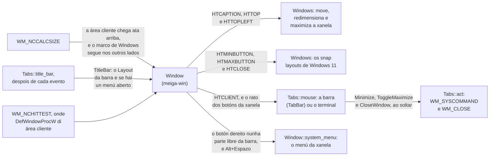

1. **O marco.** meiga crea a xanela co marco e a barra de título de Windows e, antes de mostrala, pásaa á súa (`own_title_bar`): pon unha marca nos bytes extra da xanela, e Windows calcula o marco outra vez (`SetWindowPos` con `SWP_FRAMECHANGED`). Con esa marca, `WM_NCCALCSIZE` garda o bordo de arriba da xanela, deixa que Windows calcule a área cliente co seu marco (`DefWindowProcW`) e volta poñer ese bordo: a área cliente chega ata arriba, onde ía a barra de título de Windows, e o marco de Windows segue nos outros tres lados, onde redimensiona a xanela coma sempre, case sen verse ([Código › meiga-win › `window.rs`](codigo/meiga-win.md#cratesmeiga-winsrcwindowrs)). Se Windows non deixa cambiar o marco, a xanela queda co seu, e a barra de tabs vai debaixo da barra de título de Windows, coma ata a 2.8, co sitio dos botóns da xanela baleiro; e os modos `--bench`, que non teñen barra de tabs, seguen co marco de Windows. A xanela segue tendo título, para a barra de tarefas e Alt+Tab, aínda que xa non se debuxa dentro dela.
2. **Que é cada parte para Windows.** Windows pregúntalle á xanela que hai baixo o punteiro (`WM_NCHITTEST`) cada vez que este se move, e fai el mesmo o que fai esa parte. meiga-win responde sen preguntarlle ao resto de meiga, que pode estar ocupado con outro evento: primeiro pregúntalle a Windows (`DefWindowProcW`), que di onde está o seu marco, e onde Windows di área cliente, responde co `TitleBar` que lle deu `Tabs::title_bar` despois do último evento, co `Layout` da barra e se hai un menú aberto ([Código › meiga-core › `ui/titlebar.rs`](codigo/meiga-core.md#cratesmeiga-coresrcuititlebarrs)). Os botóns da xanela son `HTMINBUTTON`, `HTMAXBUTTON` e `HTCLOSE`; a banda enriba das tabs, `HTTOP`, e os seus primeiros 19 píxeles desde o bordo esquerdo da xanela, `HTTOPLEFT`, coma co marco de Windows; as partes libres da barra, `HTCAPTION`; e o resto, as tabs, os seus botóns e o terminal, `HTCLIENT`.
3. **A banda.** Restaurada, a barra ten enriba das tabs unha banda do grosor do marco dos lados, `SM_CXPADDEDBORDER` máis `SM_CYSIZEFRAME`: 8 píxeles a escala 100 % e 11 ao 150 %. Redimensiona a xanela desde o seu bordo de arriba, coma o marco nos outros lados, e ten a cor da barra. Os botóns da xanela chegan ata o bordo de arriba, tamén por riba dela, e gañan á banda. Maximizada, non hai banda: a fila das tabs é a barra enteira, e a fila de arriba da pantalla é do que hai debaixo, unha tab, un botón ou unha parte libre da barra.
4. **Os botóns da xanela.** Coma os de Windows 11: de 46 píxeles de ancho a escala 100 %, do alto da barra enteira, e con glifos de 10 × 10 píxeles, co trazo do × e do + da barra e as esquinas cadradas: unha liña, un cadrado ou, maximizada, dous, o de atrás 2 píxeles máis arriba e á dereita, e unha ×. O punteiro resalta minimizar e maximizar coma os outros botóns da barra, e pechar, en vermello, `#C42B1C`, co glifo branco; premido, o vermello ao 90 % sobre a barra e o branco ao 70 %, coma no Windows Terminal. Para Windows son os botóns da xanela, así que, co punteiro parado no de maximizar, Windows 11 mostra os seus *snap layouts*; pero as mensaxes do rato sobre eles non van a Windows, senón á barra, que os debuxa e os fai actuar ao soltar o botón esquerdo enriba do mesmo, coma o × e o + ([Código › meiga › `tabbar.rs`](codigo/meiga.md#cratesmeigasrctabbarrs)). Entón `Tabs::act` pídelle a Windows que minimice, maximice ou restaure a xanela (`WM_SYSCOMMAND`) ou que a peche (`WM_CLOSE`), coma os seus botóns e Alt+F4.
5. **As partes libres.** Os ocos da barra e o sitio que queda antes dos botóns da xanela, fóra das tabs, do +, do ▾ e dos botóns de desprazamento, son a barra de título: arrastrar nelas move a xanela, levala a un bordo da pantalla colócaa alí, e un dobre clic maximízaa ou restáuraa, todo feito por Windows; mentres a move ou a redimensiona, os fotogramas seguen ([ADR 0008](adr/0008-temporizador-dos-fotogramas.md)). Despois do ▾ queda sempre un sitio de polo menos 45 píxeles a escala 100 % para arrastrala, tamén con moitas tabs: a franxa da 2.8 estréitase para deixalo. O botón dereito nunha parte libre abre o menú da xanela de Windows no punteiro (`Window::system_menu`), cos elementos activos segundo estea maximizada ou restaurada, e *Close* en negra. Alt+Espazo segue indo a Windows, que lle pide á xanela ese menú (`WM_SYSCOMMAND` con `SC_KEYMENU`), e meiga ábreo debaixo da barra, desde o lado esquerdo da xanela, sen nada resaltado (`Window::keyboard_menu`): Windows abriríao enriba da barra e no seu modo menú, no que a tecla seguinte a Esc non lle chegaría ao programa da tab. Sen a barra propia, ou coa xanela minimizada, ábreo Windows. Mentres está aberto un menú de meiga, as partes libres son área cliente: un clic nelas só pecha o menú, coma calquera clic fóra del ([Os menús](#os-menús)). A banda segue redimensionando a xanela, e empezar a facelo pecha o menú; e para Windows os botóns da xanela seguen sendo os seus botóns, cos *snap layouts*, pero un clic neles tamén só pecha o menú.
6. **Maximizada.** Windows deixa unha xanela maximizada fóra do monitor o grosor do seu marco por cada lado, para que o marco non se vexa. Coa barra de título de Windows, a área cliente empeza debaixo dela; coa de meiga, `WM_NCCALCSIZE` baixa tamén o bordo de arriba o grosor do marco, e así a área cliente é a área de traballo do monitor. Se a barra de tarefas se oculta soa nun bordo do monitor, a área de traballo chega a ese bordo, e a xanela taparía o sitio onde o punteiro a fai aparecer: meiga deixa libres 2 píxeles nese bordo, coma o Windows Terminal e Chrome. Para sabelo, pregúntalle á barra de tarefas (`SHAppBarMessage`, de `shell32.dll`, que meiga só carga a primeira vez que se maximiza a xanela) polo monitor da área cliente que vai ter a xanela: Windows pide a área cliente antes de mover a xanela, que aínda pode estar noutro monitor, ou minimizada, fóra de todos.
7. **O foco e o tamaño mínimo.** Sen o foco, só se apagan os glifos dos botóns da xanela, á metade de camiño entre o texto e o fondo da barra: perder ou coller o foco debuxa só os tres botóns e, coma antes, o cursor do terminal. A área cliente mide polo menos 395 píxeles de ancho a escala 100 %, o que ocupan os botóns da xanela, o sitio para arrastrala, o + e o ▾, os ocos e unha tab de 100 píxeles entre os dous botóns de desprazamento, e polo menos o alto da barra: `WM_GETMINMAXINFO` dille a Windows ese tamaño, co marco (`min_client`).
8. **O rato entre a barra e Windows.** Sobre os botóns da xanela, as partes libres e a banda, Windows envía as mensaxes do rato da área non cliente (`WM_NCMOUSEMOVE`…): meiga-win pásalle á barra os movementos, coma os da área cliente, e os botóns do rato, só sobre os botóns da xanela; e pide tamén o aviso de cando o punteiro sae desas partes (`TME_NONCLIENT`). O aviso de que saíu da área cliente cando só pasou a outra parte da barra non conta coma unha saída: para a barra, o punteiro segue nela, e as tabs que se pecharon co rato quedan co seu ancho ata que sae da barra ou da xanela, ou chega ao marco de Windows ([Moitas tabs e os indicadores](#moitas-tabs-e-os-indicadores)). Fóra da área cliente, o punteiro é o de Windows: na banda, a frecha dobre que redimensiona.

A barra de título non engade ningún fío nin temporizador, nin usa o DWM: a superficie da xanela segue opaca, e as esquinas son as que faga Windows. O fío da interface responde `WM_NCHITTEST`, que chega con cada movemento do punteiro, sen chamar ao resto de meiga, e en repouso a xanela segue sen espertar. O que fan Windows, o Windows Terminal, Chrome, Firefox e o Warp coa barra de título, do que saen estas regras, explícase en [Tecnoloxías › O marco da xanela e a barra de título](tecnoloxias.md#62-o-marco-da-xanela-e-a-barra-de-título).

## 4. Fíos

| Fío | Cantos | Que fai | Cando esperta |
|---|---|---|---|
| Interface | 1 | Mensaxes de Windows, entrada do usuario, composición e presentación. | Só cando chega unha mensaxe ou vence o temporizador dun fotograma pendente (`MsgWaitForMultipleObjectsEx`). |
| Lector | 1 por tab coa shell en marcha | Le a saída da shell, actualiza a grella e responde ás preguntas do programa. Mentres a súa tab está oculta, coa prioridade por debaixo do normal. | Só cando a shell escribe (`ReadFile`). |
| Escritor | 1 por tab coa shell en marcha | Desde o mantemento M3, crea a pseudoconsola e a shell. Envía á shell o que se teclea, e pecha a pseudoconsola cando a shell remata ou se pecha a tab; se a tab se pechou antes de que a shell se conectase, desde o M3, agarda a que se conecte e remata os seus programas; despois agarda a que remate a sesión, e remata os seus programas se se bloquea. | Só cando hai algo que enviar, cando se pecha a tab ou cando remata a shell; se a tab se pechou antes de que a shell se conectase, cando se conecta; e, mentres remata a sesión, cando remata un dos seus programas (`WaitForMultipleObjects`). |
| Peche | Só co ConPTY de Windows: 1 por cada sesión que se está a pechar | Pecha a pseudoconsola no canto do escritor, que así non agarda nese peche, e remata cando volta: desde Windows 11 24H2, nun intre; antes, cando remata o ConPTY. Ninguén agarda por el. | Nunca: queda no peche ata que volta. |

Un fío bloqueado nunha lectura ou nunha espera non consome CPU: o sistema operativo non o planifica ata que hai datos. Por iso o número de fíos non é un problema en si; o problema é que esperten sen motivo. O modelo completo, cos fotogramas e as tabs en segundo plano, está no [ADR 0005](adr/0005-fios-e-fotogramas.md), e o fin e o peche das sesións, nos [ADR 0011](adr/0011-fin-e-peche-das-sesions.md) e [ADR 0026](adr/0026-o-peche-das-sesions-ao-sair.md).

O fío da interface xa existe desde a subfase 1.1: é o fío principal do programa. Dorme en `MsgWaitForMultipleObjectsEx` mentres non chega ningunha mensaxe nin vence o temporizador dos fotogramas, que só está activo cando hai un fotograma pendente (ver [Tecnoloxías › Temporizadores](tecnoloxias.md#26-temporizadores-e-a-espera-do-fío-da-interface)). Na subfase 1.1 durmía en `GetMessageW`, que só espera mensaxes ([Tecnoloxías › Xanelas Win32](tecnoloxias.md#22-xanelas-win32-e-o-bucle-de-mensaxes)); o temporizador chegou coa 1.2 ([ADR 0008](adr/0008-temporizador-dos-fotogramas.md)). Ao arrancar, Windows crea ademais algúns fíos auxiliares no proceso, por exemplo para cargar as DLL en paralelo, que rematan sós ao pouco tempo se non teñen traballo.

O lector e o escritor existen desde a subfase 1.4, en cada sesión de ConPTY ([Sesións](#sesións-a-shell-o-conpty-e-os-dous-fíos)); desde o mantemento M3, é o escritor quen crea a pseudoconsola e o programa da sesión, e o fío da xanela xa non agarda por Windows ([ADR 0028](adr/0028-as-sesions-fora-do-fio-da-xanela.md)). Desde a 1.6, `meiga.exe` abre unha sesión ao arrancar e, desde a 2.2, unha por tab: un fío para a xanela e dous por tab, e todos dormen mentres os programas non escriben nada. O lector esperta a interface cunha mensaxe, só se non había outra pendente para a súa tab ([Da saída á pantalla](#da-saída-á-pantalla-o-aviso-a-copia-e-o-fotograma)), e o dunha tab oculta, case nunca: a primeira vez que cambia a súa pantalla e, desde a 2.8, a primeira vez que toca a campá desde que se oculta ([Moitas tabs e os indicadores](#moitas-tabs-e-os-indicadores)), polas súas actualizacións sincronizadas e, desde a 2.3, polo seu título, como moito unha vez por intervalo ([As tabs](#as-tabs-unha-sesión-por-tab-e-as-tabs-en-segundo-plano)); e, desde a 2.7, unha vez cando remata o seu programa ([O fin do programa e o reinicio](#o-fin-do-programa-e-o-reinicio)). Unha tab cuxo programa rematou xa non ten ningún fío. Desde o mantemento M2, ao pechar a xanela, o fío principal agarda polos escritores das sesións que se pecharon antes de saír, xa sen xanela; polos lectores, non ([Sesións](#sesións-a-shell-o-conpty-e-os-dous-fíos)). E, co ConPTY de Windows, cada sesión que se pecha ten un fío máis, curto, que pecha a súa pseudoconsola, e polo que tampouco agarda ninguén; co ConPTY empaquetado, que é o que usa meiga sempre que está no seu cartafol, ese fío non existe ([ADR 0026](adr/0026-o-peche-das-sesions-ao-sair.md), decisión 6).

## 5. Compilación

- O perfil `release` optimiza ao máximo: LTO completo, unha soa unidade de xeración de código e `panic = "abort"`.
- O *runtime* de C vai ligado estaticamente, así que `meiga.exe` non necesita que estea instalado o *Visual C++ Redistributable*.
- As versións *release* usan o subsistema gráfico de Windows (sen xanela de consola). As de depuración manteñen a consola para ver diagnósticos.
- O **manifesto da aplicación** vai dentro de `meiga.exe`: escala por monitor (v2), Windows 10 e 11 sen modos de compatibilidade, e sen pedir permisos de administrador. Incrústao o ligador, a petición do `build.rs` de `meiga` (ver [Tecnoloxías › Manifesto](tecnoloxias.md#23-manifesto-da-aplicación-e-dpi)).

Os detalles explícanse en [Tecnoloxías](tecnoloxias.md) e, liña a liña, en [Código › configuración do workspace](codigo/workspace.md).

## 6. Integración continua

Ningún cambio chega a `main` sen pasar por un PR e pola CI:

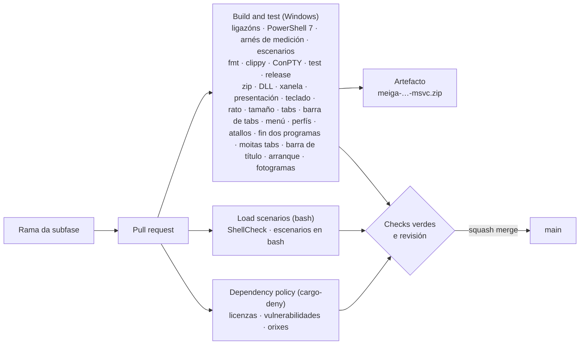

- As regras da rama `main` (*ruleset*) fan obrigatorio este camiño, tamén para os administradores.
- Dependabot propón cada semana as versións novas dos crates, das actions e de Rust, como PR que pasan polo mesmo proceso.
- Cada luns, a CI revisa de novo as dependencias contra a base de datos de vulnerabilidades, aínda que non cambiase nada, e comproba se hai unha versión estábel do ConPTY máis nova ca a fixada. Esta comprobación non é obrigatoria: unha versión nova non bloquea ningún PR.

Os detalles están en [Tecnoloxías › GitHub Actions](tecnoloxias.md#15-github-actions) e en [Código › .github](codigo/github.md).

## 7. Decisións de arquitectura (ADR)

| ADR | Decisión |
|---|---|
| [0001](adr/0001-rust.md) | Rust como linguaxe. |
| [0002](adr/0002-windows-e-renderizado-cpu.md) | Só Windows, con renderizado por CPU do que cambia. |
| [0003](adr/0003-nucleo-vt-alacritty-terminal.md) | `alacritty_terminal` como núcleo, detrás dunha fachada. |
| [0004](adr/0004-conpty-empaquetado.md) | ConPTY empaquetado con meiga. |
| [0005](adr/0005-fios-e-fotogramas.md) | Fíos bloqueados e como moito un fotograma por intervalo. |
| [0006](adr/0006-licenzas-e-dependencias.md) | Só licenzas permisivas e dependencias mínimas. |
| [0007](adr/0007-integracion-coa-shell.md) | Integración coa shell mediante secuencias OSC. |
| [0008](adr/0008-temporizador-dos-fotogramas.md) | Un temporizador de alta resolución para os fotogramas. |
| [0009](adr/0009-xanela-que-non-se-ve.md) | Non debuxar coa xanela minimizada; as tapadas debúxanse. |
| [0010](adr/0010-texto-con-directwrite.md) | Texto con DirectWrite, nunha caché de glifos do tamaño da cela. |
| [0011](adr/0011-fin-e-peche-das-sesions.md) | O escritor de cada sesión espera tamén polo programa e pecha a pseudoconsola; cada sesión ten un *job*, e unha sesión pechada remata sempre. |
| [0012](adr/0012-fachada-do-terminal.md) | A fachada do terminal: tipos propios, a copia do que cambia cela a cela, as respostas e o escáner de `?9001`. |
| [0013](adr/0013-da-saida-a-pantalla.md) | Da saída á pantalla: un aviso pendente como moito, as respostas desde o fío lector, a paleta, os estilos e un cursor que só pestanexa se Windows o permite e por pouco tempo. |
| [0014](adr/0014-o-teclado.md) | O teclado: eventos de tecla enteiros coma os da consola, nos que a tecla espera polo seu carácter; Alt+F4 e Alt+Espazo para Windows; o win32-input-mode e VT de reserva; e o IME, que se mantén. |
| [0015](adr/0015-o-rato-a-seleccion-e-o-portapapeis.md) | O rato, a selección e o portapapeis: a selección na grella, copiar ao seleccionar, as teclas e o botón dereito do Windows Terminal, o filtro ao pegar e a pregunta antes de pegar varias liñas, os informes do rato e OSC 52 só desde a xanela que se usa. |
| [0016](adr/0016-o-historial-o-tamano-e-o-zoom.md) | O historial, o tamaño e o zoom: 10 000 liñas, a grella que enche a xanela ao ritmo dos fotogramas, a pantalla onde a pon o ConPTY, a principal á parte mentres se ve a alternativa, as teclas e a barra fina do Windows Terminal, e o zoom de 6 a 72 puntos. |
| [0017](adr/0017-os-fotogramas-por-escritorio-remoto.md) | Os fotogramas por Escritorio remoto: 30 por segundo, aínda que a sesión permita 60, e 60 en local. |
| [0018](adr/0018-o-modelo-das-tabs.md) | O modelo das tabs: lóxica pura, co contido de cada tab dentro, identificadores que nunca se repiten e sempre unha tab activa; ao pechar a activa, a da dereita; as novas, ao final; e a activa, a enfocada e as visíbeis por separado. |
| [0019](adr/0019-varias-sesions-e-tabs-en-segundo-plano.md) | Varias sesións e as tabs en segundo plano: unha sesión por tab e unha vista por xanela, as tabs ocultas só avisan das transicións, un fotograma completo ao cambiar de tab, o tamaño ao mostrala, o zoom da xanela, os lectores das ocultas por debaixo do normal, catro atallos provisionais e os 2 MiB de `vte`, aceptados. |
| [0020](adr/0020-a-barra-de-tabs.md) | A barra de tabs: sempre visíbel enriba do terminal, coas medidas do Windows Terminal e as tabs que se encollen por igual; os títulos dos programas en directo, que a xanela colle no fotograma, como moito un por intervalo; o botón esquerdo mostra a tab ao premelo, o × e o + actúan ao soltalos, e o do medio pecha; e só se debuxa o que cambia. |
| [0021](adr/0021-os-menus-e-o-menu-da-tab.md) | Os menús e o menú da tab: un compoñente debuxado dentro da xanela, coas medidas dos menús de WinUI; o botón dereito, a tecla de menú e Maiús+F10 abren o menú dunha tab, que a duplica á súa dereita ou pecha ela, as outras ou as da súa dereita; un clic fóra só o pecha; e só se debuxa o que cambia. |
| [0022](adr/0022-os-perfis-e-a-configuracion.md) | Os perfís e a configuración: un `config.toml` opcional, lido ao arrancar sen serde, no que un erro non para nada e se mostra nunha caixa; as shells que atopa meiga sen lanzar procesos, que o arquivo cambia, oculta ou completa; o perfil por defecto, o + dividido e Ctrl+Maiús+Espazo; o contorno dun terminal, con `TERM_PROGRAM` e `COLORTERM`; e cada tab no seu cartafol, co nome do seu perfil. |
| [0023](adr/0023-os-atallos-de-teclado.md) | Os atallos de teclado: unha táboa `[shortcuts]` no `config.toml`, coa sintaxe do Windows Terminal e as teclas virtuais; todas as teclas que colle meiga son atallos, que se poden cambiar ou liberar; Ctrl+1…8 e Ctrl+9, e Ctrl+RePáx e Ctrl+AvPáx, coma en Chrome, e Ctrl+Maiús+1…9 e Ctrl+Maiús+D, coma no Windows Terminal; AltGr nunca dispara un atallo; e unha tab ou un perfil N que non existe non fai nada. |
| [0024](adr/0024-o-fin-do-programa-e-o-reinicio.md) | O fin do programa e o reinicio: só o código 0 é un fin limpo, que pecha a tab, e coa última a xanela; calquera outro deixa a tab, co código e o que se pode facer; Intro e *Restart tab* lanzan outra vez o mesmo perfil no mesmo terminal, co que escribiu o último programa no historial, e Ctrl+D pecha a tab; e o fin esperta sempre a xanela. |
| [0025](adr/0025-moitas-tabs-e-os-indicadores.md) | Moitas tabs e os indicadores: as tabs miden polo menos 100 píxeles e, se nin así caben, a barra desprázaas, coa roda e cuns botóns que repiten mentres seguen premidos; a tab que se mostra, sempre á vista; ao pechar co rato, as outras quedan no seu sitio ata que o punteiro sae da barra; e un indicador antes do título: o fin do programa, e, nunha tab oculta, a campá ou a actividade. |
| [0026](adr/0026-o-peche-das-sesions-ao-sair.md) | O peche das sesións ao saír: antes de saír, meiga agarda sen límite a que rematen as sesións que pechou; e o escritor de cada unha ve rematar cada un dos seus programas, e remátaos se pasan 10 s desde o último sen que remate outro. |
| [0027](adr/0027-a-barra-de-tabs-coma-barra-de-titulo.md) | A barra de tabs coma barra de título: meiga quita a barra de título de Windows e mantén o seu marco; restaurada, unha banda enriba das tabs redimensiona a xanela; os botóns de Windows 11, debuxados por meiga, actúan ao soltalos, e o de maximizar mostra os *snap layouts*; as partes libres moven a xanela; o menú da xanela ábreo meiga, co botón dereito nelas e, debaixo da barra, con Alt+Espazo; sen o DWM, e sen traballo en repouso. |

## 8. Medición do rendemento

O rendemento mídese desde fóra, sen tocar o código de meiga, co mesmo arnés para calquera terminal: `tools/perf/measure.ps1`. Cada certo tempo fai unha "fotografía" de todos os procesos e fíos do sistema e reparte o consumo en grupos:

```mermaid
flowchart TD
    subgraph T["Lanzado polo terminal"]
        term["terminal<br/>meiga.exe, warp.exe…"] --> con["console<br/>OpenConsole.exe, un por tab"]
        term --> sh["shells<br/>pwsh, wsl, cmd e os seus programas"]
    end
    subgraph P["Poñer a imaxe na pantalla"]
        dwm["dwm<br/>compón as xanelas"]
        rdp["termservice e wudfhost<br/>Escritorio remoto"]
    end
    sys["system: toda a máquina"]
```

- **Que conta como custo do terminal:** o propio terminal, os seus procesos de consola e o traballo que provoca en `dwm` e no Escritorio remoto ao debuxar. As shells son a carga de traballo, igual para todos os terminais.
- **Métricas:** CPU (en % dun núcleo e en ciclos), espertares por segundo, memoria privada e fíos. Explícanse en [Tecnoloxías › Medición do rendemento](tecnoloxias.md#19-medición-do-rendemento).
- **Onde:** en local, no equipo de desenvolvemento, e non na CI, porque as máquinas da CI son compartidas e darían cifras con moito ruído. Os resultados gárdanse en `.perf/`, fóra de Git. A CI só comproba que o arnés mide ben.
- **O arranque:** `tools/perf/measure-startup.ps1` mide o tempo desde que se crea o proceso de meiga ata que a súa xanela está pintada (ver [Tecnoloxías › Tempo ata o primeiro fotograma](tecnoloxias.md#tempo-ata-o-primeiro-fotograma)). Desde a 1.6, inclúe lanzar a sesión, que vai antes do primeiro fotograma.
- **Os fotogramas:** `tools/perf/measure-frames.ps1` mide canto custan a meiga, a `dwm` e ao Escritorio remoto os fotogramas parciais, os completos e os completos de texto, cos modos de medición de meiga (`--bench`).

O código explícase en [Código › medición](codigo/perf.md).

### Escenarios de carga

Para comparar terminais, todos teñen que facer o mesmo traballo. Os escenarios imitan o uso diario dun terminal, e cada un existe en PowerShell e en bash, para medir a mesma carga nunha tab de pwsh e nunha de Ubuntu (WSL):

| Escenario | Que imita |
|---|---|
| `idle` | O terminal aberto sen facer nada, por exemplo con 5 tabs. Non arranca ningún script. |
| `spinner` | O indicador de progreso dunha ferramenta que traballa: unha liña que se redebuxa 10 veces por segundo. |
| `ai-stream` | Unha IA que pensa e responde palabra a palabra, con cores, emoji e unha zona de estado que se redebuxa 10 veces por segundo. |
| `bigfile` | Imprimir un arquivo de 50 MiB tan rápido como o acepte o terminal. |

```mermaid
flowchart LR
    run["run-scenario.ps1<br/>noutro terminal"] -- "controller e stop" --> dir[(".perf/run/")]
    esc["escenario<br/>no terminal medido"] -- "started-…" --> dir
    run --> mea["measure.ps1<br/>varias medicións"]
    run --> res["resumo, veredicto<br/>e CSV en .perf/"]
```

- `run-scenario.ps1` corre **noutro terminal**, para que o seu traballo non se sume ao do terminal medido. Coordínase cos escenarios con arquivos baleiros nun cartafol que ven Windows e WSL, así que non fan falta portos nin procesos extra.
- Mide varias veces seguidas (por defecto, 3 medicións de 60 s) e di se os resultados son **estábeis**: se os ciclos do terminal varían pouco entre medicións ou, en bigfile, o tempo de imprimir. Se non o son, hai que voltar medir coa máquina máis tranquila.
- Con `-Start`, `run-scenario.ps1` arranca el mesmo un terminal que acepta o programa na súa liña de comandos, como meiga, co escenario como programa: así non hai que escribir nada no terminal medido. Ata a subfase 1.7, era a única forma de medir meiga, que non tiña teclado. Con `-Maximized`, arráncao maximizado, coma se mediu cada terminal na liña base.
- A CI comproba que os escenarios debuxan exactamente o esperado, en PowerShell e en bash, pero non mide nada.

O código explícase en [Código › escenarios de carga](codigo/escenarios.md). Na subfase 0.8 mediuse en local a liña base co Warp e o Windows Terminal, que fixou os orzamentos de rendemento de cada fase. Esas medicións non se publican, porque describen unha máquina concreta.

## 9. Estado actual

Despois do mantemento M3:

- Existen os catro crates, coa regra de dependencias xa declarada. `meiga-core` ten o modelo das xanelas e as súas tabs, que tamén pecha varias dunha vez, a disposición da barra de tabs, coa franxa que as despraza cando non caben e os botóns da xanela, e que é para Windows cada parte dela, e a dos menús, cos seus elementos e o resalte, as cores e a paleta, os rectángulos, o tamaño da grella, as zonas que cambian (*damage*), o *pacer* dos fotogramas, as celas do texto, e cortalo con «…», o terminal, coa selección, o historial, o cambio de tamaño e o reinicio para un programa novo, as comiñas da liña de comandos e o nome do programa, as teclas, coma eventos e coma o que le o programa, os atallos de teclado, os informes do rato e a roda, o texto que se pega, o `config.toml`, os perfís e o contorno dos programas, e unha ordenación para as listas curtas; `meiga-render`, o lenzo, cos seus anacos con coordenadas propias, o *framebuffer* e a súa presentación con GDI, e o texto: as fontes con DirectWrite, coa negra, a cursiva e as liñas do subliñado e do riscado, a caché de glifos e a mestura co fondo; e `meiga-win`, a xanela, que quita a barra de título de Windows e mantén o seu marco, e lle di a Windows que é cada parte da barra de tabs, os seus eventos, tamén os do rato, os da escala e a saída do punteiro, o teclado da xanela, o bucle de mensaxes, o temporizador dos fotogramas, os avisos desde outros fíos, os axustes do cursor e do rato de Windows, o portapapeis, as caixas de mensaxe, a que pregunta e a que avisa, as sesións de ConPTY, que crea o seu fío escritor, fóra do fío que as abre, que empezan no cartafol e co contorno que lles dan e tamén cambian de tamaño, e a prioridade dos seus lectores, e as shells instaladas, que atopa sen lanzar ningún proceso.
- `meiga.exe` é un terminal: lanza nunha pseudoconsola o programa da súa liña de comandos ou, sen el, o perfil por defecto, e mostra a súa saída: as cores (16, 256 e *truecolor*), a negra, a cursiva, o texto tenue, inverso e oculto, cinco subliñados e o riscado, os caracteres anchos e un cursor en forma de barra, que só pestanexa se a xanela ten o foco e Windows o permite, e para despois duns segundos sen actividade. A xanela leva o título que pon o programa. Responde ao programa, tamén ás preguntas polas cores e polo tamaño en píxeles, e aplica os cambios da paleta. Cando o programa remata co código 0, pecha a súa tab e, se era a última, a xanela; con outro código, ou se non arranca, a tab queda co código de saída, ou co erro, cunha liña máis se o seu cartafol non está, e o que se pode facer: Intro reinicia o programa na mesma tab, e Ctrl+D pecha a tab.
- Ten tabs, nunha barra que é a barra de título da xanela, cos botóns de minimizar, maximizar e pechar de Windows 11 á dereita, coas tabs do mesmo ancho, que se encollen por igual se non caben, ata un mínimo; se nin así caben, a roda e uns botóns aos lados das tabs desprázaas, e a tab que se mostra vai sempre á vista. As partes libres da barra moven a xanela, maximízana cun dobre clic e abren o menú da xanela co botón dereito, que Alt+Espazo abre debaixo da barra; e, restaurada, unha banda enriba das tabs redimensiónaa. Cada tab mostra o título do seu programa, en directo, ou o nome do seu perfil, e antes del, un indicador se o seu programa rematou ou, mentres está oculta, se tocou a campá ou escribiu algo; o punteiro resalta a tab ou o botón que ten debaixo. Un clic mostra unha tab, e o seu ×, ou o botón do medio, péchaa, e as outras quedan no seu sitio mentres o punteiro segue na barra; o botón + abre unha co perfil por defecto, e o ▾, ao seu lado, e Ctrl+Maiús+Espazo abren o menú dos perfís, para abrir calquera. O botón dereito nunha tab, a tecla de menú e Maiús+F10 abren o menú da tab, debuxado dentro da xanela, que a duplica, co mesmo perfil e no mesmo cartafol, xusto á súa dereita, reinicia o seu programa, se rematou, ou pecha ela, as outras ou as da súa dereita. Co teclado, Ctrl+Maiús+T abre unha tab co perfil por defecto, e Ctrl+Maiús+1…9, co perfil N do menú; Ctrl+Tab e Ctrl+AvPáx mostran a seguinte, Ctrl+Maiús+Tab e Ctrl+RePáx, a anterior, Ctrl+1…8, a tab N, e Ctrl+9, a última; Ctrl+Maiús+D duplica a que se ve, e Ctrl+Maiús+W pechaa; pechar a última pecha a xanela. Ctrl+T, Ctrl+W e as outras teclas sen atallo chegan ao programa. Os programas das tabs que non se ven seguen correndo, pero só traballa o seu fío lector, cunha prioridade menor: a interface só colle os seus títulos, para a barra, como moito un por intervalo de fotograma, e a súa primeira saída e a súa primeira campá desde que se ocultan, para os indicadores, e non copia nin debuxa nada máis por eles. Cambiar de tab fai un único fotograma completo, coa grella que enche a xanela, o título da tab e o zoom da xanela.
- Os perfís son as shells que atopa meiga sen lanzar ningún proceso, PowerShell 7, Windows PowerShell, Command Prompt, as distribucións de WSL e Git Bash, e as que engade o arquivo `%APPDATA%\meiga\config.toml`. Ese arquivo, opcional, escolle o perfil por defecto e cambia a liña de comandos ou o cartafol dun perfil, ou ocúltao, e engade, cambia ou libera os atallos de teclado; se ten erros, unha caixa de mensaxe móstraos coa súa liña e a súa columna, e meiga segue cos seus valores por defecto. Cada tab empeza no cartafol persoal, ou no do seu perfil, e as de WSL no persoal de Linux; e os seus programas saben que corren en meiga (`TERM_PROGRAM`) e que poden usar cores *truecolor* (`COLORTERM`), tamén os de Linux.
- A grella enche a xanela, debaixo da barra de tabs, e segue o seu tamaño e a súa escala, ao ritmo dos fotogramas, sen deixar lixo: a pantalla queda onde a pon o ConPTY, e mentres se ve a pantalla alternativa, a principal non se reparte. O historial garda 10 000 liñas, e vese coa roda, con Maiús+RePáx e Maiús+AvPáx, con Ctrl+Maiús e as frechas, Inicio e Fin, e cunha barra de desprazamento fina, que se ensancha baixo o punteiro; unha selección arrastrada fóra da grella despraza a vista soa. Ctrl e `+`, `-` e `0`, e Ctrl e a roda, fan o zoom, de 6 a 72 puntos.
- Pódese escribir nel coma nunha consola de Windows: as teclas chegan ao programa coma eventos enteiros, co teclado español e galego, AltGr e as teclas mortas, e o PSReadLine distingue Maiús+Intro de Intro. Alt+F4 pecha a xanela e Alt+Espazo abre o seu menú, debaixo da barra. O panel de emoji e o ditado de Windows tamén escriben nel.
- O rato selecciona texto, cun clic, dous ou tres, que vai ao portapapeis ao soltar o botón. Ctrl+C e Ctrl+Maiús+C copian; Ctrl+V, Ctrl+Maiús+V e o botón dereito pegan, sen caracteres de control e, se o texto ten varias liñas e o programa non pediu o *bracketed paste*, despois de preguntar. Os programas que piden o rato reciben os seus informes, coma vim e htop en WSL, ou os seus eventos, coma os da consola de Windows; con Maiús, o rato selecciona igual. Un programa só pode copiar ao portapapeis (OSC 52) desde a xanela que se está a usar.
- Cada fotograma presenta só as celas que cambian, que se poden ver cun bordo magenta (coa opción `--marks`). Como moito hai un fotograma por intervalo: 30 por segundo por Escritorio remoto, aínda que a sesión permita 60, e 60 en local ([ADR 0017](adr/0017-os-fotogramas-por-escritorio-remoto.md)). En repouso e coa xanela minimizada non debuxa nada, e os seus fíos dormen, tamén coa xanela enfocada. Ao pechala, os programas das súas tabs rematan, e meiga agarda por eles antes de saír co código 0, tamén polos dunha sesión que se bloquea ao pecharse ([ADR 0026](adr/0026-o-peche-das-sesions-ao-sair.md)), e polos das que se estaban a crear ([ADR 0028](adr/0028-as-sesions-fora-do-fio-da-xanela.md)); e se se pecha unha tab mentres o seu programa se conecta á súa consola, coma ao pechar meiga en canto pinta, o escritor agarda a que se conecte e remata os seus programas, e a sesión non se bloquea.
- Ten tres modos de medición, `--bench partial`, `--bench full` e `--bench text`, e un rexistro dos fotogramas, `--trace-frames`.
- `meiga-win` usa o ConPTY do Windows Terminal que vai no paquete ou, se non está, o de Windows. As probas lanzan programas de verdade cos dous, e un exemplo de consola mostra o que escribe calquera programa e grávao. O terminal de `meiga-core` usa `alacritty_terminal` detrás dunha fachada; as súas probas usan saída gravada do ConPTY, e outro exemplo de consola mide a que velocidade le unha gravación. Un terceiro exemplo proba o modelo das tabs a man: abre, pecha, move e activa tabs, e mostra a barra en texto.
- `meiga.exe` leva dentro o manifesto da aplicación, ocupa uns 850 KB e só depende de DLL do sistema, entre elas a de DirectWrite e, desde a 2.5, a do rexistro. A CI compróbao en cada cambio: as DLL, que abre a xanela e lanza o programa, a escala por monitor, que o título é o que pon o programa, que presenta só o que cambia, que as teclas chegan ao programa co teclado español e co estadounidense, que o rato selecciona, copia e pega e chega aos programas, que ao cambiar de tamaño a pantalla de meiga é a do ConPTY, co historial, a barra e o zoom, que as tabs se abren, se mostran e se pechan, e que as ocultas non debuxan, que a barra de tabs as abre, as mostra e as pecha co rato, e só debuxa o que cambia, tamén cun título que cambia sen parar, que o menú dunha tab se abre co rato e co teclado, duplica e pecha tabs, se pecha cando debe e só debuxa o que cambia, que os perfís abren as súas shells, no seu cartafol e co contorno dun terminal, que os atallos, tamén os do arquivo, manexan as tabs e os perfís, mentres Ctrl+T, Ctrl+W e AltGr seguen chegando ao programa, que o fin limpo dun programa pecha a súa tab, tamén oculta, e a última a xanela, e que calquera outro fin deixa a tab, que Intro e *Restart tab* reinician e Ctrl+D pecha, que con 30 tabs ningunha se solapa e todas se poden mostrar cun clic, que a roda e os botóns as desprazan, que as que se pechan co rato deixan as outras no seu sitio mentres o punteiro segue na barra, e que os indicadores dunha tab oculta só debuxan o seu título, que a barra de tabs é a barra de título da xanela, que a move, a redimensiona, a maximiza, a minimiza e a pecha, e abre o seu menú, e que o punteiro e o foco só debuxan os botóns da xanela, e que un erro no `config.toml` se mostra nunha caixa sen pechar meiga, que remata ben, e que os programas rematan con ela, tamén os dunha tab que se bloquea ao pecharse a xanela e os dunha que estaba a arrancar, e que unha tab cuxo cartafol non está di por que non arrancou o seu programa.
- Están activas as regras de calidade (*lints*), o formato automático, a política de licenzas (`cargo-deny`) e a xeración dos avisos de terceiros (`cargo-about`). As dependencias externas son `windows-sys`, `windows` e `windows-core`, de Microsoft, `unicode-width`, `alacritty_terminal`, co seu parser, `vte`, `memchr` e, desde a 2.5, `toml`, sen serde.
- Cada PR valídase automaticamente en GitHub Actions, tamén as ligazóns da documentación, os scripts de PowerShell, o arnés de medición e os escenarios de carga, e produce un `.zip` descargábel con `meiga.exe` e o ConPTY (`conpty.dll` e `OpenConsole.exe`). Desde o mantemento M3, un job que non é obrigatorio corre as probas coa cobertura (`cargo-llvm-cov`) e garda o informe. `tools/fetch-conpty.ps1` descarga o ConPTY do seu paquete NuGet, cunha versión e un SHA-256 fixados, e comproba que está asinado por Microsoft; cada luns, a CI avisa se hai unha versión nova.
- As decisións de arquitectura están escritas en vinte e oito ADR.
- O arnés de medición mide calquera terminal e as partes de Windows que o poñen na pantalla. `measure-startup.ps1` mide canto tarda meiga en abrir a súa xanela, coa súa sesión, e `measure-frames.ps1`, canto custan os seus fotogramas: parciais, completos e completos de texto.
- Os escenarios de carga imitan o uso diario dun terminal, en PowerShell e en bash, e `run-scenario.ps1` mide un terminal mentres corren e di se os resultados son estábeis. Con `-Start`, arranca el mesmo meiga co escenario como programa, e con `-Maximized`, maximizado.
- A porta do MVP, na subfase 1.10, mediu meiga maximizado cos escenarios: en repouso non gasta nada, e co *spinner*, coa IA, coa saída masiva e ao arrancar cumpre os orzamentos da fase 1, cunha fracción da CPU do Windows Terminal. Coa saída masiva, o DWM traballa máis ca co Windows Terminal, porque cada fotograma presenta a xanela enteira: unha desviación aceptada, que arranxa a subfase 9.2.
- A subfase 2.2 mediu meiga con 5 tabs: en repouso non esperta, e co *spinner* en 5 tabs de fondo gasta moito menos do orzamento, arredor de cen veces menos ca o Windows Terminal. Cada tab suma algo máis de 2 MiB de memoria privada, a maior parte o búfer de `vte`, que non ocupa RAM.
- A subfase 2.3 mediu a barra de tabs: con 5 tabs en repouso, os fíos de meiga seguen sen espertar; pasar o punteiro dunha tab a outra debuxa só esas dúas tabs; e un programa que cambia o título sen parar na tab que se ve custa menos dun terzo da CPU ca na 2.2. A memoria e o arranque, coma na 2.2.
- A subfase 2.4 mediu o menú dunha tab: abrilo e pechalo debuxan só o seu rectángulo, e pasar o punteiro polos seus elementos, só os resaltes que cambian; aberto e sen cambios, a xanela non esperta. A memoria, o repouso con 5 tabs e o arranque, coma na 2.3.
- A subfase 2.5 mediu os perfís: o menú dos perfís debuxa só o seu rectángulo, os resaltes que cambian e o ▾, e aberto e sen cambios a xanela non esperta; abrilo leva menos dun milisegundo máis ca abrir o menú da tab, o que custa buscar outra vez as shells. A memoria medra un pouco, igual con 1 ca con 5 tabs, pola DLL do rexistro e os perfís; e o repouso con 5 tabs, o arranque e abrir unha tab, coma na 2.4.
- A subfase 2.6 mediu os atallos: mostrar unha tab polo seu número, a última, ou con Ctrl+RePáx e Ctrl+AvPáx fai o mesmo fotograma completo ca con Ctrl+Tab, e leva o mesmo tempo. A memoria, o repouso con 5 tabs, o arranque e abrir unha tab, coma na 2.5.
- A subfase 2.8 mediu meiga con moitas tabs: con 30 en repouso, a xanela non esperta, e cada tab inactiva suma menos memoria ca o orzamento da porta 2.10; con 30, cambiar de tab fai un único fotograma completo, no mesmo tempo ca a 2.7, e a roda despraza a franxa no primeiro fotograma, que só debuxa a barra. Co *spinner* en 5 tabs de fondo, o punto da actividade debúxase unha vez en cada tab, e despois a xanela non esperta. A memoria, o repouso con 5 tabs, o arranque e abrir unha tab, coma na 2.7.
- A subfase 2.9 mediu a barra de título: o punteiro entre os botóns da xanela só debuxa eses botóns, e perder e coller o foco, só os tres botóns e o cursor do terminal; en repouso, a xanela non esperta. Maximizar leva o mesmo tempo ca no M2; cada fotograma completo debuxa uns 6 % máis píxeles restaurada e uns 3 % maximizada, porque a área cliente inclúe agora o sitio da barra de título de Windows; e a memoria medra un pouco, uns 3 % cunha tab e menos dun 1 % con 30. O repouso con 5 tabs e o arranque, coma no M2.
- A subfase 2.10, a porta das tabs, mediu meiga maximizado con 12 tabs mesturadas dos cinco perfís: cambiar de tab fai un único fotograma completo, coa mediana e o p95 moito por debaixo dos 16 ms do orzamento, tamén cos procesadores ocupados e co traballo das tabs ocultas; e cada tab inactiva suma menos memoria ca o orzamento, cos cinco perfís. Abrir unha tab leva arredor de tres cuartos do seu orzamento, pero ás veces atráncase mentres Windows crea o seu programa, porque meiga o lanza no fío da xanela: unha desviación do contorno, aceptada, e o mantemento M3 lanzarao fóra dese fío, para que a xanela non agarde por Windows. O arranque leva arredor da metade do seu orzamento, e ás veces atráncase tamén, seguramente pola mesma causa. Cos escenarios da liña base, meiga queda dentro de todos os orzamentos. E nun día enteiro de traballo, con ata 8 tabs, a maioría con Copilot CLI, gastou de media un 3 % do orzamento do uso real: 636 veces menos CPU ca o Warp no seu.
- O mantemento M3 mediu outra vez abrir unha tab e o arranque, coa sesión desconectada, fronte á 2.10 compilada igual: abrir unha tab leva agora arredor do 13 % do seu orzamento, seis veces menos, tamén con Windows PowerShell e Ubuntu, e ningunha das 100 aperturas pasa del; a primeira saída do programa chega no mesmo tempo ca coa 2.10, porque Windows o crea igual; e o arranque leva arredor dun terzo do seu orzamento, un terzo menos ca coa 2.10. En repouso con 5 tabs, nada cambia. E pechar meiga en canto pinta, mentres a shell da tab se conecta á súa consola, xa non bloquea a súa sesión.
- Os scripts de `tools/` necesitan PowerShell 7. En Windows PowerShell 5.1 non se executan: só mostran o comando para facelo con `pwsh`.
