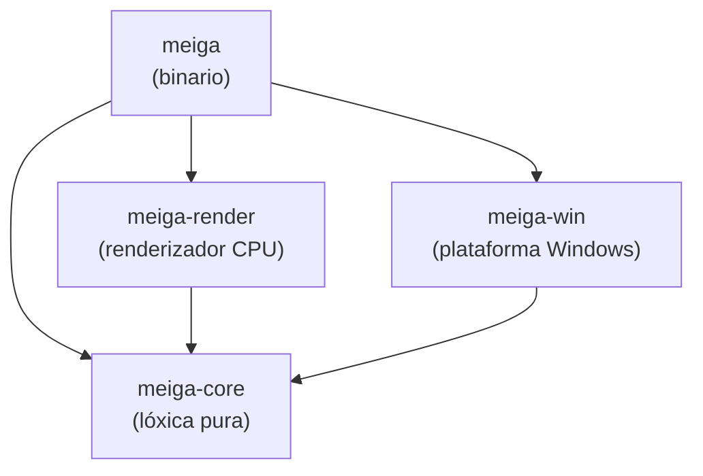
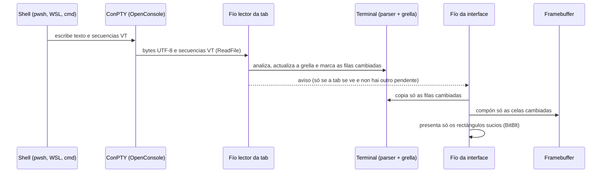
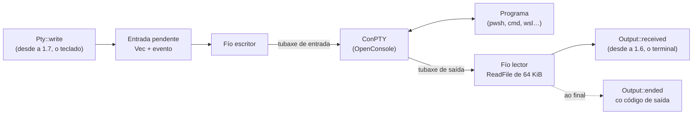
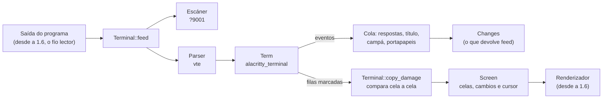
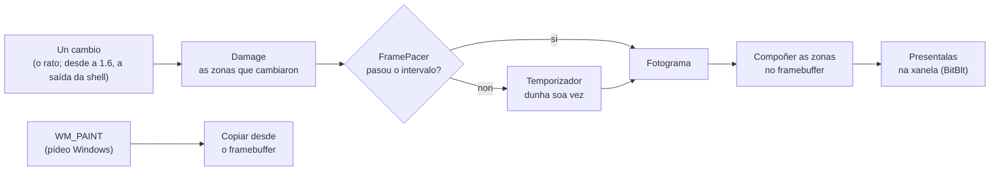
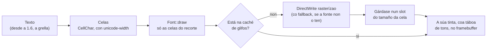
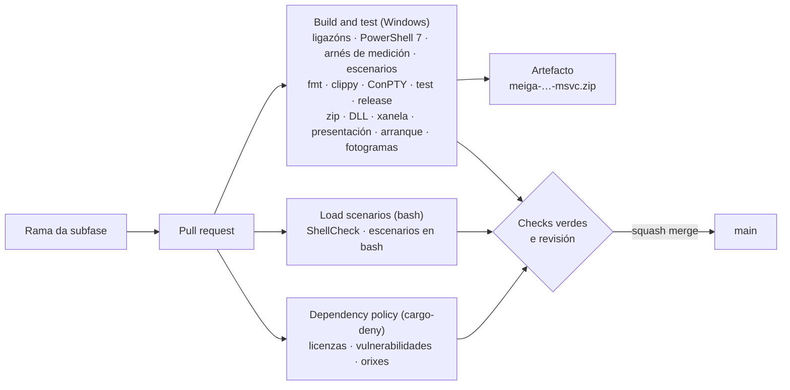
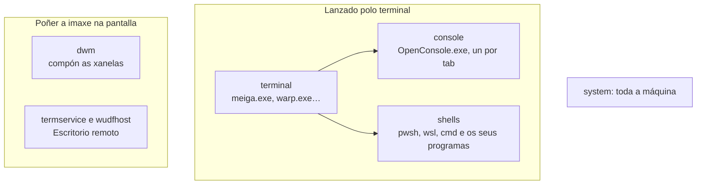
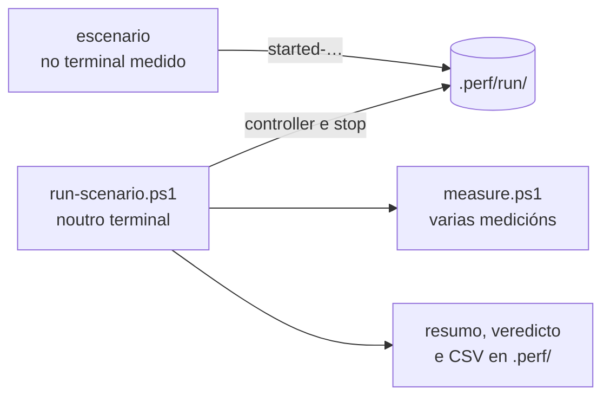

# Arquitectura

> Estado: subfase 1.5. Existen o esqueleto, a integración continua, as ferramentas de medición, os escenarios de carga e unha xanela que presenta só o que cambia, cun *framebuffer* propio, e que debuxa texto con DirectWrite: unha demo mostra o mesmo texto a tres escalas e debuxa rectángulos co rato. `meiga-win` xa lanza programas nunha pseudoconsola e fala con eles, e o terminal de `meiga-core` xa le a súa saída, aínda fóra da xanela: un exemplo de consola mostra e grava o que escriben, e outro dálle unha gravación ao terminal. As seccións marcadas como *previsto* describen o deseño acordado, que se irá implementando nas subfases indicadas. O porqué de cada decisión importante está nos [ADR](adr/README.md).

## 1. Obxectivo e restricións

meiga é un terminal para Windows con tabs, grupos de tabs, explorador de cartafoles e restauración da sesión. A restrición que manda sobre todas as demais é o **rendemento**: o programa debe gastar o mínimo de CPU e de memoria, tamén en máquinas sen GPU ou que se usan por Escritorio remoto.

Nesas máquinas, un terminal que debuxa con DirectX ou Vulkan non ten tarxeta gráfica que faga o traballo, e Windows emula a GPU na CPU (o rasterizador por software WARP). Ademais, o Escritorio remoto ten que comprimir e enviar pola rede cada fotograma que cambia. Por iso meiga debuxa na CPU, pero só o que cambia ([ADR 0002](adr/0002-windows-e-renderizado-cpu.md)).

Deste obxectivo saen os principios de deseño:

| Principio | Que significa na práctica |
|---|---|
| Cero traballo en repouso | Sen temporizadores periódicos, sen *polling* e sen animacións. Se non pasa nada, o programa está durmido. |
| Debuxar só o que cambia | Lévase a conta das celas que cambiaron (*damage tracking*) e só se presentan eses rectángulos. |
| Non debuxar o que non se ve | As tabs en segundo plano só procesan a saída da shell; non se debuxan. Coa xanela minimizada, non se debuxa nada ([ADR 0009](adr/0009-xanela-que-non-se-ve.md)). |
| Agrupar en fotogramas | Como moito un fotograma por intervalo, aínda que a shell escriba miles de veces por segundo. |
| Poucos fíos, e bloqueados | Un fío para a interface e dous por tab. Cando non hai traballo, todos esperan bloqueados sen gastar CPU. |
| Sen *frameworks* pesados | Win32, DirectWrite e GDI directamente: nada de navegadores embebidos nin *runtimes* asíncronos. |
| Medir sempre | Cada fase pecha cunha porta de rendemento con medicións (ver a [sección 8](#8-medición-do-rendemento)). |

## 2. Estrutura do código: un *workspace* con catro *crates*

En Rust, un *crate* é a unidade de compilación: unha biblioteca ou un programa executábel. O código de meiga divídese en catro *crates* dentro dun mesmo *workspace* de Cargo (un conxunto de crates que se compilan xuntos; ver [Tecnoloxías](tecnoloxias.md#3-cargo-e-os-workspaces)).

| Crate | Tipo | Responsabilidade | Que pode usar |
|---|---|---|---|
| `meiga-core` | biblioteca | Toda a lóxica que non depende de Windows: modelo de xanelas, tabs e grupos; fachada do terminal; codificación do teclado e do rato; busca difusa; configuración. | Só bibliotecas portábeis. **`unsafe` prohibido** e sen APIs de Windows. |
| `meiga-render` | biblioteca | Renderizado por CPU: caché de glifos con DirectWrite, composición no *framebuffer* e presentación dos rectángulos que cambiaron. | `meiga-core` e as APIs gráficas de Windows. |
| `meiga-win` | biblioteca | Capa de plataforma: ConPTY, detección das shells, sistema de arquivos, portapapeis, xanela Win32 e DPI. | `meiga-core` e as APIs de Windows. |
| `meiga` | binario | Une as pezas: crea a xanela, o bucle de mensaxes e o fluxo de fotogramas. | Os tres anteriores. |

### Por que esta separación

- **Probas rápidas e fiábeis.** `meiga-core` non toca o sistema operativo, así que as súas probas son unitarias puras: non abren xanelas nin procesos e executan en milisegundos.
- **`unsafe` illado.** Chamar ás APIs de Windows desde Rust require bloques `unsafe`, nos que o compilador non pode garantir a seguridade da memoria e confía no programador. Concentralos en `meiga-win` e `meiga-render` fai que o resto do código teña todas as garantías de Rust e que os puntos delicados sexan fáciles de revisar. En `meiga-core`, o compilador prohíbeo con `#![forbid(unsafe_code)]`.
- **Compilación incremental máis rápida.** Un cambio nun crate só recompila ese crate e os que dependen del.
- **Preparado para o futuro.** Un renderizador con GPU (mellora futura F2) sería outra implementación dentro de `meiga-render`, sen tocar a lóxica de `meiga-core`.

A regra de dependencias é estrita: as frechas do diagrama só van cara abaixo, e `meiga-core` nunca depende dos outros tres. Esta regra xa está declarada nos `Cargo.toml` de cada crate, así que Cargo non deixaría compilar un ciclo. A elección de Rust explícase no [ADR 0001](adr/0001-rust.md).

## 3. Fluxo de datos (*previsto*)

Así viaxará a saída dunha shell ata a pantalla:

- **ConPTY** é a API de Windows que fai de "pseudoterminal": a shell cre que escribe nunha consola normal, e ConPTY tradúceo a un fluxo de texto con secuencias de escape VT, que é o que le meiga. meiga distribúe a súa propia copia de ConPTY ([ADR 0004](adr/0004-conpty-empaquetado.md)).
- **Secuencias VT** (ou ANSI): códigos que van mesturados co texto e indican cores, movementos do cursor, borrados… Por exemplo, `ESC[31m` cambia a cor do texto a vermello.
- **Parser e grella**: o *parser* interpreta as secuencias VT e a grella é a matriz de celas (carácter, cor, estilo) que representa a pantalla do terminal. Os dous veñen de `alacritty_terminal` ([ADR 0003](adr/0003-nucleo-vt-alacritty-terminal.md)), e un escáner propio detecta antes as secuencias da integración coa shell ([ADR 0007](adr/0007-integracion-coa-shell.md)).

| Peza | Subfase |
|---|---|
| Xanela e bucle de mensaxes | 1.1 (feita) |
| *Framebuffer* e presentación parcial | 1.2 (feita) |
| Fontes e caché de glifos | 1.3 (feita) |
| ConPTY | 1.4 (feita) |
| Fachada do terminal (parser e grella) | 1.5 (feita) |
| Da saída á pantalla | 1.6 |

### Sesións: a shell, o ConPTY e os dous fíos

Desde a subfase 1.4, o principio do camiño xa funciona: `meiga-win` lanza un programa nunha pseudoconsola e fala con el ([Tecnoloxías › ConPTY](tecnoloxias.md#31-conpty-a-pseudoconsola-de-windows)). Aínda non chega á xanela: as probas e un exemplo de consola reciben o que escribe.

1. `Conpty::spawn` crea as dúas tubaxes, a pseudoconsola e un *job*, lanza o programa nela e dentro do *job*, e arranca os dous fíos da sesión. Devolve un `Pty` ([Código › meiga-win](codigo/meiga-win.md#cratesmeiga-winsrcconptyrs)).
2. `Pty::write` deixa os bytes na entrada pendente e esperta o escritor, que os escribe na tubaxe de entrada. Nunca espera.
3. O lector le a saída en bloques de ata 64 KiB e pásaos a un `Output`, que desde a subfase 1.6 será o terminal.
4. O escritor espera á vez a entrada e o fin do programa. Cando o programa remata, ou cando se destrúe o `Pty`, pecha a pseudoconsola: o ConPTY remata, a tubaxe de saída péchase, e o lector avisa do fin co código de saída do programa. Se pasan 10 s sen que remate ningún dos programas que tiña a sesión ao pechala, está bloqueada, e o escritor remata todos os do *job*: o programa e os que arrancou ([ADR 0011](adr/0011-fin-e-peche-das-sesions.md)).
5. meiga usa o ConPTY que leva ao lado de `meiga.exe` (`conpty.dll` e `OpenConsole.exe`) ou, se non está, o de Windows ([ADR 0004](adr/0004-conpty-empaquetado.md)).

### O terminal: da saída ao que se mostra

Desde a subfase 1.5, o medio do camiño tamén existe: o terminal de `meiga-core` le a saída dun programa e garda o que hai que mostrar e o que hai que responder, en tipos de meiga ([ADR 0012](adr/0012-fachada-do-terminal.md)). Aínda non o usa `meiga.exe`: as probas danlle saída gravada do ConPTY, e un exemplo de consola mide a que velocidade a le.

1. `Terminal::feed` dálle os bytes ao escáner, que segue os modos que `alacritty_terminal` ignora, e despois, os mesmos bytes, ao parser de `vte`, que actualiza o `Term` de `alacritty_terminal`: a grella, o historial, o cursor e os modos ([Tecnoloxías › `alacritty_terminal` e `vte`](tecnoloxias.md#34-alacritty_terminal-e-vte-o-núcleo-do-terminal)).
2. O que non é a grella chega como eventos a unha cola. `feed` devolve que pasou (`Changes`): hai respostas para o programa, que se recollen con `take_responses` e, desde a 1.6, se lle envían co `Pty`; cambiou o título; soou a campá; ou o programa copiou texto ao portapapeis ([Tecnoloxías › As secuencias de control](tecnoloxias.md#35-as-secuencias-de-control)).
3. `Terminal::copy_damage` copia a un `Screen` as filas que marcou `alacritty_terminal`. Compara cada cela coa que había, e só as distintas quedan como cambiadas, xunto coas do cursor se se moveu. O renderizador debuxará só esas.
4. Se o programa empeza unha actualización sincronizada, a saída espera ata que a remate ou ata que pase a súa hora límite, que o terminal di (`sync_deadline`): desde a 1.6, o temporizador dos fotogramas remátaa (`end_sync`).
5. O exemplo `conpty` de `meiga-win` grava a saída dun programa (`--record`), e o exemplo `replay` de `meiga-core` dálla a un terminal, tan rápido como pode, e mide a velocidade ([Código › meiga-core](codigo/meiga-core.md#cratesmeiga-coreexamplesreplayrs)).

O terminal pode pasar dun fío a outro: desde a 1.6, o fío lector darálle a saída e o da interface copiará o que cambiou, cada un collendo un `Mutex` ([ADR 0005](adr/0005-fios-e-fotogramas.md)).

### Fotogramas: do cambio á pantalla

Desde a subfase 1.2, o final do camiño xa funciona, cunha demo que debuxa rectángulos co rato no lugar do terminal:

1. Cada cambio anota a súa zona no ***damage*** ([Código › meiga-core](codigo/meiga-core.md#cratesmeiga-coresrcdamagers)), que xunta as zonas próximas.
2. O ***pacer*** decide cando se debuxa ([Código › meiga-core](codigo/meiga-core.md#cratesmeiga-coresrcpacingrs)): se pasou o intervalo desde o último fotograma, 33,3 ms por Escritorio remoto e 16,7 ms en local, no momento; se non, cun temporizador dunha soa vez ao final do intervalo. Os cambios que chegan mentres tanto van no mesmo fotograma ([ADR 0005](adr/0005-fios-e-fotogramas.md), [ADR 0008](adr/0008-temporizador-dos-fotogramas.md)).
3. O fotograma **compón** só esas zonas no *framebuffer*, unha *DIB section* ([Código › meiga-render](codigo/meiga-render.md)), e **preséntaas**: copia cada unha á xanela con `BitBlt` ([Tecnoloxías › DIB sections](tecnoloxias.md#24-dib-sections-e-gdi-o-framebuffer-e-a-súa-presentación)).
4. Cando Windows pide pintar (`WM_PAINT`), por exemplo cando a xanela medra ou se restaura, cópiase do *framebuffer*, sen compoñer nada ([Tecnoloxías › Pintar nunha xanela](tecnoloxias.md#25-pintar-nunha-xanela-wm_paint-e-dwm)).
5. Coa xanela minimizada, non se debuxa nada: os cambios esperan e, ao restaurala, píntase enteira unha vez ([ADR 0009](adr/0009-xanela-que-non-se-ve.md)).

O código que une as pezas explícase en [Código › meiga](codigo/meiga.md#cratesmeigasrcframesrs).

### Texto: da cela aos píxeles

Desde a subfase 1.3, meiga debuxa texto. Agora é o da demo, o mesmo a tres escalas; desde a 1.6, será a grella do terminal ([ADR 0010](adr/0010-texto-con-directwrite.md)):

1. O texto divídese en celas ([Código › meiga-core](codigo/meiga-core.md#cratesmeiga-coresrctextrs)): cada carácter ocupa unha, ou dúas se é ancho, segundo `unicode-width`, o mesmo crate que usará o núcleo do terminal ([Tecnoloxías › O ancho dos caracteres](tecnoloxias.md#29-o-ancho-dos-caracteres-unicode-width)).
2. `Font::draw` debuxa unha fila de celas coas súas cores: primeiro o fondo e despois a tinta dos glifos, só das celas que caen dentro do recorte do lenzo, que son as das zonas que cambiaron ([Código › meiga-render](codigo/meiga-render.md#cratesmeiga-rendersrctextrs)).
3. Cada glifo búscase na caché. A primeira vez, DirectWrite rasterízao con antialiasing en grises e gárdase nun *slot* do tamaño dunha cela. Se a fonte non ten o carácter, o *fallback* do sistema escolle outra que o teña ([Tecnoloxías › DirectWrite](tecnoloxias.md#27-directwrite-fontes-e-glifos)).
4. A tinta do glifo, os píxeles con cobertura, convértese en cor cunha táboa cos 256 tons entre o fondo e o texto ([Tecnoloxías › Mesturar o texto co fondo](tecnoloxias.md#30-mesturar-o-texto-co-fondo-gamma-e-contraste)).

O tamaño da cela sae das métricas da fonte e do DPI da xanela. Cada fonte, a un tamaño, ten a súa caché: a demo ten tres, unha por escala.

## 4. Fíos (*previsto*)

| Fío | Cantos | Que fai | Cando esperta |
|---|---|---|---|
| Interface | 1 | Mensaxes de Windows, entrada do usuario, composición e presentación. | Só cando chega unha mensaxe ou vence o temporizador dun fotograma pendente (`MsgWaitForMultipleObjectsEx`). |
| Lector | 1 por tab coa shell en marcha | Le a saída da shell e actualiza a grella. | Só cando a shell escribe (`ReadFile`). |
| Escritor | 1 por tab coa shell en marcha | Envía á shell o que se teclea, e pecha a pseudoconsola cando a shell remata ou se pecha a tab. | Só cando hai algo que enviar, cando se pecha a tab ou cando remata a shell (`WaitForMultipleObjects`). |

Un fío bloqueado nunha lectura ou nunha espera non consome CPU: o sistema operativo non o planifica ata que hai datos. Por iso o número de fíos non é un problema en si; o problema é que esperten sen motivo. O modelo completo, cos fotogramas e as tabs en segundo plano, está no [ADR 0005](adr/0005-fios-e-fotogramas.md), e o fin e o peche das sesións, no [ADR 0011](adr/0011-fin-e-peche-das-sesions.md).

O fío da interface xa existe desde a subfase 1.1: é o fío principal do programa. Dorme en `MsgWaitForMultipleObjectsEx` mentres non chega ningunha mensaxe nin vence o temporizador dos fotogramas, que só está activo cando hai un fotograma pendente (ver [Tecnoloxías › Temporizadores](tecnoloxias.md#26-temporizadores-e-a-espera-do-fío-da-interface)). Na subfase 1.1 durmía en `GetMessageW`, que só espera mensaxes ([Tecnoloxías › Xanelas Win32](tecnoloxias.md#22-xanelas-win32-e-o-bucle-de-mensaxes)); o temporizador chegou coa 1.2 ([ADR 0008](adr/0008-temporizador-dos-fotogramas.md)). Ao arrancar, Windows crea ademais algúns fíos auxiliares no proceso, por exemplo para cargar as DLL en paralelo, que rematan sós ao pouco tempo se non teñen traballo.

O lector e o escritor existen desde a subfase 1.4, en cada sesión de ConPTY ([Sesións](#sesións-a-shell-o-conpty-e-os-dous-fíos)), pero `meiga.exe` aínda non abre ningunha: as tabs chegan na fase 2.

## 5. Compilación

- O perfil `release` optimiza ao máximo: LTO completo, unha soa unidade de xeración de código e `panic = "abort"`.
- O *runtime* de C vai ligado estaticamente, así que `meiga.exe` non necesita que estea instalado o *Visual C++ Redistributable*.
- As versións *release* usan o subsistema gráfico de Windows (sen xanela de consola). As de depuración manteñen a consola para ver diagnósticos.
- O **manifesto da aplicación** vai dentro de `meiga.exe`: escala por monitor (v2), Windows 10 e 11 sen modos de compatibilidade, e sen pedir permisos de administrador. Incrústao o ligador, a petición do `build.rs` de `meiga` (ver [Tecnoloxías › Manifesto](tecnoloxias.md#23-manifesto-da-aplicación-e-dpi)).

Os detalles explícanse en [Tecnoloxías](tecnoloxias.md) e, liña a liña, en [Código › configuración do workspace](codigo/workspace.md).

## 6. Integración continua

Ningún cambio chega a `main` sen pasar por un PR e pola CI:

- As regras da rama `main` (*ruleset*) fan obrigatorio este camiño, tamén para os administradores.
- Dependabot propón cada semana as versións novas dos crates, das actions e de Rust, como PR que pasan polo mesmo proceso.
- Cada luns, a CI revisa de novo as dependencias contra a base de datos de vulnerabilidades, aínda que non cambiase nada, e comproba se hai unha versión estábel do ConPTY máis nova ca a fixada. Esta comprobación non é obrigatoria: unha versión nova non bloquea ningún PR.

Os detalles están en [Tecnoloxías › GitHub Actions](tecnoloxias.md#15-github-actions) e en [Código › .github](codigo/github.md).

## 7. Decisións de arquitectura (ADR)

| ADR | Decisión |
|---|---|
| [0001](adr/0001-rust.md) | Rust como linguaxe. |
| [0002](adr/0002-windows-e-renderizado-cpu.md) | Só Windows, con renderizado por CPU do que cambia. |
| [0003](adr/0003-nucleo-vt-alacritty-terminal.md) | `alacritty_terminal` como núcleo, detrás dunha fachada. |
| [0004](adr/0004-conpty-empaquetado.md) | ConPTY empaquetado con meiga. |
| [0005](adr/0005-fios-e-fotogramas.md) | Fíos bloqueados e como moito un fotograma por intervalo. |
| [0006](adr/0006-licenzas-e-dependencias.md) | Só licenzas permisivas e dependencias mínimas. |
| [0007](adr/0007-integracion-coa-shell.md) | Integración coa shell mediante secuencias OSC. |
| [0008](adr/0008-temporizador-dos-fotogramas.md) | Un temporizador de alta resolución para os fotogramas. |
| [0009](adr/0009-xanela-que-non-se-ve.md) | Non debuxar coa xanela minimizada; as tapadas debúxanse. |
| [0010](adr/0010-texto-con-directwrite.md) | Texto con DirectWrite, nunha caché de glifos do tamaño da cela. |
| [0011](adr/0011-fin-e-peche-das-sesions.md) | O escritor de cada sesión espera tamén polo programa e pecha a pseudoconsola; cada sesión ten un *job*, e unha sesión pechada remata sempre. |
| [0012](adr/0012-fachada-do-terminal.md) | A fachada do terminal: tipos propios, a copia do que cambia cela a cela, as respostas e o escáner de `?9001`. |

## 8. Medición do rendemento

O rendemento mídese desde fóra, sen tocar o código de meiga, co mesmo arnés para calquera terminal: `tools/perf/measure.ps1`. Cada certo tempo fai unha "fotografía" de todos os procesos e fíos do sistema e reparte o consumo en grupos:

- **Que conta como custo do terminal:** o propio terminal, os seus procesos de consola e o traballo que provoca en `dwm` e no Escritorio remoto ao debuxar. As shells son a carga de traballo, igual para todos os terminais.
- **Métricas:** CPU (en % dun núcleo e en ciclos), espertares por segundo, memoria privada e fíos. Explícanse en [Tecnoloxías › Medición do rendemento](tecnoloxias.md#19-medición-do-rendemento).
- **Onde:** en local, no equipo de desenvolvemento, e non na CI, porque as máquinas da CI son compartidas e darían cifras con moito ruído. Os resultados gárdanse en `.perf/`, fóra de Git. A CI só comproba que o arnés mide ben.
- **O arranque:** `tools/perf/measure-startup.ps1` mide o tempo desde que se crea o proceso de meiga ata que a súa xanela está pintada (ver [Tecnoloxías › Tempo ata o primeiro fotograma](tecnoloxias.md#tempo-ata-o-primeiro-fotograma)).
- **Os fotogramas:** `tools/perf/measure-frames.ps1` mide canto custan a meiga, a `dwm` e ao Escritorio remoto os fotogramas parciais, os completos e os completos de texto, cos modos de medición de meiga (`--bench`).

O código explícase en [Código › medición](codigo/perf.md).

### Escenarios de carga

Para comparar terminais, todos teñen que facer o mesmo traballo. Os escenarios imitan o uso diario dun terminal, e cada un existe en PowerShell e en bash, para medir a mesma carga nunha tab de pwsh e nunha de Ubuntu (WSL):

| Escenario | Que imita |
|---|---|
| `idle` | O terminal aberto sen facer nada, por exemplo con 5 tabs. Non arranca ningún script. |
| `spinner` | O indicador de progreso dunha ferramenta que traballa: unha liña que se redebuxa 10 veces por segundo. |
| `ai-stream` | Unha IA que pensa e responde palabra a palabra, con cores, emoji e unha zona de estado que se redebuxa 10 veces por segundo. |
| `bigfile` | Imprimir un arquivo de 50 MiB tan rápido como o acepte o terminal. |

- `run-scenario.ps1` corre **noutro terminal**, para que o seu traballo non se sume ao do terminal medido. Coordínase cos escenarios con arquivos baleiros nun cartafol que ven Windows e WSL, así que non fan falta portos nin procesos extra.
- Mide varias veces seguidas (por defecto, 3 medicións de 60 s) e di se os resultados son **estábeis**: se os ciclos do terminal varían pouco entre medicións ou, en bigfile, o tempo de imprimir. Se non o son, hai que voltar medir coa máquina máis tranquila.
- A CI comproba que os escenarios debuxan exactamente o esperado, en PowerShell e en bash, pero non mide nada.

O código explícase en [Código › escenarios de carga](codigo/escenarios.md). Na subfase 0.8 mediuse en local a liña base co Warp e o Windows Terminal, que fixou os orzamentos de rendemento de cada fase. Esas medicións non se publican, porque describen unha máquina concreta.

## 9. Estado actual

Despois da subfase 1.5:

- Existen os catro crates, coa regra de dependencias xa declarada. `meiga-core` ten as cores, os rectángulos, o tamaño da grella, as zonas que cambian (*damage*), o *pacer* dos fotogramas, as celas do texto e o terminal; `meiga-render`, o lenzo, o *framebuffer* e a súa presentación con GDI, e o texto: as fontes con DirectWrite, a caché de glifos e a mestura co fondo; e `meiga-win`, a xanela, os seus eventos, o bucle de mensaxes, o temporizador dos fotogramas e as sesións de ConPTY.
- `meiga-win` lanza calquera programa nunha pseudoconsola, cos seus dous fíos, que dormen mentres non hai nada que facer: le o que escribe, envíalle texto, sabe cando remata e co código de saída, e pecha a sesión sen esperar. Usa o ConPTY do Windows Terminal que vai no paquete ou, se non está, o de Windows. As probas lanzan programas de verdade cos dous, e un exemplo de consola mostra o que escribe calquera programa e grávao.
- O terminal de `meiga-core`, detrás da súa fachada, le a saída dun programa con `alacritty_terminal`: as cores e os estilos, os caracteres anchos, o cursor, o título, a campá, o portapapeis e os modos, tamén o win32-input-mode, que segue un escáner propio. Responde ás preguntas do programa e copia só as celas que cambiaron. As probas usan saída gravada do ConPTY, e outro exemplo de consola mide a que velocidade le unha gravación. `meiga.exe` aínda non usa nin as sesións nin o terminal: a saída chegará á xanela na subfase 1.6.
- `meiga.exe` abre unha xanela cunha demo: o mesmo texto ao 100 %, ao 125 % e ao 150 % de escala, con letras con acentos, símbolos, liñas de caixa, ideogramas CJK e cores, e por riba, os rectángulos que se debuxan arrastrando co rato. Cada fotograma presenta só as zonas que cambian, que se poden ver cun bordo magenta (tecla P). Como moito hai un fotograma por intervalo: 30 por segundo por Escritorio remoto e 60 en local. En repouso e coa xanela minimizada non debuxa nada, e o seu fío dorme. Ao pechala, o programa remata co código 0.
- Ten tres modos de medición, `--bench partial`, `--bench full` e `--bench text`, e un rexistro dos fotogramas, `--trace-frames`.
- `meiga.exe` leva dentro o manifesto da aplicación, ocupa uns 330 KB e só depende de DLL do sistema, entre elas a de DirectWrite. A CI compróbao en cada cambio: as DLL, que abre a xanela, a escala por monitor, que presenta só o que cambia e que remata ben.
- Están activas as regras de calidade (*lints*), o formato automático, a política de licenzas (`cargo-deny`) e a xeración dos avisos de terceiros (`cargo-about`). As dependencias externas son `windows-sys`, `windows` e `windows-core`, de Microsoft, `unicode-width`, `alacritty_terminal`, co seu parser, `vte`, e `memchr`.
- Cada PR valídase automaticamente en GitHub Actions, tamén as ligazóns da documentación, os scripts de PowerShell, o arnés de medición e os escenarios de carga, e produce un `.zip` descargábel con `meiga.exe` e o ConPTY (`conpty.dll` e `OpenConsole.exe`). `tools/fetch-conpty.ps1` descarga o ConPTY do seu paquete NuGet, cunha versión e un SHA-256 fixados, e comproba que está asinado por Microsoft; cada luns, a CI avisa se hai unha versión nova.
- As decisións de arquitectura están escritas en doce ADR.
- O arnés de medición mide calquera terminal e as partes de Windows que o poñen na pantalla. `measure-startup.ps1` mide canto tarda meiga en abrir a súa xanela, e `measure-frames.ps1`, canto custan os seus fotogramas: parciais, completos e completos de texto.
- Os escenarios de carga imitan o uso diario dun terminal, en PowerShell e en bash, e `run-scenario.ps1` mide un terminal mentres corren e di se os resultados son estábeis.
- Os scripts de `tools/` necesitan PowerShell 7. En Windows PowerShell 5.1 non se executan: só mostran o comando para facelo con `pwsh`.
