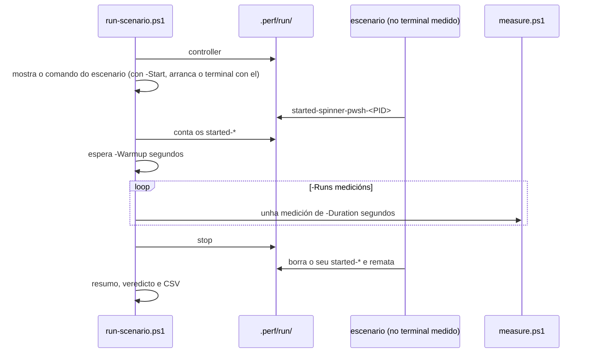

# Código › escenarios de carga (`tools/perf/`)

> Estado: subfase 1.7.

Cargas de traballo reproducíbeis para medir os terminais con [`measure.ps1`](perf.md#toolsperfmeasureps1). Imitan o que fai un terminal cada día: unha IA que pensa e responde, un indicador de progreso que xira e a saída dun arquivo grande. Cada escenario existe en PowerShell e en bash, para medir a mesma carga nunha tab de pwsh e nunha de WSL, e as dúas versións debuxan exactamente o mesmo: os mesmos textos, coas mesmas cores e as mesmas secuencias de escape.

| Arquivo | Para que |
|---|---|
| [`scenarios/spinner.ps1`, `spinner.sh`](#spinnerps1-e-spinnersh) | Un indicador de progreso (*spinner*) que redebuxa unha liña 10 veces por segundo. |
| [`scenarios/ai-stream.ps1`, `ai-stream.sh`, `ai-stream.txt`](#ai-streamps1-ai-streamsh-e-ai-streamtxt) | Unha IA que responde palabra a palabra baixo unha zona de estado que se redebuxa 10 veces por segundo. |
| [`scenarios/bigfile.ps1`, `bigfile.sh`](#bigfileps1-e-bigfilesh) | Imprimir un arquivo grande tan rápido como o acepte o terminal. |
| [`scenarios/Scenario.psm1`](#scenariopsm1), [`scenarios/common.sh`](#commonsh) | O que comparten os escenarios: a consola, os marcadores e o tempo. |
| [`gen-bigfile.ps1`](#gen-bigfileps1) | Crear o arquivo grande, igual byte a byte en calquera máquina. |
| [`run-scenario.ps1`](#run-scenariops1) | Medir un terminal mentres corre un escenario: varias medicións seguidas, un resumo e un veredicto sobre a estabilidade. |
| [`test-scenarios.ps1`](#test-scenariosps1) | Comprobar os escenarios, en PowerShell e en bash. |

## Como se usan

`run-scenario.ps1` execútase **nun terminal distinto do que mides** (por exemplo, no Windows Terminal para medir o Warp, e ao revés). Mostra o comando que tes que executar no terminal medido, agarda a que o escenario arranque e mide:

```powershell
pwsh -File .\tools\perf\run-scenario.ps1 spinner WindowsTerminal              # o spinner nunha tab de pwsh
pwsh -File .\tools\perf\run-scenario.ps1 ai-stream warp -Shell wsl            # a IA nunha tab de Ubuntu
pwsh -File .\tools\perf\run-scenario.ps1 spinner warp -Instances 5            # o spinner en 5 tabs
pwsh -File .\tools\perf\run-scenario.ps1 bigfile WindowsTerminal              # a saída masiva
pwsh -File .\tools\perf\run-scenario.ps1 idle warp                            # o terminal en repouso
```

Con `-Start`, en vez do nome do terminal, recibe a ruta dun terminal que executa o programa da súa liña de comandos, como meiga, e arráncao el mesmo, co escenario como programa: non hai que escribir o comando no terminal medido. Ata a subfase 1.7, en meiga nin se podía, porque non tiña teclado. Ao final, o script pecha a xanela do terminal (ver [Con `-Start`](#con--start)):

```powershell
pwsh -File .\tools\perf\run-scenario.ps1 spinner -Start .\target\release\meiga.exe   # meiga, que arranca co escenario como programa
pwsh -File .\tools\perf\run-scenario.ps1 idle -Start .\target\release\meiga.exe      # meiga en repouso, coa súa shell por defecto
```

Os escenarios tamén funcionan sós, sen medir nada, ata que premes Ctrl+C (bigfile remata ao imprimir o arquivo):

```powershell
pwsh -NoProfile -File .\tools\perf\scenarios\ai-stream.ps1
```

```bash
bash tools/perf/scenarios/ai-stream.sh      # en WSL, desde o cartafol do repositorio
```

## Como se coordinan

`run-scenario.ps1` e os escenarios corren en terminais distintos, e os de bash, dentro de WSL. Coordínanse con arquivos baleiros nun cartafol que ven os dous lados, `.perf\run\` (en WSL, `/mnt/c/…/.perf/run/`):



| Arquivo | Créao | Significa |
|---|---|---|
| `controller` | `run-scenario.ps1`, antes de mostrar o comando ou, con `-Start`, de arrancar o terminal | Alguén coordina os escenarios. Sen el, un escenario corre só ata Ctrl+C e non crea ningún arquivo. |
| `started-<escenario>-<shell>-<PID>` | O escenario, ao arrancar; bórrao ao rematar | Unha copia do escenario está a correr. Con `-Instances 5`, `run-scenario.ps1` agarda a 5. |
| `go-<n>` | `measure.ps1`, ao empezar a medición *n* (`-StartedFile`) | Só para bigfile: imprime o arquivo agora. |
| `finished-<n>` | bigfile, ao rematar de imprimir | Os segundos que levou imprimir. `measure.ps1` remata a medición cando aparece (`-StopFile`). |
| `stop` | `run-scenario.ps1`, ao final ou se o cancelas | Os escenarios rematan. |

- **Por que arquivos.** É o mecanismo máis simple que funciona entre Windows e WSL: non necesita rede, nin portos, nin procesos extra, e pódese mirar co explorador.
- Os escenarios miran se existe `stop` **como moito unha vez por segundo**, porque en WSL cada consulta dun arquivo de Windows atravesa o protocolo 9P e ten un custo. Por iso rematan, como moito, un segundo despois de crear `stop`.
- `run-scenario.ps1` baleira o cartafol ao empezar, así que os arquivos dunha execución anterior non molestan.
- A variábel de contorno `MEIGA_PERF_RUN` cambia o cartafol. Úsana as probas, para non tocar o cartafol de verdade.

## Que debuxan: as secuencias de escape

Os escenarios escriben texto con **secuencias de escape VT**: o carácter ESC (código 27, `\e` ou `` `e``) seguido de `[`, uns números e unha letra final. As consolas de Windows (ConPTY) e todos os terminais modernos as interpretan. Estas son as que usan:

| Secuencia | Nome | Para que |
|---|---|---|
| `\r` | Retorno de carro | Voltar ao comezo da liña, para reescribila. |
| `\n` | Salto de liña | Baixar unha liña. A consola de Windows e o terminal de Linux engaden o retorno de carro. |
| `ESC[?25l`, `ESC[?25h` | Ocultar e mostrar o cursor | As ferramentas ocultan o cursor mentres debuxan, para que non escintile. |
| `ESC[3A` | Subir o cursor 3 liñas | Voltar ao comezo da zona que se redebuxa. |
| `ESC[J` | Borrar ata o final da pantalla | Borrar a zona que se vai redebuxar. |
| `ESC[K` | Borrar ata o final da liña | Borrar o que sobra dunha liña reescrita. |
| `ESC[0m`, `ESC[1m`, `ESC[2m`, `ESC[3m` | SGR: restablecer, negra, tenue e cursiva | O formato do texto. |
| `ESC[31m`, `ESC[38;5;<n>m`, `ESC[48;5;<n>m` | Cores de 16 e de 256, da letra e do fondo | As cores máis habituais. |
| `ESC[38;2;<r>;<g>;<b>m` | Cor de 24 bits | As cores exactas, das que usan os temas e as barras de cor. |

## `Scenario.psm1`

Módulo de PowerShell co que comparten os tres escenarios de PowerShell. Cada escenario cárgao con `Import-Module (Join-Path $PSScriptRoot 'Scenario.psm1') -Force`. O estado vive no propio módulo, porque cada proceso corre un só escenario.

```powershell
function Get-RunDirectory {
    if ($env:MEIGA_PERF_RUN) {
        return [IO.Path]::GetFullPath($env:MEIGA_PERF_RUN)
    }
    [IO.Path]::GetFullPath((Join-Path $PSScriptRoot '../../../.perf/run'))
}
```

O cartafol de coordinación. As rutas escríbense con `/`, que Windows tamén acepta, para que o módulo funcione igual fóra de Windows.

```powershell
    if (-not [Console]::IsOutputRedirected) {
        # The scenarios write UTF-8, so the console must read UTF-8 (code
        # page 65001). Stop-Scenario puts the previous code page back.
        $state.Encoding = [Console]::OutputEncoding
        [Console]::OutputEncoding = $utf8
    }
    # Writing bytes straight to the standard output skips the text layers of
    # .NET: each call is a single write to the console.
    $state.Output = [Console]::OpenStandardOutput()
```

- **Páxina de códigos.** A consola de Windows interpreta os bytes que recibe segundo a súa *páxina de códigos*, que en Windows en galego ou español adoita ser a 850 ou a 437. Os escenarios escriben UTF-8 (acentos, emoji, caracteres de caixa), así que `Start-Scenario` cambia a consola á páxina 65001, que é UTF-8, e `Stop-Scenario` deixa a anterior. Se a saída vai a un arquivo, como nas probas, non hai consola que cambiar.
- **Bytes directos.** `[Console]::OpenStandardOutput()` dá o fluxo da saída estándar sen as capas de texto de .NET. Cada fotograma pásase a UTF-8 e escríbese cunha soa chamada, como fai un programa que debuxa por fotogramas. Con `[Console]::Out`, .NET partiría o texto en anacos pequenos e faría varias escrituras.

```powershell
    if (-not $KeepCursor) {
        # Hide the cursor while drawing, as command-line tools do.
        Write-Console "`e[?25l"
    }
    if ($state.Controlled) {
        $state.Marker = Join-Path $runDirectory "started-$Name-pwsh-$PID"
        [IO.File]::WriteAllText($state.Marker, '')
    }
```

O cursor ocúltase salvo en bigfile (`-KeepCursor`), porque un programa que só imprime texto non o oculta. Despois, se existe `controller`, créase o marcador co nome do escenario e o PID.

```powershell
function Stop-Scenario {
    param([string]$Text = '')
    …
        $reset = "$Text`e[0m"
        if (-not $state.KeepCursor) {
            $reset += "`e[?25h"
        }
        Write-Console $reset
    …
    if ($state.Encoding) {
        [Console]::OutputEncoding = $state.Encoding
    }
    if ($state.Marker) {
        Remove-Item -LiteralPath $state.Marker -ErrorAction SilentlyContinue
    }
```

Escribe o texto final de cada escenario, restablece o formato, mostra o cursor, volta á páxina de códigos anterior e borra o marcador. Os escenarios chámana nun bloque `finally`, que PowerShell executa tamén despois de Ctrl+C: o terminal nunca queda co cursor oculto nin cunha cor a medias.

```powershell
function Test-ScenarioStop {
    …
    $now = $state.Clock.Elapsed.TotalSeconds
    if ($now -lt $state.NextStopCheck) {
        return $false
    }
    $state.NextStopCheck = $now + 1
    Test-Path -LiteralPath (Join-Path $state.RunDirectory 'stop')
}
```

Mira se existe `stop` como moito unha vez por segundo. Sen `controller`, nunca: o escenario corre ata Ctrl+C.

```powershell
function Wait-NextFrame([double]$Interval) {
    $state = $script:scenario
    $now = $state.Clock.Elapsed.TotalSeconds
    $state.NextFrame = [math]::Max($state.NextFrame + $Interval, $now)
    $milliseconds = [int][math]::Ceiling(($state.NextFrame - $now) * 1000)
    if ($milliseconds -gt 0) {
        Start-Sleep -Milliseconds $milliseconds
    }
}
```

- **Momentos fixos.** Os fotogramas tócanlle a momentos fixos desde o comezo (0,1 s, 0,2 s, 0,3 s…), non a 0,1 s despois do anterior. Windows esperta un fío que dorme un pouco despois do pedido, e se se esperase sempre 0,1 s, eses atrasos sumaríanse e o ritmo baixaría. Así, a media mantense exacta.
- **Sen ráfagas.** Se un fotograma chega moi tarde (por exemplo, porque a máquina estivo ocupada), `Max` move os momentos seguintes cara adiante. Sen el, o escenario debuxaría de seguido todos os fotogramas atrasados, cousa que non fai ningún programa real.
- O tempo mídese cun `Stopwatch`, que nunca se axusta, e non co reloxo do sistema.

**Só ASCII.** Os `.ps1` están escritos só con caracteres ASCII, e os outros caracteres van como secuencias `` `u{280B} ``. Windows PowerShell 5.1 le os arquivos sen marca de bytes como Windows-1252, e algúns bytes do UTF-8 convertíanse alí en comiñas tipográficas (“ ”), que PowerShell trata como comiñas de verdade: o arquivo deixaría de poder lerse e a mensaxe que pide PowerShell 7 non chegaría a saír (ver [Tecnoloxías › PowerShell 7](../tecnoloxias.md#11-powershell-7)).

## `common.sh`

O mesmo para os escenarios de bash, que o cargan con `.` (`source`). Ten unha regra: **mentres corre o escenario, non se lanza ningún proceso**. Cada proceso novo custa milisegundos de CPU, e en WSL aínda máis; nun bucle de 10 fotogramas por segundo, iso sería carga extra e atrasos irregulares.

```bash
if ((BASH_VERSINFO[0] < 5)); then
  echo "The load scenarios need bash 5 or newer; this is bash $BASH_VERSION." >&2
  exit 1
fi
```

Os escenarios necesitan bash 5, que trae `EPOCHREALTIME`. Ubuntu leva bash 5 desde a versión 20.04.

```bash
scenario_now() {
  local now=${EPOCHREALTIME/[.,]/}
  now_us=$((now - start_us))
}
```

`EPOCHREALTIME` é a hora actual en segundos con 6 decimais, como `1767000000.123456`, lida sen lanzar ningún proceso (`date` sería un proceso). Ao quitarlle o separador decimal quedan microsegundos enteiros, cos que bash xa pode facer contas. O separador depende da configuración rexional: pode ser punto ou coma, e por iso o patrón `[.,]`.

```bash
  # A pipe that never gets data: a read with a timeout on it waits without
  # starting a process, which sleep would do in every frame.
  exec {sleep_fd}<> <(:)
```

Durmir sen lanzar `sleep`. `<(:)` crea unha tubaxe (*pipe*) e `exec {sleep_fd}<>` ábrea para ler e escribir, gardando o descritor en `sleep_fd`. Como o propio script ten aberto o extremo de escritura, ler da tubaxe nunca remata por fin de datos: `read -t 0.1 -u "$sleep_fd"` agarda exactamente o tempo indicado e devolve un erro de tempo esgotado.

```bash
  trap scenario_end EXIT
  trap 'exit 130' INT
  trap 'exit 143' TERM
```

`scenario_end` execútase sempre ao saír: ao rematar, por un erro ou por Ctrl+C (`INT`), que primeiro sae co código habitual, 130. Restablece o formato, mostra o cursor e borra o marcador e os arquivos temporais (`scenario_temp_files`), igual que `Stop-Scenario`. Antes escribe `scenario_end_text`, que cada escenario axusta.

```bash
scenario_should_stop() {
  $scenario_controlled || return 1
  scenario_now
  ((now_us >= next_stop_check_us)) || return 1
  next_stop_check_us=$((now_us + 1000000))
  [[ -f $run_dir/stop ]]
}
```

Como `Test-ScenarioStop`: só con `controller`, e como moito unha vez por segundo.

```bash
scenario_wait_frame() {
  local wait_us seconds
  scenario_now
  next_frame_us=$((next_frame_us + $1))
  if ((next_frame_us < now_us)); then
    next_frame_us=$now_us
  fi
  wait_us=$((next_frame_us - now_us))
  ((wait_us > 0)) || return 0
  printf -v seconds '%d.%06d' $((wait_us / 1000000)) $((wait_us % 1000000))
  scenario_sleep "$seconds"
}
```

Como `Wait-NextFrame`, en microsegundos. `printf -v` escribe o resultado nunha variábel, sen lanzar ningún proceso.

## `spinner.ps1` e `spinner.sh`

Imita o indicador de progreso das ferramentas de liña de comandos, como o dunha IA que está a pensar. Cada fotograma reescribe a mesma liña:

```powershell
$color = 16 + $frame % 216
$seconds = [math]::Floor((Get-ScenarioTime))
Write-Console "`r`e[38;5;${color}m$($glyphs[$frame % 10])`e[0m `e[1mThinking`e[0m `e[2m($seconds s)`e[0m`e[K"
Wait-NextFrame (1 / $Hz)
```

```text
⠼ Thinking (12 s)
```

- `\r` volta ao comezo da liña; despois van o glifo do spinner (os 10 caracteres braille habituais, `⠋⠙⠹⠸⠼⠴⠦⠧⠇⠏`), a palabra en negra e os segundos en tenue; `ESC[K` borra o que quedase da liña anterior.
- A cor do glifo cambia en cada fotograma, percorrendo as 216 cores do cubo de 6×6×6 da paleta de 256 cores (da 16 á 231).
- `-Hz` (por defecto, 10) cambia os fotogramas por segundo; en bash, o primeiro argumento.

## `ai-stream.ps1`, `ai-stream.sh` e `ai-stream.txt`

Imita unha IA que responde nun terminal, como as ferramentas de IA de liña de comandos. Reproduce en bucle a conversa de `ai-stream.txt`: para cada pregunta, móstraa, "pensa" 2 s e escribe a resposta a unhas 40 palabras por segundo.

```text
❯ Find the ten biggest files under this folder

The ten biggest files

In PowerShell, list every file below the current folder, sort them by     ← texto xa escrito
size and keep                                                             ← última liña, que se reescribe
⠼ Generating… (4 s · 23 words)                                            ┐
────────────────────────────────────────────────────────────              │ zona de estado
ctrl+c to stop · simulated AI answer                                      ┘
```

### `ai-stream.txt`

As respostas, como as mostra unha ferramenta de IA: *markdown* xa formatado, con cores, unha táboa con caracteres de caixa, bloques de código, emoji, acentos e caracteres CJK. Ten cinco preguntas, unha delas en galego, e unhas mil palabras.

- As liñas que empezan por `> ` son as preguntas; o resto, ata a pregunta seguinte, é a resposta.
- `\e` representa o carácter ESC, para que o arquivo se poida ler e editar.
- Os espazos consérvanse tal cal, así que as táboas quedan aliñadas.
- Ningunha liña pasa de 80 columnas (os emoji e os caracteres CJK ocupan dúas), porque unha liña que se partise romperia o redebuxado: o escenario sube un número fixo de liñas.
- Cada secuencia de cor ábrese e péchase na mesma liña, porque cada fotograma reescribe a última liña desde o comezo.

### Palabras

```powershell
$words = [regex]::Matches($line, ' *[^ ]+')
…
$prefix = if ($current.Tokens.Count -eq 0) { '' } else { "`n" * ($breaks + 1) }
$breaks = 0
foreach ($word in $words) {
    $current.Tokens.Add($prefix + $word.Value)
    $prefix = ''
}
```

Ao arrancar, cada resposta divídese en palabras, e cada palabra leva diante o que a separa da anterior: os espazos e, se empeza unha liña, os saltos de liña (máis dun se había liñas en branco). Así, escribir a resposta é só escribir as palabras unha tras outra, sen calcular nada. As liñas en branco do comezo e do final da resposta descártanse, porque o escenario pon as súas. En bash faise o mesmo cunha expresión regular, `^( *[^ ]+)(.*)$`, aplicada en bucle.

### Os fotogramas

Cada 0,1 s:

1. Volta ao comezo da última liña de texto, 3 liñas por riba do final da zona de estado, e borra ata o final da pantalla: `\r ESC[3A ESC[J`.
2. Escribe outra vez esa última liña, porque o borrado tamén a levou, e despois as palabras novas. Se unha palabra empeza unha liña, a liña anterior queda xa escrita e sobe coa pantalla.
3. Debuxa a zona de estado: o spinner co tempo e as palabras, unha raia e unha axuda.

As palabras que se escriben son as que tocan nese momento: `(agora − comezo) × 40`, menos as xa escritas. Se un fotograma chega tarde, escribe máis palabras, e a velocidade media mantense.

As fases de cada pregunta son: `prompt` (móstrase a pregunta), `thinking` (2 s sen palabras, co texto *Thinking…*), `streaming` (a resposta, co texto *Generating…*) e `answered` (a resposta rematou; o fotograma seguinte mostra a pregunta seguinte). Ao final do arquivo, volta á primeira.

Ao rematar, o texto final (`$endText` ou `scenario_end_text`) borra a zona de estado e deixa o cursor debaixo do texto.

**Parámetros:** `-WordsPerSecond` (40) e `-ThinkSeconds` (2); en bash, o primeiro e o segundo argumento. As probas usan 1000 e 0, para percorrer a conversa enteira en poucos segundos.

## `bigfile.ps1` e `bigfile.sh`

Imita imprimir un rexistro longo ou a saída dunha compilación grande, o caso máis pesado para un terminal.

```powershell
function Write-BigFile {
    $clock = [Diagnostics.Stopwatch]::StartNew()
    for ($offset = 0; $offset -lt $bytes.Length; $offset += 64KB) {
        Write-ConsoleBytes $bytes $offset ([math]::Min(64KB, $bytes.Length - $offset))
    }
    $clock.Elapsed.TotalSeconds
}
```

- O arquivo lese enteiro en memoria antes de empezar, e escríbese en anacos de 64 KiB, sen pasar polo formato de PowerShell. Así, o tempo é o do terminal, e non o do disco nin o de PowerShell (`Get-Content` escribiría liña a liña e sería moito máis lento).
- **O tempo inclúe o terminal.** Cando o terminal vai atrasado, a consola fai esperar o programa que escribe. Por iso, cando remata a última escritura, o terminal xa leu case todo o arquivo.
- **Só.** Imprime o arquivo unha vez e di canto tardou: `Printed 50.3 MB in 3.214 s.`
- **Con `run-scenario.ps1`.** Para cada medición *n*: agarda a `go-<n>`, imprime o arquivo, espera 1 s máis para que o terminal remate de debuxar, e escribe os segundos en `finished-<n>`, o que remata a medición. Remata cando aparece `stop`.

En bash, imprímese con `cat` desde unha copia en `/tmp`:

```bash
copy=$(mktemp "${TMPDIR:-/tmp}/meiga-bigfile.XXXXXX")
scenario_temp_files+=("$copy")
cp -- "$file" "$copy"
```

En WSL, ler un arquivo do disco de Windows atravesa o protocolo 9P, e o tempo sería o do sistema de arquivos e non o do terminal. A copia faise antes de dicir que o escenario arrancou, así que non conta, e bórrase ao saír.

## `gen-bigfile.ps1`

Crea `.perf\bigfile.txt`, o arquivo que imprime bigfile: uns 50 MiB de texto que parece un rexistro longo. Constrúe 2000 liñas distintas e repíteas ata chegar ao tamaño:

| Liñas | Que levan |
|---|---|
| 60 % | Rexistro: data e hora en tenue, nivel en cor (`INFO` verde, `ERROR` vermello e negra…), módulo cunha cor de 256 e unha mensaxe; ás veces, un número en negra. |
| 10 % | Palabras con letras acentuadas, en cursiva, e palabras en grego e en cirílico. |
| 5 % | Ideogramas CJK, *hiragana* e *hangul*, que ocupan dúas celas. |
| 5 % | Palabras e emoji, que tamén ocupan dúas celas. |
| 5 % | Unha barra de 64 bloques cun degradado de cor de 24 bits: unha secuencia de cor por cela. |
| 5 % | Unha fila de táboa con caracteres de caixa e fondos de 256 cores. |
| 5 % | Unha liña longa, de máis de 80 columnas, que o terminal ten que partir. |
| 5 % | Unha liña baleira. |

```powershell
$seed = 0L
function Get-Number([int]$Count) {
    $script:seed = ($script:seed * 1103515245 + 12345) % 2147483648
    [int](($script:seed -shr 16) % $Count)
}
```

- **Igual en todas partes.** Os números saen dun xerador congruencial lineal (as constantes do estándar de C), escrito no propio script. `System.Random` non garante a mesma secuencia en todas as versións de .NET. Así, o mesmo tamaño dá sempre o mesmo arquivo, byte a byte, e todos os terminais e todos os días imprimen exactamente o mesmo. Coas contas en `long` (enteiros de 64 bits) non hai desbordamentos: a semente é menor ca 2³¹ e o multiplicador tamén.
- **Unha semente por liña**, calculada a partir do número da liña: se se cambia un tipo de liña, os outros non cambian.
- O script mostra o tamaño e o SHA-256. Co tamaño por defecto, o arquivo ten 52 754 910 bytes (as 2000 liñas, 146 veces) e o SHA-256 `A36C2E71CBA56B9738DE79AE2533A24FEFA7CC293A426F9CF3A6ABC6074BFB13`.
- `-SizeMB` cambia o tamaño (as probas usan 1) e `-Path`, o arquivo.

## `run-scenario.ps1`

Mide un terminal mentres corre un escenario. Os pasos:

1. Comproba que o terminal está aberto (con `-Start`, que existe o seu executábel) e baleira `.perf\run\`; despois crea `controller`.
2. Mostra o comando que arranca o escenario no terminal medido: `pwsh -NoProfile -File "…\spinner.ps1"` ou, con `-Shell wsl`, `bash '/mnt/c/…/spinner.sh'` (a ruta de WSL dáa `wslpath`). Para bigfile, se non existe `.perf\bigfile.txt`, antes créao con `gen-bigfile.ps1`. Con `-Start`, en vez de mostrar o comando, arranca o terminal co escenario como programa e mostra `Started meiga.exe (process <PID>) with the scenario: <comando>`; o que mide despois é exactamente ese proceso, polo seu PID (ver [Con `-Start`](#con--start)).
3. Agarda a que arranquen `-Instances` copias do escenario, mostrando cantas van.
4. Agarda `-Warmup` segundos, para que deixes o terminal como o queres medir (por exemplo, coa tab do escenario diante, ou detrás). Con `-Start` non che pide que o colocues, porque o terminal acaba de abrirse e non ten máis ca o escenario: só avisa de cando empeza a medir.
5. Fai `-Runs` medicións seguidas con `measure.ps1 -Quiet -PassThru`. Para bigfile engade `-SampleInterval 1 -StartedFile go-<n> -StopFile finished-<n>`, e o límite de cada medición pasa a 600 s.
6. Crea `stop` e agarda ata 5 s a que os escenarios borren os seus marcadores. Se queda algún, avisa. Con `-Start`, despois pecha o terminal como o botón X (`CloseMainWindow`), agarda ata 5 s a que remate e, se aínda segue aberto, remátao con `Kill`. Isto tamén pasa se o cancelas con Ctrl+C.
7. Mostra o resumo e o veredicto, e garda o resumo en CSV.

| Parámetro | Por defecto | Que fai |
|---|---|---|
| `-Scenario` | — | `idle`, `spinner`, `ai-stream` ou `bigfile`. É o primeiro parámetro, así que se pode escribir sen o nome. |
| `-Name` | — | Nome do executábel do terminal, como en `measure.ps1`. É o segundo parámetro. |
| `-Id` | — | Os PID do terminal, en vez de `-Name`. |
| `-Start` | — | En vez de `-Name` ou `-Id`, a ruta dun terminal que executa o programa da súa liña de comandos, como meiga. O script arráncao co escenario como programa: `pwsh -NoProfile -File <script>` ou, con `-Shell wsl`, `wsl.exe -e bash <ruta de Linux>`. En `idle`, arráncao sen programa, e meiga lanza a súa shell por defecto. Mide ese proceso e, ao final, pecha a súa xanela. |
| `-Shell` | `pwsh` | Onde corre o escenario: `pwsh` ou `wsl`. Só cambia o comando que se mostra ou, con `-Start`, o programa do terminal. |
| `-Instances` | 1 | Cantas copias do escenario esperar, por exemplo 5 para o spinner en 5 tabs. bigfile e `-Start` só admiten unha. |
| `-Runs` | 3 | Número de medicións. |
| `-Duration` | 60 | Segundos de cada medición. En bigfile, o máximo (600 se non o indicas). |
| `-Warmup` | 5 | Segundos entre o arranque da última copia do escenario e a primeira medición. |
| `-Delay` | 10 | En `idle`, segundos antes da primeira medición. |
| `-Label` | terminal e escenario | Nome para os CSV, como `WindowsTerminal-spinner`, `warp-spinner-5` ou `warp-ai-stream-wsl`. Con `-Start`, o terminal é o nome do arquivo sen extensión, como en `meiga-spinner`. |
| `-OutDir` | `.perf\` | Cartafol dos CSV. |

`idle` non arranca ningún escenario: mide o terminal tal como o deixas, por exemplo con 5 tabs abertas, despois de `-Delay` segundos para que o poñas diante. Con `-Start`, arranca o terminal sen programa, coa súa shell por defecto, e agarda os mesmos `-Delay` segundos sen pedirche nada.

### Con `-Start`

Desde a subfase 1.6. Sen `-Start`, o escenario arráncao quen mide, escribindo o comando no terminal, e en meiga aínda non se pode escribir nada. Pero meiga executa o programa da súa liña de comandos ([Código › meiga](meiga.md#cratesmeigasrcoptionsrs)), así que o script pode arrancalo co escenario xa dentro. A coordinación, as medicións, o resumo e os CSV non cambian.

```powershell
elseif ($PSCmdlet.ParameterSetName -eq 'Start') {
    $Start = $ExecutionContext.SessionState.Path.GetUnresolvedProviderPathFromPSPath($Start)
    if (-not (Test-Path -LiteralPath $Start -PathType Leaf)) {
        throw "$Start does not exist."
    }
    if ($Instances -ne 1) {
        throw '-Start opens a single terminal: use -Instances 1.'
    }
    $terminalLabel = [IO.Path]::GetFileNameWithoutExtension($Start)
}
```

- `-Start` é un terceiro conxunto de parámetros (`ParameterSetName = 'Start'`), xunto a `-Name` e `-Id`: PowerShell esixe un dos tres e non deixa usar dous á vez. Coma eles, compróbase antes de nada.
- A ruta resólvese contra o cartafol actual de PowerShell, como nos outros scripts. .NET, ao arrancar o proceso, resolveríaa contra o cartafol de traballo do proceso, que PowerShell non actualiza ao facer `cd` (ver [Código › ferramentas](ferramentas.md#toolsthird-party-noticesps1)).
- Un terminal arrancado así executa un só programa, e meiga aínda non ten tabs: por iso `-Instances` ten que ser 1.
- A etiqueta leva o nome do executábel sen `.exe`: `meiga-spinner` ou, con `-Shell wsl`, `meiga-ai-stream-wsl`.

```powershell
function Start-Terminal {
    $info = [Diagnostics.ProcessStartInfo]::new($Start)
    $info.UseShellExecute = $false
    foreach ($argument in $program) {
        $info.ArgumentList.Add($argument)
    }
    $process = [Diagnostics.Process]::Start($info)
    $script:target = @{ Id = $process.Id }
    $process
}
```

- `$program` é o comando do escenario como unha lista de argumentos, que o script prepara xunto co comando que mostra: `pwsh`, `-NoProfile`, `-File` e a ruta do script ou, con `-Shell wsl`, `wsl.exe`, `-e`, `bash` e a ruta de Linux. O comando que se mostra sen `-Start` é para escribilo nunha tab de WSL, onde xa hai unha shell de Linux; eiquí non hai ningunha, e `wsl.exe -e` executa bash directamente na distribución por defecto. En `idle`, a lista está baleira: meiga lanza entón a súa shell por defecto, PowerShell 7 ou Windows PowerShell ([ADR 0013](../adr/0013-da-saida-a-pantalla.md)).
- `ArgumentList` pon a cada argumento as comiñas que lle fagan falta ([Tecnoloxías › A liña de comandos](../tecnoloxias.md#40-a-liña-de-comandos-en-windows)), como en [`test-scenarios.ps1`](#test-scenariosps1): a ruta do escenario pode ter espazos, por exemplo no nome do usuario. `Start-Process` non serve, porque xunta os argumentos de `-ArgumentList` cun espazo, sen comiñas, e unha ruta con espazos chegaría partida en varios argumentos. meiga sepáraos coas mesmas regras e volta a xuntalos igual para lanzar o programa, así que o escenario recibe exactamente estes.
- `$target` son os parámetros que identifican o terminal en cada medición de `measure.ps1`: eiquí, `-Id` co PID do proceso que se acaba de arrancar. O prefixo `$script:` fai falta porque, sen el, a asignación crearía unha variábel da función, que desaparecería ao rematar.
- **Polo PID, non polo nome.** Co nome, `measure.ps1` mediría tamén calquera outro meiga aberto na máquina. A partir do PID, atopa os seus descendentes coma os de calquera terminal: o seu `OpenConsole.exe` vai ao grupo `console` e o escenario, ao grupo `shells` (ver [Código › medición › Os grupos](perf.md#os-grupos)).
- O terminal arráncase despois de crear `controller` (ver [Como se coordinan](#como-se-coordinan)): o escenario atópao ao arrancar e crea o seu marcador, como cando se arranca a man.
- En `idle`, os `-Delay` segundos son para que a shell remate de arrancar. Ademais, mentres a xanela ten o foco, o cursor de meiga pestanexa ata que pasa o tempo de espera de Windows sen cambios na pantalla, 5 s por defecto ([Tecnoloxías › O cursor de Windows](../tecnoloxias.md#38-o-cursor-de-windows-pestanexo-tempo-e-grosor)): co `-Delay` por defecto, normalmente xa parou cando empeza a medición.
- **O ConPTY.** Para medir o meiga que se distribúe, `target\release\meiga.exe` ten que ter ao lado o seu ConPTY, que deixa alí [`package.ps1`](ferramentas.md#toolspackageps1). Sen el, meiga usa sen avisar o de Windows, e no grupo `console` mediríase `conhost.exe` en vez de `OpenConsole.exe`.

```powershell
    # The terminal that this script started closes as the X button does.
    if ($terminalProcess) {
        if (-not $terminalProcess.HasExited -and $terminalProcess.CloseMainWindow()) {
            $null = $terminalProcess.WaitForExit(5000)
        }
        if (-not $terminalProcess.HasExited) {
            $terminalProcess.Kill()
        }
        $terminalProcess.Dispose()
    }
```

- Vai no bloque `finally`, despois de crear `stop` e de agardar polos marcadores: primeiro remata o escenario, coma sen `-Start`, e despois péchase a xanela. Cando o seu programa remata, meiga non pecha a xanela ([ADR 0013](../adr/0013-da-saida-a-pantalla.md)), así que o script péchaa con `CloseMainWindow`, que lle envía `WM_CLOSE` coma o botón X, igual ca [`check-window.ps1`](ferramentas.md#toolscheck-windowps1). En `idle`, a shell segue aberta, e remata cando se pecha meiga ([ADR 0011](../adr/0011-fin-e-peche-das-sesions.md)).
- Se 5 s despois aínda non rematou, ou se non se lle puido pedir (`CloseMainWindow` devolve `$false` se o proceso non ten xanela, por exemplo se se cancela xusto ao arrancalo), `Kill` remátao. Como vai no `finally`, pasa tamén despois dun erro ou de Ctrl+C: o terminal nunca queda aberto.
- As medicións xa remataron, así que pechar o terminal non conta en ningunha.

### O resumo e o veredicto

Despois de cada medición mostra unha liña coa CPU e os ciclos do terminal nesa medición. Ao final, para cada grupo de `measure.ps1`, a media das medicións e, para a CPU, tamén a mínima e a máxima:

| Columna | Que é |
|---|---|
| `processes` | O maior número de procesos do grupo. |
| `cpu_pct`, `cpu_pct_min`, `cpu_pct_max` | CPU en % dun núcleo: media, mínima e máxima. |
| `cpu_s` | Segundos de CPU de cada medición, de media. En bigfile é a cifra que importa: o que lle custou ao terminal mostrar o arquivo. |
| `mcycles_per_s` | Millóns de ciclos de procesador por segundo, de media. |
| `ctx_per_s` | Cambios de contexto por segundo (espertares). |
| `private_mb_max`, `threads_max` | A maior memoria privada e o maior número de fíos. |

En bigfile mostra tamén o tempo que levou imprimir: a media, o mínimo e o máximo.

**Estábel ou non.** Os resultados son estábeis se os ciclos do grupo `terminal` varían entre medicións como moito un 10 % da súa media, ou un millón por segundo se iso é máis. En bigfile, se o tempo de imprimir varía como moito un 10 %. Se non son estábeis, o script recomenda medir outra vez coa máquina máis tranquila ou con medicións máis longas.

- **Por que os ciclos e non a CPU.** Windows conta o tempo de CPU por tics de reloxo de 15,625 ms (ver [Tecnoloxías › Medición do rendemento](../tecnoloxias.md#19-medición-do-rendemento)). Un terminal co spinner gasta tan pouco que nun minuto suma só uns poucos tics, e que caian uns máis ou uns menos cambia moito o resultado: nas probas, a CPU dunha consola co spinner chegou a variar máis do triplo entre medicións, mentres os ciclos variaron menos dun 10 %. A CPU segue no resumo porque é a cifra máis fácil de entender.
- **Por que o mínimo dun millón.** Nun terminal case parado, un 10 % dos seus ciclos é tan pouco que calquera actividade do sistema o supera. Un millón de ciclos por segundo é moito menos do 0,1 % dun núcleo, así que unha diferenza menor non importa.

**O CSV.** `.perf\scenario-<data>-<etiqueta>.csv`, cunha fila por grupo, coas columnas do resumo e tamén `scenario`, `label`, `shell`, `instances`, `runs`, `mcycles_per_s_min` e `mcycles_per_s_max` (os ciclos mínimos e máximos, que dan o veredicto), `window_s` (a duración media de cada medición) e `print_s`, `print_s_min` e `print_s_max` (só en bigfile). Cada medición garda ademais o seu propio CSV, `measure-<data>-<etiqueta>-<n>.csv`. Os números van con punto decimal, como en `measure.ps1`.

## `test-scenarios.ps1`

Comproba os escenarios:

```powershell
pwsh -File .\tools\perf\test-scenarios.ps1               # PowerShell e bash
pwsh -File .\tools\perf\test-scenarios.ps1 -Shell bash   # só bash
```

Executa cada escenario como o faría `run-scenario.ps1`, cun cartafol de coordinación temporal (`MEIGA_PERF_RUN`) e coa saída redirixida a un arquivo, e comproba:

| Escenario | Comprobacións |
|---|---|
| Todos | Crea o seu marcador; remata co código 0 cando aparece `stop`; borra o marcador; non escribe erros. |
| spinner | Entre 7 e 12 fotogramas por segundo; oculta o cursor ao empezar e móstrao ao final; escribe o glifo braille en UTF-8. |
| ai-stream | A 1000 palabras por segundo e sen pensar, o texto que queda na pantalla é exactamente a conversa de `ai-stream.txt` e, despois, a primeira pregunta outra vez; a zona de estado desaparece ao final. |
| bigfile | Só: imprime o arquivo e o tempo. Con `run-scenario.ps1`: imprime o arquivo enteiro, byte a byte, por cada `go-<n>`, e escribe en `finished-<n>` os mesmos segundos que mostra. Usa un arquivo de 1 MiB creado con `gen-bigfile.ps1`. |

```powershell
function Invoke-Screen([string]$Text) {
```

Para comprobar ai-stream, a súa saída pásase por un **emulador de liñas** mínimo, que só entende o que usan os escenarios: texto, `\r`, `\n`, subir o cursor (`ESC[nA`) e borrar (`ESC[J`, `ESC[K`); as cores e o resto de secuencias ignóranse. O resultado é o texto que verías na pantalla e no historial, que se compara liña a liña coa conversa de `ai-stream.txt` sen as cores. Así compróbase todo o mecanismo de redebuxado: que non se perde nin se repite ningunha palabra, que as táboas quedan aliñadas e que se borra a zona de estado.

**bash.** Os escenarios de bash necesitan bash 5. En Windows córrense en WSL, cun `wsl.exe -e bash` e as rutas convertidas con `wslpath`; a variábel `WSLENV` pásalle `MEIGA_PERF_RUN` a WSL traducindo a ruta (a opción `/p`). Noutros sistemas úsase o bash do sistema. Se non hai bash 5, as comprobacións de bash sáltanse cun aviso.

**A saída, byte a byte.** En Windows, `Start-Process -RedirectStandardOutput` pásalle o arquivo directamente ao proceso, e os bytes chegan tal como saen. Fóra de Windows, en cambio, PowerShell le a saída liña a liña e escríbea outra vez: cada `\r` convértese nun salto de liña, as liñas baleiras pérdense e engade un salto ao final. As comprobacións de fotogramas, do cursor e da conversa fallarían, aínda que o escenario estivese ben. Por iso, fóra de Windows, o escenario arranca a través de `sh`, que fai a redirección:

```powershell
        $info = [Diagnostics.ProcessStartInfo]::new('sh')
        foreach ($argument in @('-c', 'out=$1; shift; exec "$@" >"$out" 2>"$out.err"', 'sh', $output, $file) + $list) {
            $info.ArgumentList.Add($argument)
        }
        $process = [Diagnostics.Process]::Start($info)
```

- `sh -c '…' sh <arquivo> <programa> <argumentos>`: no código de `-c`, `$0` é `sh`, `$1` o arquivo da saída e o resto, o programa cos seus argumentos. `shift` quita o arquivo, e `exec "$@"` substitúe `sh` polo escenario, coa saída e os erros redirixidos aos dous arquivos.
- `ArgumentList` pasa cada argumento por separado, sen ter que poñer comiñas, ao contrario que `Start-Process`.
- Como `exec` substitúe `sh`, o proceso que as probas esperan e, se fai falta, deteñen é o propio escenario.

**Táboa de ancho fixo.** O resultado mostra a táboa con `Out-String -Width 400`, porque a consola dos *runners* de Linux é máis estreita ca a táboa, e `Format-Table` deixaría fóra as últimas columnas, as do valor medido e do resultado. Despois, cada comprobación que falla aparece outra vez co seu valor enteiro e os caracteres de control visíbeis (`\e`, `\r`).

**Comprobación da proba.** Cunha copia de `ai-stream.sh` que se come os espazos entre palabras, a comprobación `ai-stream (bash): conversation` falla na primeira liña con espazos; e se o spinner non mostra o cursor ao final, falla a comprobación `cursor`.

A CI executa as comprobacións de PowerShell no job de Windows e as de bash no de Linux (ver [Código › .github](github.md#job-scenarios)).
