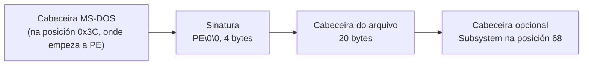

# Código › ferramentas (`tools/`)

> Estado: mantemento M1, despois da subfase 1.10. No M1, `fetch-conpty.ps1` fixa o ConPTY 1.25.261109001; os outros scripts non cambiaron. Na 1.9 chegou `check-resize.ps1`, que comproba o tamaño, o historial e o zoom de meiga, e `check-mouse.ps1` resta a franxa da barra de desprazamento ao medir as celas.

Scripts e modelos que axudan a compilar, revisar e empaquetar meiga. Non forman parte do programa. Os de medición do rendemento, en `tools/perf/`, explícanse á parte en [Código › medición](perf.md) e en [Código › escenarios de carga](escenarios.md).

| Arquivo | Para que |
|---|---|
| [`package.ps1`](#toolspackageps1) | Compilar en modo *release*, crear o `.zip` que se distribúe e deixar o ConPTY ao lado de `meiga.exe`. |
| [`fetch-conpty.ps1`](#toolsfetch-conptyps1) | Descargar o ConPTY que vai con meiga, comprobalo e deixalo en `target\conpty\` e nos cartafoles que se lle digan; avisar se hai unha versión nova. |
| [`check-imports.ps1`](#toolscheck-importsps1) | Comprobar que `meiga.exe` non depende do *runtime* de Visual C++. |
| [`check-window.ps1`](#toolscheck-windowps1) | Comprobar que `meiga.exe` abre a súa xanela, executa o seu programa e se pecha ben, sen deixar procesos. |
| [`check-present.ps1`](#toolscheck-presentps1) | Comprobar que `meiga.exe` presenta só o que cambia na saída dun programa e non debuxa en repouso nin minimizado. |
| [`check-keyboard.ps1`](#toolscheck-keyboardps1) | Comprobar que as teclas que se teclean en `meiga.exe` chegan ao programa do terminal coma as le PowerShell, co teclado español e co estadounidense. |
| [`check-mouse.ps1`](#toolscheck-mouseps1) | Comprobar que en `meiga.exe` o rato selecciona e copia texto, que as teclas e o botón dereito copian e pegan, e que o rato chega aos programas do terminal que o piden. |
| [`check-resize.ps1`](#toolscheck-resizeps1) | Comprobar que, cando a xanela de `meiga.exe` cambia de tamaño, tamén coa caixa de mensaxe aberta, a súa pantalla ten as mesmas filas ca a consola do ConPTY; que a roda, as teclas e a barra de desprazamento moven a vista do historial; e que o zoom cambia a grella. |
| [`terminal-sample.ps1`](#toolsterminal-sampleps1) | Escribir unha mostra do que ten que saber mostrar un terminal (cores, estilos, caracteres anchos…), para comprobala a ollo. |
| [`check-docs.ps1`](#toolscheck-docsps1) | Comprobar as ligazóns internas da documentación. |
| [`check-powershell.ps1`](#toolscheck-powershellps1) | Comprobar que todos os scripts piden PowerShell 7 dun xeito claro cando se abren con Windows PowerShell 5.1. |
| [`third-party-notices.ps1`](#toolsthird-party-noticesps1) | Xerar os avisos de licenza das dependencias. |
| [`about.hbs`](#toolsabouthbs) | Modelo dos avisos de licenza. |

Todos os scripts empezan igual: a axuda, os parámetros e unha comprobación da versión de PowerShell, que se explica en [`check-powershell.ps1`](#toolscheck-powershellps1).

## `tools/package.ps1`

Compila meiga en modo *release* e crea o paquete que se distribúe. Desde a subfase 1.6, deixa tamén o ConPTY ao lado de `target\release\meiga.exe`, para que as outras ferramentas executen meiga co mesmo ConPTY ca o paquete:

```powershell
.\tools\package.ps1            # compila e crea dist\meiga-<versión>-x86_64-pc-windows-msvc.zip
.\tools\package.ps1 -NoBuild   # empaqueta o meiga.exe que xa está compilado
```

Contido do `.zip`:

| Arquivo | Orixe |
|---|---|
| `meiga.exe` | `target\release\meiga.exe`. |
| `conpty.dll` e `OpenConsole.exe` | O ConPTY do Windows Terminal, que copia [`fetch-conpty.ps1`](#toolsfetch-conptyps1) desde o paquete NuGet, desde a subfase 1.4. |
| `LICENSE.txt` | `LICENSE`, coa extensión `.txt` para que Windows o abra cun dobre clic. |
| `README.md` | `README.md`. |
| `THIRD-PARTY-NOTICES.txt` | Xerado por `third-party-notices.ps1`. |

Explicación por partes:

```powershell
[CmdletBinding()]
param(
    [string]$OutDir,
    [switch]$NoBuild
)

# Windows PowerShell 5.1 can read this file but not run it: tell how to run
# it with PowerShell 7. tools/check-powershell.ps1 checks that this works.
if ($PSVersionTable.PSVersion.Major -lt 7) {
    …
}

$ErrorActionPreference = 'Stop'
Set-StrictMode -Version Latest
```

- `$OutDir`: o cartafol de destino. Por defecto, `dist\`, que Git ignora.
- `[switch]$NoBuild`: un parámetro sen valor. Se aparece na chamada, vale `$true`.
- A comprobación da versión é a mesma en todos os scripts (ver [`check-powershell.ps1`](#toolscheck-powershellps1)).
- As dúas últimas liñas deteñen o script ante calquera erro, como en todos os scripts (ver [Tecnoloxías › PowerShell 7](../tecnoloxias.md#11-powershell-7)).

```powershell
$root = (Resolve-Path (Join-Path $PSScriptRoot '..')).Path
# Not in param(): there, Windows PowerShell 5.1 leaves $PSScriptRoot empty and
# fails before the check above.
if (-not $OutDir) {
    $OutDir = Join-Path $root 'dist'
}
$OutDir = $ExecutionContext.SessionState.Path.GetUnresolvedProviderPathFromPSPath($OutDir)
```

- `Resolve-Path` devolve un obxecto; `.Path` colle a ruta como texto, para combinala despois con `Join-Path`.
- O valor por defecto de `$OutDir` ponse eiquí, despois da comprobación da versión, e non en `param()` (ver [`check-powershell.ps1`](#toolscheck-powershellps1)).
- A ruta de saída resólvese antes de cambiar de cartafol, igual que en [`third-party-notices.ps1`](#toolsthird-party-noticesps1).

```powershell
Push-Location $root
try {
    if (-not $NoBuild) {
        cargo build --release --locked
        if ($LASTEXITCODE -ne 0) {
            throw "cargo build failed with exit code $LASTEXITCODE"
        }
    }
```

Compila desde a raíz do repositorio coas versións exactas do `Cargo.lock` (`--locked`), salvo que se pase `-NoBuild`.

```powershell
    $metadata = cargo metadata --format-version 1 --no-deps --locked | ConvertFrom-Json
    if ($LASTEXITCODE -ne 0) {
        throw "cargo metadata failed with exit code $LASTEXITCODE"
    }
    $version = ($metadata.packages | Where-Object name -EQ 'meiga').version
    $exe = Join-Path $metadata.target_directory 'release\meiga.exe'
    if (-not (Test-Path -LiteralPath $exe -PathType Leaf)) {
        throw "$exe does not exist. Run the script without -NoBuild."
    }
```

- `cargo metadata` describe o workspace en JSON: os crates, as súas versións e o cartafol de compilación.
  - `--format-version 1` fixa o formato da saída, para que non cambie con versións futuras de Cargo;
  - `--no-deps` omite as dependencias externas, que non fan falta eiquí;
  - `ConvertFrom-Json` converte o texto en obxectos de PowerShell.
- A versión lese do `Cargo.toml` a través de Cargo, en vez de escribila no script: só hai un sitio onde cambiala.
- `target_directory` é o cartafol de compilación real, que pode non ser `target\` (por exemplo, coa variábel `CARGO_TARGET_DIR`).
- `-PathType Leaf` comproba que é un arquivo, non un cartafol.

```powershell
    $name = "meiga-$version-x86_64-pc-windows-msvc"
    $staging = Join-Path $metadata.target_directory "package\$name"
    if (Test-Path -LiteralPath $staging) {
        Remove-Item -LiteralPath $staging -Recurse -Force
    }
    New-Item -ItemType Directory -Force -Path $staging | Out-Null
```

- O nome do paquete leva a versión e o *target* (procesador x86-64, Windows, compilador MSVC). É a convención habitual nos proxectos de Rust.
- Os arquivos prepáranse primeiro nun cartafol intermedio (*staging*) dentro de `target\`. Bórrase antes, por se quedou dunha execución anterior, para que o zip non leve restos.
- `-LiteralPath` usa a ruta tal cal, sen interpretar caracteres comodín como `*` ou `[`.

```powershell
    Copy-Item -LiteralPath $exe -Destination $staging
    & (Join-Path $PSScriptRoot 'fetch-conpty.ps1') -Destination $staging, (Split-Path -Parent $exe)
    Copy-Item -LiteralPath (Join-Path $root 'LICENSE') -Destination (Join-Path $staging 'LICENSE.txt')
    Copy-Item -LiteralPath (Join-Path $root 'README.md') -Destination $staging
    & (Join-Path $PSScriptRoot 'third-party-notices.ps1') -OutFile (Join-Path $staging 'THIRD-PARTY-NOTICES.txt')
```

Copia os arquivos e xera os avisos de terceiros. `&` é o operador de chamada: executa o script cuxa ruta se calcula na propia liña. `fetch-conpty.ps1` comproba o ConPTY e cópiao ao cartafol do paquete; se aínda non está descargado, descárgao, así que o paquete sempre o leva.

**O ConPTY ao lado de `meiga.exe`.** Desde a subfase 1.6, `fetch-conpty.ps1` cópiao tamén ao cartafol de `meiga.exe`, `target\release\`, e por iso a súa saída ten dúas liñas `Copied to …`, unha por cartafol.

- `-Destination` recibe unha lista: os elementos van separados por comas. `Split-Path -Parent` dá o cartafol dunha ruta, e as parénteses fan que se execute antes, para que o seu resultado sexa o segundo elemento.
- **Por que.** meiga busca `conpty.dll` e `OpenConsole.exe` no seu propio cartafol e, se non os atopa, usa sen avisar o ConPTY de Windows, co seu `conhost.exe` ([Tecnoloxías › ConPTY](../tecnoloxias.md#31-conpty-a-pseudoconsola-de-windows)). Varias ferramentas executan `target\release\meiga.exe` cunha sesión no seu terminal: [`check-window.ps1`](#toolscheck-windowps1), [`check-present.ps1`](#toolscheck-presentps1), [`measure-startup.ps1`](perf.md#toolsperfmeasure-startupps1) e [`run-scenario.ps1 -Start`](escenarios.md#con--start). Sen esta copia, probarían e medirían un ConPTY distinto do que vai no paquete.

```powershell
    New-Item -ItemType Directory -Force -Path $OutDir | Out-Null
    $zip = Join-Path $OutDir "$name.zip"
    Compress-Archive -Path (Join-Path $staging '*') -DestinationPath $zip -Force
}
finally {
    Pop-Location
}

Write-Host "Wrote $zip"
```

- `Compress-Archive` crea o zip. Con `staging\*`, os arquivos quedan na raíz do zip, sen cartafol intermedio.
- `-Force` substitúe un zip anterior co mesmo nome.

## `tools/fetch-conpty.ps1`

Desde a subfase 1.4. Descarga o ConPTY que vai con meiga ([Tecnoloxías › ConPTY](../tecnoloxias.md#31-conpty-a-pseudoconsola-de-windows)), o paquete NuGet `Microsoft.Windows.Console.ConPTY` na versión que fixa o propio script, e compróbao. Deixa os dous arquivos que usa meiga en `target\conpty\`, onde os buscan as [probas](meiga-win.md#cratesmeiga-wintestsconptyrs) e o [exemplo](meiga-win.md#cratesmeiga-winexamplesconptyrs) de `meiga-win`, e desde onde os copia aos cartafoles que se lle digan: [`package.ps1`](#toolspackageps1) pídelle o do paquete e, desde a subfase 1.6, o de `target\release\meiga.exe`.

```powershell
.\tools\fetch-conpty.ps1                         # descarga e comproba; os arquivos quedan en target\conpty\
.\tools\fetch-conpty.ps1 -Destination <cartafol> # ademais, copia os dous arquivos a <cartafol>
.\tools\fetch-conpty.ps1 -Destination <a>, <b>   # ou a varios cartafoles
.\tools\fetch-conpty.ps1 -CheckLatest            # só mira en nuget.org se hai unha versión estábel máis nova
```

A primeira vez descarga o paquete, de 1,7 MB. As seguintes, só comproba o que xa ten, sen descargar nada:

```text
Microsoft.Windows.Console.ConPTY 1.25.261109001: the package is already in …\target\conpty.
conpty.dll: version 1.25.2611.09001, 119608 bytes, signed by Microsoft Corporation.
OpenConsole.exe: version 1.25.2611.09001, 1089336 bytes, signed by Microsoft Corporation.
conpty.dll and OpenConsole.exe are in …\target\conpty
```

`cargo test` necesita o ConPTY: sen el, as probas que o usan fallan cunha mensaxe que pide executar este script. Por iso a CI o executa antes das probas ([Código › GitHub](github.md#comprobacións)), e unha vez por semana comproba con `-CheckLatest` se hai unha versión nova ([job `conpty`](github.md#job-conpty)).

Explicación por partes:

```powershell
$Package = 'Microsoft.Windows.Console.ConPTY'
$Version = '1.25.261109001'
$Sha256 = '3D77F535DF848E44225C2A8912AC844FECB23F3057732B639F3034B587496F09'
# The files for x64, as they are in the package.
$Files = [ordered]@{
    'conpty.dll'      = 'runtimes/win-x64/native/conpty.dll'
    'OpenConsole.exe' = 'build/native/runtimes/x64/OpenConsole.exe'
}
# The v2 API of www.nuget.org. The v3 API, on api.nuget.org, would do too,
# but some networks block it.
$Feed = 'https://www.nuget.org/api/v2'
```

- `$Version` e `$Sha256` son o único sitio onde se fixa a versión do ConPTY ([ADR 0004](../adr/0004-conpty-empaquetado.md)). O SHA-256 é o do `.nupkg` enteiro ([Tecnoloxías › NuGet](../tecnoloxias.md#33-nuget-e-as-sinaturas-authenticode)).
- `$Files`: o nome de cada arquivo e a súa ruta dentro do paquete. Cada un está nun cartafol distinto: `conpty.dll` onde o buscan os proxectos de .NET, e `OpenConsole.exe` onde o buscan os de C++. `[ordered]` mantén a orde, para que as mensaxes saian sempre na mesma.
- `$ProgressPreference = 'SilentlyContinue'`, antes destas liñas, oculta a barra de progreso de `Invoke-WebRequest`.

```powershell
if ($CheckLatest) {
    $versions = [System.Collections.Generic.List[string]]::new()
    $url = "$Feed/FindPackagesById()?id='$Package'&semVerLevel=2.0.0"
    while ($url) {
        $feedXml = [xml](Invoke-WebRequest -Uri $url -TimeoutSec 60 -MaximumRetryCount 3 -RetryIntervalSec 5).Content
        $elements = @($feedXml.DocumentElement.ChildNodes | Where-Object { $_ -is [System.Xml.XmlElement] })
        foreach ($entry in $elements | Where-Object LocalName -EQ 'entry') {
            $versions.Add($entry.properties.Version)
        }
        # The feed comes in pages, each with a link to the next one.
        $next = @($elements | Where-Object { $_.LocalName -eq 'link' -and $_.GetAttribute('rel') -eq 'next' })
        $url = if ($next) { $next[0].GetAttribute('href') } else { $null }
    }
```

Con `-CheckLatest`, o script non descarga o paquete: só lista as versións publicadas.

- `FindPackagesById()` devolve un XML (Atom) cun elemento `entry` por versión. `semVerLevel=2.0.0` pide tamén as versións que só se poden escribir con SemVer 2.0, que sen el non aparecen.
- `[xml]` converte o texto nun documento XML. Os fillos do elemento raíz (`feed`) son as versións (`entry`), as ligazóns (`link`) e outros datos. O script percorre os fillos en vez de ler `$feedXml.feed.entry` porque, co modo estrito, ler unha propiedade que non existe é un erro: pasaría nunha páxina sen versións.
- `Where-Object { $_ -is [System.Xml.XmlElement] }` deixa só os elementos: entre eles pode haber texto, como os espazos, que non ten atributos.
- `-MaximumRetryCount 3 -RetryIntervalSec 5`: se a petición falla, por exemplo por un problema momentáneo da rede, repítea ata tres veces, cada 5 s.
- As versións chegan en páxinas. Cada páxina leva unha ligazón `link` con `rel="next"` á seguinte, e o bucle séguea ata a última. Hoxe todas caben nunha, pero o script non depende diso.

```powershell
    # Previews have a suffix, such as 1.26.260930004-preview.
    $stable = @($versions | Where-Object { $_ -notmatch '-' } | Sort-Object { [version]$_ })
    if ($stable.Count -eq 0) {
        throw "nuget.org lists no stable version of $Package."
    }
    $latest = $stable[-1]
    if ([version]$latest -gt [version]$Version) {
        throw "$Package $latest is newer than the pinned $Version. Update `$Version and `$Sha256 in $(Split-Path $PSCommandPath -Leaf)."
    }
    Write-Host "OK: $Version is the latest stable version of $Package on nuget.org."
    exit 0
}
```

- As versións de proba levan un sufixo despois dun guión, e quedan fóra.
- `Sort-Object { [version]$_ }` ordena as versións como números, parte por parte. Como texto, `1.9` iría despois de `1.25`.
- `$stable[-1]` é o último elemento: a versión máis nova.
- Se hai unha máis nova ca a fixada, falla e di o que hai que cambiar. Na mensaxe, `` `$ `` escribe un `$` en vez de ler a variábel.

```powershell
$root = (Resolve-Path (Join-Path $PSScriptRoot '..')).Path
Push-Location $root
try {
    $metadata = cargo metadata --format-version 1 --no-deps --locked | ConvertFrom-Json
    if ($LASTEXITCODE -ne 0) {
        throw "cargo metadata failed with exit code $LASTEXITCODE"
    }
}
finally {
    Pop-Location
}
$folder = Join-Path $metadata.target_directory 'conpty'
New-Item -ItemType Directory -Force -Path $folder | Out-Null
```

O cartafol de compilación, coma en [`package.ps1`](#toolspackageps1): `cargo metadata` desde a raíz do repositorio. O paquete e os arquivos quedan en `conpty\`, dentro del: Git ignórao, e `cargo clean` bórrao.

```powershell
$nupkg = Join-Path $folder "$Package.$Version.nupkg"
if ((Test-Path -LiteralPath $nupkg) -and (Get-FileHash -LiteralPath $nupkg -Algorithm SHA256).Hash -eq $Sha256) {
    Write-Host "$Package ${Version}: the package is already in $folder."
}
else {
    $partial = "$nupkg.partial"
    Invoke-WebRequest -Uri "$Feed/package/$Package/$Version" -OutFile $partial -TimeoutSec 120 -MaximumRetryCount 3 -RetryIntervalSec 5
    $hash = (Get-FileHash -LiteralPath $partial -Algorithm SHA256).Hash
    if ($hash -ne $Sha256) {
        Remove-Item -LiteralPath $partial
        throw "The SHA-256 of the downloaded package is $hash, and it should be $Sha256."
    }
    Move-Item -LiteralPath $partial -Destination $nupkg -Force
    Write-Host "$Package ${Version}: downloaded from nuget.org, $((Get-Item -LiteralPath $nupkg).Length) bytes, with the expected SHA-256."
}
```

- Só descarga o paquete se non o ten, ou se o que ten non é exactamente o fixado.
- Descárgao primeiro con outro nome (`.partial`), e dálle o definitivo só despois de comprobar o SHA-256. Así, unha descarga cortada ou un paquete distinto nunca quedan co nome do bo.
- `${Version}`, coas chaves, porque despois vén `:`, que PowerShell lería como parte do nome da variábel.

```powershell
Add-Type -AssemblyName System.IO.Compression.FileSystem
$zip = [System.IO.Compression.ZipFile]::OpenRead($nupkg)
try {
    foreach ($name in $Files.Keys) {
        $entry = $zip.GetEntry($Files[$name])
        if (-not $entry) {
            throw "The package has no $($Files[$name])."
        }
        $path = Join-Path $folder $name
        # Extract only what changed: a running session keeps its
        # OpenConsole.exe in use, and Windows does not let it be replaced.
        $stream = $entry.Open()
        try {
            $hash = [System.Convert]::ToHexString([System.Security.Cryptography.SHA256]::HashData($stream))
        }
        finally {
            $stream.Dispose()
        }
        if (-not (Test-Path -LiteralPath $path) -or (Get-FileHash -LiteralPath $path -Algorithm SHA256).Hash -ne $hash) {
            [System.IO.Compression.ZipFileExtensions]::ExtractToFile($entry, $path, $true)
        }
    }
}
finally {
    $zip.Dispose()
}
```

- Un `.nupkg` é un zip: `ZipFile.OpenRead` ábreo con .NET, sen descomprimilo enteiro. `GetEntry` busca cada arquivo pola súa ruta, e o script falla se non está, por exemplo se unha versión nova o cambiase de cartafol.
- Só extrae o arquivo se non existe ou se é distinto do do paquete: compara o SHA-256 do que hai dentro do zip (`SHA256.HashData` le o arquivo comprimido sen gardalo) co do que xa está fóra. Mentres unha sesión está aberta (por exemplo, o exemplo de `meiga-win`), Windows non deixa substituír o seu `OpenConsole.exe`; así, executar o script nese momento non falla se o arquivo xa é o bo.
- `[System.Convert]::ToHexString` escribe o *hash* en hexadecimal e en maiúsculas, coma `Get-FileHash`.
- `ExtractToFile` co terceiro argumento a `$true` substitúe o arquivo que houbese.
- Os `try`/`finally` pechan o zip e cada arquivo de dentro aínda que algo falle.

```powershell
foreach ($name in $Files.Keys) {
    $path = Join-Path $folder $name
    $signature = Get-AuthenticodeSignature -LiteralPath $path
    if ($signature.Status -ne 'Valid' -or $signature.SignerCertificate.Subject -notmatch '(^|, )O=Microsoft Corporation(,|$)') {
        throw "$name is not signed by Microsoft: $($signature.Status), $($signature.StatusMessage)"
    }
    $file = Get-Item -LiteralPath $path
    Write-Host ("{0}: version {1}, {2} bytes, signed by Microsoft Corporation." -f $name, $file.VersionInfo.FileVersion, $file.Length)
}
Write-Host "conpty.dll and OpenConsole.exe are in $folder"
```

- Comproba a sinatura Authenticode dos dous arquivos ([Tecnoloxías › NuGet e as sinaturas Authenticode](../tecnoloxias.md#33-nuget-e-as-sinaturas-authenticode)): que é válida e que a organización (`O=`) do certificado é Microsoft Corporation.
- A expresión regular quere `O=Microsoft Corporation` como un campo enteiro do nome do certificado: ao principio ou despois de `, `, e antes dunha coma ou do final. Non vale, por exemplo, `O=Microsoft Corporation Fake`.
- A versión de cada arquivo (`VersionInfo.FileVersion`) é a do Windows Terminal do que sae: a do paquete, escrita doutra maneira.

```powershell
foreach ($target in $Destination) {
    # Resolve a relative path against the current PowerShell location, not
    # the working directory of the process.
    $target = $ExecutionContext.SessionState.Path.GetUnresolvedProviderPathFromPSPath($target)
    New-Item -ItemType Directory -Force -Path $target | Out-Null
    foreach ($name in $Files.Keys) {
        $source = Join-Path $folder $name
        $copy = Join-Path $target $name
        # Copy only what changed, for the same reason: meiga may be running
        # from that folder.
        if (-not (Test-Path -LiteralPath $copy) -or
            (Get-FileHash -LiteralPath $copy -Algorithm SHA256).Hash -ne (Get-FileHash -LiteralPath $source -Algorithm SHA256).Hash) {
            Copy-Item -LiteralPath $source -Destination $copy
        }
    }
    Write-Host "Copied to $target"
}
```

Con `-Destination`, copia os dous arquivos a eses cartafoles: é o que fai `package.ps1` co cartafol do paquete e co de `meiga.exe`.

- Desde a subfase 1.6, `-Destination` é unha lista de cartafoles (`[string[]]`), separados por comas. Sen el, `$Destination` vale `$null`, e `foreach` non dá ningunha volta: non fai falta ningún `if`.
- Cada ruta resólvese coma en [`third-party-notices.ps1`](#toolsthird-party-noticesps1).
- **Só copia o que cambiou**, pola mesma razón ca ao extraer: se un meiga corre desde ese cartafol, `conpty.dll` está cargada nel e, mentres a súa sesión está aberta, `OpenConsole.exe` está en uso, e Windows non deixa substituílos. Desde a 1.6, `package.ps1` copia o ConPTY a `target\release\`, de onde se executa meiga mentres se desenvolve: sen esta comprobación, a copia fallaría cun meiga aberto desde alí, aínda que os arquivos fosen os mesmos. Se cambiaron de verdade, por exemplo cunha versión nova do ConPTY, a copia falla igual, e hai que pechar antes ese meiga.
- Compara o SHA-256 da copia co do arquivo de `target\conpty\`, que xa está comprobado. A condición ocupa dúas liñas: a primeira remata en `-or`, e PowerShell segue lendo na seguinte.
- A liña `Copied to …` sae por cada cartafol, tamén se os arquivos xa estaban: di onde están.

**Actualizar o ConPTY.** Cando o job `conpty` falla, ou `-CheckLatest` di que hai unha versión nova:

1. Ler as novidades da versión nova, nas notas da versión do Windows Terminal coa mesma serie.
2. Descargar o paquete e calcular o seu SHA-256. nuget.org mostra o SHA-512 dos paquetes, non o SHA-256:

   ```powershell
   $new = '<versión nova>'
   Invoke-WebRequest "https://www.nuget.org/api/v2/package/Microsoft.Windows.Console.ConPTY/$new" -OutFile "$env:TEMP\conpty.nupkg"
   (Get-FileHash "$env:TEMP\conpty.nupkg" -Algorithm SHA256).Hash
   ```

3. Cambiar `$Version` e `$Sha256` no script e executalo: descarga o paquete novo e comproba as sinaturas.
4. Pasar as probas (`cargo test --workspace`) e o exemplo de `meiga-win` con `cmd` e con `pwsh`.
5. Comprobar que a licenza do paquete segue sendo a MIT, coma no modelo dos [avisos de terceiros](#toolsabouthbs), e cambiar a versión na documentación.

Se o SHA-256 dun paquete xa fixado deixase de coincidir, o script falla. Nese caso, non se debe cambiar `$Sha256` sen saber antes por que cambiou o paquete.

## `tools/check-imports.ps1`

Comproba que `meiga.exe` non depende do *runtime* de Visual C++. Protexe a decisión de ligar o CRT estaticamente ([Tecnoloxías › CRT](../tecnoloxias.md#5-runtime-de-c-ligado-estaticamente-crt-static)): se algo a desfai, a CI falla.

```powershell
.\tools\check-imports.ps1                                 # comproba target\release\meiga.exe
.\tools\check-imports.ps1 -Path outro\cartafol\meiga.exe
```

Saída esperada:

```text
meiga.exe imports: kernel32.dll, dwrite.dll, ntdll.dll, oleaut32.dll, combase.dll, gdi32.dll, user32.dll, api-ms-win-core-synch-l1-2-0.dll
OK: no dependencies on the Visual C++ runtime.
```

`user32.dll` e `gdi32.dll` chegaron coa xanela, na subfase 1.1, e `dwrite.dll`, `combase.dll` e `oleaut32.dll`, co texto, na 1.3. Para que serve cada unha, e por que ata a 1.4 `kernel32.dll` aparecía dúas veces, explícase en [Código › meiga](meiga.md#comprobacións-feitas).

**Por que fai falta.** A opción `+crt-static` está en `.cargo/config.toml`, pero hai formas de perdela sen que nada falle: a máis habitual é definir a variábel `RUSTFLAGS`, que fai que Cargo ignore os `rustflags` de `.cargo/config.toml` (ver [Código › .github](github.md#variábeis-de-contorno)). Comprobouse cunha compilación con `RUSTFLAGS='-C opt-level=3'`:

```text
meiga.exe imports: api-ms-win-core-synch-l1-2-0.dll, KERNEL32.dll, ntdll.dll, VCRUNTIME140.dll,
api-ms-win-crt-string-l1-1-0.dll, api-ms-win-crt-runtime-l1-1-0.dll, ...
It depends on the Visual C++ runtime: VCRUNTIME140.dll, api-ms-win-crt-string-l1-1-0.dll, ...
Is RUSTFLAGS overriding .cargo/config.toml?
```

Explicación por partes:

```powershell
$Path = $ExecutionContext.SessionState.Path.GetUnresolvedProviderPathFromPSPath($Path)
if (-not (Test-Path -LiteralPath $Path -PathType Leaf)) {
    throw "$Path does not exist. Build it first with: cargo build --release"
}
```

Resolve a ruta como nos outros scripts e comproba que o executábel existe.

```powershell
$vswhere = Join-Path ${env:ProgramFiles(x86)} 'Microsoft Visual Studio\Installer\vswhere.exe'
if (-not (Test-Path -LiteralPath $vswhere -PathType Leaf)) {
    throw 'vswhere.exe was not found. Install Visual Studio or the Build Tools.'
}
$vs = & $vswhere -latest -products * -requires Microsoft.VisualStudio.Component.VC.Tools.x86.x64 -property installationPath
if ($LASTEXITCODE -ne 0 -or -not $vs) {
    throw 'No Visual Studio installation with the MSVC build tools was found.'
}
```

- `dumpbin` non está no `PATH` dunha consola normal, e a súa ruta cambia con cada versión de Visual Studio. `vswhere` é a ferramenta oficial para localizar as instalacións (ver [Tecnoloxías › MSVC](../tecnoloxias.md#13-msvc-e-o-windows-sdk)).
- `${env:ProgramFiles(x86)}`: as chaves son necesarias porque o nome da variábel leva parénteses.
- Opcións de `vswhere`:
  - `-latest`: a instalación máis recente;
  - `-products *`: inclúe tamén as *Build Tools*, que non son un Visual Studio completo;
  - `-requires …VC.Tools.x86.x64`: só instalacións co compilador de C++ para x64;
  - `-property installationPath`: devolve só a ruta da instalación.

```powershell
$toolsVersion = (Get-Content -LiteralPath (Join-Path $vs 'VC\Auxiliary\Build\Microsoft.VCToolsVersion.default.txt') -Raw).Trim()
$dumpbin = Join-Path $vs "VC\Tools\MSVC\$toolsVersion\bin\Hostx64\x64\dumpbin.exe"
```

- Unha instalación pode ter varias versións das ferramentas de C++. Este arquivo indica a predeterminada, a mesma que usa a *Developer PowerShell*.
- `Hostx64\x64`: as ferramentas que corren nun Windows de 64 bits e traballan con binarios de 64 bits.

```powershell
$output = & $dumpbin /nologo /dependents $Path
if ($LASTEXITCODE -ne 0) {
    throw "dumpbin failed with exit code $LASTEXITCODE"
}

# dumpbin prints each imported DLL on its own indented line.
$dlls = foreach ($line in $output) {
    if ($line -match '^\s+(\S+\.dll)\s*$') { $Matches[1] }
}
Write-Host "$(Split-Path -Leaf $Path) imports: $($dlls -join ', ')"
```

- `/dependents` lista as DLL que importa o executábel, e `/nologo` omite a cabeceira coa versión.
- A saída de `dumpbin` é texto. A expresión regular colle as liñas sangradas que só conteñen un nome rematado en `.dll`:
  - `^\s+`: espazos ao principio da liña;
  - `(\S+\.dll)`: o nome, que queda gardado en `$Matches[1]`;
  - `\s*$`: nada máis ata o final da liña.
- `$dlls = foreach …` recolle nun array todo o que emite o bucle.

```powershell
$runtime = $dlls | Where-Object { $_ -match '^(vcruntime.*|msvcp.*|ucrtbase|api-ms-win-crt-.*)\.dll$' }
if ($runtime) {
    throw "It depends on the Visual C++ runtime: $($runtime -join ', '). Is RUSTFLAGS overriding .cargo/config.toml?"
}

Write-Host 'OK: no dependencies on the Visual C++ runtime.'
```

Busca as DLL do *runtime*: `vcruntime*.dll` (o *runtime* de Visual C++), `msvcp*.dll` (a biblioteca estándar de C++), `ucrtbase.dll` (o *Universal CRT*) e os *API sets* `api-ms-win-crt-*`, que son os nomes cos que se importa o *Universal CRT*. `-match` non distingue maiúsculas, así que `VCRUNTIME140.dll` tamén coincide. Se aparece algunha, o script falla e suxire a causa máis probábel.

## `tools/check-window.ps1`

Comproba que `meiga.exe` fai o que prometen as subfases 1.1 e 1.6: abre a súa xanela, sen consola e coa escala por monitor; executa no seu terminal o programa da liña de comandos, que lle pon título á xanela; e, cando se pecha, remata ben, e con el o programa e a súa consola. Inicia o programa de verdade, con `cmd` no terminal, así que a xanela vese durante un segundo, máis ou menos.

```powershell
.\tools\check-window.ps1                                  # comproba target\release\meiga.exe
.\tools\check-window.ps1 -Path outro\cartafol\meiga.exe
.\tools\check-window.ps1 -TimeoutSeconds 30               # nunha máquina moi lenta
```

Saída esperada:

```text
OK: it is a GUI program, so it opens no console window.
OK: it opens its window (class 'meiga', title 'meiga').
OK: the window is DPI aware per monitor (v2).
OK: the program in the terminal sets the title of the window ('meiga-check').
OK: it ends with exit code 0 when its window closes.
OK: then the program in the terminal and its console end too (cmd.exe, OpenConsole.exe).
```

A última liña di `conhost.exe` en vez de `OpenConsole.exe` se o ConPTY non está ao lado de `meiga.exe`, por exemplo despois dun `cargo build --release` sen [`package.ps1`](#toolspackageps1): meiga usa entón o de Windows.

Se falla unha comprobación, o script remata cun erro que explica cal, e código de saída 1. Pase o que pase, `meiga.exe` non queda aberto.

Explicación por partes:

```powershell
[ValidateRange(1, 600)]
[int]$TimeoutSeconds = 10
```

O tempo máximo de cada espera: que se abra a xanela, que cambie o título, que remate o proceso e, despois, que rematen o programa e a súa consola. Abrir a xanela leva milisegundos, e cmd cambia o título despois dun segundo, así que 10 s só se esgotan se algo vai mal.

```powershell
$header = [byte[]]::new(4096)
$stream = [IO.File]::OpenRead($Path)
try {
    $read = $stream.Read($header, 0, $header.Length)
}
finally {
    $stream.Dispose()
}
$pe = if ($read -ge 0x40) { [BitConverter]::ToInt32($header, 0x3C) } else { -1 }
if ($pe -lt 0 -or $pe + 24 + 70 -gt $read -or [BitConverter]::ToUInt32($header, $pe) -ne 0x4550) {
    throw "$Path is not a Windows executable."
}
# The optional header follows the signature (4 bytes) and the file header (20
# bytes), and Subsystem is at offset 68 in both PE32 and PE32+.
$subsystem = [BitConverter]::ToUInt16($header, $pe + 24 + 68)
if ($subsystem -ne 2) {
    throw "$exe uses subsystem $subsystem instead of 2 (Windows GUI), so it opens a console window. Is it a debug build?"
}
```

O **subsistema** (ver [Tecnoloxías › Subsistema](../tecnoloxias.md#6-subsistema-de-windows)) é un número na cabeceira do `.exe`, que segue o formato **PE** (*Portable Executable*):



- Só se len os primeiros 4 KB: a cabeceira sempre está ao principio, e un `.exe` de depuración ocupa varios MB.
- `try`/`finally` pecha o arquivo aínda que a lectura falle.
- `[BitConverter]::ToInt32($header, 0x3C)` le un número de 4 bytes na posición 0x3C: onde empeza a cabeceira PE.
- `0x4550` son os bytes `P` e `E` seguidos de dous ceros, lidos como un número (os procesadores x64 gardan primeiro o byte de menos peso). Se non están, o arquivo non é un executábel de Windows. A condición tamén comproba que as posicións que se len caen dentro do que se leu.
- `Subsystem` está na mesma posición nos executábeis de 32 bits (PE32) e nos de 64 (PE32+). O valor 2 é unha aplicación gráfica, e o 3, de consola: o que daría unha compilación de depuración (ver [Código › meiga](meiga.md#cratesmeigasrcmainrs)).

```powershell
if (-not ('Meiga.Tools.WindowCheck' -as [type])) {
    Add-Type -Namespace Meiga.Tools -Name WindowCheck -MemberDefinition @'
[DllImport("user32.dll", CharSet = CharSet.Unicode)]
public static extern int GetClassNameW(IntPtr window, System.Text.StringBuilder name, int capacity);

[DllImport("user32.dll")]
public static extern IntPtr GetWindowDpiAwarenessContext(IntPtr window);

[DllImport("user32.dll")]
[return: MarshalAs(UnmanagedType.Bool)]
public static extern bool AreDpiAwarenessContextsEqual(IntPtr first, IntPtr second);
'@
}
```

- PowerShell non pode chamar directamente a estas tres funcións de Windows. `Add-Type -MemberDefinition` compila unha clase de C# con elas: `[DllImport("user32.dll")]` indica en que DLL está cada unha, e .NET convirte os argumentos ao chamala (*P/Invoke*). Igual que en [`measure.ps1`](../tecnoloxias.md#c-dentro-de-powershell), só que con tres declaracións en vez dun arquivo.
- `-as [type]` comproba se a clase xa existe: nunha mesma sesión de PowerShell só se pode compilar unha vez.
- `GetClassNameW` dá o nome da clase dunha xanela, e `GetWindowDpiAwarenessContext`, como escala a xanela. `[return: MarshalAs(UnmanagedType.Bool)]` indica que o `BOOL` de Windows (un número de 4 bytes) se converte nun `bool`.

```powershell
$title = 'meiga-check'
$info = [Diagnostics.ProcessStartInfo]::new($Path)
$info.UseShellExecute = $false
# With /k, cmd shows each command in the title while it runs ("cmd.exe -
# ping ..."), as soon as it starts, and the title "meiga" could be gone
# before the check below. With /c it does not. pause keeps cmd running until
# the window closes, and there is no space before & because it would be part
# of the title.
foreach ($argument in 'cmd', '/d', '/c', "ping -n 2 127.0.0.1 >nul & title $title& pause >nul") {
    $info.ArgumentList.Add($argument)
}
```

Desde a subfase 1.6, meiga executa no seu terminal o programa da súa liña de comandos ([Código › meiga](meiga.md#cratesmeigasrcoptionsrs)). O script dálle un `cmd` que fai algo que se ve desde fóra sen ler a pantalla: cambiar o título da xanela.

- `UseShellExecute = $false`: Windows crea o proceso directamente, sen pasar polo Explorador.
- `ArgumentList` pasa cada argumento por separado, e .NET pon as comiñas que fagan falta: o último leva espazos, así que vai entre comiñas. meiga recibe os catro e xúntaos outra vez, coas mesmas regras, para lanzar cmd ([Tecnoloxías › A liña de comandos](../tecnoloxias.md#40-a-liña-de-comandos-en-windows)). Polo camiño, ninguén interpreta o `>nul` nin o `&`: chegan ao cmd de dentro de meiga, que quita as comiñas de fóra e executa o que hai dentro.
- `/d`: cmd non executa os comandos `AutoRun` do rexistro de Windows, que alguén pode ter configurados e que cambiarían o que fai.
- `/c`: cmd executa os comandos e remata. Con `/k`, que despois segue aberto esperando ordes, coma unha shell, cmd mostra no título cada comando mentres o executa (`C:\Windows\SYSTEM32\cmd.exe - ping  -n 2 127.0.0.1`), e faino en canto arranca: o título «meiga» podía desaparecer antes de que o script mirase a xanela. Pasou nunha execución da CI: o título de cmd chega poucos milisegundos despois de abrirse a xanela. Con `/c`, cmd non toca o título: só o cambia `title`.
- `ping -n 2 127.0.0.1 >nul` envía dous *pings* ao propio equipo, cun segundo entre eles: sen rede e, con `>nul`, sen escribir nada. É o xeito clásico de esperar un segundo en cmd. A espera fai que o título aínda sexa «meiga» cando o script mira a xanela, xusto despois de que se abra, e que cambie despois: sen ela, `title` podería cambialo antes, e a comprobación da xanela fallaría ás veces.
- `&` executa un comando despois do outro, e `title` cambia o título da consola co texto que ten detrás, ata o seguinte `&`: por iso non hai un espazo antes del, que sería parte do título. O ConPTY envíallo ao terminal como unha secuencia OSC ([Tecnoloxías › As secuencias de control](../tecnoloxias.md#35-as-secuencias-de-control)).
- `pause >nul` agarda a que se prema unha tecla, sen escribir nada, e ninguén a preme: así cmd segue aberto ata que se pecha a xanela, e a última comprobación, que cmd remata cando se pecha meiga, demostra algo. Sen el, cmd remataría despois de poñer o título.

```powershell
$process = [Diagnostics.Process]::Start($info)
try {
    # WaitForInputIdle returns when meiga has painted its window and waits for
    # messages. It fails if the process has already ended.
    $idle = try { $process.WaitForInputIdle($TimeoutSeconds * 1000) } catch { $false }
    if (-not $idle) {
        if ($process.HasExited) {
            throw "$exe ended with exit code $($process.ExitCode) before it opened its window."
        }
        throw "$exe did not open its window within $TimeoutSeconds s."
    }
```

`WaitForInputIdle` agarda a que o programa remate de arrancar e quede esperando mensaxes, sen ningunha pendente: no caso de meiga, coa xanela xa pintada (ver [Código › meiga-win](meiga-win.md#windowrun)) e, desde a subfase 1.6, co programa do terminal xa lanzado, porque meiga lanza a súa sesión antes do primeiro fotograma ([ADR 0013](../adr/0013-da-saida-a-pantalla.md)). Devolve `$false` se pasa o tempo, e produce un erro se o proceso xa rematou, por iso o `try`/`catch`.

```powershell
    $process.Refresh()
    $window = $process.MainWindowHandle
    $class = [Text.StringBuilder]::new(256)
    if ($window -ne [IntPtr]::Zero) {
        $null = [Meiga.Tools.WindowCheck]::GetClassNameW($window, $class, $class.Capacity)
    }
    if ("$class" -ne 'meiga' -or $process.MainWindowTitle -ne 'meiga') {
        throw "The main window has class '$class' and title '$($process.MainWindowTitle)' instead of class 'meiga' and title 'meiga'. Did meiga show an error?"
    }
```

- `Refresh()` descarta os datos do proceso que .NET garda en memoria, para ler os actuais.
- `MainWindowHandle` é a primeira xanela visíbel e de nivel superior do proceso. Se meiga fallase ao arrancar, sería a caixa da mensaxe de erro, que tamén leva o título «meiga». Por iso se comproba tamén a clase: a de meiga chámase `meiga`, e a das caixas de mensaxe, `#32770`.
- `GetClassNameW` escribe o nome nun `StringBuilder`, un texto que se pode modificar, de ata 256 caracteres.

```powershell
    $context = [Meiga.Tools.WindowCheck]::GetWindowDpiAwarenessContext($window)
    if (-not [Meiga.Tools.WindowCheck]::AreDpiAwarenessContextsEqual($context, [IntPtr]::new(-4))) {
        throw 'The window is not DPI aware per monitor (v2). Is the manifest embedded?'
    }
```

O **contexto de escala** da xanela di como escala (ver [Tecnoloxías › Manifesto](../tecnoloxias.md#23-manifesto-da-aplicación-e-dpi)). `-4` é o valor que Windows define para «por monitor, versión 2» (`DPI_AWARENESS_CONTEXT_PER_MONITOR_AWARE_V2`). O contexto que devolve Windows non ten por que ser ese número, así que a documentación manda comparalos con `AreDpiAwarenessContextsEqual`, e non con `-eq`. Se o manifesto non estivese incrustado, a xanela non escalaría e a comprobación fallaría.

```powershell
    # As administrator, as on the CI runners, cmd puts "Administrator: " (in
    # the language of Windows) before the title that it is given.
    $deadline = [DateTime]::UtcNow.AddSeconds($TimeoutSeconds)
    while ($true) {
        $process.Refresh()
        $shown = $process.MainWindowTitle
        if ($shown -eq $title -or $shown.EndsWith(" $title")) {
            break
        }
        if ($process.HasExited -or [DateTime]::UtcNow -gt $deadline) {
            throw "The title of the window is '$shown' and not '$title', the one that cmd sets in the terminal."
        }
        Start-Sleep -Milliseconds 100
    }
    Write-Host "OK: the program in the terminal sets the title of the window ('$shown')."
```

**O título** é a forma máis simple de ver desde fóra que a saída dun programa chega á xanela, e para chegar pasa por todo o camiño da subfase 1.6: cmd cambia o título da consola, o ConPTY escríbeo na súa saída, o fío lector de meiga pásallo ao terminal e avisa á xanela, e a xanela colle o título e pono na barra de título ([Tecnoloxías › Avisar á xanela desde outro fío](../tecnoloxias.md#36-avisar-á-xanela-desde-outro-fío-postmessage) e [› O foco e o título da xanela](../tecnoloxias.md#39-o-foco-e-o-título-da-xanela)). Se falla calquera paso, o título non cambia.

- O script mira o título cada 0,1 s ata que é o de cmd. `Refresh()` fai falta en cada volta: sen el, .NET devolvería sempre o título que leu a primeira vez.
- **Como administrador**, cmd pon diante do título que lle dan `Administrator: `, na lingua de Windows, e un espazo. Por iso vale tamén un título que remate nun espazo e `meiga-check`. Os *runners* da CI corren como administrador, e alí a liña do resultado é `OK: the program in the terminal sets the title of the window ('Administrator:  meiga-check').` O prefixo pono cmd, non o ConPTY: o título que escribe un programa cunha secuencia OSC chega tal cal, como o de [`check-present.ps1`](#toolscheck-presentps1).
- Se meiga remata, ou se pasa o tempo, falla e di que título ten a xanela.
- A liña do resultado mostra o título que ten a xanela.

```powershell
    # The programs that meiga started: the console host of the session and
    # cmd.
    $children = @(Get-CimInstance Win32_Process -Filter "ParentProcessId = $($process.Id)" |
            Where-Object { $_.CreationDate -ge $process.StartTime })
    $names = @($children | ForEach-Object Name | Sort-Object)
    if ($names -notcontains 'cmd.exe' -or -not ($names -match '^(OpenConsole|conhost)\.exe$')) {
        throw "meiga.exe started $($names -join ', ') instead of cmd.exe and its console host."
    }
```

**Os fillos de meiga**, antes de pechar a xanela: cmd e o anfitrión da consola da sesión ([Tecnoloxías › ConPTY](../tecnoloxias.md#31-conpty-a-pseudoconsola-de-windows)).

- `Get-CimInstance Win32_Process` le os procesos a través de CIM, a interface moderna de WMI, que dá de cada un o PID do seu pai (`ParentProcessId`). O filtro aplícao o propio WMI, que só devolve os fillos de meiga.
- `CreationDate -ge $process.StartTime`: Windows reutiliza os PID, así que un proceso cuxo pai rematou hai tempo pode ter como `ParentProcessId` o PID que agora ten meiga. Un fillo de verdade sempre se creou despois ca o pai, como se ten en conta tamén en [`measure.ps1`](perf.md#toolsperfmeasureps1).
- Ten que haber un `cmd.exe` e un anfitrión: `OpenConsole.exe`, o do ConPTY que vai con meiga, ou `conhost.exe`, o de Windows. Cunha lista á esquerda, `-match` devolve os elementos que coinciden, e unha lista baleira conta como falso.
- **Por que antes de pechar.** Despois, cmd e o anfitrión poderían ter rematado xa, e o script non os atoparía: non podería distinguir entre «remataron» e «nunca existiron», e a última comprobación pasaría igual. Así, ten a lista exacta dos procesos polos que esperar, e sabe que existiron.

```powershell
    if (-not $process.CloseMainWindow()) {
        throw "Could not ask the window of $exe to close."
    }
    if (-not $process.WaitForExit($TimeoutSeconds * 1000)) {
        throw "$exe was still running $TimeoutSeconds s after its window was asked to close."
    }
    if ($process.ExitCode -ne 0) {
        throw "$exe ended with exit code $($process.ExitCode) instead of 0."
    }
```

- `CloseMainWindow` envía `WM_CLOSE` á xanela, a mesma mensaxe que o botón X da barra de título, e `WaitForExit` agarda a que remate o proceso.
- O código de saída ten que ser 0, tamén co programa do terminal aínda aberto, coma neste caso. Unha caixa de erro pechada así daría 1 (ver [Código › meiga](meiga.md#cratesmeigasrcmainrs)).

```powershell
    $deadline = [DateTime]::UtcNow.AddSeconds($TimeoutSeconds)
    while ($true) {
        $alive = @($children | Where-Object { Get-Process -Id $_.ProcessId -ErrorAction Ignore })
        if ($alive.Count -eq 0) {
            break
        }
        if ([DateTime]::UtcNow -gt $deadline) {
            throw "$(($alive | ForEach-Object Name) -join ' and ') still running $TimeoutSeconds s after meiga.exe ended."
        }
        Start-Sleep -Milliseconds 100
    }
}
finally {
    if (-not $process.HasExited) {
        $process.Kill()
    }
    $process.Dispose()
}
```

**Despois de meiga, os seus fillos.** Cando meiga remata, a súa sesión péchase, e con ela o ConPTY: cmd e o anfitrión teñen que rematar tamén ([ADR 0011](../adr/0011-fin-e-peche-das-sesions.md)). Un terminal que, ao pecharse, deixase vivos a shell e o anfitrión da súa consola deixaría procesos sen xanela, que ninguén ve nin pecha, cada vez que se pecha unha xanela.

- `Get-Process -Id … -ErrorAction Ignore` non devolve nada, sen erro, se o proceso xa non existe: `$alive` son os que seguen vivos. O script mira cada 0,1 s ata que non queda ningún, e se pasa o tempo, falla e di cales seguen.
- O script pecha a xanela cando cmd xa leva polo menos un segundo aberto. Pechala mentres un programa aínda se está a conectar á consola é outro caso, que estuda o [ADR 0011](../adr/0011-fin-e-peche-das-sesions.md).
- O bloque `finally` execútase sempre, tamén despois dun `throw`: se meiga segue aberto, remátao (`Kill`), e libera os recursos do obxecto do proceso (`Dispose`).

A CI executa este script en cada PR, despois de empaquetar (ver [Código › .github](github.md#empaquetar-e-comprobar-o-executábel)), así que o anfitrión é `OpenConsole.exe`: `package.ps1` deixou o ConPTY ao lado de `meiga.exe`. Os *runners* de Windows de GitHub teñen un escritorio, así que a xanela ábrese de verdade.

## `tools/check-present.ps1`

Comproba que `meiga.exe` fai o que prometen as subfases 1.2 e 1.6: presenta só o que cambia, agrupa os cambios en fotogramas e non debuxa nada en repouso nin coa xanela minimizada, tamén cando quen cambia a pantalla é un programa; e, coa xanela minimizada, remata á súa hora límite unha actualización sincronizada que o programa deixa aberta. Abre meiga co rexistro dos fotogramas ([`--trace-frames`](meiga.md#cratesmeigasrctracers)) e, no seu terminal, un script de PowerShell que escribe na pantalla un paso cada vez, cando llo di a comprobación; despois de cada paso, comproba no rexistro o que debuxou meiga. Leva uns segundos.

```powershell
.\tools\check-present.ps1                                  # comproba target\release\meiga.exe
.\tools\check-present.ps1 -Path outro\cartafol\meiga.exe
.\tools\check-present.ps1 -TimeoutSeconds 30               # nunha máquina moi lenta
```

Necesita PowerShell 7 no `PATH`: meiga lanza o script do terminal con `pwsh`, polo nome.

Ata a subfase 1.5, a comprobación enviáballe á demo eventos do rato, e un clic na xanela cambiaba o que debuxaba. Desde a 1.6 a demo xa non existe, e o que cambia a pantalla é o programa do terminal; e, desde a 1.8, tamén o rato, que selecciona texto. Mentres corre, non toques a xanela de meiga: a comprobación minimízaa, restáuraa e cambia o seu tamaño, e espera uns fotogramas concretos.

Saída esperada, cos píxeles que dependen da pantalla:

```text
OK: the first paint covers the whole window (… x … pixels).
OK: a row that changed 5 times made 5 frames, all inside it (… pixels in total).
OK: while nothing changes, it draws nothing (1 s).
OK: 40 changes written at once made 2 frames.
OK: another background colour makes one full frame.
OK: minimized, it draws nothing, even when the output changes.
OK: minimized, a synchronized update that the program leaves open ends at its deadline.
OK: restoring the window paints all of it.
OK: when the window grows (… x … pixels), it is composed and painted at the new size.
OK: it ends with exit code 0 when its window closes.
```

Os fotogramas da segunda e da cuarta liña son os normais; a comprobación acepta tamén outros números, como se explica nos pasos, máis abaixo.

Se falla unha comprobación, o script mostra as liñas do rexistro que o demostran e remata cun erro que explica cal, e código de saída 1. Ademais, garda o rexistro e di onde está: `The frame log is in …`. Pase o que pase, `meiga.exe` non queda aberto.

**Comprobado:** na subfase 1.6, con tres copias de meiga con erros feitos a propósito. A que presenta a xanela enteira en cada cambio falla na segunda comprobación; a que debuxa coa xanela minimizada, na sexta; e a que coa xanela minimizada non fai nada, nin sequera rematar as actualizacións sincronizadas, como na primeira versión da subfase 1.6, na sétima. As copias das subfases anteriores explícanse en [Código › meiga](meiga.md#comprobacións-feitas).

Explicación por partes. O comezo (a axuda, os parámetros, a versión de PowerShell, a ruta de `meiga.exe` e a espera con `WaitForInputIdle`) é igual ca en [`check-window.ps1`](#toolscheck-windowps1).

```powershell
if (-not ('Meiga.Tools.PresentCheck' -as [type])) {
    Add-Type -Namespace Meiga.Tools -Name PresentCheck -MemberDefinition @'
[StructLayout(LayoutKind.Sequential)]
public struct RECT { public int Left, Top, Right, Bottom; }

[DllImport("user32.dll")]
[return: MarshalAs(UnmanagedType.Bool)]
public static extern bool ShowWindowAsync(IntPtr window, int command);
…
'@
}
```

As funcións de Windows que usa, declaradas en C# como en `check-window.ps1`:

| Función | Para que |
|---|---|
| `ShowWindowAsync` | Minimiza e restaura a xanela. |
| `SetWindowPos` | Cambia o tamaño da xanela. |
| `GetClientRect` | Le o tamaño da zona de debuxo da xanela, sen o marco nin a barra de título. |
| `SetThreadDpiAwarenessContext` | Cambia a escala do fío de PowerShell (ver máis abaixo). |

- `RECT` é a estrutura de Windows cos catro bordos dun rectángulo. `[StructLayout(LayoutKind.Sequential)]` garda os campos na orde en que se declaran, que é a que espera Windows.
- `ShowWindowAsync` e `SetWindowPos` coa opción `SWP_ASYNCWINDOWPOS` (máis abaixo) non esperan a que meiga trate a petición: se meiga se bloquease, o script non quedaría parado, e fallaría na comprobación seguinte.
- Ata a subfase 1.5 usaba tamén `PostMessageW`, para os eventos do rato.
- **O título da xanela**, que mira o paso 7, non se le cunha función nova nesta clase, senón con `$process.MainWindowTitle`, como en `check-window.ps1`. PowerShell garda o tipo creado con `Add-Type` durante toda a sesión, e o script non o crea outra vez se xa existe (`-as [type]`, ver [`check-window.ps1`](#toolscheck-windowps1)): se na mesma sesión xa correra unha versión anterior do script, a clase sería a vella, sen a función nova, e a comprobación fallaría ao chamala.

```powershell
# The script that runs in the terminal. Each time the check sets the event
# <Name>-go, it writes the next step and sets <Name>-done.
$program = @'
param([Parameter(Mandatory)][string]$Name)
$ErrorActionPreference = 'Stop'
$go = [Threading.EventWaitHandle]::OpenExisting("$Name-go")
$done = [Threading.EventWaitHandle]::OpenExisting("$Name-done")
$e = [char]27
$out = [Console]::Out
$steps = @(
    # Hide the cursor, so that it never blinks, and clear the screen.
    { $out.Write("$e[?25l$e[2J$e[H") },
    # Row 5, five times, slowly.
    { foreach ($i in 1..5) { $out.Write("$e[5;3Hrow 5, $i of 5"); Start-Sleep -Milliseconds 80 } },
    # Row 8, 40 times at once.
    { foreach ($i in 1..40) { $out.Write("$e[8;3Hrow 8, $i of 40") } },
    # Another background colour, which changes every pixel.
    { $out.Write("$e]11;#202830$e\") },
    # Rows 10 to 14, while the window is minimized.
    { foreach ($i in 10..14) { $out.Write("$e[$i;3Hrow $i"); Start-Sleep -Milliseconds 50 } },
    # Still minimized, a synchronized update that is never ended, with a
    # title in it.
    { $out.Write("$e[?2026h$e]0;meiga-sync$e\") }
)
foreach ($step in $steps) {
    if (-not $go.WaitOne(60000)) { exit 1 }
    & $step
    $null = $done.Set()
}
# Until the window closes, which ends this script.
$null = $go.WaitOne()
'@
```

**O script do terminal.** Desde a subfase 1.6, a xanela de meiga só mostra o seu terminal, e a pantalla do terminal só cambia coa saída do seu programa. Por iso a comprobación necesita un programa propio, que escriba exactamente o que ela quere, e cando o quere.

- `$program` é o código dese programa, outro script de PowerShell. Vai entre `@'` e `'@`, unha cadea literal de varias liñas: PowerShell non substitúe as variábeis de dentro (`$Name`, `$e`…), que son do script do terminal.
- `$steps` é unha lista de bloques de código (`{ … }`), un por paso, e `& $step` executa un. Escriben con `[Console]::Out`, que envía o texto á consola no momento: no segundo paso, cada escritura sae antes da pausa seguinte.
- `$e` é o carácter ESC. `ESC [ 5 ; 3 H` leva o cursor á fila 5, columna 3, e despois vai o texto: cada vez a mesma fila, cun número distinto, así que a fila cambia cada vez ([Tecnoloxías › As secuencias de control](../tecnoloxias.md#35-as-secuencias-de-control)).
- **O primeiro paso oculta o cursor** (`ESC [ ? 25 l`), e despois borra a pantalla (`ESC [ 2 J`) e leva o cursor ao principio (`ESC [ H`). Mentres a xanela ten o foco, o cursor de meiga pestanexa, e cada cambio do pestanexo é un fotograma ([Tecnoloxías › O cursor de Windows](../tecnoloxias.md#38-o-cursor-de-windows-pestanexo-tempo-e-grosor)): aparecerían no rexistro fotogramas que non pediu o script, e o paso 3, que non espera ningún, fallaría. Ademais, que pestanexe ou non depende da máquina: por Escritorio remoto, Windows desactiva o pestanexo. Oculto, o cursor non debuxa nada en ningunha.
- **Outra cor de fondo** (`ESC ] 11 ; #202830 ESC \`, *OSC 11*) cambia o fondo de todas as celas e das marxes que sobran arredor da grella, así que meiga ten que presentar a xanela enteira, e nun só fotograma ([Tecnoloxías › A paleta e os estilos](../tecnoloxias.md#37-a-paleta-e-os-estilos-das-celas)). Borrar a pantalla non serviría: meiga só presentaría as celas que cambiaron de verdade, sen as marxes.
- **O último paso** abre unha actualización sincronizada (`ESC [ ? 2026 h`, *DECSET 2026*) e non a remata nunca: non escribe `ESC [ ? 2026 l`. Dentro vai un título (`ESC ] 0 ; meiga-sync ESC \`, *OSC 0*), que só chega á xanela cando remata a actualización (ver o paso 7, máis abaixo).
- Antes de cada paso, o script agarda o evento `go`; despois, sinala `done`. Se pasa un minuto sen `go`, por exemplo porque a comprobación se interrompeu, remata só (`exit 1`), en vez de quedar esperando para sempre.
- Despois do último paso segue esperando, sen límite e sen escribir nada, ata que se pecha a xanela, que o remata. Se rematase antes, meiga escribiría na pantalla a liña co seu código de saída ([ADR 0013](../adr/0013-da-saida-a-pantalla.md)), e a pantalla cambiaría durante os últimos pasos.

```powershell
$name = "meiga-check-present-$PID"
$log = Join-Path ([IO.Path]::GetTempPath()) "$name.csv"
$script = Join-Path ([IO.Path]::GetTempPath()) "$name.ps1"
Set-Content -LiteralPath $script -Value $program -Encoding utf8NoBOM
$go = [Threading.EventWaitHandle]::new($false, [Threading.EventResetMode]::AutoReset, "$name-go")
$done = [Threading.EventWaitHandle]::new($false, [Threading.EventResetMode]::AutoReset, "$name-done")
```

- O rexistro e o script do terminal van ao cartafol temporal, e os eventos levan o mesmo nome, co número do proceso de PowerShell (`$PID`): dúas comprobacións á vez non comparten arquivos nin eventos.
- O script escríbese nun arquivo, e pwsh execútao con `-File`: así o seu código non pasa polas liñas de comandos de meiga e de pwsh, onde as súas comiñas e os seus `$` terían que ir escapados.
- **Os eventos con nome.** A comprobación e o script do terminal son procesos distintos, e non se falan polo terminal: o que escribe o script vai á pantalla de meiga, e escribir no terminal dependería do teclado, que comproba outro script, [`check-keyboard.ps1`](#toolscheck-keyboardps1). Ata a subfase 1.7, meiga nin sequera tiña teclado. Un evento (`EventWaitHandle`) é un obxecto de Windows que está sinalado ou non ([Tecnoloxías › Procesos, tubaxes e eventos](../tecnoloxias.md#32-procesos-tubaxes-e-eventos)), e un evento con nome pódeo abrir calquera proceso da mesma sesión de Windows que saiba o nome. O script do terminal ábreos con `OpenExisting`, que falla se non existen: por iso a comprobación os crea antes de arrancar meiga.
- **De reinicio automático** (`AutoReset`): cada `Set` deixa pasar unha soa espera, e o evento volta a quedar sen sinalar. Así, cada `go` é exactamente un paso, e cada `done`, un paso escrito. Se a comprobación sinala `go` antes de que o script chegue a esperalo, como no primeiro paso, mentres pwsh aínda arranca, o evento queda sinalado ata entón: o aviso non se perde.
- Os escenarios de carga coordínanse con arquivos, porque teñen que funcionar tamén dentro de WSL ([Código › escenarios de carga](escenarios.md#como-se-coordinan)). Eiquí os dous lados son procesos de Windows, e un evento esperta o outro no momento, sen mirar nada cada pouco.

```powershell
# As per monitor (v2), the same as meiga, the size of the window is in pixels,
# as in its log.
$previousDpi = [Meiga.Tools.PresentCheck]::SetThreadDpiAwarenessContext([IntPtr]::new(-4))
```

**A escala do fío.** Windows dá os tamaños dunha xanela (`GetClientRect`) e entende os que se lle piden (`SetWindowPos`) segundo a escala do fío que chama. PowerShell non escala por monitor, así que, nunha pantalla ao 150 %, os tamaños do script non serían os do rexistro de meiga. Con `-4`, por monitor (v2) como meiga (ver [`check-window.ps1`](#toolscheck-windowps1)), son píxeles da xanela, os mesmos do rexistro. Ao rematar, o fío volta á escala que tiña. Ata a subfase 1.5, a escala facía falta sobre todo para as coordenadas dos eventos do rato, que Windows tamén axusta.

```powershell
$info = [Diagnostics.ProcessStartInfo]::new($Path)
$info.UseShellExecute = $false
foreach ($argument in '--trace-frames', $log, 'pwsh', '-NoLogo', '-NoProfile', '-NonInteractive',
    '-ExecutionPolicy', 'Bypass', '-File', $script, '-Name', $name) {
    $info.ArgumentList.Add($argument)
}
```

- `--trace-frames <rexistro>` é unha opción de meiga; `pwsh`, o primeiro argumento que non é unha opción, é o programa, e todo o que vai despois son os seus argumentos ([Código › meiga](meiga.md#cratesmeigasrcoptionsrs)).
- `ArgumentList` pasa cada argumento por separado, e .NET pon as comiñas que fagan falta: as rutas do cartafol temporal poden ter espazos. meiga xunta outra vez o programa e os seus argumentos coas mesmas regras, así que pwsh recibe exactamente estes ([Tecnoloxías › A liña de comandos](../tecnoloxias.md#40-a-liña-de-comandos-en-windows)).
- As opcións de pwsh: sen o texto de benvida (`-NoLogo`); sen o perfil do usuario (`-NoProfile`), que podería escribir na pantalla ou tardar; sen preguntar nada (`-NonInteractive`), porque ninguén podería responder; e sen a directiva de execución (`-ExecutionPolicy Bypass`), que podería impedir executar un script novo do cartafol temporal. `-Name` é o parámetro do script: o nome dos eventos.
- Se meiga non pode lanzar pwsh, móstrao no seu terminal, e a comprobación falla no primeiro paso, porque o script non responde.

```powershell
    function Get-Log {
        if (-not (Test-Path -LiteralPath $log)) { return }
        Get-Content -LiteralPath $log | ConvertFrom-Csv
    }

    function Wait-Quiet([int]$From) {
        …
            elseif (([DateTime]::UtcNow - $since).TotalMilliseconds -ge 400) {
                return $lines | Select-Object -Skip $From
            }
        …
    }
```

- `Get-Log` le o rexistro mentres meiga corre, porque meiga escribe cada liña no momento. `ConvertFrom-Csv` converte cada liña nun obxecto coas columnas da cabeceira: `$_.kind`, `$_.pixels`…
- **`Wait-Quiet`** espera a que meiga leve 0,4 s sen escribir nada, máis de 10 intervalos entre fotogramas, e devolve as liñas novas: as que van despois das `$From` primeiras. Así, cada paso sabe que meiga xa debuxou todo o que tiña que debuxar. Se meiga non para de escribir, o paso falla despois de `TimeoutSeconds`.

```powershell
    function Invoke-Step([string]$What) {
        $null = $go.Set()
        if (-not $done.WaitOne($TimeoutSeconds * 1000)) {
            if ($process.HasExited) {
                throw "$exe ended with exit code $($process.ExitCode) before the script in its terminal could $What."
            }
            throw "The script in the terminal did not $What within $TimeoutSeconds s."
        }
    }

    function Get-Areas($Line) {
        foreach ($area in ($Line.areas -split ';' | Where-Object { $_ })) {
            $x, $y, $w, $h = [int[]]($area -split ' ')
            [pscustomobject]@{ Left = $x; Top = $y; Right = $x + $w; Bottom = $y + $h }
        }
    }

    function Test-Full($Line) {
        [long]$Line.pixels -eq [long]$Line.width * [long]$Line.height -and [long]$Line.pixels -gt 0
    }
```

- **`Invoke-Step`** dille ao script do terminal que escriba o seguinte paso (`go`) e agarda a que o escribiu (`done`). `done` só di que o script o escribiu na consola: o ConPTY e meiga aínda o poden estar procesando, e por iso cada paso agarda despois con `Wait-Quiet` a que meiga deixe de escribir no rexistro. Se `done` non chega a tempo, o erro di que paso era e se meiga rematou.
- `Get-Areas` le as zonas dunha liña do rexistro: a columna `areas` leva `x y ancho alto` por zona, separadas por `;` ([Código › meiga](meiga.md#cratesmeigasrctracers)). `Where-Object { $_ }` descarta os textos baleiros, e `$x, $y, $w, $h = …` asigna os catro números dunha vez.
- `Test-Full` di se unha liña cubriu a xanela enteira. Os valores do CSV son textos, e `[long]` convérteos en números: sen el, PowerShell compararía textos.

Os pasos, en orde:

| Paso | Que fai o script do terminal, ou a comprobación | Que ten que haber no rexistro |
|---|---|---|
| 1 | O script oculta o cursor e borra a pantalla. | Un `paint` da xanela enteira. A xanela ten que medir polo menos 400 × 300 píxeles. |
| 2 | O script escribe na fila 5 cinco veces, cunha pausa de 80 ms entre elas. | Polo menos 2 fotogramas, e todas as súas zonas na mesma franxa, que non pasa dunha décima do alto da xanela: a fila. |
| 3 | Nada, durante 1 s. | Ningunha liña. |
| 4 | O script escribe na fila 8 corenta veces, de golpe. | Entre 1 e 3 fotogramas. |
| 5 | O script cambia a cor do fondo. | Un fotograma, da xanela enteira. |
| 6 | A comprobación minimiza a xanela, e o script escribe nas filas 10 a 14. | Ningunha liña. |
| 7 | Coa xanela aínda minimizada, o script abre unha actualización sincronizada cun título dentro, e non a remata. | Ningunha liña. Ademais, o título da xanela ten que pasar a ser `meiga-sync`. |
| 8 | A comprobación restaura a xanela. | Un `paint` da xanela enteira. |
| 9 | A comprobación fai a xanela máis pequena e despois máis grande. | Un `compose` co tamaño novo e algún `paint`. |
| 10 | A comprobación pecha a xanela, como o botón X. | O código de saída 0. |

- **Paso 1.** O primeiro `paint` é o da xanela recén aberta, antes de que o script escriba nada. Nunha xanela moito máis pequena ca o mínimo, unha fila sería unha parte grande dela, e o paso 2 non demostraría nada.
- **Paso 2.** Así se comproba que as zonas están todas na fila:

  ```powershell
      $frames = @($lines | Where-Object kind -EQ 'frame')
      $areas = @($frames | ForEach-Object { Get-Areas $_ })
      $tops = @($areas | ForEach-Object Top | Sort-Object -Unique)
      $bottoms = @($areas | ForEach-Object Bottom | Sort-Object -Unique)
      if ($frames.Count -lt 2 -or $tops.Count -ne 1 -or $bottoms.Count -ne 1 -or 10 * ($bottoms[0] - $tops[0]) -gt $height) {
  ```

  `Sort-Object -Unique` deixa cada valor unha vez: se todas as zonas teñen o mesmo bordo de arriba e o mesmo de abaixo, queda un de cada, e están todas na mesma franxa. A franxa non pode pasar dunha décima do alto da xanela: é a fila 5, non a xanela. Coas pausas, máis longas ca un intervalo entre fotogramas, cada escritura chega nun momento distinto e debúxase no momento: o normal son 5 fotogramas, e a comprobación acepta 2 ou máis, por se a máquina está ocupada. Unha copia de meiga que presente a xanela enteira en cada cambio falla eiquí.
- **Paso 3.** Ningún fotograma en 1 s: o script espera sen escribir, e o cursor, oculto, non pestanexa.
- **Paso 4.** As 40 escrituras chegan case á vez. O ConPTY pode xuntar varias nun mesmo bloque de saída, e meiga xunta os cambios que chegan dentro dun intervalo ([ADR 0013](../adr/0013-da-saida-a-pantalla.md)). O normal son 2 fotogramas: o primeiro cambio, no momento, e o resto xuntos, co temporizador. Se o envío leva máis dun intervalo, por exemplo nunha máquina moi ocupada, pode haber un terceiro.
- **Paso 5.** Un só fotograma, e completo (`Test-Full`): a xanela enteira, marxes incluídas, porque se non as marxes quedarían coa cor vella.
- **Paso 6.** A comprobación agarda a que meiga deixe de escribir despois de minimizar a xanela, e só entón lle di ao script que escriba. As filas cambian a pantalla do terminal, que segue lendo a saída, pero non se presenta nada: os cambios esperan a que se restaure a xanela ([ADR 0013](../adr/0013-da-saida-a-pantalla.md)). Despois, unha pausa de 300 ms dálle tempo á saída para chegar a meiga e, se meiga debuxase, ao fotograma para aparecer no rexistro. Unha copia de meiga que debuxe coa xanela minimizada falla eiquí.
- **Paso 7.** Coa xanela aínda minimizada, o script abre unha actualización sincronizada e non a remata. A comprobación le o título da xanela cada 50 ms, ata que é o que vai dentro da actualización:

  ```powershell
      $deadline = [DateTime]::UtcNow.AddSeconds($TimeoutSeconds)
      $process.Refresh()
      while ($process.MainWindowTitle -ne 'meiga-sync') {
          if ([DateTime]::UtcNow -gt $deadline) {
              throw "Minimized, a synchronized update that the program did not end did not end at its deadline: the title of the window is still '$($process.MainWindowTitle)'."
          }
          Start-Sleep -Milliseconds 50
          $process.Refresh()
      }
  ```

  `Refresh()` fai falta antes de cada lectura, como en [`check-window.ps1`](#toolscheck-windowps1). Se o título non chega en `TimeoutSeconds`, falla e di o que ten a xanela. Despois, o rexistro non pode ter ningunha liña nova: rematar a actualización non debuxa nada mentres a xanela está minimizada.

  **Por que importa.** Mentres unha actualización sincronizada está aberta, `vte` garda todo o que escribe o programa, tamén as súas preguntas, ata que o programa a remata ou meiga a remata á súa hora límite, 150 ms despois de abrila ([Tecnoloxías › As secuencias de control](../tecnoloxias.md#35-as-secuencias-de-control)). Na primeira versión da subfase 1.6, meiga só a remataba antes dun fotograma, e unha xanela minimizada non debuxa ningún fotograma: un programa que preguntase algo dentro dunha actualización agardaba a resposta ata que se restauraba a xanela. Agora o fío lector avisa á xanela cando o programa abre unha, tamén coa xanela minimizada, e a xanela programa o temporizador dos fotogramas para a súa hora límite e remátaa entón, sen debuxar nada ([Código › meiga](meiga.md#cratesmeigasrcframesrs)). Unha copia de meiga que non faga nada coa xanela minimizada falla eiquí.

  **Por que o título.** Sae do terminal polo mesmo camiño ca unha resposta, cando remata a actualización ([Código › meiga](meiga.md#cratesmeigasrcviewrs)), e chega á xanela: velo na barra de título demostra que a actualización rematou, sen ter que ler ningunha resposta no script do terminal.
- **Paso 8.** O `paint` mostra xa as filas do paso 6, porque, ao restaurar a xanela, o *framebuffer* se compón co que hai entón na pantalla do terminal. A comprobación non mira os píxeles: só comproba que se pintou a xanela enteira.
- **Paso 9.** `SetWindowPos` cambia o tamaño da xanela co marco; por iso o tamaño que se compara co do `compose` é o da zona de debuxo, que dá `GetClientRect`. As opcións: sen movela (`SWP_NOMOVE`), sen cambiar a orde das xanelas (`SWP_NOZORDER`), sen activala (`SWP_NOACTIVATE`) e sen esperar (`SWP_ASYNCWINDOWPOS`). Desde a subfase 1.9, a grella do terminal cambia tamén co tamaño da xanela, no seguinte fotograma ([ADR 0016](../adr/0016-o-historial-o-tamano-e-o-zoom.md)); ata a 1.8 non cambiaba, e ao medrar o que sobraba eran marxes, da cor do fondo ([ADR 0013](../adr/0013-da-saida-a-pantalla.md)). A xanela compónse e píntase enteira igual.

```powershell
finally {
    $null = [Meiga.Tools.PresentCheck]::SetThreadDpiAwarenessContext($previousDpi)
    if ($process) {
        if (-not $process.HasExited) {
            $process.Kill()
        }
        $process.Dispose()
    }
    $go.Dispose()
    $done.Dispose()
    Remove-Item -LiteralPath $script -ErrorAction SilentlyContinue
    if ($passed) {
        Remove-Item -LiteralPath $log -ErrorAction SilentlyContinue
    }
    elseif (Test-Path -LiteralPath $log) {
        Write-Host "The frame log is in $log"
    }
}
```

- O fío de PowerShell volta á súa escala, e meiga non queda aberto.
- `Dispose` pecha os eventos. Windows destrúeos cando se pecha o último *handle* de cada un, o da comprobación ou o do script do terminal.
- O script do terminal bórrase sempre. O rexistro bórrase se todo foi ben; se non, gárdase para poder miralo.

A CI executa este script en cada PR, despois de `check-window.ps1` (ver [Código › .github](github.md#empaquetar-e-comprobar-o-executábel)).

## `tools/check-keyboard.ps1`

Desde a subfase 1.7. Comproba que as teclas que se teclean en `meiga.exe` chegan ao programa do seu terminal tal como as le PowerShell: o carácter, a tecla e as modificadoras de cada unha, tamén coas teclas mortas e con AltGr ([ADR 0014](../adr/0014-o-teclado.md)). Abre meiga cun script de PowerShell no terminal, que le as teclas con `[Console]::ReadKey`, coma o PSReadLine, e escribe cada unha nun arquivo; despois teclea na xanela de meiga, e compara o que leu o script co que esperaba. Leva uns segundos.

```powershell
.\tools\check-keyboard.ps1                                  # coa distribución da xanela de meiga
.\tools\check-keyboard.ps1 -Layout Spanish                  # co teclado español
.\tools\check-keyboard.ps1 -Layout US                       # co estadounidense
.\tools\check-keyboard.ps1 -Path outro\cartafol\meiga.exe
.\tools\check-keyboard.ps1 -TimeoutSeconds 30               # nunha máquina moi lenta
```

Necesita PowerShell 7 no `PATH`, coma `check-present.ps1`: meiga lanza o script do terminal con `pwsh`.

**A distribución do teclado.** O que escribe cada tecla depende da distribución ([Tecnoloxías › O teclado en Windows](../tecnoloxias.md#41-o-teclado-en-windows)), e a comprobación coñece dúas: a española, coas súas teclas mortas (´ e ¨) e AltGr, e a estadounidense. Sen `-Layout`, usa a da xanela de meiga, que é a de quen a executa, se é unha delas; se non, para e pide `-Layout`. Con `-Layout`, se a xanela ten outra, cámbiaa e, ao rematar, volta poñer a de antes. **Coidado:** por defecto, Windows cambia a distribución en toda a sesión, non só nunha xanela, así que, mentres corre a comprobación, non hai que escribir noutras xanelas. Sen `-Layout`, ou se a xanela xa ten a que se pide, non cambia nada.

Saída esperada, co teclado español:

```text
Typing with the Spanish keyboard layout (…).
OK: the 38 keys reached the program with their characters, keys and modifier keys.
OK: it ends with exit code 0 when its window closes.
```

Entre as parénteses vai o identificador da distribución (*HKL*): por exemplo, `040A0456`, o galego co teclado español, ou `040A040A`, o español co mesmo teclado. Co estadounidense son 28 teclas.

Se algunha tecla non chega coma se espera, o script mostra unha táboa con elas: as teclas que premeu (`Keys`), o que esperaba (`Expected`) e o que leu o programa (`Read`). Despois remata cun erro, `… of 38 keys did not reach the program as expected.`, e código de saída 1, e di onde gardou o que leu o programa: `What the program read is in …`. Pase o que pase, `meiga.exe` non queda aberto, e a distribución volta ser a de antes.

**Comprobado** con dúas copias de meiga con erros feitos a propósito, co teclado español. A que envía sempre VT, sen o win32-input-mode, falla 10 das 38 teclas: entre elas Ctrl+Espazo, Maiús+Intro, que chega coma Intro, e as letras coas teclas mortas, que chegan sen a súa tecla. A que, cando chega a seguinte tecla, non lle dá á que espera o seu carácter, 18: pérdense teclas coma Maiús+Intro, Tab, Esc, a ñ, a ç e as de AltGr. E na CI, a primeira versión do teclado fallou unha: ´ e x, cando a X subía antes de que chegasen os seus dous caracteres ([Código › meiga-win](meiga-win.md#key-unha-tecla-baixa-ou-sobe)).

Explicación por partes. O comezo (a axuda, os parámetros, a versión de PowerShell e a ruta de `meiga.exe`) é igual ca en [`check-window.ps1`](#toolscheck-windowps1).

```powershell
if (-not ('Meiga.Tools.KeyboardCheck' -as [type])) {
    Add-Type -Namespace Meiga.Tools -Name KeyboardCheck -MemberDefinition @'
[StructLayout(LayoutKind.Sequential)]
public struct MSG { public IntPtr hwnd; public uint message; public UIntPtr wParam; public IntPtr lParam; public uint time; public int x, y; }

[DllImport("user32.dll")]
public static extern uint GetWindowThreadProcessId(IntPtr window, out uint process);
…
'@
}
```

As funcións de Windows que usa, declaradas en C# como en `check-window.ps1`:

| Función | Para que |
|---|---|
| `GetWindowThreadProcessId` e `GetCurrentThreadId` | O fío da xanela de meiga, e o do script. |
| `PeekMessageW` | Crea a cola de mensaxes do fío do script, que necesita `AttachThreadInput`. |
| `AttachThreadInput` | Fai que o fío do script e o da xanela compartan o estado das teclas. |
| `SetKeyboardState` | Pon abaixo as modificadoras que necesita cada tecla. |
| `PostMessageW` | Publica na xanela as mensaxes das teclas, e a que lle pide que cambie de distribución. |
| `GetKeyboardLayout`, `GetKeyboardLayoutList`, `LoadKeyboardLayoutW` e `UnloadKeyboardLayout` | Len a distribución da xanela e as da sesión, e cargan e descargan a que se pide se non está. |
| `MapVirtualKeyExW` | O código de exploración de cada tecla, na distribución da xanela. |

```powershell
$common = @(
    @{ Press = 'A'; Reads = 'U+0061 A 0' }
    @{ Press = 'Shift+A'; Reads = 'U+0041 A 2' }
    @{ Press = 'Ctrl+Spacebar'; Reads = 'U+0020 Spacebar 4' }
    @{ Press = 'Enter'; Reads = 'U+000D Enter 0' }
    @{ Press = 'Shift+Enter'; Reads = 'U+000D Enter 2' }
    …
)
$cases = @{
    Spanish = $common + @(
        @{ Press = 'Oem7', 'A'; Reads = 'U+0000 Oem7 0', 'U+00E1 A 0' }
        …
        @{ Press = 'Oem7', 'X'; Reads = 'U+0000 Oem7 0', 'U+00B4 X 0', 'U+0078 X 0' }
        @{ Press = 'Oem3'; Reads = 'U+00F1 Oem3 0' }
        @{ Press = 'AltGr+D2'; Reads = 'U+0040 D2 5' }
        …
    )
    US = $common + @(
        @{ Press = 'Shift+D2'; Reads = 'U+0040 D2 2' }
        …
    )
}
```

**Os casos.** Cada un di que teclas preme (`Press`) e que ten que ler o programa (`Reads`), unha liña por tecla que chega:

- As teclas, co nome de [`ConsoleKey`](https://learn.microsoft.com/dotnet/api/system.consolekey), que son os códigos de tecla virtual de Windows: `Oem7` é a tecla de ´ no teclado español, `Oem3`, a da ñ, e `D2`, a do 2. Diante, as modificadoras: `Shift`, `Ctrl`, `Alt` e `AltGr`.
- O que le o programa: o carácter, en hexadecimal (`U+00E1` é á); a tecla; e as modificadoras, sumadas: Alt 1, Maiús 2 e Ctrl 4. AltGr chega coma Ctrl e Alt, 5, e unha tecla morta, sen carácter ([Tecnoloxías › As teclas no terminal](../tecnoloxias.md#42-as-teclas-no-terminal-win32-input-mode-e-vt)).
- **As 20 comúns** valen nas dúas distribucións: a e A, Ctrl+Espazo, Intro e Maiús+Intro, as frechas, Inicio e Fin, Ctrl+frecha, Alt+F, Ctrl+C, Retroceso, Tab e Maiús+Tab, Esc, F5 e F10.
- **As 18 do teclado español:** as vogais con acento e a ü, coas teclas mortas; ´ e x, que non se xuntan e escriben dous caracteres; a ñ e a ç; e, con AltGr, @ # € [ ] { } \ e |. **As 8 do estadounidense:** @ # [ ] { } \ e |, que alí van sen AltGr.
- Entre elas están as que ten que escribir meiga para dar a subfase por feita ([Subfases › 1.7](../subfases/1.7-teclado.md)): á é í ó ú ü ñ ç @ # € [ ] { } \ |, Ctrl+Espazo, Maiús+Intro, as frechas, Inicio e Fin.

```powershell
$program = @'
param([Parameter(Mandatory)][string]$Log)
$ErrorActionPreference = 'Stop'
[Console]::TreatControlCAsInput = $true
[IO.File]::AppendAllText($Log, "ready`n")
while ($true) {
    $key = [Console]::ReadKey($true)
    $line = 'U+{0:X4} {1} {2}' -f [int]$key.KeyChar, $key.Key, [int]$key.Modifiers
    [IO.File]::AppendAllText($Log, "$line`n")
}
'@
```

**O script do terminal** le as teclas e escribe cada unha no rexistro, nunha liña co mesmo formato ca os casos.

- `ReadKey($true)` le unha tecla sen mostrala. `TreatControlCAsInput` fai que Ctrl+C sexa unha tecla máis, coma no PSReadLine, en vez de rematar o script.
- A primeira liña, `ready`, di que o script xa está lendo: a comprobación non teclea ata vela.
- `AppendAllText` abre o arquivo, escribe e péchao, en cada tecla: a comprobación pode lelo mentres tanto. Igual ca en [`check-present.ps1`](#toolscheck-presentps1), o script vai a un arquivo temporal, e pwsh execútao con `-File`.

```powershell
function Send-Key([string]$Key) {
    $parts = $Key -split '\+'
    $code = [int][ConsoleKey]$parts[-1]
    $state = [byte[]]::new(256)
    $modifiers = if ($parts.Count -gt 1) { $parts[0..($parts.Count - 2)] } else { @() }
    foreach ($modifier in $modifiers) {
        foreach ($down in $modifierKeys[$modifier]) { $state[$down] = 0x80 }
    }
    if (-not $api::SetKeyboardState($state)) { … }
    $alt = $parts -contains 'Alt'
    $message = if ($alt -or $code -eq $VK_F10) { $WM_SYSKEYDOWN } else { $WM_KEYDOWN }
    $scan = $api::MapVirtualKeyExW($code, $MAPVK_VK_TO_VSC, $keyboard)
    [long]$bits = 1 -bor ($scan -shl 16)
    if ($extendedKeys -contains $code) { $bits = $bits -bor (1 -shl 24) }
    if ($alt) { $bits = $bits -bor (1 -shl 29) }
    $up = $bits -bor 0xC0000000L
    if (-not $api::PostMessageW($window, $message, [UIntPtr]::new($code), [IntPtr]::new($bits)) -or
        -not $api::PostMessageW($window, $message + 1, [UIntPtr]::new($code), [IntPtr]::new($up))) { … }
}
```

**Teclear unha tecla.** A comprobación non usa `SendInput`, que simula o teclado de verdade, porque as teclas irían á xanela que ten o foco, e na CI ou mentres se traballa noutra xanela non tería por que ser meiga. Publica as mensaxes da tecla directamente na xanela de meiga, coma as publicaría Windows ([Tecnoloxías › O teclado en Windows](../tecnoloxias.md#41-o-teclado-en-windows), *Simular teclas*):

1. **As modificadoras.** As mensaxes publicadas non cambian o estado das teclas, así que `SetKeyboardState` pon abaixo as de cada tecla, e só esas: as outras quedan arriba. `$modifierKeys` di cales son: para Maiús, Ctrl e Alt, a xeral e a esquerda (`0x10` e `0xA0`, por exemplo); e para AltGr, o Alt dereito co Ctrl esquerdo que lle engade Windows.
2. **A mensaxe.** Con Alt, e para F10, `WM_SYSKEYDOWN`, coma Windows; se non, `WM_KEYDOWN`. A de subir é a seguinte (`+ 1`): `WM_SYSKEYUP` ou `WM_KEYUP`.
3. **O `lParam`:** unha repetición; o código de exploración da tecla na distribución da xanela; o bit das teclas estendidas para as frechas, Inicio, Fin, RePáx, AvPáx, Insert e Supr (`$extendedKeys`); e o de Alt. Ao subir, tamén os bits 30 e 31: a tecla estaba abaixo, e sobe.
4. **As dúas mensaxes, de seguido.** meiga chama a `TranslateMessage` para elas, e os caracteres chegan coa distribución do seu fío. Como as dúas mensaxes xa están na cola, os caracteres chegan despois da de subir: o caso que trata o [teclado da xanela](meiga-win.md#key-unha-tecla-baixa-ou-sobe).

```powershell
    $keyboard = $api::GetKeyboardLayout($thread)
    if ($Layout -and (Get-LayoutName $keyboard) -ne $Layout) {
        …
            $loaded = $api::LoadKeyboardLayoutW($layoutIds[$Layout], 0)
        …
        $previous = $keyboard
        $null = $api::PostMessageW($window, $WM_INPUTLANGCHANGEREQUEST, [UIntPtr]::Zero, $wanted)
        …
    }
```

**A distribución.** `GetKeyboardLayout` dá a do fío da xanela; `Get-LayoutName` mira o teclado, a metade alta do identificador (`0x040A`, o español, ou `0x0409`, o estadounidense), sexa cal sexa o idioma. Se `-Layout` pide outra, busca unha distribución da sesión con ese teclado e, se non a hai, cárgaa con `LoadKeyboardLayoutW`. Despois pídelle á xanela que cambie con `WM_INPUTLANGCHANGEREQUEST`, que trata `DefWindowProcW`, e agarda a que o faga. A de antes queda en `$previous`, e pídese outra vez ao rematar, tamén se a comprobación falla.

```powershell
    $message = [Meiga.Tools.KeyboardCheck+MSG]::new()
    $null = $api::PeekMessageW([ref]$message, [IntPtr]::Zero, 0, 0, 0)
    $attached = $api::AttachThreadInput($api::GetCurrentThreadId(), $thread, $true)
```

**O estado das teclas compartido.** `SetKeyboardState` cambia o estado das teclas do fío que a chama. Con `AttachThreadInput`, o fío do script e o da xanela comparten ese estado, e as modificadoras que pon o script son as que ve meiga cando trata as mensaxes. `AttachThreadInput` só funciona cun fío que ten cola de mensaxes, e o de PowerShell non ten ningunha ata que chama a algunha función de mensaxes: `PeekMessageW`, que non colle nada (`0` nas opcións non saca a mensaxe), créaa.

```powershell
    $results = foreach ($case in $cases[$layoutName]) {
        $start = @(Get-Lines).Count
        $expected = 0
        $reads = @($case.Reads)
        foreach ($key in @($case.Press)) {
            Send-Key $key
            $expected = [Math]::Min($expected + 1, $reads.Count)
            $null = Wait-Lines ($start + $expected)
        }
        $read = @(Wait-Lines ($start + $reads.Count) | Select-Object -Skip $start)
        [pscustomobject]@{
            Keys = @($case.Press) -join ', '
            Expected = $reads -join ' | '
            Read = $read -join ' | '
        }
    }
```

**Os casos, un tras outro.**

- Despois de cada tecla, a comprobación agarda a que o programa a lea (`Wait-Lines`), antes de poñer as modificadoras da seguinte: o estado das teclas é un só, e meiga leo cando trata as mensaxes, non cando se publican. Nun caso coma `Shift+Oem7` e `U`, se a U chegase antes de tratar a primeira tecla, a tecla morta lería o estado da U, sen Maiús.
- Un caso pode ler máis liñas ca teclas (´ e x dan tres) e menos: `Min` evita esperar unha liña que non chegará.
- `Wait-Lines` le o rexistro cada 20 ms ata que ten as liñas que espera, ou ata `TimeoutSeconds`; se meiga remata mentres tanto, falla no momento. Unha tecla que non chega fai esperar todo o tempo: o caso falla despois.
- `Get-Lines` le o rexistro aínda que o script estea escribindo nel (`ReadWrite`), e só colle as liñas enteiras.

```powershell
    $wrong = @($results | Where-Object { $_.Read -ne $_.Expected })
    if ($wrong.Count -gt 0) {
        $wrong | Format-Table -AutoSize -Wrap | Out-Host
        throw "$($wrong.Count) of $(@($results).Count) keys did not reach the program as expected."
    }
```

Os casos que non coinciden móstranse nunha táboa, e a comprobación falla. Despois, a comprobación solta o estado das teclas, volta poñer a distribución, pecha a xanela coma o botón X (`CloseMainWindow`) e comproba o código de saída, 0, coma `check-window.ps1`.

```powershell
finally {
    if ($attached) {
        $null = $api::AttachThreadInput($api::GetCurrentThreadId(), $thread, $false)
    }
    if ($process) {
        if ($previous -ne [IntPtr]::Zero -and -not $process.HasExited) {
            $null = $api::PostMessageW($window, $WM_INPUTLANGCHANGEREQUEST, [UIntPtr]::Zero, $previous)
            Start-Sleep -Milliseconds 200
        }
        if (-not $process.HasExited) {
            $process.Kill()
        }
        $process.Dispose()
    }
    if ($loaded -ne [IntPtr]::Zero) {
        $null = $api::UnloadKeyboardLayout($loaded)
    }
    …
}
```

- Pase o que pase, o fío do script deixa de compartir o estado das teclas, e a xanela volta á distribución de antes, que hai que pedirlle antes de rematala: é ela quen a cambia para toda a sesión. A pausa dálle tempo a tratar a petición.
- A distribución que cargou a comprobación descárgase, e o script do terminal bórrase. O rexistro, como en `check-present.ps1`, gárdase se algo fallou.

A CI executa este script en cada PR, co teclado español e co estadounidense, despois de `check-present.ps1` (ver [Código › .github](github.md#empaquetar-e-comprobar-o-executábel)).

## `tools/check-mouse.ps1`

Desde a subfase 1.8. Comproba o rato de `meiga.exe` ([ADR 0015](../adr/0015-o-rato-a-seleccion-e-o-portapapeis.md)): que selecciona texto cun dobre clic, cun triplo clic e arrastrando, e que o copia ao portapapeis; que as teclas e o botón dereito copian e pegan coma no Windows Terminal; e que os programas do terminal que piden o rato o reciben. Abre meiga tres veces, cada unha cun script de PowerShell no terminal, e publica na súa xanela as mensaxes do rato e das teclas, coma fai Windows coas de quen a usa; despois compara o que leu o script, e o que hai no portapapeis, co que esperaba. A xanela non necesita o foco. Leva uns segundos.

```powershell
.\tools\check-mouse.ps1                                  # comproba target\release\meiga.exe
.\tools\check-mouse.ps1 -Path outro\cartafol\meiga.exe
.\tools\check-mouse.ps1 -TimeoutSeconds 30               # nunha máquina moi lenta
```

Necesita PowerShell 7 no `PATH`, coma `check-present.ps1`: meiga lanza o script do terminal con `pwsh`.

**Coidado:** mentres corre, non uses o rato nin o teclado: mesturaríanse coas mensaxes da comprobación. E a comprobación usa o portapapeis: se tiña texto, ao rematar volta deixalo nel, pero calquera outra cousa, coma unha imaxe, pérdese.

Saída esperada, cos tamaños que dependen da pantalla:

```text
The grid has … x … cells of … x … pixels.
OK: a program does not copy text to the clipboard (OSC 52) while the window is not in the foreground.
OK: a double click selects a word, a whole path, or from a bracket to the other one, and copies it.
OK: a triple click selects a whole line, with its accents and its wide characters, and copies it.
OK: dragging selects from a cell to another one, across rows and with whole wide characters, and copies it.
OK: Ctrl+C and Ctrl+Shift+C copy the selection and remove it; without one, Ctrl+C reaches the program.
OK: Esc removes the selection; without one, it reaches the program.
OK: a right click removes the selection and pastes the clipboard: a line without its control characters nor its blanks at the end.
OK: Ctrl+V and Ctrl+Shift+V ask before pasting more than one line: Cancel pastes nothing, and OK pastes each line with Enter.
OK: a key that meiga takes, and that goes up while a message box is open, reaches the program the next time.
OK: it ends with exit code 0 when its window closes.
OK: a program for Windows gets the moves, the clicks, the wheel and the drags as mouse events.
OK: with Shift, dragging selects text and copies it, and the program does not get it.
OK: it ends with exit code 0 when its window closes.
OK: if the window loses the mouse while a button is down, to another window or to a message box, the program gets the release then, once.
OK: a program that reads the input of a terminal gets the clicks in SGR, and in the format of the first xterm.
OK: on the alternate screen, a program without the mouse gets 3 arrows for each notch of the wheel.
OK: with bracketed paste, Ctrl+V pastes more than one line without asking, between its marks and without its control characters.
OK: it ends with exit code 0 when its window closes.
```

- A primeira liña di o tamaño da grella, en celas, e o de cada cela, en píxeles: a comprobación necesítaos para saber onde premer.
- **OSC 52.** A primeira liña `OK:` depende da xanela de meiga: se está en primeiro plano, coma no *runner* da CI, un programa pode copiar ao portapapeis, e a liña é `OK: a program copies text to the clipboard (OSC 52) while the window is in the foreground.`; se non, é a de enriba. A xanela que abre a comprobación pode non chegar a estar en primeiro plano, por exemplo se outra xanela colle o foco mentres tanto ([Tecnoloxías › O foco e o título da xanela](../tecnoloxias.md#39-o-foco-e-o-título-da-xanela)).
- **As frechas** de cada parte da roda son as liñas que despraza a roda nas preferencias de Windows: 3 por defecto, ou as filas da grella, se a roda despraza unha pantalla de cada vez.
- `OK: it ends with exit code 0 when its window closes.` sae tres veces, unha por cada meiga que abre.

Se falla unha comprobación, o script remata cun erro que explica cal, co que leu o programa ou co que ten o portapapeis, e código de saída 1, e di onde gardou o que leu o programa: `What the program read is in …`. Pase o que pase, `meiga.exe` non queda aberto, o portapapeis volta ter o texto que tiña e o punteiro volta a onde estaba.

**Comprobado** con oito copias de meiga cun erro feito a propósito cada unha, e cada unha falla na súa comprobación:

- a que non lle deixa o rato a meiga con Maiús: o arrastre con Maiús chega ao programa coma eventos do rato;
- a que pega varias liñas sen preguntar;
- a que lle deixa Esc ao programa cunha selección;
- a que, co botón dereito, copia outra vez a selección antes de pegar: pega a palabra seleccionada en vez do portapapeis;
- a que non envía frechas coa roda na pantalla alternativa;
- a que, cando outra xanela colle o rato, esquece o botón sen enviarlle ao programa a súa soltura;
- a que, ao pecharse a caixa de mensaxe, non esquece os botóns: o programa non recibe a soltura;
- e a que, ao pecharse a caixa, non esquece as teclas que colleu: o C seguinte non chega ao programa.

Explicación por partes. O comezo (a axuda, a versión de PowerShell e a ruta de `meiga.exe`) é igual ca en [`check-window.ps1`](#toolscheck-windowps1), e os parámetros tamén:

```powershell
[CmdletBinding()]
param(
    [string]$Path,

    [ValidateRange(1, 600)]
    [int]$TimeoutSeconds = 10
)
```

- `-Path`: o `meiga.exe` que se comproba. Por defecto, `target\release\meiga.exe`, que se calcula despois da comprobación da versión, coma en todos os scripts (ver [`check-powershell.ps1`](#toolscheck-powershellps1)).
- `-TimeoutSeconds`: o tempo máximo de cada espera: que se abra a xanela, cada paso da comprobación e que remate o proceso. Coma en `check-window.ps1`, 10 s só se esgotan se algo vai mal.

**Publicar as mensaxes.** Coma [`check-keyboard.ps1`](#toolscheck-keyboardps1), a comprobación non usa `SendInput`, que move o punteiro de verdade: os clics irían á xanela que estivese debaixo del, e Windows mesturaría os seus movementos do rato cos da comprobación. Publica as mensaxes directamente na xanela de meiga, con `PostMessageW`, coma as publicaría Windows ([Tecnoloxías › O rato en Windows](../tecnoloxias.md#44-o-rato-en-windows), *Simular o rato*). Para iso, e para o resto, declara en C# as funcións de Windows que usa, coma `check-window.ps1`:

```powershell
if (-not ('Meiga.Tools.MouseCheck' -as [type])) {
    Add-Type -Namespace Meiga.Tools -Name MouseCheck -MemberDefinition @'
[StructLayout(LayoutKind.Sequential)]
public struct MSG { public IntPtr hwnd; public uint message; public UIntPtr wParam; public IntPtr lParam; public uint time; public int x, y; }

[StructLayout(LayoutKind.Sequential)]
public struct RECT { public int Left, Top, Right, Bottom; }

[StructLayout(LayoutKind.Sequential)]
public struct POINT { public int X, Y; }

[DllImport("user32.dll")]
public static extern uint GetWindowThreadProcessId(IntPtr window, out uint process);
…
[DllImport("user32.dll")]
public static extern uint GetDpiForWindow(IntPtr window);
…
'@
}
$api = [Meiga.Tools.MouseCheck]
```

Para que serve cada unha:

| Función | Para que |
|---|---|
| `GetWindowThreadProcessId` e `GetCurrentThreadId` | O fío da xanela de meiga, e o do script. |
| `PeekMessageW`, `AttachThreadInput` e `SetKeyboardState` | Poñen abaixo as modificadoras das teclas, coma en `check-keyboard.ps1`. |
| `PostMessageW` | Publica as mensaxes do rato e das teclas na xanela, e a dun botón na caixa de mensaxe. |
| `GetKeyboardLayout` e `MapVirtualKeyExW` | O código de exploración de cada tecla, na distribución da xanela. |
| `GetClientRect`, `ClientToScreen` e `ScreenToClient` | O tamaño da área cliente da xanela, e un punto dela na pantalla, ou ao revés. |
| `GetDpiForWindow` | A escala da xanela, para a franxa da barra de desprazamento. |
| `GetCursorPos` e `SetCursorPos` | Len e moven o punteiro. |
| `SetThreadDpiAwarenessContext` | Cambia a escala do fío de PowerShell, coma en [`check-present.ps1`](#toolscheck-presentps1). |
| `FindWindowW` e `GetWindow` | Atopan a caixa de mensaxe de meiga, e a xanela dona dela. |
| `GetForegroundWindow` | A xanela de primeiro plano. |
| `SystemParametersInfoW` | As liñas que despraza cada parte da roda. |
| `OpenClipboard`, `EmptyClipboard` e `CloseClipboard` | Baleiran o portapapeis. |
| `OpenThread`, `SuspendThread`, `ResumeThread` e `CloseHandle` | Suspenden o fío da xanela mentres se publican as mensaxes. |

- `MSG` é a mensaxe que enche `PeekMessageW`; `RECT`, os catro bordos dun rectángulo; e `POINT`, un punto. Desde PowerShell, un tipo de dentro da clase escríbese cun `+`: `[Meiga.Tools.MouseCheck+RECT]`.
- `$api` garda a clase, para chamar ás súas funcións con `$api::`.
- Ademais das declaracións, a clase ten dúas funcións propias, en C#: `PostAll` e `ClearClipboard`.

```csharp
// Posts messages to a window, each one as three numbers: the message, its
// wParam and its lParam. The thread of the window is suspended meanwhile,
// so it reads all of them before the input that Windows makes: a thread
// reads the posted messages first.
public static void PostAll(IntPtr window, uint thread, long[] messages)
{
    const uint THREAD_SUSPEND_RESUME = 0x0002;
    IntPtr handle = OpenThread(THREAD_SUSPEND_RESUME, false, thread);
    if (handle == IntPtr.Zero) throw new System.ComponentModel.Win32Exception();
    try
    {
        if (SuspendThread(handle) == uint.MaxValue) throw new System.ComponentModel.Win32Exception();
        try
        {
            for (int i = 0; i + 2 < messages.Length; i += 3)
            {
                if (!PostMessageW(window, (uint)messages[i], new UIntPtr((ulong)messages[i + 1]), new IntPtr(messages[i + 2])))
                    throw new System.ComponentModel.Win32Exception();
            }
        }
        finally { ResumeThread(handle); }
    }
    finally { CloseHandle(handle); }
}
```

**Todo de vez: `PostAll`.** Windows tamén lle envía á xanela movementos do rato propios, `WM_MOUSEMOVE` no sitio do punteiro de verdade: por exemplo, cando a xanela colle o rato porque baixou un botón ([Tecnoloxías › O rato en Windows](../tecnoloxias.md#44-o-rato-en-windows), *A captura*). Un deles, entre as mensaxes dun clic ou dun arrastre, levaría a selección, ou o informe do programa, ao sitio do punteiro. Por iso a comprobación publica todas as mensaxes de cada acción de vez, co fío da xanela suspendido:

- Un fío le primeiro as mensaxes publicadas, e despois as do rato e do teclado que fai Windows ([Tecnoloxías › O teclado en Windows](../tecnoloxias.md#41-o-teclado-en-windows), *Os caracteres*). Pero, se a xanela tratase o botón que baixa antes de que estivese publicado o que sobe, o movemento de Windows podería chegar entre os dous. Suspendido, o fío da xanela non trata nada ata que están todas na cola, e despois trátaas todas antes ca os movementos de Windows.
- Así van todas as accións da comprobación: cada clic, arrastre, xiro da roda ou tecla.
- `OpenThread` abre o fío co permiso de suspendelo e continualo (`THREAD_SUSPEND_RESUME`). Os dous `finally` continúan o fío e pechan o *handle* aínda que falle `PostMessageW`: meiga non queda suspendido.
- `SuspendThread` devolve `uint.MaxValue` se falla. `Win32Exception` sen argumentos colle o último erro de Windows, que .NET garda porque as funcións que poden fallar están declaradas con `SetLastError = true`.

```csharp
// Empties the clipboard. Returns whether it could.
public static bool ClearClipboard()
{
    if (!OpenClipboard(IntPtr.Zero)) return false;
    try { return EmptyClipboard(); }
    finally { CloseClipboard(); }
}
```

`ClearClipboard` baleira o portapapeis ao rematar, se ao principio non tiña texto ([Tecnoloxías › O portapapeis de Windows](../tecnoloxias.md#46-o-portapapeis-de-windows)). `OpenClipboard` falla se outro programa ten o portapapeis aberto: entón devolve `false`, e quen a chama téntao outra vez. Se o abriu, `finally` péchao sempre.

```powershell
$WM_KEYDOWN = 0x0100
$WM_KEYUP = 0x0101
$WM_COMMAND = 0x0111
$WM_MOUSEMOVE = 0x0200
$WM_LBUTTONDOWN = 0x0201
$WM_LBUTTONUP = 0x0202
$WM_RBUTTONDOWN = 0x0204
$WM_RBUTTONUP = 0x0205
$WM_MOUSEWHEEL = 0x020A
$WM_CAPTURECHANGED = 0x0215
$MK_LBUTTON = 0x0001
$MK_RBUTTON = 0x0002
$MK_SHIFT = 0x0004
$WHEEL_DELTA = 120
$WHEEL_PAGESCROLL = [uint32]::MaxValue
$SPI_GETWHEELSCROLLLINES = 0x0068
$MAPVK_VK_TO_VSC = 0
$GW_OWNER = 4
$IDOK = 1
$IDCANCEL = 2

# The keys that each modifier sets down: Shift and the left Shift, and Ctrl
# and the left Ctrl.
$modifierKeys = @{
    Shift = 0x10, 0xA0
    Ctrl = 0x11, 0xA2
}
```

As constantes de Windows, cos seus nomes:

- As mensaxes das teclas e do rato ([Tecnoloxías › O rato en Windows](../tecnoloxias.md#44-o-rato-en-windows)), e `WM_COMMAND`, a que recibe a caixa de mensaxe cando se preme un dos seus botóns, `IDOK` ou `IDCANCEL`. `WM_CAPTURECHANGED` é a que recibe a xanela cando outra lle colle o rato.
- `MK_…`: os botóns que están abaixo e Maiús, no `wParam` das mensaxes do rato. `WHEEL_DELTA` é o xiro dunha parte da roda, e `WHEEL_PAGESCROLL`, o que dá `SPI_GETWHEELSCROLLLINES` cando a roda despraza unha pantalla de cada vez.
- `MAPVK_VK_TO_VSC` pídelle a `MapVirtualKeyExW` o código de exploración dunha tecla, e `GW_OWNER`, a `GetWindow`, a xanela dona doutra.
- `$modifierKeys` son as teclas que pon abaixo cada modificadora, coma en `check-keyboard.ps1`: a xeral e a esquerda. Só Maiús e Ctrl: a comprobación non usa Alt.

```powershell
# The script that runs in the terminal, in one of the three phases. It
# writes to the log the size of the terminal and what it reads, and sets the
# title of the window when it is ready: the title goes after what it wrote
# before, so, when the window shows it, meiga has read the rest.
$program = @'
param(
    [Parameter(Mandatory)][string]$Log,
    [Parameter(Mandatory)][ValidateSet('Text', 'Events', 'Terminal')][string]$Phase
)
$ErrorActionPreference = 'Stop'
[Console]::OutputEncoding = [Text.UTF8Encoding]::new($false)
Add-Type -Namespace MeigaCheck -Name Console -MemberDefinition @"
[DllImport("kernel32.dll")] public static extern System.IntPtr GetStdHandle(int handle);
[DllImport("kernel32.dll")] public static extern bool SetConsoleMode(System.IntPtr handle, uint mode);
[DllImport("kernel32.dll")] public static extern bool ReadConsoleInputW(System.IntPtr handle, [System.Runtime.InteropServices.Out] byte[] records, uint count, out uint read);
"@
function Write-Log([string]$Line) { [IO.File]::AppendAllText($Log, "$Line`n") }
function Set-Title([string]$Title) { [Console]::Write("`e]0;$Title`a") }
$in = [MeigaCheck.Console]::GetStdHandle(-10)
# Up to 64 INPUT_RECORD of 20 bytes: the type of the event in the first two,
# and the event from byte 4.
$records = [byte[]]::new(20 * 64)
# The offsets of the records that the console gives.
function Read-Records {
    $read = 0
    $null = [MeigaCheck.Console]::ReadConsoleInputW($in, $records, 64, [ref]$read)
    for ($at = 0; $at -lt 20 * $read; $at += 20) { $at }
}
Write-Log "size $([Console]::WindowWidth) $([Console]::WindowHeight)"
switch ($Phase) {
```

**O script do terminal.** Un só script fai de tres programas, segundo o parámetro `-Phase`: `Text`, `Events` ou `Terminal`. Coma en `check-keyboard.ps1`, escribe no rexistro (`-Log`) unha liña por cada cousa que le, con `AppendAllText`, e a comprobación pode lelo mentres tanto.

- **O título fai de aviso.** Cando está listo, e despois de cada cambio que lle pide a comprobación, o script pon un título coa secuencia *OSC 0*, `ESC ] 0 ; título BEL`. meiga le a saída en orde, así que, cando a xanela mostra o título, xa leu todo o que o script escribiu antes: o texto, os modos que pediu ou o que copia. A comprobación agarda cada título con `Wait-Title`.
- **A primeira liña** do rexistro é o tamaño do terminal, `size <columnas> <filas>`: con ela calcula a comprobación as celas (`Measure-Cells`).
- `OutputEncoding` en UTF-8, sen marca de bytes, coma en [`terminal-sample.ps1`](#toolsterminal-sampleps1), para que os caracteres que non son ASCII cheguen ben a meiga.
- **A entrada da consola.** Os eventos do rato, e os caracteres tal como os envía un terminal, non se len con `ReadKey`: o script le a entrada da consola directamente, con `ReadConsoleInputW`. `GetStdHandle(-10)` dá a entrada estándar (`STD_INPUT_HANDLE`). Cada evento é un `INPUT_RECORD` de 20 bytes: o tipo nos dous primeiros, e o evento desde o byte 4. Van a unha lista de bytes, e o script le cada campo na súa posición, con `BitConverter`, en vez de declarar as estruturas en C#. `Read-Records` le ata 64 eventos e devolve a posición de cada un.
- O `Add-Type` do script vai entre `@"` e `"@`: unha liña que empezase por `'@` remataría `$program`.

```powershell
    'Text' {
        # Ctrl+C is a key, as in PSReadLine.
        [Console]::TreatControlCAsInput = $true
        [Console]::Write("ola mundo C:\x\f.rs:12:5 (ok, si)`r`n")
        [Console]::Write("`u{E1}`u{E9}`u{ED}`u{F3}`u{FA} `u{F1} `u{20AC} `u{4E2D}`u{6587} fin`r`n")
        Set-Title 'meiga-mouse-text'
        while ($true) {
            $key = [Console]::ReadKey($true)
            Write-Log ('U+{0:X4} {1} {2}' -f [int]$key.KeyChar, $key.Key, [int]$key.Modifiers)
            # Q: the program copies text to the clipboard (OSC 52).
            if ($key.Key -eq 'Q') {
                $text = [Convert]::ToBase64String([Text.Encoding]::UTF8.GetBytes("OSC 52 `u{2713}"))
                [Console]::Write("`e]52;c;$text`a")
                Set-Title 'meiga-mouse-osc52'
            }
        }
    }
```

**1. O texto** (`Text`): o texto que se selecciona, e un programa que le as teclas coma o PSReadLine.

- Escribe dúas liñas: `ola mundo C:\x\f.rs:12:5 (ok, si)`, con palabras, unha ruta cunha posición e unhas parénteses; e `áéíóú ñ € 中文 fin`, con letras con acento, o euro e dous caracteres anchos, de dúas celas cada un. Os que non son ASCII van coa secuencia `` `u{…} ``, porque o arquivo só ten caracteres ASCII, coma `terminal-sample.ps1`.
- Despois le as teclas e escríbeas no rexistro coma `check-keyboard.ps1`, co mesmo formato: o carácter, a tecla e as modificadoras, `U+0003 C 4` para Ctrl+C. O texto que se pega chega tamén coma teclas: o ConPTY convérteo así para os programas da consola de Windows ([Tecnoloxías › Pegar no terminal](../tecnoloxias.md#47-pegar-no-terminal-o-filtro-e-o-bracketed-paste)).
- Coa Q, copia ao portapapeis `OSC 52 ✓`, que leva un carácter que non é ASCII: escribe a secuencia *OSC 52*, `ESC ] 52 ; c ; texto BEL`, co texto en UTF-8 e en Base64, e despois outro título.

```powershell
    'Events' {
        [Console]::Write('meiga')
        # The mouse, without the quick edit of the console:
        # ENABLE_MOUSE_INPUT and ENABLE_EXTENDED_FLAGS.
        $null = [MeigaCheck.Console]::SetConsoleMode($in, 0x90)
        Set-Title 'meiga-mouse-events'
        while ($true) {
            foreach ($at in Read-Records) {
                # MOUSE_EVENT: the cell, the buttons, the direction of the
                # wheel and the flags.
                if ([BitConverter]::ToUInt16($records, $at) -eq 2) {
                    Write-Log ('mouse {0} {1} 0x{2:X} {3} 0x{4:X}' -f [BitConverter]::ToInt16($records, $at + 4),
                        [BitConverter]::ToInt16($records, $at + 6), [BitConverter]::ToUInt16($records, $at + 8),
                        [Math]::Sign([BitConverter]::ToInt16($records, $at + 10)), [BitConverter]::ToUInt32($records, $at + 16))
                }
            }
        }
    }
```

**2. Os eventos do rato** (`Events`): un programa para Windows que lle pide o rato á consola.

- Escribe `meiga`, que a comprobación selecciona con Maiús.
- `SetConsoleMode` con `0x90`: `ENABLE_MOUSE_INPUT` (`0x10`) e `ENABLE_EXTENDED_FLAGS` (`0x80`), que, sen `ENABLE_QUICK_EDIT_MODE` (`0x40`), desactiva a edición rápida. Entón o ConPTY pídelle a meiga todos os movementos do rato en SGR, e converte cada informe nun evento do rato da consola ([Tecnoloxías › O rato nos programas](../tecnoloxias.md#45-o-rato-nos-programas-modos-e-formatos)).
- De cada evento do rato (o tipo 2, `MOUSE_EVENT`), escribe unha liña: `mouse`; a columna e a fila, desde 0; os botóns, en hexadecimal; o sentido da roda, 1, -1 ou 0, que vai na metade alta dos botóns, nos bytes 10 e 11; e os *flags*, en hexadecimal.

```powershell
    'Terminal' {
        # The input as a terminal sends it, the mouse too:
        # ENABLE_VIRTUAL_TERMINAL_INPUT and ENABLE_EXTENDED_FLAGS. Then, the
        # mouse in SGR.
        $null = [MeigaCheck.Console]::SetConsoleMode($in, 0x280)
        [Console]::Write("`e[?1000;1006h")
        Set-Title 'meiga-mouse-sgr'
        while ($true) {
            # The characters of the keys that go down.
            $units = @(foreach ($at in Read-Records) {
                    if ([BitConverter]::ToUInt16($records, $at) -eq 1 -and [BitConverter]::ToInt32($records, $at + 4) -ne 0) {
                        $unit = [BitConverter]::ToUInt16($records, $at + 14)
                        if ($unit -ne 0) { $unit }
                    }
                })
            if ($units.Count -eq 0) { continue }
            Write-Log ('in ' + (($units | ForEach-Object { '{0:X2}' -f $_ }) -join ' '))
            switch (-join [char[]]$units) {
                # X: the mouse in the format of the first xterm.
                'x' { [Console]::Write("`e[?1006l"); Set-Title 'meiga-mouse-x10' }
                # A: the alternate screen, without the mouse.
                'a' { [Console]::Write("`e[?1000l`e[?1049h"); Set-Title 'meiga-mouse-alternate' }
                # B: bracketed paste.
                'b' { [Console]::Write("`e[?2004h"); Set-Title 'meiga-mouse-bracketed' }
            }
        }
    }
}
'@
```

**3. A entrada dun terminal** (`Terminal`): un programa que le a entrada coma a envía un terminal, coma os de WSL.

- `SetConsoleMode` con `0x280`: `ENABLE_VIRTUAL_TERMINAL_INPUT` (`0x200`), co que o ConPTY lle pasa a entrada en VT, e os informes do rato tal cal; e `ENABLE_EXTENDED_FLAGS`, sen a edición rápida. Despois pide os clics e a roda en SGR: `ESC [ ? 1000 ; 1006 h`.
- Cada carácter chega coma o evento dunha tecla (o tipo 1, `KEY_EVENT`). O script colle o carácter en UTF-16 (no byte 14) das teclas que baixan (`bKeyDown`, no byte 4), e escribe unha liña por lectura: `in` e cada carácter en hexadecimal, `in 1B 5B 3C …`.
- Tres letras cambian os modos, e cada unha pon o seu título: a X volta ao formato do primeiro xterm (`ESC [ ? 1006 l`); a A desactiva o rato (`ESC [ ? 1000 l`) e activa a pantalla alternativa (`ESC [ ? 1049 h`); e a B activa o *bracketed paste* (`ESC [ ? 2004 h`).

```powershell
$name = "meiga-check-mouse-$PID"
$log = Join-Path ([IO.Path]::GetTempPath()) "$name.txt"
$script = Join-Path ([IO.Path]::GetTempPath()) "$name.ps1"
Set-Content -LiteralPath $script -Value $program -Encoding utf8NoBOM
```

O script do terminal e o rexistro van ao cartafol temporal, co número do proceso de PowerShell, coma en [`check-present.ps1`](#toolscheck-presentps1). O rexistro é un para as tres fases: `Start-Meiga` bórrao ao comezo de cada unha.

```powershell
# Waits until $Done gives true. If it does not in time, fails with the
# message that $Failure gives then.
function Wait-For([scriptblock]$Done, [scriptblock]$Failure) {
    $deadline = [DateTime]::UtcNow.AddSeconds($TimeoutSeconds)
    while (-not (& $Done)) {
        if ($process -and $process.HasExited) {
            throw "$exe ended with exit code $($process.ExitCode) during the check."
        }
        if ([DateTime]::UtcNow -gt $deadline) { throw (& $Failure) }
        Start-Sleep -Milliseconds 20
    }
}

function Wait-Title([string]$Title) {
    Wait-For { $process.Refresh(); $process.MainWindowTitle -eq $Title } `
    { "The title of the window of $exe did not become '$Title': it is '$($process.MainWindowTitle)'." }
}

# Waits until the last thing that the script read is like $Pattern.
function Wait-Last([string]$Pattern, [string]$What) {
    Wait-For { $lines = @(Get-Lines); $lines.Count -gt 0 -and $lines[-1] -like $Pattern } `
    { "$What`: the program read $(@(Get-Lines | Select-Object -Last 1)) last." }
}
```

**As esperas.**

- `Get-Lines`, igual ca en `check-keyboard.ps1`, le o rexistro aínda que o script estea escribindo nel (`ReadWrite`), e só colle as liñas enteiras.
- **`Wait-For`** é a espera de todas as comprobacións: executa `$Done` cada 20 ms ata que dá `$true`. Se meiga remata mentres tanto, falla no momento, co seu código de saída; se pasa `TimeoutSeconds`, falla coa mensaxe que dá `$Failure`. As dúas son bloques de código (`{ … }`), e `&` execútaos: a mensaxe só se calcula ao fallar, así que di o que había entón, por exemplo o que tiña o portapapeis.
- `Wait-Title` agarda un título da xanela, con `Refresh()` en cada volta, coma en `check-window.ps1`. `Wait-Last` agarda a que a última liña do rexistro sexa coma un patrón de `-like`, con `*`.
- O acento grave ao final dunha liña continúa a chamada na seguinte: o segundo bloque é `$Failure`. En `` "$What`: …" ``, o acento grave fai que PowerShell non lea `$What:` coma o principio dunha variábel cun prefixo, coma `$env:PATH`.

```powershell
# The text of the clipboard: nothing if it has none, or if another program
# keeps it open.
function Get-Text {
    try { Get-Clipboard -Raw } catch { $null }
}

# Puts $Text in the clipboard. Another program can keep it open for a moment,
# such as the clipboard history of Windows: then, it tries again.
function Set-Text([string]$Text) {
    Wait-For { try { Set-Clipboard -Value $Text } catch { $null }; (Get-Text) -ceq $Text } `
    { "Could not put '$(Show-Text $Text)' in the clipboard." }
}

function Wait-Clipboard([string]$Expected, [string]$What) {
    Wait-For { (Get-Text) -ceq $Expected } `
    { "$What`: the clipboard has '$(Show-Text (Get-Text))' instead of '$(Show-Text $Expected)'." }
}

# Text with its control characters in sight.
function Show-Text([string]$Text) {
    $Text -replace "`e", '\e' -replace "`r", '\r' -replace "`n", '\n'
}
```

**O portapapeis.**

- `Get-Text` le o texto do portapapeis enteiro, cos seus fins de liña (`-Raw`); se non ten texto, ou se outro programa o ten aberto, nada.
- `Set-Text` pon un texto e compróbao, e téntao outra vez, con `Wait-For`, ata que está: outro programa, coma o historial do portapapeis (Win + V), pode telo aberto un intre despois de cada cambio, e entón `Set-Clipboard` falla ([Tecnoloxías › O portapapeis de Windows](../tecnoloxias.md#46-o-portapapeis-de-windows)).
- `Wait-Clipboard` agarda a que o portapapeis teña un texto, distinguindo maiúsculas e minúsculas (`-ceq`).
- `Show-Text` fai visíbeis nas mensaxes de erro os caracteres de control: ESC, CR e LF, coma `\e`, `\r` e `\n`.

```powershell
# The size of the grid, which the script wrote first, and of its cells: the
# grid fills the client area of the window but for the strip of the scroll
# bar, 12 pixels at a scale of 100 %, and less than a cell.
function Measure-Cells {
    $size = @(Get-Lines)[0] -split ' '
    $rect = [Meiga.Tools.MouseCheck+RECT]::new()
    if (-not $api::GetClientRect($window, [ref]$rect)) {
        throw "Could not read the size of the window of $exe."
    }
    $strip = [Math]::Max(1, [Math]::Floor((12 * $api::GetDpiForWindow($window) + 48) / 96))
    $script:grid = [pscustomobject]@{ Columns = [int]$size[1]; Rows = [int]$size[2] }
    $script:cell = [pscustomobject]@{
        Width = [Math]::Floor(($rect.Right - $strip) / $grid.Columns)
        Height = [Math]::Floor($rect.Bottom / $grid.Rows)
    }
}

# A pixel of a cell: near its left edge, near its right edge, or in its
# middle.
function Get-X([int]$Column, [string]$Side = 'Middle') {
    switch ($Side) {
        'Left' { $Column * $cell.Width + 1 }
        'Right' { ($Column + 1) * $cell.Width - 2 }
        default { $Column * $cell.Width + [Math]::Floor($cell.Width / 2) }
    }
}
function Get-Y([int]$Row) { $Row * $cell.Height + [Math]::Floor($cell.Height / 2) }
```

**As celas.** A comprobación preme en celas, e as mensaxes do rato levan píxeles.

- `Measure-Cells` le o tamaño da grella na primeira liña do rexistro, e o da área cliente con `GetClientRect`. A grella enche a área cliente salvo a franxa da barra de desprazamento, á dereita, e menos dunha cela, así que o ancho dunha cela é o da área cliente sen a franxa entre as columnas, sen decimais, e o alto, o da área cliente entre as filas. `$script:` garda as variábeis no script, e non só dentro da función.
- **A franxa**, desde a subfase 1.9 ([ADR 0016](../adr/0016-o-historial-o-tamano-e-o-zoom.md), decisión 10), mide 12 píxeles ao 100 %, e escálase coma en meiga, redondeando e polo menos a un ([Tecnoloxías › A barra de desprazamento e o zoom](../tecnoloxias.md#52-a-barra-de-desprazamento-e-o-zoom)). `GetDpiForWindow` dá a escala da xanela en puntos por polgada (DPI), 96 ao 100 %, e `(12 × DPI + 48) / 96`, sen decimais, é `12 × DPI / 96` redondeado: 12 ao 100 % e 18 ao 150 %. Ata a 1.8, a grella enchía a área cliente enteira, salvo menos dunha cela.
- `Get-X` e `Get-Y` dan un píxel dunha cela, na área cliente, contando as columnas e as filas desde 0: no medio, ou xunto a un dos seus bordos. Un arrastre empeza xunto ao bordo esquerdo dunha cela e remata xunto ao dereito doutra, porque a selección colle unha cela cando se pasa da súa metade ([ADR 0015](../adr/0015-o-rato-a-seleccion-e-o-portapapeis.md), decisión 1): así entran as dúas.

```powershell
# Posts messages to the window at once: see PostAll.
function Send-Messages([long[]]$Messages) {
    $api::PostAll($window, $thread, $Messages)
}

# A mouse message at a pixel: the message, its wParam and its lParam.
function Get-Mouse([int]$Message, [int]$Keys, [int]$X, [int]$Y) {
    $Message, $Keys, (($X -band 0xFFFF) -bor (($Y -band 0xFFFF) -shl 16))
}

function Send-Move([int]$Column, [int]$Row) {
    Send-Messages (Get-Mouse $WM_MOUSEMOVE 0 (Get-X $Column) (Get-Y $Row))
}

# Clicks a cell $Times times, with the left or the right button and the
# modifier keys of $Keys.
function Send-Click([int]$Column, [int]$Row, [string]$Button = 'Left', [int]$Times = 1, [int]$Keys = 0) {
    $down, $up, $flag = if ($Button -eq 'Left') {
        $WM_LBUTTONDOWN, $WM_LBUTTONUP, $MK_LBUTTON
    }
    else {
        $WM_RBUTTONDOWN, $WM_RBUTTONUP, $MK_RBUTTON
    }
    $x = Get-X $Column
    $y = Get-Y $Row
    Send-Messages @(for ($i = 0; $i -lt $Times; $i++) {
            Get-Mouse $down ($Keys -bor $flag) $x $y
            Get-Mouse $up $Keys $x $y
        })
}

# Presses the left button near the left edge of a cell, moves near the right
# edge of another one, and lets the button go.
function Send-Drag([int]$FromColumn, [int]$FromRow, [int]$ToColumn, [int]$ToRow, [int]$Keys = 0) {
    $x = Get-X $ToColumn 'Right'
    $y = Get-Y $ToRow
    Send-Messages @(
        Get-Mouse $WM_LBUTTONDOWN ($Keys -bor $MK_LBUTTON) (Get-X $FromColumn 'Left') (Get-Y $FromRow)
        Get-Mouse $WM_MOUSEMOVE ($Keys -bor $MK_LBUTTON) $x $y
        Get-Mouse $WM_LBUTTONUP $Keys $x $y
    )
}

# Turns the wheel over a cell, forward with a positive number of notches.
# Its message gives the place on the screen.
function Send-Wheel([int]$Column, [int]$Row, [int]$Notches) {
    $point = [Meiga.Tools.MouseCheck+POINT]::new()
    $point.X = Get-X $Column
    $point.Y = Get-Y $Row
    $null = $api::ClientToScreen($window, [ref]$point)
    $turn = [long](($Notches * $WHEEL_DELTA) -band 0xFFFF) -shl 16
    Send-Messages @($WM_MOUSEWHEEL, $turn, (($point.X -band 0xFFFF) -bor (($point.Y -band 0xFFFF) -shl 16)))
}
```

**O rato.** Cada función publica as mensaxes dunha acción de vez, con `Send-Messages`, que chama a `PostAll`:

- `Get-Mouse` dá os tres números dunha mensaxe do rato: a mensaxe; o `wParam`, cos botóns e as teclas (`MK_…`); e o `lParam`, co punto: a `x` na metade baixa e a `y` na alta, cada unha en 16 bits (`-band 0xFFFF`). Cada función devolve os seus números, e PowerShell xúntaos nunha soa lista: `@(…)` coas saídas de varias chamadas, e `+` entre dúas listas.
- `Send-Move` move o rato ao medio dunha cela, sen botóns.
- `Send-Click` preme e solta un botón no medio dunha cela, unha vez ou varias seguidas: `-Times 2` é un dobre clic, e `-Times 3`, un triplo. meiga conta os clics seguidos coas medidas do dobre clic de Windows ([Tecnoloxías › O rato en Windows](../tecnoloxias.md#44-o-rato-en-windows)), e os da comprobación chegan seguidos e no mesmo punto. Mentres o botón está abaixo, o `wParam` lévao (`MK_LBUTTON` ou `MK_RBUTTON`), coma en Windows; ao soltalo, xa non. `$down, $up, $flag = if …` asigna os tres valores dunha vez.
- `Send-Drag` preme o botón esquerdo, móveo co botón abaixo ata a outra cela e sóltao. `-Keys $MK_SHIFT` arrastra con Maiús.
- `Send-Wheel` xira a roda: `$Notches` partes de 120 (`WHEEL_DELTA`), na metade alta do `wParam`, en 16 bits con signo, así que atrás é negativo. O punto vai en coordenadas da pantalla, coma nas mensaxes da roda de Windows: `ClientToScreen` pasa o da cela á pantalla.

```powershell
# Sets down the modifier keys of $Modifiers, such as "Ctrl" and "Shift", and
# no other key. The key state is the one of the thread of the window, so a
# key must reach it before the next one changes the state: see
# Connect-Keyboard.
function Set-Modifiers([string[]]$Modifiers) {
    $state = [byte[]]::new(256)
    foreach ($modifier in @($Modifiers)) {
        foreach ($down in $modifierKeys[$modifier]) { $state[$down] = 0x80 }
    }
    if (-not $api::SetKeyboardState($state)) {
        throw "SetKeyboardState failed: error $([Runtime.InteropServices.Marshal]::GetLastWin32Error())."
    }
}

# The message of a key, such as "V", going down, or up with -Up: the
# message, its wParam and its lParam.
function Get-Key([string]$Key, [switch]$Up) {
    $code = [int][ConsoleKey]$Key
    $scan = $api::MapVirtualKeyExW($code, $MAPVK_VK_TO_VSC, $api::GetKeyboardLayout($thread))
    [long]$bits = 1 -bor ($scan -shl 16)
    # Going up: the key was down (bit 30), and goes up (bit 31).
    if ($Up) { $WM_KEYUP, $code, ($bits -bor 0xC0000000L) }
    else { $WM_KEYDOWN, $code, $bits }
}

# Types a key, such as "Ctrl+Shift+V": sets its modifier keys down, and posts
# the messages of the key going down and up. With -Keep, the modifier keys
# stay as they are.
function Send-Key([string]$Key, [switch]$Keep) {
    $parts = $Key -split '\+'
    if (-not $Keep) {
        Set-Modifiers @($parts | Select-Object -SkipLast 1)
    }
    Send-Messages @((Get-Key $parts[-1]) + (Get-Key $parts[-1] -Up))
}
```

**As teclas,** coma en [`check-keyboard.ps1`](#toolscheck-keyboardps1) (*Teclear unha tecla*), pero en tres funcións, para poder premer unha tecla e soltala despois, mentres a caixa de mensaxe está aberta:

- `Set-Modifiers` pon abaixo as modificadoras que se lle din, e só esas, con `SetKeyboardState`: as mensaxes publicadas non cambian o estado das teclas ([Tecnoloxías › O teclado en Windows](../tecnoloxias.md#41-o-teclado-en-windows), *Simular teclas*).
- `Get-Key` dá os tres números da mensaxe dunha tecla que baixa ou, con `-Up`, que sobe: `WM_KEYDOWN` ou `WM_KEYUP`; o código de tecla virtual, co nome de [`ConsoleKey`](https://learn.microsoft.com/dotnet/api/system.consolekey); e o `lParam`, cunha repetición e o código de exploración na distribución da xanela, e, ao subir, os bits 30 e 31. A comprobación non usa Alt nin teclas estendidas. `0xC0000000L`, co `L`, é un `long`: sen el, PowerShell lería un número negativo de 32 bits.
- `Send-Key` teclea unha tecla coas súas modificadoras: as dúas mensaxes, a de baixar e a de subir, de vez. Con `-Keep`, non cambia as modificadoras.
- **Unha tecla cada vez.** O estado das teclas é un só, e meiga leo cando trata a mensaxe, non cando se publica: unha tecla ten que chegar antes de que a seguinte cambie as modificadoras. Por iso, antes de cambialas, a comprobación agarda a que a tecla anterior faga algo que se vexa: que cambie o portapapeis, que se abra a caixa de mensaxe ou que o programa a lea.

```powershell
# Does $Action, which types or pastes in the script, and then types Z with
# the modifier keys that are down: the keys reach the script in order, so,
# when it reads the Z, it has read all that $Action sent. Returns the lines
# that it wrote before the Z.
function Read-Keys([scriptblock]$Action) {
    $start = @(Get-Lines).Count
    & $Action
    Send-Key 'Z' -Keep
    $z = '^U\+[0-9A-F]{4} Z \d+$'
    Wait-For { @(Get-Lines | Select-Object -Skip $start) -match $z } `
    { "The program did not read the Z that the check typed. It read: $(@(Get-Lines | Select-Object -Skip $start) -join ' | ')." }
    $read = [Collections.Generic.List[string]]::new()
    foreach ($line in @(Get-Lines | Select-Object -Skip $start)) {
        if ($line -match $z) { break }
        $read.Add($line)
    }
    $read.ToArray()
}

# The characters of the keys of these lines of the Text phase.
function Get-Typed([string[]]$Lines) {
    -join @(foreach ($line in @($Lines)) { [char][Convert]::ToInt32($line.Substring(2, 4), 16) })
}
```

**O Z, a marca do final.** Moitas comprobacións teñen que demostrar que unha tecla non chegou ao programa, porque a colleu meiga: Ctrl+C cunha selección, ou Esc. Pero non se pode agardar a que algo non pase. `Read-Keys` fai unha acción e despois teclea un Z: as teclas e o texto pegado chegan ao script en orde, así que, cando le o Z, xa leu todo o que enviou a acción. Devolve as liñas de antes do Z, e a comprobación compáraas coas que espera, nin máis nin menos.

- O Z vai coas modificadoras que están abaixo (`-Keep`): se as cambiase, a última tecla da acción podería chegar a meiga co estado novo.
- O patrón recoñece o Z con calquera carácter e modificadoras: con Ctrl, por exemplo, o carácter é `U+001A`.
- `Get-Typed` xunta nun texto os caracteres desas liñas: o que se pegou, por exemplo. `Substring(2, 4)` colle os catro díxitos hexadecimais de despois de `U+`.

```powershell
# What the script of the Terminal phase read from line $From, as text.
function Get-Input([int]$From) {
    -join @(foreach ($line in @(Get-Lines | Select-Object -Skip $From)) {
            foreach ($unit in @($line -split ' ' | Select-Object -Skip 1)) { [char][Convert]::ToInt32($unit, 16) }
        })
}

function Wait-Input([int]$From, [string]$Expected, [string]$What) {
    Wait-For { (Get-Input $From) -ceq $Expected } `
    { "$What`: the program read '$(Show-Text (Get-Input $From))' instead of '$(Show-Text $Expected)'." }
}
```

**A entrada da fase `Terminal`.** `Get-Input` xunta nun texto todo o que leu o script desde unha liña do rexistro: os caracteres de cada liña, sen o `in` do principio. `Wait-Input` agarda a que ese texto sexa exactamente o que se espera.

```powershell
# The message box of meiga: a dialog with its title, owned by its window.
function Get-Dialog {
    $dialog = $api::FindWindowW('#32770', 'meiga')
    if ($dialog -ne [IntPtr]::Zero -and $api::GetWindow($dialog, $GW_OWNER) -eq $window) { $dialog }
    else { [IntPtr]::Zero }
}

# Waits for the message box that asks before pasting, posts $Messages to the
# window while it is open, and presses $Button. The window does not get
# those messages: meiga is busy with the message box.
function Close-Dialog([int]$Button, [long[]]$Messages = @()) {
    Wait-For { (Get-Dialog) -ne [IntPtr]::Zero } { "$exe did not ask before pasting more than one line." }
    if ($Messages.Count -gt 0) {
        Send-Messages $Messages
    }
    if (-not $api::PostMessageW((Get-Dialog), $WM_COMMAND, [UIntPtr]::new([uint64]$Button), [IntPtr]::Zero)) {
        throw "PostMessageW failed: error $([Runtime.InteropServices.Marshal]::GetLastWin32Error())."
    }
    Wait-For { (Get-Dialog) -eq [IntPtr]::Zero } { 'The message box did not close.' }
}
```

**A caixa de mensaxe** coa que meiga pregunta antes de pegar varias liñas ([Tecnoloxías › Pegar no terminal](../tecnoloxias.md#47-pegar-no-terminal-o-filtro-e-o-bracketed-paste)):

- `Get-Dialog` búscaa pola súa clase, `#32770`, a das caixas de diálogo de Windows, e polo seu título, `meiga`. A súa dona (`GW_OWNER`) ten que ser a xanela de meiga: a caixa doutro meiga non conta.
- `Close-Dialog` agarda a que se abra e preme un botón: publica na caixa `WM_COMMAND` co botón, `IDOK` ou `IDCANCEL`, coma cando se preme. Despois agarda a que se peche. Se a caixa non se abre, falla: meiga non preguntou.
- **`-Messages`:** as mensaxes que se publican na xanela de meiga mentres a caixa está aberta, antes de premer o botón. A xanela recíbeas, porque o bucle de mensaxes da caixa reparte tamén as súas, pero os seus eventos non chegan a meiga, que agarda a resposta da caixa ([ADR 0015](../adr/0015-o-rato-a-seleccion-e-o-portapapeis.md), decisión 13). Así se simula unha tecla ou un botón que sobe mentres a caixa está aberta: as súas mensaxes pérdense, coma as de verdade.

```powershell
# If the pointer is over the terminal, moves it to the title bar of the
# window: the moves that Windows makes at its place would reach the program.
function Move-Pointer {
    $point = [Meiga.Tools.MouseCheck+POINT]::new()
    if (-not $api::GetCursorPos([ref]$point)) { return }
    $inside = [Meiga.Tools.MouseCheck+POINT]::new()
    $inside.X = $point.X
    $inside.Y = $point.Y
    $rect = [Meiga.Tools.MouseCheck+RECT]::new()
    if (-not $api::ScreenToClient($window, [ref]$inside) -or -not $api::GetClientRect($window, [ref]$rect) -or
        $inside.X -lt 0 -or $inside.Y -lt 0 -or $inside.X -ge $rect.Right -or $inside.Y -ge $rect.Bottom) {
        return
    }
    if ($null -eq $script:pointer) { $script:pointer = $point }
    $title = [Meiga.Tools.MouseCheck+POINT]::new()
    $title.X = [Math]::Floor($rect.Right / 2)
    $title.Y = -8
    $null = $api::ClientToScreen($window, [ref]$title)
    if (-not $api::SetCursorPos($title.X, $title.Y)) {
        throw "Could not move the pointer out of the window: error $([Runtime.InteropServices.Marshal]::GetLastWin32Error())."
    }
}
```

**O punteiro.** `PostAll` evita que os movementos que fai Windows no sitio do punteiro caian no medio dunha acción, pero non que cheguen despois: se o punteiro está por riba do terminal, chegarían ao programa, que na fase `Events` pide todos os movementos. `Move-Pointer` mira se o punteiro está na área cliente e, se está, móveo á barra de título, ao medio e 8 píxeles por riba da área cliente: alí, os movementos de Windows non son do terminal.

- `ScreenToClient` pasa o punto do punteiro á área cliente: está dentro se cae entre 0 e o ancho e o alto que dá `GetClientRect`.
- A primeira vez que o move, garda onde estaba (`$script:pointer`), e ao rematar devólveo alí.
- `[ref]` pásalle á función a variábel, e non unha copia, para que a encha ou a cambie.

```powershell
# Starts meiga.exe with the script of $Phase in its terminal, and waits until
# the script sets the title $Title.
function Start-Meiga([string]$Phase, [string]$Title) {
    Remove-Item -LiteralPath $log -ErrorAction SilentlyContinue
    $info = [Diagnostics.ProcessStartInfo]::new($Path)
    $info.UseShellExecute = $false
    foreach ($argument in 'pwsh', '-NoLogo', '-NoProfile', '-NonInteractive', '-ExecutionPolicy', 'Bypass',
        '-File', $script, '-Log', $log, '-Phase', $Phase) {
        $info.ArgumentList.Add($argument)
    }
    $script:process = [Diagnostics.Process]::Start($info)
    $idle = try { $process.WaitForInputIdle($TimeoutSeconds * 1000) } catch { $false }
    if (-not $idle) {
        if ($process.HasExited) {
            throw "$exe ended with exit code $($process.ExitCode) before it opened its window."
        }
        throw "$exe did not open its window within $TimeoutSeconds s."
    }
    $process.Refresh()
    $script:window = $process.MainWindowHandle
    $processId = [uint32]0
    $script:thread = $api::GetWindowThreadProcessId($window, [ref]$processId)
    Move-Pointer
    Wait-Title $Title
    Measure-Cells
}

# SetKeyboardState sets the key state of the thread that calls it: share it
# with the thread of the window. This thread needs a message queue, which
# PeekMessageW creates.
function Connect-Keyboard {
    $message = [Meiga.Tools.MouseCheck+MSG]::new()
    $null = $api::PeekMessageW([ref]$message, [IntPtr]::Zero, 0, 0, 0)
    $script:attached = $api::AttachThreadInput($api::GetCurrentThreadId(), $thread, $true)
    if (-not $attached) {
        throw "AttachThreadInput failed: error $([Runtime.InteropServices.Marshal]::GetLastWin32Error())."
    }
}

# Closes the window, as its X button does, and checks how meiga.exe ends.
function Stop-Meiga {
    if ($attached) {
        $null = $api::AttachThreadInput($api::GetCurrentThreadId(), $thread, $false)
        $script:attached = $false
    }
    if (-not $process.CloseMainWindow()) {
        throw "Could not ask the window of $exe to close."
    }
    …
    Write-Host 'OK: it ends with exit code 0 when its window closes.'
    $process.Dispose()
    $script:process = $null
}
```

**Abrir e pechar meiga.**

- `Start-Meiga` borra o rexistro da fase anterior e abre meiga co script do terminal, coas mesmas opcións de pwsh ca en `check-present.ps1`, e agarda a súa xanela con `WaitForInputIdle`, coma `check-window.ps1`. Despois colle a xanela e o fío que a trata, aparta o punteiro, agarda o título do script, que xa escribiu o tamaño da grella, e mide as celas.
- **`Connect-Keyboard`**, coma en `check-keyboard.ps1`: `SetKeyboardState` cambia o estado das teclas do fío que a chama, así que o fío do script e o da xanela teñen que compartilo, con `AttachThreadInput`, para que as modificadoras que pon o script sexan as que ve meiga. `AttachThreadInput` necesita que o fío do script teña cola de mensaxes, e `PeekMessageW`, que non colle nada, créaa. Chámana as fases `Text` e `Terminal`, que teclean; a fase `Events` só usa o rato, que leva Maiús no `wParam`.
- `Stop-Meiga` remata cada fase: o fío do script deixa de compartir o estado das teclas, e a xanela péchase coma co botón X (`CloseMainWindow`). Despois, coma en `check-window.ps1`, agarda a que meiga remate e comproba o código de saída, 0.

```powershell
# As per monitor (v2), as meiga, this thread sees the pixels of the window as
# they are on the screen.
$previousDpi = $api::SetThreadDpiAwarenessContext([IntPtr]::new(-4))
$process = $null
$window = [IntPtr]::Zero
$thread = [uint32]0
$attached = $false
$pointer = $null
$grid = $null
$cell = $null
$passed = $false
$saved = Get-Text
```

**A escala do fío.** Windows dá os tamaños e os puntos da xanela (`GetClientRect`, `ClientToScreen`, `GetCursorPos`…) segundo a escala do fío que chama, coma en `check-present.ps1`. Por monitor (v2), coma meiga, o fío do script ve os píxeles da xanela tal como están na pantalla, os mesmos cos que meiga le as mensaxes do rato ([Tecnoloxías › O rato en Windows](../tecnoloxias.md#44-o-rato-en-windows), *Simular o rato*): nunha pantalla ao 150 %, sen iso, os píxeles das celas non serían os de meiga, e os clics caerían noutras celas.

- As variábeis que usan as funcións créanse antes, porque `Set-StrictMode` non deixa ler unha variábel que non existe.
- `$saved` garda o texto do portapapeis, para poñelo outra vez ao rematar: se non ten texto, `$null`.

**A fase `Text`.** `Start-Meiga 'Text'`, e a liña do tamaño da grella. Despois, unha comprobación tras outra, cada unha coa súa liña `OK:`:

| Comprobación | Que fai a comprobación | Que ten que pasar |
|---|---|---|
| OSC 52 | Pon `meiga-check` no portapapeis e teclea Q, coa que o programa copia `OSC 52 ✓`. | En primeiro plano, o portapapeis ten `OSC 52 ✓`; se non, segue con `meiga-check`. |
| Dobre clic | Un dobre clic na ruta, outro en `mundo` e outro na primeira paréntese. | O portapapeis ten `C:\x\f.rs:12:5`, `mundo` e `(ok, si)`. |
| Triplo clic | Un triplo clic na segunda liña. | A liña enteira: `áéíóú ñ € 中文 fin`. |
| Arrastrar | Arrastra desde `mundo` ata o `ú` da segunda liña, e desde a metade dereita de 中 ata a esquerda de 文. | `mundo C:\x\f.rs:12:5 (ok, si)`, CR LF e `áéíóú`; e `中文`, enteiros. |
| Ctrl+C e Ctrl+Maiús+C | Selecciona `ola` e preme Ctrl+C; selecciona `mundo` e preme Ctrl+Maiús+C; e, xa sen selección, Ctrl+C. | As dúas primeiras copian, e só a última chega ao programa. |
| Esc | Selecciona `ola` e preme Esc dúas veces, e despois Ctrl+C. | O primeiro Esc só quita a selección: o programa le un Esc e Ctrl+C. |
| O botón dereito | Selecciona `mundo`, pon outro texto no portapapeis e preme o botón dereito; despois, Ctrl+C. | O programa le o texto do portapapeis, filtrado, e Ctrl+C. |
| Ctrl+V e Ctrl+Maiús+V | Pon dúas liñas no portapapeis; preme Ctrl+V e *Cancel*, e Ctrl+Maiús+V e *OK*. | As dúas preguntan; só *OK* pega, coas liñas separadas por un CR. |
| Unha tecla que sobe na caixa | Ctrl+C con dúas liñas seleccionadas, e Ctrl+V co C aínda abaixo; o C sobe mentres a caixa está aberta. Despois, un C. | O C chega ao programa. |

Despois, `Stop-Meiga`. As comprobacións que non se explican soas:

```powershell
    Set-Text 'meiga-check'
    $foreground = $api::GetForegroundWindow() -eq $window
    Connect-Keyboard
    Send-Key 'Q'
    Wait-Title 'meiga-mouse-osc52'
    if ($foreground) {
        Wait-Clipboard "OSC 52 `u{2713}" 'A program copied text to the clipboard (OSC 52)'
        Write-Host 'OK: a program copies text to the clipboard (OSC 52) while the window is in the foreground.'
    }
    else {
        # meiga read the text to copy before the title.
        Start-Sleep -Milliseconds 300
        if ((Get-Text) -cne 'meiga-check') {
            throw "A program copied text to the clipboard (OSC 52) while the window was not in the foreground: '$(Get-Text)'."
        }
        Write-Host 'OK: a program does not copy text to the clipboard (OSC 52) while the window is not in the foreground.'
    }
```

- **OSC 52.** meiga só deixa que un programa copie ao portapapeis se a súa xanela ten o foco e está en primeiro plano ([ADR 0015](../adr/0015-o-rato-a-seleccion-e-o-portapapeis.md), decisión 11). A comprobación non escolle onde está a xanela: míraa e comproba o que corresponde. O título sae despois da secuencia, así que, cando chega, meiga xa leu o texto que copiar: en primeiro plano, a comprobación agarda o texto no portapapeis; se non, despois dunha pausa curta, o portapapeis ten que seguir con `meiga-check`. Así atopou esta comprobación que un programa podía copiar desde unha xanela que tiña o foco do seu fío sen estar en primeiro plano ([Subfases › 1.8](../subfases/1.8-rato.md)): agora meiga mira as dúas cousas.

```powershell
    Send-Drag 0 0 2 0
    Wait-Clipboard 'ola' 'Dragging in a row'
    Set-Text 'meiga-check'
    $read = @(Read-Keys {
            Send-Key 'Ctrl+C'
            Wait-Clipboard 'ola' 'Ctrl+C with a selection'
            Send-Drag 4 0 8 0
            Wait-Clipboard 'mundo' 'Dragging in a row'
            Set-Text 'meiga-check'
            Send-Key 'Ctrl+Shift+C'
            Wait-Clipboard 'mundo' 'Ctrl+Shift+C with a selection'
            Send-Key 'Ctrl+C'
        })
    if (($read -join ' | ') -cne 'U+0003 C 4') {
        throw "Ctrl+C and Ctrl+Shift+C with a selection, and Ctrl+C without one, reached the program as: $($read -join ' | ')."
    }
```

- **Ctrl+C e Ctrl+Maiús+C** (decisión 4). Arrastrar xa copia a selección ao soltar o botón, así que, antes de cada tecla, a comprobación pon `meiga-check` no portapapeis: se despois ten a selección, copiouna a tecla. Cada `Wait-Clipboard` agarda tamén a que meiga trate a tecla antes de que a seguinte cambie as modificadoras. Ctrl+Maiús+C quita a selección, e o último Ctrl+C, xa sen ela, chega ao programa. Ata o Z, o programa só pode ler `U+0003 C 4`: se algunha das dúas primeiras chegase a el, habería máis liñas; e se non quitasen a selección, o último Ctrl+C copiaría en vez de chegar.
- **Esc** igual: cunha selección, o primeiro Esc só a quita, e o segundo chega ao programa. `Wait-Last` agarda a que o programa o lea antes de que Ctrl+C poña Ctrl abaixo.

```powershell
    Send-Click 5 0 -Times 2
    Wait-Clipboard 'mundo' 'A double click on a word'
    Set-Text "eco `e[2J`u{E1}`u{20AC}  "
    $typed = Get-Typed (Read-Keys {
            Send-Click 20 3 -Button 'Right'
            Send-Key 'Ctrl+C'
        })
    if ($typed -cne "eco [2J`u{E1}`u{20AC}`u{3}") {
        throw "A right click with a selection, and then Ctrl+C, typed '$(Show-Text $typed)' instead of 'eco [2J$("`u{E1}`u{20AC}")' and U+0003."
    }
```

- **O botón dereito** quita a selección e pega o portapapeis, que ten o último que se copiou, quizais noutro programa (decisión 7). A comprobación selecciona `mundo`, que se copia, e despois pon no portapapeis outro texto, coma se o copiase outro programa: `eco`, a secuencia `ESC [ 2 J`, que borraría a pantalla, `á€` e dous espazos. O programa ten que ler ese texto filtrado ([Tecnoloxías › Pegar no terminal](../tecnoloxias.md#47-pegar-no-terminal-o-filtro-e-o-bracketed-paste)): sen o ESC, que é un carácter de control, e sen os espazos do final, porque é unha liña e o programa non pediu o *bracketed paste*. Despois, Ctrl+C chega ao programa, `U+0003`: xa non hai selección. A copia de meiga que copiaba outra vez a selección pegaba `mundo`.

```powershell
    Set-Text "un`r`ndous"
    $typed = Get-Typed (Read-Keys {
            Send-Key 'Ctrl+V'
            Close-Dialog $IDCANCEL
            Send-Key 'Ctrl+Shift+V'
            Close-Dialog $IDOK
        })
    if ($typed -cne "un`rdous") {
        throw "Ctrl+V, cancelled, and Ctrl+Shift+V pasted '$(Show-Text $typed)' instead of 'un\rdous'."
    }
```

- **Ctrl+V e Ctrl+Maiús+V** con dúas liñas, nun programa sen *bracketed paste*, preguntan antes de pegar (decisión 6). `Close-Dialog` agarda cada caixa, e preme *Cancel* na primeira e *OK* na segunda. Só pega a segunda: `un`, un CR, que é a tecla Intro, e `dous`. Se meiga non preguntase, `Close-Dialog` fallaría: `meiga.exe did not ask before pasting more than one line.`

```powershell
    # Ctrl+C copies two lines and meiga takes the C; then, with the C still
    # down, Ctrl+V asks before pasting them, and the C goes up while the
    # message box is open.
    Send-Drag 4 0 4 1
    Wait-Clipboard ("mundo C:\x\f.rs:12:5 (ok, si)`r`n" + $line.Substring(0, 5)) 'Dragging to the next row'
    $read = @(Read-Keys {
            Set-Modifiers 'Ctrl'
            Send-Messages @((Get-Key 'C') + (Get-Key 'V'))
            Close-Dialog $IDCANCEL -Messages @((Get-Key 'C' -Up) + (Get-Key 'V' -Up))
            Send-Key 'C'
        })
    if (($read -join ' | ') -cne 'U+0063 C 0') {
        throw "After Ctrl+C, and Ctrl+V with the C still down, a C reached the program as: $($read -join ' | ')."
    }
    Write-Host 'OK: a key that meiga takes, and that goes up while a message box is open, reaches the program the next time.'
    Stop-Meiga
```

- **Unha tecla que sobe mentres a caixa está aberta.** Unha tecla que colle meiga, coma o C de Ctrl+C cunha selección, tampouco chega ao programa mentres se repite nin cando sobe (decisión 4): meiga lémbraa ata que sobe. Pero, mentres a caixa de mensaxe está aberta, os eventos da xanela non lle chegan, e a tecla pode subir alí. Se meiga seguise lembrándoa, tomaría a seguinte pulsación por unha repetición, e non a enviaría ao programa. Por iso, ao pecharse a caixa, meiga esquece as teclas que colleu ([Código › meiga › `view.rs`](meiga.md#cratesmeigasrcviewrs)).
  - Arrastrando, a comprobación selecciona dúas liñas. Con Ctrl abaixo, publica de vez o C e o V que baixan: Ctrl+C copia as dúas liñas e quita a selección, e meiga colle o C; Ctrl+V, co C aínda abaixo, pregunta antes de pegalas.
  - Con `-Messages`, o C e o V soben mentres a caixa está aberta, e *Cancel* péchaa.
  - Despois, un C sen modificadoras ten que chegar ao programa, e só el: `U+0063 C 0`, o c minúsculo, a tecla C e ningunha modificadora.

```powershell
    # 2. The mouse events of a program for Windows.
    Start-Meiga 'Events' 'meiga-mouse-events'
    Set-Text 'meiga-check'
    $start = @(Get-Lines).Count
    Send-Move 5 2
    Send-Click 7 3
    Send-Click 8 1 -Button 'Right'
    Send-Wheel 2 2 1
    Send-Wheel 2 2 -1
    # With Shift, the mouse is for meiga: dragging selects text.
    Send-Drag 0 0 4 0 -Keys $MK_SHIFT
    Send-Drag 1 1 4 1
    # mouse <column> <row> <buttons> <wheel> <flags>. The buttons: left 1 and
    # right 2. The wheel: forward 1 and back -1. The flags: MOUSE_MOVED 1 and
    # MOUSE_WHEELED 4.
    $expected = @(
        'mouse 5 2 0x0 0 0x1'
        'mouse 7 3 0x1 0 0x0', 'mouse 7 3 0x0 0 0x0'
        'mouse 8 1 0x2 0 0x0', 'mouse 8 1 0x0 0 0x0'
        'mouse 2 2 0x0 1 0x4', 'mouse 2 2 0x0 -1 0x4'
        'mouse 1 1 0x1 0 0x0', 'mouse 4 1 0x1 0 0x1', 'mouse 4 1 0x0 0 0x0'
    )
    Wait-For { @(Get-Lines).Count -ge $start + $expected.Count } `
    { "The program read $(@(Get-Lines).Count - $start) mouse events instead of $($expected.Count): $(@(Get-Lines | Select-Object -Skip $start) -join ' | ')." }
    $read = @(Get-Lines | Select-Object -Skip $start)
    if (($read -join ' | ') -cne ($expected -join ' | ')) {
        throw "The program read these mouse events: $($read -join ' | '). Expected: $($expected -join ' | ')."
    }
    Write-Host 'OK: a program for Windows gets the moves, the clicks, the wheel and the drags as mouse events.'
    Wait-Clipboard 'meiga' 'Dragging with Shift'
    Write-Host 'OK: with Shift, dragging selects text and copies it, and the program does not get it.'
    Stop-Meiga
```

**A fase `Events`.** O programa pediu o rato, así que meiga lle envía os clics, os movementos e a roda en vez de seleccionar, e o ConPTY convérteos en eventos ([Arquitectura › O rato, a selección e o portapapeis](../arquitectura.md#o-rato-a-selección-e-o-portapapeis)). A comprobación move o rato, fai un clic co botón esquerdo e outro co dereito, xira a roda adiante e atrás, e arrastra dúas veces: con Maiús, na primeira fila, onde está `meiga`, e sen Maiús, na segunda. O programa ten que ler exactamente os eventos de `$expected`, e na súa orde:

- o movemento, co *flag* `MOUSE_MOVED`;
- cada clic, coma dous eventos: co botón abaixo (`0x1`, o esquerdo, ou `0x2`, o dereito), e sen ningún;
- cada parte da roda, co *flag* `MOUSE_WHEELED` e o seu sentido;
- o arrastre sen Maiús: o botón que baixa, o movemento co botón abaixo e o botón que sobe.

O arrastre con Maiús non está: con Maiús, o rato é para meiga, que selecciona `meiga` e cópiao (decisión 8). A comprobación agarda a que haxa tantas liñas coma eventos esperados, e despois compáraas: un evento do arrastre con Maiús iría antes ca os do outro, e as liñas xa non coincidirían.

```powershell
    # 3. The input of a terminal, as the programs of WSL read it.
    Start-Meiga 'Terminal' 'meiga-mouse-sgr'
    Connect-Keyboard
    $start = @(Get-Lines).Count
    Send-Click 4 2
    Wait-Input $start "`e[<0;5;3M`e[<0;5;3m" 'A click in SGR'
```

**A fase `Terminal`.** O programa pediu os clics en SGR, e un clic na columna 4 e na fila 2, contando desde 0, chega tal cal: `ESC [ < 0 ; 5 ; 3 M`, o botón esquerdo que baixa, e `ESC [ < 0 ; 5 ; 3 m`, o mesmo botón que sobe. Os informes contan as columnas e as filas desde 1 ([Tecnoloxías › O rato nos programas](../tecnoloxias.md#45-o-rato-nos-programas-modos-e-formatos)).

```powershell
    # The left button goes down, and another window takes the mouse before
    # it goes up. Then, a message box does: the button goes up while it is
    # open. The Z goes after what meiga sends.
    $start = @(Get-Lines).Count
    Send-Messages @(
        Get-Mouse $WM_LBUTTONDOWN $MK_LBUTTON (Get-X 4) (Get-Y 2)
        $WM_CAPTURECHANGED, 0, 0
        Get-Mouse $WM_LBUTTONUP 0 (Get-X 6) (Get-Y 2)
    )
    Send-Key 'Z'
    Wait-Input $start "`e[<0;5;3M`e[<0;5;3mz" 'A press, and another window that takes the mouse before the button goes up'
    Set-Text "un`r`ndous"
    $start = @(Get-Lines).Count
    Send-Messages (Get-Mouse $WM_LBUTTONDOWN $MK_LBUTTON (Get-X 4) (Get-Y 2))
    Send-Key 'Ctrl+V'
    Close-Dialog $IDCANCEL -Messages (Get-Mouse $WM_LBUTTONUP 0 (Get-X 6) (Get-Y 2))
    Send-Key 'Z'
    Wait-Input $start "`e[<0;5;3M`e[<0;5;3mz" 'A press, and a message box that opens before the button goes up'
    Write-Host 'OK: if the window loses the mouse while a button is down, to another window or to a message box, the program gets the release then, once.'
```

**Cando a xanela perde o rato cun botón abaixo.** Un programa que recibiu a pulsación dun botón espera a súa soltura. A xanela segue o botón porque captura o rato cando baixa ([Tecnoloxías › O rato en Windows](../tecnoloxias.md#44-o-rato-en-windows), *A captura*), pero pode perdelo antes de que suba: se outra xanela o colle, e entón recibe `WM_CAPTURECHANGED`; ou se se abre unha caixa de mensaxe, porque, mentres está aberta, os eventos da xanela non chegan a meiga. Nos dous casos, meiga envíalle ao programa a soltura no momento, na última cela que lle enviou, e esquece o botón: cando suba de verdade, xa non envía nada ([Código › meiga › `mouse.rs`](meiga.md#cratesmeigasrcmousers)).

- **Outra xanela.** A comprobación publica de vez a pulsación na columna 4, `WM_CAPTURECHANGED`, coma se outra xanela collese o rato, e a soltura na columna 6. O programa ten que ler a pulsación e a soltura na columna 4 (5, desde 1), unha vez, e nada da columna 6.
- **A caixa de mensaxe.** O mesmo cunha caixa: co botón abaixo, Ctrl+V pregunta antes de pegar dúas liñas, porque o programa aínda non pediu o *bracketed paste*, e o botón sobe mentres a caixa está aberta (`-Messages`). Ao pechala con *Cancel*, meiga envía a soltura.
- **O Z.** Despois de cada caso, a comprobación teclea un Z, que o programa le coma `z`. Vai despois do que envía meiga polas mensaxes do rato, así que unha soltura de máis, ou na columna 6, aparecería antes do `z`, e o texto non sería o esperado.

```powershell
    Send-Key 'X'
    Wait-Title 'meiga-mouse-x10'
    $start = @(Get-Lines).Count
    Send-Click 4 2 -Button 'Right'
    Wait-Input $start "`e[M`"%#`e[M#%#" 'A right click in the format of the first xterm'
    Write-Host 'OK: a program that reads the input of a terminal gets the clicks in SGR, and in the format of the first xterm.'
```

**O formato do primeiro xterm.** Coa X, o programa desactiva SGR, e un clic co botón dereito na mesma cela chega coma `ESC [ M " % #` e `ESC [ M # % #`: o botón dereito, 2, e a soltura, 3, a columna, 5, e a fila, 3, cada un con 32 máis, coma un carácter ([Tecnoloxías › O rato nos programas](../tecnoloxias.md#45-o-rato-nos-programas-modos-e-formatos)). Dentro das comiñas dobres de PowerShell, `` `" `` son unhas comiñas.

```powershell
    Send-Key 'A'
    Wait-Title 'meiga-mouse-alternate'
    $lines = [uint32]0
    $null = $api::SystemParametersInfoW($SPI_GETWHEELSCROLLLINES, 0, [ref]$lines, 0)
    # A notch that scrolls a page: the rows of the screen.
    if ($lines -eq $WHEEL_PAGESCROLL) { $lines = [uint32]$grid.Rows }
    $start = @(Get-Lines).Count
    Send-Wheel 4 2 1
    Wait-Input $start ("`e[A" * $lines) "A notch of the wheel, which scrolls $lines lines"
    Write-Host "OK: on the alternate screen, a program without the mouse gets $lines arrows for each notch of the wheel."
```

**A roda na pantalla alternativa.** Coa A, o programa desactiva o rato e activa a pantalla alternativa, coma `less`. Unha parte da roda adiante ten que chegar coma tantas frechas arriba (`ESC [ A`) coma liñas despraza a roda nas preferencias de Windows, que a comprobación le con `SystemParametersInfoW`: se a roda despraza unha pantalla de cada vez, as filas da grella (decisión 10). `` "`e[A" * $lines `` repite o texto `$lines` veces.

```powershell
    Send-Key 'B'
    Wait-Title 'meiga-mouse-bracketed'
    Set-Text "un`r`n`e[31mdous"
    $start = @(Get-Lines).Count
    Send-Key 'Ctrl+V'
    Wait-Input $start "`e[200~un`r[31mdous`e[201~" 'Ctrl+V with bracketed paste'
    Write-Host 'OK: with bracketed paste, Ctrl+V pastes more than one line without asking, between its marks and without its control characters.'
    Stop-Meiga
    $passed = $true
```

**O *bracketed paste*.** Coa B, o programa actívao. Con dúas liñas e un ESC no portapapeis, Ctrl+V pega sen preguntar: o programa le o texto entre `ESC [ 200 ~` e `ESC [ 201 ~`, co fin de liña en CR e sen o ESC, que podería pechar as marcas antes de tempo ([Tecnoloxías › Pegar no terminal](../tecnoloxias.md#47-pegar-no-terminal-o-filtro-e-o-bracketed-paste)). Se meiga preguntase, a caixa quedaría aberta e o programa non lería nada. Despois do último `Stop-Meiga`, `$passed` di que todo foi ben.

```powershell
finally {
    if ($attached) {
        $null = $api::AttachThreadInput($api::GetCurrentThreadId(), $thread, $false)
    }
    if ($process) {
        if (-not $process.HasExited) {
            $process.Kill()
        }
        $process.Dispose()
    }
    if ($null -ne $pointer) {
        $null = $api::SetCursorPos($pointer.X, $pointer.Y)
    }
    $null = $api::SetThreadDpiAwarenessContext($previousDpi)
    # The text that the clipboard had, or nothing.
    for ($try = 0; $try -lt 20; $try++) {
        $restored = if ($null -ne $saved) {
            try { Set-Clipboard -Value $saved; (Get-Text) -ceq $saved } catch { $false }
        }
        else {
            $api::ClearClipboard()
        }
        if ($restored) { break }
        Start-Sleep -Milliseconds 50
    }
    Remove-Item -LiteralPath $script -ErrorAction SilentlyContinue
    if ($passed) {
        Remove-Item -LiteralPath $log -ErrorAction SilentlyContinue
    }
    elseif (Test-Path -LiteralPath $log) {
        Write-Host "What the program read is in $log"
    }
}
```

- Pase o que pase, o fío do script deixa de compartir o estado das teclas, e meiga non queda aberto: se a comprobación fallou no medio dunha fase, remátao (`Kill`).
- **O punteiro** volta a onde estaba, se a comprobación o moveu. Vai antes de que o fío volte á súa escala: o punto gardouse en píxeles da pantalla, coa escala por monitor.
- **O portapapeis** volta ter o texto que tiña ou, se non tiña texto, queda baleiro. Outro programa pode telo aberto un intre, coma o historial do portapapeis, así que a comprobación téntao ata 20 veces, cada 50 ms. O que non era texto, coma unha imaxe, non o puido gardar `Get-Text`, e pérdese.
- O script do terminal bórrase sempre. O rexistro bórrase se todo foi ben; se non, gárdase, e o script di onde está.

A CI executa este script en cada PR, despois de `check-keyboard.ps1` (ver [Código › .github](github.md#empaquetar-e-comprobar-o-executábel)). No *runner*, a xanela de meiga está en primeiro plano, así que comproba que un programa pode copiar ao portapapeis (OSC 52).

## `tools/check-resize.ps1`

Desde a subfase 1.9. Comproba o tamaño, o historial e o zoom de `meiga.exe` ([ADR 0016](../adr/0016-o-historial-o-tamano-e-o-zoom.md)): que, cando a xanela cambia de tamaño, o programa do terminal recibe a grella que a enche, e a pantalla de meiga ten as mesmas filas ca o búfer da consola, que o ConPTY tamén reparte, aínda que o tamaño cambie mentres está aberta a caixa de mensaxe que pregunta antes de pegar; que a roda, as teclas e a barra de desprazamento moven a vista do historial, e que unha tecla para o programa, ou pegar, a levan á pantalla; que unha selección arrastrada por riba da xanela despraza a vista soa; e que o zoom cambia as celas e, con elas, a grella. Abre meiga cun script de PowerShell no terminal, cambia o tamaño da súa xanela e publica nela as mensaxes do rato e das teclas, coma [`check-mouse.ps1`](#toolscheck-mouseps1). Despois de cada paso, o script le o búfer da súa consola con `ReadConsoleOutputCharacterW` e escríbeo nun arquivo, e a comprobación compárao coa pantalla de meiga, que copia seleccionándoa: o texto chega ao portapapeis. A xanela non necesita o foco. Leva uns 6 s.

```powershell
.\tools\check-resize.ps1                                  # comproba target\release\meiga.exe
.\tools\check-resize.ps1 -Path outro\cartafol\meiga.exe
.\tools\check-resize.ps1 -TimeoutSeconds 30               # nunha máquina moi lenta
```

Necesita PowerShell 7 no `PATH`, coma `check-present.ps1`: meiga lanza o script do terminal con `pwsh`.

**Coidado:** coma con `check-mouse.ps1`, mentres corre non uses o rato nin o teclado, que se mesturarían coas mensaxes da comprobación; e o portapapeis volta ter ao final o texto que tiña, pero calquera outra cousa, coma unha imaxe, pérdese. Ademais, a xanela de meiga cambia de tamaño varias veces, e nun paso a comprobación move o punteiro por riba dela.

Saída esperada, cos valores que dependen da pantalla e do tempo:

```text
The cells have … x … pixels, and the strip of the scroll bar ….
OK: the program gets the grid that fills the window, and the screen has the rows of the console when the window gets narrower, shorter, wider and taller.
OK: on the alternate screen, the primary one gets the new size when the program goes back to it.
OK: if the window changes size while a message box is open, the program gets the grid that fills it when the box closes.
OK: the wheel (3 rows), Shift+Page Up, Ctrl+Shift+Up, Ctrl+Shift+Home and Ctrl+Shift+End move the view of the history.
OK: dragging the thumb of the scroll bar moves the view, and a click on the strip under it moves it a page down.
OK: a key for the program, and pasting, bring the view back to the screen.
OK: a selection above the window moves the view on its own, up to the line '…'.
OK: Ctrl and +, and Ctrl and the wheel, make the cells bigger and the grid smaller, which the program gets; Ctrl and -, and Ctrl+0, bring the grid back.
OK: it ends with exit code 0 when its window closes.
```

- **A primeira liña** di o tamaño das celas e o ancho da franxa da barra de desprazamento, en píxeles, que dependen da escala da pantalla: ao 100 %, coma no *runner* da CI, as celas son máis pequenas ca ao 150 %, e a franxa mide 12 píxeles en vez de 18 ([Tecnoloxías › A barra de desprazamento e o zoom](../tecnoloxias.md#52-a-barra-de-desprazamento-e-o-zoom)). A comprobación necesítaos para calcular o tamaño da xanela de cada grella, e os píxeles onde premer.
- **As filas da roda** son as liñas que despraza cada parte nas preferencias de Windows: 3 por defecto, ou as filas da grella, se a roda despraza unha pantalla de cada vez.
- **A liña á que chega a selección,** unha das liñas curtas que escribe o script, `h…|`, cambia dunha vez a outra: depende de canto tempo está o punteiro por riba da xanela (ver *A selección que despraza a vista soa*, máis abaixo).

Se falla unha comprobación, o script remata cun erro que explica cal, coa grella que recibiu o programa, coa fila que mostra a vista ou coa primeira liña distinta en meiga e na consola, e código de saída 1; e di onde gardou o que escribiu o programa: `What the program wrote is in …`. Se o que falla é o script do terminal, a mensaxe é a súa: `The script in the terminal failed: …`. Pase o que pase, `meiga.exe` non queda aberto, o portapapeis volta ter o texto que tiña e o punteiro volta a onde estaba.

**Comprobado** con cinco copias de meiga cun cambio feito a propósito cada unha, compiladas noutro cartafol en *release* sen LTO, que eiquí só alongaría a compilación, e co ConPTY ao lado (`conpty.dll` e `OpenConsole.exe`): sen el, meiga usaría o de Windows. Cada unha falla no seu paso:

- A que non reserva a franxa da barra, no primeiro tamaño: `The first size: the program has a grid of … x 20 cells, and it has to be 70 x 20.` Sen a franxa, a grella da copia é máis ancha, e as celas que calcula a comprobación, que resta a franxa, saen máis estreitas ca as de meiga: na xanela que fai para 70 columnas caben menos, e cantas depende da escala.
- A que non leva a vista á pantalla cunha tecla: `A key for the program: the first row of the view is the line h042, and it has to be h082.` A vista queda onde a deixou Maiús+RePáx.
- A que non despraza a vista soa coa selección: `A selection above the window: the view did not move on its own, and the selection starts with 'h082|'.` A selección só chega á primeira fila da vista.
- A que, mentres se ve a pantalla alternativa, reparte tamén a principal, coma `alacritty_terminal`: `The primary screen, after the alternate one changed size: the screen of meiga.exe is not the one of the console. Their line 1 is '26 …' in meiga and '25 …' in the console.` As dúas liñas son longas, e eiquí van cortadas.
- A que, ao pecharse a caixa de mensaxe, non colle o tamaño que ten a xanela, sen [`App::catch_up`](meiga.md#respond-o-que-pide-a-vista): `After the message box: the program did not write its screen.` A xanela cambiou de tamaño coa caixa aberta, e os seus eventos perdéronse: meiga non o soubo, e o programa segue coa grella de antes.

O ritmo dos cambios de tamaño, como moito un por intervalo dos fotogramas ([ADR 0016](../adr/0016-o-historial-o-tamano-e-o-zoom.md), decisión 3), non o pode ver esta comprobación, que cambia o tamaño unha vez en cada paso: compróbase lendo o código, e a man.

Explicación por partes. O comezo (a axuda, os parámetros, a versión de PowerShell e a ruta de `meiga.exe`) é igual ca en [`check-mouse.ps1`](#toolscheck-mouseps1).

**As funcións de Windows**, declaradas en C# nunha clase propia, `ResizeCheck`, coma en `check-mouse.ps1`:

```powershell
if (-not ('Meiga.Tools.ResizeCheck' -as [type])) {
    Add-Type -Namespace Meiga.Tools -Name ResizeCheck -MemberDefinition @'
…
[DllImport("user32.dll")]
[return: MarshalAs(UnmanagedType.Bool)]
public static extern bool GetWindowRect(IntPtr window, out RECT rect);

[DllImport("user32.dll", SetLastError = true)]
[return: MarshalAs(UnmanagedType.Bool)]
public static extern bool SetWindowPos(IntPtr window, IntPtr after, int x, int y, int width, int height, uint flags);

[DllImport("user32.dll")]
public static extern uint GetDpiForWindow(IntPtr window);
…
'@
}
$api = [Meiga.Tools.ResizeCheck]
```

Son as de `check-mouse.ps1`, coas súas dúas funcións propias: `PostAll`, que publica as mensaxes dunha acción co fío da xanela suspendido, e `ClearClipboard`, que baleira o portapapeis. Están tamén as da caixa de mensaxe, `FindWindowW` e `GetWindow`; non está a da xanela de primeiro plano, `GetForegroundWindow`, que esta comprobación non usa; e hai tres máis:

| Función | Para que |
|---|---|
| `GetWindowRect` | O tamaño da xanela, co seu marco. |
| `SetWindowPos` | Cambia o tamaño da xanela. |
| `GetDpiForWindow` | A escala da xanela, en puntos por polgada (DPI): 96 ao 100 %. |

**Unha clase propia.** PowerShell garda durante toda a sesión a clase que crea `Add-Type`, e o script non a crea outra vez se xa existe (ver [`check-present.ps1`](#toolscheck-presentps1)). Coa clase de `check-mouse.ps1`, nunha sesión que xa executou ese script, faltarían as funcións novas.

```powershell
$WM_KEYDOWN = 0x0100
$WM_KEYUP = 0x0101
$WM_COMMAND = 0x0111
$WM_MOUSEMOVE = 0x0200
$WM_LBUTTONDOWN = 0x0201
$WM_LBUTTONUP = 0x0202
$WM_MOUSEWHEEL = 0x020A
$MK_LBUTTON = 0x0001
$MK_CONTROL = 0x0008
$WHEEL_DELTA = 120
$WHEEL_PAGESCROLL = [uint32]::MaxValue
$SPI_GETWHEELSCROLLLINES = 0x0068
$MAPVK_VK_TO_VSC = 0
$GW_OWNER = 4
$IDCANCEL = 2
$SWP_NOMOVE = 0x0002
$SWP_NOZORDER = 0x0004
$SWP_NOACTIVATE = 0x0010

# The keys that each modifier sets down: Shift and the left Shift, and Ctrl
# and the left Ctrl.
$modifierKeys = @{
    Shift = 0x10, 0xA0
    Ctrl = 0x11, 0xA2
}
```

As constantes son as de `check-mouse.ps1` que usa, e catro novas:

- `MK_CONTROL`: Ctrl, no `wParam` das mensaxes do rato. Coa roda, fai o zoom.
- As opcións de `SetWindowPos`, coma en [`check-present.ps1`](#toolscheck-presentps1): cambiar só o tamaño, sen mover a xanela (`SWP_NOMOVE`), sen cambiar a orde das xanelas (`SWP_NOZORDER`) e sen activala (`SWP_NOACTIVATE`).

```powershell
# The script that runs in the terminal. It writes to the log the size of
# the terminal, the keys that it reads, and, when the size changes and after
# some keys, the rows of the console and where its cursor is. Its lines end
# with |, so the rows that do not end with it go on in the next one.
$program = @'
param([Parameter(Mandatory)][string]$Log)
$ErrorActionPreference = 'Stop'
# An error goes to the log, where the check finds it.
trap {
    [IO.File]::AppendAllText($Log, "error $($_.Exception.Message) (line $($_.InvocationInfo.ScriptLineNumber))`n")
    break
}
[Console]::OutputEncoding = [Text.UTF8Encoding]::new($false)
Add-Type -Namespace MeigaCheck -Name Console -MemberDefinition @"
[DllImport("kernel32.dll")] public static extern System.IntPtr GetStdHandle(int handle);
[DllImport("kernel32.dll")] public static extern bool SetConsoleMode(System.IntPtr handle, uint mode);
[DllImport("kernel32.dll")] public static extern bool ReadConsoleInputW(System.IntPtr handle, [System.Runtime.InteropServices.Out] byte[] records, uint count, out uint read);
[DllImport("kernel32.dll", CharSet = System.Runtime.InteropServices.CharSet.Unicode)] public static extern bool ReadConsoleOutputCharacterW(System.IntPtr handle, [System.Runtime.InteropServices.Out] char[] text, uint length, int at, out uint read);
"@
function Write-Log([string]$Line) { [IO.File]::AppendAllText($Log, "$Line`n") }
function Set-Title([string]$Title) { [Console]::Write("`e]0;$Title`a") }
$in = [MeigaCheck.Console]::GetStdHandle(-10)
$out = [MeigaCheck.Console]::GetStdHandle(-11)
# The keys and the changes of size, without the mouse, which stays for
# meiga: ENABLE_WINDOW_INPUT and ENABLE_EXTENDED_FLAGS.
$null = [MeigaCheck.Console]::SetConsoleMode($in, 0x88)
# Up to 64 INPUT_RECORD of 20 bytes: the type of the event in the first two,
# and the event from byte 4.
$records = [byte[]]::new(20 * 64)
$screens = 0
```

**O script do terminal.** Coma o de `check-mouse.ps1`, escribe no rexistro (`-Log`) unha liña por cada cousa, con `AppendAllText`, e le a entrada da consola con `ReadConsoleInputW`. O novo:

- **O `trap`.** Con `$ErrorActionPreference = 'Stop'`, calquera erro remata o script. Antes, o `trap` escribe no rexistro `error <mensaxe> (line <liña>)`, coa liña do script onde foi, e `break` deixa que o erro siga e remate o script, coma sen el. Sen o `trap`, o erro só se vería no terminal de meiga, que a comprobación non le, e a comprobación só diría que o programa non escribiu a súa pantalla. `Wait-For` atópao no rexistro (máis abaixo).
- **[`ReadConsoleOutputCharacterW`](https://learn.microsoft.com/windows/console/readconsoleoutputcharacter)** le caracteres do búfer da consola, tantos coma di `length`, desde unha posición, nunha lista de `char`, e di cantos leu. A posición é un `COORD`, dous números de 16 bits, a columna e a fila, que caben nun `int`: a columna na metade baixa, e a fila na alta.
- **`CharSet.Unicode`.** Sen el, .NET usa o predeterminado, Ansi, e converte a lista de `char` nunha de bytes, un por carácter. Pero a función, a versión W, escribe dous bytes por carácter: pasaba do final da lista, e pwsh pechábase de súpeto. Con `CharSet.Unicode`, a lista vai tal cal, con dous bytes por carácter.
- `GetStdHandle(-11)` dá a saída estándar (`STD_OUTPUT_HANDLE`): o búfer da consola.
- **`SetConsoleMode` con `0x88`:** `ENABLE_WINDOW_INPUT` (`0x8`), co que o ConPTY lle dá ao script un evento `WINDOW_BUFFER_SIZE_EVENT` en cada cambio de tamaño ([Tecnoloxías › Cambiar o tamaño do ConPTY](../tecnoloxias.md#48-cambiar-o-tamaño-do-conpty-o-seu-reflow-e-a-pregunta-polo-cursor)); e `ENABLE_EXTENDED_FLAGS` (`0x80`), sen a edición rápida, coma en `check-mouse.ps1`. Sen `ENABLE_MOUSE_INPUT`, o ConPTY non lle pide o rato a meiga ([Tecnoloxías › O rato nos programas](../tecnoloxias.md#45-o-rato-nos-programas-modos-e-formatos)): o rato queda para meiga, que selecciona e despraza o historial con el.
- `$screens` conta as pantallas que escribe o script.

```powershell
# Writes to the log the size of the screen, its rows and where the cursor
# is, and then sets a title with how many times it did.
function Write-Screen {
    $width = [Console]::WindowWidth
    $height = [Console]::WindowHeight
    $top = [Console]::WindowTop
    $text = [char[]]::new($width)
    Write-Log "size $width $height"
    for ($row = 0; $row -lt $height; $row++) {
        $read = 0
        $null = [MeigaCheck.Console]::ReadConsoleOutputCharacterW($out, $text, $width, ($top + $row) -shl 16, [ref]$read)
        Write-Log ("row $row " + [string]::new($text, 0, $read).TrimEnd(' '))
    }
    Write-Log "cursor $([Console]::CursorLeft) $([Console]::CursorTop - $top)"
    $script:screens++
    Set-Title "meiga-resize-$screens"
}
```

**`Write-Screen`** escribe no rexistro unha pantalla enteira da consola: `size <columnas> <filas>`, unha liña `row <fila> <texto>` por fila, e `cursor <columna> <fila>`.

- O tamaño é o da xanela da consola (`WindowWidth` e `WindowHeight`), e `WindowTop`, a súa primeira fila no búfer, que nunha pseudoconsola é a 0: o búfer é a xanela, sen historial.
- Cada fila lese enteira, desde a columna 0: `-shl 16` leva o número da fila á metade alta do `COORD`. `[string]::new($text, 0, $read)` fai un texto cos caracteres que leu, e `TrimEnd(' ')` quítalle os brancos do final, coma meiga ao copiar ([Código › meiga-core › `term/selection.rs`](meiga-core.md#cratesmeiga-coresrctermselectionrs)).
- **A pregunta polo cursor.** Ler o tamaño chama a `GetConsoleScreenBufferInfo`. Despois dun cambio de tamaño, a primeira chamada fai que o ConPTY lle pregunte a meiga onde ten o cursor, e colle esa posición ([Tecnoloxías › Cambiar o tamaño do ConPTY](../tecnoloxias.md#48-cambiar-o-tamaño-do-conpty-o-seu-reflow-e-a-pregunta-polo-cursor)): o que escribe despois o script vai alí.
- Ao final, un título con cantas pantallas leva, `meiga-resize-<n>`. Vese na xanela, pero a comprobación só agarda o primeiro título, e conta as pantallas no rexistro. `$script:screens` é a variábel do script: sen o prefixo, a función crearía unha súa.

```powershell
Write-Log "size $([Console]::WindowWidth) $([Console]::WindowHeight)"
Set-Title 'meiga-resize-ready'
while ($true) {
    $read = 0
    $null = [MeigaCheck.Console]::ReadConsoleInputW($in, $records, 64, [ref]$read)
    for ($at = 0; $at -lt 20 * $read; $at += 20) {
        $type = [BitConverter]::ToUInt16($records, $at)
        # WINDOW_BUFFER_SIZE_EVENT
        if ($type -eq 4) { Write-Screen }
        # KEY_EVENT, of a key that goes down: its virtual-key code.
        if ($type -ne 1 -or [BitConverter]::ToInt32($records, $at + 4) -eq 0) { continue }
        $key = [BitConverter]::ToUInt16($records, $at + 10)
        Write-Log "key $key"
        switch ($key) {
            # L: lines of many lengths, and the start of another one, where
            # the cursor stays.
            0x4C {
                $chars = 'abcdefghijklmnopqrstuvwxyz0123456789'
                for ($line = 1; $line -le 30; $line++) {
                    $length = ($line * 37) % 150 + 6
                    $body = -join @(for ($i = 0; $i -lt $length - 4; $i++) { $chars[($i + $line) % $chars.Length] })
                    [Console]::Write(('{0:D2} {1}|' -f $line, $body) + "`r`n")
                }
                [Console]::Write('> ready|')
                Write-Screen
            }
            # W: two characters where the cursor is.
            0x57 { [Console]::Write('w|'); Write-Screen }
            # A: the alternate screen. B: back to the primary one.
            0x41 { [Console]::Write("`e[?1049h`e[Halt|"); Write-Screen }
            0x42 { [Console]::Write("`e[?1049l"); Write-Screen }
            # H: 100 short lines.
            0x48 {
                [Console]::Write("`r`n")
                for ($line = 1; $line -le 100; $line++) { [Console]::Write(('h{0:D3}|' -f $line) + "`r`n") }
                [Console]::Write('> ready|')
                Write-Screen
            }
        }
    }
}
'@
```

**O bucle.** Antes del, o script escribe no rexistro o tamaño da grella ao arrancar, a primeira liña, e pon o título `meiga-resize-ready`: está listo. Despois le eventos, ata 64 de cada vez:

- Con cada `WINDOW_BUFFER_SIZE_EVENT` (o tipo 4), escribe a pantalla, que o ConPTY xa repartiu para o tamaño novo.
- De cada tecla que baixa (`KEY_EVENT`, o tipo 1, co `bKeyDown` do byte 4), escribe `key` e o seu código de tecla virtual (`wVirtualKeyCode`, no byte 10), en decimal: `key 78` é a N. O texto pegado chega tamén coma teclas ([Tecnoloxías › Pegar no terminal](../tecnoloxias.md#47-pegar-no-terminal-o-filtro-e-o-bracketed-paste)).
- Con cinco letras, escribe algo na pantalla, e despois a pantalla no rexistro:
  - **L:** 30 liñas de lonxitudes moi distintas, de 29 a 154 caracteres (a liña *n* mide 37 *n* mod 150 + 6): o seu número, un espazo, letras e números que empezan nun sitio distinto en cada liña, e `|`. Despois, `> ready|`, o principio doutra liña, onde queda o cursor.
  - **W:** `w|`, onde está o cursor.
  - **A:** a pantalla alternativa (`ESC [ ? 1049 h`), co cursor arriba (`ESC [ H`), e `alt|`. **B:** a volta á principal (`ESC [ ? 1049 l`).
  - **H:** o fin da liña do cursor, as 100 liñas curtas, de `h001|` a `h100|`, e outra vez `> ready|`.
- **As liñas rematan en `|`.** O búfer da consola só ten caracteres: non di que filas continúan na seguinte, cando unha liña non cabe nunha fila. Pero todas as liñas do script rematan en `|`, así que unha fila que non remata en `|`, e non está baleira, continúa na seguinte. A comprobación necesítao para saber onde pon meiga os fins de liña ao copiar (`Get-Expected`, máis abaixo).
- Entre 45 e 90 columnas, as liñas da L ocupan dunha a catro filas, e cada cambio de ancho fai que o ConPTY e meiga as repartan.

O script do terminal e o rexistro van ao cartafol temporal, coma en `check-mouse.ps1`, co nome `meiga-check-resize-<PID>`.

**As esperas e o portapapeis.** `Get-Lines`, `Wait-Title`, `Get-Text`, `Set-Text` e `Show-Text` son os de `check-mouse.ps1`. `Wait-For` tamén, cunha cousa máis:

```powershell
# Waits until $Done gives true. If it does not in time, fails with the
# message that $Failure gives then.
function Wait-For([scriptblock]$Done, [scriptblock]$Failure) {
    $deadline = [DateTime]::UtcNow.AddSeconds($TimeoutSeconds)
    while (-not (& $Done)) {
        if ($process -and $process.HasExited) {
            throw "$exe ended with exit code $($process.ExitCode) during the check."
        }
        if ([DateTime]::UtcNow -gt $deadline) {
            $failed = @(Get-Lines | Where-Object { $_.StartsWith('error ') })
            if ($failed) { throw "The script in the terminal failed: $($failed[0].Substring(6))" }
            throw (& $Failure)
        }
        Start-Sleep -Milliseconds 20
    }
}
```

Cando pasa o tempo, mira antes se o script do terminal escribiu un erro no rexistro, co seu `trap`, e, se o escribiu, falla con el: `The script in the terminal failed: … (line …)`, sen o `error ` do principio (`Substring(6)`). Un script que fallou xa non escribe nada, e a espera remataría co seu tempo, cunha mensaxe que non diría por que.

```powershell
# How many times the script wrote the screen.
function Get-Screens { @(Get-Lines | Where-Object { $_.StartsWith('cursor ') }).Count }

# The last screen that the script wrote whole: its size, and its rows. Nothing
# if it did not write any.
function Read-Screen {
    $lines = @(Get-Lines)
    $start = $lines.Count - 1
    while ($start -ge 0 -and -not $lines[$start].StartsWith('cursor ')) { $start-- }
    while ($start -ge 0 -and -not $lines[$start].StartsWith('size ')) { $start-- }
    if ($start -lt 0) { return $null }
    $size = $lines[$start] -split ' '
    $rows = [int]$size[2]
    [pscustomobject]@{
        Columns = [int]$size[1]
        Rows = $rows
        Text = @(for ($row = 1; $row -le $rows; $row++) { $lines[$start + $row] -replace '^row \d+ ', '' })
    }
}

# Waits until the script writes the screen after the $Before time, and
# returns it. With $Columns and $Rows, waits for a screen of that size.
function Wait-Screen([int]$Before, [string]$What, [int]$Columns = 0, [int]$Rows = 0) {
    Wait-For {
        if ((Get-Screens) -le $Before) { return $false }
        $screen = Read-Screen
        $Columns -eq 0 -or ($screen.Columns -eq $Columns -and $screen.Rows -eq $Rows)
    } {
        $screen = Read-Screen
        if ((Get-Screens) -le $Before) { "$What`: the program did not write its screen." }
        else { "$What`: the program has a grid of $($screen.Columns) x $($screen.Rows) cells, and it has to be $Columns x $Rows." }
    }
    $script:grid = Read-Screen
    $grid
}
```

**As pantallas do script.**

- `Get-Screens` conta as pantallas que escribiu o script: as liñas `cursor`, a última de cada unha.
- `Read-Screen` le a última pantalla enteira: busca cara atrás a última liña `cursor` e, antes dela, a súa liña `size`, e devolve o tamaño e as filas, sen o `row <fila>` do principio. Unha pantalla que o script aínda está escribindo non ten a liña `cursor`, e non conta. Se o script non escribiu ningunha, por exemplo porque fallou antes, devolve `$null`: por iso `Wait-Screen` mira antes `Get-Screens`.
- **`Wait-Screen`** agarda a que o script escriba unha pantalla despois das `$Before` que xa levaba e, se se lle dá un tamaño, a que a última sexa dese tamaño. Gárdaa en `$grid`, a grella que ten o programa, e devólvea. Se non chega, a mensaxe di o que pasou: que o programa non escribiu a súa pantalla, ou que a súa grella ten outro tamaño, `… the program has a grid of … x … cells, and it has to be … x ….`

```powershell
# The size of the cells, from the first size of the grid that the script
# wrote: the grid fills the client area of the window but for the strip of
# the scroll bar, 12 pixels at a scale of 100 %, and less than a cell.
function Measure-Cells {
    $size = @(Get-Lines)[0] -split ' '
    $client = Get-Client
    $script:strip = [Math]::Max(1, [Math]::Floor((12 * $api::GetDpiForWindow($window) + 48) / 96))
    $script:cell = [pscustomobject]@{
        Width = [Math]::Floor(($client.Right - $strip) / [int]$size[1])
        Height = [Math]::Floor($client.Bottom / [int]$size[2])
    }
}

function Get-Client {
    $rect = [Meiga.Tools.ResizeCheck+RECT]::new()
    if (-not $api::GetClientRect($window, [ref]$rect)) {
        throw "Could not read the size of the window of $exe."
    }
    $rect
}

# Changes the size of the window, so that the grid that fills it has
# $Columns x $Rows cells, and half a cell to spare.
function Resize-Window([int]$Columns, [int]$Rows) {
    $client = Get-Client
    $outer = [Meiga.Tools.ResizeCheck+RECT]::new()
    $null = $api::GetWindowRect($window, [ref]$outer)
    $width = $Columns * $cell.Width + $strip + [Math]::Floor($cell.Width / 2) + ($outer.Right - $outer.Left - $client.Right)
    $height = $Rows * $cell.Height + [Math]::Floor($cell.Height / 2) + ($outer.Bottom - $outer.Top - $client.Bottom)
    if (-not $api::SetWindowPos($window, [IntPtr]::Zero, 0, 0, $width, $height, $SWP_NOMOVE -bor $SWP_NOZORDER -bor $SWP_NOACTIVATE)) {
        throw "SetWindowPos failed: error $([Runtime.InteropServices.Marshal]::GetLastWin32Error())."
    }
    Move-Pointer
}

# Changes the size of the window as Resize-Window, and waits until the
# program gets the grid.
function Set-Grid([int]$Columns, [int]$Rows, [string]$What) {
    $before = Get-Screens
    Resize-Window $Columns $Rows
    $null = Wait-Screen $before $What $Columns $Rows
}
```

**As celas e o tamaño da xanela.**

- `Measure-Cells` mide as celas coma en [`check-mouse.ps1`](#toolscheck-mouseps1), co tamaño da grella ao arrancar, que é a primeira liña do rexistro: o ancho é o da área cliente sen a franxa da barra entre as columnas, e o alto, o da área cliente entre as filas, sen decimais. Garda tamén o ancho da franxa, en `$script:strip`, para o tamaño da xanela e para premer na barra. As celas non cambian ata o zoom: a xanela cambia de tamaño, pero a fonte é a mesma.
- `Get-Client` dá a área cliente. Empeza en 0, así que `Right` e `Bottom` son o seu ancho e o seu alto.
- **`Resize-Window`** fai a xanela do tamaño dunha grella: de ancho, as columnas polo ancho dunha cela, máis a franxa; de alto, as filas polo alto dunha cela; e en cada un, media cela de máis, que sobra. A grella colle as celas enteiras que caben, e a media cela deixa o tamaño lonxe do límite entre unha grella e a seguinte. `SetWindowPos` pide o tamaño da xanela co seu marco: por iso súmase o marco, o que mide `GetWindowRect` de máis ca a área cliente. Despois, `Move-Pointer` aparta o punteiro, se a xanela medrou ata el.
- **`Set-Grid`** cambia o tamaño con `Resize-Window`, e `Wait-Screen` agarda a pantalla do programa con ese tamaño: o programa recibiu a grella que enche a xanela. As pantallas cóntanse antes do cambio, porque o programa pode escribir a nova antes de que volte `SetWindowPos`. `Resize-Window` vai á parte para o paso da caixa de mensaxe, onde o programa non recibe a grella ata que se pecha a caixa.

```powershell
# The message box of meiga: a dialog with its title, owned by its window.
function Get-Dialog {
    $dialog = $api::FindWindowW('#32770', 'meiga')
    if ($dialog -ne [IntPtr]::Zero -and $api::GetWindow($dialog, $GW_OWNER) -eq $window) { $dialog }
    else { [IntPtr]::Zero }
}

function Wait-Dialog {
    Wait-For { (Get-Dialog) -ne [IntPtr]::Zero } { "$exe did not ask before pasting more than one line." }
}

# Presses $Button in the message box, and waits until it closes.
function Close-Dialog([int]$Button) {
    if (-not $api::PostMessageW((Get-Dialog), $WM_COMMAND, [UIntPtr]::new([uint64]$Button), [IntPtr]::Zero)) {
        throw "PostMessageW failed: error $([Runtime.InteropServices.Marshal]::GetLastWin32Error())."
    }
    Wait-For { (Get-Dialog) -eq [IntPtr]::Zero } { 'The message box did not close.' }
}
```

**A caixa de mensaxe.** `Get-Dialog` é o de [`check-mouse.ps1`](#toolscheck-mouseps1): atopa a caixa coa que meiga pregunta antes de pegar varias liñas, se é da súa xanela. `Close-Dialog` tamén, pero sen a espera do principio, que vai á parte, en `Wait-Dialog`, e sen `-Messages`: entre que se abre a caixa e se preme o botón, esta comprobación non publica mensaxes, senón que cambia o tamaño da xanela.

**O rato e as teclas.** `Get-X`, `Get-Y`, `Send-Messages`, `Get-Mouse`, `Set-Modifiers` e `Get-Key` son os de `check-mouse.ps1`. A roda e as teclas cambian un pouco:

```powershell
# Turns the wheel over the middle of the grid, forward with a positive
# number of notches, with the modifier keys of $Keys. Its message gives the
# place on the screen.
function Send-Wheel([int]$Notches, [int]$Keys = 0) {
    $point = [Meiga.Tools.ResizeCheck+POINT]::new()
    $point.X = Get-X ([Math]::Floor($grid.Columns / 2))
    $point.Y = Get-Y ([Math]::Floor($grid.Rows / 2))
    $null = $api::ClientToScreen($window, [ref]$point)
    $turn = ([long](($Notches * $WHEEL_DELTA) -band 0xFFFF) -shl 16) -bor $Keys
    Send-Messages @($WM_MOUSEWHEEL, $turn, (($point.X -band 0xFFFF) -bor (($point.Y -band 0xFFFF) -shl 16)))
}
```

`Send-Wheel` xira a roda sempre no medio da grella, e leva no `wParam`, na metade baixa, as modificadoras de `$Keys`, coma Windows: `MK_CONTROL` para o zoom.

```powershell
# Types a key, such as "Ctrl+Shift+Home": sets its modifier keys down, and
# posts the messages of the key going down and up.
function Send-Key([string]$Key) {
    $parts = $Key -split '\+'
    Set-Modifiers @($parts | Select-Object -SkipLast 1)
    Send-Messages @((Get-Key $parts[-1]) + (Get-Key $parts[-1] -Up))
}

# Types a key for the program, and waits until the script reads it.
function Send-ProgramKey([string]$Key) {
    $count = @(Get-Lines).Count
    Send-Key $Key
    $code = [int][ConsoleKey]$Key
    Wait-For { @(Get-Lines | Select-Object -Skip $count) -contains "key $code" } `
    { "The program did not read the $Key that the check typed." }
}
```

- `Send-Key` é o de `check-mouse.ps1`, sen `-Keep`: cada tecla pon as súas modificadoras.
- `Get-Key` non pon o bit das teclas estendidas, e a comprobación usa RePáx, a frecha arriba, Inicio e Fin. Non importa: meiga recoñece as teclas do historial polo seu código de tecla virtual ([Código › meiga › `view.rs`](meiga.md#cratesmeigasrcviewrs)), e non chegan ao programa.
- `Send-ProgramKey` teclea unha tecla que vai ao programa, e agarda a que o script a lea: a súa liña `key`, co código da tecla, despois das que xa había.

**Ler a pantalla de meiga.** A comprobación non le os píxeles da xanela: selecciona texto, e meiga cópiao ao portapapeis ao soltar o botón ([ADR 0015](../adr/0015-o-rato-a-seleccion-e-o-portapapeis.md)).

```powershell
# Selects from the left edge of a cell to the right edge of another one,
# and returns the text that meiga copies. The press goes to the top or to the
# bottom of the first cell, by turns: two presses at the same place, inside
# the double-click time, would be a double or a triple click.
function Copy-Cells([int]$FromColumn, [int]$FromRow, [int]$ToColumn, [int]$ToRow, [string]$What) {
    Wait-For { $api::ClearClipboard() } { 'Could not empty the clipboard.' }
    $script:presses++
    $from = if ($presses % 2) { $FromRow * $cell.Height + 2 } else { ($FromRow + 1) * $cell.Height - 3 }
    $x = Get-X $ToColumn 'Right'
    $y = Get-Y $ToRow
    Send-Messages @(
        Get-Mouse $WM_LBUTTONDOWN $MK_LBUTTON (Get-X $FromColumn 'Left') $from
        Get-Mouse $WM_MOUSEMOVE $MK_LBUTTON $x $y
        Get-Mouse $WM_LBUTTONUP 0 $x $y
    )
    Wait-Copied "$What`: $exe did not copy the selection."
}

# Waits until the clipboard has text, and returns it: reading it once more
# could fail, while another program opens it.
function Wait-Copied([string]$Message) {
    Wait-For { ($script:copiedText = Get-Text) } { $Message }
    $script:copiedText
}
```

- `Copy-Cells` baleira antes o portapapeis, e téntao outra vez mentres outro programa o teña aberto: así, o texto que chega é o novo. Despois arrastra desde o bordo esquerdo dunha cela ata o dereito doutra, coma `Send-Drag` en `check-mouse.ps1`, e agarda o texto.
- **Unha vez arriba e outra abaixo.** meiga conta coma un dobre ou un triplo clic unha pulsación que chega preto da anterior, dentro do tempo e do rectángulo do dobre clic de Windows, 500 ms e 4 × 4 píxeles por defecto ([Tecnoloxías › O rato en Windows](../tecnoloxias.md#44-o-rato-en-windows)); e as seleccións da comprobación empezan moitas veces na mesma cela, unha tras outra. Un dobre clic selecciona palabras, e un triplo, liñas enteiras, que `alacritty_terminal` copia cun LF ao final: unha pantalla que remataba en filas baleiras copiábase cun fin de liña de máis. Por iso a pulsación vai, por quendas, 2 píxeles por debaixo do bordo de arriba da fila e 3 por riba do de abaixo: entre unha e a seguinte hai o alto dunha cela menos 5 píxeles, moito máis ca os 2 que admite o rectángulo a cada lado. `$script:presses` conta as pulsacións de todo o script.
- **O portapapeis, unha soa vez.** Outro programa pode abrir o portapapeis un intre despois de cada cambio, para lelo: o do Escritorio remoto (`rdpclip`), que o leva ao outro equipo, ou o historial do portapapeis ([Tecnoloxías › O portapapeis de Windows](../tecnoloxias.md#46-o-portapapeis-de-windows)). Mentres tanto, `Get-Text` non dá nada. Se a comprobación agardase o texto e despois o lese outra vez, esa segunda lectura podería fallar. Por iso `Wait-Copied` le o portapapeis unha soa vez en cada volta de `Wait-For`, e garda o texto en `$script:copiedText`. Entre parénteses, unha asignación dá o valor asignado: o bloque devolve o texto, e un texto baleiro, ou `$null`, conta coma falso.
- **Por que `$script:`.** `Wait-For` executa o bloque (`& $Done`) nun ámbito novo, fillo do seu. Unha variábel que se asigna no bloque sen prefixo créase nese ámbito, e desaparece con el. E as que se len búscanse nos ámbitos de quen o executa: primeiro no de `Wait-For`, despois no de `Wait-Copied`, e así ata o do script; é o ámbito dinámico de PowerShell. Por iso o texto vai a unha variábel do script; e por iso o parámetro de `Wait-Copied` non pode chamarse coma os de `Wait-For`, `$Done` e `$Failure`: nun bloque `{ $Failure }`, `$Failure` sería o de `Wait-For`, o propio bloque, e non a mensaxe. Chámase `$Message`.

```powershell
# The text of a row of the view.
function Read-Row([int]$Row, [string]$What) {
    Copy-Cells 0 $Row ($grid.Columns - 1) $Row $What
}

# The number of the short line of a row of the view.
function Read-Number([int]$Row, [string]$What) {
    $text = Read-Row $Row $What
    if ($text -notmatch '^h(\d{3})\|$') { throw "$What`: the row $Row of the view is '$(Show-Text $text)'." }
    [int]$Matches[1]
}

function Assert-Number([int]$Expected, [string]$What) {
    $number = Read-Number 0 $What
    if ($number -ne $Expected) {
        throw "$What`: the first row of the view is the line h$('{0:D3}' -f $number), and it has to be h$('{0:D3}' -f $Expected)."
    }
}
```

**A vista do historial.**

- `Read-Row` copia unha fila enteira da vista.
- `Read-Number` dá o número da liña curta dunha fila, 82 para `h082|`, e falla se a fila é outra cousa. `$Matches[1]` é o que colleu o grupo entre parénteses de `-match`.
- `Assert-Number` comproba que a primeira fila da vista é unha liña curta concreta: así sabe a comprobación onde está a vista.

```powershell
# The text that meiga copies when the whole screen is selected, from the
# rows of the console: each row, with the end of a line after the ones that
# do not go on in the next one. alacritty_terminal leaves out the end of the
# last row, and meiga one more.
function Get-Expected([string[]]$Rows) {
    $text = -join @(foreach ($row in $Rows) {
            if ($row -and -not $row.EndsWith('|')) { $row } else { "$row`r`n" }
        })
    foreach ($end in 1, 2) {
        if ($text.EndsWith("`r`n")) { $text = $text.Substring(0, $text.Length - 2) }
    }
    $text
}

# Checks that the screen of meiga shows the rows of the last screen that the
# script wrote.
function Compare-Screen([string]$What) {
    $screen = Read-Screen
    $expected = Get-Expected $screen.Text
    $copied = Copy-Cells 0 0 ($screen.Columns - 1) ($screen.Rows - 1) $What
    if ($copied -cne $expected) {
        $mine = $copied -split "`r`n"
        $theirs = $expected -split "`r`n"
        $line = 0
        while ($line -lt $mine.Count -and $line -lt $theirs.Count -and $mine[$line] -ceq $theirs[$line]) { $line++ }
        $inMeiga = if ($line -lt $mine.Count) { "'$($mine[$line])'" } else { 'missing' }
        $inConsole = if ($line -lt $theirs.Count) { "'$($theirs[$line])'" } else { 'missing' }
        throw "$What`: the screen of $exe is not the one of the console. Their line $($line + 1) is $inMeiga in meiga and $inConsole in the console."
    }
}
```

**Comparar as pantallas.**

- `Get-Expected` calcula, coas filas da consola, o texto que copia meiga cando se selecciona a pantalla enteira: cada fila e, despois, CR LF, salvo nas filas que continúan na seguinte, que non rematan en `|` e non están baleiras. Ao final, `alacritty_terminal` deixa fóra o fin da última fila, e meiga un máis ([Código › meiga-core › `term/selection.rs`](meiga-core.md#cratesmeiga-coresrctermselectionrs)): quítanse ata dous.
- `Compare-Screen` selecciona a pantalla enteira de meiga, da primeira cela á última, e compara o texto co da última pantalla do script. Se non coinciden, busca a primeira liña distinta, e a mensaxe dá as dúas, `… Their line … is '…' in meiga and '…' in the console.`, ou `missing` na que ten menos liñas. Son liñas do texto, non filas: unha liña partida en varias filas é unha.

**O punteiro, e abrir e pechar meiga.** `Move-Pointer`, `Start-Meiga`, `Connect-Keyboard` e `Stop-Meiga` son os de `check-mouse.ps1`, cunha soa fase: `Start-Meiga` agarda o título `meiga-resize-ready` e mide as celas. Eiquí, os movementos que fai Windows no sitio do punteiro chegarían a meiga, e non ao programa, que non pide o rato; e `Resize-Window` chama a `Move-Pointer` despois de cada cambio de tamaño, porque a xanela pode medrar ata o punteiro.

```powershell
# As per monitor (v2), as meiga, this thread sees the pixels of the window as
# they are on the screen.
$previousDpi = $api::SetThreadDpiAwarenessContext([IntPtr]::new(-4))
$process = $null
$window = [IntPtr]::Zero
$thread = [uint32]0
$attached = $false
$pointer = $null
$grid = $null
$cell = $null
$presses = 0
$strip = 0
$passed = $false
$saved = Get-Text
try {
    Start-Meiga
    Connect-Keyboard
    Write-Host "The cells have $($cell.Width) x $($cell.Height) pixels, and the strip of the scroll bar $strip."
```

- Coma en `check-mouse.ps1`, o fío pasa á escala por monitor (v2), coma meiga, para ver os píxeles da xanela tal como están na pantalla; eiquí, tamén os que dan `GetWindowRect` e pide `SetWindowPos`, coma en `check-present.ps1`. As variábeis que usan as funcións créanse antes, porque `Set-StrictMode` non deixa ler unha que non existe, e `$saved` garda o texto do portapapeis. As novas son `$presses`, as pulsacións de `Copy-Cells`, e `$strip`, o ancho da franxa.
- Despois, `Start-Meiga`, `Connect-Keyboard`, porque a comprobación teclea, e a liña do tamaño das celas.

**Os pasos,** cada un coa súa liña `OK:`:

| Paso | Que fai a comprobación | Que ten que pasar |
|---|---|---|
| O tamaño | Fai a xanela de 70 × 20 celas, e o script escribe as liñas longas (L). Despois, de 45 × 14, de 90 × 18 e de 60 × 24, e en cada tamaño o script escribe dous caracteres (W). | O programa recibe cada grella, e a pantalla de meiga ten as filas da consola, antes e despois de escribir. |
| A pantalla alternativa | O script pasa á alternativa (A); a xanela, a 50 × 16; e o script volta á principal (B). | A alternativa, e despois a principal, xa co tamaño novo, teñen as filas da consola. |
| A caixa de mensaxe | Dúas liñas no portapapeis, e Ctrl+V: meiga pregunta antes de pegar. Coa caixa aberta, a xanela pasa a 66 × 15; despois, *Cancel*. | Ao pecharse a caixa, o programa recibe a grella de 66 × 15, e a pantalla de meiga ten as filas da consola. |
| O historial | A xanela de 60 × 20, e as liñas curtas (H). Unha parte da roda, Maiús+RePáx, Ctrl+Maiús+↑, Ctrl+Maiús+Inicio e Ctrl+Maiús+Fin. | A vista sobe o que corresponde a cada un, chega ao principio do historial e volta á pantalla. |
| A barra | Arrastra o polgar ata arriba. Despois, coa vista dúas páxinas arriba, un clic na franxa debaixo do polgar. | A vista vai ao principio do historial, e despois baixa unha páxina. |
| Volta á pantalla | Maiús+RePáx e unha tecla para o programa (N). Maiús+RePáx e Ctrl+V. | As dúas veces, a vista volta á pantalla. |
| A selección | Arrastra desde a terceira fila ata por riba da xanela, e o punteiro queda alí medio segundo. | A selección empeza polo menos seis liñas por riba da primeira da pantalla. |
| O zoom | Ctrl e `+`, Ctrl e `-`, Ctrl e a roda, e Ctrl+0. | A grella faise máis pequena, e despois volta a 60 × 20. |

```powershell
    # 1. Resizing.
    Set-Grid 70 20 'The first size'
    $before = Get-Screens
    Send-Key 'L'
    $null = Wait-Screen $before 'The lines'
    Compare-Screen 'The lines of many lengths'
    foreach ($size in @(45, 14), @(90, 18), @(60, 24)) {
        $what = "At $($size[0]) x $($size[1]) cells"
        Set-Grid $size[0] $size[1] $what
        Compare-Screen $what
        $before = Get-Screens
        Send-Key 'W'
        $null = Wait-Screen $before $what
        Compare-Screen "$what, after writing where the cursor is"
    }
    Write-Host 'OK: the program gets the grid that fills the window, and the screen has the rows of the console when the window gets narrower, shorter, wider and taller.'
```

**O tamaño.**

- Primeiro, a xanela de 70 × 20 celas, antes de escribir nada: o programa ten que recibir a grella que enche a xanela, sen a franxa da barra ([ADR 0016](../adr/0016-o-historial-o-tamano-e-o-zoom.md), decisión 2). A copia que non reserva a franxa falla eiquí.
- Coa L, o script escribe as liñas longas, e a pantalla de meiga ten que ter as filas da consola.
- Despois, tres tamaños: 45 × 14, máis estreita e máis baixa; 90 × 18, máis ancha; e 60 × 24, máis estreita e máis alta. Con cada un, o ConPTY reparte o seu búfer ([Tecnoloxías › Cambiar o tamaño do ConPTY](../tecnoloxias.md#48-cambiar-o-tamaño-do-conpty-o-seu-reflow-e-a-pregunta-polo-cursor)), e meiga a súa grella, que despois coloca a pantalla onde a pon o ConPTY (decisión 4): as filas teñen que coincidir.
- Despois de cada tamaño, coa W, o script escribe `w|` onde está o cursor, e a comprobación compara outra vez: o que escribe o programa despois do cambio tamén ten que quedar igual nas dúas pantallas.
- `@(45, 14), @(90, 18), @(60, 24)` é unha lista de listas: en cada volta, `$size[0]` son as columnas, e `$size[1]`, as filas.

```powershell
    $before = Get-Screens
    Send-Key 'A'
    $null = Wait-Screen $before 'The alternate screen'
    Set-Grid 50 16 'On the alternate screen'
    Compare-Screen 'The alternate screen, at 50 x 16 cells'
    $before = Get-Screens
    Send-Key 'B'
    $null = Wait-Screen $before 'Back to the primary screen' 50 16
    Compare-Screen 'The primary screen, after the alternate one changed size'
    Write-Host 'OK: on the alternate screen, the primary one gets the new size when the program goes back to it.'
```

**A pantalla alternativa.**

- Coa A, o script pasa á pantalla alternativa e escribe `alt|` arriba. Mentres se ve, a xanela pasa a 50 × 16: o ConPTY corta ou enche a alternativa, e non reparte a principal ata que o programa volta a ela; meiga gárdaa á parte, sen repartila ([ADR 0016](../adr/0016-o-historial-o-tamano-e-o-zoom.md), decisión 5). Primeiro compárase a alternativa.
- Coa B, o script volta á principal, que recibe entón o tamaño novo, no ConPTY e en meiga: `Wait-Screen` agarda unha pantalla de 50 × 16, e a comprobación compáraa. A copia que reparte a principal mentres se ve a alternativa falla eiquí: as súas filas quedan noutro sitio.

```powershell
    # While the message box that asks before pasting more than one line is
    # open, the window changes size. Its events do not reach meiga, which
    # waits for the box: the program gets the new grid when the box closes.
    Set-Text "un`r`ndous"
    $before = Get-Screens
    Send-Key 'Ctrl+V'
    Wait-Dialog
    Resize-Window 66 15
    Close-Dialog $IDCANCEL
    $null = Wait-Screen $before 'After the message box' 66 15
    Compare-Screen 'The screen, after the window changed size while the message box was open'
    Write-Host 'OK: if the window changes size while a message box is open, the program gets the grid that fills it when the box closes.'
```

**A caixa de mensaxe.**

- `Set-Text` deixa dúas liñas no portapapeis, e Ctrl+V: o script non pediu o *bracketed paste*, así que meiga pregunta antes de pegalas, e `Wait-Dialog` agarda a caixa ([Tecnoloxías › Pegar no terminal](../tecnoloxias.md#47-pegar-no-terminal-o-filtro-e-o-bracketed-paste)).
- Coa caixa aberta, `Resize-Window` fai a xanela de 66 × 15 celas. A caixa desactiva a xanela, pero `SetWindowPos` cámbialle o tamaño igual, e o seu *window procedure* recibe o `WM_SIZE`; o evento, en cambio, non chega a meiga, que agarda a resposta da caixa ([Código › meiga-win › `State`](meiga-win.md#state-e-installed-o-handler-dentro-do-window-procedure)). É o que pasa se outro programa redimensiona a xanela, ou se cambia a escala do monitor, mentres a caixa está aberta.
- *Cancel* pecha a caixa sen pegar nada. Entón, [`App::catch_up`](meiga.md#respond-o-que-pide-a-vista) dálle á vista a escala e o tamaño que ten a xanela, e o programa recibe a grella de 66 × 15: `Wait-Screen` agárdaa, e a comprobación compara as pantallas. A copia sen `catch_up` falla eiquí, sen pantalla nova.
- As pantallas cóntanse antes de Ctrl+V: o programa non escribe ningunha mentres a caixa está aberta, e a primeira despois de pecharse ten que ser a de 66 × 15.

```powershell
    # 2. The history. At the bottom, the view shows the last $rows - 1 short
    # lines, and the line of the cursor.
    Set-Grid 60 20 'Before the history'
    $before = Get-Screens
    Send-Key 'H'
    $null = Wait-Screen $before 'The short lines'
    $rows = $grid.Rows
    $last = 101 - $rows + 1
    Assert-Number $last 'At the bottom'

    $lines = [uint32]0
    $null = $api::SystemParametersInfoW($SPI_GETWHEELSCROLLLINES, 0, [ref]$lines, 0)
    if ($lines -eq $WHEEL_PAGESCROLL) { $lines = [uint32]$rows }
    Send-Wheel 1
    $first = $last - [int]$lines
    Assert-Number $first 'A notch of the wheel'
    Send-Key 'Shift+PageUp'
    $first -= $rows
    Assert-Number $first 'Shift+Page Up'
    Send-Key 'Ctrl+Shift+UpArrow'
    $first -= 1
    Assert-Number $first 'Ctrl+Shift+Up'
    Send-Key 'Ctrl+Shift+Home'
    $top = Read-Row 0 'Ctrl+Shift+Home'
    if (-not $top.StartsWith('01 ')) {
        throw "Ctrl+Shift+Home: the first row of the view is '$(Show-Text $top)' instead of the first line of the history."
    }
    Send-Key 'Ctrl+Shift+End'
    Assert-Number $last 'Ctrl+Shift+End'
    Write-Host "OK: the wheel ($lines rows), Shift+Page Up, Ctrl+Shift+Up, Ctrl+Shift+Home and Ctrl+Shift+End move the view of the history."
```

**O historial.**

- A xanela pasa a 60 × 20, e coa H o script escribe as 100 liñas curtas. Abaixo, a vista mostra as últimas 19, de `h082|` a `h100|`, e a liña do cursor: `$last` é o número da primeira, 82. Por riba, no historial, están as outras liñas curtas e, antes delas, as da L.
- **A roda.** Unha parte adiante, no medio da grella, sobe a vista as liñas das preferencias de Windows, que a comprobación le con `SystemParametersInfoW`, coma en `check-mouse.ps1`: se a roda despraza unha pantalla, as filas da grella ([ADR 0016](../adr/0016-o-historial-o-tamano-e-o-zoom.md), decisión 9).
- **As teclas** (decisión 8): Maiús+RePáx sobe a vista unha pantalla, as filas da grella; Ctrl+Maiús+↑, unha fila; Ctrl+Maiús+Inicio lévaa ao principio do historial, á primeira liña que escribiu o script coa L, `01 …`; e Ctrl+Maiús+Fin, outra vez á pantalla. Despois de cada unha, a comprobación le a primeira fila da vista. `PageUp`, `UpArrow`, `Home` e `End` son os nomes de `ConsoleKey`.

```powershell
    # The thumb, at the bottom of the strip, up to the top; and a click on
    # the strip under it, a page down.
    $client = Get-Client
    $x = $client.Right - [Math]::Floor($strip / 2) - 1
    $bottom = $client.Bottom - [Math]::Max(1, [Math]::Floor((2 * $api::GetDpiForWindow($window) + 48) / 96)) - 2
    Send-Messages @(
        Get-Mouse $WM_LBUTTONDOWN $MK_LBUTTON $x $bottom
        Get-Mouse $WM_MOUSEMOVE $MK_LBUTTON $x (-1000)
        Get-Mouse $WM_LBUTTONUP 0 $x (-1000)
    )
    $top = Read-Row 0 'Dragging the thumb to the top'
    if (-not $top.StartsWith('01 ')) {
        throw "Dragging the thumb to the top: the first row of the view is '$(Show-Text $top)' instead of the first line of the history."
    }
    Send-Key 'Ctrl+Shift+End'
    Send-Key 'Shift+PageUp'
    Send-Key 'Shift+PageUp'
    Assert-Number ($last - 2 * $rows) 'Two pages up'
    Send-Messages @(
        Get-Mouse $WM_LBUTTONDOWN $MK_LBUTTON $x ($client.Bottom - 1)
        Get-Mouse $WM_LBUTTONUP 0 $x ($client.Bottom - 1)
    )
    Assert-Number ($last - $rows) 'A click on the strip under the thumb'
    Write-Host 'OK: dragging the thumb of the scroll bar moves the view, and a click on the strip under it moves it a page down.'
```

**A barra de desprazamento** ([ADR 0016](../adr/0016-o-historial-o-tamano-e-o-zoom.md), decisión 10).

- `$x` é o medio da franxa, á dereita da área cliente.
- **O polgar.** Coa vista na pantalla, está abaixo de todo, ata a marxe de debaixo, 2 píxeles ao 100 %, que se escala coma a franxa ([Tecnoloxías › A barra de desprazamento e o zoom](../tecnoloxias.md#52-a-barra-de-desprazamento-e-o-zoom)): `$bottom` cae 2 píxeles por riba do seu extremo, dentro del. A comprobación prémeo, móveo co botón abaixo ata 1 000 píxeles por riba da xanela, e sóltao alí: o polgar sobe ata arriba de todo, onde se detén, e a vista vai ao principio do historial.
- **A franxa.** Coa vista dúas páxinas por riba da pantalla, o polgar xa non está abaixo. Un clic na última fila de píxeles da franxa, debaixo del, baixa a vista unha páxina. O botón sobe na mesma publicación, no momento: as páxinas non se repiten, que o farían aos 250 ms.

```powershell
    # A key for the program, and pasting, bring the view back to the screen.
    Send-Key 'Shift+PageUp'
    Send-ProgramKey 'N'
    Assert-Number $last 'A key for the program'
    Set-Text 'x'
    Send-Key 'Shift+PageUp'
    Send-Key 'Ctrl+V'
    Wait-For { @(Get-Lines)[-1] -eq "key $([int][ConsoleKey]::X)" } { 'The program did not get the text that the check pasted.' }
    Assert-Number $last 'Pasting'
    Write-Host 'OK: a key for the program, and pasting, bring the view back to the screen.'
```

**Volta á pantalla** ([ADR 0016](../adr/0016-o-historial-o-tamano-e-o-zoom.md), decisión 7).

- Maiús+RePáx sobe a vista, e a N vai ao programa: `Send-ProgramKey` agarda a que a lea, e a vista ten que estar outra vez na pantalla. A copia que non a leva á pantalla falla eiquí: a vista segue onde a deixou Maiús+RePáx, en `h042|`.
- **Pegar.** O portapapeis ten `x` e, despois doutro Maiús+RePáx, Ctrl+V pégao: o programa leo coma a tecla X, `key 88`. A comprobación agarda esa liña antes de mirar a vista, porque `Copy-Cells` baleira o portapapeis: se meiga aínda non pegara, xa non pegaría nada.

```powershell
    # A selection from the third row to above the window, where the pointer
    # stays for half a second: the view moves on its own, and the selection
    # grows with it. The pointer goes there too, for the moves that Windows
    # makes at its place when the window takes the mouse.
    $above = [Meiga.Tools.ResizeCheck+POINT]::new()
    $above.X = Get-X 0 'Left'
    $above.Y = -3 * $cell.Height
    $screen = [Meiga.Tools.ResizeCheck+POINT]::new()
    $screen.X = $above.X
    $screen.Y = $above.Y
    $null = $api::ClientToScreen($window, [ref]$screen)
    if ($null -eq $pointer) {
        $current = [Meiga.Tools.ResizeCheck+POINT]::new()
        if ($api::GetCursorPos([ref]$current)) { $pointer = $current }
    }
    $null = $api::SetCursorPos($screen.X, $screen.Y)
    Set-Modifiers @()
    Send-Messages @(
        Get-Mouse $WM_LBUTTONDOWN $MK_LBUTTON (Get-X 3) (Get-Y 2)
        Get-Mouse $WM_MOUSEMOVE $MK_LBUTTON $above.X $above.Y
    )
    Start-Sleep -Milliseconds 500
    Wait-For { $api::ClearClipboard() } { 'Could not empty the clipboard.' }
    Send-Messages (Get-Mouse $WM_LBUTTONUP 0 $above.X $above.Y)
    $first = (Wait-Copied "A selection above the window: $exe did not copy it.") -split "`r`n" | Select-Object -First 1
    if ($first -match '^h(\d{3})\|' -and [int]$Matches[1] -ge $last - 5) {
        throw "A selection above the window: the view did not move on its own, and the selection starts with '$first'."
    }
    Send-ProgramKey 'N'
    Write-Host "OK: a selection above the window moves the view on its own, up to the line '$first'."
```

**A selección que despraza a vista soa** ([ADR 0016](../adr/0016-o-historial-o-tamano-e-o-zoom.md), decisión 11).

- A comprobación preme na terceira fila da vista, que está na pantalla, e, co botón abaixo, move o rato 3 celas por riba da área cliente, á altura da primeira columna. Por riba da grella, a vista desprázase soa, e a selección medra con ela, máis rápido canto máis lonxe está o punteiro. O punteiro queda alí medio segundo (`Start-Sleep`); despois, a comprobación baleira o portapapeis e publica a soltura: meiga copia a selección, que empeza na fila á que chegou a vista.
- **O punteiro de verdade.** Cando baixa o botón, meiga captura o rato, e Windows envíalle entón un movemento no sitio do punteiro de verdade ([Tecnoloxías › O rato en Windows](../tecnoloxias.md#44-o-rato-en-windows), *A captura*). Nos outros pasos non importa: `PostAll` fai que chegue despois de toda a acción, co botón xa arriba. Eiquí, o botón segue abaixo medio segundo, e ese movemento chegaría no medio: o final da selección, e a velocidade da vista, irían ao sitio do punteiro, que pode estar en calquera parte. Na barra de título, onde o deixa `Move-Pointer`, a só 8 píxeles da área cliente, a vista case non se movería; e sobre a grella, non se movería. Por iso a comprobación leva o punteiro de verdade ao mesmo punto ca o movemento publicado, con `SetCursorPos`: os movementos de Windows caen no mesmo sitio.
- **Devolvelo.** `Move-Pointer` só garda o sitio do punteiro cando o move. Se aínda non o gardou, a comprobación gárdao agora en `$pointer`, e o `finally` devólveo alí ao rematar, coma en `check-mouse.ps1`. Este código vai no corpo do script, así que `$pointer` xa é a variábel do script, sen `$script:`.
- `Set-Modifiers @()` solta Ctrl, que deixou abaixo Ctrl+V: a selección vai sen modificadoras.
- **O resultado.** A primeira liña do texto copiado ten que estar polo menos seis liñas por riba da primeira da pantalla: unha liña curta ata `h076|`, ou unha máis antiga, que xa non é curta. A copia que non despraza a vista soa falla eiquí: a selección só chega á primeira fila da vista, `h082|`. Despois, a N leva a vista outra vez á pantalla, e quita a selección.
- **A liña cambia dunha vez a outra.** A vista avanza co temporizador dos fotogramas, a 2 filas por segundo máis o cadrado da distancia en píxeles ao 100 % entre 25: a 3 celas, unhas decenas de filas en medio segundo. Pero ese medio segundo, máis o que tarda meiga en tratar a soltura, nunca é exacto, e a liña á que chega a selección tampouco.

```powershell
    # 3. The zoom.
    $columns = $grid.Columns
    $before = Get-Screens
    Send-Key 'Ctrl+OemPlus'
    $null = Wait-Screen $before 'Ctrl and +'
    if ($grid.Columns -ge $columns -or $grid.Rows -gt $rows) {
        throw "Ctrl and +: the grid has $($grid.Columns) x $($grid.Rows) cells, and it has to be smaller than $columns x $rows."
    }
    $before = Get-Screens
    Send-Key 'Ctrl+OemMinus'
    $null = Wait-Screen $before 'Ctrl and -' $columns $rows
    $before = Get-Screens
    Set-Modifiers 'Ctrl'
    Send-Wheel 1 $MK_CONTROL
    $null = Wait-Screen $before 'Ctrl and the wheel'
    if ($grid.Columns -ge $columns) {
        throw "Ctrl and the wheel: the grid has $($grid.Columns) x $($grid.Rows) cells, and it has to be smaller than $columns x $rows."
    }
    $before = Get-Screens
    Send-Key 'Ctrl+D0'
    $null = Wait-Screen $before 'Ctrl+0' $columns $rows
    Write-Host 'OK: Ctrl and +, and Ctrl and the wheel, make the cells bigger and the grid smaller, which the program gets; Ctrl and -, and Ctrl+0, bring the grid back.'

    Stop-Meiga
    $passed = $true
}
```

**O zoom** ([ADR 0016](../adr/0016-o-historial-o-tamano-e-o-zoom.md), decisión 12). A xanela non cambia de tamaño: cambian as celas e, con elas, a grella que a enche, que recibe o programa. `$columns` e `$rows` son a grella de antes, 60 × 20.

- **Ctrl e `+`** (`OemPlus`, o código `VK_OEM_PLUS`: a tecla de `+` no teclado español, e a de `=` no estadounidense) fai a fonte un punto máis grande ([Tecnoloxías › A barra de desprazamento e o zoom](../tecnoloxias.md#52-a-barra-de-desprazamento-e-o-zoom), *As teclas do zoom*). A grella do programa ten que ter menos columnas, e non máis filas.
- **Ctrl e `-`** (`OemMinus`) volta aos 12 puntos, e a grella, a 60 × 20.
- **Ctrl e a roda.** `Set-Modifiers 'Ctrl'` pon Ctrl abaixo, coma cando se xira a roda con Ctrl de verdade, e a mensaxe lévao no `wParam` (`MK_CONTROL`), que é o que le meiga: unha parte adiante, un punto máis. A grella ten que ter menos columnas.
- **Ctrl+0** (`D0`, o 0 de enriba das letras) volta aos 12 puntos, e a grella, a 60 × 20.
- Despois, `Stop-Meiga`, e `$passed` di que todo foi ben.

O `finally` é o de `check-mouse.ps1`: meiga non queda aberto; o punteiro volta a onde estaba, tamén despois da selección por riba da xanela; o portapapeis volta ter o texto que tiña; e, se algo fallou, o rexistro, coas pantallas que escribiu o script, gárdase, e o script di onde está: `What the program wrote is in …`.

A CI executa este script en cada PR, despois de `check-mouse.ps1`, no paso *Check the resizing, the history and the zoom* (ver [Código › .github](github.md#empaquetar-e-comprobar-o-executábel)). No *runner*, a escala é do 100 %, e a franxa mide 12 píxeles.

## `tools/terminal-sample.ps1`

Desde a subfase 1.6. Escribe unha mostra do que ten que saber mostrar un terminal, para comprobala a ollo: as cores, os estilos e os caracteres que non son ASCII. Ata a 1.5, a demo de meiga mostraba un texto fixo; desde a 1.6, meiga só mostra o que escribe o seu programa, e esta mostra é o programa que ensina de vez todo o que debuxa. Tamén se pode executar noutro terminal, para comparar. Non comproba nada soa: hai que mirala.

```powershell
.\target\release\meiga.exe pwsh -NoProfile -File tools\terminal-sample.ps1   # en meiga, desde a raíz do repositorio
pwsh -File .\tools\terminal-sample.ps1                                        # no terminal onde se executa, para comparar
pwsh -File .\tools\terminal-sample.ps1 -Wait 30                               # e espera 30 s antes de rematar
```

- O script pode ir como o programa de meiga, na liña de comandos: así a mostra sae soa, nunha shell sen perfil. Ata a subfase 1.7 era a única forma, porque meiga non tiña teclado; desde a 1.7 tamén se pode executar desde a shell de meiga, coma noutro terminal. pwsh resolve a ruta relativa desde o seu cartafol actual, que herda de meiga, e meiga do terminal desde o que se lanza: por iso funciona desde a raíz do repositorio. `-NoProfile` evita que o perfil do usuario escriba algo antes da mostra.
- Cando o script remata, meiga escribe debaixo da mostra `[process exited with code 0 (0x00000000)]` e oculta o cursor, e a xanela queda aberta ata que se pecha ([ADR 0013](../adr/0013-da-saida-a-pantalla.md)).
- A mostra ocupa 20 filas, e as máis anchas, 72 columnas: nunha xanela máis estreita, as liñas longas pasan á fila seguinte. Desde a subfase 1.9, a grella de meiga segue o tamaño da xanela ([ADR 0016](../adr/0016-o-historial-o-tamano-e-o-zoom.md)); ata a 1.8, tiña o da xanela ao arrancar, e non cambiaba con ela.

Que mirar:

| Parte | Que escribe | Como ten que verse |
|---|---|---|
| O título | `ESC ] 0 ; meiga sample ESC \` | O título da xanela, ou o da tab, pasa a ser «meiga sample». |
| As 16 cores | `30`–`37` e `90`–`97` como cor do texto, e `40`–`47` e `100`–`107` como cor do fondo, cada unha co seu código | As cores do esquema *Campbell* ([Tecnoloxías › A paleta e os estilos](../tecnoloxias.md#37-a-paleta-e-os-estilos-das-celas)), as brillantes máis claras ca as normais. |
| As 256 cores | O cubo de 6 × 6 × 6 (`48;5;16` a `48;5;231`), en 6 filas de 36 cores, e os 24 grises (`232` a `255`) | En cada fila, o verde sobe cada 6 cores, e o azul dentro de cada grupo de 6; os grises van do máis escuro ao máis claro. |
| *Truecolor* | 72 celas de `48;2;r;g;b`, do azul (`0;80;255`) ao vermello (`255;80;0`) | Un degradado continuo. |
| Os estilos | Negra, cursiva, negra cursiva, tenue, inverso, oculto entre corchetes e riscado | Cada palabra co seu estilo. A negra, coa fonte negra e a mesma cor; entre os corchetes do oculto, só o fondo. |
| Os subliñados | Simple, dobre, ondulado, de puntos e de trazos (`4`, `4:2`, `4:3`, `4:4` e `4:5`), e `bold red` en negra, subliñado e vermello | Cada un co seu debuxo; o de `bold red`, vermello, porque o subliñado ten a cor do texto. |
| Os caracteres anchos | `[中文] [日本語] [한국어] [😀]` | Cada carácter en dúas celas, cos corchetes xusto ao seu lado, sen tapalo nin deixar oco. |
| As letras | `á é í ó ú ñ ç €` | Estas letras e o euro, e non `?` nin outros caracteres. |
| As caixas | `┌─┬─┐ ╔═╗ ░▒▓█` | As liñas unidas, e os bloques de sombra cada vez máis cheos. |

En meiga, polo de agora, os emoji son dunha soa cor (en cor, na subfase 8.1), e entre as celas dalgunhas liñas de caixa e bloques pode quedar un oco dun píxel (arránxase na 8.2): ver o [ADR 0013](../adr/0013-da-saida-a-pantalla.md). Ao comparar con outro terminal, a negra pode ser distinta: o xterm, por exemplo, pode debuxala coa cor brillante.

Explicación por partes:

```powershell
$e = [char]27
$sample = [Text.StringBuilder]::new()
function Add-Text([string]$Text) {
    $null = $sample.Append($Text)
}

Add-Text "$e]0;meiga sample$e\"
```

- A mostra constrúese enteira nun `StringBuilder`, un texto que crece sen copiarse cada vez, e escríbese ao final, dunha vez (máis abaixo).
- `Append` devolve o propio `StringBuilder`. `$null =` descártao: sen el, sería a saída de `Add-Text`, e PowerShell mostraría o obxecto na consola por cada texto que se engade.
- O primeiro é o título, `ESC ] 0 ; texto`, unha secuencia *OSC* que remata con `ESC \` ([Tecnoloxías › As secuencias de control](../tecnoloxias.md#35-as-secuencias-de-control)). meiga pono na barra de título da xanela ([Tecnoloxías › O foco e o título da xanela](../tecnoloxias.md#39-o-foco-e-o-título-da-xanela)).

```powershell
Add-Text "Text colours (30-37 and 90-97):`r`n"
foreach ($first in 30, 90) {
    foreach ($code in $first..($first + 7)) {
        Add-Text "$e[${code}m $code $e[0m"
    }
    Add-Text "`r`n"
}
```

- Cada cor leva escrito o seu código, para saber cal é cal ao comparala. `${code}`, coas chaves, porque despois vén a letra `m`, que PowerShell lería como parte do nome da variábel.
- `ESC [ 0 m` restablece o formato despois de cada cor e, no resto da mostra, antes de cada salto de liña: a cor do fondo non pasa ao que vén despois.
- Cada liña remata en `` `r`n ``, retorno de carro e salto de liña, para non depender de que a consola engada ela o retorno ([Código › escenarios de carga](escenarios.md#que-debuxan-as-secuencias-de-escape)).

```powershell
foreach ($row in 0..5) {
    foreach ($column in 0..35) {
        Add-Text "$e[48;5;$(16 + 36 * $row + $column)m  "
    }
    Add-Text "$e[0m`r`n"
}
```

- O cubo: a cor `16 + 36 r + 6 g + b`, con cada compoñente de 0 a 5 ([Tecnoloxías › A paleta e os estilos](../tecnoloxias.md#37-a-paleta-e-os-estilos-das-celas)). Cada fila é un valor do vermello, e nela `$column` percorre o verde e o azul: `6 g + b`. `$(…)` calcula a expresión dentro do texto.
- Cada cor do cubo ocupa dúas celas, e cada gris, tres: as dúas partes miden 72 columnas, como o degradado *truecolor*, que vai do azul ao vermello en 72 pasos, co verde fixo.

```powershell
Add-Text "Wide: [`u{4E2D}`u{6587}] [`u{65E5}`u{672C}`u{8A9E}] [`u{D55C}`u{AD6D}`u{C5B4}] [`u{1F600}]  Latin: `u{E1} `u{E9} `u{ED} `u{F3} `u{FA} `u{F1} `u{E7} `u{20AC}`r`n"
```

- **Só ASCII.** O arquivo só ten caracteres ASCII, coma os escenarios ([Código › escenarios de carga](escenarios.md#scenariopsm1)): Windows PowerShell 5.1 le os arquivos sen marca de bytes como Windows-1252, e uns bytes de UTF-8 mal lidos poderían impedirlle ler o arquivo, e entón non mostraría a mensaxe que pide PowerShell 7. Os outros caracteres escríbense coa secuencia `` `u{…} `` de PowerShell 7 e o seu código Unicode: `` `u{4E2D} `` é 中. Windows PowerShell 5.1 non a coñece, pero le o texto sen erro: para el, `` `u `` é só unha `u`.
- Os corchetes arredor dos caracteres anchos fan visíbel onde acaba cada un: cada carácter ocupa dúas celas ([Tecnoloxías › O ancho dos caracteres](../tecnoloxias.md#29-o-ancho-dos-caracteres-unicode-width)) e, se o terminal lle dese unha, o corchete seguinte taparía a metade do glifo.

```powershell
$encoding = [Console]::OutputEncoding
try {
    [Console]::OutputEncoding = [Text.UTF8Encoding]::new($false)
    [Console]::Out.Write($sample.ToString())
    [Console]::Out.Flush()
}
finally {
    [Console]::OutputEncoding = $encoding
}
if ($Wait -gt 0) {
    Start-Sleep -Seconds $Wait
}
```

- **A páxina de códigos.** A consola interpreta os bytes que recibe segundo a súa páxina de códigos, que en Windows en galego ou español adoita ser a 850 ou a 437, e nelas non están os caracteres chineses nin o euro. Poñer `[Console]::OutputEncoding` en UTF-8 cambia a páxina de códigos da consola á 65001, e .NET escribe o texto en UTF-8. `$false` quere dicir sen a marca de bytes ao principio (BOM).
- **Só mentres escribe.** A páxina de códigos é da consola, non do script, e a consola dura máis ca el: nunha tab, a shell desde a que se executou quedaría coa páxina nova. Por iso o bloque `finally` volta á anterior, tamén despois dun erro ou de Ctrl+C. É a mesma idea ca en [`Scenario.psm1`](escenarios.md#scenariopsm1). En meiga daría igual, porque a consola remata co script, pero o script vale para calquera terminal.
- Por iso tamén se escribe todo dunha vez: o cambio de páxina só envolve unha chamada. `Flush` garante que saíu todo o texto antes de voltar á páxina anterior.
- **`-Wait`** espera eses segundos antes de rematar. En meiga, mentres o programa segue vivo, a mostra queda sen a liña do código de saída e co cursor visíbel.

## `tools/check-docs.ps1`

Comproba as ligazóns internas da documentación: que cada ligazón relativa de `README.md` e de `docs/` apunte a un arquivo que existe e, se leva ancla (`#sección`), que ese arquivo teña un título con esa ancla. As ligazóns externas (`https://…`) non se comproban, porque dependen da rede e de servizos alleos.

```powershell
.\tools\check-docs.ps1                               # README.md e todo docs\
.\tools\check-docs.ps1 -Path docs\arquitectura.md    # só os arquivos indicados
```

Saída esperada (os números dependen da documentación):

```text
OK: 126 relative links checked in 25 files.
```

Se algo falla, indica o arquivo, a liña e a ligazón:

```text
docs\exemplo.md:13: target not found (check the letter case): Arquitectura.md
docs\exemplo.md:14: anchor not found: arquitectura.md#non-existe
```

Explicación por partes:

```powershell
param(
    [string[]]$Path
)
...
if ($Path) {
    $Path = $Path | ForEach-Object { $ExecutionContext.SessionState.Path.GetUnresolvedProviderPathFromPSPath($_) }
}
else {
    $Path = @(Join-Path $root 'README.md') +
        @(Get-ChildItem -LiteralPath (Join-Path $root 'docs') -Recurse -Filter '*.md' -File | ForEach-Object FullName)
}
```

- `[string[]]$Path`: unha lista de arquivos. Se non se indica, revísanse `README.md` e todos os `.md` de `docs\`, incluídos os subcartafoles (`-Recurse`).
- `@(…) + @(…)` une dúas listas. `@()` garante que cada parte sexa unha lista aínda que só teña un elemento.

```powershell
$fence = '^\s*(```|~~~)'
```

A expresión regular que recoñece o inicio e o fin dun bloque de código. O que hai dentro dos bloques de código son exemplos, non ligazóns nin títulos, así que non se analiza.

```powershell
function ConvertTo-Anchor([string]$heading) {
    $text = ($heading -replace '[`*]', '').ToLowerInvariant()
    ($text -replace '[^\p{L}\p{M}\p{N}\p{Pc}\- ]', '') -replace ' ', '-'
}
```

Calcula a ancla dun título igual que GitHub:

1. quita as marcas de formato (`` ` `` e `*`), porque a ancla sae do texto que se ve;
2. pasa todo a minúsculas;
3. elimina todo o que non sexa unha letra (`\p{L}`, tamén con acento), unha marca diacrítica (`\p{M}`), un número (`\p{N}`), un guión baixo (`\p{Pc}`), un guión ou un espazo;
4. cambia cada espazo por un guión.

Por exemplo, `## 4. Perfís de compilación` dá `4-perfís-de-compilación`.

```powershell
function Get-Anchor([string]$file) {
    $anchors = [System.Collections.Generic.HashSet[string]]::new()
    $seen = @{}
    ...
        if ($inFence -or $line -notmatch '^#{1,6}\s+(.+?)(\s+#+)?\s*$') { continue }
        $anchor = ConvertTo-Anchor $Matches[1]
        # Repeated headings get a numeric suffix: name, name-1, name-2...
        if ($seen.ContainsKey($anchor)) {
            $seen[$anchor]++
            $anchor = "$anchor-$($seen[$anchor])"
        }
        ...
    , $anchors
}
```

- Recolle as anclas de todos os títulos dun arquivo nun `HashSet`, un conxunto que comproba moi rápido se contén un valor.
- Un título é unha liña que empeza por entre un e seis `#` seguidos dun espazo.
- Se dous títulos dan a mesma ancla, GitHub engade `-1`, `-2`… a partir do segundo. `$seen` leva a conta.
- A coma de `, $anchors` impide que PowerShell desfaga o conxunto en elementos soltos ao devolvelo.

```powershell
function Resolve-ExactPath([string]$directory, [string]$relative) {
    $current = $directory
    foreach ($segment in $relative -split '[\\/]') {
        if ($segment -in '', '.') { continue }
        if ($segment -eq '..') {
            $current = [System.IO.Path]::GetDirectoryName($current)
            continue
        }
        $entry = Get-ChildItem -LiteralPath $current -Force -ErrorAction SilentlyContinue |
            Where-Object Name -CEQ $segment
        if (-not $entry) { return $null }
        $current = $entry.FullName
    }
    $current
}
```

Resolve a ruta da ligazón cartafol a cartafol. En Windows, `Test-Path` non distingue maiúsculas de minúsculas, pero GitHub si: unha ligazón a `Arquitectura.md` funcionaría en local e estaría rota en GitHub. Por iso cada parte da ruta compárase co nome real con `-CEQ`, a comparación que si distingue maiúsculas.

```powershell
        # Links inside inline code are examples, not links.
        $prose = $line -replace '`[^`]*`', ''
        foreach ($match in [regex]::Matches($prose, '\]\(([^)\s]+)\)')) {
            $target = $match.Groups[1].Value
            if ($target -match '^[a-z][a-z0-9+.-]*:') { continue }
```

- Quita o código en liña da liña antes de buscar ligazóns.
- Unha ligazón de Markdown ten a forma `[texto](destino)`; a expresión regular captura o destino.
- Se o destino empeza por un esquema (`https:`, `mailto:`…), é externo e non se comproba.

```powershell
            $pathPart, $anchor = $target -split '#', 2
```

Separa a ruta e a ancla. Se non hai ancla, `$anchor` queda baleira. Se non hai ruta (por exemplo, `#sección`), a ligazón apunta ao mesmo arquivo. `UnescapeDataString` decodifica os caracteres codificados nas URL, como `%C3%AD` (`í`).

```powershell
if ($problems.Count -gt 0) {
    $problems | ForEach-Object { Write-Host $_ }
    throw "$($problems.Count) broken link(s) in the documentation."
}
```

Mostra todos os problemas e despois falla, para corrixilos todos dunha vez en vez de un a un.

**Comprobación:** cun arquivo de proba, o script detectou unha ruta inexistente, unha ruta con maiúsculas incorrectas e unha ancla inexistente, e aceptou como correctas unha ancla dun título repetido, unha ancla con acentos, a mesma ancla codificada (`%C3%AD`), unha ligazón a un cartafol e unha URL externa. As ligazóns dentro de código ignoráronse.

## `tools/check-powershell.ps1`

Todos os scripts de `tools\` necesitan PowerShell 7 (`pwsh`). Windows, en cambio, trae Windows PowerShell 5.1, e é fácil abrir un script con ela sen darse conta: cunha tab de *Windows PowerShell*, ou co botón dereito sobre o arquivo e *Executar con PowerShell*. Por iso cada script empeza cunha comprobación que, en 5.1, explica como executalo:

```powershell
# Windows PowerShell 5.1 can read this file but not run it: tell how to run
# it with PowerShell 7. tools/check-powershell.ps1 checks that this works.
if ($PSVersionTable.PSVersion.Major -lt 7) {
    $command = "pwsh -File $(Resolve-Path -Relative $PSCommandPath)"
    if ($PSBoundParameters.Count -gt 0) { $command += ' <the same parameters>' }
    Write-Host "This script needs PowerShell 7. Run it with: $command" -ForegroundColor Yellow
    exit 1
}
```

```text
This script needs PowerShell 7. Run it with: pwsh -File .\tools\perf\measure.ps1 <the same parameters>
```

- `$PSVersionTable.PSVersion.Major` é a versión principal: 5 en Windows PowerShell e 7 en PowerShell 7.
- `Resolve-Path -Relative` dá a ruta do script desde o cartafol actual, para que o comando se poida copiar tal cal. Se se pasaron parámetros, engade `<the same parameters>`, porque non se poden reconstruír con seguridade (comiñas, listas…).
- `exit 1` remata cun código de erro, para que a CI ou outro script o note.
- **Por que non `#Requires -Version 7.0`.** Ata a subfase 0.7, `measure.ps1` levaba esa liña, e Windows PowerShell 5.1 detíase cunha mensaxe técnica que non dicía como executalo. A comprobación propia indica o comando exacto.

A comprobación só funciona se Windows PowerShell 5.1 chega a executala, e iso esixe dúas cousas:

1. **Que 5.1 poida ler o arquivo.** PowerShell analiza o arquivo enteiro antes de executar nada. Se usa sintaxe que só coñece PowerShell 7 (os operadores `?:`, `??` ou `&&`), 5.1 dá un erro de sintaxe e a comprobación non chega a correr. Por iso os scripts usan só a sintaxe que comparten as dúas versións, e están escritos en ASCII (ver [Código › escenarios](escenarios.md#scenariopsm1)).
2. **Que 5.1 poida asignar os parámetros.** Os valores por defecto de `param()` calcúlanse antes da comprobación. Nun script avanzado (con `[CmdletBinding()]`) lanzado con `-File`, Windows PowerShell 5.1 deixa `$PSScriptRoot` baleiro nese momento, e un valor como `(Join-Path $PSScriptRoot '..\dist')` fallaba cun erro de `Join-Path` que non tiña nada que ver coa versión. Por iso eses valores calcúlanse despois da comprobación:

   ```powershell
   param(
       [string]$OutDir
   )
   …
   if (-not $OutDir) {
       $OutDir = Join-Path $PSScriptRoot '..\..\.perf'
   }
   ```

`check-powershell.ps1` comproba as dúas cousas en todos os `.ps1` de `tools\`, incluídos os subcartafoles; desde a subfase 1.9, con [`check-resize.ps1`](#toolscheck-resizeps1), son 22:

```text
OK: the 22 scripts ask for PowerShell 7, and Windows PowerShell 5.1 shows how to run them.
```

| Comprobación | Como |
|---|---|
| O script ten a comprobación | Busca a liña `if ($PSVersionTable.PSVersion.Major -lt 7) {`. |
| Os valores por defecto non usan `$PSScriptRoot` | Analiza o script co analizador de PowerShell (a súa árbore sintáctica, o AST) e busca `$PSScriptRoot`, `$PSCommandPath` e `$MyInvocation` nos valores por defecto dos parámetros. |
| 5.1 pode lelo | Pásalle a `powershell.exe` (5.1) un bloque de código que analiza todos os scripts co analizador de 5.1 e devolve os erros. |
| 5.1 mostra a mensaxe | Executa todos os scripts en Windows PowerShell 5.1, á vez, e comproba que cada un remata co código 1 e coa mensaxe. Se un script segue a correr despois de 60 s, detense e conta como erro. |

```powershell
$arguments = @{
    'measure.ps1'      = @('-Name', 'none')
    'run-scenario.ps1' = @('idle', '-Name', 'none')
}
```

Os scripts con parámetros obrigatorios reciben valores: sen eles, Windows PowerShell 5.1 pediríaos antes da comprobación. Un script novo con parámetros obrigatorios necesita unha entrada nesta táboa; se falta, a última comprobación falla e avisa.

**Comprobación da proba.** Con dous scripts temporais, un con `(Join-Path $PSScriptRoot 'x')` como valor por defecto e outro sen a comprobación, o script informou dos tres problemas (o valor por defecto, a comprobación que falta e que 5.1 executou o segundo sen mostrar a mensaxe) e rematou co código 1.

A CI execútao en cada PR (ver [Código › .github](github.md#job-windows)).

## `tools/third-party-notices.ps1`

Xera `THIRD-PARTY-NOTICES.txt` coas licenzas de todas as dependencias e do ConPTY. Uso:

```powershell
.\tools\third-party-notices.ps1                       # escribe target\THIRD-PARTY-NOTICES.txt
.\tools\third-party-notices.ps1 -OutFile dist\NOTICES.txt
```

Explicación por partes:

```powershell
<#
.SYNOPSIS
Generates THIRD-PARTY-NOTICES.txt for the crates and the ConPTY that meiga
ships.
...
#>
```

Axuda integrada en PowerShell (*comment-based help*). Con `Get-Help .\tools\third-party-notices.ps1` mostra a descrición e os parámetros.

```powershell
[CmdletBinding()]
param(
    [string]$OutFile
)
```

- `[CmdletBinding()]` fai que o script se comporte como un *cmdlet*: acepta parámetros comúns como `-Verbose`.
- `$OutFile` é o arquivo de saída. Por defecto vai a `target\`, que Git ignora; o valor por defecto ponse máis abaixo, despois da comprobación da versión de PowerShell (ver [`check-powershell.ps1`](#toolscheck-powershellps1)).

```powershell
$ErrorActionPreference = 'Stop'
Set-StrictMode -Version Latest
```

As dúas liñas que deteñen o script ante calquera erro (ver [Tecnoloxías › PowerShell 7](../tecnoloxias.md#11-powershell-7)).

```powershell
$root = Resolve-Path (Join-Path $PSScriptRoot '..')
# Not in param(): there, Windows PowerShell 5.1 leaves $PSScriptRoot empty and
# fails before the check above.
if (-not $OutFile) {
    $OutFile = Join-Path $root 'target\THIRD-PARTY-NOTICES.txt'
}
# Resolve a relative path against the current PowerShell location. .NET APIs
# such as [System.IO.Path]::GetFullPath use the process working directory,
# which PowerShell does not update on Set-Location.
$OutFile = $ExecutionContext.SessionState.Path.GetUnresolvedProviderPathFromPSPath($OutFile)
New-Item -ItemType Directory -Force -Path (Split-Path $OutFile) | Out-Null
```

- `$root`: a raíz do repositorio. `$PSScriptRoot` é o cartafol do propio script, así que funciona desde calquera cartafol.
- `GetUnresolvedProviderPathFromPSPath` converte a ruta de saída nunha ruta absoluta. Faise antes de entrar na raíz do repositorio (máis abaixo), para que unha ruta relativa como `-OutFile notices.txt` siga referíndose ao cartafol desde o que se lanzou o script.
  - Funciona aínda que o arquivo non exista, e resolve os `..` da ruta por defecto.
  - **Trampa evitada:** a alternativa obvia, `[System.IO.Path]::GetFullPath`, é unha función de .NET que usa o cartafol de traballo do *proceso*. PowerShell non o actualiza ao facer `cd` (`Set-Location`), así que nunha sesión na que xa se cambiou de cartafol, a ruta resolveríase contra o cartafol inicial da sesión. Comprobouse: despois de `Set-Location C:\Windows`, `GetFullPath('x.txt')` devolveu a ruta no cartafol inicial, mentres que esta función devolveu `C:\Windows\x.txt`.
- `New-Item … -Force` crea o cartafol de destino se non existe. `| Out-Null` oculta a súa saída.

```powershell
Push-Location $root
try {
    cargo about generate --workspace --locked --fail --output-file $OutFile tools/about.hbs
    if ($LASTEXITCODE -ne 0) {
        throw "cargo about failed with exit code $LASTEXITCODE"
    }
}
finally {
    Pop-Location
}
```

- `Push-Location` / `Pop-Location`: entra na raíz do repositorio e, ao rematar, volta ao cartafol inicial. O bloque `finally` executa `Pop-Location` aínda que haxa un erro.
- Opcións de `cargo about generate`:
  - `--workspace`: inclúe as dependencias de todos os crates do workspace;
  - `--locked`: usa exactamente as versións do `Cargo.lock` e falla se habería que cambialo;
  - `--fail`: remata cun erro se non consegue ler ou determinar a licenza dalgunha dependencia, en vez de continuar sen ela;
  - `--output-file`: onde escribir o resultado;
  - `tools/about.hbs`: o modelo.
- `$LASTEXITCODE` é o código de saída do último programa externo. Se non é 0, `throw` detén o script cun erro.

```powershell
Write-Host "Wrote $OutFile"
```

Ao rematar, mostra a ruta completa do arquivo xerado.

## `tools/about.hbs`

O modelo Handlebars do arquivo de avisos (sintaxe explicada en [Tecnoloxías › cargo-about](../tecnoloxias.md#10-cargo-about-e-handlebars)):

```handlebars
THIRD-PARTY SOFTWARE NOTICES

meiga uses the third-party components listed below. Each component is
distributed under the license reproduced with it.
{{#each licenses}}

================================================================================
{{{name}}} ({{{id}}})

Used by:
{{#each used_by}}
- {{{crate.name}}} {{{crate.version}}}{{#if crate.repository}} <{{{crate.repository}}}>{{/if}}
{{/each}}

{{{text}}}
{{/each}}

================================================================================
MIT License (MIT)

Used by:
- Microsoft.Windows.Console.ConPTY, from NuGet: conpty.dll and OpenConsole.exe <https://github.com/microsoft/terminal>

Copyright (c) Microsoft Corporation. All rights reserved.

MIT License

Permission is hereby granted, free of charge, to any person obtaining a copy
...
```

- Cabeceira fixa en inglés, porque este arquivo distribúese co programa.
- Para cada licenza (`licenses`) escríbense:
  - o seu nome e identificador SPDX (por exemplo, `MIT License (MIT)`);
  - a lista de crates que a usan, coa versión e o repositorio se o teñen;
  - o texto completo da licenza, co *copyright* do autor.
- Úsanse sempre tres chaves para que o texto non se escape como HTML.
- **O ConPTY**, desde a subfase 1.4. `conpty.dll` e `OpenConsole.exe` non son crates, así que `cargo-about` non os coñece: a súa licenza vai escrita ao final do modelo, co mesmo formato ca as demais. O texto é o do arquivo `LICENSE` do Windows Terminal, o proxecto do que saen, coa licenza MIT que declara o paquete NuGet ([ADR 0004](../adr/0004-conpty-empaquetado.md)). Non leva a versión do paquete, para que non haxa que cambiala en dous sitios: só está en [`fetch-conpty.ps1`](#toolsfetch-conptyps1).

Exemplo do resultado real, xerado nunha copia do repositorio á que se lle engadiu unha dependencia de proba (`memchr`):

```text
================================================================================
MIT License (MIT)

Used by:
- memchr 2.8.3 <https://github.com/BurntSushi/memchr>

The MIT License (MIT)

Copyright (c) 2015 Andrew Gallant
...
```
