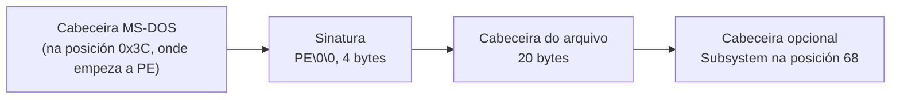

# Código › ferramentas (`tools/`)

> Estado: subfase 1.1.

Scripts e modelos que axudan a compilar, revisar e empaquetar meiga. Non forman parte do programa. Os de medición do rendemento, en `tools/perf/`, explícanse á parte en [Código › medición](perf.md) e en [Código › escenarios de carga](escenarios.md).

| Arquivo | Para que |
|---|---|
| [`package.ps1`](#toolspackageps1) | Compilar en modo *release* e crear o `.zip` que se distribúe. |
| [`check-imports.ps1`](#toolscheck-importsps1) | Comprobar que `meiga.exe` non depende do *runtime* de Visual C++. |
| [`check-window.ps1`](#toolscheck-windowps1) | Comprobar que `meiga.exe` abre a súa xanela e se pecha ben. |
| [`check-docs.ps1`](#toolscheck-docsps1) | Comprobar as ligazóns internas da documentación. |
| [`check-powershell.ps1`](#toolscheck-powershellps1) | Comprobar que todos os scripts piden PowerShell 7 dun xeito claro cando se abren con Windows PowerShell 5.1. |
| [`third-party-notices.ps1`](#toolsthird-party-noticesps1) | Xerar os avisos de licenza das dependencias. |
| [`about.hbs`](#toolsabouthbs) | Modelo dos avisos de licenza. |

Todos os scripts empezan igual: a axuda, os parámetros e unha comprobación da versión de PowerShell, que se explica en [`check-powershell.ps1`](#toolscheck-powershellps1).

## `tools/package.ps1`

Compila meiga en modo *release* e crea o paquete que se distribúe:

```powershell
.\tools\package.ps1            # compila e crea dist\meiga-<versión>-x86_64-pc-windows-msvc.zip
.\tools\package.ps1 -NoBuild   # empaqueta o meiga.exe que xa está compilado
```

Contido do `.zip`:

| Arquivo | Orixe |
|---|---|
| `meiga.exe` | `target\release\meiga.exe`. |
| `LICENSE.txt` | `LICENSE`, coa extensión `.txt` para que Windows o abra cun dobre clic. |
| `README.md` | `README.md`. |
| `THIRD-PARTY-NOTICES.txt` | Xerado por `third-party-notices.ps1`. |

Explicación por partes:

```powershell
[CmdletBinding()]
param(
    [string]$OutDir,
    [switch]$NoBuild
)

# Windows PowerShell 5.1 can read this file but not run it: tell how to run
# it with PowerShell 7. tools/check-powershell.ps1 checks that this works.
if ($PSVersionTable.PSVersion.Major -lt 7) {
    …
}

$ErrorActionPreference = 'Stop'
Set-StrictMode -Version Latest
```

- `$OutDir`: o cartafol de destino. Por defecto, `dist\`, que Git ignora.
- `[switch]$NoBuild`: un parámetro sen valor. Se aparece na chamada, vale `$true`.
- A comprobación da versión é a mesma en todos os scripts (ver [`check-powershell.ps1`](#toolscheck-powershellps1)).
- As dúas últimas liñas deteñen o script ante calquera erro, como en todos os scripts (ver [Tecnoloxías › PowerShell 7](../tecnoloxias.md#11-powershell-7)).

```powershell
$root = (Resolve-Path (Join-Path $PSScriptRoot '..')).Path
# Not in param(): there, Windows PowerShell 5.1 leaves $PSScriptRoot empty and
# fails before the check above.
if (-not $OutDir) {
    $OutDir = Join-Path $root 'dist'
}
$OutDir = $ExecutionContext.SessionState.Path.GetUnresolvedProviderPathFromPSPath($OutDir)
```

- `Resolve-Path` devolve un obxecto; `.Path` colle a ruta como texto, para combinala despois con `Join-Path`.
- O valor por defecto de `$OutDir` ponse eiquí, despois da comprobación da versión, e non en `param()` (ver [`check-powershell.ps1`](#toolscheck-powershellps1)).
- A ruta de saída resólvese antes de cambiar de cartafol, igual que en [`third-party-notices.ps1`](#toolsthird-party-noticesps1).

```powershell
Push-Location $root
try {
    if (-not $NoBuild) {
        cargo build --release --locked
        if ($LASTEXITCODE -ne 0) {
            throw "cargo build failed with exit code $LASTEXITCODE"
        }
    }
```

Compila desde a raíz do repositorio coas versións exactas do `Cargo.lock` (`--locked`), salvo que se pase `-NoBuild`.

```powershell
    $metadata = cargo metadata --format-version 1 --no-deps --locked | ConvertFrom-Json
    if ($LASTEXITCODE -ne 0) {
        throw "cargo metadata failed with exit code $LASTEXITCODE"
    }
    $version = ($metadata.packages | Where-Object name -EQ 'meiga').version
    $exe = Join-Path $metadata.target_directory 'release\meiga.exe'
    if (-not (Test-Path -LiteralPath $exe -PathType Leaf)) {
        throw "$exe does not exist. Run the script without -NoBuild."
    }
```

- `cargo metadata` describe o workspace en JSON: os crates, as súas versións e o cartafol de compilación.
  - `--format-version 1` fixa o formato da saída, para que non cambie con versións futuras de Cargo;
  - `--no-deps` omite as dependencias externas, que non fan falta eiquí;
  - `ConvertFrom-Json` converte o texto en obxectos de PowerShell.
- A versión lese do `Cargo.toml` a través de Cargo, en vez de escribila no script: só hai un sitio onde cambiala.
- `target_directory` é o cartafol de compilación real, que pode non ser `target\` (por exemplo, coa variábel `CARGO_TARGET_DIR`).
- `-PathType Leaf` comproba que é un arquivo, non un cartafol.

```powershell
    $name = "meiga-$version-x86_64-pc-windows-msvc"
    $staging = Join-Path $metadata.target_directory "package\$name"
    if (Test-Path -LiteralPath $staging) {
        Remove-Item -LiteralPath $staging -Recurse -Force
    }
    New-Item -ItemType Directory -Force -Path $staging | Out-Null
```

- O nome do paquete leva a versión e o *target* (procesador x86-64, Windows, compilador MSVC). É a convención habitual nos proxectos de Rust.
- Os arquivos prepáranse primeiro nun cartafol intermedio (*staging*) dentro de `target\`. Bórrase antes, por se quedou dunha execución anterior, para que o zip non leve restos.
- `-LiteralPath` usa a ruta tal cal, sen interpretar caracteres comodín como `*` ou `[`.

```powershell
    Copy-Item -LiteralPath $exe -Destination $staging
    Copy-Item -LiteralPath (Join-Path $root 'LICENSE') -Destination (Join-Path $staging 'LICENSE.txt')
    Copy-Item -LiteralPath (Join-Path $root 'README.md') -Destination $staging
    & (Join-Path $PSScriptRoot 'third-party-notices.ps1') -OutFile (Join-Path $staging 'THIRD-PARTY-NOTICES.txt')
```

Copia os arquivos e xera os avisos de terceiros. `&` é o operador de chamada: executa o script cuxa ruta se calcula na propia liña.

```powershell
    New-Item -ItemType Directory -Force -Path $OutDir | Out-Null
    $zip = Join-Path $OutDir "$name.zip"
    Compress-Archive -Path (Join-Path $staging '*') -DestinationPath $zip -Force
}
finally {
    Pop-Location
}

Write-Host "Wrote $zip"
```

- `Compress-Archive` crea o zip. Con `staging\*`, os arquivos quedan na raíz do zip, sen cartafol intermedio.
- `-Force` substitúe un zip anterior co mesmo nome.

## `tools/check-imports.ps1`

Comproba que `meiga.exe` non depende do *runtime* de Visual C++. Protexe a decisión de ligar o CRT estaticamente ([Tecnoloxías › CRT](../tecnoloxias.md#5-runtime-de-c-ligado-estaticamente-crt-static)): se algo a desfai, a CI falla.

```powershell
.\tools\check-imports.ps1                                 # comproba target\release\meiga.exe
.\tools\check-imports.ps1 -Path outro\cartafol\meiga.exe
```

Saída esperada:

```text
meiga.exe imports: kernel32.dll, user32.dll, gdi32.dll, ntdll.dll, api-ms-win-core-synch-l1-2-0.dll, KERNEL32.dll
OK: no dependencies on the Visual C++ runtime.
```

`user32.dll` e `gdi32.dll` chegaron coa xanela, na subfase 1.1. Por que `kernel32.dll` aparece dúas veces explícase en [Código › meiga](meiga.md#comprobacións-feitas).

**Por que fai falta.** A opción `+crt-static` está en `.cargo/config.toml`, pero hai formas de perdela sen que nada falle: a máis habitual é definir a variábel `RUSTFLAGS`, que fai que Cargo ignore os `rustflags` de `.cargo/config.toml` (ver [Código › .github](github.md#variábeis-de-contorno)). Comprobouse cunha compilación con `RUSTFLAGS='-C opt-level=3'`:

```text
meiga.exe imports: api-ms-win-core-synch-l1-2-0.dll, KERNEL32.dll, ntdll.dll, VCRUNTIME140.dll,
api-ms-win-crt-string-l1-1-0.dll, api-ms-win-crt-runtime-l1-1-0.dll, ...
It depends on the Visual C++ runtime: VCRUNTIME140.dll, api-ms-win-crt-string-l1-1-0.dll, ...
Is RUSTFLAGS overriding .cargo/config.toml?
```

Explicación por partes:

```powershell
$Path = $ExecutionContext.SessionState.Path.GetUnresolvedProviderPathFromPSPath($Path)
if (-not (Test-Path -LiteralPath $Path -PathType Leaf)) {
    throw "$Path does not exist. Build it first with: cargo build --release"
}
```

Resolve a ruta como nos outros scripts e comproba que o executábel existe.

```powershell
$vswhere = Join-Path ${env:ProgramFiles(x86)} 'Microsoft Visual Studio\Installer\vswhere.exe'
if (-not (Test-Path -LiteralPath $vswhere -PathType Leaf)) {
    throw 'vswhere.exe was not found. Install Visual Studio or the Build Tools.'
}
$vs = & $vswhere -latest -products * -requires Microsoft.VisualStudio.Component.VC.Tools.x86.x64 -property installationPath
if ($LASTEXITCODE -ne 0 -or -not $vs) {
    throw 'No Visual Studio installation with the MSVC build tools was found.'
}
```

- `dumpbin` non está no `PATH` dunha consola normal, e a súa ruta cambia con cada versión de Visual Studio. `vswhere` é a ferramenta oficial para localizar as instalacións (ver [Tecnoloxías › MSVC](../tecnoloxias.md#13-msvc-e-o-windows-sdk)).
- `${env:ProgramFiles(x86)}`: as chaves son necesarias porque o nome da variábel leva parénteses.
- Opcións de `vswhere`:
  - `-latest`: a instalación máis recente;
  - `-products *`: inclúe tamén as *Build Tools*, que non son un Visual Studio completo;
  - `-requires …VC.Tools.x86.x64`: só instalacións co compilador de C++ para x64;
  - `-property installationPath`: devolve só a ruta da instalación.

```powershell
$toolsVersion = (Get-Content -LiteralPath (Join-Path $vs 'VC\Auxiliary\Build\Microsoft.VCToolsVersion.default.txt') -Raw).Trim()
$dumpbin = Join-Path $vs "VC\Tools\MSVC\$toolsVersion\bin\Hostx64\x64\dumpbin.exe"
```

- Unha instalación pode ter varias versións das ferramentas de C++. Este arquivo indica a predeterminada, a mesma que usa a *Developer PowerShell*.
- `Hostx64\x64`: as ferramentas que corren nun Windows de 64 bits e traballan con binarios de 64 bits.

```powershell
$output = & $dumpbin /nologo /dependents $Path
if ($LASTEXITCODE -ne 0) {
    throw "dumpbin failed with exit code $LASTEXITCODE"
}

# dumpbin prints each imported DLL on its own indented line.
$dlls = foreach ($line in $output) {
    if ($line -match '^\s+(\S+\.dll)\s*$') { $Matches[1] }
}
Write-Host "$(Split-Path -Leaf $Path) imports: $($dlls -join ', ')"
```

- `/dependents` lista as DLL que importa o executábel, e `/nologo` omite a cabeceira coa versión.
- A saída de `dumpbin` é texto. A expresión regular colle as liñas sangradas que só conteñen un nome rematado en `.dll`:
  - `^\s+`: espazos ao principio da liña;
  - `(\S+\.dll)`: o nome, que queda gardado en `$Matches[1]`;
  - `\s*$`: nada máis ata o final da liña.
- `$dlls = foreach …` recolle nun array todo o que emite o bucle.

```powershell
$runtime = $dlls | Where-Object { $_ -match '^(vcruntime.*|msvcp.*|ucrtbase|api-ms-win-crt-.*)\.dll$' }
if ($runtime) {
    throw "It depends on the Visual C++ runtime: $($runtime -join ', '). Is RUSTFLAGS overriding .cargo/config.toml?"
}

Write-Host 'OK: no dependencies on the Visual C++ runtime.'
```

Busca as DLL do *runtime*: `vcruntime*.dll` (o *runtime* de Visual C++), `msvcp*.dll` (a biblioteca estándar de C++), `ucrtbase.dll` (o *Universal CRT*) e os *API sets* `api-ms-win-crt-*`, que son os nomes cos que se importa o *Universal CRT*. `-match` non distingue maiúsculas, así que `VCRUNTIME140.dll` tamén coincide. Se aparece algunha, o script falla e suxire a causa máis probábel.

## `tools/check-window.ps1`

Comproba que `meiga.exe` fai o que promete a subfase 1.1: abre a súa xanela, sen consola e coa escala por monitor, e remata ben cando se pecha. Inicia o programa de verdade, así que a xanela aparece un instante.

```powershell
.\tools\check-window.ps1                                  # comproba target\release\meiga.exe
.\tools\check-window.ps1 -Path outro\cartafol\meiga.exe
.\tools\check-window.ps1 -TimeoutSeconds 30               # nunha máquina moi lenta
```

Saída esperada:

```text
OK: it is a GUI program, so it opens no console window.
OK: it opens its window (class 'meiga', title 'meiga').
OK: the window is DPI aware per monitor (v2).
OK: it ends with exit code 0 when its window closes.
```

Se falla unha comprobación, o script remata cun erro que explica cal, e código de saída 1. Pase o que pase, `meiga.exe` non queda aberto.

Explicación por partes:

```powershell
[ValidateRange(1, 600)]
[int]$TimeoutSeconds = 10
```

O tempo máximo de cada espera: primeiro, a que se abra a xanela; despois, a que remate o proceso. Abrir a xanela leva milisegundos, así que 10 s só se esgotan se algo vai mal.

```powershell
$header = [byte[]]::new(4096)
$stream = [IO.File]::OpenRead($Path)
try {
    $read = $stream.Read($header, 0, $header.Length)
}
finally {
    $stream.Dispose()
}
$pe = if ($read -ge 0x40) { [BitConverter]::ToInt32($header, 0x3C) } else { -1 }
if ($pe -lt 0 -or $pe + 24 + 70 -gt $read -or [BitConverter]::ToUInt32($header, $pe) -ne 0x4550) {
    throw "$Path is not a Windows executable."
}
# The optional header follows the signature (4 bytes) and the file header (20
# bytes), and Subsystem is at offset 68 in both PE32 and PE32+.
$subsystem = [BitConverter]::ToUInt16($header, $pe + 24 + 68)
if ($subsystem -ne 2) {
    throw "$exe uses subsystem $subsystem instead of 2 (Windows GUI), so it opens a console window. Is it a debug build?"
}
```

O **subsistema** (ver [Tecnoloxías › Subsistema](../tecnoloxias.md#6-subsistema-de-windows)) é un número na cabeceira do `.exe`, que segue o formato **PE** (*Portable Executable*):



- Só se len os primeiros 4 KB: a cabeceira sempre está ao principio, e un `.exe` de depuración ocupa varios MB.
- `try`/`finally` pecha o arquivo aínda que a lectura falle.
- `[BitConverter]::ToInt32($header, 0x3C)` le un número de 4 bytes na posición 0x3C: onde empeza a cabeceira PE.
- `0x4550` son os bytes `P` e `E` seguidos de dous ceros, lidos como un número (os procesadores x64 gardan primeiro o byte de menos peso). Se non están, o arquivo non é un executábel de Windows. A condición tamén comproba que as posicións que se len caen dentro do que se leu.
- `Subsystem` está na mesma posición nos executábeis de 32 bits (PE32) e nos de 64 (PE32+). O valor 2 é unha aplicación gráfica, e o 3, de consola: o que daría unha compilación de depuración (ver [Código › meiga](meiga.md#cratesmeigasrcmainrs)).

```powershell
if (-not ('Meiga.Tools.WindowCheck' -as [type])) {
    Add-Type -Namespace Meiga.Tools -Name WindowCheck -MemberDefinition @'
[DllImport("user32.dll", CharSet = CharSet.Unicode)]
public static extern int GetClassNameW(IntPtr window, System.Text.StringBuilder name, int capacity);

[DllImport("user32.dll")]
public static extern IntPtr GetWindowDpiAwarenessContext(IntPtr window);

[DllImport("user32.dll")]
[return: MarshalAs(UnmanagedType.Bool)]
public static extern bool AreDpiAwarenessContextsEqual(IntPtr first, IntPtr second);
'@
}
```

- PowerShell non pode chamar directamente a estas tres funcións de Windows. `Add-Type -MemberDefinition` compila unha clase de C# con elas: `[DllImport("user32.dll")]` indica en que DLL está cada unha, e .NET convirte os argumentos ao chamala (*P/Invoke*). Igual que en [`measure.ps1`](../tecnoloxias.md#c-dentro-de-powershell), só que con tres declaracións en vez dun arquivo.
- `-as [type]` comproba se a clase xa existe: nunha mesma sesión de PowerShell só se pode compilar unha vez.
- `GetClassNameW` dá o nome da clase dunha xanela, e `GetWindowDpiAwarenessContext`, como escala a xanela. `[return: MarshalAs(UnmanagedType.Bool)]` indica que o `BOOL` de Windows (un número de 4 bytes) se converte nun `bool`.

```powershell
$info = [Diagnostics.ProcessStartInfo]::new($Path)
$info.UseShellExecute = $false
$process = [Diagnostics.Process]::Start($info)
try {
    # WaitForInputIdle returns when meiga has painted its window and waits for
    # messages. It fails if the process has already ended.
    $idle = try { $process.WaitForInputIdle($TimeoutSeconds * 1000) } catch { $false }
    if (-not $idle) {
        if ($process.HasExited) {
            throw "$exe ended with exit code $($process.ExitCode) before it opened its window."
        }
        throw "$exe did not open its window within $TimeoutSeconds s."
    }
```

- `UseShellExecute = $false`: Windows crea o proceso directamente, sen pasar polo Explorador.
- `WaitForInputIdle` agarda a que o programa remate de arrancar e quede esperando mensaxes, sen ningunha pendente: no caso de meiga, coa xanela xa pintada (ver [Código › meiga-win](meiga-win.md#windowshow)). Devolve `$false` se pasa o tempo, e produce un erro se o proceso xa rematou, por iso o `try`/`catch`.

```powershell
    $process.Refresh()
    $window = $process.MainWindowHandle
    $class = [Text.StringBuilder]::new(256)
    if ($window -ne [IntPtr]::Zero) {
        $null = [Meiga.Tools.WindowCheck]::GetClassNameW($window, $class, $class.Capacity)
    }
    if ("$class" -ne 'meiga' -or $process.MainWindowTitle -ne 'meiga') {
        throw "The main window has class '$class' and title '$($process.MainWindowTitle)' instead of class 'meiga' and title 'meiga'. Did meiga show an error?"
    }
```

- `Refresh()` descarta os datos do proceso que .NET garda en memoria, para ler os actuais.
- `MainWindowHandle` é a primeira xanela visíbel e de nivel superior do proceso. Se meiga fallase ao arrancar, sería a caixa da mensaxe de erro, que tamén leva o título «meiga». Por iso se comproba tamén a clase: a de meiga chámase `meiga`, e a das caixas de mensaxe, `#32770`.
- `GetClassNameW` escribe o nome nun `StringBuilder`, un texto que se pode modificar, de ata 256 caracteres.

```powershell
    $context = [Meiga.Tools.WindowCheck]::GetWindowDpiAwarenessContext($window)
    if (-not [Meiga.Tools.WindowCheck]::AreDpiAwarenessContextsEqual($context, [IntPtr]::new(-4))) {
        throw 'The window is not DPI aware per monitor (v2). Is the manifest embedded?'
    }
```

O **contexto de escala** da xanela di como escala (ver [Tecnoloxías › Manifesto](../tecnoloxias.md#23-manifesto-da-aplicación-e-dpi)). `-4` é o valor que Windows define para «por monitor, versión 2» (`DPI_AWARENESS_CONTEXT_PER_MONITOR_AWARE_V2`). O contexto que devolve Windows non ten por que ser ese número, así que a documentación manda comparalos con `AreDpiAwarenessContextsEqual`, e non con `-eq`. Se o manifesto non estivese incrustado, a xanela non escalaría e a comprobación fallaría.

```powershell
    if (-not $process.CloseMainWindow()) {
        throw "Could not ask the window of $exe to close."
    }
    if (-not $process.WaitForExit($TimeoutSeconds * 1000)) {
        throw "$exe was still running $TimeoutSeconds s after its window was asked to close."
    }
    if ($process.ExitCode -ne 0) {
        throw "$exe ended with exit code $($process.ExitCode) instead of 0."
    }
}
finally {
    if (-not $process.HasExited) {
        $process.Kill()
    }
    $process.Dispose()
}
```

- `CloseMainWindow` envía `WM_CLOSE` á xanela, a mesma mensaxe que o botón X da barra de título, e `WaitForExit` agarda a que remate o proceso.
- O código de saída ten que ser 0. Unha caixa de erro pechada así daría 1 (ver [Código › meiga](meiga.md#cratesmeigasrcmainrs)).
- O bloque `finally` execútase sempre, tamén despois dun `throw`: se meiga segue aberto, remátao (`Kill`), e libera os recursos do obxecto do proceso (`Dispose`).

A CI executa este script en cada PR, despois de empaquetar (ver [Código › .github](github.md#empaquetar-e-comprobar-o-executábel)). Os *runners* de Windows de GitHub teñen un escritorio, así que a xanela ábrese de verdade.

## `tools/check-docs.ps1`

Comproba as ligazóns internas da documentación: que cada ligazón relativa de `README.md` e de `docs/` apunte a un arquivo que existe e, se leva ancla (`#sección`), que ese arquivo teña un título con esa ancla. As ligazóns externas (`https://…`) non se comproban, porque dependen da rede e de servizos alleos.

```powershell
.\tools\check-docs.ps1                               # README.md e todo docs\
.\tools\check-docs.ps1 -Path docs\arquitectura.md    # só os arquivos indicados
```

Saída esperada (os números dependen da documentación):

```text
OK: 126 relative links checked in 25 files.
```

Se algo falla, indica o arquivo, a liña e a ligazón:

```text
docs\exemplo.md:13: target not found (check the letter case): Arquitectura.md
docs\exemplo.md:14: anchor not found: arquitectura.md#non-existe
```

Explicación por partes:

```powershell
param(
    [string[]]$Path
)
...
if ($Path) {
    $Path = $Path | ForEach-Object { $ExecutionContext.SessionState.Path.GetUnresolvedProviderPathFromPSPath($_) }
}
else {
    $Path = @(Join-Path $root 'README.md') +
        @(Get-ChildItem -LiteralPath (Join-Path $root 'docs') -Recurse -Filter '*.md' -File | ForEach-Object FullName)
}
```

- `[string[]]$Path`: unha lista de arquivos. Se non se indica, revísanse `README.md` e todos os `.md` de `docs\`, incluídos os subcartafoles (`-Recurse`).
- `@(…) + @(…)` une dúas listas. `@()` garante que cada parte sexa unha lista aínda que só teña un elemento.

```powershell
$fence = '^\s*(```|~~~)'
```

A expresión regular que recoñece o inicio e o fin dun bloque de código. O que hai dentro dos bloques de código son exemplos, non ligazóns nin títulos, así que non se analiza.

```powershell
function ConvertTo-Anchor([string]$heading) {
    $text = ($heading -replace '[`*]', '').ToLowerInvariant()
    ($text -replace '[^\p{L}\p{M}\p{N}\p{Pc}\- ]', '') -replace ' ', '-'
}
```

Calcula a ancla dun título igual que GitHub:

1. quita as marcas de formato (`` ` `` e `*`), porque a ancla sae do texto que se ve;
2. pasa todo a minúsculas;
3. elimina todo o que non sexa unha letra (`\p{L}`, tamén con acento), unha marca diacrítica (`\p{M}`), un número (`\p{N}`), un guión baixo (`\p{Pc}`), un guión ou un espazo;
4. cambia cada espazo por un guión.

Por exemplo, `## 4. Perfís de compilación` dá `4-perfís-de-compilación`.

```powershell
function Get-Anchor([string]$file) {
    $anchors = [System.Collections.Generic.HashSet[string]]::new()
    $seen = @{}
    ...
        if ($inFence -or $line -notmatch '^#{1,6}\s+(.+?)(\s+#+)?\s*$') { continue }
        $anchor = ConvertTo-Anchor $Matches[1]
        # Repeated headings get a numeric suffix: name, name-1, name-2...
        if ($seen.ContainsKey($anchor)) {
            $seen[$anchor]++
            $anchor = "$anchor-$($seen[$anchor])"
        }
        ...
    , $anchors
}
```

- Recolle as anclas de todos os títulos dun arquivo nun `HashSet`, un conxunto que comproba moi rápido se contén un valor.
- Un título é unha liña que empeza por entre un e seis `#` seguidos dun espazo.
- Se dous títulos dan a mesma ancla, GitHub engade `-1`, `-2`… a partir do segundo. `$seen` leva a conta.
- A coma de `, $anchors` impide que PowerShell desfaga o conxunto en elementos soltos ao devolvelo.

```powershell
function Resolve-ExactPath([string]$directory, [string]$relative) {
    $current = $directory
    foreach ($segment in $relative -split '[\\/]') {
        if ($segment -in '', '.') { continue }
        if ($segment -eq '..') {
            $current = [System.IO.Path]::GetDirectoryName($current)
            continue
        }
        $entry = Get-ChildItem -LiteralPath $current -Force -ErrorAction SilentlyContinue |
            Where-Object Name -CEQ $segment
        if (-not $entry) { return $null }
        $current = $entry.FullName
    }
    $current
}
```

Resolve a ruta da ligazón cartafol a cartafol. En Windows, `Test-Path` non distingue maiúsculas de minúsculas, pero GitHub si: unha ligazón a `Arquitectura.md` funcionaría en local e estaría rota en GitHub. Por iso cada parte da ruta compárase co nome real con `-CEQ`, a comparación que si distingue maiúsculas.

```powershell
        # Links inside inline code are examples, not links.
        $prose = $line -replace '`[^`]*`', ''
        foreach ($match in [regex]::Matches($prose, '\]\(([^)\s]+)\)')) {
            $target = $match.Groups[1].Value
            if ($target -match '^[a-z][a-z0-9+.-]*:') { continue }
```

- Quita o código en liña da liña antes de buscar ligazóns.
- Unha ligazón de Markdown ten a forma `[texto](destino)`; a expresión regular captura o destino.
- Se o destino empeza por un esquema (`https:`, `mailto:`…), é externo e non se comproba.

```powershell
            $pathPart, $anchor = $target -split '#', 2
```

Separa a ruta e a ancla. Se non hai ancla, `$anchor` queda baleira. Se non hai ruta (por exemplo, `#sección`), a ligazón apunta ao mesmo arquivo. `UnescapeDataString` decodifica os caracteres codificados nas URL, como `%C3%AD` (`í`).

```powershell
if ($problems.Count -gt 0) {
    $problems | ForEach-Object { Write-Host $_ }
    throw "$($problems.Count) broken link(s) in the documentation."
}
```

Mostra todos os problemas e despois falla, para corrixilos todos dunha vez en vez de un a un.

**Comprobación:** cun arquivo de proba, o script detectou unha ruta inexistente, unha ruta con maiúsculas incorrectas e unha ancla inexistente, e aceptou como correctas unha ancla dun título repetido, unha ancla con acentos, a mesma ancla codificada (`%C3%AD`), unha ligazón a un cartafol e unha URL externa. As ligazóns dentro de código ignoráronse.

## `tools/check-powershell.ps1`

Todos os scripts de `tools\` necesitan PowerShell 7 (`pwsh`). Windows, en cambio, trae Windows PowerShell 5.1, e é fácil abrir un script con ela sen darse conta: cunha tab de *Windows PowerShell*, ou co botón dereito sobre o arquivo e *Executar con PowerShell*. Por iso cada script empeza cunha comprobación que, en 5.1, explica como executalo:

```powershell
# Windows PowerShell 5.1 can read this file but not run it: tell how to run
# it with PowerShell 7. tools/check-powershell.ps1 checks that this works.
if ($PSVersionTable.PSVersion.Major -lt 7) {
    $command = "pwsh -File $(Resolve-Path -Relative $PSCommandPath)"
    if ($PSBoundParameters.Count -gt 0) { $command += ' <the same parameters>' }
    Write-Host "This script needs PowerShell 7. Run it with: $command" -ForegroundColor Yellow
    exit 1
}
```

```text
This script needs PowerShell 7. Run it with: pwsh -File .\tools\perf\measure.ps1 <the same parameters>
```

- `$PSVersionTable.PSVersion.Major` é a versión principal: 5 en Windows PowerShell e 7 en PowerShell 7.
- `Resolve-Path -Relative` dá a ruta do script desde o cartafol actual, para que o comando se poida copiar tal cal. Se se pasaron parámetros, engade `<the same parameters>`, porque non se poden reconstruír con seguridade (comiñas, listas…).
- `exit 1` remata cun código de erro, para que a CI ou outro script o note.
- **Por que non `#Requires -Version 7.0`.** Ata a subfase 0.7, `measure.ps1` levaba esa liña, e Windows PowerShell 5.1 detíase cunha mensaxe técnica que non dicía como executalo. A comprobación propia indica o comando exacto.

A comprobación só funciona se Windows PowerShell 5.1 chega a executala, e iso esixe dúas cousas:

1. **Que 5.1 poida ler o arquivo.** PowerShell analiza o arquivo enteiro antes de executar nada. Se usa sintaxe que só coñece PowerShell 7 (os operadores `?:`, `??` ou `&&`), 5.1 dá un erro de sintaxe e a comprobación non chega a correr. Por iso os scripts usan só a sintaxe que comparten as dúas versións, e están escritos en ASCII (ver [Código › escenarios](escenarios.md#scenariopsm1)).
2. **Que 5.1 poida asignar os parámetros.** Os valores por defecto de `param()` calcúlanse antes da comprobación. Nun script avanzado (con `[CmdletBinding()]`) lanzado con `-File`, Windows PowerShell 5.1 deixa `$PSScriptRoot` baleiro nese momento, e un valor como `(Join-Path $PSScriptRoot '..\dist')` fallaba cun erro de `Join-Path` que non tiña nada que ver coa versión. Por iso eses valores calcúlanse despois da comprobación:

   ```powershell
   param(
       [string]$OutDir
   )
   …
   if (-not $OutDir) {
       $OutDir = Join-Path $PSScriptRoot '..\..\.perf'
   }
   ```

`check-powershell.ps1` comproba as dúas cousas en todos os `.ps1` de `tools\`, incluídos os subcartafoles:

```text
OK: the 13 scripts ask for PowerShell 7, and Windows PowerShell 5.1 shows how to run them.
```

| Comprobación | Como |
|---|---|
| O script ten a comprobación | Busca a liña `if ($PSVersionTable.PSVersion.Major -lt 7) {`. |
| Os valores por defecto non usan `$PSScriptRoot` | Analiza o script co analizador de PowerShell (a súa árbore sintáctica, o AST) e busca `$PSScriptRoot`, `$PSCommandPath` e `$MyInvocation` nos valores por defecto dos parámetros. |
| 5.1 pode lelo | Pásalle a `powershell.exe` (5.1) un bloque de código que analiza todos os scripts co analizador de 5.1 e devolve os erros. |
| 5.1 mostra a mensaxe | Executa todos os scripts en Windows PowerShell 5.1, á vez, e comproba que cada un remata co código 1 e coa mensaxe. Se un script segue a correr despois de 60 s, detense e conta como erro. |

```powershell
$arguments = @{
    'measure.ps1'      = @('-Name', 'none')
    'run-scenario.ps1' = @('idle', '-Name', 'none')
}
```

Os scripts con parámetros obrigatorios reciben valores: sen eles, Windows PowerShell 5.1 pediríaos antes da comprobación. Un script novo con parámetros obrigatorios necesita unha entrada nesta táboa; se falta, a última comprobación falla e avisa.

**Comprobación da proba.** Con dous scripts temporais, un con `(Join-Path $PSScriptRoot 'x')` como valor por defecto e outro sen a comprobación, o script informou dos tres problemas (o valor por defecto, a comprobación que falta e que 5.1 executou o segundo sen mostrar a mensaxe) e rematou co código 1.

A CI execútao en cada PR (ver [Código › .github](github.md#job-windows)).

## `tools/third-party-notices.ps1`

Xera `THIRD-PARTY-NOTICES.txt` coas licenzas de todas as dependencias. Uso:

```powershell
.\tools\third-party-notices.ps1                       # escribe target\THIRD-PARTY-NOTICES.txt
.\tools\third-party-notices.ps1 -OutFile dist\NOTICES.txt
```

Explicación por partes:

```powershell
<#
.SYNOPSIS
Generates THIRD-PARTY-NOTICES.txt for the crates that meiga ships.
...
#>
```

Axuda integrada en PowerShell (*comment-based help*). Con `Get-Help .\tools\third-party-notices.ps1` mostra a descrición e os parámetros.

```powershell
[CmdletBinding()]
param(
    [string]$OutFile
)
```

- `[CmdletBinding()]` fai que o script se comporte como un *cmdlet*: acepta parámetros comúns como `-Verbose`.
- `$OutFile` é o arquivo de saída. Por defecto vai a `target\`, que Git ignora; o valor por defecto ponse máis abaixo, despois da comprobación da versión de PowerShell (ver [`check-powershell.ps1`](#toolscheck-powershellps1)).

```powershell
$ErrorActionPreference = 'Stop'
Set-StrictMode -Version Latest
```

As dúas liñas que deteñen o script ante calquera erro (ver [Tecnoloxías › PowerShell 7](../tecnoloxias.md#11-powershell-7)).

```powershell
$root = Resolve-Path (Join-Path $PSScriptRoot '..')
# Not in param(): there, Windows PowerShell 5.1 leaves $PSScriptRoot empty and
# fails before the check above.
if (-not $OutFile) {
    $OutFile = Join-Path $root 'target\THIRD-PARTY-NOTICES.txt'
}
# Resolve a relative path against the current PowerShell location. .NET APIs
# such as [System.IO.Path]::GetFullPath use the process working directory,
# which PowerShell does not update on Set-Location.
$OutFile = $ExecutionContext.SessionState.Path.GetUnresolvedProviderPathFromPSPath($OutFile)
New-Item -ItemType Directory -Force -Path (Split-Path $OutFile) | Out-Null
```

- `$root`: a raíz do repositorio. `$PSScriptRoot` é o cartafol do propio script, así que funciona desde calquera cartafol.
- `GetUnresolvedProviderPathFromPSPath` converte a ruta de saída nunha ruta absoluta. Faise antes de entrar na raíz do repositorio (máis abaixo), para que unha ruta relativa como `-OutFile notices.txt` siga referíndose ao cartafol desde o que se lanzou o script.
  - Funciona aínda que o arquivo non exista, e resolve os `..` da ruta por defecto.
  - **Trampa evitada:** a alternativa obvia, `[System.IO.Path]::GetFullPath`, é unha función de .NET que usa o cartafol de traballo do *proceso*. PowerShell non o actualiza ao facer `cd` (`Set-Location`), así que nunha sesión na que xa se cambiou de cartafol, a ruta resolveríase contra o cartafol inicial da sesión. Comprobouse: despois de `Set-Location C:\Windows`, `GetFullPath('x.txt')` devolveu a ruta no cartafol inicial, mentres que esta función devolveu `C:\Windows\x.txt`.
- `New-Item … -Force` crea o cartafol de destino se non existe. `| Out-Null` oculta a súa saída.

```powershell
Push-Location $root
try {
    cargo about generate --workspace --locked --fail --output-file $OutFile tools/about.hbs
    if ($LASTEXITCODE -ne 0) {
        throw "cargo about failed with exit code $LASTEXITCODE"
    }
}
finally {
    Pop-Location
}
```

- `Push-Location` / `Pop-Location`: entra na raíz do repositorio e, ao rematar, volta ao cartafol inicial. O bloque `finally` executa `Pop-Location` aínda que haxa un erro.
- Opcións de `cargo about generate`:
  - `--workspace`: inclúe as dependencias de todos os crates do workspace;
  - `--locked`: usa exactamente as versións do `Cargo.lock` e falla se habería que cambialo;
  - `--fail`: remata cun erro se non consegue ler ou determinar a licenza dalgunha dependencia, en vez de continuar sen ela;
  - `--output-file`: onde escribir o resultado;
  - `tools/about.hbs`: o modelo.
- `$LASTEXITCODE` é o código de saída do último programa externo. Se non é 0, `throw` detén o script cun erro.

```powershell
Write-Host "Wrote $OutFile"
```

Ao rematar, mostra a ruta completa do arquivo xerado.

## `tools/about.hbs`

O modelo Handlebars do arquivo de avisos (sintaxe explicada en [Tecnoloxías › cargo-about](../tecnoloxias.md#10-cargo-about-e-handlebars)):

```handlebars
THIRD-PARTY SOFTWARE NOTICES

meiga uses the third-party components listed below. Each component is
distributed under the license reproduced with it.
{{#each licenses}}

================================================================================
{{{name}}} ({{{id}}})

Used by:
{{#each used_by}}
- {{{crate.name}}} {{{crate.version}}}{{#if crate.repository}} <{{{crate.repository}}}>{{/if}}
{{/each}}

{{{text}}}
{{/each}}
```

- Cabeceira fixa en inglés, porque este arquivo distribúese co programa.
- Para cada licenza (`licenses`) escríbense:
  - o seu nome e identificador SPDX (por exemplo, `MIT License (MIT)`);
  - a lista de crates que a usan, coa versión e o repositorio se o teñen;
  - o texto completo da licenza, co *copyright* do autor.
- Úsanse sempre tres chaves para que o texto non se escape como HTML.

Exemplo do resultado real, xerado nunha copia do repositorio á que se lle engadiu unha dependencia de proba (`memchr`):

```text
================================================================================
MIT License (MIT)

Used by:
- memchr 2.8.3 <https://github.com/BurntSushi/memchr>

The MIT License (MIT)

Copyright (c) 2015 Andrew Gallant
...
```
