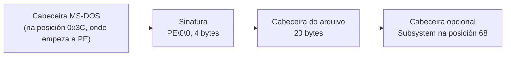

# Código › ferramentas (`tools/`)

> Estado: subfase 1.7.

Scripts e modelos que axudan a compilar, revisar e empaquetar meiga. Non forman parte do programa. Os de medición do rendemento, en `tools/perf/`, explícanse á parte en [Código › medición](perf.md) e en [Código › escenarios de carga](escenarios.md).

| Arquivo | Para que |
|---|---|
| [`package.ps1`](#toolspackageps1) | Compilar en modo *release*, crear o `.zip` que se distribúe e deixar o ConPTY ao lado de `meiga.exe`. |
| [`fetch-conpty.ps1`](#toolsfetch-conptyps1) | Descargar o ConPTY que vai con meiga, comprobalo e deixalo en `target\conpty\` e nos cartafoles que se lle digan; avisar se hai unha versión nova. |
| [`check-imports.ps1`](#toolscheck-importsps1) | Comprobar que `meiga.exe` non depende do *runtime* de Visual C++. |
| [`check-window.ps1`](#toolscheck-windowps1) | Comprobar que `meiga.exe` abre a súa xanela, executa o seu programa e se pecha ben, sen deixar procesos. |
| [`check-present.ps1`](#toolscheck-presentps1) | Comprobar que `meiga.exe` presenta só o que cambia na saída dun programa e non debuxa en repouso nin minimizado. |
| [`check-keyboard.ps1`](#toolscheck-keyboardps1) | Comprobar que as teclas que se teclean en `meiga.exe` chegan ao programa do terminal coma as le PowerShell, co teclado español e co estadounidense. |
| [`terminal-sample.ps1`](#toolsterminal-sampleps1) | Escribir unha mostra do que ten que saber mostrar un terminal (cores, estilos, caracteres anchos…), para comprobala a ollo. |
| [`check-docs.ps1`](#toolscheck-docsps1) | Comprobar as ligazóns internas da documentación. |
| [`check-powershell.ps1`](#toolscheck-powershellps1) | Comprobar que todos os scripts piden PowerShell 7 dun xeito claro cando se abren con Windows PowerShell 5.1. |
| [`third-party-notices.ps1`](#toolsthird-party-noticesps1) | Xerar os avisos de licenza das dependencias. |
| [`about.hbs`](#toolsabouthbs) | Modelo dos avisos de licenza. |

Todos os scripts empezan igual: a axuda, os parámetros e unha comprobación da versión de PowerShell, que se explica en [`check-powershell.ps1`](#toolscheck-powershellps1).

## `tools/package.ps1`

Compila meiga en modo *release* e crea o paquete que se distribúe. Desde a subfase 1.6, deixa tamén o ConPTY ao lado de `target\release\meiga.exe`, para que as outras ferramentas executen meiga co mesmo ConPTY ca o paquete:

```powershell
.\tools\package.ps1            # compila e crea dist\meiga-<versión>-x86_64-pc-windows-msvc.zip
.\tools\package.ps1 -NoBuild   # empaqueta o meiga.exe que xa está compilado
```

Contido do `.zip`:

| Arquivo | Orixe |
|---|---|
| `meiga.exe` | `target\release\meiga.exe`. |
| `conpty.dll` e `OpenConsole.exe` | O ConPTY do Windows Terminal, que copia [`fetch-conpty.ps1`](#toolsfetch-conptyps1) desde o paquete NuGet, desde a subfase 1.4. |
| `LICENSE.txt` | `LICENSE`, coa extensión `.txt` para que Windows o abra cun dobre clic. |
| `README.md` | `README.md`. |
| `THIRD-PARTY-NOTICES.txt` | Xerado por `third-party-notices.ps1`. |

Explicación por partes:

```powershell
[CmdletBinding()]
param(
    [string]$OutDir,
    [switch]$NoBuild
)

# Windows PowerShell 5.1 can read this file but not run it: tell how to run
# it with PowerShell 7. tools/check-powershell.ps1 checks that this works.
if ($PSVersionTable.PSVersion.Major -lt 7) {
    …
}

$ErrorActionPreference = 'Stop'
Set-StrictMode -Version Latest
```

- `$OutDir`: o cartafol de destino. Por defecto, `dist\`, que Git ignora.
- `[switch]$NoBuild`: un parámetro sen valor. Se aparece na chamada, vale `$true`.
- A comprobación da versión é a mesma en todos os scripts (ver [`check-powershell.ps1`](#toolscheck-powershellps1)).
- As dúas últimas liñas deteñen o script ante calquera erro, como en todos os scripts (ver [Tecnoloxías › PowerShell 7](../tecnoloxias.md#11-powershell-7)).

```powershell
$root = (Resolve-Path (Join-Path $PSScriptRoot '..')).Path
# Not in param(): there, Windows PowerShell 5.1 leaves $PSScriptRoot empty and
# fails before the check above.
if (-not $OutDir) {
    $OutDir = Join-Path $root 'dist'
}
$OutDir = $ExecutionContext.SessionState.Path.GetUnresolvedProviderPathFromPSPath($OutDir)
```

- `Resolve-Path` devolve un obxecto; `.Path` colle a ruta como texto, para combinala despois con `Join-Path`.
- O valor por defecto de `$OutDir` ponse eiquí, despois da comprobación da versión, e non en `param()` (ver [`check-powershell.ps1`](#toolscheck-powershellps1)).
- A ruta de saída resólvese antes de cambiar de cartafol, igual que en [`third-party-notices.ps1`](#toolsthird-party-noticesps1).

```powershell
Push-Location $root
try {
    if (-not $NoBuild) {
        cargo build --release --locked
        if ($LASTEXITCODE -ne 0) {
            throw "cargo build failed with exit code $LASTEXITCODE"
        }
    }
```

Compila desde a raíz do repositorio coas versións exactas do `Cargo.lock` (`--locked`), salvo que se pase `-NoBuild`.

```powershell
    $metadata = cargo metadata --format-version 1 --no-deps --locked | ConvertFrom-Json
    if ($LASTEXITCODE -ne 0) {
        throw "cargo metadata failed with exit code $LASTEXITCODE"
    }
    $version = ($metadata.packages | Where-Object name -EQ 'meiga').version
    $exe = Join-Path $metadata.target_directory 'release\meiga.exe'
    if (-not (Test-Path -LiteralPath $exe -PathType Leaf)) {
        throw "$exe does not exist. Run the script without -NoBuild."
    }
```

- `cargo metadata` describe o workspace en JSON: os crates, as súas versións e o cartafol de compilación.
  - `--format-version 1` fixa o formato da saída, para que non cambie con versións futuras de Cargo;
  - `--no-deps` omite as dependencias externas, que non fan falta eiquí;
  - `ConvertFrom-Json` converte o texto en obxectos de PowerShell.
- A versión lese do `Cargo.toml` a través de Cargo, en vez de escribila no script: só hai un sitio onde cambiala.
- `target_directory` é o cartafol de compilación real, que pode non ser `target\` (por exemplo, coa variábel `CARGO_TARGET_DIR`).
- `-PathType Leaf` comproba que é un arquivo, non un cartafol.

```powershell
    $name = "meiga-$version-x86_64-pc-windows-msvc"
    $staging = Join-Path $metadata.target_directory "package\$name"
    if (Test-Path -LiteralPath $staging) {
        Remove-Item -LiteralPath $staging -Recurse -Force
    }
    New-Item -ItemType Directory -Force -Path $staging | Out-Null
```

- O nome do paquete leva a versión e o *target* (procesador x86-64, Windows, compilador MSVC). É a convención habitual nos proxectos de Rust.
- Os arquivos prepáranse primeiro nun cartafol intermedio (*staging*) dentro de `target\`. Bórrase antes, por se quedou dunha execución anterior, para que o zip non leve restos.
- `-LiteralPath` usa a ruta tal cal, sen interpretar caracteres comodín como `*` ou `[`.

```powershell
    Copy-Item -LiteralPath $exe -Destination $staging
    & (Join-Path $PSScriptRoot 'fetch-conpty.ps1') -Destination $staging, (Split-Path -Parent $exe)
    Copy-Item -LiteralPath (Join-Path $root 'LICENSE') -Destination (Join-Path $staging 'LICENSE.txt')
    Copy-Item -LiteralPath (Join-Path $root 'README.md') -Destination $staging
    & (Join-Path $PSScriptRoot 'third-party-notices.ps1') -OutFile (Join-Path $staging 'THIRD-PARTY-NOTICES.txt')
```

Copia os arquivos e xera os avisos de terceiros. `&` é o operador de chamada: executa o script cuxa ruta se calcula na propia liña. `fetch-conpty.ps1` comproba o ConPTY e cópiao ao cartafol do paquete; se aínda non está descargado, descárgao, así que o paquete sempre o leva.

**O ConPTY ao lado de `meiga.exe`.** Desde a subfase 1.6, `fetch-conpty.ps1` cópiao tamén ao cartafol de `meiga.exe`, `target\release\`, e por iso a súa saída ten dúas liñas `Copied to …`, unha por cartafol.

- `-Destination` recibe unha lista: os elementos van separados por comas. `Split-Path -Parent` dá o cartafol dunha ruta, e as parénteses fan que se execute antes, para que o seu resultado sexa o segundo elemento.
- **Por que.** meiga busca `conpty.dll` e `OpenConsole.exe` no seu propio cartafol e, se non os atopa, usa sen avisar o ConPTY de Windows, co seu `conhost.exe` ([Tecnoloxías › ConPTY](../tecnoloxias.md#31-conpty-a-pseudoconsola-de-windows)). Varias ferramentas executan `target\release\meiga.exe` cunha sesión no seu terminal: [`check-window.ps1`](#toolscheck-windowps1), [`check-present.ps1`](#toolscheck-presentps1), [`measure-startup.ps1`](perf.md#toolsperfmeasure-startupps1) e [`run-scenario.ps1 -Start`](escenarios.md#con--start). Sen esta copia, probarían e medirían un ConPTY distinto do que vai no paquete.

```powershell
    New-Item -ItemType Directory -Force -Path $OutDir | Out-Null
    $zip = Join-Path $OutDir "$name.zip"
    Compress-Archive -Path (Join-Path $staging '*') -DestinationPath $zip -Force
}
finally {
    Pop-Location
}

Write-Host "Wrote $zip"
```

- `Compress-Archive` crea o zip. Con `staging\*`, os arquivos quedan na raíz do zip, sen cartafol intermedio.
- `-Force` substitúe un zip anterior co mesmo nome.

## `tools/fetch-conpty.ps1`

Desde a subfase 1.4. Descarga o ConPTY que vai con meiga ([Tecnoloxías › ConPTY](../tecnoloxias.md#31-conpty-a-pseudoconsola-de-windows)), o paquete NuGet `Microsoft.Windows.Console.ConPTY` na versión que fixa o propio script, e compróbao. Deixa os dous arquivos que usa meiga en `target\conpty\`, onde os buscan as [probas](meiga-win.md#cratesmeiga-wintestsconptyrs) e o [exemplo](meiga-win.md#cratesmeiga-winexamplesconptyrs) de `meiga-win`, e desde onde os copia aos cartafoles que se lle digan: [`package.ps1`](#toolspackageps1) pídelle o do paquete e, desde a subfase 1.6, o de `target\release\meiga.exe`.

```powershell
.\tools\fetch-conpty.ps1                         # descarga e comproba; os arquivos quedan en target\conpty\
.\tools\fetch-conpty.ps1 -Destination <cartafol> # ademais, copia os dous arquivos a <cartafol>
.\tools\fetch-conpty.ps1 -Destination <a>, <b>   # ou a varios cartafoles
.\tools\fetch-conpty.ps1 -CheckLatest            # só mira en nuget.org se hai unha versión estábel máis nova
```

A primeira vez descarga o paquete, de 1,7 MB. As seguintes, só comproba o que xa ten, sen descargar nada:

```text
Microsoft.Windows.Console.ConPTY 1.25.260930003: the package is already in …\target\conpty.
conpty.dll: version 1.25.2609.30003, 119608 bytes, signed by Microsoft Corporation.
OpenConsole.exe: version 1.25.2609.30003, 1089376 bytes, signed by Microsoft Corporation.
conpty.dll and OpenConsole.exe are in …\target\conpty
```

`cargo test` necesita o ConPTY: sen el, as probas que o usan fallan cunha mensaxe que pide executar este script. Por iso a CI o executa antes das probas ([Código › GitHub](github.md#comprobacións)), e unha vez por semana comproba con `-CheckLatest` se hai unha versión nova ([job `conpty`](github.md#job-conpty)).

Explicación por partes:

```powershell
$Package = 'Microsoft.Windows.Console.ConPTY'
$Version = '1.25.260930003'
$Sha256 = '02B07B349AF66D801159BDF9E440D4A1CE78BB951F37FC8609731665AFDAE7EE'
# The files for x64, as they are in the package.
$Files = [ordered]@{
    'conpty.dll'      = 'runtimes/win-x64/native/conpty.dll'
    'OpenConsole.exe' = 'build/native/runtimes/x64/OpenConsole.exe'
}
# The v2 API of www.nuget.org. The v3 API, on api.nuget.org, would do too,
# but some networks block it.
$Feed = 'https://www.nuget.org/api/v2'
```

- `$Version` e `$Sha256` son o único sitio onde se fixa a versión do ConPTY ([ADR 0004](../adr/0004-conpty-empaquetado.md)). O SHA-256 é o do `.nupkg` enteiro ([Tecnoloxías › NuGet](../tecnoloxias.md#33-nuget-e-as-sinaturas-authenticode)).
- `$Files`: o nome de cada arquivo e a súa ruta dentro do paquete. Cada un está nun cartafol distinto: `conpty.dll` onde o buscan os proxectos de .NET, e `OpenConsole.exe` onde o buscan os de C++. `[ordered]` mantén a orde, para que as mensaxes saian sempre na mesma.
- `$ProgressPreference = 'SilentlyContinue'`, antes destas liñas, oculta a barra de progreso de `Invoke-WebRequest`.

```powershell
if ($CheckLatest) {
    $versions = [System.Collections.Generic.List[string]]::new()
    $url = "$Feed/FindPackagesById()?id='$Package'&semVerLevel=2.0.0"
    while ($url) {
        $feedXml = [xml](Invoke-WebRequest -Uri $url -TimeoutSec 60 -MaximumRetryCount 3 -RetryIntervalSec 5).Content
        $elements = @($feedXml.DocumentElement.ChildNodes | Where-Object { $_ -is [System.Xml.XmlElement] })
        foreach ($entry in $elements | Where-Object LocalName -EQ 'entry') {
            $versions.Add($entry.properties.Version)
        }
        # The feed comes in pages, each with a link to the next one.
        $next = @($elements | Where-Object { $_.LocalName -eq 'link' -and $_.GetAttribute('rel') -eq 'next' })
        $url = if ($next) { $next[0].GetAttribute('href') } else { $null }
    }
```

Con `-CheckLatest`, o script non descarga o paquete: só lista as versións publicadas.

- `FindPackagesById()` devolve un XML (Atom) cun elemento `entry` por versión. `semVerLevel=2.0.0` pide tamén as versións que só se poden escribir con SemVer 2.0, que sen el non aparecen.
- `[xml]` converte o texto nun documento XML. Os fillos do elemento raíz (`feed`) son as versións (`entry`), as ligazóns (`link`) e outros datos. O script percorre os fillos en vez de ler `$feedXml.feed.entry` porque, co modo estrito, ler unha propiedade que non existe é un erro: pasaría nunha páxina sen versións.
- `Where-Object { $_ -is [System.Xml.XmlElement] }` deixa só os elementos: entre eles pode haber texto, como os espazos, que non ten atributos.
- `-MaximumRetryCount 3 -RetryIntervalSec 5`: se a petición falla, por exemplo por un problema momentáneo da rede, repítea ata tres veces, cada 5 s.
- As versións chegan en páxinas. Cada páxina leva unha ligazón `link` con `rel="next"` á seguinte, e o bucle séguea ata a última. Hoxe todas caben nunha, pero o script non depende diso.

```powershell
    # Previews have a suffix, such as 1.26.260930004-preview.
    $stable = @($versions | Where-Object { $_ -notmatch '-' } | Sort-Object { [version]$_ })
    if ($stable.Count -eq 0) {
        throw "nuget.org lists no stable version of $Package."
    }
    $latest = $stable[-1]
    if ([version]$latest -gt [version]$Version) {
        throw "$Package $latest is newer than the pinned $Version. Update `$Version and `$Sha256 in $(Split-Path $PSCommandPath -Leaf)."
    }
    Write-Host "OK: $Version is the latest stable version of $Package on nuget.org."
    exit 0
}
```

- As versións de proba levan un sufixo despois dun guión, e quedan fóra.
- `Sort-Object { [version]$_ }` ordena as versións como números, parte por parte. Como texto, `1.9` iría despois de `1.25`.
- `$stable[-1]` é o último elemento: a versión máis nova.
- Se hai unha máis nova ca a fixada, falla e di o que hai que cambiar. Na mensaxe, `` `$ `` escribe un `$` en vez de ler a variábel.

```powershell
$root = (Resolve-Path (Join-Path $PSScriptRoot '..')).Path
Push-Location $root
try {
    $metadata = cargo metadata --format-version 1 --no-deps --locked | ConvertFrom-Json
    if ($LASTEXITCODE -ne 0) {
        throw "cargo metadata failed with exit code $LASTEXITCODE"
    }
}
finally {
    Pop-Location
}
$folder = Join-Path $metadata.target_directory 'conpty'
New-Item -ItemType Directory -Force -Path $folder | Out-Null
```

O cartafol de compilación, coma en [`package.ps1`](#toolspackageps1): `cargo metadata` desde a raíz do repositorio. O paquete e os arquivos quedan en `conpty\`, dentro del: Git ignórao, e `cargo clean` bórrao.

```powershell
$nupkg = Join-Path $folder "$Package.$Version.nupkg"
if ((Test-Path -LiteralPath $nupkg) -and (Get-FileHash -LiteralPath $nupkg -Algorithm SHA256).Hash -eq $Sha256) {
    Write-Host "$Package ${Version}: the package is already in $folder."
}
else {
    $partial = "$nupkg.partial"
    Invoke-WebRequest -Uri "$Feed/package/$Package/$Version" -OutFile $partial -TimeoutSec 120 -MaximumRetryCount 3 -RetryIntervalSec 5
    $hash = (Get-FileHash -LiteralPath $partial -Algorithm SHA256).Hash
    if ($hash -ne $Sha256) {
        Remove-Item -LiteralPath $partial
        throw "The SHA-256 of the downloaded package is $hash, and it should be $Sha256."
    }
    Move-Item -LiteralPath $partial -Destination $nupkg -Force
    Write-Host "$Package ${Version}: downloaded from nuget.org, $((Get-Item -LiteralPath $nupkg).Length) bytes, with the expected SHA-256."
}
```

- Só descarga o paquete se non o ten, ou se o que ten non é exactamente o fixado.
- Descárgao primeiro con outro nome (`.partial`), e dálle o definitivo só despois de comprobar o SHA-256. Así, unha descarga cortada ou un paquete distinto nunca quedan co nome do bo.
- `${Version}`, coas chaves, porque despois vén `:`, que PowerShell lería como parte do nome da variábel.

```powershell
Add-Type -AssemblyName System.IO.Compression.FileSystem
$zip = [System.IO.Compression.ZipFile]::OpenRead($nupkg)
try {
    foreach ($name in $Files.Keys) {
        $entry = $zip.GetEntry($Files[$name])
        if (-not $entry) {
            throw "The package has no $($Files[$name])."
        }
        $path = Join-Path $folder $name
        # Extract only what changed: a running session keeps its
        # OpenConsole.exe in use, and Windows does not let it be replaced.
        $stream = $entry.Open()
        try {
            $hash = [System.Convert]::ToHexString([System.Security.Cryptography.SHA256]::HashData($stream))
        }
        finally {
            $stream.Dispose()
        }
        if (-not (Test-Path -LiteralPath $path) -or (Get-FileHash -LiteralPath $path -Algorithm SHA256).Hash -ne $hash) {
            [System.IO.Compression.ZipFileExtensions]::ExtractToFile($entry, $path, $true)
        }
    }
}
finally {
    $zip.Dispose()
}
```

- Un `.nupkg` é un zip: `ZipFile.OpenRead` ábreo con .NET, sen descomprimilo enteiro. `GetEntry` busca cada arquivo pola súa ruta, e o script falla se non está, por exemplo se unha versión nova o cambiase de cartafol.
- Só extrae o arquivo se non existe ou se é distinto do do paquete: compara o SHA-256 do que hai dentro do zip (`SHA256.HashData` le o arquivo comprimido sen gardalo) co do que xa está fóra. Mentres unha sesión está aberta (por exemplo, o exemplo de `meiga-win`), Windows non deixa substituír o seu `OpenConsole.exe`; así, executar o script nese momento non falla se o arquivo xa é o bo.
- `[System.Convert]::ToHexString` escribe o *hash* en hexadecimal e en maiúsculas, coma `Get-FileHash`.
- `ExtractToFile` co terceiro argumento a `$true` substitúe o arquivo que houbese.
- Os `try`/`finally` pechan o zip e cada arquivo de dentro aínda que algo falle.

```powershell
foreach ($name in $Files.Keys) {
    $path = Join-Path $folder $name
    $signature = Get-AuthenticodeSignature -LiteralPath $path
    if ($signature.Status -ne 'Valid' -or $signature.SignerCertificate.Subject -notmatch '(^|, )O=Microsoft Corporation(,|$)') {
        throw "$name is not signed by Microsoft: $($signature.Status), $($signature.StatusMessage)"
    }
    $file = Get-Item -LiteralPath $path
    Write-Host ("{0}: version {1}, {2} bytes, signed by Microsoft Corporation." -f $name, $file.VersionInfo.FileVersion, $file.Length)
}
Write-Host "conpty.dll and OpenConsole.exe are in $folder"
```

- Comproba a sinatura Authenticode dos dous arquivos ([Tecnoloxías › NuGet e as sinaturas Authenticode](../tecnoloxias.md#33-nuget-e-as-sinaturas-authenticode)): que é válida e que a organización (`O=`) do certificado é Microsoft Corporation.
- A expresión regular quere `O=Microsoft Corporation` como un campo enteiro do nome do certificado: ao principio ou despois de `, `, e antes dunha coma ou do final. Non vale, por exemplo, `O=Microsoft Corporation Fake`.
- A versión de cada arquivo (`VersionInfo.FileVersion`) é a do Windows Terminal do que sae: a do paquete, escrita doutra maneira.

```powershell
foreach ($target in $Destination) {
    # Resolve a relative path against the current PowerShell location, not
    # the working directory of the process.
    $target = $ExecutionContext.SessionState.Path.GetUnresolvedProviderPathFromPSPath($target)
    New-Item -ItemType Directory -Force -Path $target | Out-Null
    foreach ($name in $Files.Keys) {
        $source = Join-Path $folder $name
        $copy = Join-Path $target $name
        # Copy only what changed, for the same reason: meiga may be running
        # from that folder.
        if (-not (Test-Path -LiteralPath $copy) -or
            (Get-FileHash -LiteralPath $copy -Algorithm SHA256).Hash -ne (Get-FileHash -LiteralPath $source -Algorithm SHA256).Hash) {
            Copy-Item -LiteralPath $source -Destination $copy
        }
    }
    Write-Host "Copied to $target"
}
```

Con `-Destination`, copia os dous arquivos a eses cartafoles: é o que fai `package.ps1` co cartafol do paquete e co de `meiga.exe`.

- Desde a subfase 1.6, `-Destination` é unha lista de cartafoles (`[string[]]`), separados por comas. Sen el, `$Destination` vale `$null`, e `foreach` non dá ningunha volta: non fai falta ningún `if`.
- Cada ruta resólvese coma en [`third-party-notices.ps1`](#toolsthird-party-noticesps1).
- **Só copia o que cambiou**, pola mesma razón ca ao extraer: se un meiga corre desde ese cartafol, `conpty.dll` está cargada nel e, mentres a súa sesión está aberta, `OpenConsole.exe` está en uso, e Windows non deixa substituílos. Desde a 1.6, `package.ps1` copia o ConPTY a `target\release\`, de onde se executa meiga mentres se desenvolve: sen esta comprobación, a copia fallaría cun meiga aberto desde alí, aínda que os arquivos fosen os mesmos. Se cambiaron de verdade, por exemplo cunha versión nova do ConPTY, a copia falla igual, e hai que pechar antes ese meiga.
- Compara o SHA-256 da copia co do arquivo de `target\conpty\`, que xa está comprobado. A condición ocupa dúas liñas: a primeira remata en `-or`, e PowerShell segue lendo na seguinte.
- A liña `Copied to …` sae por cada cartafol, tamén se os arquivos xa estaban: di onde están.

**Actualizar o ConPTY.** Cando o job `conpty` falla, ou `-CheckLatest` di que hai unha versión nova:

1. Ler as novidades da versión nova, nas notas da versión do Windows Terminal coa mesma serie.
2. Descargar o paquete e calcular o seu SHA-256. nuget.org mostra o SHA-512 dos paquetes, non o SHA-256:

   ```powershell
   $new = '<versión nova>'
   Invoke-WebRequest "https://www.nuget.org/api/v2/package/Microsoft.Windows.Console.ConPTY/$new" -OutFile "$env:TEMP\conpty.nupkg"
   (Get-FileHash "$env:TEMP\conpty.nupkg" -Algorithm SHA256).Hash
   ```

3. Cambiar `$Version` e `$Sha256` no script e executalo: descarga o paquete novo e comproba as sinaturas.
4. Pasar as probas (`cargo test --workspace`) e o exemplo de `meiga-win` con `cmd` e con `pwsh`.
5. Comprobar que a licenza do paquete segue sendo a MIT, coma no modelo dos [avisos de terceiros](#toolsabouthbs), e cambiar a versión na documentación.

Se o SHA-256 dun paquete xa fixado deixase de coincidir, o script falla. Nese caso, non se debe cambiar `$Sha256` sen saber antes por que cambiou o paquete.

## `tools/check-imports.ps1`

Comproba que `meiga.exe` non depende do *runtime* de Visual C++. Protexe a decisión de ligar o CRT estaticamente ([Tecnoloxías › CRT](../tecnoloxias.md#5-runtime-de-c-ligado-estaticamente-crt-static)): se algo a desfai, a CI falla.

```powershell
.\tools\check-imports.ps1                                 # comproba target\release\meiga.exe
.\tools\check-imports.ps1 -Path outro\cartafol\meiga.exe
```

Saída esperada:

```text
meiga.exe imports: kernel32.dll, dwrite.dll, ntdll.dll, oleaut32.dll, combase.dll, gdi32.dll, user32.dll, api-ms-win-core-synch-l1-2-0.dll
OK: no dependencies on the Visual C++ runtime.
```

`user32.dll` e `gdi32.dll` chegaron coa xanela, na subfase 1.1, e `dwrite.dll`, `combase.dll` e `oleaut32.dll`, co texto, na 1.3. Para que serve cada unha, e por que ata a 1.4 `kernel32.dll` aparecía dúas veces, explícase en [Código › meiga](meiga.md#comprobacións-feitas).

**Por que fai falta.** A opción `+crt-static` está en `.cargo/config.toml`, pero hai formas de perdela sen que nada falle: a máis habitual é definir a variábel `RUSTFLAGS`, que fai que Cargo ignore os `rustflags` de `.cargo/config.toml` (ver [Código › .github](github.md#variábeis-de-contorno)). Comprobouse cunha compilación con `RUSTFLAGS='-C opt-level=3'`:

```text
meiga.exe imports: api-ms-win-core-synch-l1-2-0.dll, KERNEL32.dll, ntdll.dll, VCRUNTIME140.dll,
api-ms-win-crt-string-l1-1-0.dll, api-ms-win-crt-runtime-l1-1-0.dll, ...
It depends on the Visual C++ runtime: VCRUNTIME140.dll, api-ms-win-crt-string-l1-1-0.dll, ...
Is RUSTFLAGS overriding .cargo/config.toml?
```

Explicación por partes:

```powershell
$Path = $ExecutionContext.SessionState.Path.GetUnresolvedProviderPathFromPSPath($Path)
if (-not (Test-Path -LiteralPath $Path -PathType Leaf)) {
    throw "$Path does not exist. Build it first with: cargo build --release"
}
```

Resolve a ruta como nos outros scripts e comproba que o executábel existe.

```powershell
$vswhere = Join-Path ${env:ProgramFiles(x86)} 'Microsoft Visual Studio\Installer\vswhere.exe'
if (-not (Test-Path -LiteralPath $vswhere -PathType Leaf)) {
    throw 'vswhere.exe was not found. Install Visual Studio or the Build Tools.'
}
$vs = & $vswhere -latest -products * -requires Microsoft.VisualStudio.Component.VC.Tools.x86.x64 -property installationPath
if ($LASTEXITCODE -ne 0 -or -not $vs) {
    throw 'No Visual Studio installation with the MSVC build tools was found.'
}
```

- `dumpbin` non está no `PATH` dunha consola normal, e a súa ruta cambia con cada versión de Visual Studio. `vswhere` é a ferramenta oficial para localizar as instalacións (ver [Tecnoloxías › MSVC](../tecnoloxias.md#13-msvc-e-o-windows-sdk)).
- `${env:ProgramFiles(x86)}`: as chaves son necesarias porque o nome da variábel leva parénteses.
- Opcións de `vswhere`:
  - `-latest`: a instalación máis recente;
  - `-products *`: inclúe tamén as *Build Tools*, que non son un Visual Studio completo;
  - `-requires …VC.Tools.x86.x64`: só instalacións co compilador de C++ para x64;
  - `-property installationPath`: devolve só a ruta da instalación.

```powershell
$toolsVersion = (Get-Content -LiteralPath (Join-Path $vs 'VC\Auxiliary\Build\Microsoft.VCToolsVersion.default.txt') -Raw).Trim()
$dumpbin = Join-Path $vs "VC\Tools\MSVC\$toolsVersion\bin\Hostx64\x64\dumpbin.exe"
```

- Unha instalación pode ter varias versións das ferramentas de C++. Este arquivo indica a predeterminada, a mesma que usa a *Developer PowerShell*.
- `Hostx64\x64`: as ferramentas que corren nun Windows de 64 bits e traballan con binarios de 64 bits.

```powershell
$output = & $dumpbin /nologo /dependents $Path
if ($LASTEXITCODE -ne 0) {
    throw "dumpbin failed with exit code $LASTEXITCODE"
}

# dumpbin prints each imported DLL on its own indented line.
$dlls = foreach ($line in $output) {
    if ($line -match '^\s+(\S+\.dll)\s*$') { $Matches[1] }
}
Write-Host "$(Split-Path -Leaf $Path) imports: $($dlls -join ', ')"
```

- `/dependents` lista as DLL que importa o executábel, e `/nologo` omite a cabeceira coa versión.
- A saída de `dumpbin` é texto. A expresión regular colle as liñas sangradas que só conteñen un nome rematado en `.dll`:
  - `^\s+`: espazos ao principio da liña;
  - `(\S+\.dll)`: o nome, que queda gardado en `$Matches[1]`;
  - `\s*$`: nada máis ata o final da liña.
- `$dlls = foreach …` recolle nun array todo o que emite o bucle.

```powershell
$runtime = $dlls | Where-Object { $_ -match '^(vcruntime.*|msvcp.*|ucrtbase|api-ms-win-crt-.*)\.dll$' }
if ($runtime) {
    throw "It depends on the Visual C++ runtime: $($runtime -join ', '). Is RUSTFLAGS overriding .cargo/config.toml?"
}

Write-Host 'OK: no dependencies on the Visual C++ runtime.'
```

Busca as DLL do *runtime*: `vcruntime*.dll` (o *runtime* de Visual C++), `msvcp*.dll` (a biblioteca estándar de C++), `ucrtbase.dll` (o *Universal CRT*) e os *API sets* `api-ms-win-crt-*`, que son os nomes cos que se importa o *Universal CRT*. `-match` non distingue maiúsculas, así que `VCRUNTIME140.dll` tamén coincide. Se aparece algunha, o script falla e suxire a causa máis probábel.

## `tools/check-window.ps1`

Comproba que `meiga.exe` fai o que prometen as subfases 1.1 e 1.6: abre a súa xanela, sen consola e coa escala por monitor; executa no seu terminal o programa da liña de comandos, que lle pon título á xanela; e, cando se pecha, remata ben, e con el o programa e a súa consola. Inicia o programa de verdade, con `cmd` no terminal, así que a xanela vese durante un segundo, máis ou menos.

```powershell
.\tools\check-window.ps1                                  # comproba target\release\meiga.exe
.\tools\check-window.ps1 -Path outro\cartafol\meiga.exe
.\tools\check-window.ps1 -TimeoutSeconds 30               # nunha máquina moi lenta
```

Saída esperada:

```text
OK: it is a GUI program, so it opens no console window.
OK: it opens its window (class 'meiga', title 'meiga').
OK: the window is DPI aware per monitor (v2).
OK: the program in the terminal sets the title of the window ('meiga-check').
OK: it ends with exit code 0 when its window closes.
OK: then the program in the terminal and its console end too (cmd.exe, OpenConsole.exe).
```

A última liña di `conhost.exe` en vez de `OpenConsole.exe` se o ConPTY non está ao lado de `meiga.exe`, por exemplo despois dun `cargo build --release` sen [`package.ps1`](#toolspackageps1): meiga usa entón o de Windows.

Se falla unha comprobación, o script remata cun erro que explica cal, e código de saída 1. Pase o que pase, `meiga.exe` non queda aberto.

Explicación por partes:

```powershell
[ValidateRange(1, 600)]
[int]$TimeoutSeconds = 10
```

O tempo máximo de cada espera: que se abra a xanela, que cambie o título, que remate o proceso e, despois, que rematen o programa e a súa consola. Abrir a xanela leva milisegundos, e cmd cambia o título despois dun segundo, así que 10 s só se esgotan se algo vai mal.

```powershell
$header = [byte[]]::new(4096)
$stream = [IO.File]::OpenRead($Path)
try {
    $read = $stream.Read($header, 0, $header.Length)
}
finally {
    $stream.Dispose()
}
$pe = if ($read -ge 0x40) { [BitConverter]::ToInt32($header, 0x3C) } else { -1 }
if ($pe -lt 0 -or $pe + 24 + 70 -gt $read -or [BitConverter]::ToUInt32($header, $pe) -ne 0x4550) {
    throw "$Path is not a Windows executable."
}
# The optional header follows the signature (4 bytes) and the file header (20
# bytes), and Subsystem is at offset 68 in both PE32 and PE32+.
$subsystem = [BitConverter]::ToUInt16($header, $pe + 24 + 68)
if ($subsystem -ne 2) {
    throw "$exe uses subsystem $subsystem instead of 2 (Windows GUI), so it opens a console window. Is it a debug build?"
}
```

O **subsistema** (ver [Tecnoloxías › Subsistema](../tecnoloxias.md#6-subsistema-de-windows)) é un número na cabeceira do `.exe`, que segue o formato **PE** (*Portable Executable*):



- Só se len os primeiros 4 KB: a cabeceira sempre está ao principio, e un `.exe` de depuración ocupa varios MB.
- `try`/`finally` pecha o arquivo aínda que a lectura falle.
- `[BitConverter]::ToInt32($header, 0x3C)` le un número de 4 bytes na posición 0x3C: onde empeza a cabeceira PE.
- `0x4550` son os bytes `P` e `E` seguidos de dous ceros, lidos como un número (os procesadores x64 gardan primeiro o byte de menos peso). Se non están, o arquivo non é un executábel de Windows. A condición tamén comproba que as posicións que se len caen dentro do que se leu.
- `Subsystem` está na mesma posición nos executábeis de 32 bits (PE32) e nos de 64 (PE32+). O valor 2 é unha aplicación gráfica, e o 3, de consola: o que daría unha compilación de depuración (ver [Código › meiga](meiga.md#cratesmeigasrcmainrs)).

```powershell
if (-not ('Meiga.Tools.WindowCheck' -as [type])) {
    Add-Type -Namespace Meiga.Tools -Name WindowCheck -MemberDefinition @'
[DllImport("user32.dll", CharSet = CharSet.Unicode)]
public static extern int GetClassNameW(IntPtr window, System.Text.StringBuilder name, int capacity);

[DllImport("user32.dll")]
public static extern IntPtr GetWindowDpiAwarenessContext(IntPtr window);

[DllImport("user32.dll")]
[return: MarshalAs(UnmanagedType.Bool)]
public static extern bool AreDpiAwarenessContextsEqual(IntPtr first, IntPtr second);
'@
}
```

- PowerShell non pode chamar directamente a estas tres funcións de Windows. `Add-Type -MemberDefinition` compila unha clase de C# con elas: `[DllImport("user32.dll")]` indica en que DLL está cada unha, e .NET convirte os argumentos ao chamala (*P/Invoke*). Igual que en [`measure.ps1`](../tecnoloxias.md#c-dentro-de-powershell), só que con tres declaracións en vez dun arquivo.
- `-as [type]` comproba se a clase xa existe: nunha mesma sesión de PowerShell só se pode compilar unha vez.
- `GetClassNameW` dá o nome da clase dunha xanela, e `GetWindowDpiAwarenessContext`, como escala a xanela. `[return: MarshalAs(UnmanagedType.Bool)]` indica que o `BOOL` de Windows (un número de 4 bytes) se converte nun `bool`.

```powershell
$title = 'meiga-check'
$info = [Diagnostics.ProcessStartInfo]::new($Path)
$info.UseShellExecute = $false
# With /k, cmd shows each command in the title while it runs ("cmd.exe -
# ping ..."), as soon as it starts, and the title "meiga" could be gone
# before the check below. With /c it does not. pause keeps cmd running until
# the window closes, and there is no space before & because it would be part
# of the title.
foreach ($argument in 'cmd', '/d', '/c', "ping -n 2 127.0.0.1 >nul & title $title& pause >nul") {
    $info.ArgumentList.Add($argument)
}
```

Desde a subfase 1.6, meiga executa no seu terminal o programa da súa liña de comandos ([Código › meiga](meiga.md#cratesmeigasrcoptionsrs)). O script dálle un `cmd` que fai algo que se ve desde fóra sen ler a pantalla: cambiar o título da xanela.

- `UseShellExecute = $false`: Windows crea o proceso directamente, sen pasar polo Explorador.
- `ArgumentList` pasa cada argumento por separado, e .NET pon as comiñas que fagan falta: o último leva espazos, así que vai entre comiñas. meiga recibe os catro e xúntaos outra vez, coas mesmas regras, para lanzar cmd ([Tecnoloxías › A liña de comandos](../tecnoloxias.md#40-a-liña-de-comandos-en-windows)). Polo camiño, ninguén interpreta o `>nul` nin o `&`: chegan ao cmd de dentro de meiga, que quita as comiñas de fóra e executa o que hai dentro.
- `/d`: cmd non executa os comandos `AutoRun` do rexistro de Windows, que alguén pode ter configurados e que cambiarían o que fai.
- `/c`: cmd executa os comandos e remata. Con `/k`, que despois segue aberto esperando ordes, coma unha shell, cmd mostra no título cada comando mentres o executa (`C:\Windows\SYSTEM32\cmd.exe - ping  -n 2 127.0.0.1`), e faino en canto arranca: o título «meiga» podía desaparecer antes de que o script mirase a xanela. Pasou nunha execución da CI: o título de cmd chega poucos milisegundos despois de abrirse a xanela. Con `/c`, cmd non toca o título: só o cambia `title`.
- `ping -n 2 127.0.0.1 >nul` envía dous *pings* ao propio equipo, cun segundo entre eles: sen rede e, con `>nul`, sen escribir nada. É o xeito clásico de esperar un segundo en cmd. A espera fai que o título aínda sexa «meiga» cando o script mira a xanela, xusto despois de que se abra, e que cambie despois: sen ela, `title` podería cambialo antes, e a comprobación da xanela fallaría ás veces.
- `&` executa un comando despois do outro, e `title` cambia o título da consola co texto que ten detrás, ata o seguinte `&`: por iso non hai un espazo antes del, que sería parte do título. O ConPTY envíallo ao terminal como unha secuencia OSC ([Tecnoloxías › As secuencias de control](../tecnoloxias.md#35-as-secuencias-de-control)).
- `pause >nul` agarda a que se prema unha tecla, sen escribir nada, e ninguén a preme: así cmd segue aberto ata que se pecha a xanela, e a última comprobación, que cmd remata cando se pecha meiga, demostra algo. Sen el, cmd remataría despois de poñer o título.

```powershell
$process = [Diagnostics.Process]::Start($info)
try {
    # WaitForInputIdle returns when meiga has painted its window and waits for
    # messages. It fails if the process has already ended.
    $idle = try { $process.WaitForInputIdle($TimeoutSeconds * 1000) } catch { $false }
    if (-not $idle) {
        if ($process.HasExited) {
            throw "$exe ended with exit code $($process.ExitCode) before it opened its window."
        }
        throw "$exe did not open its window within $TimeoutSeconds s."
    }
```

`WaitForInputIdle` agarda a que o programa remate de arrancar e quede esperando mensaxes, sen ningunha pendente: no caso de meiga, coa xanela xa pintada (ver [Código › meiga-win](meiga-win.md#windowrun)) e, desde a subfase 1.6, co programa do terminal xa lanzado, porque meiga lanza a súa sesión antes do primeiro fotograma ([ADR 0013](../adr/0013-da-saida-a-pantalla.md)). Devolve `$false` se pasa o tempo, e produce un erro se o proceso xa rematou, por iso o `try`/`catch`.

```powershell
    $process.Refresh()
    $window = $process.MainWindowHandle
    $class = [Text.StringBuilder]::new(256)
    if ($window -ne [IntPtr]::Zero) {
        $null = [Meiga.Tools.WindowCheck]::GetClassNameW($window, $class, $class.Capacity)
    }
    if ("$class" -ne 'meiga' -or $process.MainWindowTitle -ne 'meiga') {
        throw "The main window has class '$class' and title '$($process.MainWindowTitle)' instead of class 'meiga' and title 'meiga'. Did meiga show an error?"
    }
```

- `Refresh()` descarta os datos do proceso que .NET garda en memoria, para ler os actuais.
- `MainWindowHandle` é a primeira xanela visíbel e de nivel superior do proceso. Se meiga fallase ao arrancar, sería a caixa da mensaxe de erro, que tamén leva o título «meiga». Por iso se comproba tamén a clase: a de meiga chámase `meiga`, e a das caixas de mensaxe, `#32770`.
- `GetClassNameW` escribe o nome nun `StringBuilder`, un texto que se pode modificar, de ata 256 caracteres.

```powershell
    $context = [Meiga.Tools.WindowCheck]::GetWindowDpiAwarenessContext($window)
    if (-not [Meiga.Tools.WindowCheck]::AreDpiAwarenessContextsEqual($context, [IntPtr]::new(-4))) {
        throw 'The window is not DPI aware per monitor (v2). Is the manifest embedded?'
    }
```

O **contexto de escala** da xanela di como escala (ver [Tecnoloxías › Manifesto](../tecnoloxias.md#23-manifesto-da-aplicación-e-dpi)). `-4` é o valor que Windows define para «por monitor, versión 2» (`DPI_AWARENESS_CONTEXT_PER_MONITOR_AWARE_V2`). O contexto que devolve Windows non ten por que ser ese número, así que a documentación manda comparalos con `AreDpiAwarenessContextsEqual`, e non con `-eq`. Se o manifesto non estivese incrustado, a xanela non escalaría e a comprobación fallaría.

```powershell
    # As administrator, as on the CI runners, cmd puts "Administrator: " (in
    # the language of Windows) before the title that it is given.
    $deadline = [DateTime]::UtcNow.AddSeconds($TimeoutSeconds)
    while ($true) {
        $process.Refresh()
        $shown = $process.MainWindowTitle
        if ($shown -eq $title -or $shown.EndsWith(" $title")) {
            break
        }
        if ($process.HasExited -or [DateTime]::UtcNow -gt $deadline) {
            throw "The title of the window is '$shown' and not '$title', the one that cmd sets in the terminal."
        }
        Start-Sleep -Milliseconds 100
    }
    Write-Host "OK: the program in the terminal sets the title of the window ('$shown')."
```

**O título** é a forma máis simple de ver desde fóra que a saída dun programa chega á xanela, e para chegar pasa por todo o camiño da subfase 1.6: cmd cambia o título da consola, o ConPTY escríbeo na súa saída, o fío lector de meiga pásallo ao terminal e avisa á xanela, e a xanela colle o título e pono na barra de título ([Tecnoloxías › Avisar á xanela desde outro fío](../tecnoloxias.md#36-avisar-á-xanela-desde-outro-fío-postmessage) e [› O foco e o título da xanela](../tecnoloxias.md#39-o-foco-e-o-título-da-xanela)). Se falla calquera paso, o título non cambia.

- O script mira o título cada 0,1 s ata que é o de cmd. `Refresh()` fai falta en cada volta: sen el, .NET devolvería sempre o título que leu a primeira vez.
- **Como administrador**, cmd pon diante do título que lle dan `Administrator: `, na lingua de Windows, e un espazo. Por iso vale tamén un título que remate nun espazo e `meiga-check`. Os *runners* da CI corren como administrador, e alí a liña do resultado é `OK: the program in the terminal sets the title of the window ('Administrator:  meiga-check').` O prefixo pono cmd, non o ConPTY: o título que escribe un programa cunha secuencia OSC chega tal cal, como o de [`check-present.ps1`](#toolscheck-presentps1).
- Se meiga remata, ou se pasa o tempo, falla e di que título ten a xanela.
- A liña do resultado mostra o título que ten a xanela.

```powershell
    # The programs that meiga started: the console host of the session and
    # cmd.
    $children = @(Get-CimInstance Win32_Process -Filter "ParentProcessId = $($process.Id)" |
            Where-Object { $_.CreationDate -ge $process.StartTime })
    $names = @($children | ForEach-Object Name | Sort-Object)
    if ($names -notcontains 'cmd.exe' -or -not ($names -match '^(OpenConsole|conhost)\.exe$')) {
        throw "meiga.exe started $($names -join ', ') instead of cmd.exe and its console host."
    }
```

**Os fillos de meiga**, antes de pechar a xanela: cmd e o anfitrión da consola da sesión ([Tecnoloxías › ConPTY](../tecnoloxias.md#31-conpty-a-pseudoconsola-de-windows)).

- `Get-CimInstance Win32_Process` le os procesos a través de CIM, a interface moderna de WMI, que dá de cada un o PID do seu pai (`ParentProcessId`). O filtro aplícao o propio WMI, que só devolve os fillos de meiga.
- `CreationDate -ge $process.StartTime`: Windows reutiliza os PID, así que un proceso cuxo pai rematou hai tempo pode ter como `ParentProcessId` o PID que agora ten meiga. Un fillo de verdade sempre se creou despois ca o pai, como se ten en conta tamén en [`measure.ps1`](perf.md#toolsperfmeasureps1).
- Ten que haber un `cmd.exe` e un anfitrión: `OpenConsole.exe`, o do ConPTY que vai con meiga, ou `conhost.exe`, o de Windows. Cunha lista á esquerda, `-match` devolve os elementos que coinciden, e unha lista baleira conta como falso.
- **Por que antes de pechar.** Despois, cmd e o anfitrión poderían ter rematado xa, e o script non os atoparía: non podería distinguir entre «remataron» e «nunca existiron», e a última comprobación pasaría igual. Así, ten a lista exacta dos procesos polos que esperar, e sabe que existiron.

```powershell
    if (-not $process.CloseMainWindow()) {
        throw "Could not ask the window of $exe to close."
    }
    if (-not $process.WaitForExit($TimeoutSeconds * 1000)) {
        throw "$exe was still running $TimeoutSeconds s after its window was asked to close."
    }
    if ($process.ExitCode -ne 0) {
        throw "$exe ended with exit code $($process.ExitCode) instead of 0."
    }
```

- `CloseMainWindow` envía `WM_CLOSE` á xanela, a mesma mensaxe que o botón X da barra de título, e `WaitForExit` agarda a que remate o proceso.
- O código de saída ten que ser 0, tamén co programa do terminal aínda aberto, coma neste caso. Unha caixa de erro pechada así daría 1 (ver [Código › meiga](meiga.md#cratesmeigasrcmainrs)).

```powershell
    $deadline = [DateTime]::UtcNow.AddSeconds($TimeoutSeconds)
    while ($true) {
        $alive = @($children | Where-Object { Get-Process -Id $_.ProcessId -ErrorAction Ignore })
        if ($alive.Count -eq 0) {
            break
        }
        if ([DateTime]::UtcNow -gt $deadline) {
            throw "$(($alive | ForEach-Object Name) -join ' and ') still running $TimeoutSeconds s after meiga.exe ended."
        }
        Start-Sleep -Milliseconds 100
    }
}
finally {
    if (-not $process.HasExited) {
        $process.Kill()
    }
    $process.Dispose()
}
```

**Despois de meiga, os seus fillos.** Cando meiga remata, a súa sesión péchase, e con ela o ConPTY: cmd e o anfitrión teñen que rematar tamén ([ADR 0011](../adr/0011-fin-e-peche-das-sesions.md)). Un terminal que, ao pecharse, deixase vivos a shell e o anfitrión da súa consola deixaría procesos sen xanela, que ninguén ve nin pecha, cada vez que se pecha unha xanela.

- `Get-Process -Id … -ErrorAction Ignore` non devolve nada, sen erro, se o proceso xa non existe: `$alive` son os que seguen vivos. O script mira cada 0,1 s ata que non queda ningún, e se pasa o tempo, falla e di cales seguen.
- O script pecha a xanela cando cmd xa leva polo menos un segundo aberto. Pechala mentres un programa aínda se está a conectar á consola é outro caso, que estuda o [ADR 0011](../adr/0011-fin-e-peche-das-sesions.md).
- O bloque `finally` execútase sempre, tamén despois dun `throw`: se meiga segue aberto, remátao (`Kill`), e libera os recursos do obxecto do proceso (`Dispose`).

A CI executa este script en cada PR, despois de empaquetar (ver [Código › .github](github.md#empaquetar-e-comprobar-o-executábel)), así que o anfitrión é `OpenConsole.exe`: `package.ps1` deixou o ConPTY ao lado de `meiga.exe`. Os *runners* de Windows de GitHub teñen un escritorio, así que a xanela ábrese de verdade.

## `tools/check-present.ps1`

Comproba que `meiga.exe` fai o que prometen as subfases 1.2 e 1.6: presenta só o que cambia, agrupa os cambios en fotogramas e non debuxa nada en repouso nin coa xanela minimizada, tamén cando quen cambia a pantalla é un programa; e, coa xanela minimizada, remata á súa hora límite unha actualización sincronizada que o programa deixa aberta. Abre meiga co rexistro dos fotogramas ([`--trace-frames`](meiga.md#cratesmeigasrctracers)) e, no seu terminal, un script de PowerShell que escribe na pantalla un paso cada vez, cando llo di a comprobación; despois de cada paso, comproba no rexistro o que debuxou meiga. Leva uns segundos.

```powershell
.\tools\check-present.ps1                                  # comproba target\release\meiga.exe
.\tools\check-present.ps1 -Path outro\cartafol\meiga.exe
.\tools\check-present.ps1 -TimeoutSeconds 30               # nunha máquina moi lenta
```

Necesita PowerShell 7 no `PATH`: meiga lanza o script do terminal con `pwsh`, polo nome.

Ata a subfase 1.5, a comprobación enviáballe á demo eventos do rato, e un clic na xanela cambiaba o que debuxaba. Desde a 1.6 a demo xa non existe, e o que cambia a pantalla é o programa do terminal, así que o rato xa non lle afecta. Aínda así, mentres corre, non toques a xanela de meiga: a comprobación minimízaa, restáuraa e cambia o seu tamaño, e espera uns fotogramas concretos.

Saída esperada, cos píxeles que dependen da pantalla:

```text
OK: the first paint covers the whole window (… x … pixels).
OK: a row that changed 5 times made 5 frames, all inside it (… pixels in total).
OK: while nothing changes, it draws nothing (1 s).
OK: 40 changes written at once made 2 frames.
OK: another background colour makes one full frame.
OK: minimized, it draws nothing, even when the output changes.
OK: minimized, a synchronized update that the program leaves open ends at its deadline.
OK: restoring the window paints all of it.
OK: when the window grows (… x … pixels), it is composed and painted at the new size.
OK: it ends with exit code 0 when its window closes.
```

Os fotogramas da segunda e da cuarta liña son os normais; a comprobación acepta tamén outros números, como se explica nos pasos, máis abaixo.

Se falla unha comprobación, o script mostra as liñas do rexistro que o demostran e remata cun erro que explica cal, e código de saída 1. Ademais, garda o rexistro e di onde está: `The frame log is in …`. Pase o que pase, `meiga.exe` non queda aberto.

**Comprobado:** na subfase 1.6, con tres copias de meiga con erros feitos a propósito. A que presenta a xanela enteira en cada cambio falla na segunda comprobación; a que debuxa coa xanela minimizada, na sexta; e a que coa xanela minimizada non fai nada, nin sequera rematar as actualizacións sincronizadas, como na primeira versión da subfase 1.6, na sétima. As copias das subfases anteriores explícanse en [Código › meiga](meiga.md#comprobacións-feitas).

Explicación por partes. O comezo (a axuda, os parámetros, a versión de PowerShell, a ruta de `meiga.exe` e a espera con `WaitForInputIdle`) é igual ca en [`check-window.ps1`](#toolscheck-windowps1).

```powershell
if (-not ('Meiga.Tools.PresentCheck' -as [type])) {
    Add-Type -Namespace Meiga.Tools -Name PresentCheck -MemberDefinition @'
[StructLayout(LayoutKind.Sequential)]
public struct RECT { public int Left, Top, Right, Bottom; }

[DllImport("user32.dll")]
[return: MarshalAs(UnmanagedType.Bool)]
public static extern bool ShowWindowAsync(IntPtr window, int command);
…
'@
}
```

As funcións de Windows que usa, declaradas en C# como en `check-window.ps1`:

| Función | Para que |
|---|---|
| `ShowWindowAsync` | Minimiza e restaura a xanela. |
| `SetWindowPos` | Cambia o tamaño da xanela. |
| `GetClientRect` | Le o tamaño da zona de debuxo da xanela, sen o marco nin a barra de título. |
| `SetThreadDpiAwarenessContext` | Cambia a escala do fío de PowerShell (ver máis abaixo). |

- `RECT` é a estrutura de Windows cos catro bordos dun rectángulo. `[StructLayout(LayoutKind.Sequential)]` garda os campos na orde en que se declaran, que é a que espera Windows.
- `ShowWindowAsync` e `SetWindowPos` coa opción `SWP_ASYNCWINDOWPOS` (máis abaixo) non esperan a que meiga trate a petición: se meiga se bloquease, o script non quedaría parado, e fallaría na comprobación seguinte.
- Ata a subfase 1.5 usaba tamén `PostMessageW`, para os eventos do rato.
- **O título da xanela**, que mira o paso 7, non se le cunha función nova nesta clase, senón con `$process.MainWindowTitle`, como en `check-window.ps1`. PowerShell garda o tipo creado con `Add-Type` durante toda a sesión, e o script non o crea outra vez se xa existe (`-as [type]`, ver [`check-window.ps1`](#toolscheck-windowps1)): se na mesma sesión xa correra unha versión anterior do script, a clase sería a vella, sen a función nova, e a comprobación fallaría ao chamala.

```powershell
# The script that runs in the terminal. Each time the check sets the event
# <Name>-go, it writes the next step and sets <Name>-done.
$program = @'
param([Parameter(Mandatory)][string]$Name)
$ErrorActionPreference = 'Stop'
$go = [Threading.EventWaitHandle]::OpenExisting("$Name-go")
$done = [Threading.EventWaitHandle]::OpenExisting("$Name-done")
$e = [char]27
$out = [Console]::Out
$steps = @(
    # Hide the cursor, so that it never blinks, and clear the screen.
    { $out.Write("$e[?25l$e[2J$e[H") },
    # Row 5, five times, slowly.
    { foreach ($i in 1..5) { $out.Write("$e[5;3Hrow 5, $i of 5"); Start-Sleep -Milliseconds 80 } },
    # Row 8, 40 times at once.
    { foreach ($i in 1..40) { $out.Write("$e[8;3Hrow 8, $i of 40") } },
    # Another background colour, which changes every pixel.
    { $out.Write("$e]11;#202830$e\") },
    # Rows 10 to 14, while the window is minimized.
    { foreach ($i in 10..14) { $out.Write("$e[$i;3Hrow $i"); Start-Sleep -Milliseconds 50 } },
    # Still minimized, a synchronized update that is never ended, with a
    # title in it.
    { $out.Write("$e[?2026h$e]0;meiga-sync$e\") }
)
foreach ($step in $steps) {
    if (-not $go.WaitOne(60000)) { exit 1 }
    & $step
    $null = $done.Set()
}
# Until the window closes, which ends this script.
$null = $go.WaitOne()
'@
```

**O script do terminal.** Desde a subfase 1.6, a xanela de meiga só mostra o seu terminal, e a pantalla do terminal só cambia coa saída do seu programa. Por iso a comprobación necesita un programa propio, que escriba exactamente o que ela quere, e cando o quere.

- `$program` é o código dese programa, outro script de PowerShell. Vai entre `@'` e `'@`, unha cadea literal de varias liñas: PowerShell non substitúe as variábeis de dentro (`$Name`, `$e`…), que son do script do terminal.
- `$steps` é unha lista de bloques de código (`{ … }`), un por paso, e `& $step` executa un. Escriben con `[Console]::Out`, que envía o texto á consola no momento: no segundo paso, cada escritura sae antes da pausa seguinte.
- `$e` é o carácter ESC. `ESC [ 5 ; 3 H` leva o cursor á fila 5, columna 3, e despois vai o texto: cada vez a mesma fila, cun número distinto, así que a fila cambia cada vez ([Tecnoloxías › As secuencias de control](../tecnoloxias.md#35-as-secuencias-de-control)).
- **O primeiro paso oculta o cursor** (`ESC [ ? 25 l`), e despois borra a pantalla (`ESC [ 2 J`) e leva o cursor ao principio (`ESC [ H`). Mentres a xanela ten o foco, o cursor de meiga pestanexa, e cada cambio do pestanexo é un fotograma ([Tecnoloxías › O cursor de Windows](../tecnoloxias.md#38-o-cursor-de-windows-pestanexo-tempo-e-grosor)): aparecerían no rexistro fotogramas que non pediu o script, e o paso 3, que non espera ningún, fallaría. Ademais, que pestanexe ou non depende da máquina: por Escritorio remoto, Windows desactiva o pestanexo. Oculto, o cursor non debuxa nada en ningunha.
- **Outra cor de fondo** (`ESC ] 11 ; #202830 ESC \`, *OSC 11*) cambia o fondo de todas as celas e das marxes que sobran arredor da grella, así que meiga ten que presentar a xanela enteira, e nun só fotograma ([Tecnoloxías › A paleta e os estilos](../tecnoloxias.md#37-a-paleta-e-os-estilos-das-celas)). Borrar a pantalla non serviría: meiga só presentaría as celas que cambiaron de verdade, sen as marxes.
- **O último paso** abre unha actualización sincronizada (`ESC [ ? 2026 h`, *DECSET 2026*) e non a remata nunca: non escribe `ESC [ ? 2026 l`. Dentro vai un título (`ESC ] 0 ; meiga-sync ESC \`, *OSC 0*), que só chega á xanela cando remata a actualización (ver o paso 7, máis abaixo).
- Antes de cada paso, o script agarda o evento `go`; despois, sinala `done`. Se pasa un minuto sen `go`, por exemplo porque a comprobación se interrompeu, remata só (`exit 1`), en vez de quedar esperando para sempre.
- Despois do último paso segue esperando, sen límite e sen escribir nada, ata que se pecha a xanela, que o remata. Se rematase antes, meiga escribiría na pantalla a liña co seu código de saída ([ADR 0013](../adr/0013-da-saida-a-pantalla.md)), e a pantalla cambiaría durante os últimos pasos.

```powershell
$name = "meiga-check-present-$PID"
$log = Join-Path ([IO.Path]::GetTempPath()) "$name.csv"
$script = Join-Path ([IO.Path]::GetTempPath()) "$name.ps1"
Set-Content -LiteralPath $script -Value $program -Encoding utf8NoBOM
$go = [Threading.EventWaitHandle]::new($false, [Threading.EventResetMode]::AutoReset, "$name-go")
$done = [Threading.EventWaitHandle]::new($false, [Threading.EventResetMode]::AutoReset, "$name-done")
```

- O rexistro e o script do terminal van ao cartafol temporal, e os eventos levan o mesmo nome, co número do proceso de PowerShell (`$PID`): dúas comprobacións á vez non comparten arquivos nin eventos.
- O script escríbese nun arquivo, e pwsh execútao con `-File`: así o seu código non pasa polas liñas de comandos de meiga e de pwsh, onde as súas comiñas e os seus `$` terían que ir escapados.
- **Os eventos con nome.** A comprobación e o script do terminal son procesos distintos, e non se falan polo terminal: o que escribe o script vai á pantalla de meiga, e escribir no terminal dependería do teclado, que comproba outro script, [`check-keyboard.ps1`](#toolscheck-keyboardps1). Ata a subfase 1.7, meiga nin sequera tiña teclado. Un evento (`EventWaitHandle`) é un obxecto de Windows que está sinalado ou non ([Tecnoloxías › Procesos, tubaxes e eventos](../tecnoloxias.md#32-procesos-tubaxes-e-eventos)), e un evento con nome pódeo abrir calquera proceso da mesma sesión de Windows que saiba o nome. O script do terminal ábreos con `OpenExisting`, que falla se non existen: por iso a comprobación os crea antes de arrancar meiga.
- **De reinicio automático** (`AutoReset`): cada `Set` deixa pasar unha soa espera, e o evento volta a quedar sen sinalar. Así, cada `go` é exactamente un paso, e cada `done`, un paso escrito. Se a comprobación sinala `go` antes de que o script chegue a esperalo, como no primeiro paso, mentres pwsh aínda arranca, o evento queda sinalado ata entón: o aviso non se perde.
- Os escenarios de carga coordínanse con arquivos, porque teñen que funcionar tamén dentro de WSL ([Código › escenarios de carga](escenarios.md#como-se-coordinan)). Eiquí os dous lados son procesos de Windows, e un evento esperta o outro no momento, sen mirar nada cada pouco.

```powershell
# As per monitor (v2), the same as meiga, the size of the window is in pixels,
# as in its log.
$previousDpi = [Meiga.Tools.PresentCheck]::SetThreadDpiAwarenessContext([IntPtr]::new(-4))
```

**A escala do fío.** Windows dá os tamaños dunha xanela (`GetClientRect`) e entende os que se lle piden (`SetWindowPos`) segundo a escala do fío que chama. PowerShell non escala por monitor, así que, nunha pantalla ao 150 %, os tamaños do script non serían os do rexistro de meiga. Con `-4`, por monitor (v2) como meiga (ver [`check-window.ps1`](#toolscheck-windowps1)), son píxeles da xanela, os mesmos do rexistro. Ao rematar, o fío volta á escala que tiña. Ata a subfase 1.5, a escala facía falta sobre todo para as coordenadas dos eventos do rato, que Windows tamén axusta.

```powershell
$info = [Diagnostics.ProcessStartInfo]::new($Path)
$info.UseShellExecute = $false
foreach ($argument in '--trace-frames', $log, 'pwsh', '-NoLogo', '-NoProfile', '-NonInteractive',
    '-ExecutionPolicy', 'Bypass', '-File', $script, '-Name', $name) {
    $info.ArgumentList.Add($argument)
}
```

- `--trace-frames <rexistro>` é unha opción de meiga; `pwsh`, o primeiro argumento que non é unha opción, é o programa, e todo o que vai despois son os seus argumentos ([Código › meiga](meiga.md#cratesmeigasrcoptionsrs)).
- `ArgumentList` pasa cada argumento por separado, e .NET pon as comiñas que fagan falta: as rutas do cartafol temporal poden ter espazos. meiga xunta outra vez o programa e os seus argumentos coas mesmas regras, así que pwsh recibe exactamente estes ([Tecnoloxías › A liña de comandos](../tecnoloxias.md#40-a-liña-de-comandos-en-windows)).
- As opcións de pwsh: sen o texto de benvida (`-NoLogo`); sen o perfil do usuario (`-NoProfile`), que podería escribir na pantalla ou tardar; sen preguntar nada (`-NonInteractive`), porque ninguén podería responder; e sen a directiva de execución (`-ExecutionPolicy Bypass`), que podería impedir executar un script novo do cartafol temporal. `-Name` é o parámetro do script: o nome dos eventos.
- Se meiga non pode lanzar pwsh, móstrao no seu terminal, e a comprobación falla no primeiro paso, porque o script non responde.

```powershell
    function Get-Log {
        if (-not (Test-Path -LiteralPath $log)) { return }
        Get-Content -LiteralPath $log | ConvertFrom-Csv
    }

    function Wait-Quiet([int]$From) {
        …
            elseif (([DateTime]::UtcNow - $since).TotalMilliseconds -ge 400) {
                return $lines | Select-Object -Skip $From
            }
        …
    }
```

- `Get-Log` le o rexistro mentres meiga corre, porque meiga escribe cada liña no momento. `ConvertFrom-Csv` converte cada liña nun obxecto coas columnas da cabeceira: `$_.kind`, `$_.pixels`…
- **`Wait-Quiet`** espera a que meiga leve 0,4 s sen escribir nada, máis de 10 intervalos entre fotogramas, e devolve as liñas novas: as que van despois das `$From` primeiras. Así, cada paso sabe que meiga xa debuxou todo o que tiña que debuxar. Se meiga non para de escribir, o paso falla despois de `TimeoutSeconds`.

```powershell
    function Invoke-Step([string]$What) {
        $null = $go.Set()
        if (-not $done.WaitOne($TimeoutSeconds * 1000)) {
            if ($process.HasExited) {
                throw "$exe ended with exit code $($process.ExitCode) before the script in its terminal could $What."
            }
            throw "The script in the terminal did not $What within $TimeoutSeconds s."
        }
    }

    function Get-Areas($Line) {
        foreach ($area in ($Line.areas -split ';' | Where-Object { $_ })) {
            $x, $y, $w, $h = [int[]]($area -split ' ')
            [pscustomobject]@{ Left = $x; Top = $y; Right = $x + $w; Bottom = $y + $h }
        }
    }

    function Test-Full($Line) {
        [long]$Line.pixels -eq [long]$Line.width * [long]$Line.height -and [long]$Line.pixels -gt 0
    }
```

- **`Invoke-Step`** dille ao script do terminal que escriba o seguinte paso (`go`) e agarda a que o escribiu (`done`). `done` só di que o script o escribiu na consola: o ConPTY e meiga aínda o poden estar procesando, e por iso cada paso agarda despois con `Wait-Quiet` a que meiga deixe de escribir no rexistro. Se `done` non chega a tempo, o erro di que paso era e se meiga rematou.
- `Get-Areas` le as zonas dunha liña do rexistro: a columna `areas` leva `x y ancho alto` por zona, separadas por `;` ([Código › meiga](meiga.md#cratesmeigasrctracers)). `Where-Object { $_ }` descarta os textos baleiros, e `$x, $y, $w, $h = …` asigna os catro números dunha vez.
- `Test-Full` di se unha liña cubriu a xanela enteira. Os valores do CSV son textos, e `[long]` convérteos en números: sen el, PowerShell compararía textos.

Os pasos, en orde:

| Paso | Que fai o script do terminal, ou a comprobación | Que ten que haber no rexistro |
|---|---|---|
| 1 | O script oculta o cursor e borra a pantalla. | Un `paint` da xanela enteira. A xanela ten que medir polo menos 400 × 300 píxeles. |
| 2 | O script escribe na fila 5 cinco veces, cunha pausa de 80 ms entre elas. | Polo menos 2 fotogramas, e todas as súas zonas na mesma franxa, que non pasa dunha décima do alto da xanela: a fila. |
| 3 | Nada, durante 1 s. | Ningunha liña. |
| 4 | O script escribe na fila 8 corenta veces, de golpe. | Entre 1 e 3 fotogramas. |
| 5 | O script cambia a cor do fondo. | Un fotograma, da xanela enteira. |
| 6 | A comprobación minimiza a xanela, e o script escribe nas filas 10 a 14. | Ningunha liña. |
| 7 | Coa xanela aínda minimizada, o script abre unha actualización sincronizada cun título dentro, e non a remata. | Ningunha liña. Ademais, o título da xanela ten que pasar a ser `meiga-sync`. |
| 8 | A comprobación restaura a xanela. | Un `paint` da xanela enteira. |
| 9 | A comprobación fai a xanela máis pequena e despois máis grande. | Un `compose` co tamaño novo e algún `paint`. |
| 10 | A comprobación pecha a xanela, como o botón X. | O código de saída 0. |

- **Paso 1.** O primeiro `paint` é o da xanela recén aberta, antes de que o script escriba nada. Nunha xanela moito máis pequena ca o mínimo, unha fila sería unha parte grande dela, e o paso 2 non demostraría nada.
- **Paso 2.** Así se comproba que as zonas están todas na fila:

  ```powershell
      $frames = @($lines | Where-Object kind -EQ 'frame')
      $areas = @($frames | ForEach-Object { Get-Areas $_ })
      $tops = @($areas | ForEach-Object Top | Sort-Object -Unique)
      $bottoms = @($areas | ForEach-Object Bottom | Sort-Object -Unique)
      if ($frames.Count -lt 2 -or $tops.Count -ne 1 -or $bottoms.Count -ne 1 -or 10 * ($bottoms[0] - $tops[0]) -gt $height) {
  ```

  `Sort-Object -Unique` deixa cada valor unha vez: se todas as zonas teñen o mesmo bordo de arriba e o mesmo de abaixo, queda un de cada, e están todas na mesma franxa. A franxa non pode pasar dunha décima do alto da xanela: é a fila 5, non a xanela. Coas pausas, máis longas ca un intervalo entre fotogramas, cada escritura chega nun momento distinto e debúxase no momento: o normal son 5 fotogramas, e a comprobación acepta 2 ou máis, por se a máquina está ocupada. Unha copia de meiga que presente a xanela enteira en cada cambio falla eiquí.
- **Paso 3.** Ningún fotograma en 1 s: o script espera sen escribir, e o cursor, oculto, non pestanexa.
- **Paso 4.** As 40 escrituras chegan case á vez. O ConPTY pode xuntar varias nun mesmo bloque de saída, e meiga xunta os cambios que chegan dentro dun intervalo ([ADR 0013](../adr/0013-da-saida-a-pantalla.md)). O normal son 2 fotogramas: o primeiro cambio, no momento, e o resto xuntos, co temporizador. Se o envío leva máis dun intervalo, por exemplo nunha máquina moi ocupada, pode haber un terceiro.
- **Paso 5.** Un só fotograma, e completo (`Test-Full`): a xanela enteira, marxes incluídas, porque se non as marxes quedarían coa cor vella.
- **Paso 6.** A comprobación agarda a que meiga deixe de escribir despois de minimizar a xanela, e só entón lle di ao script que escriba. As filas cambian a pantalla do terminal, que segue lendo a saída, pero non se presenta nada: os cambios esperan a que se restaure a xanela ([ADR 0013](../adr/0013-da-saida-a-pantalla.md)). Despois, unha pausa de 300 ms dálle tempo á saída para chegar a meiga e, se meiga debuxase, ao fotograma para aparecer no rexistro. Unha copia de meiga que debuxe coa xanela minimizada falla eiquí.
- **Paso 7.** Coa xanela aínda minimizada, o script abre unha actualización sincronizada e non a remata. A comprobación le o título da xanela cada 50 ms, ata que é o que vai dentro da actualización:

  ```powershell
      $deadline = [DateTime]::UtcNow.AddSeconds($TimeoutSeconds)
      $process.Refresh()
      while ($process.MainWindowTitle -ne 'meiga-sync') {
          if ([DateTime]::UtcNow -gt $deadline) {
              throw "Minimized, a synchronized update that the program did not end did not end at its deadline: the title of the window is still '$($process.MainWindowTitle)'."
          }
          Start-Sleep -Milliseconds 50
          $process.Refresh()
      }
  ```

  `Refresh()` fai falta antes de cada lectura, como en [`check-window.ps1`](#toolscheck-windowps1). Se o título non chega en `TimeoutSeconds`, falla e di o que ten a xanela. Despois, o rexistro non pode ter ningunha liña nova: rematar a actualización non debuxa nada mentres a xanela está minimizada.

  **Por que importa.** Mentres unha actualización sincronizada está aberta, `vte` garda todo o que escribe o programa, tamén as súas preguntas, ata que o programa a remata ou meiga a remata á súa hora límite, 150 ms despois de abrila ([Tecnoloxías › As secuencias de control](../tecnoloxias.md#35-as-secuencias-de-control)). Na primeira versión da subfase 1.6, meiga só a remataba antes dun fotograma, e unha xanela minimizada non debuxa ningún fotograma: un programa que preguntase algo dentro dunha actualización agardaba a resposta ata que se restauraba a xanela. Agora o fío lector avisa á xanela cando o programa abre unha, tamén coa xanela minimizada, e a xanela programa o temporizador dos fotogramas para a súa hora límite e remátaa entón, sen debuxar nada ([Código › meiga](meiga.md#cratesmeigasrcframesrs)). Unha copia de meiga que non faga nada coa xanela minimizada falla eiquí.

  **Por que o título.** Sae do terminal polo mesmo camiño ca unha resposta, cando remata a actualización ([Código › meiga](meiga.md#cratesmeigasrcviewrs)), e chega á xanela: velo na barra de título demostra que a actualización rematou, sen ter que ler ningunha resposta no script do terminal.
- **Paso 8.** O `paint` mostra xa as filas do paso 6, porque, ao restaurar a xanela, o *framebuffer* se compón co que hai entón na pantalla do terminal. A comprobación non mira os píxeles: só comproba que se pintou a xanela enteira.
- **Paso 9.** `SetWindowPos` cambia o tamaño da xanela co marco; por iso o tamaño que se compara co do `compose` é o da zona de debuxo, que dá `GetClientRect`. As opcións: sen movela (`SWP_NOMOVE`), sen cambiar a orde das xanelas (`SWP_NOZORDER`), sen activala (`SWP_NOACTIVATE`) e sen esperar (`SWP_ASYNCWINDOWPOS`). A grella do terminal non cambia co tamaño da xanela ata a subfase 1.9: ao medrar, o que sobra son marxes, da cor do fondo ([ADR 0013](../adr/0013-da-saida-a-pantalla.md)). A xanela compónse e píntase enteira igual.

```powershell
finally {
    $null = [Meiga.Tools.PresentCheck]::SetThreadDpiAwarenessContext($previousDpi)
    if ($process) {
        if (-not $process.HasExited) {
            $process.Kill()
        }
        $process.Dispose()
    }
    $go.Dispose()
    $done.Dispose()
    Remove-Item -LiteralPath $script -ErrorAction SilentlyContinue
    if ($passed) {
        Remove-Item -LiteralPath $log -ErrorAction SilentlyContinue
    }
    elseif (Test-Path -LiteralPath $log) {
        Write-Host "The frame log is in $log"
    }
}
```

- O fío de PowerShell volta á súa escala, e meiga non queda aberto.
- `Dispose` pecha os eventos. Windows destrúeos cando se pecha o último *handle* de cada un, o da comprobación ou o do script do terminal.
- O script do terminal bórrase sempre. O rexistro bórrase se todo foi ben; se non, gárdase para poder miralo.

A CI executa este script en cada PR, despois de `check-window.ps1` (ver [Código › .github](github.md#empaquetar-e-comprobar-o-executábel)).

## `tools/check-keyboard.ps1`

Desde a subfase 1.7. Comproba que as teclas que se teclean en `meiga.exe` chegan ao programa do seu terminal tal como as le PowerShell: o carácter, a tecla e as modificadoras de cada unha, tamén coas teclas mortas e con AltGr ([ADR 0014](../adr/0014-o-teclado.md)). Abre meiga cun script de PowerShell no terminal, que le as teclas con `[Console]::ReadKey`, coma o PSReadLine, e escribe cada unha nun arquivo; despois teclea na xanela de meiga, e compara o que leu o script co que esperaba. Leva uns segundos.

```powershell
.\tools\check-keyboard.ps1                                  # coa distribución da xanela de meiga
.\tools\check-keyboard.ps1 -Layout Spanish                  # co teclado español
.\tools\check-keyboard.ps1 -Layout US                       # co estadounidense
.\tools\check-keyboard.ps1 -Path outro\cartafol\meiga.exe
.\tools\check-keyboard.ps1 -TimeoutSeconds 30               # nunha máquina moi lenta
```

Necesita PowerShell 7 no `PATH`, coma `check-present.ps1`: meiga lanza o script do terminal con `pwsh`.

**A distribución do teclado.** O que escribe cada tecla depende da distribución ([Tecnoloxías › O teclado en Windows](../tecnoloxias.md#41-o-teclado-en-windows)), e a comprobación coñece dúas: a española, coas súas teclas mortas (´ e ¨) e AltGr, e a estadounidense. Sen `-Layout`, usa a da xanela de meiga, que é a de quen a executa, se é unha delas; se non, para e pide `-Layout`. Con `-Layout`, se a xanela ten outra, cámbiaa e, ao rematar, volta poñer a de antes. **Coidado:** por defecto, Windows cambia a distribución en toda a sesión, non só nunha xanela, así que, mentres corre a comprobación, non hai que escribir noutras xanelas. Sen `-Layout`, ou se a xanela xa ten a que se pide, non cambia nada.

Saída esperada, co teclado español:

```text
Typing with the Spanish keyboard layout (…).
OK: the 38 keys reached the program with their characters, keys and modifier keys.
OK: it ends with exit code 0 when its window closes.
```

Entre as parénteses vai o identificador da distribución (*HKL*): por exemplo, `040A0456`, o galego co teclado español, ou `040A040A`, o español co mesmo teclado. Co estadounidense son 28 teclas.

Se algunha tecla non chega coma se espera, o script mostra unha táboa con elas: as teclas que premeu (`Keys`), o que esperaba (`Expected`) e o que leu o programa (`Read`). Despois remata cun erro, `… of 38 keys did not reach the program as expected.`, e código de saída 1, e di onde gardou o que leu o programa: `What the program read is in …`. Pase o que pase, `meiga.exe` non queda aberto, e a distribución volta ser a de antes.

**Comprobado** con dúas copias de meiga con erros feitos a propósito, co teclado español. A que envía sempre VT, sen o win32-input-mode, falla 10 das 38 teclas: entre elas Ctrl+Espazo, Maiús+Intro, que chega coma Intro, e as letras coas teclas mortas, que chegan sen a súa tecla. A que, cando chega a seguinte tecla, non lle dá á que espera o seu carácter, 18: pérdense teclas coma Maiús+Intro, Tab, Esc, a ñ, a ç e as de AltGr. E na CI, a primeira versión do teclado fallou unha: ´ e x, cando a X subía antes de que chegasen os seus dous caracteres ([Código › meiga-win](meiga-win.md#key-unha-tecla-baixa-ou-sobe)).

Explicación por partes. O comezo (a axuda, os parámetros, a versión de PowerShell e a ruta de `meiga.exe`) é igual ca en [`check-window.ps1`](#toolscheck-windowps1).

```powershell
if (-not ('Meiga.Tools.KeyboardCheck' -as [type])) {
    Add-Type -Namespace Meiga.Tools -Name KeyboardCheck -MemberDefinition @'
[StructLayout(LayoutKind.Sequential)]
public struct MSG { public IntPtr hwnd; public uint message; public UIntPtr wParam; public IntPtr lParam; public uint time; public int x, y; }

[DllImport("user32.dll")]
public static extern uint GetWindowThreadProcessId(IntPtr window, out uint process);
…
'@
}
```

As funcións de Windows que usa, declaradas en C# como en `check-window.ps1`:

| Función | Para que |
|---|---|
| `GetWindowThreadProcessId` e `GetCurrentThreadId` | O fío da xanela de meiga, e o do script. |
| `PeekMessageW` | Crea a cola de mensaxes do fío do script, que necesita `AttachThreadInput`. |
| `AttachThreadInput` | Fai que o fío do script e o da xanela compartan o estado das teclas. |
| `SetKeyboardState` | Pon abaixo as modificadoras que necesita cada tecla. |
| `PostMessageW` | Publica na xanela as mensaxes das teclas, e a que lle pide que cambie de distribución. |
| `GetKeyboardLayout`, `GetKeyboardLayoutList`, `LoadKeyboardLayoutW` e `UnloadKeyboardLayout` | Len a distribución da xanela e as da sesión, e cargan e descargan a que se pide se non está. |
| `MapVirtualKeyExW` | O código de exploración de cada tecla, na distribución da xanela. |

```powershell
$common = @(
    @{ Press = 'A'; Reads = 'U+0061 A 0' }
    @{ Press = 'Shift+A'; Reads = 'U+0041 A 2' }
    @{ Press = 'Ctrl+Spacebar'; Reads = 'U+0020 Spacebar 4' }
    @{ Press = 'Enter'; Reads = 'U+000D Enter 0' }
    @{ Press = 'Shift+Enter'; Reads = 'U+000D Enter 2' }
    …
)
$cases = @{
    Spanish = $common + @(
        @{ Press = 'Oem7', 'A'; Reads = 'U+0000 Oem7 0', 'U+00E1 A 0' }
        …
        @{ Press = 'Oem7', 'X'; Reads = 'U+0000 Oem7 0', 'U+00B4 X 0', 'U+0078 X 0' }
        @{ Press = 'Oem3'; Reads = 'U+00F1 Oem3 0' }
        @{ Press = 'AltGr+D2'; Reads = 'U+0040 D2 5' }
        …
    )
    US = $common + @(
        @{ Press = 'Shift+D2'; Reads = 'U+0040 D2 2' }
        …
    )
}
```

**Os casos.** Cada un di que teclas preme (`Press`) e que ten que ler o programa (`Reads`), unha liña por tecla que chega:

- As teclas, co nome de [`ConsoleKey`](https://learn.microsoft.com/dotnet/api/system.consolekey), que son os códigos de tecla virtual de Windows: `Oem7` é a tecla de ´ no teclado español, `Oem3`, a da ñ, e `D2`, a do 2. Diante, as modificadoras: `Shift`, `Ctrl`, `Alt` e `AltGr`.
- O que le o programa: o carácter, en hexadecimal (`U+00E1` é á); a tecla; e as modificadoras, sumadas: Alt 1, Maiús 2 e Ctrl 4. AltGr chega coma Ctrl e Alt, 5, e unha tecla morta, sen carácter ([Tecnoloxías › As teclas no terminal](../tecnoloxias.md#42-as-teclas-no-terminal-win32-input-mode-e-vt)).
- **As 20 comúns** valen nas dúas distribucións: a e A, Ctrl+Espazo, Intro e Maiús+Intro, as frechas, Inicio e Fin, Ctrl+frecha, Alt+F, Ctrl+C, Retroceso, Tab e Maiús+Tab, Esc, F5 e F10.
- **As 18 do teclado español:** as vogais con acento e a ü, coas teclas mortas; ´ e x, que non se xuntan e escriben dous caracteres; a ñ e a ç; e, con AltGr, @ # € [ ] { } \ e |. **As 8 do estadounidense:** @ # [ ] { } \ e |, que alí van sen AltGr.
- Entre elas están as que ten que escribir meiga para dar a subfase por feita ([Subfases › 1.7](../subfases/1.7-teclado.md)): á é í ó ú ü ñ ç @ # € [ ] { } \ |, Ctrl+Espazo, Maiús+Intro, as frechas, Inicio e Fin.

```powershell
$program = @'
param([Parameter(Mandatory)][string]$Log)
$ErrorActionPreference = 'Stop'
[Console]::TreatControlCAsInput = $true
[IO.File]::AppendAllText($Log, "ready`n")
while ($true) {
    $key = [Console]::ReadKey($true)
    $line = 'U+{0:X4} {1} {2}' -f [int]$key.KeyChar, $key.Key, [int]$key.Modifiers
    [IO.File]::AppendAllText($Log, "$line`n")
}
'@
```

**O script do terminal** le as teclas e escribe cada unha no rexistro, nunha liña co mesmo formato ca os casos.

- `ReadKey($true)` le unha tecla sen mostrala. `TreatControlCAsInput` fai que Ctrl+C sexa unha tecla máis, coma no PSReadLine, en vez de rematar o script.
- A primeira liña, `ready`, di que o script xa está lendo: a comprobación non teclea ata vela.
- `AppendAllText` abre o arquivo, escribe e péchao, en cada tecla: a comprobación pode lelo mentres tanto. Igual ca en [`check-present.ps1`](#toolscheck-presentps1), o script vai a un arquivo temporal, e pwsh execútao con `-File`.

```powershell
function Send-Key([string]$Key) {
    $parts = $Key -split '\+'
    $code = [int][ConsoleKey]$parts[-1]
    $state = [byte[]]::new(256)
    $modifiers = if ($parts.Count -gt 1) { $parts[0..($parts.Count - 2)] } else { @() }
    foreach ($modifier in $modifiers) {
        foreach ($down in $modifierKeys[$modifier]) { $state[$down] = 0x80 }
    }
    if (-not $api::SetKeyboardState($state)) { … }
    $alt = $parts -contains 'Alt'
    $message = if ($alt -or $code -eq $VK_F10) { $WM_SYSKEYDOWN } else { $WM_KEYDOWN }
    $scan = $api::MapVirtualKeyExW($code, $MAPVK_VK_TO_VSC, $keyboard)
    [long]$bits = 1 -bor ($scan -shl 16)
    if ($extendedKeys -contains $code) { $bits = $bits -bor (1 -shl 24) }
    if ($alt) { $bits = $bits -bor (1 -shl 29) }
    $up = $bits -bor 0xC0000000L
    if (-not $api::PostMessageW($window, $message, [UIntPtr]::new($code), [IntPtr]::new($bits)) -or
        -not $api::PostMessageW($window, $message + 1, [UIntPtr]::new($code), [IntPtr]::new($up))) { … }
}
```

**Teclear unha tecla.** A comprobación non usa `SendInput`, que simula o teclado de verdade, porque as teclas irían á xanela que ten o foco, e na CI ou mentres se traballa noutra xanela non tería por que ser meiga. Publica as mensaxes da tecla directamente na xanela de meiga, coma as publicaría Windows ([Tecnoloxías › O teclado en Windows](../tecnoloxias.md#41-o-teclado-en-windows), *Simular teclas*):

1. **As modificadoras.** As mensaxes publicadas non cambian o estado das teclas, así que `SetKeyboardState` pon abaixo as de cada tecla, e só esas: as outras quedan arriba. `$modifierKeys` di cales son: para Maiús, Ctrl e Alt, a xeral e a esquerda (`0x10` e `0xA0`, por exemplo); e para AltGr, o Alt dereito co Ctrl esquerdo que lle engade Windows.
2. **A mensaxe.** Con Alt, e para F10, `WM_SYSKEYDOWN`, coma Windows; se non, `WM_KEYDOWN`. A de subir é a seguinte (`+ 1`): `WM_SYSKEYUP` ou `WM_KEYUP`.
3. **O `lParam`:** unha repetición; o código de exploración da tecla na distribución da xanela; o bit das teclas estendidas para as frechas, Inicio, Fin, RePáx, AvPáx, Insert e Supr (`$extendedKeys`); e o de Alt. Ao subir, tamén os bits 30 e 31: a tecla estaba abaixo, e sobe.
4. **As dúas mensaxes, de seguido.** meiga chama a `TranslateMessage` para elas, e os caracteres chegan coa distribución do seu fío. Como as dúas mensaxes xa están na cola, os caracteres chegan despois da de subir: o caso que trata o [teclado da xanela](meiga-win.md#key-unha-tecla-baixa-ou-sobe).

```powershell
    $keyboard = $api::GetKeyboardLayout($thread)
    if ($Layout -and (Get-LayoutName $keyboard) -ne $Layout) {
        …
            $loaded = $api::LoadKeyboardLayoutW($layoutIds[$Layout], 0)
        …
        $previous = $keyboard
        $null = $api::PostMessageW($window, $WM_INPUTLANGCHANGEREQUEST, [UIntPtr]::Zero, $wanted)
        …
    }
```

**A distribución.** `GetKeyboardLayout` dá a do fío da xanela; `Get-LayoutName` mira o teclado, a metade alta do identificador (`0x040A`, o español, ou `0x0409`, o estadounidense), sexa cal sexa o idioma. Se `-Layout` pide outra, busca unha distribución da sesión con ese teclado e, se non a hai, cárgaa con `LoadKeyboardLayoutW`. Despois pídelle á xanela que cambie con `WM_INPUTLANGCHANGEREQUEST`, que trata `DefWindowProcW`, e agarda a que o faga. A de antes queda en `$previous`, e pídese outra vez ao rematar, tamén se a comprobación falla.

```powershell
    $message = [Meiga.Tools.KeyboardCheck+MSG]::new()
    $null = $api::PeekMessageW([ref]$message, [IntPtr]::Zero, 0, 0, 0)
    $attached = $api::AttachThreadInput($api::GetCurrentThreadId(), $thread, $true)
```

**O estado das teclas compartido.** `SetKeyboardState` cambia o estado das teclas do fío que a chama. Con `AttachThreadInput`, o fío do script e o da xanela comparten ese estado, e as modificadoras que pon o script son as que ve meiga cando trata as mensaxes. `AttachThreadInput` só funciona cun fío que ten cola de mensaxes, e o de PowerShell non ten ningunha ata que chama a algunha función de mensaxes: `PeekMessageW`, que non colle nada (`0` nas opcións non saca a mensaxe), créaa.

```powershell
    $results = foreach ($case in $cases[$layoutName]) {
        $start = @(Get-Lines).Count
        $expected = 0
        $reads = @($case.Reads)
        foreach ($key in @($case.Press)) {
            Send-Key $key
            $expected = [Math]::Min($expected + 1, $reads.Count)
            $null = Wait-Lines ($start + $expected)
        }
        $read = @(Wait-Lines ($start + $reads.Count) | Select-Object -Skip $start)
        [pscustomobject]@{
            Keys = @($case.Press) -join ', '
            Expected = $reads -join ' | '
            Read = $read -join ' | '
        }
    }
```

**Os casos, un tras outro.**

- Despois de cada tecla, a comprobación agarda a que o programa a lea (`Wait-Lines`), antes de poñer as modificadoras da seguinte: o estado das teclas é un só, e meiga leo cando trata as mensaxes, non cando se publican. Nun caso coma `Shift+Oem7` e `U`, se a U chegase antes de tratar a primeira tecla, a tecla morta lería o estado da U, sen Maiús.
- Un caso pode ler máis liñas ca teclas (´ e x dan tres) e menos: `Min` evita esperar unha liña que non chegará.
- `Wait-Lines` le o rexistro cada 20 ms ata que ten as liñas que espera, ou ata `TimeoutSeconds`; se meiga remata mentres tanto, falla no momento. Unha tecla que non chega fai esperar todo o tempo: o caso falla despois.
- `Get-Lines` le o rexistro aínda que o script estea escribindo nel (`ReadWrite`), e só colle as liñas enteiras.

```powershell
    $wrong = @($results | Where-Object { $_.Read -ne $_.Expected })
    if ($wrong.Count -gt 0) {
        $wrong | Format-Table -AutoSize -Wrap | Out-Host
        throw "$($wrong.Count) of $(@($results).Count) keys did not reach the program as expected."
    }
```

Os casos que non coinciden móstranse nunha táboa, e a comprobación falla. Despois, a comprobación solta o estado das teclas, volta poñer a distribución, pecha a xanela coma o botón X (`CloseMainWindow`) e comproba o código de saída, 0, coma `check-window.ps1`.

```powershell
finally {
    if ($attached) {
        $null = $api::AttachThreadInput($api::GetCurrentThreadId(), $thread, $false)
    }
    if ($process) {
        if ($previous -ne [IntPtr]::Zero -and -not $process.HasExited) {
            $null = $api::PostMessageW($window, $WM_INPUTLANGCHANGEREQUEST, [UIntPtr]::Zero, $previous)
            Start-Sleep -Milliseconds 200
        }
        if (-not $process.HasExited) {
            $process.Kill()
        }
        $process.Dispose()
    }
    if ($loaded -ne [IntPtr]::Zero) {
        $null = $api::UnloadKeyboardLayout($loaded)
    }
    …
}
```

- Pase o que pase, o fío do script deixa de compartir o estado das teclas, e a xanela volta á distribución de antes, que hai que pedirlle antes de rematala: é ela quen a cambia para toda a sesión. A pausa dálle tempo a tratar a petición.
- A distribución que cargou a comprobación descárgase, e o script do terminal bórrase. O rexistro, como en `check-present.ps1`, gárdase se algo fallou.

A CI executa este script en cada PR, co teclado español e co estadounidense, despois de `check-present.ps1` (ver [Código › .github](github.md#empaquetar-e-comprobar-o-executábel)).

## `tools/terminal-sample.ps1`

Desde a subfase 1.6. Escribe unha mostra do que ten que saber mostrar un terminal, para comprobala a ollo: as cores, os estilos e os caracteres que non son ASCII. Ata a 1.5, a demo de meiga mostraba un texto fixo; desde a 1.6, meiga só mostra o que escribe o seu programa, e esta mostra é o programa que ensina de vez todo o que debuxa. Tamén se pode executar noutro terminal, para comparar. Non comproba nada soa: hai que mirala.

```powershell
.\target\release\meiga.exe pwsh -NoProfile -File tools\terminal-sample.ps1   # en meiga, desde a raíz do repositorio
pwsh -File .\tools\terminal-sample.ps1                                        # no terminal onde se executa, para comparar
pwsh -File .\tools\terminal-sample.ps1 -Wait 30                               # e espera 30 s antes de rematar
```

- O script pode ir como o programa de meiga, na liña de comandos: así a mostra sae soa, nunha shell sen perfil. Ata a subfase 1.7 era a única forma, porque meiga non tiña teclado; desde a 1.7 tamén se pode executar desde a shell de meiga, coma noutro terminal. pwsh resolve a ruta relativa desde o seu cartafol actual, que herda de meiga, e meiga do terminal desde o que se lanza: por iso funciona desde a raíz do repositorio. `-NoProfile` evita que o perfil do usuario escriba algo antes da mostra.
- Cando o script remata, meiga escribe debaixo da mostra `[process exited with code 0 (0x00000000)]` e oculta o cursor, e a xanela queda aberta ata que se pecha ([ADR 0013](../adr/0013-da-saida-a-pantalla.md)).
- A mostra ocupa 20 filas, e as máis anchas, 72 columnas. A grella de meiga ten o tamaño da xanela ao arrancar e non cambia con ela ata a subfase 1.9: nunha xanela máis pequena, as liñas longas pasan á fila seguinte.

Que mirar:

| Parte | Que escribe | Como ten que verse |
|---|---|---|
| O título | `ESC ] 0 ; meiga sample ESC \` | O título da xanela, ou o da tab, pasa a ser «meiga sample». |
| As 16 cores | `30`–`37` e `90`–`97` como cor do texto, e `40`–`47` e `100`–`107` como cor do fondo, cada unha co seu código | As cores do esquema *Campbell* ([Tecnoloxías › A paleta e os estilos](../tecnoloxias.md#37-a-paleta-e-os-estilos-das-celas)), as brillantes máis claras ca as normais. |
| As 256 cores | O cubo de 6 × 6 × 6 (`48;5;16` a `48;5;231`), en 6 filas de 36 cores, e os 24 grises (`232` a `255`) | En cada fila, o verde sobe cada 6 cores, e o azul dentro de cada grupo de 6; os grises van do máis escuro ao máis claro. |
| *Truecolor* | 72 celas de `48;2;r;g;b`, do azul (`0;80;255`) ao vermello (`255;80;0`) | Un degradado continuo. |
| Os estilos | Negra, cursiva, negra cursiva, tenue, inverso, oculto entre corchetes e riscado | Cada palabra co seu estilo. A negra, coa fonte negra e a mesma cor; entre os corchetes do oculto, só o fondo. |
| Os subliñados | Simple, dobre, ondulado, de puntos e de trazos (`4`, `4:2`, `4:3`, `4:4` e `4:5`), e `bold red` en negra, subliñado e vermello | Cada un co seu debuxo; o de `bold red`, vermello, porque o subliñado ten a cor do texto. |
| Os caracteres anchos | `[中文] [日本語] [한국어] [😀]` | Cada carácter en dúas celas, cos corchetes xusto ao seu lado, sen tapalo nin deixar oco. |
| As letras | `á é í ó ú ñ ç €` | Estas letras e o euro, e non `?` nin outros caracteres. |
| As caixas | `┌─┬─┐ ╔═╗ ░▒▓█` | As liñas unidas, e os bloques de sombra cada vez máis cheos. |

En meiga, polo de agora, os emoji son dunha soa cor (en cor, na subfase 8.1), e entre as celas dalgunhas liñas de caixa e bloques pode quedar un oco dun píxel (arránxase na 8.2): ver o [ADR 0013](../adr/0013-da-saida-a-pantalla.md). Ao comparar con outro terminal, a negra pode ser distinta: o xterm, por exemplo, pode debuxala coa cor brillante.

Explicación por partes:

```powershell
$e = [char]27
$sample = [Text.StringBuilder]::new()
function Add-Text([string]$Text) {
    $null = $sample.Append($Text)
}

Add-Text "$e]0;meiga sample$e\"
```

- A mostra constrúese enteira nun `StringBuilder`, un texto que crece sen copiarse cada vez, e escríbese ao final, dunha vez (máis abaixo).
- `Append` devolve o propio `StringBuilder`. `$null =` descártao: sen el, sería a saída de `Add-Text`, e PowerShell mostraría o obxecto na consola por cada texto que se engade.
- O primeiro é o título, `ESC ] 0 ; texto`, unha secuencia *OSC* que remata con `ESC \` ([Tecnoloxías › As secuencias de control](../tecnoloxias.md#35-as-secuencias-de-control)). meiga pono na barra de título da xanela ([Tecnoloxías › O foco e o título da xanela](../tecnoloxias.md#39-o-foco-e-o-título-da-xanela)).

```powershell
Add-Text "Text colours (30-37 and 90-97):`r`n"
foreach ($first in 30, 90) {
    foreach ($code in $first..($first + 7)) {
        Add-Text "$e[${code}m $code $e[0m"
    }
    Add-Text "`r`n"
}
```

- Cada cor leva escrito o seu código, para saber cal é cal ao comparala. `${code}`, coas chaves, porque despois vén a letra `m`, que PowerShell lería como parte do nome da variábel.
- `ESC [ 0 m` restablece o formato despois de cada cor e, no resto da mostra, antes de cada salto de liña: a cor do fondo non pasa ao que vén despois.
- Cada liña remata en `` `r`n ``, retorno de carro e salto de liña, para non depender de que a consola engada ela o retorno ([Código › escenarios de carga](escenarios.md#que-debuxan-as-secuencias-de-escape)).

```powershell
foreach ($row in 0..5) {
    foreach ($column in 0..35) {
        Add-Text "$e[48;5;$(16 + 36 * $row + $column)m  "
    }
    Add-Text "$e[0m`r`n"
}
```

- O cubo: a cor `16 + 36 r + 6 g + b`, con cada compoñente de 0 a 5 ([Tecnoloxías › A paleta e os estilos](../tecnoloxias.md#37-a-paleta-e-os-estilos-das-celas)). Cada fila é un valor do vermello, e nela `$column` percorre o verde e o azul: `6 g + b`. `$(…)` calcula a expresión dentro do texto.
- Cada cor do cubo ocupa dúas celas, e cada gris, tres: as dúas partes miden 72 columnas, como o degradado *truecolor*, que vai do azul ao vermello en 72 pasos, co verde fixo.

```powershell
Add-Text "Wide: [`u{4E2D}`u{6587}] [`u{65E5}`u{672C}`u{8A9E}] [`u{D55C}`u{AD6D}`u{C5B4}] [`u{1F600}]  Latin: `u{E1} `u{E9} `u{ED} `u{F3} `u{FA} `u{F1} `u{E7} `u{20AC}`r`n"
```

- **Só ASCII.** O arquivo só ten caracteres ASCII, coma os escenarios ([Código › escenarios de carga](escenarios.md#scenariopsm1)): Windows PowerShell 5.1 le os arquivos sen marca de bytes como Windows-1252, e uns bytes de UTF-8 mal lidos poderían impedirlle ler o arquivo, e entón non mostraría a mensaxe que pide PowerShell 7. Os outros caracteres escríbense coa secuencia `` `u{…} `` de PowerShell 7 e o seu código Unicode: `` `u{4E2D} `` é 中. Windows PowerShell 5.1 non a coñece, pero le o texto sen erro: para el, `` `u `` é só unha `u`.
- Os corchetes arredor dos caracteres anchos fan visíbel onde acaba cada un: cada carácter ocupa dúas celas ([Tecnoloxías › O ancho dos caracteres](../tecnoloxias.md#29-o-ancho-dos-caracteres-unicode-width)) e, se o terminal lle dese unha, o corchete seguinte taparía a metade do glifo.

```powershell
$encoding = [Console]::OutputEncoding
try {
    [Console]::OutputEncoding = [Text.UTF8Encoding]::new($false)
    [Console]::Out.Write($sample.ToString())
    [Console]::Out.Flush()
}
finally {
    [Console]::OutputEncoding = $encoding
}
if ($Wait -gt 0) {
    Start-Sleep -Seconds $Wait
}
```

- **A páxina de códigos.** A consola interpreta os bytes que recibe segundo a súa páxina de códigos, que en Windows en galego ou español adoita ser a 850 ou a 437, e nelas non están os caracteres chineses nin o euro. Poñer `[Console]::OutputEncoding` en UTF-8 cambia a páxina de códigos da consola á 65001, e .NET escribe o texto en UTF-8. `$false` quere dicir sen a marca de bytes ao principio (BOM).
- **Só mentres escribe.** A páxina de códigos é da consola, non do script, e a consola dura máis ca el: nunha tab, a shell desde a que se executou quedaría coa páxina nova. Por iso o bloque `finally` volta á anterior, tamén despois dun erro ou de Ctrl+C. É a mesma idea ca en [`Scenario.psm1`](escenarios.md#scenariopsm1). En meiga daría igual, porque a consola remata co script, pero o script vale para calquera terminal.
- Por iso tamén se escribe todo dunha vez: o cambio de páxina só envolve unha chamada. `Flush` garante que saíu todo o texto antes de voltar á páxina anterior.
- **`-Wait`** espera eses segundos antes de rematar. En meiga, mentres o programa segue vivo, a mostra queda sen a liña do código de saída e co cursor visíbel.

## `tools/check-docs.ps1`

Comproba as ligazóns internas da documentación: que cada ligazón relativa de `README.md` e de `docs/` apunte a un arquivo que existe e, se leva ancla (`#sección`), que ese arquivo teña un título con esa ancla. As ligazóns externas (`https://…`) non se comproban, porque dependen da rede e de servizos alleos.

```powershell
.\tools\check-docs.ps1                               # README.md e todo docs\
.\tools\check-docs.ps1 -Path docs\arquitectura.md    # só os arquivos indicados
```

Saída esperada (os números dependen da documentación):

```text
OK: 126 relative links checked in 25 files.
```

Se algo falla, indica o arquivo, a liña e a ligazón:

```text
docs\exemplo.md:13: target not found (check the letter case): Arquitectura.md
docs\exemplo.md:14: anchor not found: arquitectura.md#non-existe
```

Explicación por partes:

```powershell
param(
    [string[]]$Path
)
...
if ($Path) {
    $Path = $Path | ForEach-Object { $ExecutionContext.SessionState.Path.GetUnresolvedProviderPathFromPSPath($_) }
}
else {
    $Path = @(Join-Path $root 'README.md') +
        @(Get-ChildItem -LiteralPath (Join-Path $root 'docs') -Recurse -Filter '*.md' -File | ForEach-Object FullName)
}
```

- `[string[]]$Path`: unha lista de arquivos. Se non se indica, revísanse `README.md` e todos os `.md` de `docs\`, incluídos os subcartafoles (`-Recurse`).
- `@(…) + @(…)` une dúas listas. `@()` garante que cada parte sexa unha lista aínda que só teña un elemento.

```powershell
$fence = '^\s*(```|~~~)'
```

A expresión regular que recoñece o inicio e o fin dun bloque de código. O que hai dentro dos bloques de código son exemplos, non ligazóns nin títulos, así que non se analiza.

```powershell
function ConvertTo-Anchor([string]$heading) {
    $text = ($heading -replace '[`*]', '').ToLowerInvariant()
    ($text -replace '[^\p{L}\p{M}\p{N}\p{Pc}\- ]', '') -replace ' ', '-'
}
```

Calcula a ancla dun título igual que GitHub:

1. quita as marcas de formato (`` ` `` e `*`), porque a ancla sae do texto que se ve;
2. pasa todo a minúsculas;
3. elimina todo o que non sexa unha letra (`\p{L}`, tamén con acento), unha marca diacrítica (`\p{M}`), un número (`\p{N}`), un guión baixo (`\p{Pc}`), un guión ou un espazo;
4. cambia cada espazo por un guión.

Por exemplo, `## 4. Perfís de compilación` dá `4-perfís-de-compilación`.

```powershell
function Get-Anchor([string]$file) {
    $anchors = [System.Collections.Generic.HashSet[string]]::new()
    $seen = @{}
    ...
        if ($inFence -or $line -notmatch '^#{1,6}\s+(.+?)(\s+#+)?\s*$') { continue }
        $anchor = ConvertTo-Anchor $Matches[1]
        # Repeated headings get a numeric suffix: name, name-1, name-2...
        if ($seen.ContainsKey($anchor)) {
            $seen[$anchor]++
            $anchor = "$anchor-$($seen[$anchor])"
        }
        ...
    , $anchors
}
```

- Recolle as anclas de todos os títulos dun arquivo nun `HashSet`, un conxunto que comproba moi rápido se contén un valor.
- Un título é unha liña que empeza por entre un e seis `#` seguidos dun espazo.
- Se dous títulos dan a mesma ancla, GitHub engade `-1`, `-2`… a partir do segundo. `$seen` leva a conta.
- A coma de `, $anchors` impide que PowerShell desfaga o conxunto en elementos soltos ao devolvelo.

```powershell
function Resolve-ExactPath([string]$directory, [string]$relative) {
    $current = $directory
    foreach ($segment in $relative -split '[\\/]') {
        if ($segment -in '', '.') { continue }
        if ($segment -eq '..') {
            $current = [System.IO.Path]::GetDirectoryName($current)
            continue
        }
        $entry = Get-ChildItem -LiteralPath $current -Force -ErrorAction SilentlyContinue |
            Where-Object Name -CEQ $segment
        if (-not $entry) { return $null }
        $current = $entry.FullName
    }
    $current
}
```

Resolve a ruta da ligazón cartafol a cartafol. En Windows, `Test-Path` non distingue maiúsculas de minúsculas, pero GitHub si: unha ligazón a `Arquitectura.md` funcionaría en local e estaría rota en GitHub. Por iso cada parte da ruta compárase co nome real con `-CEQ`, a comparación que si distingue maiúsculas.

```powershell
        # Links inside inline code are examples, not links.
        $prose = $line -replace '`[^`]*`', ''
        foreach ($match in [regex]::Matches($prose, '\]\(([^)\s]+)\)')) {
            $target = $match.Groups[1].Value
            if ($target -match '^[a-z][a-z0-9+.-]*:') { continue }
```

- Quita o código en liña da liña antes de buscar ligazóns.
- Unha ligazón de Markdown ten a forma `[texto](destino)`; a expresión regular captura o destino.
- Se o destino empeza por un esquema (`https:`, `mailto:`…), é externo e non se comproba.

```powershell
            $pathPart, $anchor = $target -split '#', 2
```

Separa a ruta e a ancla. Se non hai ancla, `$anchor` queda baleira. Se non hai ruta (por exemplo, `#sección`), a ligazón apunta ao mesmo arquivo. `UnescapeDataString` decodifica os caracteres codificados nas URL, como `%C3%AD` (`í`).

```powershell
if ($problems.Count -gt 0) {
    $problems | ForEach-Object { Write-Host $_ }
    throw "$($problems.Count) broken link(s) in the documentation."
}
```

Mostra todos os problemas e despois falla, para corrixilos todos dunha vez en vez de un a un.

**Comprobación:** cun arquivo de proba, o script detectou unha ruta inexistente, unha ruta con maiúsculas incorrectas e unha ancla inexistente, e aceptou como correctas unha ancla dun título repetido, unha ancla con acentos, a mesma ancla codificada (`%C3%AD`), unha ligazón a un cartafol e unha URL externa. As ligazóns dentro de código ignoráronse.

## `tools/check-powershell.ps1`

Todos os scripts de `tools\` necesitan PowerShell 7 (`pwsh`). Windows, en cambio, trae Windows PowerShell 5.1, e é fácil abrir un script con ela sen darse conta: cunha tab de *Windows PowerShell*, ou co botón dereito sobre o arquivo e *Executar con PowerShell*. Por iso cada script empeza cunha comprobación que, en 5.1, explica como executalo:

```powershell
# Windows PowerShell 5.1 can read this file but not run it: tell how to run
# it with PowerShell 7. tools/check-powershell.ps1 checks that this works.
if ($PSVersionTable.PSVersion.Major -lt 7) {
    $command = "pwsh -File $(Resolve-Path -Relative $PSCommandPath)"
    if ($PSBoundParameters.Count -gt 0) { $command += ' <the same parameters>' }
    Write-Host "This script needs PowerShell 7. Run it with: $command" -ForegroundColor Yellow
    exit 1
}
```

```text
This script needs PowerShell 7. Run it with: pwsh -File .\tools\perf\measure.ps1 <the same parameters>
```

- `$PSVersionTable.PSVersion.Major` é a versión principal: 5 en Windows PowerShell e 7 en PowerShell 7.
- `Resolve-Path -Relative` dá a ruta do script desde o cartafol actual, para que o comando se poida copiar tal cal. Se se pasaron parámetros, engade `<the same parameters>`, porque non se poden reconstruír con seguridade (comiñas, listas…).
- `exit 1` remata cun código de erro, para que a CI ou outro script o note.
- **Por que non `#Requires -Version 7.0`.** Ata a subfase 0.7, `measure.ps1` levaba esa liña, e Windows PowerShell 5.1 detíase cunha mensaxe técnica que non dicía como executalo. A comprobación propia indica o comando exacto.

A comprobación só funciona se Windows PowerShell 5.1 chega a executala, e iso esixe dúas cousas:

1. **Que 5.1 poida ler o arquivo.** PowerShell analiza o arquivo enteiro antes de executar nada. Se usa sintaxe que só coñece PowerShell 7 (os operadores `?:`, `??` ou `&&`), 5.1 dá un erro de sintaxe e a comprobación non chega a correr. Por iso os scripts usan só a sintaxe que comparten as dúas versións, e están escritos en ASCII (ver [Código › escenarios](escenarios.md#scenariopsm1)).
2. **Que 5.1 poida asignar os parámetros.** Os valores por defecto de `param()` calcúlanse antes da comprobación. Nun script avanzado (con `[CmdletBinding()]`) lanzado con `-File`, Windows PowerShell 5.1 deixa `$PSScriptRoot` baleiro nese momento, e un valor como `(Join-Path $PSScriptRoot '..\dist')` fallaba cun erro de `Join-Path` que non tiña nada que ver coa versión. Por iso eses valores calcúlanse despois da comprobación:

   ```powershell
   param(
       [string]$OutDir
   )
   …
   if (-not $OutDir) {
       $OutDir = Join-Path $PSScriptRoot '..\..\.perf'
   }
   ```

`check-powershell.ps1` comproba as dúas cousas en todos os `.ps1` de `tools\`, incluídos os subcartafoles; desde a subfase 1.7, con [`check-keyboard.ps1`](#toolscheck-keyboardps1), son 20:

```text
OK: the 20 scripts ask for PowerShell 7, and Windows PowerShell 5.1 shows how to run them.
```

| Comprobación | Como |
|---|---|
| O script ten a comprobación | Busca a liña `if ($PSVersionTable.PSVersion.Major -lt 7) {`. |
| Os valores por defecto non usan `$PSScriptRoot` | Analiza o script co analizador de PowerShell (a súa árbore sintáctica, o AST) e busca `$PSScriptRoot`, `$PSCommandPath` e `$MyInvocation` nos valores por defecto dos parámetros. |
| 5.1 pode lelo | Pásalle a `powershell.exe` (5.1) un bloque de código que analiza todos os scripts co analizador de 5.1 e devolve os erros. |
| 5.1 mostra a mensaxe | Executa todos os scripts en Windows PowerShell 5.1, á vez, e comproba que cada un remata co código 1 e coa mensaxe. Se un script segue a correr despois de 60 s, detense e conta como erro. |

```powershell
$arguments = @{
    'measure.ps1'      = @('-Name', 'none')
    'run-scenario.ps1' = @('idle', '-Name', 'none')
}
```

Os scripts con parámetros obrigatorios reciben valores: sen eles, Windows PowerShell 5.1 pediríaos antes da comprobación. Un script novo con parámetros obrigatorios necesita unha entrada nesta táboa; se falta, a última comprobación falla e avisa.

**Comprobación da proba.** Con dous scripts temporais, un con `(Join-Path $PSScriptRoot 'x')` como valor por defecto e outro sen a comprobación, o script informou dos tres problemas (o valor por defecto, a comprobación que falta e que 5.1 executou o segundo sen mostrar a mensaxe) e rematou co código 1.

A CI execútao en cada PR (ver [Código › .github](github.md#job-windows)).

## `tools/third-party-notices.ps1`

Xera `THIRD-PARTY-NOTICES.txt` coas licenzas de todas as dependencias e do ConPTY. Uso:

```powershell
.\tools\third-party-notices.ps1                       # escribe target\THIRD-PARTY-NOTICES.txt
.\tools\third-party-notices.ps1 -OutFile dist\NOTICES.txt
```

Explicación por partes:

```powershell
<#
.SYNOPSIS
Generates THIRD-PARTY-NOTICES.txt for the crates and the ConPTY that meiga
ships.
...
#>
```

Axuda integrada en PowerShell (*comment-based help*). Con `Get-Help .\tools\third-party-notices.ps1` mostra a descrición e os parámetros.

```powershell
[CmdletBinding()]
param(
    [string]$OutFile
)
```

- `[CmdletBinding()]` fai que o script se comporte como un *cmdlet*: acepta parámetros comúns como `-Verbose`.
- `$OutFile` é o arquivo de saída. Por defecto vai a `target\`, que Git ignora; o valor por defecto ponse máis abaixo, despois da comprobación da versión de PowerShell (ver [`check-powershell.ps1`](#toolscheck-powershellps1)).

```powershell
$ErrorActionPreference = 'Stop'
Set-StrictMode -Version Latest
```

As dúas liñas que deteñen o script ante calquera erro (ver [Tecnoloxías › PowerShell 7](../tecnoloxias.md#11-powershell-7)).

```powershell
$root = Resolve-Path (Join-Path $PSScriptRoot '..')
# Not in param(): there, Windows PowerShell 5.1 leaves $PSScriptRoot empty and
# fails before the check above.
if (-not $OutFile) {
    $OutFile = Join-Path $root 'target\THIRD-PARTY-NOTICES.txt'
}
# Resolve a relative path against the current PowerShell location. .NET APIs
# such as [System.IO.Path]::GetFullPath use the process working directory,
# which PowerShell does not update on Set-Location.
$OutFile = $ExecutionContext.SessionState.Path.GetUnresolvedProviderPathFromPSPath($OutFile)
New-Item -ItemType Directory -Force -Path (Split-Path $OutFile) | Out-Null
```

- `$root`: a raíz do repositorio. `$PSScriptRoot` é o cartafol do propio script, así que funciona desde calquera cartafol.
- `GetUnresolvedProviderPathFromPSPath` converte a ruta de saída nunha ruta absoluta. Faise antes de entrar na raíz do repositorio (máis abaixo), para que unha ruta relativa como `-OutFile notices.txt` siga referíndose ao cartafol desde o que se lanzou o script.
  - Funciona aínda que o arquivo non exista, e resolve os `..` da ruta por defecto.
  - **Trampa evitada:** a alternativa obvia, `[System.IO.Path]::GetFullPath`, é unha función de .NET que usa o cartafol de traballo do *proceso*. PowerShell non o actualiza ao facer `cd` (`Set-Location`), así que nunha sesión na que xa se cambiou de cartafol, a ruta resolveríase contra o cartafol inicial da sesión. Comprobouse: despois de `Set-Location C:\Windows`, `GetFullPath('x.txt')` devolveu a ruta no cartafol inicial, mentres que esta función devolveu `C:\Windows\x.txt`.
- `New-Item … -Force` crea o cartafol de destino se non existe. `| Out-Null` oculta a súa saída.

```powershell
Push-Location $root
try {
    cargo about generate --workspace --locked --fail --output-file $OutFile tools/about.hbs
    if ($LASTEXITCODE -ne 0) {
        throw "cargo about failed with exit code $LASTEXITCODE"
    }
}
finally {
    Pop-Location
}
```

- `Push-Location` / `Pop-Location`: entra na raíz do repositorio e, ao rematar, volta ao cartafol inicial. O bloque `finally` executa `Pop-Location` aínda que haxa un erro.
- Opcións de `cargo about generate`:
  - `--workspace`: inclúe as dependencias de todos os crates do workspace;
  - `--locked`: usa exactamente as versións do `Cargo.lock` e falla se habería que cambialo;
  - `--fail`: remata cun erro se non consegue ler ou determinar a licenza dalgunha dependencia, en vez de continuar sen ela;
  - `--output-file`: onde escribir o resultado;
  - `tools/about.hbs`: o modelo.
- `$LASTEXITCODE` é o código de saída do último programa externo. Se non é 0, `throw` detén o script cun erro.

```powershell
Write-Host "Wrote $OutFile"
```

Ao rematar, mostra a ruta completa do arquivo xerado.

## `tools/about.hbs`

O modelo Handlebars do arquivo de avisos (sintaxe explicada en [Tecnoloxías › cargo-about](../tecnoloxias.md#10-cargo-about-e-handlebars)):

```handlebars
THIRD-PARTY SOFTWARE NOTICES

meiga uses the third-party components listed below. Each component is
distributed under the license reproduced with it.
{{#each licenses}}

================================================================================
{{{name}}} ({{{id}}})

Used by:
{{#each used_by}}
- {{{crate.name}}} {{{crate.version}}}{{#if crate.repository}} <{{{crate.repository}}}>{{/if}}
{{/each}}

{{{text}}}
{{/each}}

================================================================================
MIT License (MIT)

Used by:
- Microsoft.Windows.Console.ConPTY, from NuGet: conpty.dll and OpenConsole.exe <https://github.com/microsoft/terminal>

Copyright (c) Microsoft Corporation. All rights reserved.

MIT License

Permission is hereby granted, free of charge, to any person obtaining a copy
...
```

- Cabeceira fixa en inglés, porque este arquivo distribúese co programa.
- Para cada licenza (`licenses`) escríbense:
  - o seu nome e identificador SPDX (por exemplo, `MIT License (MIT)`);
  - a lista de crates que a usan, coa versión e o repositorio se o teñen;
  - o texto completo da licenza, co *copyright* do autor.
- Úsanse sempre tres chaves para que o texto non se escape como HTML.
- **O ConPTY**, desde a subfase 1.4. `conpty.dll` e `OpenConsole.exe` non son crates, así que `cargo-about` non os coñece: a súa licenza vai escrita ao final do modelo, co mesmo formato ca as demais. O texto é o do arquivo `LICENSE` do Windows Terminal, o proxecto do que saen, coa licenza MIT que declara o paquete NuGet ([ADR 0004](../adr/0004-conpty-empaquetado.md)). Non leva a versión do paquete, para que non haxa que cambiala en dous sitios: só está en [`fetch-conpty.ps1`](#toolsfetch-conptyps1).

Exemplo do resultado real, xerado nunha copia do repositorio á que se lle engadiu unha dependencia de proba (`memchr`):

```text
================================================================================
MIT License (MIT)

Used by:
- memchr 2.8.3 <https://github.com/BurntSushi/memchr>

The MIT License (MIT)

Copyright (c) 2015 Andrew Gallant
...
```
