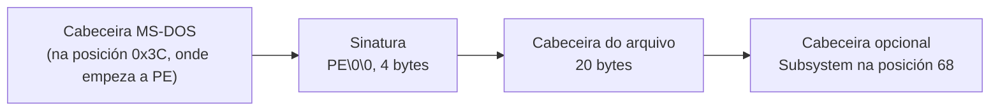

# Código › ferramentas (`tools/`)

> Estado: subfase 2.5. Na 2.5 chegou `check-profiles.ps1`, que comproba os perfís e a configuración de meiga: a caixa de mensaxe cos erros do `config.toml`, o perfil e o contorno da primeira tab, o menú dos perfís, co teclado e co rato, cada perfil que atopa meiga, o botón + e *Duplicate tab*; e as comprobacións con xanela lanzan meiga cun `APPDATA` baleiro, para que o `config.toml` de quen as executa non cambie o que comproban, e `check-tabbar.ps1` e `check-menu.ps1` deixan sitio na barra para o botón dos perfís. Na 2.4 chegou `check-menu.ps1`, que comproba co rato e co teclado o menú dunha tab de meiga: onde se abre, o que debuxa cada cambio, o que fan os seus elementos, as teclas que lle quita ao programa e cando se pecha; os outros scripts non cambiaron. Na 2.3 chegou `check-tabbar.ps1`, que comproba co rato a barra de tabs de meiga: os botóns que abren e pechan as tabs, os clics nas tabs, o que debuxa cada cambio, cantas veces esperta a xanela un programa que cambia o título sen parar ou que o repite, e que a barra non perde o rato cando un atallo mostra outra tab; `check-mouse.ps1` e `check-resize.ps1` contan co alto da barra, e `check-tabs.ps1` comproba tamén que a xanela leva ao portapapeis o texto que un programa copia dentro dunha actualización sincronizada que ela remata á súa hora límite, e que non leva o que copiou unha tab oculta dentro dunha que segue aberta ao mostrala; os outros scripts non cambiaron. Na 2.2 chegou `check-tabs.ps1`, que comproba as tabs de meiga: os atallos que as abren, as mostran e as pechan, e o que fai e o que non fai unha tab oculta. No mantemento M1, `fetch-conpty.ps1` fixou o ConPTY 1.25.261109001.

Scripts e modelos que axudan a compilar, revisar e empaquetar meiga. Non forman parte do programa. Os de medición do rendemento, en `tools/perf/`, explícanse á parte en [Código › medición](perf.md) e en [Código › escenarios de carga](escenarios.md).

| Arquivo | Para que |
|---|---|
| [`package.ps1`](#toolspackageps1) | Compilar en modo *release*, crear o `.zip` que se distribúe e deixar o ConPTY ao lado de `meiga.exe`. |
| [`fetch-conpty.ps1`](#toolsfetch-conptyps1) | Descargar o ConPTY que vai con meiga, comprobalo e deixalo en `target\conpty\` e nos cartafoles que se lle digan; avisar se hai unha versión nova. |
| [`check-imports.ps1`](#toolscheck-importsps1) | Comprobar que `meiga.exe` non depende do *runtime* de Visual C++. |
| [`check-window.ps1`](#toolscheck-windowps1) | Comprobar que `meiga.exe` abre a súa xanela, executa o seu programa e se pecha ben, sen deixar procesos. |
| [`check-present.ps1`](#toolscheck-presentps1) | Comprobar que `meiga.exe` presenta só o que cambia na saída dun programa e non debuxa en repouso nin minimizado. |
| [`check-keyboard.ps1`](#toolscheck-keyboardps1) | Comprobar que as teclas que se teclean en `meiga.exe` chegan ao programa do terminal coma as le PowerShell, co teclado español e co estadounidense. |
| [`check-mouse.ps1`](#toolscheck-mouseps1) | Comprobar que en `meiga.exe` o rato selecciona e copia texto, que as teclas e o botón dereito copian e pegan, e que o rato chega aos programas do terminal que o piden. |
| [`check-resize.ps1`](#toolscheck-resizeps1) | Comprobar que, cando a xanela de `meiga.exe` cambia de tamaño, tamén coa caixa de mensaxe aberta, a súa pantalla ten as mesmas filas ca a consola do ConPTY; que a roda, as teclas e a barra de desprazamento moven a vista do historial; e que o zoom cambia a grella. |
| [`check-tabs.ps1`](#toolscheck-tabsps1) | Comprobar que en `meiga.exe` os atallos abren, mostran e pechan as tabs, e que a saída dunha tab oculta non debuxa nada, o seu programa recibe as respostas ás súas preguntas e non copia ao portapapeis, e a tab, cando se mostra, leva o seu título á xanela e colle a grella dela. |
| [`check-tabbar.ps1`](#toolscheck-tabbarps1) | Comprobar co rato a barra de tabs de `meiga.exe`: que o botón + abre unha tab, que o × e o botón do medio as pechan e un clic as mostra, que cada cambio debuxa só o que cambia, que un programa que cambia o título sen parar, ou que pon o mesmo unha e outra vez, non esperta a xanela miles de veces por segundo, e que a barra segue co rato mentres Ctrl+Tab mostra outra tab. |
| [`check-menu.ps1`](#toolscheck-menups1) | Comprobar co rato e co teclado o menú dunha tab de `meiga.exe`: que se abre debaixo da tab ou no punteiro, que cada cambio debuxa só o que cambia, que os seus elementos duplican e pechan tabs, que as teclas que colle non lle chegan ao programa, e as que baixaron antes para el si, ao subir, e que se pecha con Esc, tamén cun botón premido nel, cun clic fóra, cando a xanela cambia de tamaño e cando se minimiza. |
| [`check-profiles.ps1`](#toolscheck-profilesps1) | Comprobar os perfís e a configuración de `meiga.exe`: que os erros do `config.toml` saen nunha caixa de mensaxe da súa xanela, sen parar nada; que a primeira tab corre o perfil por defecto, no seu cartafol e co contorno dun terminal; que Ctrl+Maiús+Espazo e o botón ▾ abren o menú dos perfís, e que cada perfil corre a súa shell no cartafol persoal; e que o + abre o perfil por defecto, e *Duplicate tab* repite o perfil e o cartafol. |
| [`terminal-sample.ps1`](#toolsterminal-sampleps1) | Escribir unha mostra do que ten que saber mostrar un terminal (cores, estilos, caracteres anchos…), para comprobala a ollo. |
| [`check-docs.ps1`](#toolscheck-docsps1) | Comprobar as ligazóns internas da documentación. |
| [`check-powershell.ps1`](#toolscheck-powershellps1) | Comprobar que todos os scripts piden PowerShell 7 dun xeito claro cando se abren con Windows PowerShell 5.1. |
| [`third-party-notices.ps1`](#toolsthird-party-noticesps1) | Xerar os avisos de licenza das dependencias. |
| [`about.hbs`](#toolsabouthbs) | Modelo dos avisos de licenza. |

Todos os scripts empezan igual: a axuda, os parámetros e unha comprobación da versión de PowerShell, que se explica en [`check-powershell.ps1`](#toolscheck-powershellps1).

## `tools/package.ps1`

Compila meiga en modo *release* e crea o paquete que se distribúe. Desde a subfase 1.6, deixa tamén o ConPTY ao lado de `target\release\meiga.exe`, para que as outras ferramentas executen meiga co mesmo ConPTY ca o paquete:

```powershell
.\tools\package.ps1            # compila e crea dist\meiga-<versión>-x86_64-pc-windows-msvc.zip
.\tools\package.ps1 -NoBuild   # empaqueta o meiga.exe que xa está compilado
```

Contido do `.zip`:

| Arquivo | Orixe |
|---|---|
| `meiga.exe` | `target\release\meiga.exe`. |
| `conpty.dll` e `OpenConsole.exe` | O ConPTY do Windows Terminal, que copia [`fetch-conpty.ps1`](#toolsfetch-conptyps1) desde o paquete NuGet, desde a subfase 1.4. |
| `LICENSE.txt` | `LICENSE`, coa extensión `.txt` para que Windows o abra cun dobre clic. |
| `README.md` | `README.md`. |
| `THIRD-PARTY-NOTICES.txt` | Xerado por `third-party-notices.ps1`. |

Explicación por partes:

```powershell
[CmdletBinding()]
param(
    [string]$OutDir,
    [switch]$NoBuild
)

# Windows PowerShell 5.1 can read this file but not run it: tell how to run
# it with PowerShell 7. tools/check-powershell.ps1 checks that this works.
if ($PSVersionTable.PSVersion.Major -lt 7) {
    …
}

$ErrorActionPreference = 'Stop'
Set-StrictMode -Version Latest
```

- `$OutDir`: o cartafol de destino. Por defecto, `dist\`, que Git ignora.
- `[switch]$NoBuild`: un parámetro sen valor. Se aparece na chamada, vale `$true`.
- A comprobación da versión é a mesma en todos os scripts (ver [`check-powershell.ps1`](#toolscheck-powershellps1)).
- As dúas últimas liñas deteñen o script ante calquera erro, como en todos os scripts (ver [Tecnoloxías › PowerShell 7](../tecnoloxias.md#11-powershell-7)).

```powershell
$root = (Resolve-Path (Join-Path $PSScriptRoot '..')).Path
# Not in param(): there, Windows PowerShell 5.1 leaves $PSScriptRoot empty and
# fails before the check above.
if (-not $OutDir) {
    $OutDir = Join-Path $root 'dist'
}
$OutDir = $ExecutionContext.SessionState.Path.GetUnresolvedProviderPathFromPSPath($OutDir)
```

- `Resolve-Path` devolve un obxecto; `.Path` colle a ruta como texto, para combinala despois con `Join-Path`.
- O valor por defecto de `$OutDir` ponse eiquí, despois da comprobación da versión, e non en `param()` (ver [`check-powershell.ps1`](#toolscheck-powershellps1)).
- A ruta de saída resólvese antes de cambiar de cartafol, igual que en [`third-party-notices.ps1`](#toolsthird-party-noticesps1).

```powershell
Push-Location $root
try {
    if (-not $NoBuild) {
        cargo build --release --locked
        if ($LASTEXITCODE -ne 0) {
            throw "cargo build failed with exit code $LASTEXITCODE"
        }
    }
```

Compila desde a raíz do repositorio coas versións exactas do `Cargo.lock` (`--locked`), salvo que se pase `-NoBuild`.

```powershell
    $metadata = cargo metadata --format-version 1 --no-deps --locked | ConvertFrom-Json
    if ($LASTEXITCODE -ne 0) {
        throw "cargo metadata failed with exit code $LASTEXITCODE"
    }
    $version = ($metadata.packages | Where-Object name -EQ 'meiga').version
    $exe = Join-Path $metadata.target_directory 'release\meiga.exe'
    if (-not (Test-Path -LiteralPath $exe -PathType Leaf)) {
        throw "$exe does not exist. Run the script without -NoBuild."
    }
```

- `cargo metadata` describe o workspace en JSON: os crates, as súas versións e o cartafol de compilación.
  - `--format-version 1` fixa o formato da saída, para que non cambie con versións futuras de Cargo;
  - `--no-deps` omite as dependencias externas, que non fan falta eiquí;
  - `ConvertFrom-Json` converte o texto en obxectos de PowerShell.
- A versión lese do `Cargo.toml` a través de Cargo, en vez de escribila no script: só hai un sitio onde cambiala.
- `target_directory` é o cartafol de compilación real, que pode non ser `target\` (por exemplo, coa variábel `CARGO_TARGET_DIR`).
- `-PathType Leaf` comproba que é un arquivo, non un cartafol.

```powershell
    $name = "meiga-$version-x86_64-pc-windows-msvc"
    $staging = Join-Path $metadata.target_directory "package\$name"
    if (Test-Path -LiteralPath $staging) {
        Remove-Item -LiteralPath $staging -Recurse -Force
    }
    New-Item -ItemType Directory -Force -Path $staging | Out-Null
```

- O nome do paquete leva a versión e o *target* (procesador x86-64, Windows, compilador MSVC). É a convención habitual nos proxectos de Rust.
- Os arquivos prepáranse primeiro nun cartafol intermedio (*staging*) dentro de `target\`. Bórrase antes, por se quedou dunha execución anterior, para que o zip non leve restos.
- `-LiteralPath` usa a ruta tal cal, sen interpretar caracteres comodín como `*` ou `[`.

```powershell
    Copy-Item -LiteralPath $exe -Destination $staging
    & (Join-Path $PSScriptRoot 'fetch-conpty.ps1') -Destination $staging, (Split-Path -Parent $exe)
    Copy-Item -LiteralPath (Join-Path $root 'LICENSE') -Destination (Join-Path $staging 'LICENSE.txt')
    Copy-Item -LiteralPath (Join-Path $root 'README.md') -Destination $staging
    & (Join-Path $PSScriptRoot 'third-party-notices.ps1') -OutFile (Join-Path $staging 'THIRD-PARTY-NOTICES.txt')
```

Copia os arquivos e xera os avisos de terceiros. `&` é o operador de chamada: executa o script cuxa ruta se calcula na propia liña. `fetch-conpty.ps1` comproba o ConPTY e cópiao ao cartafol do paquete; se aínda non está descargado, descárgao, así que o paquete sempre o leva.

**O ConPTY ao lado de `meiga.exe`.** Desde a subfase 1.6, `fetch-conpty.ps1` cópiao tamén ao cartafol de `meiga.exe`, `target\release\`, e por iso a súa saída ten dúas liñas `Copied to …`, unha por cartafol.

- `-Destination` recibe unha lista: os elementos van separados por comas. `Split-Path -Parent` dá o cartafol dunha ruta, e as parénteses fan que se execute antes, para que o seu resultado sexa o segundo elemento.
- **Por que.** meiga busca `conpty.dll` e `OpenConsole.exe` no seu propio cartafol e, se non os atopa, usa sen avisar o ConPTY de Windows, co seu `conhost.exe` ([Tecnoloxías › ConPTY](../tecnoloxias.md#31-conpty-a-pseudoconsola-de-windows)). Varias ferramentas executan `target\release\meiga.exe` cunha sesión no seu terminal: [`check-window.ps1`](#toolscheck-windowps1), [`check-present.ps1`](#toolscheck-presentps1), [`measure-startup.ps1`](perf.md#toolsperfmeasure-startupps1) e [`run-scenario.ps1 -Start`](escenarios.md#con--start). Sen esta copia, probarían e medirían un ConPTY distinto do que vai no paquete.

```powershell
    New-Item -ItemType Directory -Force -Path $OutDir | Out-Null
    $zip = Join-Path $OutDir "$name.zip"
    Compress-Archive -Path (Join-Path $staging '*') -DestinationPath $zip -Force
}
finally {
    Pop-Location
}

Write-Host "Wrote $zip"
```

- `Compress-Archive` crea o zip. Con `staging\*`, os arquivos quedan na raíz do zip, sen cartafol intermedio.
- `-Force` substitúe un zip anterior co mesmo nome.

## `tools/fetch-conpty.ps1`

Desde a subfase 1.4. Descarga o ConPTY que vai con meiga ([Tecnoloxías › ConPTY](../tecnoloxias.md#31-conpty-a-pseudoconsola-de-windows)), o paquete NuGet `Microsoft.Windows.Console.ConPTY` na versión que fixa o propio script, e compróbao. Deixa os dous arquivos que usa meiga en `target\conpty\`, onde os buscan as [probas](meiga-win.md#cratesmeiga-wintestsconptyrs) e o [exemplo](meiga-win.md#cratesmeiga-winexamplesconptyrs) de `meiga-win`, e desde onde os copia aos cartafoles que se lle digan: [`package.ps1`](#toolspackageps1) pídelle o do paquete e, desde a subfase 1.6, o de `target\release\meiga.exe`.

```powershell
.\tools\fetch-conpty.ps1                         # descarga e comproba; os arquivos quedan en target\conpty\
.\tools\fetch-conpty.ps1 -Destination <cartafol> # ademais, copia os dous arquivos a <cartafol>
.\tools\fetch-conpty.ps1 -Destination <a>, <b>   # ou a varios cartafoles
.\tools\fetch-conpty.ps1 -CheckLatest            # só mira en nuget.org se hai unha versión estábel máis nova
```

A primeira vez descarga o paquete, de 1,7 MB. As seguintes, só comproba o que xa ten, sen descargar nada:

```text
Microsoft.Windows.Console.ConPTY 1.25.261109001: the package is already in …\target\conpty.
conpty.dll: version 1.25.2611.09001, 119608 bytes, signed by Microsoft Corporation.
OpenConsole.exe: version 1.25.2611.09001, 1089336 bytes, signed by Microsoft Corporation.
conpty.dll and OpenConsole.exe are in …\target\conpty
```

`cargo test` necesita o ConPTY: sen el, as probas que o usan fallan cunha mensaxe que pide executar este script. Por iso a CI o executa antes das probas ([Código › GitHub](github.md#comprobacións)), e unha vez por semana comproba con `-CheckLatest` se hai unha versión nova ([job `conpty`](github.md#job-conpty)).

Explicación por partes:

```powershell
$Package = 'Microsoft.Windows.Console.ConPTY'
$Version = '1.25.261109001'
$Sha256 = '3D77F535DF848E44225C2A8912AC844FECB23F3057732B639F3034B587496F09'
# The files for x64, as they are in the package.
$Files = [ordered]@{
    'conpty.dll'      = 'runtimes/win-x64/native/conpty.dll'
    'OpenConsole.exe' = 'build/native/runtimes/x64/OpenConsole.exe'
}
# The v2 API of www.nuget.org. The v3 API, on api.nuget.org, would do too,
# but some networks block it.
$Feed = 'https://www.nuget.org/api/v2'
```

- `$Version` e `$Sha256` son o único sitio onde se fixa a versión do ConPTY ([ADR 0004](../adr/0004-conpty-empaquetado.md)). O SHA-256 é o do `.nupkg` enteiro ([Tecnoloxías › NuGet](../tecnoloxias.md#33-nuget-e-as-sinaturas-authenticode)).
- `$Files`: o nome de cada arquivo e a súa ruta dentro do paquete. Cada un está nun cartafol distinto: `conpty.dll` onde o buscan os proxectos de .NET, e `OpenConsole.exe` onde o buscan os de C++. `[ordered]` mantén a orde, para que as mensaxes saian sempre na mesma.
- `$ProgressPreference = 'SilentlyContinue'`, antes destas liñas, oculta a barra de progreso de `Invoke-WebRequest`.

```powershell
if ($CheckLatest) {
    $versions = [System.Collections.Generic.List[string]]::new()
    $url = "$Feed/FindPackagesById()?id='$Package'&semVerLevel=2.0.0"
    while ($url) {
        $feedXml = [xml](Invoke-WebRequest -Uri $url -TimeoutSec 60 -MaximumRetryCount 3 -RetryIntervalSec 5).Content
        $elements = @($feedXml.DocumentElement.ChildNodes | Where-Object { $_ -is [System.Xml.XmlElement] })
        foreach ($entry in $elements | Where-Object LocalName -EQ 'entry') {
            $versions.Add($entry.properties.Version)
        }
        # The feed comes in pages, each with a link to the next one.
        $next = @($elements | Where-Object { $_.LocalName -eq 'link' -and $_.GetAttribute('rel') -eq 'next' })
        $url = if ($next) { $next[0].GetAttribute('href') } else { $null }
    }
```

Con `-CheckLatest`, o script non descarga o paquete: só lista as versións publicadas.

- `FindPackagesById()` devolve un XML (Atom) cun elemento `entry` por versión. `semVerLevel=2.0.0` pide tamén as versións que só se poden escribir con SemVer 2.0, que sen el non aparecen.
- `[xml]` converte o texto nun documento XML. Os fillos do elemento raíz (`feed`) son as versións (`entry`), as ligazóns (`link`) e outros datos. O script percorre os fillos en vez de ler `$feedXml.feed.entry` porque, co modo estrito, ler unha propiedade que non existe é un erro: pasaría nunha páxina sen versións.
- `Where-Object { $_ -is [System.Xml.XmlElement] }` deixa só os elementos: entre eles pode haber texto, como os espazos, que non ten atributos.
- `-MaximumRetryCount 3 -RetryIntervalSec 5`: se a petición falla, por exemplo por un problema momentáneo da rede, repítea ata tres veces, cada 5 s.
- As versións chegan en páxinas. Cada páxina leva unha ligazón `link` con `rel="next"` á seguinte, e o bucle séguea ata a última. Hoxe todas caben nunha, pero o script non depende diso.

```powershell
    # Previews have a suffix, such as 1.26.260930004-preview.
    $stable = @($versions | Where-Object { $_ -notmatch '-' } | Sort-Object { [version]$_ })
    if ($stable.Count -eq 0) {
        throw "nuget.org lists no stable version of $Package."
    }
    $latest = $stable[-1]
    if ([version]$latest -gt [version]$Version) {
        throw "$Package $latest is newer than the pinned $Version. Update `$Version and `$Sha256 in $(Split-Path $PSCommandPath -Leaf)."
    }
    Write-Host "OK: $Version is the latest stable version of $Package on nuget.org."
    exit 0
}
```

- As versións de proba levan un sufixo despois dun guión, e quedan fóra.
- `Sort-Object { [version]$_ }` ordena as versións como números, parte por parte. Como texto, `1.9` iría despois de `1.25`.
- `$stable[-1]` é o último elemento: a versión máis nova.
- Se hai unha máis nova ca a fixada, falla e di o que hai que cambiar. Na mensaxe, `` `$ `` escribe un `$` en vez de ler a variábel.

```powershell
$root = (Resolve-Path (Join-Path $PSScriptRoot '..')).Path
Push-Location $root
try {
    $metadata = cargo metadata --format-version 1 --no-deps --locked | ConvertFrom-Json
    if ($LASTEXITCODE -ne 0) {
        throw "cargo metadata failed with exit code $LASTEXITCODE"
    }
}
finally {
    Pop-Location
}
$folder = Join-Path $metadata.target_directory 'conpty'
New-Item -ItemType Directory -Force -Path $folder | Out-Null
```

O cartafol de compilación, coma en [`package.ps1`](#toolspackageps1): `cargo metadata` desde a raíz do repositorio. O paquete e os arquivos quedan en `conpty\`, dentro del: Git ignórao, e `cargo clean` bórrao.

```powershell
$nupkg = Join-Path $folder "$Package.$Version.nupkg"
if ((Test-Path -LiteralPath $nupkg) -and (Get-FileHash -LiteralPath $nupkg -Algorithm SHA256).Hash -eq $Sha256) {
    Write-Host "$Package ${Version}: the package is already in $folder."
}
else {
    $partial = "$nupkg.partial"
    Invoke-WebRequest -Uri "$Feed/package/$Package/$Version" -OutFile $partial -TimeoutSec 120 -MaximumRetryCount 3 -RetryIntervalSec 5
    $hash = (Get-FileHash -LiteralPath $partial -Algorithm SHA256).Hash
    if ($hash -ne $Sha256) {
        Remove-Item -LiteralPath $partial
        throw "The SHA-256 of the downloaded package is $hash, and it should be $Sha256."
    }
    Move-Item -LiteralPath $partial -Destination $nupkg -Force
    Write-Host "$Package ${Version}: downloaded from nuget.org, $((Get-Item -LiteralPath $nupkg).Length) bytes, with the expected SHA-256."
}
```

- Só descarga o paquete se non o ten, ou se o que ten non é exactamente o fixado.
- Descárgao primeiro con outro nome (`.partial`), e dálle o definitivo só despois de comprobar o SHA-256. Así, unha descarga cortada ou un paquete distinto nunca quedan co nome do bo.
- `${Version}`, coas chaves, porque despois vén `:`, que PowerShell lería como parte do nome da variábel.

```powershell
Add-Type -AssemblyName System.IO.Compression.FileSystem
$zip = [System.IO.Compression.ZipFile]::OpenRead($nupkg)
try {
    foreach ($name in $Files.Keys) {
        $entry = $zip.GetEntry($Files[$name])
        if (-not $entry) {
            throw "The package has no $($Files[$name])."
        }
        $path = Join-Path $folder $name
        # Extract only what changed: a running session keeps its
        # OpenConsole.exe in use, and Windows does not let it be replaced.
        $stream = $entry.Open()
        try {
            $hash = [System.Convert]::ToHexString([System.Security.Cryptography.SHA256]::HashData($stream))
        }
        finally {
            $stream.Dispose()
        }
        if (-not (Test-Path -LiteralPath $path) -or (Get-FileHash -LiteralPath $path -Algorithm SHA256).Hash -ne $hash) {
            [System.IO.Compression.ZipFileExtensions]::ExtractToFile($entry, $path, $true)
        }
    }
}
finally {
    $zip.Dispose()
}
```

- Un `.nupkg` é un zip: `ZipFile.OpenRead` ábreo con .NET, sen descomprimilo enteiro. `GetEntry` busca cada arquivo pola súa ruta, e o script falla se non está, por exemplo se unha versión nova o cambiase de cartafol.
- Só extrae o arquivo se non existe ou se é distinto do do paquete: compara o SHA-256 do que hai dentro do zip (`SHA256.HashData` le o arquivo comprimido sen gardalo) co do que xa está fóra. Mentres unha sesión está aberta (por exemplo, o exemplo de `meiga-win`), Windows non deixa substituír o seu `OpenConsole.exe`; así, executar o script nese momento non falla se o arquivo xa é o bo.
- `[System.Convert]::ToHexString` escribe o *hash* en hexadecimal e en maiúsculas, coma `Get-FileHash`.
- `ExtractToFile` co terceiro argumento a `$true` substitúe o arquivo que houbese.
- Os `try`/`finally` pechan o zip e cada arquivo de dentro aínda que algo falle.

```powershell
foreach ($name in $Files.Keys) {
    $path = Join-Path $folder $name
    $signature = Get-AuthenticodeSignature -LiteralPath $path
    if ($signature.Status -ne 'Valid' -or $signature.SignerCertificate.Subject -notmatch '(^|, )O=Microsoft Corporation(,|$)') {
        throw "$name is not signed by Microsoft: $($signature.Status), $($signature.StatusMessage)"
    }
    $file = Get-Item -LiteralPath $path
    Write-Host ("{0}: version {1}, {2} bytes, signed by Microsoft Corporation." -f $name, $file.VersionInfo.FileVersion, $file.Length)
}
Write-Host "conpty.dll and OpenConsole.exe are in $folder"
```

- Comproba a sinatura Authenticode dos dous arquivos ([Tecnoloxías › NuGet e as sinaturas Authenticode](../tecnoloxias.md#33-nuget-e-as-sinaturas-authenticode)): que é válida e que a organización (`O=`) do certificado é Microsoft Corporation.
- A expresión regular quere `O=Microsoft Corporation` como un campo enteiro do nome do certificado: ao principio ou despois de `, `, e antes dunha coma ou do final. Non vale, por exemplo, `O=Microsoft Corporation Fake`.
- A versión de cada arquivo (`VersionInfo.FileVersion`) é a do Windows Terminal do que sae: a do paquete, escrita doutra maneira.

```powershell
foreach ($target in $Destination) {
    # Resolve a relative path against the current PowerShell location, not
    # the working directory of the process.
    $target = $ExecutionContext.SessionState.Path.GetUnresolvedProviderPathFromPSPath($target)
    New-Item -ItemType Directory -Force -Path $target | Out-Null
    foreach ($name in $Files.Keys) {
        $source = Join-Path $folder $name
        $copy = Join-Path $target $name
        # Copy only what changed, for the same reason: meiga may be running
        # from that folder.
        if (-not (Test-Path -LiteralPath $copy) -or
            (Get-FileHash -LiteralPath $copy -Algorithm SHA256).Hash -ne (Get-FileHash -LiteralPath $source -Algorithm SHA256).Hash) {
            Copy-Item -LiteralPath $source -Destination $copy
        }
    }
    Write-Host "Copied to $target"
}
```

Con `-Destination`, copia os dous arquivos a eses cartafoles: é o que fai `package.ps1` co cartafol do paquete e co de `meiga.exe`.

- Desde a subfase 1.6, `-Destination` é unha lista de cartafoles (`[string[]]`), separados por comas. Sen el, `$Destination` vale `$null`, e `foreach` non dá ningunha volta: non fai falta ningún `if`.
- Cada ruta resólvese coma en [`third-party-notices.ps1`](#toolsthird-party-noticesps1).
- **Só copia o que cambiou**, pola mesma razón ca ao extraer: se un meiga corre desde ese cartafol, `conpty.dll` está cargada nel e, mentres a súa sesión está aberta, `OpenConsole.exe` está en uso, e Windows non deixa substituílos. Desde a 1.6, `package.ps1` copia o ConPTY a `target\release\`, de onde se executa meiga mentres se desenvolve: sen esta comprobación, a copia fallaría cun meiga aberto desde alí, aínda que os arquivos fosen os mesmos. Se cambiaron de verdade, por exemplo cunha versión nova do ConPTY, a copia falla igual, e hai que pechar antes ese meiga.
- Compara o SHA-256 da copia co do arquivo de `target\conpty\`, que xa está comprobado. A condición ocupa dúas liñas: a primeira remata en `-or`, e PowerShell segue lendo na seguinte.
- A liña `Copied to …` sae por cada cartafol, tamén se os arquivos xa estaban: di onde están.

**Actualizar o ConPTY.** Cando o job `conpty` falla, ou `-CheckLatest` di que hai unha versión nova:

1. Ler as novidades da versión nova, nas notas da versión do Windows Terminal coa mesma serie.
2. Descargar o paquete e calcular o seu SHA-256. nuget.org mostra o SHA-512 dos paquetes, non o SHA-256:

   ```powershell
   $new = '<versión nova>'
   Invoke-WebRequest "https://www.nuget.org/api/v2/package/Microsoft.Windows.Console.ConPTY/$new" -OutFile "$env:TEMP\conpty.nupkg"
   (Get-FileHash "$env:TEMP\conpty.nupkg" -Algorithm SHA256).Hash
   ```

3. Cambiar `$Version` e `$Sha256` no script e executalo: descarga o paquete novo e comproba as sinaturas.
4. Pasar as probas (`cargo test --workspace`) e o exemplo de `meiga-win` con `cmd` e con `pwsh`.
5. Comprobar que a licenza do paquete segue sendo a MIT, coma no modelo dos [avisos de terceiros](#toolsabouthbs), e cambiar a versión na documentación.

Se o SHA-256 dun paquete xa fixado deixase de coincidir, o script falla. Nese caso, non se debe cambiar `$Sha256` sen saber antes por que cambiou o paquete.

## `tools/check-imports.ps1`

Comproba que `meiga.exe` non depende do *runtime* de Visual C++. Protexe a decisión de ligar o CRT estaticamente ([Tecnoloxías › CRT](../tecnoloxias.md#5-runtime-de-c-ligado-estaticamente-crt-static)): se algo a desfai, a CI falla.

```powershell
.\tools\check-imports.ps1                                 # comproba target\release\meiga.exe
.\tools\check-imports.ps1 -Path outro\cartafol\meiga.exe
```

Saída esperada:

```text
meiga.exe imports: kernel32.dll, dwrite.dll, ntdll.dll, oleaut32.dll, combase.dll, api-ms-win-core-synch-l1-2-0.dll, gdi32.dll, user32.dll, advapi32.dll
OK: no dependencies on the Visual C++ runtime.
```

`user32.dll` e `gdi32.dll` chegaron coa xanela, na subfase 1.1; `dwrite.dll`, `combase.dll` e `oleaut32.dll`, co texto, na 1.3; e `advapi32.dll`, a das funcións do rexistro de Windows, cos perfís, na 2.5: meiga le nel as distribucións de WSL e o cartafol de Git for Windows ([ADR 0022](../adr/0022-os-perfis-e-a-configuracion.md), decisión 4). Para que serve cada unha, e por que ata a 1.4 `kernel32.dll` aparecía dúas veces, explícase en [Código › meiga](meiga.md#comprobacións-feitas).

**Por que fai falta.** A opción `+crt-static` está en `.cargo/config.toml`, pero hai formas de perdela sen que nada falle: a máis habitual é definir a variábel `RUSTFLAGS`, que fai que Cargo ignore os `rustflags` de `.cargo/config.toml` (ver [Código › .github](github.md#variábeis-de-contorno)). Comprobouse cunha compilación con `RUSTFLAGS='-C opt-level=3'`:

```text
meiga.exe imports: api-ms-win-core-synch-l1-2-0.dll, KERNEL32.dll, ntdll.dll, VCRUNTIME140.dll,
api-ms-win-crt-string-l1-1-0.dll, api-ms-win-crt-runtime-l1-1-0.dll, ...
It depends on the Visual C++ runtime: VCRUNTIME140.dll, api-ms-win-crt-string-l1-1-0.dll, ...
Is RUSTFLAGS overriding .cargo/config.toml?
```

Explicación por partes:

```powershell
$Path = $ExecutionContext.SessionState.Path.GetUnresolvedProviderPathFromPSPath($Path)
if (-not (Test-Path -LiteralPath $Path -PathType Leaf)) {
    throw "$Path does not exist. Build it first with: cargo build --release"
}
```

Resolve a ruta como nos outros scripts e comproba que o executábel existe.

```powershell
$vswhere = Join-Path ${env:ProgramFiles(x86)} 'Microsoft Visual Studio\Installer\vswhere.exe'
if (-not (Test-Path -LiteralPath $vswhere -PathType Leaf)) {
    throw 'vswhere.exe was not found. Install Visual Studio or the Build Tools.'
}
$vs = & $vswhere -latest -products * -requires Microsoft.VisualStudio.Component.VC.Tools.x86.x64 -property installationPath
if ($LASTEXITCODE -ne 0 -or -not $vs) {
    throw 'No Visual Studio installation with the MSVC build tools was found.'
}
```

- `dumpbin` non está no `PATH` dunha consola normal, e a súa ruta cambia con cada versión de Visual Studio. `vswhere` é a ferramenta oficial para localizar as instalacións (ver [Tecnoloxías › MSVC](../tecnoloxias.md#13-msvc-e-o-windows-sdk)).
- `${env:ProgramFiles(x86)}`: as chaves son necesarias porque o nome da variábel leva parénteses.
- Opcións de `vswhere`:
  - `-latest`: a instalación máis recente;
  - `-products *`: inclúe tamén as *Build Tools*, que non son un Visual Studio completo;
  - `-requires …VC.Tools.x86.x64`: só instalacións co compilador de C++ para x64;
  - `-property installationPath`: devolve só a ruta da instalación.

```powershell
$toolsVersion = (Get-Content -LiteralPath (Join-Path $vs 'VC\Auxiliary\Build\Microsoft.VCToolsVersion.default.txt') -Raw).Trim()
$dumpbin = Join-Path $vs "VC\Tools\MSVC\$toolsVersion\bin\Hostx64\x64\dumpbin.exe"
```

- Unha instalación pode ter varias versións das ferramentas de C++. Este arquivo indica a predeterminada, a mesma que usa a *Developer PowerShell*.
- `Hostx64\x64`: as ferramentas que corren nun Windows de 64 bits e traballan con binarios de 64 bits.

```powershell
$output = & $dumpbin /nologo /dependents $Path
if ($LASTEXITCODE -ne 0) {
    throw "dumpbin failed with exit code $LASTEXITCODE"
}

# dumpbin prints each imported DLL on its own indented line.
$dlls = foreach ($line in $output) {
    if ($line -match '^\s+(\S+\.dll)\s*$') { $Matches[1] }
}
Write-Host "$(Split-Path -Leaf $Path) imports: $($dlls -join ', ')"
```

- `/dependents` lista as DLL que importa o executábel, e `/nologo` omite a cabeceira coa versión.
- A saída de `dumpbin` é texto. A expresión regular colle as liñas sangradas que só conteñen un nome rematado en `.dll`:
  - `^\s+`: espazos ao principio da liña;
  - `(\S+\.dll)`: o nome, que queda gardado en `$Matches[1]`;
  - `\s*$`: nada máis ata o final da liña.
- `$dlls = foreach …` recolle nun array todo o que emite o bucle.

```powershell
$runtime = $dlls | Where-Object { $_ -match '^(vcruntime.*|msvcp.*|ucrtbase|api-ms-win-crt-.*)\.dll$' }
if ($runtime) {
    throw "It depends on the Visual C++ runtime: $($runtime -join ', '). Is RUSTFLAGS overriding .cargo/config.toml?"
}

Write-Host 'OK: no dependencies on the Visual C++ runtime.'
```

Busca as DLL do *runtime*: `vcruntime*.dll` (o *runtime* de Visual C++), `msvcp*.dll` (a biblioteca estándar de C++), `ucrtbase.dll` (o *Universal CRT*) e os *API sets* `api-ms-win-crt-*`, que son os nomes cos que se importa o *Universal CRT*. `-match` non distingue maiúsculas, así que `VCRUNTIME140.dll` tamén coincide. Se aparece algunha, o script falla e suxire a causa máis probábel.

## `tools/check-window.ps1`

Comproba que `meiga.exe` fai o que prometen as subfases 1.1 e 1.6: abre a súa xanela, sen consola e coa escala por monitor; executa no seu terminal o programa da liña de comandos, que lle pon título á xanela; e, cando se pecha, remata ben, e con el o programa e a súa consola. Inicia o programa de verdade, con `cmd` no terminal, así que a xanela vese durante un segundo, máis ou menos.

```powershell
.\tools\check-window.ps1                                  # comproba target\release\meiga.exe
.\tools\check-window.ps1 -Path outro\cartafol\meiga.exe
.\tools\check-window.ps1 -TimeoutSeconds 30               # nunha máquina moi lenta
```

Saída esperada:

```text
OK: it is a GUI program, so it opens no console window.
OK: it opens its window (class 'meiga', title 'meiga').
OK: the window is DPI aware per monitor (v2).
OK: the program in the terminal sets the title of the window ('meiga-check').
OK: it ends with exit code 0 when its window closes.
OK: then the program in the terminal and its console end too (cmd.exe, OpenConsole.exe).
```

A última liña di `conhost.exe` en vez de `OpenConsole.exe` se o ConPTY non está ao lado de `meiga.exe`, por exemplo despois dun `cargo build --release` sen [`package.ps1`](#toolspackageps1): meiga usa entón o de Windows.

Se falla unha comprobación, o script remata cun erro que explica cal, e código de saída 1. Pase o que pase, `meiga.exe` non queda aberto.

Explicación por partes:

```powershell
[ValidateRange(1, 600)]
[int]$TimeoutSeconds = 10
```

O tempo máximo de cada espera: que se abra a xanela, que cambie o título, que remate o proceso e, despois, que rematen o programa e a súa consola. Abrir a xanela leva milisegundos, e cmd cambia o título despois dun segundo, así que 10 s só se esgotan se algo vai mal.

```powershell
$header = [byte[]]::new(4096)
$stream = [IO.File]::OpenRead($Path)
try {
    $read = $stream.Read($header, 0, $header.Length)
}
finally {
    $stream.Dispose()
}
$pe = if ($read -ge 0x40) { [BitConverter]::ToInt32($header, 0x3C) } else { -1 }
if ($pe -lt 0 -or $pe + 24 + 70 -gt $read -or [BitConverter]::ToUInt32($header, $pe) -ne 0x4550) {
    throw "$Path is not a Windows executable."
}
# The optional header follows the signature (4 bytes) and the file header (20
# bytes), and Subsystem is at offset 68 in both PE32 and PE32+.
$subsystem = [BitConverter]::ToUInt16($header, $pe + 24 + 68)
if ($subsystem -ne 2) {
    throw "$exe uses subsystem $subsystem instead of 2 (Windows GUI), so it opens a console window. Is it a debug build?"
}
```

O **subsistema** (ver [Tecnoloxías › Subsistema](../tecnoloxias.md#6-subsistema-de-windows)) é un número na cabeceira do `.exe`, que segue o formato **PE** (*Portable Executable*):



- Só se len os primeiros 4 KB: a cabeceira sempre está ao principio, e un `.exe` de depuración ocupa varios MB.
- `try`/`finally` pecha o arquivo aínda que a lectura falle.
- `[BitConverter]::ToInt32($header, 0x3C)` le un número de 4 bytes na posición 0x3C: onde empeza a cabeceira PE.
- `0x4550` son os bytes `P` e `E` seguidos de dous ceros, lidos como un número (os procesadores x64 gardan primeiro o byte de menos peso). Se non están, o arquivo non é un executábel de Windows. A condición tamén comproba que as posicións que se len caen dentro do que se leu.
- `Subsystem` está na mesma posición nos executábeis de 32 bits (PE32) e nos de 64 (PE32+). O valor 2 é unha aplicación gráfica, e o 3, de consola: o que daría unha compilación de depuración (ver [Código › meiga](meiga.md#cratesmeigasrcmainrs)).

```powershell
if (-not ('Meiga.Tools.WindowCheck' -as [type])) {
    Add-Type -Namespace Meiga.Tools -Name WindowCheck -MemberDefinition @'
[DllImport("user32.dll", CharSet = CharSet.Unicode)]
public static extern int GetClassNameW(IntPtr window, System.Text.StringBuilder name, int capacity);

[DllImport("user32.dll")]
public static extern IntPtr GetWindowDpiAwarenessContext(IntPtr window);

[DllImport("user32.dll")]
[return: MarshalAs(UnmanagedType.Bool)]
public static extern bool AreDpiAwarenessContextsEqual(IntPtr first, IntPtr second);
'@
}
```

- PowerShell non pode chamar directamente a estas tres funcións de Windows. `Add-Type -MemberDefinition` compila unha clase de C# con elas: `[DllImport("user32.dll")]` indica en que DLL está cada unha, e .NET convirte os argumentos ao chamala (*P/Invoke*). Igual que en [`measure.ps1`](../tecnoloxias.md#c-dentro-de-powershell), só que con tres declaracións en vez dun arquivo.
- `-as [type]` comproba se a clase xa existe: nunha mesma sesión de PowerShell só se pode compilar unha vez.
- `GetClassNameW` dá o nome da clase dunha xanela, e `GetWindowDpiAwarenessContext`, como escala a xanela. `[return: MarshalAs(UnmanagedType.Bool)]` indica que o `BOOL` de Windows (un número de 4 bytes) se converte nun `bool`.

```powershell
# meiga reads its configuration from %APPDATA%\meiga\config.toml: an empty
# folder instead gives it its default values, whatever the user has there.
# The programs in its tabs get that folder too.
$appdata = Join-Path ([IO.Path]::GetTempPath()) "meiga-check-window-$PID-appdata"
$null = New-Item -ItemType Directory -Force -Path $appdata
```

**O `APPDATA` baleiro.** Desde a subfase 2.5, meiga le ao arrancar a súa configuración, `%APPDATA%\meiga\config.toml` ([ADR 0022](../adr/0022-os-perfis-e-a-configuracion.md), decisión 1), e un `config.toml` de quen executa a comprobación podería cambiar o que comproba: o perfil das tabs novas, por exemplo, ou unha caixa cos seus erros diante da xanela. Por iso, todas as comprobacións que abren meiga lle dan un `APPDATA` propio, un cartafol baleiro: sen `config.toml`, meiga usa os seus valores por defecto.

- O cartafol vai no cartafol temporal, co número do proceso da comprobación, coma os seus outros arquivos: dúas comprobacións á vez non o comparten. `New-Item -ItemType Directory -Force` créao, e non falla se xa existe; `$null =` descarta o obxecto do cartafol, que se mostraría.
- meiga le `APPDATA` no seu contorno, que lle dá a comprobación (`$info.Environment`, máis abaixo). E os programas das súas tabs reciben ese mesmo cartafol: meiga dálles o seu contorno (decisión 9).
- O `finally` bórrao ao rematar.
- As outras comprobacións fan o mesmo, co cartafol `meiga-check-<nome>-<PID>-appdata`, salvo [`check-profiles.ps1`](#toolscheck-profilesps1), que escribe no seu o `config.toml` que comproba.

```powershell
$title = 'meiga-check'
$info = [Diagnostics.ProcessStartInfo]::new($Path)
$info.UseShellExecute = $false
$info.Environment['APPDATA'] = $appdata
# With /k, cmd shows each command in the title while it runs ("cmd.exe -
# ping ..."), as soon as it starts, and the title "meiga" could be gone
# before the check below. With /c it does not. pause keeps cmd running until
# the window closes, and there is no space before & because it would be part
# of the title.
foreach ($argument in 'cmd', '/d', '/c', "ping -n 2 127.0.0.1 >nul & title $title& pause >nul") {
    $info.ArgumentList.Add($argument)
}
```

Desde a subfase 1.6, meiga executa no seu terminal o programa da súa liña de comandos ([Código › meiga](meiga.md#cratesmeigasrcoptionsrs)). O script dálle un `cmd` que fai algo que se ve desde fóra sen ler a pantalla: cambiar o título da xanela.

- `UseShellExecute = $false`: Windows crea o proceso directamente, sen pasar polo Explorador.
- `Environment` é o contorno que recibe meiga: unha copia do da comprobación, que se pode cambiar antes de arrancalo. Desde a 2.5, `APPDATA` é o cartafol baleiro de enriba.
- `ArgumentList` pasa cada argumento por separado, e .NET pon as comiñas que fagan falta: o último leva espazos, así que vai entre comiñas. meiga recibe os catro e xúntaos outra vez, coas mesmas regras, para lanzar cmd ([Tecnoloxías › A liña de comandos](../tecnoloxias.md#40-a-liña-de-comandos-en-windows)). Polo camiño, ninguén interpreta o `>nul` nin o `&`: chegan ao cmd de dentro de meiga, que quita as comiñas de fóra e executa o que hai dentro.
- `/d`: cmd non executa os comandos `AutoRun` do rexistro de Windows, que alguén pode ter configurados e que cambiarían o que fai.
- `/c`: cmd executa os comandos e remata. Con `/k`, que despois segue aberto esperando ordes, coma unha shell, cmd mostra no título cada comando mentres o executa (`C:\Windows\SYSTEM32\cmd.exe - ping  -n 2 127.0.0.1`), e faino en canto arranca: o título «meiga» podía desaparecer antes de que o script mirase a xanela. Pasou nunha execución da CI: o título de cmd chega poucos milisegundos despois de abrirse a xanela. Con `/c`, cmd non toca o título: só o cambia `title`.
- `ping -n 2 127.0.0.1 >nul` envía dous *pings* ao propio equipo, cun segundo entre eles: sen rede e, con `>nul`, sen escribir nada. É o xeito clásico de esperar un segundo en cmd. A espera fai que o título aínda sexa «meiga» cando o script mira a xanela, xusto despois de que se abra, e que cambie despois: sen ela, `title` podería cambialo antes, e a comprobación da xanela fallaría ás veces.
- `&` executa un comando despois do outro, e `title` cambia o título da consola co texto que ten detrás, ata o seguinte `&`: por iso non hai un espazo antes del, que sería parte do título. O ConPTY envíallo ao terminal como unha secuencia OSC ([Tecnoloxías › As secuencias de control](../tecnoloxias.md#35-as-secuencias-de-control)).
- `pause >nul` agarda a que se prema unha tecla, sen escribir nada, e ninguén a preme: así cmd segue aberto ata que se pecha a xanela, e a última comprobación, que cmd remata cando se pecha meiga, demostra algo. Sen el, cmd remataría despois de poñer o título.

```powershell
$process = [Diagnostics.Process]::Start($info)
try {
    # WaitForInputIdle returns when meiga has painted its window and waits for
    # messages. It fails if the process has already ended.
    $idle = try { $process.WaitForInputIdle($TimeoutSeconds * 1000) } catch { $false }
    if (-not $idle) {
        if ($process.HasExited) {
            throw "$exe ended with exit code $($process.ExitCode) before it opened its window."
        }
        throw "$exe did not open its window within $TimeoutSeconds s."
    }
```

`WaitForInputIdle` agarda a que o programa remate de arrancar e quede esperando mensaxes, sen ningunha pendente: no caso de meiga, coa xanela xa pintada (ver [Código › meiga-win](meiga-win.md#windowrun)) e, desde a subfase 1.6, co programa do terminal xa lanzado, porque meiga lanza a súa sesión antes do primeiro fotograma ([ADR 0013](../adr/0013-da-saida-a-pantalla.md)). Devolve `$false` se pasa o tempo, e produce un erro se o proceso xa rematou, por iso o `try`/`catch`.

```powershell
    $process.Refresh()
    $window = $process.MainWindowHandle
    $class = [Text.StringBuilder]::new(256)
    if ($window -ne [IntPtr]::Zero) {
        $null = [Meiga.Tools.WindowCheck]::GetClassNameW($window, $class, $class.Capacity)
    }
    if ("$class" -ne 'meiga' -or $process.MainWindowTitle -ne 'meiga') {
        throw "The main window has class '$class' and title '$($process.MainWindowTitle)' instead of class 'meiga' and title 'meiga'. Did meiga show an error?"
    }
```

- `Refresh()` descarta os datos do proceso que .NET garda en memoria, para ler os actuais.
- `MainWindowHandle` é a primeira xanela visíbel e de nivel superior do proceso. Se meiga fallase ao arrancar, sería a caixa da mensaxe de erro, que tamén leva o título «meiga». Por iso se comproba tamén a clase: a de meiga chámase `meiga`, e a das caixas de mensaxe, `#32770`.
- `GetClassNameW` escribe o nome nun `StringBuilder`, un texto que se pode modificar, de ata 256 caracteres.

```powershell
    $context = [Meiga.Tools.WindowCheck]::GetWindowDpiAwarenessContext($window)
    if (-not [Meiga.Tools.WindowCheck]::AreDpiAwarenessContextsEqual($context, [IntPtr]::new(-4))) {
        throw 'The window is not DPI aware per monitor (v2). Is the manifest embedded?'
    }
```

O **contexto de escala** da xanela di como escala (ver [Tecnoloxías › Manifesto](../tecnoloxias.md#23-manifesto-da-aplicación-e-dpi)). `-4` é o valor que Windows define para «por monitor, versión 2» (`DPI_AWARENESS_CONTEXT_PER_MONITOR_AWARE_V2`). O contexto que devolve Windows non ten por que ser ese número, así que a documentación manda comparalos con `AreDpiAwarenessContextsEqual`, e non con `-eq`. Se o manifesto non estivese incrustado, a xanela non escalaría e a comprobación fallaría.

```powershell
    # As administrator, as on the CI runners, cmd puts "Administrator: " (in
    # the language of Windows) before the title that it is given.
    $deadline = [DateTime]::UtcNow.AddSeconds($TimeoutSeconds)
    while ($true) {
        $process.Refresh()
        $shown = $process.MainWindowTitle
        if ($shown -eq $title -or $shown.EndsWith(" $title")) {
            break
        }
        if ($process.HasExited -or [DateTime]::UtcNow -gt $deadline) {
            throw "The title of the window is '$shown' and not '$title', the one that cmd sets in the terminal."
        }
        Start-Sleep -Milliseconds 100
    }
    Write-Host "OK: the program in the terminal sets the title of the window ('$shown')."
```

**O título** é a forma máis simple de ver desde fóra que a saída dun programa chega á xanela, e para chegar pasa por todo o camiño da subfase 1.6: cmd cambia o título da consola, o ConPTY escríbeo na súa saída, o fío lector de meiga pásallo ao terminal e avisa á xanela, e a xanela colle o título e pono na barra de título ([Tecnoloxías › Avisar á xanela desde outro fío](../tecnoloxias.md#36-avisar-á-xanela-desde-outro-fío-postmessage) e [› O foco e o título da xanela](../tecnoloxias.md#39-o-foco-e-o-título-da-xanela)). Se falla calquera paso, o título non cambia.

- O script mira o título cada 0,1 s ata que é o de cmd. `Refresh()` fai falta en cada volta: sen el, .NET devolvería sempre o título que leu a primeira vez.
- **Como administrador**, cmd pon diante do título que lle dan `Administrator: `, na lingua de Windows, e un espazo. Por iso vale tamén un título que remate nun espazo e `meiga-check`. Os *runners* da CI corren como administrador, e alí a liña do resultado é `OK: the program in the terminal sets the title of the window ('Administrator:  meiga-check').` O prefixo pono cmd, non o ConPTY: o título que escribe un programa cunha secuencia OSC chega tal cal, como o de [`check-present.ps1`](#toolscheck-presentps1).
- Se meiga remata, ou se pasa o tempo, falla e di que título ten a xanela.
- A liña do resultado mostra o título que ten a xanela.

```powershell
    # The programs that meiga started: the console host of the session and
    # cmd.
    $children = @(Get-CimInstance Win32_Process -Filter "ParentProcessId = $($process.Id)" |
            Where-Object { $_.CreationDate -ge $process.StartTime })
    $names = @($children | ForEach-Object Name | Sort-Object)
    if ($names -notcontains 'cmd.exe' -or -not ($names -match '^(OpenConsole|conhost)\.exe$')) {
        throw "meiga.exe started $($names -join ', ') instead of cmd.exe and its console host."
    }
```

**Os fillos de meiga**, antes de pechar a xanela: cmd e o anfitrión da consola da sesión ([Tecnoloxías › ConPTY](../tecnoloxias.md#31-conpty-a-pseudoconsola-de-windows)).

- `Get-CimInstance Win32_Process` le os procesos a través de CIM, a interface moderna de WMI, que dá de cada un o PID do seu pai (`ParentProcessId`). O filtro aplícao o propio WMI, que só devolve os fillos de meiga.
- `CreationDate -ge $process.StartTime`: Windows reutiliza os PID, así que un proceso cuxo pai rematou hai tempo pode ter como `ParentProcessId` o PID que agora ten meiga. Un fillo de verdade sempre se creou despois ca o pai, como se ten en conta tamén en [`measure.ps1`](perf.md#toolsperfmeasureps1).
- Ten que haber un `cmd.exe` e un anfitrión: `OpenConsole.exe`, o do ConPTY que vai con meiga, ou `conhost.exe`, o de Windows. Cunha lista á esquerda, `-match` devolve os elementos que coinciden, e unha lista baleira conta como falso.
- **Por que antes de pechar.** Despois, cmd e o anfitrión poderían ter rematado xa, e o script non os atoparía: non podería distinguir entre «remataron» e «nunca existiron», e a última comprobación pasaría igual. Así, ten a lista exacta dos procesos polos que esperar, e sabe que existiron.

```powershell
    if (-not $process.CloseMainWindow()) {
        throw "Could not ask the window of $exe to close."
    }
    if (-not $process.WaitForExit($TimeoutSeconds * 1000)) {
        throw "$exe was still running $TimeoutSeconds s after its window was asked to close."
    }
    if ($process.ExitCode -ne 0) {
        throw "$exe ended with exit code $($process.ExitCode) instead of 0."
    }
```

- `CloseMainWindow` envía `WM_CLOSE` á xanela, a mesma mensaxe que o botón X da barra de título, e `WaitForExit` agarda a que remate o proceso.
- O código de saída ten que ser 0, tamén co programa do terminal aínda aberto, coma neste caso. Unha caixa de erro pechada así daría 1 (ver [Código › meiga](meiga.md#cratesmeigasrcmainrs)).

```powershell
    $deadline = [DateTime]::UtcNow.AddSeconds($TimeoutSeconds)
    while ($true) {
        $alive = @($children | Where-Object { Get-Process -Id $_.ProcessId -ErrorAction Ignore })
        if ($alive.Count -eq 0) {
            break
        }
        if ([DateTime]::UtcNow -gt $deadline) {
            throw "$(($alive | ForEach-Object Name) -join ' and ') still running $TimeoutSeconds s after meiga.exe ended."
        }
        Start-Sleep -Milliseconds 100
    }
}
finally {
    if (-not $process.HasExited) {
        $process.Kill()
    }
    $process.Dispose()
    Remove-Item -LiteralPath $appdata -Recurse -Force -ErrorAction SilentlyContinue
}
```

**Despois de meiga, os seus fillos.** Cando meiga remata, a súa sesión péchase, e con ela o ConPTY: cmd e o anfitrión teñen que rematar tamén ([ADR 0011](../adr/0011-fin-e-peche-das-sesions.md)). Un terminal que, ao pecharse, deixase vivos a shell e o anfitrión da súa consola deixaría procesos sen xanela, que ninguén ve nin pecha, cada vez que se pecha unha xanela.

- `Get-Process -Id … -ErrorAction Ignore` non devolve nada, sen erro, se o proceso xa non existe: `$alive` son os que seguen vivos. O script mira cada 0,1 s ata que non queda ningún, e se pasa o tempo, falla e di cales seguen.
- O script pecha a xanela cando cmd xa leva polo menos un segundo aberto. Pechala mentres un programa aínda se está a conectar á consola é outro caso, que estuda o [ADR 0011](../adr/0011-fin-e-peche-das-sesions.md).
- O bloque `finally` execútase sempre, tamén despois dun `throw`: se meiga segue aberto, remátao (`Kill`), e libera os recursos do obxecto do proceso (`Dispose`). Despois borra o cartafol `APPDATA`, co que teña dentro (`-Recurse -Force`), e sen erro se non pode (`-ErrorAction SilentlyContinue`).

A CI executa este script en cada PR, despois de empaquetar (ver [Código › .github](github.md#empaquetar-e-comprobar-o-executábel)), así que o anfitrión é `OpenConsole.exe`: `package.ps1` deixou o ConPTY ao lado de `meiga.exe`. Os *runners* de Windows de GitHub teñen un escritorio, así que a xanela ábrese de verdade.

## `tools/check-present.ps1`

Comproba que `meiga.exe` fai o que prometen as subfases 1.2 e 1.6: presenta só o que cambia, agrupa os cambios en fotogramas e non debuxa nada en repouso nin coa xanela minimizada, tamén cando quen cambia a pantalla é un programa; e, coa xanela minimizada, remata á súa hora límite unha actualización sincronizada que o programa deixa aberta. Abre meiga co rexistro dos fotogramas ([`--trace-frames`](meiga.md#cratesmeigasrctracers)) e, no seu terminal, un script de PowerShell que escribe na pantalla un paso cada vez, cando llo di a comprobación; despois de cada paso, comproba no rexistro o que debuxou meiga. Leva uns segundos.

```powershell
.\tools\check-present.ps1                                  # comproba target\release\meiga.exe
.\tools\check-present.ps1 -Path outro\cartafol\meiga.exe
.\tools\check-present.ps1 -TimeoutSeconds 30               # nunha máquina moi lenta
```

Necesita PowerShell 7 no `PATH`: meiga lanza o script do terminal con `pwsh`, polo nome.

Ata a subfase 1.5, a comprobación enviáballe á demo eventos do rato, e un clic na xanela cambiaba o que debuxaba. Desde a 1.6 a demo xa non existe, e o que cambia a pantalla é o programa do terminal; e, desde a 1.8, tamén o rato, que selecciona texto. Mentres corre, non toques a xanela de meiga: a comprobación minimízaa, restáuraa e cambia o seu tamaño, e espera uns fotogramas concretos.

Saída esperada, cos píxeles que dependen da pantalla:

```text
OK: the first paint covers the whole window (… x … pixels).
OK: a row that changed 5 times made 5 frames, all inside it (… pixels in total).
OK: while nothing changes, it draws nothing (1 s).
OK: 40 changes written at once made 2 frames.
OK: another background colour makes one full frame.
OK: minimized, it draws nothing, even when the output changes.
OK: minimized, a synchronized update that the program leaves open ends at its deadline.
OK: restoring the window paints all of it.
OK: when the window grows (… x … pixels), it is composed and painted at the new size.
OK: it ends with exit code 0 when its window closes.
```

Os fotogramas da segunda e da cuarta liña son os normais; a comprobación acepta tamén outros números, como se explica nos pasos, máis abaixo.

Se falla unha comprobación, o script mostra as liñas do rexistro que o demostran e remata cun erro que explica cal, e código de saída 1. Ademais, garda o rexistro e di onde está: `The frame log is in …`. Pase o que pase, `meiga.exe` non queda aberto.

**Comprobado:** na subfase 1.6, con tres copias de meiga con erros feitos a propósito. A que presenta a xanela enteira en cada cambio falla na segunda comprobación; a que debuxa coa xanela minimizada, na sexta; e a que coa xanela minimizada non fai nada, nin sequera rematar as actualizacións sincronizadas, como na primeira versión da subfase 1.6, na sétima. As copias das subfases anteriores explícanse en [Código › meiga](meiga.md#comprobacións-feitas).

Explicación por partes. O comezo (a axuda, os parámetros, a versión de PowerShell, a ruta de `meiga.exe` e a espera con `WaitForInputIdle`) é igual ca en [`check-window.ps1`](#toolscheck-windowps1).

```powershell
if (-not ('Meiga.Tools.PresentCheck' -as [type])) {
    Add-Type -Namespace Meiga.Tools -Name PresentCheck -MemberDefinition @'
[StructLayout(LayoutKind.Sequential)]
public struct RECT { public int Left, Top, Right, Bottom; }

[DllImport("user32.dll")]
[return: MarshalAs(UnmanagedType.Bool)]
public static extern bool ShowWindowAsync(IntPtr window, int command);
…
'@
}
```

As funcións de Windows que usa, declaradas en C# como en `check-window.ps1`:

| Función | Para que |
|---|---|
| `ShowWindowAsync` | Minimiza e restaura a xanela. |
| `SetWindowPos` | Cambia o tamaño da xanela. |
| `GetClientRect` | Le o tamaño da zona de debuxo da xanela, sen o marco nin a barra de título. |
| `SetThreadDpiAwarenessContext` | Cambia a escala do fío de PowerShell (ver máis abaixo). |

- `RECT` é a estrutura de Windows cos catro bordos dun rectángulo. `[StructLayout(LayoutKind.Sequential)]` garda os campos na orde en que se declaran, que é a que espera Windows.
- `ShowWindowAsync` e `SetWindowPos` coa opción `SWP_ASYNCWINDOWPOS` (máis abaixo) non esperan a que meiga trate a petición: se meiga se bloquease, o script non quedaría parado, e fallaría na comprobación seguinte.
- Ata a subfase 1.5 usaba tamén `PostMessageW`, para os eventos do rato.
- **O título da xanela**, que mira o paso 7, non se le cunha función nova nesta clase, senón con `$process.MainWindowTitle`, como en `check-window.ps1`. PowerShell garda o tipo creado con `Add-Type` durante toda a sesión, e o script non o crea outra vez se xa existe (`-as [type]`, ver [`check-window.ps1`](#toolscheck-windowps1)): se na mesma sesión xa correra unha versión anterior do script, a clase sería a vella, sen a función nova, e a comprobación fallaría ao chamala.

```powershell
# The script that runs in the terminal. Each time the check sets the event
# <Name>-go, it writes the next step and sets <Name>-done.
$program = @'
param([Parameter(Mandatory)][string]$Name)
$ErrorActionPreference = 'Stop'
$go = [Threading.EventWaitHandle]::OpenExisting("$Name-go")
$done = [Threading.EventWaitHandle]::OpenExisting("$Name-done")
$e = [char]27
$out = [Console]::Out
$steps = @(
    # Hide the cursor, so that it never blinks, and clear the screen.
    { $out.Write("$e[?25l$e[2J$e[H") },
    # Row 5, five times, slowly.
    { foreach ($i in 1..5) { $out.Write("$e[5;3Hrow 5, $i of 5"); Start-Sleep -Milliseconds 80 } },
    # Row 8, 40 times at once.
    { foreach ($i in 1..40) { $out.Write("$e[8;3Hrow 8, $i of 40") } },
    # Another background colour, which changes every pixel.
    { $out.Write("$e]11;#202830$e\") },
    # Rows 10 to 14, while the window is minimized.
    { foreach ($i in 10..14) { $out.Write("$e[$i;3Hrow $i"); Start-Sleep -Milliseconds 50 } },
    # Still minimized, a synchronized update that is never ended, with a
    # title in it.
    { $out.Write("$e[?2026h$e]0;meiga-sync$e\") }
)
foreach ($step in $steps) {
    if (-not $go.WaitOne(60000)) { exit 1 }
    & $step
    $null = $done.Set()
}
# Until the window closes, which ends this script.
$null = $go.WaitOne()
'@
```

**O script do terminal.** Desde a subfase 1.6, a xanela de meiga só mostra o seu terminal, e a pantalla do terminal só cambia coa saída do seu programa. Por iso a comprobación necesita un programa propio, que escriba exactamente o que ela quere, e cando o quere.

- `$program` é o código dese programa, outro script de PowerShell. Vai entre `@'` e `'@`, unha cadea literal de varias liñas: PowerShell non substitúe as variábeis de dentro (`$Name`, `$e`…), que son do script do terminal.
- `$steps` é unha lista de bloques de código (`{ … }`), un por paso, e `& $step` executa un. Escriben con `[Console]::Out`, que envía o texto á consola no momento: no segundo paso, cada escritura sae antes da pausa seguinte.
- `$e` é o carácter ESC. `ESC [ 5 ; 3 H` leva o cursor á fila 5, columna 3, e despois vai o texto: cada vez a mesma fila, cun número distinto, así que a fila cambia cada vez ([Tecnoloxías › As secuencias de control](../tecnoloxias.md#35-as-secuencias-de-control)).
- **O primeiro paso oculta o cursor** (`ESC [ ? 25 l`), e despois borra a pantalla (`ESC [ 2 J`) e leva o cursor ao principio (`ESC [ H`). Mentres a xanela ten o foco, o cursor de meiga pestanexa, e cada cambio do pestanexo é un fotograma ([Tecnoloxías › O cursor de Windows](../tecnoloxias.md#38-o-cursor-de-windows-pestanexo-tempo-e-grosor)): aparecerían no rexistro fotogramas que non pediu o script, e o paso 3, que non espera ningún, fallaría. Ademais, que pestanexe ou non depende da máquina: por Escritorio remoto, Windows desactiva o pestanexo. Oculto, o cursor non debuxa nada en ningunha.
- **Outra cor de fondo** (`ESC ] 11 ; #202830 ESC \`, *OSC 11*) cambia o fondo de todas as celas e das marxes que sobran arredor da grella, así que meiga ten que presentar a xanela enteira, e nun só fotograma ([Tecnoloxías › A paleta e os estilos](../tecnoloxias.md#37-a-paleta-e-os-estilos-das-celas)). Borrar a pantalla non serviría: meiga só presentaría as celas que cambiaron de verdade, sen as marxes.
- **O último paso** abre unha actualización sincronizada (`ESC [ ? 2026 h`, *DECSET 2026*) e non a remata nunca: non escribe `ESC [ ? 2026 l`. Dentro vai un título (`ESC ] 0 ; meiga-sync ESC \`, *OSC 0*), que só chega á xanela cando remata a actualización (ver o paso 7, máis abaixo).
- Antes de cada paso, o script agarda o evento `go`; despois, sinala `done`. Se pasa un minuto sen `go`, por exemplo porque a comprobación se interrompeu, remata só (`exit 1`), en vez de quedar esperando para sempre.
- Despois do último paso segue esperando, sen límite e sen escribir nada, ata que se pecha a xanela, que o remata. Se rematase antes, meiga escribiría na pantalla a liña co seu código de saída ([ADR 0013](../adr/0013-da-saida-a-pantalla.md)), e a pantalla cambiaría durante os últimos pasos.

```powershell
$name = "meiga-check-present-$PID"
$log = Join-Path ([IO.Path]::GetTempPath()) "$name.csv"
$script = Join-Path ([IO.Path]::GetTempPath()) "$name.ps1"
Set-Content -LiteralPath $script -Value $program -Encoding utf8NoBOM
# meiga reads its configuration from %APPDATA%\meiga\config.toml: an empty
# folder instead gives it its default values, whatever the user has there.
# The programs in its tabs get that folder too.
$appdata = Join-Path ([IO.Path]::GetTempPath()) "$name-appdata"
$null = New-Item -ItemType Directory -Force -Path $appdata
$go = [Threading.EventWaitHandle]::new($false, [Threading.EventResetMode]::AutoReset, "$name-go")
$done = [Threading.EventWaitHandle]::new($false, [Threading.EventResetMode]::AutoReset, "$name-done")
```

- O rexistro e o script do terminal van ao cartafol temporal, e os eventos levan o mesmo nome, co número do proceso de PowerShell (`$PID`): dúas comprobacións á vez non comparten arquivos nin eventos.
- **O `APPDATA` baleiro**, desde a 2.5, coma en [`check-window.ps1`](#toolscheck-windowps1) (ver *O `APPDATA` baleiro*): co nome dos outros arquivos e `-appdata`, para que meiga non lea o `config.toml` de quen executa a comprobación.
- O script escríbese nun arquivo, e pwsh execútao con `-File`: así o seu código non pasa polas liñas de comandos de meiga e de pwsh, onde as súas comiñas e os seus `$` terían que ir escapados.
- **Os eventos con nome.** A comprobación e o script do terminal son procesos distintos, e non se falan polo terminal: o que escribe o script vai á pantalla de meiga, e escribir no terminal dependería do teclado, que comproba outro script, [`check-keyboard.ps1`](#toolscheck-keyboardps1). Ata a subfase 1.7, meiga nin sequera tiña teclado. Un evento (`EventWaitHandle`) é un obxecto de Windows que está sinalado ou non ([Tecnoloxías › Procesos, tubaxes e eventos](../tecnoloxias.md#32-procesos-tubaxes-e-eventos)), e un evento con nome pódeo abrir calquera proceso da mesma sesión de Windows que saiba o nome. O script do terminal ábreos con `OpenExisting`, que falla se non existen: por iso a comprobación os crea antes de arrancar meiga.
- **De reinicio automático** (`AutoReset`): cada `Set` deixa pasar unha soa espera, e o evento volta a quedar sen sinalar. Así, cada `go` é exactamente un paso, e cada `done`, un paso escrito. Se a comprobación sinala `go` antes de que o script chegue a esperalo, como no primeiro paso, mentres pwsh aínda arranca, o evento queda sinalado ata entón: o aviso non se perde.
- Os escenarios de carga coordínanse con arquivos, porque teñen que funcionar tamén dentro de WSL ([Código › escenarios de carga](escenarios.md#como-se-coordinan)). Eiquí os dous lados son procesos de Windows, e un evento esperta o outro no momento, sen mirar nada cada pouco.

```powershell
# As per monitor (v2), the same as meiga, the size of the window is in pixels,
# as in its log.
$previousDpi = [Meiga.Tools.PresentCheck]::SetThreadDpiAwarenessContext([IntPtr]::new(-4))
```

**A escala do fío.** Windows dá os tamaños dunha xanela (`GetClientRect`) e entende os que se lle piden (`SetWindowPos`) segundo a escala do fío que chama. PowerShell non escala por monitor, así que, nunha pantalla ao 150 %, os tamaños do script non serían os do rexistro de meiga. Con `-4`, por monitor (v2) como meiga (ver [`check-window.ps1`](#toolscheck-windowps1)), son píxeles da xanela, os mesmos do rexistro. Ao rematar, o fío volta á escala que tiña. Ata a subfase 1.5, a escala facía falta sobre todo para as coordenadas dos eventos do rato, que Windows tamén axusta.

```powershell
$info = [Diagnostics.ProcessStartInfo]::new($Path)
$info.UseShellExecute = $false
$info.Environment['APPDATA'] = $appdata
foreach ($argument in '--trace-frames', $log, 'pwsh', '-NoLogo', '-NoProfile', '-NonInteractive',
    '-ExecutionPolicy', 'Bypass', '-File', $script, '-Name', $name) {
    $info.ArgumentList.Add($argument)
}
```

- `--trace-frames <rexistro>` é unha opción de meiga; `pwsh`, o primeiro argumento que non é unha opción, é o programa, e todo o que vai despois son os seus argumentos ([Código › meiga](meiga.md#cratesmeigasrcoptionsrs)).
- `ArgumentList` pasa cada argumento por separado, e .NET pon as comiñas que fagan falta: as rutas do cartafol temporal poden ter espazos. meiga xunta outra vez o programa e os seus argumentos coas mesmas regras, así que pwsh recibe exactamente estes ([Tecnoloxías › A liña de comandos](../tecnoloxias.md#40-a-liña-de-comandos-en-windows)).
- As opcións de pwsh: sen o texto de benvida (`-NoLogo`); sen o perfil do usuario (`-NoProfile`), que podería escribir na pantalla ou tardar; sen preguntar nada (`-NonInteractive`), porque ninguén podería responder; e sen a directiva de execución (`-ExecutionPolicy Bypass`), que podería impedir executar un script novo do cartafol temporal. `-Name` é o parámetro do script: o nome dos eventos.
- Se meiga non pode lanzar pwsh, móstrao no seu terminal, e a comprobación falla no primeiro paso, porque o script non responde.
- O contorno de meiga leva o `APPDATA` baleiro, coma en `check-window.ps1`.

```powershell
    function Get-Log {
        if (-not (Test-Path -LiteralPath $log)) { return }
        Get-Content -LiteralPath $log | ConvertFrom-Csv
    }

    function Wait-Quiet([int]$From) {
        …
            elseif (([DateTime]::UtcNow - $since).TotalMilliseconds -ge 400) {
                return $lines | Select-Object -Skip $From
            }
        …
    }
```

- `Get-Log` le o rexistro mentres meiga corre, porque meiga escribe cada liña no momento. `ConvertFrom-Csv` converte cada liña nun obxecto coas columnas da cabeceira: `$_.kind`, `$_.pixels`…
- **`Wait-Quiet`** espera a que meiga leve 0,4 s sen escribir nada, máis de 10 intervalos entre fotogramas, e devolve as liñas novas: as que van despois das `$From` primeiras. Así, cada paso sabe que meiga xa debuxou todo o que tiña que debuxar. Se meiga non para de escribir, o paso falla despois de `TimeoutSeconds`.

```powershell
    function Invoke-Step([string]$What) {
        $null = $go.Set()
        if (-not $done.WaitOne($TimeoutSeconds * 1000)) {
            if ($process.HasExited) {
                throw "$exe ended with exit code $($process.ExitCode) before the script in its terminal could $What."
            }
            throw "The script in the terminal did not $What within $TimeoutSeconds s."
        }
    }

    function Get-Areas($Line) {
        foreach ($area in ($Line.areas -split ';' | Where-Object { $_ })) {
            $x, $y, $w, $h = [int[]]($area -split ' ')
            [pscustomobject]@{ Left = $x; Top = $y; Right = $x + $w; Bottom = $y + $h }
        }
    }

    function Test-Full($Line) {
        [long]$Line.pixels -eq [long]$Line.width * [long]$Line.height -and [long]$Line.pixels -gt 0
    }
```

- **`Invoke-Step`** dille ao script do terminal que escriba o seguinte paso (`go`) e agarda a que o escribiu (`done`). `done` só di que o script o escribiu na consola: o ConPTY e meiga aínda o poden estar procesando, e por iso cada paso agarda despois con `Wait-Quiet` a que meiga deixe de escribir no rexistro. Se `done` non chega a tempo, o erro di que paso era e se meiga rematou.
- `Get-Areas` le as zonas dunha liña do rexistro: a columna `areas` leva `x y ancho alto` por zona, separadas por `;` ([Código › meiga](meiga.md#cratesmeigasrctracers)). `Where-Object { $_ }` descarta os textos baleiros, e `$x, $y, $w, $h = …` asigna os catro números dunha vez.
- `Test-Full` di se unha liña cubriu a xanela enteira. Os valores do CSV son textos, e `[long]` convérteos en números: sen el, PowerShell compararía textos.

Os pasos, en orde:

| Paso | Que fai o script do terminal, ou a comprobación | Que ten que haber no rexistro |
|---|---|---|
| 1 | O script oculta o cursor e borra a pantalla. | Un `paint` da xanela enteira. A xanela ten que medir polo menos 400 × 300 píxeles. |
| 2 | O script escribe na fila 5 cinco veces, cunha pausa de 80 ms entre elas. | Polo menos 2 fotogramas, e todas as súas zonas na mesma franxa, que non pasa dunha décima do alto da xanela: a fila. |
| 3 | Nada, durante 1 s. | Ningunha liña. |
| 4 | O script escribe na fila 8 corenta veces, de golpe. | Entre 1 e 3 fotogramas. |
| 5 | O script cambia a cor do fondo. | Un fotograma, da xanela enteira. |
| 6 | A comprobación minimiza a xanela, e o script escribe nas filas 10 a 14. | Ningunha liña. |
| 7 | Coa xanela aínda minimizada, o script abre unha actualización sincronizada cun título dentro, e non a remata. | Ningunha liña. Ademais, o título da xanela ten que pasar a ser `meiga-sync`. |
| 8 | A comprobación restaura a xanela. | Un `paint` da xanela enteira. |
| 9 | A comprobación fai a xanela máis pequena e despois máis grande. | Un `compose` co tamaño novo e algún `paint`. |
| 10 | A comprobación pecha a xanela, como o botón X. | O código de saída 0. |

- **Paso 1.** O primeiro `paint` é o da xanela recén aberta, antes de que o script escriba nada. Nunha xanela moito máis pequena ca o mínimo, unha fila sería unha parte grande dela, e o paso 2 non demostraría nada.
- **Paso 2.** Así se comproba que as zonas están todas na fila:

  ```powershell
      $frames = @($lines | Where-Object kind -EQ 'frame')
      $areas = @($frames | ForEach-Object { Get-Areas $_ })
      $tops = @($areas | ForEach-Object Top | Sort-Object -Unique)
      $bottoms = @($areas | ForEach-Object Bottom | Sort-Object -Unique)
      if ($frames.Count -lt 2 -or $tops.Count -ne 1 -or $bottoms.Count -ne 1 -or 10 * ($bottoms[0] - $tops[0]) -gt $height) {
  ```

  `Sort-Object -Unique` deixa cada valor unha vez: se todas as zonas teñen o mesmo bordo de arriba e o mesmo de abaixo, queda un de cada, e están todas na mesma franxa. A franxa non pode pasar dunha décima do alto da xanela: é a fila 5, non a xanela. Coas pausas, máis longas ca un intervalo entre fotogramas, cada escritura chega nun momento distinto e debúxase no momento: o normal son 5 fotogramas, e a comprobación acepta 2 ou máis, por se a máquina está ocupada. Unha copia de meiga que presente a xanela enteira en cada cambio falla eiquí.
- **Paso 3.** Ningún fotograma en 1 s: o script espera sen escribir, e o cursor, oculto, non pestanexa.
- **Paso 4.** As 40 escrituras chegan case á vez. O ConPTY pode xuntar varias nun mesmo bloque de saída, e meiga xunta os cambios que chegan dentro dun intervalo ([ADR 0013](../adr/0013-da-saida-a-pantalla.md)). O normal son 2 fotogramas: o primeiro cambio, no momento, e o resto xuntos, co temporizador. Se o envío leva máis dun intervalo, por exemplo nunha máquina moi ocupada, pode haber un terceiro.
- **Paso 5.** Un só fotograma, e completo (`Test-Full`): a xanela enteira, marxes incluídas, porque se non as marxes quedarían coa cor vella.
- **Paso 6.** A comprobación agarda a que meiga deixe de escribir despois de minimizar a xanela, e só entón lle di ao script que escriba. As filas cambian a pantalla do terminal, que segue lendo a saída, pero non se presenta nada: os cambios esperan a que se restaure a xanela ([ADR 0013](../adr/0013-da-saida-a-pantalla.md)). Despois, unha pausa de 300 ms dálle tempo á saída para chegar a meiga e, se meiga debuxase, ao fotograma para aparecer no rexistro. Unha copia de meiga que debuxe coa xanela minimizada falla eiquí.
- **Paso 7.** Coa xanela aínda minimizada, o script abre unha actualización sincronizada e non a remata. A comprobación le o título da xanela cada 50 ms, ata que é o que vai dentro da actualización:

  ```powershell
      $deadline = [DateTime]::UtcNow.AddSeconds($TimeoutSeconds)
      $process.Refresh()
      while ($process.MainWindowTitle -ne 'meiga-sync') {
          if ([DateTime]::UtcNow -gt $deadline) {
              throw "Minimized, a synchronized update that the program did not end did not end at its deadline: the title of the window is still '$($process.MainWindowTitle)'."
          }
          Start-Sleep -Milliseconds 50
          $process.Refresh()
      }
  ```

  `Refresh()` fai falta antes de cada lectura, como en [`check-window.ps1`](#toolscheck-windowps1). Se o título non chega en `TimeoutSeconds`, falla e di o que ten a xanela. Despois, o rexistro non pode ter ningunha liña nova: rematar a actualización non debuxa nada mentres a xanela está minimizada.

  **Por que importa.** Mentres unha actualización sincronizada está aberta, `vte` garda todo o que escribe o programa, tamén as súas preguntas, ata que o programa a remata ou meiga a remata á súa hora límite, 150 ms despois de abrila ([Tecnoloxías › As secuencias de control](../tecnoloxias.md#35-as-secuencias-de-control)). Na primeira versión da subfase 1.6, meiga só a remataba antes dun fotograma, e unha xanela minimizada non debuxa ningún fotograma: un programa que preguntase algo dentro dunha actualización agardaba a resposta ata que se restauraba a xanela. Agora o fío lector avisa á xanela cando o programa abre unha, tamén coa xanela minimizada, e a xanela programa o temporizador dos fotogramas para a súa hora límite e remátaa entón, sen debuxar nada ([Código › meiga](meiga.md#cratesmeigasrcframesrs)). Unha copia de meiga que non faga nada coa xanela minimizada falla eiquí.

  **Por que o título.** Sae do terminal polo mesmo camiño ca unha resposta, cando remata a actualización ([Código › meiga](meiga.md#cratesmeigasrcviewrs)), e chega á xanela: velo na barra de título demostra que a actualización rematou, sen ter que ler ningunha resposta no script do terminal.
- **Paso 8.** O `paint` mostra xa as filas do paso 6, porque, ao restaurar a xanela, o *framebuffer* se compón co que hai entón na pantalla do terminal. A comprobación non mira os píxeles: só comproba que se pintou a xanela enteira.
- **Paso 9.** `SetWindowPos` cambia o tamaño da xanela co marco; por iso o tamaño que se compara co do `compose` é o da zona de debuxo, que dá `GetClientRect`. As opcións: sen movela (`SWP_NOMOVE`), sen cambiar a orde das xanelas (`SWP_NOZORDER`), sen activala (`SWP_NOACTIVATE`) e sen esperar (`SWP_ASYNCWINDOWPOS`). Desde a subfase 1.9, a grella do terminal cambia tamén co tamaño da xanela, no seguinte fotograma ([ADR 0016](../adr/0016-o-historial-o-tamano-e-o-zoom.md)); ata a 1.8 non cambiaba, e ao medrar o que sobraba eran marxes, da cor do fondo ([ADR 0013](../adr/0013-da-saida-a-pantalla.md)). A xanela compónse e píntase enteira igual.

```powershell
finally {
    $null = [Meiga.Tools.PresentCheck]::SetThreadDpiAwarenessContext($previousDpi)
    if ($process) {
        if (-not $process.HasExited) {
            $process.Kill()
        }
        $process.Dispose()
    }
    $go.Dispose()
    $done.Dispose()
    Remove-Item -LiteralPath $script -ErrorAction SilentlyContinue
    Remove-Item -LiteralPath $appdata -Recurse -Force -ErrorAction SilentlyContinue
    if ($passed) {
        Remove-Item -LiteralPath $log -ErrorAction SilentlyContinue
    }
    elseif (Test-Path -LiteralPath $log) {
        Write-Host "The frame log is in $log"
    }
}
```

- O fío de PowerShell volta á súa escala, e meiga non queda aberto.
- `Dispose` pecha os eventos. Windows destrúeos cando se pecha o último *handle* de cada un, o da comprobación ou o do script do terminal.
- O script do terminal e o cartafol `APPDATA` bórranse sempre. O rexistro bórrase se todo foi ben; se non, gárdase para poder miralo.

A CI executa este script en cada PR, despois de `check-window.ps1` (ver [Código › .github](github.md#empaquetar-e-comprobar-o-executábel)).

## `tools/check-keyboard.ps1`

Desde a subfase 1.7. Comproba que as teclas que se teclean en `meiga.exe` chegan ao programa do seu terminal tal como as le PowerShell: o carácter, a tecla e as modificadoras de cada unha, tamén coas teclas mortas e con AltGr ([ADR 0014](../adr/0014-o-teclado.md)). Abre meiga cun script de PowerShell no terminal, que le as teclas con `[Console]::ReadKey`, coma o PSReadLine, e escribe cada unha nun arquivo; despois teclea na xanela de meiga, e compara o que leu o script co que esperaba. Leva uns segundos.

```powershell
.\tools\check-keyboard.ps1                                  # coa distribución da xanela de meiga
.\tools\check-keyboard.ps1 -Layout Spanish                  # co teclado español
.\tools\check-keyboard.ps1 -Layout US                       # co estadounidense
.\tools\check-keyboard.ps1 -Path outro\cartafol\meiga.exe
.\tools\check-keyboard.ps1 -TimeoutSeconds 30               # nunha máquina moi lenta
```

Necesita PowerShell 7 no `PATH`, coma `check-present.ps1`: meiga lanza o script do terminal con `pwsh`.

**A distribución do teclado.** O que escribe cada tecla depende da distribución ([Tecnoloxías › O teclado en Windows](../tecnoloxias.md#41-o-teclado-en-windows)), e a comprobación coñece dúas: a española, coas súas teclas mortas (´ e ¨) e AltGr, e a estadounidense. Sen `-Layout`, usa a da xanela de meiga, que é a de quen a executa, se é unha delas; se non, para e pide `-Layout`. Con `-Layout`, se a xanela ten outra, cámbiaa e, ao rematar, volta poñer a de antes. **Coidado:** por defecto, Windows cambia a distribución en toda a sesión, non só nunha xanela, así que, mentres corre a comprobación, non hai que escribir noutras xanelas. Sen `-Layout`, ou se a xanela xa ten a que se pide, non cambia nada.

Saída esperada, co teclado español:

```text
Typing with the Spanish keyboard layout (…).
OK: the 38 keys reached the program with their characters, keys and modifier keys.
OK: it ends with exit code 0 when its window closes.
```

Entre as parénteses vai o identificador da distribución (*HKL*): por exemplo, `040A0456`, o galego co teclado español, ou `040A040A`, o español co mesmo teclado. Co estadounidense son 28 teclas.

Se algunha tecla non chega coma se espera, o script mostra unha táboa con elas: as teclas que premeu (`Keys`), o que esperaba (`Expected`) e o que leu o programa (`Read`). Despois remata cun erro, `… of 38 keys did not reach the program as expected.`, e código de saída 1, e di onde gardou o que leu o programa: `What the program read is in …`. Pase o que pase, `meiga.exe` non queda aberto, e a distribución volta ser a de antes.

**Comprobado** con dúas copias de meiga con erros feitos a propósito, co teclado español. A que envía sempre VT, sen o win32-input-mode, falla 10 das 38 teclas: entre elas Ctrl+Espazo, Maiús+Intro, que chega coma Intro, e as letras coas teclas mortas, que chegan sen a súa tecla. A que, cando chega a seguinte tecla, non lle dá á que espera o seu carácter, 18: pérdense teclas coma Maiús+Intro, Tab, Esc, a ñ, a ç e as de AltGr. E na CI, a primeira versión do teclado fallou unha: ´ e x, cando a X subía antes de que chegasen os seus dous caracteres ([Código › meiga-win](meiga-win.md#key-unha-tecla-baixa-ou-sobe)).

Explicación por partes. O comezo (a axuda, os parámetros, a versión de PowerShell e a ruta de `meiga.exe`) é igual ca en [`check-window.ps1`](#toolscheck-windowps1).

```powershell
if (-not ('Meiga.Tools.KeyboardCheck' -as [type])) {
    Add-Type -Namespace Meiga.Tools -Name KeyboardCheck -MemberDefinition @'
[StructLayout(LayoutKind.Sequential)]
public struct MSG { public IntPtr hwnd; public uint message; public UIntPtr wParam; public IntPtr lParam; public uint time; public int x, y; }

[DllImport("user32.dll")]
public static extern uint GetWindowThreadProcessId(IntPtr window, out uint process);
…
'@
}
```

As funcións de Windows que usa, declaradas en C# como en `check-window.ps1`:

| Función | Para que |
|---|---|
| `GetWindowThreadProcessId` e `GetCurrentThreadId` | O fío da xanela de meiga, e o do script. |
| `PeekMessageW` | Crea a cola de mensaxes do fío do script, que necesita `AttachThreadInput`. |
| `AttachThreadInput` | Fai que o fío do script e o da xanela compartan o estado das teclas. |
| `SetKeyboardState` | Pon abaixo as modificadoras que necesita cada tecla. |
| `PostMessageW` | Publica na xanela as mensaxes das teclas, e a que lle pide que cambie de distribución. |
| `GetKeyboardLayout`, `GetKeyboardLayoutList`, `LoadKeyboardLayoutW` e `UnloadKeyboardLayout` | Len a distribución da xanela e as da sesión, e cargan e descargan a que se pide se non está. |
| `MapVirtualKeyExW` | O código de exploración de cada tecla, na distribución da xanela. |

```powershell
$common = @(
    @{ Press = 'A'; Reads = 'U+0061 A 0' }
    @{ Press = 'Shift+A'; Reads = 'U+0041 A 2' }
    @{ Press = 'Ctrl+Spacebar'; Reads = 'U+0020 Spacebar 4' }
    @{ Press = 'Enter'; Reads = 'U+000D Enter 0' }
    @{ Press = 'Shift+Enter'; Reads = 'U+000D Enter 2' }
    …
)
$cases = @{
    Spanish = $common + @(
        @{ Press = 'Oem7', 'A'; Reads = 'U+0000 Oem7 0', 'U+00E1 A 0' }
        …
        @{ Press = 'Oem7', 'X'; Reads = 'U+0000 Oem7 0', 'U+00B4 X 0', 'U+0078 X 0' }
        @{ Press = 'Oem3'; Reads = 'U+00F1 Oem3 0' }
        @{ Press = 'AltGr+D2'; Reads = 'U+0040 D2 5' }
        …
    )
    US = $common + @(
        @{ Press = 'Shift+D2'; Reads = 'U+0040 D2 2' }
        …
    )
}
```

**Os casos.** Cada un di que teclas preme (`Press`) e que ten que ler o programa (`Reads`), unha liña por tecla que chega:

- As teclas, co nome de [`ConsoleKey`](https://learn.microsoft.com/dotnet/api/system.consolekey), que son os códigos de tecla virtual de Windows: `Oem7` é a tecla de ´ no teclado español, `Oem3`, a da ñ, e `D2`, a do 2. Diante, as modificadoras: `Shift`, `Ctrl`, `Alt` e `AltGr`.
- O que le o programa: o carácter, en hexadecimal (`U+00E1` é á); a tecla; e as modificadoras, sumadas: Alt 1, Maiús 2 e Ctrl 4. AltGr chega coma Ctrl e Alt, 5, e unha tecla morta, sen carácter ([Tecnoloxías › As teclas no terminal](../tecnoloxias.md#42-as-teclas-no-terminal-win32-input-mode-e-vt)).
- **As 20 comúns** valen nas dúas distribucións: a e A, Ctrl+Espazo, Intro e Maiús+Intro, as frechas, Inicio e Fin, Ctrl+frecha, Alt+F, Ctrl+C, Retroceso, Tab e Maiús+Tab, Esc, F5 e F10.
- **As 18 do teclado español:** as vogais con acento e a ü, coas teclas mortas; ´ e x, que non se xuntan e escriben dous caracteres; a ñ e a ç; e, con AltGr, @ # € [ ] { } \ e |. **As 8 do estadounidense:** @ # [ ] { } \ e |, que alí van sen AltGr.
- Entre elas están as que ten que escribir meiga para dar a subfase por feita ([Subfases › 1.7](../subfases/1.7-teclado.md)): á é í ó ú ü ñ ç @ # € [ ] { } \ |, Ctrl+Espazo, Maiús+Intro, as frechas, Inicio e Fin.

```powershell
$program = @'
param([Parameter(Mandatory)][string]$Log)
$ErrorActionPreference = 'Stop'
[Console]::TreatControlCAsInput = $true
[IO.File]::AppendAllText($Log, "ready`n")
while ($true) {
    $key = [Console]::ReadKey($true)
    $line = 'U+{0:X4} {1} {2}' -f [int]$key.KeyChar, $key.Key, [int]$key.Modifiers
    [IO.File]::AppendAllText($Log, "$line`n")
}
'@
```

**O script do terminal** le as teclas e escribe cada unha no rexistro, nunha liña co mesmo formato ca os casos.

- `ReadKey($true)` le unha tecla sen mostrala. `TreatControlCAsInput` fai que Ctrl+C sexa unha tecla máis, coma no PSReadLine, en vez de rematar o script.
- A primeira liña, `ready`, di que o script xa está lendo: a comprobación non teclea ata vela.
- `AppendAllText` abre o arquivo, escribe e péchao, en cada tecla: a comprobación pode lelo mentres tanto. Igual ca en [`check-present.ps1`](#toolscheck-presentps1), o script vai a un arquivo temporal, e pwsh execútao con `-File`.

```powershell
function Send-Key([string]$Key) {
    $parts = $Key -split '\+'
    $code = [int][ConsoleKey]$parts[-1]
    $state = [byte[]]::new(256)
    $modifiers = if ($parts.Count -gt 1) { $parts[0..($parts.Count - 2)] } else { @() }
    foreach ($modifier in $modifiers) {
        foreach ($down in $modifierKeys[$modifier]) { $state[$down] = 0x80 }
    }
    if (-not $api::SetKeyboardState($state)) { … }
    $alt = $parts -contains 'Alt'
    $message = if ($alt -or $code -eq $VK_F10) { $WM_SYSKEYDOWN } else { $WM_KEYDOWN }
    $scan = $api::MapVirtualKeyExW($code, $MAPVK_VK_TO_VSC, $keyboard)
    [long]$bits = 1 -bor ($scan -shl 16)
    if ($extendedKeys -contains $code) { $bits = $bits -bor (1 -shl 24) }
    if ($alt) { $bits = $bits -bor (1 -shl 29) }
    $up = $bits -bor 0xC0000000L
    if (-not $api::PostMessageW($window, $message, [UIntPtr]::new($code), [IntPtr]::new($bits)) -or
        -not $api::PostMessageW($window, $message + 1, [UIntPtr]::new($code), [IntPtr]::new($up))) { … }
}
```

**Teclear unha tecla.** A comprobación non usa `SendInput`, que simula o teclado de verdade, porque as teclas irían á xanela que ten o foco, e na CI ou mentres se traballa noutra xanela non tería por que ser meiga. Publica as mensaxes da tecla directamente na xanela de meiga, coma as publicaría Windows ([Tecnoloxías › O teclado en Windows](../tecnoloxias.md#41-o-teclado-en-windows), *Simular teclas*):

1. **As modificadoras.** As mensaxes publicadas non cambian o estado das teclas, así que `SetKeyboardState` pon abaixo as de cada tecla, e só esas: as outras quedan arriba. `$modifierKeys` di cales son: para Maiús, Ctrl e Alt, a xeral e a esquerda (`0x10` e `0xA0`, por exemplo); e para AltGr, o Alt dereito co Ctrl esquerdo que lle engade Windows.
2. **A mensaxe.** Con Alt, e para F10, `WM_SYSKEYDOWN`, coma Windows; se non, `WM_KEYDOWN`. A de subir é a seguinte (`+ 1`): `WM_SYSKEYUP` ou `WM_KEYUP`.
3. **O `lParam`:** unha repetición; o código de exploración da tecla na distribución da xanela; o bit das teclas estendidas para as frechas, Inicio, Fin, RePáx, AvPáx, Insert e Supr (`$extendedKeys`); e o de Alt. Ao subir, tamén os bits 30 e 31: a tecla estaba abaixo, e sobe.
4. **As dúas mensaxes, de seguido.** meiga chama a `TranslateMessage` para elas, e os caracteres chegan coa distribución do seu fío. Como as dúas mensaxes xa están na cola, os caracteres chegan despois da de subir: o caso que trata o [teclado da xanela](meiga-win.md#key-unha-tecla-baixa-ou-sobe).

```powershell
    $keyboard = $api::GetKeyboardLayout($thread)
    if ($Layout -and (Get-LayoutName $keyboard) -ne $Layout) {
        …
            $loaded = $api::LoadKeyboardLayoutW($layoutIds[$Layout], 0)
        …
        $previous = $keyboard
        $null = $api::PostMessageW($window, $WM_INPUTLANGCHANGEREQUEST, [UIntPtr]::Zero, $wanted)
        …
    }
```

**A distribución.** `GetKeyboardLayout` dá a do fío da xanela; `Get-LayoutName` mira o teclado, a metade alta do identificador (`0x040A`, o español, ou `0x0409`, o estadounidense), sexa cal sexa o idioma. Se `-Layout` pide outra, busca unha distribución da sesión con ese teclado e, se non a hai, cárgaa con `LoadKeyboardLayoutW`. Despois pídelle á xanela que cambie con `WM_INPUTLANGCHANGEREQUEST`, que trata `DefWindowProcW`, e agarda a que o faga. A de antes queda en `$previous`, e pídese outra vez ao rematar, tamén se a comprobación falla.

```powershell
    $message = [Meiga.Tools.KeyboardCheck+MSG]::new()
    $null = $api::PeekMessageW([ref]$message, [IntPtr]::Zero, 0, 0, 0)
    $attached = $api::AttachThreadInput($api::GetCurrentThreadId(), $thread, $true)
```

**O estado das teclas compartido.** `SetKeyboardState` cambia o estado das teclas do fío que a chama. Con `AttachThreadInput`, o fío do script e o da xanela comparten ese estado, e as modificadoras que pon o script son as que ve meiga cando trata as mensaxes. `AttachThreadInput` só funciona cun fío que ten cola de mensaxes, e o de PowerShell non ten ningunha ata que chama a algunha función de mensaxes: `PeekMessageW`, que non colle nada (`0` nas opcións non saca a mensaxe), créaa.

```powershell
    $results = foreach ($case in $cases[$layoutName]) {
        $start = @(Get-Lines).Count
        $expected = 0
        $reads = @($case.Reads)
        foreach ($key in @($case.Press)) {
            Send-Key $key
            $expected = [Math]::Min($expected + 1, $reads.Count)
            $null = Wait-Lines ($start + $expected)
        }
        $read = @(Wait-Lines ($start + $reads.Count) | Select-Object -Skip $start)
        [pscustomobject]@{
            Keys = @($case.Press) -join ', '
            Expected = $reads -join ' | '
            Read = $read -join ' | '
        }
    }
```

**Os casos, un tras outro.**

- Despois de cada tecla, a comprobación agarda a que o programa a lea (`Wait-Lines`), antes de poñer as modificadoras da seguinte: o estado das teclas é un só, e meiga leo cando trata as mensaxes, non cando se publican. Nun caso coma `Shift+Oem7` e `U`, se a U chegase antes de tratar a primeira tecla, a tecla morta lería o estado da U, sen Maiús.
- Un caso pode ler máis liñas ca teclas (´ e x dan tres) e menos: `Min` evita esperar unha liña que non chegará.
- `Wait-Lines` le o rexistro cada 20 ms ata que ten as liñas que espera, ou ata `TimeoutSeconds`; se meiga remata mentres tanto, falla no momento. Unha tecla que non chega fai esperar todo o tempo: o caso falla despois.
- `Get-Lines` le o rexistro aínda que o script estea escribindo nel (`ReadWrite`), e só colle as liñas enteiras.

```powershell
    $wrong = @($results | Where-Object { $_.Read -ne $_.Expected })
    if ($wrong.Count -gt 0) {
        $wrong | Format-Table -AutoSize -Wrap | Out-Host
        throw "$($wrong.Count) of $(@($results).Count) keys did not reach the program as expected."
    }
```

Os casos que non coinciden móstranse nunha táboa, e a comprobación falla. Despois, a comprobación solta o estado das teclas, volta poñer a distribución, pecha a xanela coma o botón X (`CloseMainWindow`) e comproba o código de saída, 0, coma `check-window.ps1`.

```powershell
finally {
    if ($attached) {
        $null = $api::AttachThreadInput($api::GetCurrentThreadId(), $thread, $false)
    }
    if ($process) {
        if ($previous -ne [IntPtr]::Zero -and -not $process.HasExited) {
            $null = $api::PostMessageW($window, $WM_INPUTLANGCHANGEREQUEST, [UIntPtr]::Zero, $previous)
            Start-Sleep -Milliseconds 200
        }
        if (-not $process.HasExited) {
            $process.Kill()
        }
        $process.Dispose()
    }
    if ($loaded -ne [IntPtr]::Zero) {
        $null = $api::UnloadKeyboardLayout($loaded)
    }
    …
}
```

- Pase o que pase, o fío do script deixa de compartir o estado das teclas, e a xanela volta á distribución de antes, que hai que pedirlle antes de rematala: é ela quen a cambia para toda a sesión. A pausa dálle tempo a tratar a petición.
- A distribución que cargou a comprobación descárgase, e o script do terminal bórrase, e tamén, desde a 2.5, o `APPDATA` baleiro co que arranca meiga, coma en [`check-window.ps1`](#toolscheck-windowps1) (ver *O `APPDATA` baleiro*). O rexistro, como en `check-present.ps1`, gárdase se algo fallou.

A CI executa este script en cada PR, co teclado español e co estadounidense, despois de `check-present.ps1` (ver [Código › .github](github.md#empaquetar-e-comprobar-o-executábel)).

## `tools/check-mouse.ps1`

Desde a subfase 1.8. Comproba o rato de `meiga.exe` ([ADR 0015](../adr/0015-o-rato-a-seleccion-e-o-portapapeis.md)): que selecciona texto cun dobre clic, cun triplo clic e arrastrando, e que o copia ao portapapeis; que as teclas e o botón dereito copian e pegan coma no Windows Terminal; e que os programas do terminal que piden o rato o reciben. Abre meiga tres veces, cada unha cun script de PowerShell no terminal, e publica na súa xanela as mensaxes do rato e das teclas, coma fai Windows coas de quen a usa; despois compara o que leu o script, e o que hai no portapapeis, co que esperaba. A xanela non necesita o foco. Leva uns segundos.

```powershell
.\tools\check-mouse.ps1                                  # comproba target\release\meiga.exe
.\tools\check-mouse.ps1 -Path outro\cartafol\meiga.exe
.\tools\check-mouse.ps1 -TimeoutSeconds 30               # nunha máquina moi lenta
```

Necesita PowerShell 7 no `PATH`, coma `check-present.ps1`: meiga lanza o script do terminal con `pwsh`.

**Coidado:** mentres corre, non uses o rato nin o teclado: mesturaríanse coas mensaxes da comprobación. E a comprobación usa o portapapeis: se tiña texto, ao rematar volta deixalo nel, pero calquera outra cousa, coma unha imaxe, pérdese.

Saída esperada, cos tamaños que dependen da pantalla:

```text
The grid has … x … cells of … x … pixels.
OK: a program does not copy text to the clipboard (OSC 52) while the window is not in the foreground.
OK: a double click selects a word, a whole path, or from a bracket to the other one, and copies it.
OK: a triple click selects a whole line, with its accents and its wide characters, and copies it.
OK: dragging selects from a cell to another one, across rows and with whole wide characters, and copies it.
OK: Ctrl+C and Ctrl+Shift+C copy the selection and remove it; without one, Ctrl+C reaches the program.
OK: Esc removes the selection; without one, it reaches the program.
OK: a right click removes the selection and pastes the clipboard: a line without its control characters nor its blanks at the end.
OK: Ctrl+V and Ctrl+Shift+V ask before pasting more than one line: Cancel pastes nothing, and OK pastes each line with Enter.
OK: a key that meiga takes, and that goes up while a message box is open, reaches the program the next time.
OK: it ends with exit code 0 when its window closes.
OK: a program for Windows gets the moves, the clicks, the wheel and the drags as mouse events.
OK: with Shift, dragging selects text and copies it, and the program does not get it.
OK: it ends with exit code 0 when its window closes.
OK: if the window loses the mouse while a button is down, to another window or to a message box, the program gets the release then, once.
OK: a program that reads the input of a terminal gets the clicks in SGR, and in the format of the first xterm.
OK: on the alternate screen, a program without the mouse gets 3 arrows for each notch of the wheel.
OK: with bracketed paste, Ctrl+V pastes more than one line without asking, between its marks and without its control characters.
OK: it ends with exit code 0 when its window closes.
```

- A primeira liña di o tamaño da grella, en celas, e o de cada cela, en píxeles: a comprobación necesítaos para saber onde premer.
- **OSC 52.** A primeira liña `OK:` depende da xanela de meiga: se está en primeiro plano, coma no *runner* da CI, un programa pode copiar ao portapapeis, e a liña é `OK: a program copies text to the clipboard (OSC 52) while the window is in the foreground.`; se non, é a de enriba. A xanela que abre a comprobación pode non chegar a estar en primeiro plano, por exemplo se outra xanela colle o foco mentres tanto ([Tecnoloxías › O foco e o título da xanela](../tecnoloxias.md#39-o-foco-e-o-título-da-xanela)).
- **As frechas** de cada parte da roda son as liñas que despraza a roda nas preferencias de Windows: 3 por defecto, ou as filas da grella, se a roda despraza unha pantalla de cada vez.
- `OK: it ends with exit code 0 when its window closes.` sae tres veces, unha por cada meiga que abre.

Se falla unha comprobación, o script remata cun erro que explica cal, co que leu o programa ou co que ten o portapapeis, e código de saída 1, e di onde gardou o que leu o programa: `What the program read is in …`. Pase o que pase, `meiga.exe` non queda aberto, o portapapeis volta ter o texto que tiña e o punteiro volta a onde estaba.

**Comprobado** con oito copias de meiga cun erro feito a propósito cada unha, e cada unha falla na súa comprobación:

- a que non lle deixa o rato a meiga con Maiús: o arrastre con Maiús chega ao programa coma eventos do rato;
- a que pega varias liñas sen preguntar;
- a que lle deixa Esc ao programa cunha selección;
- a que, co botón dereito, copia outra vez a selección antes de pegar: pega a palabra seleccionada en vez do portapapeis;
- a que non envía frechas coa roda na pantalla alternativa;
- a que, cando outra xanela colle o rato, esquece o botón sen enviarlle ao programa a súa soltura;
- a que, ao pecharse a caixa de mensaxe, non esquece os botóns: o programa non recibe a soltura;
- e a que, ao pecharse a caixa, non esquece as teclas que colleu: o C seguinte non chega ao programa.

Explicación por partes. O comezo (a axuda, a versión de PowerShell e a ruta de `meiga.exe`) é igual ca en [`check-window.ps1`](#toolscheck-windowps1), e os parámetros tamén:

```powershell
[CmdletBinding()]
param(
    [string]$Path,

    [ValidateRange(1, 600)]
    [int]$TimeoutSeconds = 10
)
```

- `-Path`: o `meiga.exe` que se comproba. Por defecto, `target\release\meiga.exe`, que se calcula despois da comprobación da versión, coma en todos os scripts (ver [`check-powershell.ps1`](#toolscheck-powershellps1)).
- `-TimeoutSeconds`: o tempo máximo de cada espera: que se abra a xanela, cada paso da comprobación e que remate o proceso. Coma en `check-window.ps1`, 10 s só se esgotan se algo vai mal.

**Publicar as mensaxes.** Coma [`check-keyboard.ps1`](#toolscheck-keyboardps1), a comprobación non usa `SendInput`, que move o punteiro de verdade: os clics irían á xanela que estivese debaixo del, e Windows mesturaría os seus movementos do rato cos da comprobación. Publica as mensaxes directamente na xanela de meiga, con `PostMessageW`, coma as publicaría Windows ([Tecnoloxías › O rato en Windows](../tecnoloxias.md#44-o-rato-en-windows), *Simular o rato*). Para iso, e para o resto, declara en C# as funcións de Windows que usa, coma `check-window.ps1`:

```powershell
if (-not ('Meiga.Tools.MouseCheck' -as [type])) {
    Add-Type -Namespace Meiga.Tools -Name MouseCheck -MemberDefinition @'
[StructLayout(LayoutKind.Sequential)]
public struct MSG { public IntPtr hwnd; public uint message; public UIntPtr wParam; public IntPtr lParam; public uint time; public int x, y; }

[StructLayout(LayoutKind.Sequential)]
public struct RECT { public int Left, Top, Right, Bottom; }

[StructLayout(LayoutKind.Sequential)]
public struct POINT { public int X, Y; }

[DllImport("user32.dll")]
public static extern uint GetWindowThreadProcessId(IntPtr window, out uint process);
…
[DllImport("user32.dll")]
public static extern uint GetDpiForWindow(IntPtr window);
…
'@
}
$api = [Meiga.Tools.MouseCheck]
```

Para que serve cada unha:

| Función | Para que |
|---|---|
| `GetWindowThreadProcessId` e `GetCurrentThreadId` | O fío da xanela de meiga, e o do script. |
| `PeekMessageW`, `AttachThreadInput` e `SetKeyboardState` | Poñen abaixo as modificadoras das teclas, coma en `check-keyboard.ps1`. |
| `PostMessageW` | Publica as mensaxes do rato e das teclas na xanela, e a dun botón na caixa de mensaxe. |
| `GetKeyboardLayout` e `MapVirtualKeyExW` | O código de exploración de cada tecla, na distribución da xanela. |
| `GetClientRect`, `ClientToScreen` e `ScreenToClient` | O tamaño da área cliente da xanela, e un punto dela na pantalla, ou ao revés. |
| `GetDpiForWindow` | A escala da xanela, para a franxa da barra de desprazamento e o alto da barra de tabs. |
| `GetCursorPos` e `SetCursorPos` | Len e moven o punteiro. |
| `SetThreadDpiAwarenessContext` | Cambia a escala do fío de PowerShell, coma en [`check-present.ps1`](#toolscheck-presentps1). |
| `FindWindowW` e `GetWindow` | Atopan a caixa de mensaxe de meiga, e a xanela dona dela. |
| `GetForegroundWindow` | A xanela de primeiro plano. |
| `SystemParametersInfoW` | As liñas que despraza cada parte da roda. |
| `OpenClipboard`, `EmptyClipboard` e `CloseClipboard` | Baleiran o portapapeis. |
| `OpenThread`, `SuspendThread`, `ResumeThread` e `CloseHandle` | Suspenden o fío da xanela mentres se publican as mensaxes. |

- `MSG` é a mensaxe que enche `PeekMessageW`; `RECT`, os catro bordos dun rectángulo; e `POINT`, un punto. Desde PowerShell, un tipo de dentro da clase escríbese cun `+`: `[Meiga.Tools.MouseCheck+RECT]`.
- `$api` garda a clase, para chamar ás súas funcións con `$api::`.
- Ademais das declaracións, a clase ten dúas funcións propias, en C#: `PostAll` e `ClearClipboard`.

```csharp
// Posts messages to a window, each one as three numbers: the message, its
// wParam and its lParam. The thread of the window is suspended meanwhile,
// so it reads all of them before the input that Windows makes: a thread
// reads the posted messages first.
public static void PostAll(IntPtr window, uint thread, long[] messages)
{
    const uint THREAD_SUSPEND_RESUME = 0x0002;
    IntPtr handle = OpenThread(THREAD_SUSPEND_RESUME, false, thread);
    if (handle == IntPtr.Zero) throw new System.ComponentModel.Win32Exception();
    try
    {
        if (SuspendThread(handle) == uint.MaxValue) throw new System.ComponentModel.Win32Exception();
        try
        {
            for (int i = 0; i + 2 < messages.Length; i += 3)
            {
                if (!PostMessageW(window, (uint)messages[i], new UIntPtr((ulong)messages[i + 1]), new IntPtr(messages[i + 2])))
                    throw new System.ComponentModel.Win32Exception();
            }
        }
        finally { ResumeThread(handle); }
    }
    finally { CloseHandle(handle); }
}
```

**Todo de vez: `PostAll`.** Windows tamén lle envía á xanela movementos do rato propios, `WM_MOUSEMOVE` no sitio do punteiro de verdade: por exemplo, cando a xanela colle o rato porque baixou un botón ([Tecnoloxías › O rato en Windows](../tecnoloxias.md#44-o-rato-en-windows), *A captura*). Un deles, entre as mensaxes dun clic ou dun arrastre, levaría a selección, ou o informe do programa, ao sitio do punteiro. Por iso a comprobación publica todas as mensaxes de cada acción de vez, co fío da xanela suspendido:

- Un fío le primeiro as mensaxes publicadas, e despois as do rato e do teclado que fai Windows ([Tecnoloxías › O teclado en Windows](../tecnoloxias.md#41-o-teclado-en-windows), *Os caracteres*). Pero, se a xanela tratase o botón que baixa antes de que estivese publicado o que sobe, o movemento de Windows podería chegar entre os dous. Suspendido, o fío da xanela non trata nada ata que están todas na cola, e despois trátaas todas antes ca os movementos de Windows.
- Así van todas as accións da comprobación: cada clic, arrastre, xiro da roda ou tecla.
- `OpenThread` abre o fío co permiso de suspendelo e continualo (`THREAD_SUSPEND_RESUME`). Os dous `finally` continúan o fío e pechan o *handle* aínda que falle `PostMessageW`: meiga non queda suspendido.
- `SuspendThread` devolve `uint.MaxValue` se falla. `Win32Exception` sen argumentos colle o último erro de Windows, que .NET garda porque as funcións que poden fallar están declaradas con `SetLastError = true`.

```csharp
// Empties the clipboard. Returns whether it could.
public static bool ClearClipboard()
{
    if (!OpenClipboard(IntPtr.Zero)) return false;
    try { return EmptyClipboard(); }
    finally { CloseClipboard(); }
}
```

`ClearClipboard` baleira o portapapeis ao rematar, se ao principio non tiña texto ([Tecnoloxías › O portapapeis de Windows](../tecnoloxias.md#46-o-portapapeis-de-windows)). `OpenClipboard` falla se outro programa ten o portapapeis aberto: entón devolve `false`, e quen a chama téntao outra vez. Se o abriu, `finally` péchao sempre.

```powershell
$WM_KEYDOWN = 0x0100
$WM_KEYUP = 0x0101
$WM_COMMAND = 0x0111
$WM_MOUSEMOVE = 0x0200
$WM_LBUTTONDOWN = 0x0201
$WM_LBUTTONUP = 0x0202
$WM_RBUTTONDOWN = 0x0204
$WM_RBUTTONUP = 0x0205
$WM_MOUSEWHEEL = 0x020A
$WM_CAPTURECHANGED = 0x0215
$MK_LBUTTON = 0x0001
$MK_RBUTTON = 0x0002
$MK_SHIFT = 0x0004
$WHEEL_DELTA = 120
$WHEEL_PAGESCROLL = [uint32]::MaxValue
$SPI_GETWHEELSCROLLLINES = 0x0068
$MAPVK_VK_TO_VSC = 0
$GW_OWNER = 4
$IDOK = 1
$IDCANCEL = 2

# The keys that each modifier sets down: Shift and the left Shift, and Ctrl
# and the left Ctrl.
$modifierKeys = @{
    Shift = 0x10, 0xA0
    Ctrl = 0x11, 0xA2
}
```

As constantes de Windows, cos seus nomes:

- As mensaxes das teclas e do rato ([Tecnoloxías › O rato en Windows](../tecnoloxias.md#44-o-rato-en-windows)), e `WM_COMMAND`, a que recibe a caixa de mensaxe cando se preme un dos seus botóns, `IDOK` ou `IDCANCEL`. `WM_CAPTURECHANGED` é a que recibe a xanela cando outra lle colle o rato.
- `MK_…`: os botóns que están abaixo e Maiús, no `wParam` das mensaxes do rato. `WHEEL_DELTA` é o xiro dunha parte da roda, e `WHEEL_PAGESCROLL`, o que dá `SPI_GETWHEELSCROLLLINES` cando a roda despraza unha pantalla de cada vez.
- `MAPVK_VK_TO_VSC` pídelle a `MapVirtualKeyExW` o código de exploración dunha tecla, e `GW_OWNER`, a `GetWindow`, a xanela dona doutra.
- `$modifierKeys` son as teclas que pon abaixo cada modificadora, coma en `check-keyboard.ps1`: a xeral e a esquerda. Só Maiús e Ctrl: a comprobación non usa Alt.

```powershell
# The script that runs in the terminal, in one of the three phases. It
# writes to the log the size of the terminal and what it reads, and sets the
# title of the window when it is ready: the title goes after what it wrote
# before, so, when the window shows it, meiga has read the rest.
$program = @'
param(
    [Parameter(Mandatory)][string]$Log,
    [Parameter(Mandatory)][ValidateSet('Text', 'Events', 'Terminal')][string]$Phase
)
$ErrorActionPreference = 'Stop'
[Console]::OutputEncoding = [Text.UTF8Encoding]::new($false)
Add-Type -Namespace MeigaCheck -Name Console -MemberDefinition @"
[DllImport("kernel32.dll")] public static extern System.IntPtr GetStdHandle(int handle);
[DllImport("kernel32.dll")] public static extern bool SetConsoleMode(System.IntPtr handle, uint mode);
[DllImport("kernel32.dll")] public static extern bool ReadConsoleInputW(System.IntPtr handle, [System.Runtime.InteropServices.Out] byte[] records, uint count, out uint read);
"@
function Write-Log([string]$Line) { [IO.File]::AppendAllText($Log, "$Line`n") }
function Set-Title([string]$Title) { [Console]::Write("`e]0;$Title`a") }
$in = [MeigaCheck.Console]::GetStdHandle(-10)
# Up to 64 INPUT_RECORD of 20 bytes: the type of the event in the first two,
# and the event from byte 4.
$records = [byte[]]::new(20 * 64)
# The offsets of the records that the console gives.
function Read-Records {
    $read = 0
    $null = [MeigaCheck.Console]::ReadConsoleInputW($in, $records, 64, [ref]$read)
    for ($at = 0; $at -lt 20 * $read; $at += 20) { $at }
}
Write-Log "size $([Console]::WindowWidth) $([Console]::WindowHeight)"
switch ($Phase) {
```

**O script do terminal.** Un só script fai de tres programas, segundo o parámetro `-Phase`: `Text`, `Events` ou `Terminal`. Coma en `check-keyboard.ps1`, escribe no rexistro (`-Log`) unha liña por cada cousa que le, con `AppendAllText`, e a comprobación pode lelo mentres tanto.

- **O título fai de aviso.** Cando está listo, e despois de cada cambio que lle pide a comprobación, o script pon un título coa secuencia *OSC 0*, `ESC ] 0 ; título BEL`. meiga le a saída en orde, así que, cando a xanela mostra o título, xa leu todo o que o script escribiu antes: o texto, os modos que pediu ou o que copia. A comprobación agarda cada título con `Wait-Title`.
- **A primeira liña** do rexistro é o tamaño do terminal, `size <columnas> <filas>`: con ela calcula a comprobación as celas (`Measure-Cells`).
- `OutputEncoding` en UTF-8, sen marca de bytes, coma en [`terminal-sample.ps1`](#toolsterminal-sampleps1), para que os caracteres que non son ASCII cheguen ben a meiga.
- **A entrada da consola.** Os eventos do rato, e os caracteres tal como os envía un terminal, non se len con `ReadKey`: o script le a entrada da consola directamente, con `ReadConsoleInputW`. `GetStdHandle(-10)` dá a entrada estándar (`STD_INPUT_HANDLE`). Cada evento é un `INPUT_RECORD` de 20 bytes: o tipo nos dous primeiros, e o evento desde o byte 4. Van a unha lista de bytes, e o script le cada campo na súa posición, con `BitConverter`, en vez de declarar as estruturas en C#. `Read-Records` le ata 64 eventos e devolve a posición de cada un.
- O `Add-Type` do script vai entre `@"` e `"@`: unha liña que empezase por `'@` remataría `$program`.

```powershell
    'Text' {
        # Ctrl+C is a key, as in PSReadLine.
        [Console]::TreatControlCAsInput = $true
        [Console]::Write("ola mundo C:\x\f.rs:12:5 (ok, si)`r`n")
        [Console]::Write("`u{E1}`u{E9}`u{ED}`u{F3}`u{FA} `u{F1} `u{20AC} `u{4E2D}`u{6587} fin`r`n")
        Set-Title 'meiga-mouse-text'
        while ($true) {
            $key = [Console]::ReadKey($true)
            Write-Log ('U+{0:X4} {1} {2}' -f [int]$key.KeyChar, $key.Key, [int]$key.Modifiers)
            # Q: the program copies text to the clipboard (OSC 52).
            if ($key.Key -eq 'Q') {
                $text = [Convert]::ToBase64String([Text.Encoding]::UTF8.GetBytes("OSC 52 `u{2713}"))
                [Console]::Write("`e]52;c;$text`a")
                Set-Title 'meiga-mouse-osc52'
            }
        }
    }
```

**1. O texto** (`Text`): o texto que se selecciona, e un programa que le as teclas coma o PSReadLine.

- Escribe dúas liñas: `ola mundo C:\x\f.rs:12:5 (ok, si)`, con palabras, unha ruta cunha posición e unhas parénteses; e `áéíóú ñ € 中文 fin`, con letras con acento, o euro e dous caracteres anchos, de dúas celas cada un. Os que non son ASCII van coa secuencia `` `u{…} ``, porque o arquivo só ten caracteres ASCII, coma `terminal-sample.ps1`.
- Despois le as teclas e escríbeas no rexistro coma `check-keyboard.ps1`, co mesmo formato: o carácter, a tecla e as modificadoras, `U+0003 C 4` para Ctrl+C. O texto que se pega chega tamén coma teclas: o ConPTY convérteo así para os programas da consola de Windows ([Tecnoloxías › Pegar no terminal](../tecnoloxias.md#47-pegar-no-terminal-o-filtro-e-o-bracketed-paste)).
- Coa Q, copia ao portapapeis `OSC 52 ✓`, que leva un carácter que non é ASCII: escribe a secuencia *OSC 52*, `ESC ] 52 ; c ; texto BEL`, co texto en UTF-8 e en Base64, e despois outro título.

```powershell
    'Events' {
        [Console]::Write('meiga')
        # The mouse, without the quick edit of the console:
        # ENABLE_MOUSE_INPUT and ENABLE_EXTENDED_FLAGS.
        $null = [MeigaCheck.Console]::SetConsoleMode($in, 0x90)
        Set-Title 'meiga-mouse-events'
        while ($true) {
            foreach ($at in Read-Records) {
                # MOUSE_EVENT: the cell, the buttons, the direction of the
                # wheel and the flags.
                if ([BitConverter]::ToUInt16($records, $at) -eq 2) {
                    Write-Log ('mouse {0} {1} 0x{2:X} {3} 0x{4:X}' -f [BitConverter]::ToInt16($records, $at + 4),
                        [BitConverter]::ToInt16($records, $at + 6), [BitConverter]::ToUInt16($records, $at + 8),
                        [Math]::Sign([BitConverter]::ToInt16($records, $at + 10)), [BitConverter]::ToUInt32($records, $at + 16))
                }
            }
        }
    }
```

**2. Os eventos do rato** (`Events`): un programa para Windows que lle pide o rato á consola.

- Escribe `meiga`, que a comprobación selecciona con Maiús.
- `SetConsoleMode` con `0x90`: `ENABLE_MOUSE_INPUT` (`0x10`) e `ENABLE_EXTENDED_FLAGS` (`0x80`), que, sen `ENABLE_QUICK_EDIT_MODE` (`0x40`), desactiva a edición rápida. Entón o ConPTY pídelle a meiga todos os movementos do rato en SGR, e converte cada informe nun evento do rato da consola ([Tecnoloxías › O rato nos programas](../tecnoloxias.md#45-o-rato-nos-programas-modos-e-formatos)).
- De cada evento do rato (o tipo 2, `MOUSE_EVENT`), escribe unha liña: `mouse`; a columna e a fila, desde 0; os botóns, en hexadecimal; o sentido da roda, 1, -1 ou 0, que vai na metade alta dos botóns, nos bytes 10 e 11; e os *flags*, en hexadecimal.

```powershell
    'Terminal' {
        # The input as a terminal sends it, the mouse too:
        # ENABLE_VIRTUAL_TERMINAL_INPUT and ENABLE_EXTENDED_FLAGS. Then, the
        # mouse in SGR.
        $null = [MeigaCheck.Console]::SetConsoleMode($in, 0x280)
        [Console]::Write("`e[?1000;1006h")
        Set-Title 'meiga-mouse-sgr'
        while ($true) {
            # The characters of the keys that go down.
            $units = @(foreach ($at in Read-Records) {
                    if ([BitConverter]::ToUInt16($records, $at) -eq 1 -and [BitConverter]::ToInt32($records, $at + 4) -ne 0) {
                        $unit = [BitConverter]::ToUInt16($records, $at + 14)
                        if ($unit -ne 0) { $unit }
                    }
                })
            if ($units.Count -eq 0) { continue }
            Write-Log ('in ' + (($units | ForEach-Object { '{0:X2}' -f $_ }) -join ' '))
            switch (-join [char[]]$units) {
                # X: the mouse in the format of the first xterm.
                'x' { [Console]::Write("`e[?1006l"); Set-Title 'meiga-mouse-x10' }
                # A: the alternate screen, without the mouse.
                'a' { [Console]::Write("`e[?1000l`e[?1049h"); Set-Title 'meiga-mouse-alternate' }
                # B: bracketed paste.
                'b' { [Console]::Write("`e[?2004h"); Set-Title 'meiga-mouse-bracketed' }
            }
        }
    }
}
'@
```

**3. A entrada dun terminal** (`Terminal`): un programa que le a entrada coma a envía un terminal, coma os de WSL.

- `SetConsoleMode` con `0x280`: `ENABLE_VIRTUAL_TERMINAL_INPUT` (`0x200`), co que o ConPTY lle pasa a entrada en VT, e os informes do rato tal cal; e `ENABLE_EXTENDED_FLAGS`, sen a edición rápida. Despois pide os clics e a roda en SGR: `ESC [ ? 1000 ; 1006 h`.
- Cada carácter chega coma o evento dunha tecla (o tipo 1, `KEY_EVENT`). O script colle o carácter en UTF-16 (no byte 14) das teclas que baixan (`bKeyDown`, no byte 4), e escribe unha liña por lectura: `in` e cada carácter en hexadecimal, `in 1B 5B 3C …`.
- Tres letras cambian os modos, e cada unha pon o seu título: a X volta ao formato do primeiro xterm (`ESC [ ? 1006 l`); a A desactiva o rato (`ESC [ ? 1000 l`) e activa a pantalla alternativa (`ESC [ ? 1049 h`); e a B activa o *bracketed paste* (`ESC [ ? 2004 h`).

```powershell
$name = "meiga-check-mouse-$PID"
$log = Join-Path ([IO.Path]::GetTempPath()) "$name.txt"
$script = Join-Path ([IO.Path]::GetTempPath()) "$name.ps1"
Set-Content -LiteralPath $script -Value $program -Encoding utf8NoBOM
# meiga reads its configuration from %APPDATA%\meiga\config.toml: an empty
# folder instead gives it its default values, whatever the user has there.
# The programs in its tabs get that folder too.
$appdata = Join-Path ([IO.Path]::GetTempPath()) "$name-appdata"
$null = New-Item -ItemType Directory -Force -Path $appdata
```

O script do terminal e o rexistro van ao cartafol temporal, co número do proceso de PowerShell, coma en [`check-present.ps1`](#toolscheck-presentps1). O rexistro é un para as tres fases: `Start-Meiga` bórrao ao comezo de cada unha. E, desde a 2.5, o `APPDATA` baleiro de meiga, coma en [`check-window.ps1`](#toolscheck-windowps1) (ver *O `APPDATA` baleiro*): o mesmo para as tres.

```powershell
# Waits until $Done gives true. If it does not in time, fails with the
# message that $Failure gives then.
function Wait-For([scriptblock]$Done, [scriptblock]$Failure) {
    $deadline = [DateTime]::UtcNow.AddSeconds($TimeoutSeconds)
    while (-not (& $Done)) {
        if ($process -and $process.HasExited) {
            throw "$exe ended with exit code $($process.ExitCode) during the check."
        }
        if ([DateTime]::UtcNow -gt $deadline) { throw (& $Failure) }
        Start-Sleep -Milliseconds 20
    }
}

function Wait-Title([string]$Title) {
    Wait-For { $process.Refresh(); $process.MainWindowTitle -eq $Title } `
    { "The title of the window of $exe did not become '$Title': it is '$($process.MainWindowTitle)'." }
}

# Waits until the last thing that the script read is like $Pattern.
function Wait-Last([string]$Pattern, [string]$What) {
    Wait-For { $lines = @(Get-Lines); $lines.Count -gt 0 -and $lines[-1] -like $Pattern } `
    { "$What`: the program read $(@(Get-Lines | Select-Object -Last 1)) last." }
}
```

**As esperas.**

- `Get-Lines`, igual ca en `check-keyboard.ps1`, le o rexistro aínda que o script estea escribindo nel (`ReadWrite`), e só colle as liñas enteiras.
- **`Wait-For`** é a espera de todas as comprobacións: executa `$Done` cada 20 ms ata que dá `$true`. Se meiga remata mentres tanto, falla no momento, co seu código de saída; se pasa `TimeoutSeconds`, falla coa mensaxe que dá `$Failure`. As dúas son bloques de código (`{ … }`), e `&` execútaos: a mensaxe só se calcula ao fallar, así que di o que había entón, por exemplo o que tiña o portapapeis.
- `Wait-Title` agarda un título da xanela, con `Refresh()` en cada volta, coma en `check-window.ps1`. `Wait-Last` agarda a que a última liña do rexistro sexa coma un patrón de `-like`, con `*`.
- O acento grave ao final dunha liña continúa a chamada na seguinte: o segundo bloque é `$Failure`. En `` "$What`: …" ``, o acento grave fai que PowerShell non lea `$What:` coma o principio dunha variábel cun prefixo, coma `$env:PATH`.

```powershell
# The text of the clipboard: nothing if it has none, or if another program
# keeps it open.
function Get-Text {
    try { Get-Clipboard -Raw } catch { $null }
}

# Puts $Text in the clipboard. Another program can keep it open for a moment,
# such as the clipboard history of Windows: then, it tries again.
function Set-Text([string]$Text) {
    Wait-For { try { Set-Clipboard -Value $Text } catch { $null }; (Get-Text) -ceq $Text } `
    { "Could not put '$(Show-Text $Text)' in the clipboard." }
}

function Wait-Clipboard([string]$Expected, [string]$What) {
    Wait-For { (Get-Text) -ceq $Expected } `
    { "$What`: the clipboard has '$(Show-Text (Get-Text))' instead of '$(Show-Text $Expected)'." }
}

# Text with its control characters in sight.
function Show-Text([string]$Text) {
    $Text -replace "`e", '\e' -replace "`r", '\r' -replace "`n", '\n'
}
```

**O portapapeis.**

- `Get-Text` le o texto do portapapeis enteiro, cos seus fins de liña (`-Raw`); se non ten texto, ou se outro programa o ten aberto, nada.
- `Set-Text` pon un texto e compróbao, e téntao outra vez, con `Wait-For`, ata que está: outro programa, coma o historial do portapapeis (Win + V), pode telo aberto un intre despois de cada cambio, e entón `Set-Clipboard` falla ([Tecnoloxías › O portapapeis de Windows](../tecnoloxias.md#46-o-portapapeis-de-windows)).
- `Wait-Clipboard` agarda a que o portapapeis teña un texto, distinguindo maiúsculas e minúsculas (`-ceq`).
- `Show-Text` fai visíbeis nas mensaxes de erro os caracteres de control: ESC, CR e LF, coma `\e`, `\r` e `\n`.

```powershell
# The size of the grid, which the script wrote first, and of its cells: the
# grid fills the client area of the window below the tab bar, 32 pixels high
# at a scale of 100 %, but for the strip of the scroll bar, 12 pixels, and
# less than a cell.
function Measure-Cells {
    $size = @(Get-Lines)[0] -split ' '
    $rect = [Meiga.Tools.MouseCheck+RECT]::new()
    if (-not $api::GetClientRect($window, [ref]$rect)) {
        throw "Could not read the size of the window of $exe."
    }
    $dpi = $api::GetDpiForWindow($window)
    $strip = [Math]::Max(1, [Math]::Floor((12 * $dpi + 48) / 96))
    $script:bar = [Math]::Max(1, [Math]::Floor((32 * $dpi + 48) / 96))
    $script:grid = [pscustomobject]@{ Columns = [int]$size[1]; Rows = [int]$size[2] }
    $script:cell = [pscustomobject]@{
        Width = [Math]::Floor(($rect.Right - $strip) / $grid.Columns)
        Height = [Math]::Floor(($rect.Bottom - $bar) / $grid.Rows)
    }
}

# A pixel of a cell: near its left edge, near its right edge, or in its
# middle.
function Get-X([int]$Column, [string]$Side = 'Middle') {
    switch ($Side) {
        'Left' { $Column * $cell.Width + 1 }
        'Right' { ($Column + 1) * $cell.Width - 2 }
        default { $Column * $cell.Width + [Math]::Floor($cell.Width / 2) }
    }
}
function Get-Y([int]$Row) { $bar + $Row * $cell.Height + [Math]::Floor($cell.Height / 2) }
```

**As celas.** A comprobación preme en celas, e as mensaxes do rato levan píxeles.

- `Measure-Cells` le o tamaño da grella na primeira liña do rexistro, e o da área cliente con `GetClientRect`. A grella enche a área cliente debaixo da barra de tabs, salvo a franxa da barra de desprazamento, á dereita, e menos dunha cela, así que o ancho dunha cela é o da área cliente sen a franxa entre as columnas, sen decimais, e o alto, o da área cliente sen a barra de tabs entre as filas. `$script:` garda as variábeis no script, e non só dentro da función.
- **A franxa**, desde a subfase 1.9 ([ADR 0016](../adr/0016-o-historial-o-tamano-e-o-zoom.md), decisión 10), mide 12 píxeles ao 100 %, e escálase coma en meiga, redondeando e polo menos a un ([Tecnoloxías › A barra de desprazamento e o zoom](../tecnoloxias.md#52-a-barra-de-desprazamento-e-o-zoom)). `GetDpiForWindow` dá a escala da xanela en puntos por polgada (DPI), 96 ao 100 %, e `(12 × DPI + 48) / 96`, sen decimais, é `12 × DPI / 96` redondeado: 12 ao 100 % e 18 ao 150 %. Ata a 1.8, a grella enchía a área cliente enteira, salvo menos dunha cela.
- **A barra de tabs**, desde a subfase 2.3, vai sempre enriba do terminal, tamén cunha soa tab, e mide 32 píxeles de alto ao 100 % ([ADR 0020](../adr/0020-a-barra-de-tabs.md), decisión 1). Escálase coma a franxa, `(32 × DPI + 48) / 96`: 32 ao 100 % e 48 ao 150 %. Vai en `$script:bar`, porque a necesita `Get-Y`, e `$dpi` le a escala unha soa vez para as dúas medidas. Ata a 2.2, a grella empezaba arriba de todo.
- `Get-X` e `Get-Y` dan un píxel dunha cela, na área cliente, contando as columnas e as filas desde 0: no medio, ou xunto a un dos seus bordos. As filas empezan debaixo da barra de tabs, así que `Get-Y` súmalle o seu alto: por riba do seu bordo de abaixo, os eventos serían da barra, e non do terminal ([ADR 0020](../adr/0020-a-barra-de-tabs.md), decisión 7). Un arrastre empeza xunto ao bordo esquerdo dunha cela e remata xunto ao dereito doutra, porque a selección colle unha cela cando se pasa da súa metade ([ADR 0015](../adr/0015-o-rato-a-seleccion-e-o-portapapeis.md), decisión 1): así entran as dúas.

```powershell
# Posts messages to the window at once: see PostAll.
function Send-Messages([long[]]$Messages) {
    $api::PostAll($window, $thread, $Messages)
}

# A mouse message at a pixel: the message, its wParam and its lParam.
function Get-Mouse([int]$Message, [int]$Keys, [int]$X, [int]$Y) {
    $Message, $Keys, (($X -band 0xFFFF) -bor (($Y -band 0xFFFF) -shl 16))
}

function Send-Move([int]$Column, [int]$Row) {
    Send-Messages (Get-Mouse $WM_MOUSEMOVE 0 (Get-X $Column) (Get-Y $Row))
}

# Clicks a cell $Times times, with the left or the right button and the
# modifier keys of $Keys.
function Send-Click([int]$Column, [int]$Row, [string]$Button = 'Left', [int]$Times = 1, [int]$Keys = 0) {
    $down, $up, $flag = if ($Button -eq 'Left') {
        $WM_LBUTTONDOWN, $WM_LBUTTONUP, $MK_LBUTTON
    }
    else {
        $WM_RBUTTONDOWN, $WM_RBUTTONUP, $MK_RBUTTON
    }
    $x = Get-X $Column
    $y = Get-Y $Row
    Send-Messages @(for ($i = 0; $i -lt $Times; $i++) {
            Get-Mouse $down ($Keys -bor $flag) $x $y
            Get-Mouse $up $Keys $x $y
        })
}

# Presses the left button near the left edge of a cell, moves near the right
# edge of another one, and lets the button go.
function Send-Drag([int]$FromColumn, [int]$FromRow, [int]$ToColumn, [int]$ToRow, [int]$Keys = 0) {
    $x = Get-X $ToColumn 'Right'
    $y = Get-Y $ToRow
    Send-Messages @(
        Get-Mouse $WM_LBUTTONDOWN ($Keys -bor $MK_LBUTTON) (Get-X $FromColumn 'Left') (Get-Y $FromRow)
        Get-Mouse $WM_MOUSEMOVE ($Keys -bor $MK_LBUTTON) $x $y
        Get-Mouse $WM_LBUTTONUP $Keys $x $y
    )
}

# Turns the wheel over a cell, forward with a positive number of notches.
# Its message gives the place on the screen.
function Send-Wheel([int]$Column, [int]$Row, [int]$Notches) {
    $point = [Meiga.Tools.MouseCheck+POINT]::new()
    $point.X = Get-X $Column
    $point.Y = Get-Y $Row
    $null = $api::ClientToScreen($window, [ref]$point)
    $turn = [long](($Notches * $WHEEL_DELTA) -band 0xFFFF) -shl 16
    Send-Messages @($WM_MOUSEWHEEL, $turn, (($point.X -band 0xFFFF) -bor (($point.Y -band 0xFFFF) -shl 16)))
}
```

**O rato.** Cada función publica as mensaxes dunha acción de vez, con `Send-Messages`, que chama a `PostAll`:

- `Get-Mouse` dá os tres números dunha mensaxe do rato: a mensaxe; o `wParam`, cos botóns e as teclas (`MK_…`); e o `lParam`, co punto: a `x` na metade baixa e a `y` na alta, cada unha en 16 bits (`-band 0xFFFF`). Cada función devolve os seus números, e PowerShell xúntaos nunha soa lista: `@(…)` coas saídas de varias chamadas, e `+` entre dúas listas.
- `Send-Move` move o rato ao medio dunha cela, sen botóns.
- `Send-Click` preme e solta un botón no medio dunha cela, unha vez ou varias seguidas: `-Times 2` é un dobre clic, e `-Times 3`, un triplo. meiga conta os clics seguidos coas medidas do dobre clic de Windows ([Tecnoloxías › O rato en Windows](../tecnoloxias.md#44-o-rato-en-windows)), e os da comprobación chegan seguidos e no mesmo punto. Mentres o botón está abaixo, o `wParam` lévao (`MK_LBUTTON` ou `MK_RBUTTON`), coma en Windows; ao soltalo, xa non. `$down, $up, $flag = if …` asigna os tres valores dunha vez.
- `Send-Drag` preme o botón esquerdo, móveo co botón abaixo ata a outra cela e sóltao. `-Keys $MK_SHIFT` arrastra con Maiús.
- `Send-Wheel` xira a roda: `$Notches` partes de 120 (`WHEEL_DELTA`), na metade alta do `wParam`, en 16 bits con signo, así que atrás é negativo. O punto vai en coordenadas da pantalla, coma nas mensaxes da roda de Windows: `ClientToScreen` pasa o da cela á pantalla.

```powershell
# Sets down the modifier keys of $Modifiers, such as "Ctrl" and "Shift", and
# no other key. The key state is the one of the thread of the window, so a
# key must reach it before the next one changes the state: see
# Connect-Keyboard.
function Set-Modifiers([string[]]$Modifiers) {
    $state = [byte[]]::new(256)
    foreach ($modifier in @($Modifiers)) {
        foreach ($down in $modifierKeys[$modifier]) { $state[$down] = 0x80 }
    }
    if (-not $api::SetKeyboardState($state)) {
        throw "SetKeyboardState failed: error $([Runtime.InteropServices.Marshal]::GetLastWin32Error())."
    }
}

# The message of a key, such as "V", going down, or up with -Up: the
# message, its wParam and its lParam.
function Get-Key([string]$Key, [switch]$Up) {
    $code = [int][ConsoleKey]$Key
    $scan = $api::MapVirtualKeyExW($code, $MAPVK_VK_TO_VSC, $api::GetKeyboardLayout($thread))
    [long]$bits = 1 -bor ($scan -shl 16)
    # Going up: the key was down (bit 30), and goes up (bit 31).
    if ($Up) { $WM_KEYUP, $code, ($bits -bor 0xC0000000L) }
    else { $WM_KEYDOWN, $code, $bits }
}

# Types a key, such as "Ctrl+Shift+V": sets its modifier keys down, and posts
# the messages of the key going down and up. With -Keep, the modifier keys
# stay as they are.
function Send-Key([string]$Key, [switch]$Keep) {
    $parts = $Key -split '\+'
    if (-not $Keep) {
        Set-Modifiers @($parts | Select-Object -SkipLast 1)
    }
    Send-Messages @((Get-Key $parts[-1]) + (Get-Key $parts[-1] -Up))
}
```

**As teclas,** coma en [`check-keyboard.ps1`](#toolscheck-keyboardps1) (*Teclear unha tecla*), pero en tres funcións, para poder premer unha tecla e soltala despois, mentres a caixa de mensaxe está aberta:

- `Set-Modifiers` pon abaixo as modificadoras que se lle din, e só esas, con `SetKeyboardState`: as mensaxes publicadas non cambian o estado das teclas ([Tecnoloxías › O teclado en Windows](../tecnoloxias.md#41-o-teclado-en-windows), *Simular teclas*).
- `Get-Key` dá os tres números da mensaxe dunha tecla que baixa ou, con `-Up`, que sobe: `WM_KEYDOWN` ou `WM_KEYUP`; o código de tecla virtual, co nome de [`ConsoleKey`](https://learn.microsoft.com/dotnet/api/system.consolekey); e o `lParam`, cunha repetición e o código de exploración na distribución da xanela, e, ao subir, os bits 30 e 31. A comprobación non usa Alt nin teclas estendidas. `0xC0000000L`, co `L`, é un `long`: sen el, PowerShell lería un número negativo de 32 bits.
- `Send-Key` teclea unha tecla coas súas modificadoras: as dúas mensaxes, a de baixar e a de subir, de vez. Con `-Keep`, non cambia as modificadoras.
- **Unha tecla cada vez.** O estado das teclas é un só, e meiga leo cando trata a mensaxe, non cando se publica: unha tecla ten que chegar antes de que a seguinte cambie as modificadoras. Por iso, antes de cambialas, a comprobación agarda a que a tecla anterior faga algo que se vexa: que cambie o portapapeis, que se abra a caixa de mensaxe ou que o programa a lea.

```powershell
# Does $Action, which types or pastes in the script, and then types Z with
# the modifier keys that are down: the keys reach the script in order, so,
# when it reads the Z, it has read all that $Action sent. Returns the lines
# that it wrote before the Z.
function Read-Keys([scriptblock]$Action) {
    $start = @(Get-Lines).Count
    & $Action
    Send-Key 'Z' -Keep
    $z = '^U\+[0-9A-F]{4} Z \d+$'
    Wait-For { @(Get-Lines | Select-Object -Skip $start) -match $z } `
    { "The program did not read the Z that the check typed. It read: $(@(Get-Lines | Select-Object -Skip $start) -join ' | ')." }
    $read = [Collections.Generic.List[string]]::new()
    foreach ($line in @(Get-Lines | Select-Object -Skip $start)) {
        if ($line -match $z) { break }
        $read.Add($line)
    }
    $read.ToArray()
}

# The characters of the keys of these lines of the Text phase.
function Get-Typed([string[]]$Lines) {
    -join @(foreach ($line in @($Lines)) { [char][Convert]::ToInt32($line.Substring(2, 4), 16) })
}
```

**O Z, a marca do final.** Moitas comprobacións teñen que demostrar que unha tecla non chegou ao programa, porque a colleu meiga: Ctrl+C cunha selección, ou Esc. Pero non se pode agardar a que algo non pase. `Read-Keys` fai unha acción e despois teclea un Z: as teclas e o texto pegado chegan ao script en orde, así que, cando le o Z, xa leu todo o que enviou a acción. Devolve as liñas de antes do Z, e a comprobación compáraas coas que espera, nin máis nin menos.

- O Z vai coas modificadoras que están abaixo (`-Keep`): se as cambiase, a última tecla da acción podería chegar a meiga co estado novo.
- O patrón recoñece o Z con calquera carácter e modificadoras: con Ctrl, por exemplo, o carácter é `U+001A`.
- `Get-Typed` xunta nun texto os caracteres desas liñas: o que se pegou, por exemplo. `Substring(2, 4)` colle os catro díxitos hexadecimais de despois de `U+`.

```powershell
# What the script of the Terminal phase read from line $From, as text.
function Get-Input([int]$From) {
    -join @(foreach ($line in @(Get-Lines | Select-Object -Skip $From)) {
            foreach ($unit in @($line -split ' ' | Select-Object -Skip 1)) { [char][Convert]::ToInt32($unit, 16) }
        })
}

function Wait-Input([int]$From, [string]$Expected, [string]$What) {
    Wait-For { (Get-Input $From) -ceq $Expected } `
    { "$What`: the program read '$(Show-Text (Get-Input $From))' instead of '$(Show-Text $Expected)'." }
}
```

**A entrada da fase `Terminal`.** `Get-Input` xunta nun texto todo o que leu o script desde unha liña do rexistro: os caracteres de cada liña, sen o `in` do principio. `Wait-Input` agarda a que ese texto sexa exactamente o que se espera.

```powershell
# The message box of meiga: a dialog with its title, owned by its window.
function Get-Dialog {
    $dialog = $api::FindWindowW('#32770', 'meiga')
    if ($dialog -ne [IntPtr]::Zero -and $api::GetWindow($dialog, $GW_OWNER) -eq $window) { $dialog }
    else { [IntPtr]::Zero }
}

# Waits for the message box that asks before pasting, posts $Messages to the
# window while it is open, and presses $Button. The window does not get
# those messages: meiga is busy with the message box.
function Close-Dialog([int]$Button, [long[]]$Messages = @()) {
    Wait-For { (Get-Dialog) -ne [IntPtr]::Zero } { "$exe did not ask before pasting more than one line." }
    if ($Messages.Count -gt 0) {
        Send-Messages $Messages
    }
    if (-not $api::PostMessageW((Get-Dialog), $WM_COMMAND, [UIntPtr]::new([uint64]$Button), [IntPtr]::Zero)) {
        throw "PostMessageW failed: error $([Runtime.InteropServices.Marshal]::GetLastWin32Error())."
    }
    Wait-For { (Get-Dialog) -eq [IntPtr]::Zero } { 'The message box did not close.' }
}
```

**A caixa de mensaxe** coa que meiga pregunta antes de pegar varias liñas ([Tecnoloxías › Pegar no terminal](../tecnoloxias.md#47-pegar-no-terminal-o-filtro-e-o-bracketed-paste)):

- `Get-Dialog` búscaa pola súa clase, `#32770`, a das caixas de diálogo de Windows, e polo seu título, `meiga`. A súa dona (`GW_OWNER`) ten que ser a xanela de meiga: a caixa doutro meiga non conta.
- `Close-Dialog` agarda a que se abra e preme un botón: publica na caixa `WM_COMMAND` co botón, `IDOK` ou `IDCANCEL`, coma cando se preme. Despois agarda a que se peche. Se a caixa non se abre, falla: meiga non preguntou.
- **`-Messages`:** as mensaxes que se publican na xanela de meiga mentres a caixa está aberta, antes de premer o botón. A xanela recíbeas, porque o bucle de mensaxes da caixa reparte tamén as súas, pero os seus eventos non chegan a meiga, que agarda a resposta da caixa ([ADR 0015](../adr/0015-o-rato-a-seleccion-e-o-portapapeis.md), decisión 13). Así se simula unha tecla ou un botón que sobe mentres a caixa está aberta: as súas mensaxes pérdense, coma as de verdade.

```powershell
# If the pointer is over the terminal, moves it to the title bar of the
# window: the moves that Windows makes at its place would reach the program.
function Move-Pointer {
    $point = [Meiga.Tools.MouseCheck+POINT]::new()
    if (-not $api::GetCursorPos([ref]$point)) { return }
    $inside = [Meiga.Tools.MouseCheck+POINT]::new()
    $inside.X = $point.X
    $inside.Y = $point.Y
    $rect = [Meiga.Tools.MouseCheck+RECT]::new()
    if (-not $api::ScreenToClient($window, [ref]$inside) -or -not $api::GetClientRect($window, [ref]$rect) -or
        $inside.X -lt 0 -or $inside.Y -lt 0 -or $inside.X -ge $rect.Right -or $inside.Y -ge $rect.Bottom) {
        return
    }
    if ($null -eq $script:pointer) { $script:pointer = $point }
    $title = [Meiga.Tools.MouseCheck+POINT]::new()
    $title.X = [Math]::Floor($rect.Right / 2)
    $title.Y = -8
    $null = $api::ClientToScreen($window, [ref]$title)
    if (-not $api::SetCursorPos($title.X, $title.Y)) {
        throw "Could not move the pointer out of the window: error $([Runtime.InteropServices.Marshal]::GetLastWin32Error())."
    }
}
```

**O punteiro.** `PostAll` evita que os movementos que fai Windows no sitio do punteiro caian no medio dunha acción, pero non que cheguen despois: se o punteiro está por riba do terminal, chegarían ao programa, que na fase `Events` pide todos os movementos. `Move-Pointer` mira se o punteiro está na área cliente e, se está, móveo á barra de título, ao medio e 8 píxeles por riba da área cliente: alí, os movementos de Windows non son do terminal.

- `ScreenToClient` pasa o punto do punteiro á área cliente: está dentro se cae entre 0 e o ancho e o alto que dá `GetClientRect`.
- A primeira vez que o move, garda onde estaba (`$script:pointer`), e ao rematar devólveo alí.
- `[ref]` pásalle á función a variábel, e non unha copia, para que a encha ou a cambie.

```powershell
# Starts meiga.exe with the script of $Phase in its terminal, and waits until
# the script sets the title $Title.
function Start-Meiga([string]$Phase, [string]$Title) {
    Remove-Item -LiteralPath $log -ErrorAction SilentlyContinue
    $info = [Diagnostics.ProcessStartInfo]::new($Path)
    $info.UseShellExecute = $false
    $info.Environment['APPDATA'] = $appdata
    foreach ($argument in 'pwsh', '-NoLogo', '-NoProfile', '-NonInteractive', '-ExecutionPolicy', 'Bypass',
        '-File', $script, '-Log', $log, '-Phase', $Phase) {
        $info.ArgumentList.Add($argument)
    }
    $script:process = [Diagnostics.Process]::Start($info)
    $idle = try { $process.WaitForInputIdle($TimeoutSeconds * 1000) } catch { $false }
    if (-not $idle) {
        if ($process.HasExited) {
            throw "$exe ended with exit code $($process.ExitCode) before it opened its window."
        }
        throw "$exe did not open its window within $TimeoutSeconds s."
    }
    $process.Refresh()
    $script:window = $process.MainWindowHandle
    $processId = [uint32]0
    $script:thread = $api::GetWindowThreadProcessId($window, [ref]$processId)
    Move-Pointer
    Wait-Title $Title
    Measure-Cells
}

# SetKeyboardState sets the key state of the thread that calls it: share it
# with the thread of the window. This thread needs a message queue, which
# PeekMessageW creates.
function Connect-Keyboard {
    $message = [Meiga.Tools.MouseCheck+MSG]::new()
    $null = $api::PeekMessageW([ref]$message, [IntPtr]::Zero, 0, 0, 0)
    $script:attached = $api::AttachThreadInput($api::GetCurrentThreadId(), $thread, $true)
    if (-not $attached) {
        throw "AttachThreadInput failed: error $([Runtime.InteropServices.Marshal]::GetLastWin32Error())."
    }
}

# Closes the window, as its X button does, and checks how meiga.exe ends.
function Stop-Meiga {
    if ($attached) {
        $null = $api::AttachThreadInput($api::GetCurrentThreadId(), $thread, $false)
        $script:attached = $false
    }
    if (-not $process.CloseMainWindow()) {
        throw "Could not ask the window of $exe to close."
    }
    …
    Write-Host 'OK: it ends with exit code 0 when its window closes.'
    $process.Dispose()
    $script:process = $null
}
```

**Abrir e pechar meiga.**

- `Start-Meiga` borra o rexistro da fase anterior e abre meiga co script do terminal, coas mesmas opcións de pwsh ca en `check-present.ps1`, e co `APPDATA` baleiro, e agarda a súa xanela con `WaitForInputIdle`, coma `check-window.ps1`. Despois colle a xanela e o fío que a trata, aparta o punteiro, agarda o título do script, que xa escribiu o tamaño da grella, e mide as celas.
- **`Connect-Keyboard`**, coma en `check-keyboard.ps1`: `SetKeyboardState` cambia o estado das teclas do fío que a chama, así que o fío do script e o da xanela teñen que compartilo, con `AttachThreadInput`, para que as modificadoras que pon o script sexan as que ve meiga. `AttachThreadInput` necesita que o fío do script teña cola de mensaxes, e `PeekMessageW`, que non colle nada, créaa. Chámana as fases `Text` e `Terminal`, que teclean; a fase `Events` só usa o rato, que leva Maiús no `wParam`.
- `Stop-Meiga` remata cada fase: o fío do script deixa de compartir o estado das teclas, e a xanela péchase coma co botón X (`CloseMainWindow`). Despois, coma en `check-window.ps1`, agarda a que meiga remate e comproba o código de saída, 0.

```powershell
# As per monitor (v2), as meiga, this thread sees the pixels of the window as
# they are on the screen.
$previousDpi = $api::SetThreadDpiAwarenessContext([IntPtr]::new(-4))
$process = $null
$window = [IntPtr]::Zero
$thread = [uint32]0
$attached = $false
$pointer = $null
$grid = $null
$cell = $null
$bar = 0
$passed = $false
$saved = Get-Text
```

**A escala do fío.** Windows dá os tamaños e os puntos da xanela (`GetClientRect`, `ClientToScreen`, `GetCursorPos`…) segundo a escala do fío que chama, coma en `check-present.ps1`. Por monitor (v2), coma meiga, o fío do script ve os píxeles da xanela tal como están na pantalla, os mesmos cos que meiga le as mensaxes do rato ([Tecnoloxías › O rato en Windows](../tecnoloxias.md#44-o-rato-en-windows), *Simular o rato*): nunha pantalla ao 150 %, sen iso, os píxeles das celas non serían os de meiga, e os clics caerían noutras celas.

- As variábeis que usan as funcións créanse antes, porque `Set-StrictMode` non deixa ler unha variábel que non existe: desde a 2.3, tamén `$bar`, o alto da barra de tabs, que mide `Measure-Cells`.
- `$saved` garda o texto do portapapeis, para poñelo outra vez ao rematar: se non ten texto, `$null`.

**A fase `Text`.** `Start-Meiga 'Text'`, e a liña do tamaño da grella. Despois, unha comprobación tras outra, cada unha coa súa liña `OK:`:

| Comprobación | Que fai a comprobación | Que ten que pasar |
|---|---|---|
| OSC 52 | Pon `meiga-check` no portapapeis e teclea Q, coa que o programa copia `OSC 52 ✓`. | En primeiro plano, o portapapeis ten `OSC 52 ✓`; se non, segue con `meiga-check`. |
| Dobre clic | Un dobre clic na ruta, outro en `mundo` e outro na primeira paréntese. | O portapapeis ten `C:\x\f.rs:12:5`, `mundo` e `(ok, si)`. |
| Triplo clic | Un triplo clic na segunda liña. | A liña enteira: `áéíóú ñ € 中文 fin`. |
| Arrastrar | Arrastra desde `mundo` ata o `ú` da segunda liña, e desde a metade dereita de 中 ata a esquerda de 文. | `mundo C:\x\f.rs:12:5 (ok, si)`, CR LF e `áéíóú`; e `中文`, enteiros. |
| Ctrl+C e Ctrl+Maiús+C | Selecciona `ola` e preme Ctrl+C; selecciona `mundo` e preme Ctrl+Maiús+C; e, xa sen selección, Ctrl+C. | As dúas primeiras copian, e só a última chega ao programa. |
| Esc | Selecciona `ola` e preme Esc dúas veces, e despois Ctrl+C. | O primeiro Esc só quita a selección: o programa le un Esc e Ctrl+C. |
| O botón dereito | Selecciona `mundo`, pon outro texto no portapapeis e preme o botón dereito; despois, Ctrl+C. | O programa le o texto do portapapeis, filtrado, e Ctrl+C. |
| Ctrl+V e Ctrl+Maiús+V | Pon dúas liñas no portapapeis; preme Ctrl+V e *Cancel*, e Ctrl+Maiús+V e *OK*. | As dúas preguntan; só *OK* pega, coas liñas separadas por un CR. |
| Unha tecla que sobe na caixa | Ctrl+C con dúas liñas seleccionadas, e Ctrl+V co C aínda abaixo; o C sobe mentres a caixa está aberta. Despois, un C. | O C chega ao programa. |

Despois, `Stop-Meiga`. As comprobacións que non se explican soas:

```powershell
    Set-Text 'meiga-check'
    $foreground = $api::GetForegroundWindow() -eq $window
    Connect-Keyboard
    Send-Key 'Q'
    Wait-Title 'meiga-mouse-osc52'
    if ($foreground) {
        Wait-Clipboard "OSC 52 `u{2713}" 'A program copied text to the clipboard (OSC 52)'
        Write-Host 'OK: a program copies text to the clipboard (OSC 52) while the window is in the foreground.'
    }
    else {
        # meiga read the text to copy before the title.
        Start-Sleep -Milliseconds 300
        if ((Get-Text) -cne 'meiga-check') {
            throw "A program copied text to the clipboard (OSC 52) while the window was not in the foreground: '$(Get-Text)'."
        }
        Write-Host 'OK: a program does not copy text to the clipboard (OSC 52) while the window is not in the foreground.'
    }
```

- **OSC 52.** meiga só deixa que un programa copie ao portapapeis se a súa xanela ten o foco e está en primeiro plano ([ADR 0015](../adr/0015-o-rato-a-seleccion-e-o-portapapeis.md), decisión 11). A comprobación non escolle onde está a xanela: míraa e comproba o que corresponde. O título sae despois da secuencia, así que, cando chega, meiga xa leu o texto que copiar: en primeiro plano, a comprobación agarda o texto no portapapeis; se non, despois dunha pausa curta, o portapapeis ten que seguir con `meiga-check`. Así atopou esta comprobación que un programa podía copiar desde unha xanela que tiña o foco do seu fío sen estar en primeiro plano ([Subfases › 1.8](../subfases/1.8-rato.md)): agora meiga mira as dúas cousas.

```powershell
    Send-Drag 0 0 2 0
    Wait-Clipboard 'ola' 'Dragging in a row'
    Set-Text 'meiga-check'
    $read = @(Read-Keys {
            Send-Key 'Ctrl+C'
            Wait-Clipboard 'ola' 'Ctrl+C with a selection'
            Send-Drag 4 0 8 0
            Wait-Clipboard 'mundo' 'Dragging in a row'
            Set-Text 'meiga-check'
            Send-Key 'Ctrl+Shift+C'
            Wait-Clipboard 'mundo' 'Ctrl+Shift+C with a selection'
            Send-Key 'Ctrl+C'
        })
    if (($read -join ' | ') -cne 'U+0003 C 4') {
        throw "Ctrl+C and Ctrl+Shift+C with a selection, and Ctrl+C without one, reached the program as: $($read -join ' | ')."
    }
```

- **Ctrl+C e Ctrl+Maiús+C** (decisión 4). Arrastrar xa copia a selección ao soltar o botón, así que, antes de cada tecla, a comprobación pon `meiga-check` no portapapeis: se despois ten a selección, copiouna a tecla. Cada `Wait-Clipboard` agarda tamén a que meiga trate a tecla antes de que a seguinte cambie as modificadoras. Ctrl+Maiús+C quita a selección, e o último Ctrl+C, xa sen ela, chega ao programa. Ata o Z, o programa só pode ler `U+0003 C 4`: se algunha das dúas primeiras chegase a el, habería máis liñas; e se non quitasen a selección, o último Ctrl+C copiaría en vez de chegar.
- **Esc** igual: cunha selección, o primeiro Esc só a quita, e o segundo chega ao programa. `Wait-Last` agarda a que o programa o lea antes de que Ctrl+C poña Ctrl abaixo.

```powershell
    Send-Click 5 0 -Times 2
    Wait-Clipboard 'mundo' 'A double click on a word'
    Set-Text "eco `e[2J`u{E1}`u{20AC}  "
    $typed = Get-Typed (Read-Keys {
            Send-Click 20 3 -Button 'Right'
            Send-Key 'Ctrl+C'
        })
    if ($typed -cne "eco [2J`u{E1}`u{20AC}`u{3}") {
        throw "A right click with a selection, and then Ctrl+C, typed '$(Show-Text $typed)' instead of 'eco [2J$("`u{E1}`u{20AC}")' and U+0003."
    }
```

- **O botón dereito** quita a selección e pega o portapapeis, que ten o último que se copiou, quizais noutro programa (decisión 7). A comprobación selecciona `mundo`, que se copia, e despois pon no portapapeis outro texto, coma se o copiase outro programa: `eco`, a secuencia `ESC [ 2 J`, que borraría a pantalla, `á€` e dous espazos. O programa ten que ler ese texto filtrado ([Tecnoloxías › Pegar no terminal](../tecnoloxias.md#47-pegar-no-terminal-o-filtro-e-o-bracketed-paste)): sen o ESC, que é un carácter de control, e sen os espazos do final, porque é unha liña e o programa non pediu o *bracketed paste*. Despois, Ctrl+C chega ao programa, `U+0003`: xa non hai selección. A copia de meiga que copiaba outra vez a selección pegaba `mundo`.

```powershell
    Set-Text "un`r`ndous"
    $typed = Get-Typed (Read-Keys {
            Send-Key 'Ctrl+V'
            Close-Dialog $IDCANCEL
            Send-Key 'Ctrl+Shift+V'
            Close-Dialog $IDOK
        })
    if ($typed -cne "un`rdous") {
        throw "Ctrl+V, cancelled, and Ctrl+Shift+V pasted '$(Show-Text $typed)' instead of 'un\rdous'."
    }
```

- **Ctrl+V e Ctrl+Maiús+V** con dúas liñas, nun programa sen *bracketed paste*, preguntan antes de pegar (decisión 6). `Close-Dialog` agarda cada caixa, e preme *Cancel* na primeira e *OK* na segunda. Só pega a segunda: `un`, un CR, que é a tecla Intro, e `dous`. Se meiga non preguntase, `Close-Dialog` fallaría: `meiga.exe did not ask before pasting more than one line.`

```powershell
    # Ctrl+C copies two lines and meiga takes the C; then, with the C still
    # down, Ctrl+V asks before pasting them, and the C goes up while the
    # message box is open.
    Send-Drag 4 0 4 1
    Wait-Clipboard ("mundo C:\x\f.rs:12:5 (ok, si)`r`n" + $line.Substring(0, 5)) 'Dragging to the next row'
    $read = @(Read-Keys {
            Set-Modifiers 'Ctrl'
            Send-Messages @((Get-Key 'C') + (Get-Key 'V'))
            Close-Dialog $IDCANCEL -Messages @((Get-Key 'C' -Up) + (Get-Key 'V' -Up))
            Send-Key 'C'
        })
    if (($read -join ' | ') -cne 'U+0063 C 0') {
        throw "After Ctrl+C, and Ctrl+V with the C still down, a C reached the program as: $($read -join ' | ')."
    }
    Write-Host 'OK: a key that meiga takes, and that goes up while a message box is open, reaches the program the next time.'
    Stop-Meiga
```

- **Unha tecla que sobe mentres a caixa está aberta.** Unha tecla que colle meiga, coma o C de Ctrl+C cunha selección, tampouco chega ao programa mentres se repite nin cando sobe (decisión 4): meiga lémbraa ata que sobe. Pero, mentres a caixa de mensaxe está aberta, os eventos da xanela non lle chegan, e a tecla pode subir alí. Se meiga seguise lembrándoa, tomaría a seguinte pulsación por unha repetición, e non a enviaría ao programa. Por iso, ao pecharse a caixa, meiga esquece as teclas que colleu ([Código › meiga › `view.rs`](meiga.md#cratesmeigasrcviewrs)).
  - Arrastrando, a comprobación selecciona dúas liñas. Con Ctrl abaixo, publica de vez o C e o V que baixan: Ctrl+C copia as dúas liñas e quita a selección, e meiga colle o C; Ctrl+V, co C aínda abaixo, pregunta antes de pegalas.
  - Con `-Messages`, o C e o V soben mentres a caixa está aberta, e *Cancel* péchaa.
  - Despois, un C sen modificadoras ten que chegar ao programa, e só el: `U+0063 C 0`, o c minúsculo, a tecla C e ningunha modificadora.

```powershell
    # 2. The mouse events of a program for Windows.
    Start-Meiga 'Events' 'meiga-mouse-events'
    Set-Text 'meiga-check'
    $start = @(Get-Lines).Count
    Send-Move 5 2
    Send-Click 7 3
    Send-Click 8 1 -Button 'Right'
    Send-Wheel 2 2 1
    Send-Wheel 2 2 -1
    # With Shift, the mouse is for meiga: dragging selects text.
    Send-Drag 0 0 4 0 -Keys $MK_SHIFT
    Send-Drag 1 1 4 1
    # mouse <column> <row> <buttons> <wheel> <flags>. The buttons: left 1 and
    # right 2. The wheel: forward 1 and back -1. The flags: MOUSE_MOVED 1 and
    # MOUSE_WHEELED 4.
    $expected = @(
        'mouse 5 2 0x0 0 0x1'
        'mouse 7 3 0x1 0 0x0', 'mouse 7 3 0x0 0 0x0'
        'mouse 8 1 0x2 0 0x0', 'mouse 8 1 0x0 0 0x0'
        'mouse 2 2 0x0 1 0x4', 'mouse 2 2 0x0 -1 0x4'
        'mouse 1 1 0x1 0 0x0', 'mouse 4 1 0x1 0 0x1', 'mouse 4 1 0x0 0 0x0'
    )
    Wait-For { @(Get-Lines).Count -ge $start + $expected.Count } `
    { "The program read $(@(Get-Lines).Count - $start) mouse events instead of $($expected.Count): $(@(Get-Lines | Select-Object -Skip $start) -join ' | ')." }
    $read = @(Get-Lines | Select-Object -Skip $start)
    if (($read -join ' | ') -cne ($expected -join ' | ')) {
        throw "The program read these mouse events: $($read -join ' | '). Expected: $($expected -join ' | ')."
    }
    Write-Host 'OK: a program for Windows gets the moves, the clicks, the wheel and the drags as mouse events.'
    Wait-Clipboard 'meiga' 'Dragging with Shift'
    Write-Host 'OK: with Shift, dragging selects text and copies it, and the program does not get it.'
    Stop-Meiga
```

**A fase `Events`.** O programa pediu o rato, así que meiga lle envía os clics, os movementos e a roda en vez de seleccionar, e o ConPTY convérteos en eventos ([Arquitectura › O rato, a selección e o portapapeis](../arquitectura.md#o-rato-a-selección-e-o-portapapeis)). A comprobación move o rato, fai un clic co botón esquerdo e outro co dereito, xira a roda adiante e atrás, e arrastra dúas veces: con Maiús, na primeira fila, onde está `meiga`, e sen Maiús, na segunda. O programa ten que ler exactamente os eventos de `$expected`, e na súa orde:

- o movemento, co *flag* `MOUSE_MOVED`;
- cada clic, coma dous eventos: co botón abaixo (`0x1`, o esquerdo, ou `0x2`, o dereito), e sen ningún;
- cada parte da roda, co *flag* `MOUSE_WHEELED` e o seu sentido;
- o arrastre sen Maiús: o botón que baixa, o movemento co botón abaixo e o botón que sobe.

O arrastre con Maiús non está: con Maiús, o rato é para meiga, que selecciona `meiga` e cópiao (decisión 8). A comprobación agarda a que haxa tantas liñas coma eventos esperados, e despois compáraas: un evento do arrastre con Maiús iría antes ca os do outro, e as liñas xa non coincidirían.

```powershell
    # 3. The input of a terminal, as the programs of WSL read it.
    Start-Meiga 'Terminal' 'meiga-mouse-sgr'
    Connect-Keyboard
    $start = @(Get-Lines).Count
    Send-Click 4 2
    Wait-Input $start "`e[<0;5;3M`e[<0;5;3m" 'A click in SGR'
```

**A fase `Terminal`.** O programa pediu os clics en SGR, e un clic na columna 4 e na fila 2, contando desde 0, chega tal cal: `ESC [ < 0 ; 5 ; 3 M`, o botón esquerdo que baixa, e `ESC [ < 0 ; 5 ; 3 m`, o mesmo botón que sobe. Os informes contan as columnas e as filas desde 1 ([Tecnoloxías › O rato nos programas](../tecnoloxias.md#45-o-rato-nos-programas-modos-e-formatos)).

```powershell
    # The left button goes down, and another window takes the mouse before
    # it goes up. Then, a message box does: the button goes up while it is
    # open. The Z goes after what meiga sends.
    $start = @(Get-Lines).Count
    Send-Messages @(
        Get-Mouse $WM_LBUTTONDOWN $MK_LBUTTON (Get-X 4) (Get-Y 2)
        $WM_CAPTURECHANGED, 0, 0
        Get-Mouse $WM_LBUTTONUP 0 (Get-X 6) (Get-Y 2)
    )
    Send-Key 'Z'
    Wait-Input $start "`e[<0;5;3M`e[<0;5;3mz" 'A press, and another window that takes the mouse before the button goes up'
    Set-Text "un`r`ndous"
    $start = @(Get-Lines).Count
    Send-Messages (Get-Mouse $WM_LBUTTONDOWN $MK_LBUTTON (Get-X 4) (Get-Y 2))
    Send-Key 'Ctrl+V'
    Close-Dialog $IDCANCEL -Messages (Get-Mouse $WM_LBUTTONUP 0 (Get-X 6) (Get-Y 2))
    Send-Key 'Z'
    Wait-Input $start "`e[<0;5;3M`e[<0;5;3mz" 'A press, and a message box that opens before the button goes up'
    Write-Host 'OK: if the window loses the mouse while a button is down, to another window or to a message box, the program gets the release then, once.'
```

**Cando a xanela perde o rato cun botón abaixo.** Un programa que recibiu a pulsación dun botón espera a súa soltura. A xanela segue o botón porque captura o rato cando baixa ([Tecnoloxías › O rato en Windows](../tecnoloxias.md#44-o-rato-en-windows), *A captura*), pero pode perdelo antes de que suba: se outra xanela o colle, e entón recibe `WM_CAPTURECHANGED`; ou se se abre unha caixa de mensaxe, porque, mentres está aberta, os eventos da xanela non chegan a meiga. Nos dous casos, meiga envíalle ao programa a soltura no momento, na última cela que lle enviou, e esquece o botón: cando suba de verdade, xa non envía nada ([Código › meiga › `mouse.rs`](meiga.md#cratesmeigasrcmousers)).

- **Outra xanela.** A comprobación publica de vez a pulsación na columna 4, `WM_CAPTURECHANGED`, coma se outra xanela collese o rato, e a soltura na columna 6. O programa ten que ler a pulsación e a soltura na columna 4 (5, desde 1), unha vez, e nada da columna 6.
- **A caixa de mensaxe.** O mesmo cunha caixa: co botón abaixo, Ctrl+V pregunta antes de pegar dúas liñas, porque o programa aínda non pediu o *bracketed paste*, e o botón sobe mentres a caixa está aberta (`-Messages`). Ao pechala con *Cancel*, meiga envía a soltura.
- **O Z.** Despois de cada caso, a comprobación teclea un Z, que o programa le coma `z`. Vai despois do que envía meiga polas mensaxes do rato, así que unha soltura de máis, ou na columna 6, aparecería antes do `z`, e o texto non sería o esperado.

```powershell
    Send-Key 'X'
    Wait-Title 'meiga-mouse-x10'
    $start = @(Get-Lines).Count
    Send-Click 4 2 -Button 'Right'
    Wait-Input $start "`e[M`"%#`e[M#%#" 'A right click in the format of the first xterm'
    Write-Host 'OK: a program that reads the input of a terminal gets the clicks in SGR, and in the format of the first xterm.'
```

**O formato do primeiro xterm.** Coa X, o programa desactiva SGR, e un clic co botón dereito na mesma cela chega coma `ESC [ M " % #` e `ESC [ M # % #`: o botón dereito, 2, e a soltura, 3, a columna, 5, e a fila, 3, cada un con 32 máis, coma un carácter ([Tecnoloxías › O rato nos programas](../tecnoloxias.md#45-o-rato-nos-programas-modos-e-formatos)). Dentro das comiñas dobres de PowerShell, `` `" `` son unhas comiñas.

```powershell
    Send-Key 'A'
    Wait-Title 'meiga-mouse-alternate'
    $lines = [uint32]0
    $null = $api::SystemParametersInfoW($SPI_GETWHEELSCROLLLINES, 0, [ref]$lines, 0)
    # A notch that scrolls a page: the rows of the screen.
    if ($lines -eq $WHEEL_PAGESCROLL) { $lines = [uint32]$grid.Rows }
    $start = @(Get-Lines).Count
    Send-Wheel 4 2 1
    Wait-Input $start ("`e[A" * $lines) "A notch of the wheel, which scrolls $lines lines"
    Write-Host "OK: on the alternate screen, a program without the mouse gets $lines arrows for each notch of the wheel."
```

**A roda na pantalla alternativa.** Coa A, o programa desactiva o rato e activa a pantalla alternativa, coma `less`. Unha parte da roda adiante ten que chegar coma tantas frechas arriba (`ESC [ A`) coma liñas despraza a roda nas preferencias de Windows, que a comprobación le con `SystemParametersInfoW`: se a roda despraza unha pantalla de cada vez, as filas da grella (decisión 10). `` "`e[A" * $lines `` repite o texto `$lines` veces.

```powershell
    Send-Key 'B'
    Wait-Title 'meiga-mouse-bracketed'
    Set-Text "un`r`n`e[31mdous"
    $start = @(Get-Lines).Count
    Send-Key 'Ctrl+V'
    Wait-Input $start "`e[200~un`r[31mdous`e[201~" 'Ctrl+V with bracketed paste'
    Write-Host 'OK: with bracketed paste, Ctrl+V pastes more than one line without asking, between its marks and without its control characters.'
    Stop-Meiga
    $passed = $true
```

**O *bracketed paste*.** Coa B, o programa actívao. Con dúas liñas e un ESC no portapapeis, Ctrl+V pega sen preguntar: o programa le o texto entre `ESC [ 200 ~` e `ESC [ 201 ~`, co fin de liña en CR e sen o ESC, que podería pechar as marcas antes de tempo ([Tecnoloxías › Pegar no terminal](../tecnoloxias.md#47-pegar-no-terminal-o-filtro-e-o-bracketed-paste)). Se meiga preguntase, a caixa quedaría aberta e o programa non lería nada. Despois do último `Stop-Meiga`, `$passed` di que todo foi ben.

```powershell
finally {
    if ($attached) {
        $null = $api::AttachThreadInput($api::GetCurrentThreadId(), $thread, $false)
    }
    if ($process) {
        if (-not $process.HasExited) {
            $process.Kill()
        }
        $process.Dispose()
    }
    if ($null -ne $pointer) {
        $null = $api::SetCursorPos($pointer.X, $pointer.Y)
    }
    $null = $api::SetThreadDpiAwarenessContext($previousDpi)
    # The text that the clipboard had, or nothing.
    for ($try = 0; $try -lt 20; $try++) {
        $restored = if ($null -ne $saved) {
            try { Set-Clipboard -Value $saved; (Get-Text) -ceq $saved } catch { $false }
        }
        else {
            $api::ClearClipboard()
        }
        if ($restored) { break }
        Start-Sleep -Milliseconds 50
    }
    Remove-Item -LiteralPath $script -ErrorAction SilentlyContinue
    Remove-Item -LiteralPath $appdata -Recurse -Force -ErrorAction SilentlyContinue
    if ($passed) {
        Remove-Item -LiteralPath $log -ErrorAction SilentlyContinue
    }
    elseif (Test-Path -LiteralPath $log) {
        Write-Host "What the program read is in $log"
    }
}
```

- Pase o que pase, o fío do script deixa de compartir o estado das teclas, e meiga non queda aberto: se a comprobación fallou no medio dunha fase, remátao (`Kill`).
- **O punteiro** volta a onde estaba, se a comprobación o moveu. Vai antes de que o fío volte á súa escala: o punto gardouse en píxeles da pantalla, coa escala por monitor.
- **O portapapeis** volta ter o texto que tiña ou, se non tiña texto, queda baleiro. Outro programa pode telo aberto un intre, coma o historial do portapapeis, así que a comprobación téntao ata 20 veces, cada 50 ms. O que non era texto, coma unha imaxe, non o puido gardar `Get-Text`, e pérdese.
- O script do terminal e o cartafol `APPDATA` bórranse sempre. O rexistro bórrase se todo foi ben; se non, gárdase, e o script di onde está.

A CI executa este script en cada PR, despois de `check-keyboard.ps1` (ver [Código › .github](github.md#empaquetar-e-comprobar-o-executábel)). No *runner*, a xanela de meiga está en primeiro plano, así que comproba que un programa pode copiar ao portapapeis (OSC 52).

## `tools/check-resize.ps1`

Desde a subfase 1.9. Comproba o tamaño, o historial e o zoom de `meiga.exe` ([ADR 0016](../adr/0016-o-historial-o-tamano-e-o-zoom.md)): que, cando a xanela cambia de tamaño, o programa do terminal recibe a grella que a enche, e a pantalla de meiga ten as mesmas filas ca o búfer da consola, que o ConPTY tamén reparte, aínda que o tamaño cambie mentres está aberta a caixa de mensaxe que pregunta antes de pegar; que a roda, as teclas e a barra de desprazamento moven a vista do historial, e que unha tecla para o programa, ou pegar, a levan á pantalla; que unha selección arrastrada por riba da xanela despraza a vista soa; e que o zoom cambia as celas e, con elas, a grella. Abre meiga cun script de PowerShell no terminal, cambia o tamaño da súa xanela e publica nela as mensaxes do rato e das teclas, coma [`check-mouse.ps1`](#toolscheck-mouseps1). Despois de cada paso, o script le o búfer da súa consola con `ReadConsoleOutputCharacterW` e escríbeo nun arquivo, e a comprobación compárao coa pantalla de meiga, que copia seleccionándoa: o texto chega ao portapapeis. A xanela non necesita o foco. Leva uns 6 s.

```powershell
.\tools\check-resize.ps1                                  # comproba target\release\meiga.exe
.\tools\check-resize.ps1 -Path outro\cartafol\meiga.exe
.\tools\check-resize.ps1 -TimeoutSeconds 30               # nunha máquina moi lenta
```

Necesita PowerShell 7 no `PATH`, coma `check-present.ps1`: meiga lanza o script do terminal con `pwsh`.

**Coidado:** coma con `check-mouse.ps1`, mentres corre non uses o rato nin o teclado, que se mesturarían coas mensaxes da comprobación; e o portapapeis volta ter ao final o texto que tiña, pero calquera outra cousa, coma unha imaxe, pérdese. Ademais, a xanela de meiga cambia de tamaño varias veces, e nun paso a comprobación move o punteiro por riba dela.

Saída esperada, cos valores que dependen da pantalla e do tempo:

```text
The cells have … x … pixels, and the strip of the scroll bar ….
OK: the program gets the grid that fills the window, and the screen has the rows of the console when the window gets narrower, shorter, wider and taller.
OK: on the alternate screen, the primary one gets the new size when the program goes back to it.
OK: if the window changes size while a message box is open, the program gets the grid that fills it when the box closes.
OK: the wheel (3 rows), Shift+Page Up, Ctrl+Shift+Up, Ctrl+Shift+Home and Ctrl+Shift+End move the view of the history.
OK: dragging the thumb of the scroll bar moves the view, and a click on the strip under it moves it a page down.
OK: a key for the program, and pasting, bring the view back to the screen.
OK: a selection above the window moves the view on its own, up to the line '…'.
OK: Ctrl and +, and Ctrl and the wheel, make the cells bigger and the grid smaller, which the program gets; Ctrl and -, and Ctrl+0, bring the grid back.
OK: it ends with exit code 0 when its window closes.
```

- **A primeira liña** di o tamaño das celas e o ancho da franxa da barra de desprazamento, en píxeles, que dependen da escala da pantalla: ao 100 %, coma no *runner* da CI, as celas son máis pequenas ca ao 150 %, e a franxa mide 12 píxeles en vez de 18 ([Tecnoloxías › A barra de desprazamento e o zoom](../tecnoloxias.md#52-a-barra-de-desprazamento-e-o-zoom)). A comprobación necesítaos para calcular o tamaño da xanela de cada grella, e os píxeles onde premer.
- **As filas da roda** son as liñas que despraza cada parte nas preferencias de Windows: 3 por defecto, ou as filas da grella, se a roda despraza unha pantalla de cada vez.
- **A liña á que chega a selección,** unha das liñas que escribe o script, cambia dunha vez a outra: depende de canto tempo está o punteiro por riba da xanela (ver *A selección que despraza a vista soa*, máis abaixo). Pode ser unha das curtas, `h…|`, ou, se a vista chega ao principio do historial, a primeira das longas, `01 …`.

Se falla unha comprobación, o script remata cun erro que explica cal, coa grella que recibiu o programa, coa fila que mostra a vista ou coa primeira liña distinta en meiga e na consola, e código de saída 1; e di onde gardou o que escribiu o programa: `What the program wrote is in …`. Se o que falla é o script do terminal, a mensaxe é a súa: `The script in the terminal failed: …`. Pase o que pase, `meiga.exe` non queda aberto, o portapapeis volta ter o texto que tiña e o punteiro volta a onde estaba.

**Comprobado** con cinco copias de meiga cun cambio feito a propósito cada unha, compiladas noutro cartafol en *release* sen LTO, que eiquí só alongaría a compilación, e co ConPTY ao lado (`conpty.dll` e `OpenConsole.exe`): sen el, meiga usaría o de Windows. Cada unha falla no seu paso:

- A que non reserva a franxa da barra, no primeiro tamaño: `The first size: the program has a grid of … x 20 cells, and it has to be 70 x 20.` Sen a franxa, a grella da copia é máis ancha, e as celas que calcula a comprobación, que resta a franxa, saen máis estreitas ca as de meiga: na xanela que fai para 70 columnas caben menos, e cantas depende da escala.
- A que non leva a vista á pantalla cunha tecla: `A key for the program: the first row of the view is the line h042, and it has to be h082.` A vista queda onde a deixou Maiús+RePáx.
- A que non despraza a vista soa coa selección: `A selection above the window: the view did not move on its own, and the selection starts with 'h082|'.` A selección só chega á primeira fila da vista.
- A que, mentres se ve a pantalla alternativa, reparte tamén a principal, coma `alacritty_terminal`: `The primary screen, after the alternate one changed size: the screen of meiga.exe is not the one of the console. Their line 1 is '26 …' in meiga and '25 …' in the console.` As dúas liñas son longas, e eiquí van cortadas.
- A que, ao pecharse a caixa de mensaxe, non colle o tamaño que ten a xanela, sen [`App::catch_up`](meiga.md#respond-o-que-pide-a-vista): `After the message box: the program did not write its screen.` A xanela cambiou de tamaño coa caixa aberta, e os seus eventos perdéronse: meiga non o soubo, e o programa segue coa grella de antes.

O ritmo dos cambios de tamaño, como moito un por intervalo dos fotogramas ([ADR 0016](../adr/0016-o-historial-o-tamano-e-o-zoom.md), decisión 3), non o pode ver esta comprobación, que cambia o tamaño unha vez en cada paso: compróbase lendo o código, e a man.

Explicación por partes. O comezo (a axuda, os parámetros, a versión de PowerShell e a ruta de `meiga.exe`) é igual ca en [`check-mouse.ps1`](#toolscheck-mouseps1).

**As funcións de Windows**, declaradas en C# nunha clase propia, `ResizeCheck`, coma en `check-mouse.ps1`:

```powershell
if (-not ('Meiga.Tools.ResizeCheck' -as [type])) {
    Add-Type -Namespace Meiga.Tools -Name ResizeCheck -MemberDefinition @'
…
[DllImport("user32.dll")]
[return: MarshalAs(UnmanagedType.Bool)]
public static extern bool GetWindowRect(IntPtr window, out RECT rect);

[DllImport("user32.dll", SetLastError = true)]
[return: MarshalAs(UnmanagedType.Bool)]
public static extern bool SetWindowPos(IntPtr window, IntPtr after, int x, int y, int width, int height, uint flags);

[DllImport("user32.dll")]
public static extern uint GetDpiForWindow(IntPtr window);
…
'@
}
$api = [Meiga.Tools.ResizeCheck]
```

Son as de `check-mouse.ps1`, coas súas dúas funcións propias: `PostAll`, que publica as mensaxes dunha acción co fío da xanela suspendido, e `ClearClipboard`, que baleira o portapapeis. Están tamén as da caixa de mensaxe, `FindWindowW` e `GetWindow`; non está a da xanela de primeiro plano, `GetForegroundWindow`, que esta comprobación non usa; e hai tres máis:

| Función | Para que |
|---|---|
| `GetWindowRect` | O tamaño da xanela, co seu marco. |
| `SetWindowPos` | Cambia o tamaño da xanela. |
| `GetDpiForWindow` | A escala da xanela, en puntos por polgada (DPI): 96 ao 100 %. |

**Unha clase propia.** PowerShell garda durante toda a sesión a clase que crea `Add-Type`, e o script non a crea outra vez se xa existe (ver [`check-present.ps1`](#toolscheck-presentps1)). Coa clase de `check-mouse.ps1`, nunha sesión que xa executou ese script, faltarían as funcións novas.

```powershell
$WM_KEYDOWN = 0x0100
$WM_KEYUP = 0x0101
$WM_COMMAND = 0x0111
$WM_MOUSEMOVE = 0x0200
$WM_LBUTTONDOWN = 0x0201
$WM_LBUTTONUP = 0x0202
$WM_MOUSEWHEEL = 0x020A
$MK_LBUTTON = 0x0001
$MK_CONTROL = 0x0008
$WHEEL_DELTA = 120
$WHEEL_PAGESCROLL = [uint32]::MaxValue
$SPI_GETWHEELSCROLLLINES = 0x0068
$MAPVK_VK_TO_VSC = 0
$GW_OWNER = 4
$IDCANCEL = 2
$SWP_NOMOVE = 0x0002
$SWP_NOZORDER = 0x0004
$SWP_NOACTIVATE = 0x0010

# The keys that each modifier sets down: Shift and the left Shift, and Ctrl
# and the left Ctrl.
$modifierKeys = @{
    Shift = 0x10, 0xA0
    Ctrl = 0x11, 0xA2
}
```

As constantes son as de `check-mouse.ps1` que usa, e catro novas:

- `MK_CONTROL`: Ctrl, no `wParam` das mensaxes do rato. Coa roda, fai o zoom.
- As opcións de `SetWindowPos`, coma en [`check-present.ps1`](#toolscheck-presentps1): cambiar só o tamaño, sen mover a xanela (`SWP_NOMOVE`), sen cambiar a orde das xanelas (`SWP_NOZORDER`) e sen activala (`SWP_NOACTIVATE`).

```powershell
# The script that runs in the terminal. It writes to the log the size of
# the terminal, the keys that it reads, and, when the size changes and after
# some keys, the rows of the console and where its cursor is. Its lines end
# with |, so the rows that do not end with it go on in the next one.
$program = @'
param([Parameter(Mandatory)][string]$Log)
$ErrorActionPreference = 'Stop'
# An error goes to the log, where the check finds it.
trap {
    [IO.File]::AppendAllText($Log, "error $($_.Exception.Message) (line $($_.InvocationInfo.ScriptLineNumber))`n")
    break
}
[Console]::OutputEncoding = [Text.UTF8Encoding]::new($false)
Add-Type -Namespace MeigaCheck -Name Console -MemberDefinition @"
[DllImport("kernel32.dll")] public static extern System.IntPtr GetStdHandle(int handle);
[DllImport("kernel32.dll")] public static extern bool SetConsoleMode(System.IntPtr handle, uint mode);
[DllImport("kernel32.dll")] public static extern bool ReadConsoleInputW(System.IntPtr handle, [System.Runtime.InteropServices.Out] byte[] records, uint count, out uint read);
[DllImport("kernel32.dll", CharSet = System.Runtime.InteropServices.CharSet.Unicode)] public static extern bool ReadConsoleOutputCharacterW(System.IntPtr handle, [System.Runtime.InteropServices.Out] char[] text, uint length, int at, out uint read);
"@
function Write-Log([string]$Line) { [IO.File]::AppendAllText($Log, "$Line`n") }
function Set-Title([string]$Title) { [Console]::Write("`e]0;$Title`a") }
$in = [MeigaCheck.Console]::GetStdHandle(-10)
$out = [MeigaCheck.Console]::GetStdHandle(-11)
# The keys and the changes of size, without the mouse, which stays for
# meiga: ENABLE_WINDOW_INPUT and ENABLE_EXTENDED_FLAGS.
$null = [MeigaCheck.Console]::SetConsoleMode($in, 0x88)
# Up to 64 INPUT_RECORD of 20 bytes: the type of the event in the first two,
# and the event from byte 4.
$records = [byte[]]::new(20 * 64)
$screens = 0
```

**O script do terminal.** Coma o de `check-mouse.ps1`, escribe no rexistro (`-Log`) unha liña por cada cousa, con `AppendAllText`, e le a entrada da consola con `ReadConsoleInputW`. O novo:

- **O `trap`.** Con `$ErrorActionPreference = 'Stop'`, calquera erro remata o script. Antes, o `trap` escribe no rexistro `error <mensaxe> (line <liña>)`, coa liña do script onde foi, e `break` deixa que o erro siga e remate o script, coma sen el. Sen o `trap`, o erro só se vería no terminal de meiga, que a comprobación non le, e a comprobación só diría que o programa non escribiu a súa pantalla. `Wait-For` atópao no rexistro (máis abaixo).
- **[`ReadConsoleOutputCharacterW`](https://learn.microsoft.com/windows/console/readconsoleoutputcharacter)** le caracteres do búfer da consola, tantos coma di `length`, desde unha posición, nunha lista de `char`, e di cantos leu. A posición é un `COORD`, dous números de 16 bits, a columna e a fila, que caben nun `int`: a columna na metade baixa, e a fila na alta.
- **`CharSet.Unicode`.** Sen el, .NET usa o predeterminado, Ansi, e converte a lista de `char` nunha de bytes, un por carácter. Pero a función, a versión W, escribe dous bytes por carácter: pasaba do final da lista, e pwsh pechábase de súpeto. Con `CharSet.Unicode`, a lista vai tal cal, con dous bytes por carácter.
- `GetStdHandle(-11)` dá a saída estándar (`STD_OUTPUT_HANDLE`): o búfer da consola.
- **`SetConsoleMode` con `0x88`:** `ENABLE_WINDOW_INPUT` (`0x8`), co que o ConPTY lle dá ao script un evento `WINDOW_BUFFER_SIZE_EVENT` en cada cambio de tamaño ([Tecnoloxías › Cambiar o tamaño do ConPTY](../tecnoloxias.md#48-cambiar-o-tamaño-do-conpty-o-seu-reflow-e-a-pregunta-polo-cursor)); e `ENABLE_EXTENDED_FLAGS` (`0x80`), sen a edición rápida, coma en `check-mouse.ps1`. Sen `ENABLE_MOUSE_INPUT`, o ConPTY non lle pide o rato a meiga ([Tecnoloxías › O rato nos programas](../tecnoloxias.md#45-o-rato-nos-programas-modos-e-formatos)): o rato queda para meiga, que selecciona e despraza o historial con el.
- `$screens` conta as pantallas que escribe o script.

```powershell
# Writes to the log the size of the screen, its rows and where the cursor
# is, and then sets a title with how many times it did.
function Write-Screen {
    $width = [Console]::WindowWidth
    $height = [Console]::WindowHeight
    $top = [Console]::WindowTop
    $text = [char[]]::new($width)
    Write-Log "size $width $height"
    for ($row = 0; $row -lt $height; $row++) {
        $read = 0
        $null = [MeigaCheck.Console]::ReadConsoleOutputCharacterW($out, $text, $width, ($top + $row) -shl 16, [ref]$read)
        Write-Log ("row $row " + [string]::new($text, 0, $read).TrimEnd(' '))
    }
    Write-Log "cursor $([Console]::CursorLeft) $([Console]::CursorTop - $top)"
    $script:screens++
    Set-Title "meiga-resize-$screens"
}
```

**`Write-Screen`** escribe no rexistro unha pantalla enteira da consola: `size <columnas> <filas>`, unha liña `row <fila> <texto>` por fila, e `cursor <columna> <fila>`.

- O tamaño é o da xanela da consola (`WindowWidth` e `WindowHeight`), e `WindowTop`, a súa primeira fila no búfer, que nunha pseudoconsola é a 0: o búfer é a xanela, sen historial.
- Cada fila lese enteira, desde a columna 0: `-shl 16` leva o número da fila á metade alta do `COORD`. `[string]::new($text, 0, $read)` fai un texto cos caracteres que leu, e `TrimEnd(' ')` quítalle os brancos do final, coma meiga ao copiar ([Código › meiga-core › `term/selection.rs`](meiga-core.md#cratesmeiga-coresrctermselectionrs)).
- **A pregunta polo cursor.** Ler o tamaño chama a `GetConsoleScreenBufferInfo`. Despois dun cambio de tamaño, a primeira chamada fai que o ConPTY lle pregunte a meiga onde ten o cursor, e colle esa posición ([Tecnoloxías › Cambiar o tamaño do ConPTY](../tecnoloxias.md#48-cambiar-o-tamaño-do-conpty-o-seu-reflow-e-a-pregunta-polo-cursor)): o que escribe despois o script vai alí.
- Ao final, un título con cantas pantallas leva, `meiga-resize-<n>`. Vese na xanela, pero a comprobación só agarda o primeiro título, e conta as pantallas no rexistro. `$script:screens` é a variábel do script: sen o prefixo, a función crearía unha súa.

```powershell
Write-Log "size $([Console]::WindowWidth) $([Console]::WindowHeight)"
Set-Title 'meiga-resize-ready'
while ($true) {
    $read = 0
    $null = [MeigaCheck.Console]::ReadConsoleInputW($in, $records, 64, [ref]$read)
    for ($at = 0; $at -lt 20 * $read; $at += 20) {
        $type = [BitConverter]::ToUInt16($records, $at)
        # WINDOW_BUFFER_SIZE_EVENT
        if ($type -eq 4) { Write-Screen }
        # KEY_EVENT, of a key that goes down: its virtual-key code.
        if ($type -ne 1 -or [BitConverter]::ToInt32($records, $at + 4) -eq 0) { continue }
        $key = [BitConverter]::ToUInt16($records, $at + 10)
        Write-Log "key $key"
        switch ($key) {
            # L: lines of many lengths, and the start of another one, where
            # the cursor stays.
            0x4C {
                $chars = 'abcdefghijklmnopqrstuvwxyz0123456789'
                for ($line = 1; $line -le 30; $line++) {
                    $length = ($line * 37) % 150 + 6
                    $body = -join @(for ($i = 0; $i -lt $length - 4; $i++) { $chars[($i + $line) % $chars.Length] })
                    [Console]::Write(('{0:D2} {1}|' -f $line, $body) + "`r`n")
                }
                [Console]::Write('> ready|')
                Write-Screen
            }
            # W: two characters where the cursor is.
            0x57 { [Console]::Write('w|'); Write-Screen }
            # A: the alternate screen. B: back to the primary one.
            0x41 { [Console]::Write("`e[?1049h`e[Halt|"); Write-Screen }
            0x42 { [Console]::Write("`e[?1049l"); Write-Screen }
            # H: 100 short lines.
            0x48 {
                [Console]::Write("`r`n")
                for ($line = 1; $line -le 100; $line++) { [Console]::Write(('h{0:D3}|' -f $line) + "`r`n") }
                [Console]::Write('> ready|')
                Write-Screen
            }
        }
    }
}
'@
```

**O bucle.** Antes del, o script escribe no rexistro o tamaño da grella ao arrancar, a primeira liña, e pon o título `meiga-resize-ready`: está listo. Despois le eventos, ata 64 de cada vez:

- Con cada `WINDOW_BUFFER_SIZE_EVENT` (o tipo 4), escribe a pantalla, que o ConPTY xa repartiu para o tamaño novo.
- De cada tecla que baixa (`KEY_EVENT`, o tipo 1, co `bKeyDown` do byte 4), escribe `key` e o seu código de tecla virtual (`wVirtualKeyCode`, no byte 10), en decimal: `key 78` é a N. O texto pegado chega tamén coma teclas ([Tecnoloxías › Pegar no terminal](../tecnoloxias.md#47-pegar-no-terminal-o-filtro-e-o-bracketed-paste)).
- Con cinco letras, escribe algo na pantalla, e despois a pantalla no rexistro:
  - **L:** 30 liñas de lonxitudes moi distintas, de 29 a 154 caracteres (a liña *n* mide 37 *n* mod 150 + 6): o seu número, un espazo, letras e números que empezan nun sitio distinto en cada liña, e `|`. Despois, `> ready|`, o principio doutra liña, onde queda o cursor.
  - **W:** `w|`, onde está o cursor.
  - **A:** a pantalla alternativa (`ESC [ ? 1049 h`), co cursor arriba (`ESC [ H`), e `alt|`. **B:** a volta á principal (`ESC [ ? 1049 l`).
  - **H:** o fin da liña do cursor, as 100 liñas curtas, de `h001|` a `h100|`, e outra vez `> ready|`.
- **As liñas rematan en `|`.** O búfer da consola só ten caracteres: non di que filas continúan na seguinte, cando unha liña non cabe nunha fila. Pero todas as liñas do script rematan en `|`, así que unha fila que non remata en `|`, e non está baleira, continúa na seguinte. A comprobación necesítao para saber onde pon meiga os fins de liña ao copiar (`Get-Expected`, máis abaixo).
- Entre 45 e 90 columnas, as liñas da L ocupan dunha a catro filas, e cada cambio de ancho fai que o ConPTY e meiga as repartan.

O script do terminal e o rexistro van ao cartafol temporal, coma en `check-mouse.ps1`, co nome `meiga-check-resize-<PID>`.

**As esperas e o portapapeis.** `Get-Lines`, `Wait-Title`, `Get-Text`, `Set-Text` e `Show-Text` son os de `check-mouse.ps1`. `Wait-For` tamén, cunha cousa máis:

```powershell
# Waits until $Done gives true. If it does not in time, fails with the
# message that $Failure gives then.
function Wait-For([scriptblock]$Done, [scriptblock]$Failure) {
    $deadline = [DateTime]::UtcNow.AddSeconds($TimeoutSeconds)
    while (-not (& $Done)) {
        if ($process -and $process.HasExited) {
            throw "$exe ended with exit code $($process.ExitCode) during the check."
        }
        if ([DateTime]::UtcNow -gt $deadline) {
            $failed = @(Get-Lines | Where-Object { $_.StartsWith('error ') })
            if ($failed) { throw "The script in the terminal failed: $($failed[0].Substring(6))" }
            throw (& $Failure)
        }
        Start-Sleep -Milliseconds 20
    }
}
```

Cando pasa o tempo, mira antes se o script do terminal escribiu un erro no rexistro, co seu `trap`, e, se o escribiu, falla con el: `The script in the terminal failed: … (line …)`, sen o `error ` do principio (`Substring(6)`). Un script que fallou xa non escribe nada, e a espera remataría co seu tempo, cunha mensaxe que non diría por que.

```powershell
# How many times the script wrote the screen.
function Get-Screens { @(Get-Lines | Where-Object { $_.StartsWith('cursor ') }).Count }

# The last screen that the script wrote whole: its size, and its rows. Nothing
# if it did not write any.
function Read-Screen {
    $lines = @(Get-Lines)
    $start = $lines.Count - 1
    while ($start -ge 0 -and -not $lines[$start].StartsWith('cursor ')) { $start-- }
    while ($start -ge 0 -and -not $lines[$start].StartsWith('size ')) { $start-- }
    if ($start -lt 0) { return $null }
    $size = $lines[$start] -split ' '
    $rows = [int]$size[2]
    [pscustomobject]@{
        Columns = [int]$size[1]
        Rows = $rows
        Text = @(for ($row = 1; $row -le $rows; $row++) { $lines[$start + $row] -replace '^row \d+ ', '' })
    }
}

# Waits until the script writes the screen after the $Before time, and
# returns it. With $Columns and $Rows, waits for a screen of that size.
function Wait-Screen([int]$Before, [string]$What, [int]$Columns = 0, [int]$Rows = 0) {
    Wait-For {
        if ((Get-Screens) -le $Before) { return $false }
        $screen = Read-Screen
        $Columns -eq 0 -or ($screen.Columns -eq $Columns -and $screen.Rows -eq $Rows)
    } {
        $screen = Read-Screen
        if ((Get-Screens) -le $Before) { "$What`: the program did not write its screen." }
        else { "$What`: the program has a grid of $($screen.Columns) x $($screen.Rows) cells, and it has to be $Columns x $Rows." }
    }
    $script:grid = Read-Screen
    $grid
}
```

**As pantallas do script.**

- `Get-Screens` conta as pantallas que escribiu o script: as liñas `cursor`, a última de cada unha.
- `Read-Screen` le a última pantalla enteira: busca cara atrás a última liña `cursor` e, antes dela, a súa liña `size`, e devolve o tamaño e as filas, sen o `row <fila>` do principio. Unha pantalla que o script aínda está escribindo non ten a liña `cursor`, e non conta. Se o script non escribiu ningunha, por exemplo porque fallou antes, devolve `$null`: por iso `Wait-Screen` mira antes `Get-Screens`.
- **`Wait-Screen`** agarda a que o script escriba unha pantalla despois das `$Before` que xa levaba e, se se lle dá un tamaño, a que a última sexa dese tamaño. Gárdaa en `$grid`, a grella que ten o programa, e devólvea. Se non chega, a mensaxe di o que pasou: que o programa non escribiu a súa pantalla, ou que a súa grella ten outro tamaño, `… the program has a grid of … x … cells, and it has to be … x ….`

```powershell
# The size of the cells, from the first size of the grid that the script
# wrote: the grid fills the client area of the window below the tab bar, 32
# pixels high at a scale of 100 %, but for the strip of the scroll bar, 12
# pixels, and less than a cell.
function Measure-Cells {
    $size = @(Get-Lines)[0] -split ' '
    $client = Get-Client
    $dpi = $api::GetDpiForWindow($window)
    $script:strip = [Math]::Max(1, [Math]::Floor((12 * $dpi + 48) / 96))
    $script:bar = [Math]::Max(1, [Math]::Floor((32 * $dpi + 48) / 96))
    $script:cell = [pscustomobject]@{
        Width = [Math]::Floor(($client.Right - $strip) / [int]$size[1])
        Height = [Math]::Floor(($client.Bottom - $bar) / [int]$size[2])
    }
}

function Get-Client {
    $rect = [Meiga.Tools.ResizeCheck+RECT]::new()
    if (-not $api::GetClientRect($window, [ref]$rect)) {
        throw "Could not read the size of the window of $exe."
    }
    $rect
}

# Changes the size of the window, so that the grid that fills it has
# $Columns x $Rows cells, and half a cell to spare.
function Resize-Window([int]$Columns, [int]$Rows) {
    $client = Get-Client
    $outer = [Meiga.Tools.ResizeCheck+RECT]::new()
    $null = $api::GetWindowRect($window, [ref]$outer)
    $width = $Columns * $cell.Width + $strip + [Math]::Floor($cell.Width / 2) + ($outer.Right - $outer.Left - $client.Right)
    $height = $Rows * $cell.Height + $bar + [Math]::Floor($cell.Height / 2) + ($outer.Bottom - $outer.Top - $client.Bottom)
    if (-not $api::SetWindowPos($window, [IntPtr]::Zero, 0, 0, $width, $height, $SWP_NOMOVE -bor $SWP_NOZORDER -bor $SWP_NOACTIVATE)) {
        throw "SetWindowPos failed: error $([Runtime.InteropServices.Marshal]::GetLastWin32Error())."
    }
    Move-Pointer
}

# Changes the size of the window as Resize-Window, and waits until the
# program gets the grid.
function Set-Grid([int]$Columns, [int]$Rows, [string]$What) {
    $before = Get-Screens
    Resize-Window $Columns $Rows
    $null = Wait-Screen $before $What $Columns $Rows
}
```

**As celas e o tamaño da xanela.**

- `Measure-Cells` mide as celas coma en [`check-mouse.ps1`](#toolscheck-mouseps1), co tamaño da grella ao arrancar, que é a primeira liña do rexistro: o ancho é o da área cliente sen a franxa da barra de desprazamento entre as columnas, e o alto, o da área cliente sen a barra de tabs entre as filas, sen decimais. Garda tamén o ancho da franxa, en `$script:strip`, para o tamaño da xanela e para premer na barra de desprazamento; e, desde a subfase 2.3, o alto da barra de tabs, en `$script:bar`, para o tamaño da xanela e para premer nas celas, que empezan debaixo dela ([ADR 0020](../adr/0020-a-barra-de-tabs.md), decisión 1). As celas non cambian ata o zoom: a xanela cambia de tamaño, pero a fonte é a mesma.
- `Get-Client` dá a área cliente. Empeza en 0, así que `Right` e `Bottom` son o seu ancho e o seu alto.
- **`Resize-Window`** fai a xanela do tamaño dunha grella: de ancho, as columnas polo ancho dunha cela, máis a franxa; de alto, as filas polo alto dunha cela, máis a barra de tabs; e en cada un, media cela de máis, que sobra. A grella colle as celas enteiras que caben, e a media cela deixa o tamaño lonxe do límite entre unha grella e a seguinte. `SetWindowPos` pide o tamaño da xanela co seu marco: por iso súmase o marco, o que mide `GetWindowRect` de máis ca a área cliente. Despois, `Move-Pointer` aparta o punteiro, se a xanela medrou ata el.
- **`Set-Grid`** cambia o tamaño con `Resize-Window`, e `Wait-Screen` agarda a pantalla do programa con ese tamaño: o programa recibiu a grella que enche a xanela. As pantallas cóntanse antes do cambio, porque o programa pode escribir a nova antes de que volte `SetWindowPos`. `Resize-Window` vai á parte para o paso da caixa de mensaxe, onde o programa non recibe a grella ata que se pecha a caixa.

```powershell
# The message box of meiga: a dialog with its title, owned by its window.
function Get-Dialog {
    $dialog = $api::FindWindowW('#32770', 'meiga')
    if ($dialog -ne [IntPtr]::Zero -and $api::GetWindow($dialog, $GW_OWNER) -eq $window) { $dialog }
    else { [IntPtr]::Zero }
}

function Wait-Dialog {
    Wait-For { (Get-Dialog) -ne [IntPtr]::Zero } { "$exe did not ask before pasting more than one line." }
}

# Presses $Button in the message box, and waits until it closes.
function Close-Dialog([int]$Button) {
    if (-not $api::PostMessageW((Get-Dialog), $WM_COMMAND, [UIntPtr]::new([uint64]$Button), [IntPtr]::Zero)) {
        throw "PostMessageW failed: error $([Runtime.InteropServices.Marshal]::GetLastWin32Error())."
    }
    Wait-For { (Get-Dialog) -eq [IntPtr]::Zero } { 'The message box did not close.' }
}
```

**A caixa de mensaxe.** `Get-Dialog` é o de [`check-mouse.ps1`](#toolscheck-mouseps1): atopa a caixa coa que meiga pregunta antes de pegar varias liñas, se é da súa xanela. `Close-Dialog` tamén, pero sen a espera do principio, que vai á parte, en `Wait-Dialog`, e sen `-Messages`: entre que se abre a caixa e se preme o botón, esta comprobación non publica mensaxes, senón que cambia o tamaño da xanela.

**O rato e as teclas.** `Get-X`, `Get-Y`, `Send-Messages`, `Get-Mouse`, `Set-Modifiers` e `Get-Key` son os de `check-mouse.ps1`. A roda e as teclas cambian un pouco:

```powershell
# Turns the wheel over the middle of the grid, forward with a positive
# number of notches, with the modifier keys of $Keys. Its message gives the
# place on the screen.
function Send-Wheel([int]$Notches, [int]$Keys = 0) {
    $point = [Meiga.Tools.ResizeCheck+POINT]::new()
    $point.X = Get-X ([Math]::Floor($grid.Columns / 2))
    $point.Y = Get-Y ([Math]::Floor($grid.Rows / 2))
    $null = $api::ClientToScreen($window, [ref]$point)
    $turn = ([long](($Notches * $WHEEL_DELTA) -band 0xFFFF) -shl 16) -bor $Keys
    Send-Messages @($WM_MOUSEWHEEL, $turn, (($point.X -band 0xFFFF) -bor (($point.Y -band 0xFFFF) -shl 16)))
}
```

`Send-Wheel` xira a roda sempre no medio da grella, e leva no `wParam`, na metade baixa, as modificadoras de `$Keys`, coma Windows: `MK_CONTROL` para o zoom.

```powershell
# Types a key, such as "Ctrl+Shift+Home": sets its modifier keys down, and
# posts the messages of the key going down and up.
function Send-Key([string]$Key) {
    $parts = $Key -split '\+'
    Set-Modifiers @($parts | Select-Object -SkipLast 1)
    Send-Messages @((Get-Key $parts[-1]) + (Get-Key $parts[-1] -Up))
}

# Types a key for the program, and waits until the script reads it.
function Send-ProgramKey([string]$Key) {
    $count = @(Get-Lines).Count
    Send-Key $Key
    $code = [int][ConsoleKey]$Key
    Wait-For { @(Get-Lines | Select-Object -Skip $count) -contains "key $code" } `
    { "The program did not read the $Key that the check typed." }
}
```

- `Send-Key` é o de `check-mouse.ps1`, sen `-Keep`: cada tecla pon as súas modificadoras.
- `Get-Key` non pon o bit das teclas estendidas, e a comprobación usa RePáx, a frecha arriba, Inicio e Fin. Non importa: meiga recoñece as teclas do historial polo seu código de tecla virtual ([Código › meiga › `view.rs`](meiga.md#cratesmeigasrcviewrs)), e non chegan ao programa.
- `Send-ProgramKey` teclea unha tecla que vai ao programa, e agarda a que o script a lea: a súa liña `key`, co código da tecla, despois das que xa había.

**Ler a pantalla de meiga.** A comprobación non le os píxeles da xanela: selecciona texto, e meiga cópiao ao portapapeis ao soltar o botón ([ADR 0015](../adr/0015-o-rato-a-seleccion-e-o-portapapeis.md)).

```powershell
# Selects from the left edge of a cell to the right edge of another one,
# and returns the text that meiga copies. The press goes to the top or to the
# bottom of the first cell, by turns: two presses at the same place, inside
# the double-click time, would be a double or a triple click.
function Copy-Cells([int]$FromColumn, [int]$FromRow, [int]$ToColumn, [int]$ToRow, [string]$What) {
    Wait-For { $api::ClearClipboard() } { 'Could not empty the clipboard.' }
    $script:presses++
    $from = $bar + $(if ($presses % 2) { $FromRow * $cell.Height + 2 } else { ($FromRow + 1) * $cell.Height - 3 })
    $x = Get-X $ToColumn 'Right'
    $y = Get-Y $ToRow
    Send-Messages @(
        Get-Mouse $WM_LBUTTONDOWN $MK_LBUTTON (Get-X $FromColumn 'Left') $from
        Get-Mouse $WM_MOUSEMOVE $MK_LBUTTON $x $y
        Get-Mouse $WM_LBUTTONUP 0 $x $y
    )
    Wait-Copied "$What`: $exe did not copy the selection."
}

# Waits until the clipboard has text, and returns it: reading it once more
# could fail, while another program opens it.
function Wait-Copied([string]$Message) {
    Wait-For { ($script:copiedText = Get-Text) } { $Message }
    $script:copiedText
}
```

- `Copy-Cells` baleira antes o portapapeis, e téntao outra vez mentres outro programa o teña aberto: así, o texto que chega é o novo. Despois arrastra desde o bordo esquerdo dunha cela ata o dereito doutra, coma `Send-Drag` en `check-mouse.ps1`, e agarda o texto.
- **Unha vez arriba e outra abaixo.** meiga conta coma un dobre ou un triplo clic unha pulsación que chega preto da anterior, dentro do tempo e do rectángulo do dobre clic de Windows, 500 ms e 4 × 4 píxeles por defecto ([Tecnoloxías › O rato en Windows](../tecnoloxias.md#44-o-rato-en-windows)); e as seleccións da comprobación empezan moitas veces na mesma cela, unha tras outra. Un dobre clic selecciona palabras, e un triplo, liñas enteiras, que `alacritty_terminal` copia cun LF ao final: unha pantalla que remataba en filas baleiras copiábase cun fin de liña de máis. Por iso a pulsación vai, por quendas, 2 píxeles por debaixo do bordo de arriba da fila e 3 por riba do de abaixo: entre unha e a seguinte hai o alto dunha cela menos 5 píxeles, moito máis ca os 2 que admite o rectángulo a cada lado. `$script:presses` conta as pulsacións de todo o script.
- **Debaixo da barra de tabs.** Coma en `Get-Y`, as filas cóntanse desde o bordo de abaixo da barra, así que `$from` súmalle `$bar`. O `if` vai dentro de `$( … )`, unha subexpresión: unha instrución coma `if` pode dar o valor dunha asignación, coma ata a 2.2, pero non pode ir nunha suma.
- **O portapapeis, unha soa vez.** Outro programa pode abrir o portapapeis un intre despois de cada cambio, para lelo: o do Escritorio remoto (`rdpclip`), que o leva ao outro equipo, ou o historial do portapapeis ([Tecnoloxías › O portapapeis de Windows](../tecnoloxias.md#46-o-portapapeis-de-windows)). Mentres tanto, `Get-Text` non dá nada. Se a comprobación agardase o texto e despois o lese outra vez, esa segunda lectura podería fallar. Por iso `Wait-Copied` le o portapapeis unha soa vez en cada volta de `Wait-For`, e garda o texto en `$script:copiedText`. Entre parénteses, unha asignación dá o valor asignado: o bloque devolve o texto, e un texto baleiro, ou `$null`, conta coma falso.
- **Por que `$script:`.** `Wait-For` executa o bloque (`& $Done`) nun ámbito novo, fillo do seu. Unha variábel que se asigna no bloque sen prefixo créase nese ámbito, e desaparece con el. E as que se len búscanse nos ámbitos de quen o executa: primeiro no de `Wait-For`, despois no de `Wait-Copied`, e así ata o do script; é o ámbito dinámico de PowerShell. Por iso o texto vai a unha variábel do script; e por iso o parámetro de `Wait-Copied` non pode chamarse coma os de `Wait-For`, `$Done` e `$Failure`: nun bloque `{ $Failure }`, `$Failure` sería o de `Wait-For`, o propio bloque, e non a mensaxe. Chámase `$Message`.

```powershell
# The text of a row of the view.
function Read-Row([int]$Row, [string]$What) {
    Copy-Cells 0 $Row ($grid.Columns - 1) $Row $What
}

# The number of the short line of a row of the view.
function Read-Number([int]$Row, [string]$What) {
    $text = Read-Row $Row $What
    if ($text -notmatch '^h(\d{3})\|$') { throw "$What`: the row $Row of the view is '$(Show-Text $text)'." }
    [int]$Matches[1]
}

function Assert-Number([int]$Expected, [string]$What) {
    $number = Read-Number 0 $What
    if ($number -ne $Expected) {
        throw "$What`: the first row of the view is the line h$('{0:D3}' -f $number), and it has to be h$('{0:D3}' -f $Expected)."
    }
}
```

**A vista do historial.**

- `Read-Row` copia unha fila enteira da vista.
- `Read-Number` dá o número da liña curta dunha fila, 82 para `h082|`, e falla se a fila é outra cousa. `$Matches[1]` é o que colleu o grupo entre parénteses de `-match`.
- `Assert-Number` comproba que a primeira fila da vista é unha liña curta concreta: así sabe a comprobación onde está a vista.

```powershell
# The text that meiga copies when the whole screen is selected, from the
# rows of the console: each row, with the end of a line after the ones that
# do not go on in the next one. alacritty_terminal leaves out the end of the
# last row, and meiga one more.
function Get-Expected([string[]]$Rows) {
    $text = -join @(foreach ($row in $Rows) {
            if ($row -and -not $row.EndsWith('|')) { $row } else { "$row`r`n" }
        })
    foreach ($end in 1, 2) {
        if ($text.EndsWith("`r`n")) { $text = $text.Substring(0, $text.Length - 2) }
    }
    $text
}

# Checks that the screen of meiga shows the rows of the last screen that the
# script wrote.
function Compare-Screen([string]$What) {
    $screen = Read-Screen
    $expected = Get-Expected $screen.Text
    $copied = Copy-Cells 0 0 ($screen.Columns - 1) ($screen.Rows - 1) $What
    if ($copied -cne $expected) {
        $mine = $copied -split "`r`n"
        $theirs = $expected -split "`r`n"
        $line = 0
        while ($line -lt $mine.Count -and $line -lt $theirs.Count -and $mine[$line] -ceq $theirs[$line]) { $line++ }
        $inMeiga = if ($line -lt $mine.Count) { "'$($mine[$line])'" } else { 'missing' }
        $inConsole = if ($line -lt $theirs.Count) { "'$($theirs[$line])'" } else { 'missing' }
        throw "$What`: the screen of $exe is not the one of the console. Their line $($line + 1) is $inMeiga in meiga and $inConsole in the console."
    }
}
```

**Comparar as pantallas.**

- `Get-Expected` calcula, coas filas da consola, o texto que copia meiga cando se selecciona a pantalla enteira: cada fila e, despois, CR LF, salvo nas filas que continúan na seguinte, que non rematan en `|` e non están baleiras. Ao final, `alacritty_terminal` deixa fóra o fin da última fila, e meiga un máis ([Código › meiga-core › `term/selection.rs`](meiga-core.md#cratesmeiga-coresrctermselectionrs)): quítanse ata dous.
- `Compare-Screen` selecciona a pantalla enteira de meiga, da primeira cela á última, e compara o texto co da última pantalla do script. Se non coinciden, busca a primeira liña distinta, e a mensaxe dá as dúas, `… Their line … is '…' in meiga and '…' in the console.`, ou `missing` na que ten menos liñas. Son liñas do texto, non filas: unha liña partida en varias filas é unha.

**O punteiro, e abrir e pechar meiga.** `Move-Pointer`, `Start-Meiga`, `Connect-Keyboard` e `Stop-Meiga` son os de `check-mouse.ps1`, cunha soa fase: `Start-Meiga` agarda o título `meiga-resize-ready` e mide as celas. Coma alí, desde a 2.5, meiga arranca cun `APPDATA` baleiro, que a comprobación crea ao principio, xunto ao script do terminal, coma en [`check-window.ps1`](#toolscheck-windowps1) (ver *O `APPDATA` baleiro*). Eiquí, os movementos que fai Windows no sitio do punteiro chegarían a meiga, e non ao programa, que non pide o rato; e `Resize-Window` chama a `Move-Pointer` despois de cada cambio de tamaño, porque a xanela pode medrar ata o punteiro.

```powershell
# As per monitor (v2), as meiga, this thread sees the pixels of the window as
# they are on the screen.
$previousDpi = $api::SetThreadDpiAwarenessContext([IntPtr]::new(-4))
$process = $null
$window = [IntPtr]::Zero
$thread = [uint32]0
$attached = $false
$pointer = $null
$grid = $null
$cell = $null
$presses = 0
$strip = 0
$bar = 0
$passed = $false
$saved = Get-Text
try {
    Start-Meiga
    Connect-Keyboard
    Write-Host "The cells have $($cell.Width) x $($cell.Height) pixels, and the strip of the scroll bar $strip."
```

- Coma en `check-mouse.ps1`, o fío pasa á escala por monitor (v2), coma meiga, para ver os píxeles da xanela tal como están na pantalla; eiquí, tamén os que dan `GetWindowRect` e pide `SetWindowPos`, coma en `check-present.ps1`. As variábeis que usan as funcións créanse antes, porque `Set-StrictMode` non deixa ler unha que non existe, e `$saved` garda o texto do portapapeis. As novas son `$presses`, as pulsacións de `Copy-Cells`, e `$strip`, o ancho da franxa; `$bar`, o alto da barra de tabs, está tamén en `check-mouse.ps1`.
- Despois, `Start-Meiga`, `Connect-Keyboard`, porque a comprobación teclea, e a liña do tamaño das celas.

**Os pasos,** cada un coa súa liña `OK:`:

| Paso | Que fai a comprobación | Que ten que pasar |
|---|---|---|
| O tamaño | Fai a xanela de 70 × 20 celas, e o script escribe as liñas longas (L). Despois, de 45 × 14, de 90 × 18 e de 60 × 24, e en cada tamaño o script escribe dous caracteres (W). | O programa recibe cada grella, e a pantalla de meiga ten as filas da consola, antes e despois de escribir. |
| A pantalla alternativa | O script pasa á alternativa (A); a xanela, a 50 × 16; e o script volta á principal (B). | A alternativa, e despois a principal, xa co tamaño novo, teñen as filas da consola. |
| A caixa de mensaxe | Dúas liñas no portapapeis, e Ctrl+V: meiga pregunta antes de pegar. Coa caixa aberta, a xanela pasa a 66 × 15; despois, *Cancel*. | Ao pecharse a caixa, o programa recibe a grella de 66 × 15, e a pantalla de meiga ten as filas da consola. |
| O historial | A xanela de 60 × 20, e as liñas curtas (H). Unha parte da roda, Maiús+RePáx, Ctrl+Maiús+↑, Ctrl+Maiús+Inicio e Ctrl+Maiús+Fin. | A vista sobe o que corresponde a cada un, chega ao principio do historial e volta á pantalla. |
| A barra | Arrastra o polgar ata arriba. Despois, coa vista dúas páxinas arriba, un clic na franxa debaixo do polgar. | A vista vai ao principio do historial, e despois baixa unha páxina. |
| Volta á pantalla | Maiús+RePáx e unha tecla para o programa (N). Maiús+RePáx e Ctrl+V. | As dúas veces, a vista volta á pantalla. |
| A selección | Arrastra desde a terceira fila ata por riba da xanela, e o punteiro queda alí medio segundo. | A selección empeza polo menos seis liñas por riba da primeira da pantalla. |
| O zoom | Ctrl e `+`, Ctrl e `-`, Ctrl e a roda, e Ctrl+0. | A grella faise máis pequena, e despois volta a 60 × 20. |

```powershell
    # 1. Resizing.
    Set-Grid 70 20 'The first size'
    $before = Get-Screens
    Send-Key 'L'
    $null = Wait-Screen $before 'The lines'
    Compare-Screen 'The lines of many lengths'
    foreach ($size in @(45, 14), @(90, 18), @(60, 24)) {
        $what = "At $($size[0]) x $($size[1]) cells"
        Set-Grid $size[0] $size[1] $what
        Compare-Screen $what
        $before = Get-Screens
        Send-Key 'W'
        $null = Wait-Screen $before $what
        Compare-Screen "$what, after writing where the cursor is"
    }
    Write-Host 'OK: the program gets the grid that fills the window, and the screen has the rows of the console when the window gets narrower, shorter, wider and taller.'
```

**O tamaño.**

- Primeiro, a xanela de 70 × 20 celas, antes de escribir nada: o programa ten que recibir a grella que enche a xanela, sen a barra de tabs nin a franxa da barra de desprazamento ([ADR 0016](../adr/0016-o-historial-o-tamano-e-o-zoom.md), decisión 2, e [ADR 0020](../adr/0020-a-barra-de-tabs.md), decisión 1). A copia que non reserva a franxa falla eiquí.
- Coa L, o script escribe as liñas longas, e a pantalla de meiga ten que ter as filas da consola.
- Despois, tres tamaños: 45 × 14, máis estreita e máis baixa; 90 × 18, máis ancha; e 60 × 24, máis estreita e máis alta. Con cada un, o ConPTY reparte o seu búfer ([Tecnoloxías › Cambiar o tamaño do ConPTY](../tecnoloxias.md#48-cambiar-o-tamaño-do-conpty-o-seu-reflow-e-a-pregunta-polo-cursor)), e meiga a súa grella, que despois coloca a pantalla onde a pon o ConPTY (decisión 4): as filas teñen que coincidir.
- Despois de cada tamaño, coa W, o script escribe `w|` onde está o cursor, e a comprobación compara outra vez: o que escribe o programa despois do cambio tamén ten que quedar igual nas dúas pantallas.
- `@(45, 14), @(90, 18), @(60, 24)` é unha lista de listas: en cada volta, `$size[0]` son as columnas, e `$size[1]`, as filas.

```powershell
    $before = Get-Screens
    Send-Key 'A'
    $null = Wait-Screen $before 'The alternate screen'
    Set-Grid 50 16 'On the alternate screen'
    Compare-Screen 'The alternate screen, at 50 x 16 cells'
    $before = Get-Screens
    Send-Key 'B'
    $null = Wait-Screen $before 'Back to the primary screen' 50 16
    Compare-Screen 'The primary screen, after the alternate one changed size'
    Write-Host 'OK: on the alternate screen, the primary one gets the new size when the program goes back to it.'
```

**A pantalla alternativa.**

- Coa A, o script pasa á pantalla alternativa e escribe `alt|` arriba. Mentres se ve, a xanela pasa a 50 × 16: o ConPTY corta ou enche a alternativa, e non reparte a principal ata que o programa volta a ela; meiga gárdaa á parte, sen repartila ([ADR 0016](../adr/0016-o-historial-o-tamano-e-o-zoom.md), decisión 5). Primeiro compárase a alternativa.
- Coa B, o script volta á principal, que recibe entón o tamaño novo, no ConPTY e en meiga: `Wait-Screen` agarda unha pantalla de 50 × 16, e a comprobación compáraa. A copia que reparte a principal mentres se ve a alternativa falla eiquí: as súas filas quedan noutro sitio.

```powershell
    # While the message box that asks before pasting more than one line is
    # open, the window changes size. Its events do not reach meiga, which
    # waits for the box: the program gets the new grid when the box closes.
    Set-Text "un`r`ndous"
    $before = Get-Screens
    Send-Key 'Ctrl+V'
    Wait-Dialog
    Resize-Window 66 15
    Close-Dialog $IDCANCEL
    $null = Wait-Screen $before 'After the message box' 66 15
    Compare-Screen 'The screen, after the window changed size while the message box was open'
    Write-Host 'OK: if the window changes size while a message box is open, the program gets the grid that fills it when the box closes.'
```

**A caixa de mensaxe.**

- `Set-Text` deixa dúas liñas no portapapeis, e Ctrl+V: o script non pediu o *bracketed paste*, así que meiga pregunta antes de pegalas, e `Wait-Dialog` agarda a caixa ([Tecnoloxías › Pegar no terminal](../tecnoloxias.md#47-pegar-no-terminal-o-filtro-e-o-bracketed-paste)).
- Coa caixa aberta, `Resize-Window` fai a xanela de 66 × 15 celas. A caixa desactiva a xanela, pero `SetWindowPos` cámbialle o tamaño igual, e o seu *window procedure* recibe o `WM_SIZE`; o evento, en cambio, non chega a meiga, que agarda a resposta da caixa ([Código › meiga-win › `State`](meiga-win.md#state-e-installed-o-handler-dentro-do-window-procedure)). É o que pasa se outro programa redimensiona a xanela, ou se cambia a escala do monitor, mentres a caixa está aberta.
- *Cancel* pecha a caixa sen pegar nada. Entón, [`App::catch_up`](meiga.md#respond-o-que-pide-a-vista) dálle á vista a escala e o tamaño que ten a xanela, e o programa recibe a grella de 66 × 15: `Wait-Screen` agárdaa, e a comprobación compara as pantallas. A copia sen `catch_up` falla eiquí, sen pantalla nova.
- As pantallas cóntanse antes de Ctrl+V: o programa non escribe ningunha mentres a caixa está aberta, e a primeira despois de pecharse ten que ser a de 66 × 15.

```powershell
    # 2. The history. At the bottom, the view shows the last $rows - 1 short
    # lines, and the line of the cursor.
    Set-Grid 60 20 'Before the history'
    $before = Get-Screens
    Send-Key 'H'
    $null = Wait-Screen $before 'The short lines'
    $rows = $grid.Rows
    $last = 101 - $rows + 1
    Assert-Number $last 'At the bottom'

    $lines = [uint32]0
    $null = $api::SystemParametersInfoW($SPI_GETWHEELSCROLLLINES, 0, [ref]$lines, 0)
    if ($lines -eq $WHEEL_PAGESCROLL) { $lines = [uint32]$rows }
    Send-Wheel 1
    $first = $last - [int]$lines
    Assert-Number $first 'A notch of the wheel'
    Send-Key 'Shift+PageUp'
    $first -= $rows
    Assert-Number $first 'Shift+Page Up'
    Send-Key 'Ctrl+Shift+UpArrow'
    $first -= 1
    Assert-Number $first 'Ctrl+Shift+Up'
    Send-Key 'Ctrl+Shift+Home'
    $top = Read-Row 0 'Ctrl+Shift+Home'
    if (-not $top.StartsWith('01 ')) {
        throw "Ctrl+Shift+Home: the first row of the view is '$(Show-Text $top)' instead of the first line of the history."
    }
    Send-Key 'Ctrl+Shift+End'
    Assert-Number $last 'Ctrl+Shift+End'
    Write-Host "OK: the wheel ($lines rows), Shift+Page Up, Ctrl+Shift+Up, Ctrl+Shift+Home and Ctrl+Shift+End move the view of the history."
```

**O historial.**

- A xanela pasa a 60 × 20, e coa H o script escribe as 100 liñas curtas. Abaixo, a vista mostra as últimas 19, de `h082|` a `h100|`, e a liña do cursor: `$last` é o número da primeira, 82. Por riba, no historial, están as outras liñas curtas e, antes delas, as da L.
- **A roda.** Unha parte adiante, no medio da grella, sobe a vista as liñas das preferencias de Windows, que a comprobación le con `SystemParametersInfoW`, coma en `check-mouse.ps1`: se a roda despraza unha pantalla, as filas da grella ([ADR 0016](../adr/0016-o-historial-o-tamano-e-o-zoom.md), decisión 9).
- **As teclas** (decisión 8): Maiús+RePáx sobe a vista unha pantalla, as filas da grella; Ctrl+Maiús+↑, unha fila; Ctrl+Maiús+Inicio lévaa ao principio do historial, á primeira liña que escribiu o script coa L, `01 …`; e Ctrl+Maiús+Fin, outra vez á pantalla. Despois de cada unha, a comprobación le a primeira fila da vista. `PageUp`, `UpArrow`, `Home` e `End` son os nomes de `ConsoleKey`.

```powershell
    # The thumb, at the bottom of the strip, up to the top; and a click on
    # the strip under it, a page down.
    $client = Get-Client
    $x = $client.Right - [Math]::Floor($strip / 2) - 1
    $bottom = $client.Bottom - [Math]::Max(1, [Math]::Floor((2 * $api::GetDpiForWindow($window) + 48) / 96)) - 2
    Send-Messages @(
        Get-Mouse $WM_LBUTTONDOWN $MK_LBUTTON $x $bottom
        Get-Mouse $WM_MOUSEMOVE $MK_LBUTTON $x (-1000)
        Get-Mouse $WM_LBUTTONUP 0 $x (-1000)
    )
    $top = Read-Row 0 'Dragging the thumb to the top'
    if (-not $top.StartsWith('01 ')) {
        throw "Dragging the thumb to the top: the first row of the view is '$(Show-Text $top)' instead of the first line of the history."
    }
    Send-Key 'Ctrl+Shift+End'
    Send-Key 'Shift+PageUp'
    Send-Key 'Shift+PageUp'
    Assert-Number ($last - 2 * $rows) 'Two pages up'
    Send-Messages @(
        Get-Mouse $WM_LBUTTONDOWN $MK_LBUTTON $x ($client.Bottom - 1)
        Get-Mouse $WM_LBUTTONUP 0 $x ($client.Bottom - 1)
    )
    Assert-Number ($last - $rows) 'A click on the strip under the thumb'
    Write-Host 'OK: dragging the thumb of the scroll bar moves the view, and a click on the strip under it moves it a page down.'
```

**A barra de desprazamento** ([ADR 0016](../adr/0016-o-historial-o-tamano-e-o-zoom.md), decisión 10).

- `$x` é o medio da franxa, á dereita da área cliente.
- **O polgar.** Coa vista na pantalla, está abaixo de todo, ata a marxe de debaixo, 2 píxeles ao 100 %, que se escala coma a franxa ([Tecnoloxías › A barra de desprazamento e o zoom](../tecnoloxias.md#52-a-barra-de-desprazamento-e-o-zoom)): `$bottom` cae 2 píxeles por riba do seu extremo, dentro del. A comprobación prémeo, móveo co botón abaixo ata 1 000 píxeles por riba da xanela, e sóltao alí: o polgar sobe ata arriba de todo, onde se detén, e a vista vai ao principio do historial.
- **A franxa.** Coa vista dúas páxinas por riba da pantalla, o polgar xa non está abaixo. Un clic na última fila de píxeles da franxa, debaixo del, baixa a vista unha páxina. O botón sobe na mesma publicación, no momento: as páxinas non se repiten, que o farían aos 250 ms.

```powershell
    # A key for the program, and pasting, bring the view back to the screen.
    Send-Key 'Shift+PageUp'
    Send-ProgramKey 'N'
    Assert-Number $last 'A key for the program'
    Set-Text 'x'
    Send-Key 'Shift+PageUp'
    Send-Key 'Ctrl+V'
    Wait-For { @(Get-Lines)[-1] -eq "key $([int][ConsoleKey]::X)" } { 'The program did not get the text that the check pasted.' }
    Assert-Number $last 'Pasting'
    Write-Host 'OK: a key for the program, and pasting, bring the view back to the screen.'
```

**Volta á pantalla** ([ADR 0016](../adr/0016-o-historial-o-tamano-e-o-zoom.md), decisión 7).

- Maiús+RePáx sobe a vista, e a N vai ao programa: `Send-ProgramKey` agarda a que a lea, e a vista ten que estar outra vez na pantalla. A copia que non a leva á pantalla falla eiquí: a vista segue onde a deixou Maiús+RePáx, en `h042|`.
- **Pegar.** O portapapeis ten `x` e, despois doutro Maiús+RePáx, Ctrl+V pégao: o programa leo coma a tecla X, `key 88`. A comprobación agarda esa liña antes de mirar a vista, porque `Copy-Cells` baleira o portapapeis: se meiga aínda non pegara, xa non pegaría nada.

```powershell
    # A selection from the third row to above the window, where the pointer
    # stays for half a second: the view moves on its own, and the selection
    # grows with it. The pointer goes there too, for the moves that Windows
    # makes at its place when the window takes the mouse.
    $above = [Meiga.Tools.ResizeCheck+POINT]::new()
    $above.X = Get-X 0 'Left'
    $above.Y = -3 * $cell.Height
    $screen = [Meiga.Tools.ResizeCheck+POINT]::new()
    $screen.X = $above.X
    $screen.Y = $above.Y
    $null = $api::ClientToScreen($window, [ref]$screen)
    if ($null -eq $pointer) {
        $current = [Meiga.Tools.ResizeCheck+POINT]::new()
        if ($api::GetCursorPos([ref]$current)) { $pointer = $current }
    }
    $null = $api::SetCursorPos($screen.X, $screen.Y)
    Set-Modifiers @()
    Send-Messages @(
        Get-Mouse $WM_LBUTTONDOWN $MK_LBUTTON (Get-X 3) (Get-Y 2)
        Get-Mouse $WM_MOUSEMOVE $MK_LBUTTON $above.X $above.Y
    )
    Start-Sleep -Milliseconds 500
    Wait-For { $api::ClearClipboard() } { 'Could not empty the clipboard.' }
    Send-Messages (Get-Mouse $WM_LBUTTONUP 0 $above.X $above.Y)
    $first = (Wait-Copied "A selection above the window: $exe did not copy it.") -split "`r`n" | Select-Object -First 1
    if ($first -match '^h(\d{3})\|' -and [int]$Matches[1] -ge $last - 5) {
        throw "A selection above the window: the view did not move on its own, and the selection starts with '$first'."
    }
    Send-ProgramKey 'N'
    Write-Host "OK: a selection above the window moves the view on its own, up to the line '$first'."
```

**A selección que despraza a vista soa** ([ADR 0016](../adr/0016-o-historial-o-tamano-e-o-zoom.md), decisión 11).

- A comprobación preme na terceira fila da vista, que está na pantalla, e, co botón abaixo, move o rato 3 celas por riba da área cliente, á altura da primeira columna. Por riba da grella, a vista desprázase soa, e a selección medra con ela, máis rápido canto máis lonxe está o punteiro. O punteiro queda alí medio segundo (`Start-Sleep`); despois, a comprobación baleira o portapapeis e publica a soltura: meiga copia a selección, que empeza na fila á que chegou a vista.
- **O punteiro de verdade.** Cando baixa o botón, meiga captura o rato, e Windows envíalle entón un movemento no sitio do punteiro de verdade ([Tecnoloxías › O rato en Windows](../tecnoloxias.md#44-o-rato-en-windows), *A captura*). Nos outros pasos non importa: `PostAll` fai que chegue despois de toda a acción, co botón xa arriba. Eiquí, o botón segue abaixo medio segundo, e ese movemento chegaría no medio: o final da selección, e a velocidade da vista, irían ao sitio do punteiro, que pode estar en calquera parte. Na barra de título, onde o deixa `Move-Pointer`, a só 8 píxeles da área cliente, a vista moveríase máis amodo, e ata a 2.2, sen a barra de tabs polo medio, case non se movería; e sobre a grella, non se movería. Por iso a comprobación leva o punteiro de verdade ao mesmo punto ca o movemento publicado, con `SetCursorPos`: os movementos de Windows caen no mesmo sitio.
- **Devolvelo.** `Move-Pointer` só garda o sitio do punteiro cando o move. Se aínda non o gardou, a comprobación gárdao agora en `$pointer`, e o `finally` devólveo alí ao rematar, coma en `check-mouse.ps1`. Este código vai no corpo do script, así que `$pointer` xa é a variábel do script, sen `$script:`.
- `Set-Modifiers @()` solta Ctrl, que deixou abaixo Ctrl+V: a selección vai sen modificadoras.
- **O resultado.** A primeira liña do texto copiado ten que estar polo menos seis liñas por riba da primeira da pantalla: unha liña curta ata `h076|`, ou unha máis antiga, que xa non é curta. A copia que non despraza a vista soa falla eiquí: a selección só chega á primeira fila da vista, `h082|`. Despois, a N leva a vista outra vez á pantalla, e quita a selección.
- **A liña á que chega.** A vista avanza co temporizador dos fotogramas, a 2 filas por segundo máis o cadrado da distancia en píxeles ao 100 % entre 25, contada desde o bordo de arriba do terminal, que desde a 2.3 está debaixo da barra de tabs ([ADR 0020](../adr/0020-a-barra-de-tabs.md), decisión 7). Ata a 2.2, a 3 celas, eran unhas 130 filas por segundo: en medio segundo, a selección chegaba a unha liña curta arredor de `h020|`, que cambiaba dunha vez a outra, porque ese medio segundo, máis o que tarda meiga en tratar a soltura, nunca é exacto. Coa barra polo medio, a distancia medra o seu alto, e a velocidade pasa de 300 filas por segundo: a vista chega ao principio do historial, onde se detén, e a selección empeza case sempre na primeira liña da L, `01 bcdefghijklmnopqrstuvwxyz0123456789abcd|`.

```powershell
    # 3. The zoom.
    $columns = $grid.Columns
    $before = Get-Screens
    Send-Key 'Ctrl+OemPlus'
    $null = Wait-Screen $before 'Ctrl and +'
    if ($grid.Columns -ge $columns -or $grid.Rows -gt $rows) {
        throw "Ctrl and +: the grid has $($grid.Columns) x $($grid.Rows) cells, and it has to be smaller than $columns x $rows."
    }
    $before = Get-Screens
    Send-Key 'Ctrl+OemMinus'
    $null = Wait-Screen $before 'Ctrl and -' $columns $rows
    $before = Get-Screens
    Set-Modifiers 'Ctrl'
    Send-Wheel 1 $MK_CONTROL
    $null = Wait-Screen $before 'Ctrl and the wheel'
    if ($grid.Columns -ge $columns) {
        throw "Ctrl and the wheel: the grid has $($grid.Columns) x $($grid.Rows) cells, and it has to be smaller than $columns x $rows."
    }
    $before = Get-Screens
    Send-Key 'Ctrl+D0'
    $null = Wait-Screen $before 'Ctrl+0' $columns $rows
    Write-Host 'OK: Ctrl and +, and Ctrl and the wheel, make the cells bigger and the grid smaller, which the program gets; Ctrl and -, and Ctrl+0, bring the grid back.'

    Stop-Meiga
    $passed = $true
}
```

**O zoom** ([ADR 0016](../adr/0016-o-historial-o-tamano-e-o-zoom.md), decisión 12). A xanela non cambia de tamaño: cambian as celas e, con elas, a grella que a enche, que recibe o programa. `$columns` e `$rows` son a grella de antes, 60 × 20.

- **Ctrl e `+`** (`OemPlus`, o código `VK_OEM_PLUS`: a tecla de `+` no teclado español, e a de `=` no estadounidense) fai a fonte un punto máis grande ([Tecnoloxías › A barra de desprazamento e o zoom](../tecnoloxias.md#52-a-barra-de-desprazamento-e-o-zoom), *As teclas do zoom*). A grella do programa ten que ter menos columnas, e non máis filas.
- **Ctrl e `-`** (`OemMinus`) volta aos 12 puntos, e a grella, a 60 × 20.
- **Ctrl e a roda.** `Set-Modifiers 'Ctrl'` pon Ctrl abaixo, coma cando se xira a roda con Ctrl de verdade, e a mensaxe lévao no `wParam` (`MK_CONTROL`), que é o que le meiga: unha parte adiante, un punto máis. A grella ten que ter menos columnas.
- **Ctrl+0** (`D0`, o 0 de enriba das letras) volta aos 12 puntos, e a grella, a 60 × 20.
- Despois, `Stop-Meiga`, e `$passed` di que todo foi ben.

O `finally` é o de `check-mouse.ps1`: meiga non queda aberto; o punteiro volta a onde estaba, tamén despois da selección por riba da xanela; o portapapeis volta ter o texto que tiña; o script do terminal e o cartafol `APPDATA` bórranse; e, se algo fallou, o rexistro, coas pantallas que escribiu o script, gárdase, e o script di onde está: `What the program wrote is in …`.

A CI executa este script en cada PR, despois de `check-mouse.ps1`, no paso *Check the resizing, the history and the zoom* (ver [Código › .github](github.md#empaquetar-e-comprobar-o-executábel)). No *runner*, a escala é do 100 %, e a franxa mide 12 píxeles.

## `tools/check-tabs.ps1`

Desde a subfase 2.2. Comproba as tabs de `meiga.exe` ([ADR 0019](../adr/0019-varias-sesions-e-tabs-en-segundo-plano.md)). Os atallos: Ctrl+Maiús+T abre unha tab co perfil por defecto e móstraa cun fotograma completo; Ctrl+Tab e Ctrl+Maiús+Tab mostran a seguinte e a anterior, e dan a volta; e Ctrl+Maiús+W pecha a tab que se mostra, cos seus programas, ou a xanela, se é a última. E unha tab oculta: o seu fío lector baixa de prioridade; a saída do seu programa non debuxa nada, pero o programa recibe as respostas ás súas preguntas, tamén dentro dunha actualización sincronizada que non remata; o seu título non chega á xanela, só á súa tab na barra, ata que se mostra, e o texto que copia ao portapapeis non chega nunca, tampouco dentro dunha actualización sincronizada que o programa mantén aberta ata que se mostra a tab, mentres que o que copia xa á vista si, tamén dentro dunha actualización sincronizada que o programa deixa aberta e que a xanela remata á súa hora límite; e a súa grella non cambia ata que se mostra. Abre meiga co rexistro dos fotogramas ([`--trace-frames`](meiga.md#cratesmeigasrctracers)) e, na súa primeira tab, un script de PowerShell que fai un paso cada vez que llo di a comprobación, coma en [`check-present.ps1`](#toolscheck-presentps1), e escribe nun arquivo o que ve. Teclea os atallos na xanela coma [`check-keyboard.ps1`](#toolscheck-keyboardps1) as súas teclas, pero co fío da xanela suspendido, coma [`check-mouse.ps1`](#toolscheck-mouseps1) as accións do rato, e sabe que tab se mostra pola prioridade dos fíos lectores. A xanela non ten que estar en primeiro plano, pero sen iso a comprobación demostra menos do portapapeis (o paso 8). Leva uns 10 s, boa parte deles agardando a que deixe de pestanexar o cursor da tab nova (o paso 3).

```powershell
.\tools\check-tabs.ps1                                  # comproba target\release\meiga.exe
.\tools\check-tabs.ps1 -Path outro\cartafol\meiga.exe
.\tools\check-tabs.ps1 -TimeoutSeconds 30               # nunha máquina moi lenta
```

Necesita PowerShell 7 no `PATH`, coma `check-present.ps1`: meiga lanza o script da primeira tab con `pwsh`. As tabs novas corren o perfil por defecto: desde a 2.5, co `APPDATA` baleiro da comprobación, PowerShell, o PowerShell 7 que atopa meiga nos cartafoles onde o deixan os seus instaladores, ou, se non atopa ningún, Windows PowerShell ([ADR 0022](../adr/0022-os-perfis-e-a-configuracion.md), decisións 4 e 5); ata a 2.4, o `pwsh` do `PATH`, ou `powershell`, se non o había. E cargan o perfil de PowerShell do usuario: un perfil que debuxe algo segundos despois do *prompt* pode facer fallar a comprobación, porque nos pasos 4 e 5 non pode haber ningún fotograma. Funciona co ConPTY que vai con meiga, que [`package.ps1`](#toolspackageps1) deixa ao lado de `meiga.exe`, e tamén co de Windows, se ese non está: as consolas das tabs son entón `conhost.exe`, e non `OpenConsole.exe`.

**Coidado:** mentres corre, non uses o rato nin o teclado: as teclas mesturaríanse coas da comprobación, e un clic noutra xanela cambiaría o primeiro plano, que a comprobación mira no paso 8 e que ten que quedar igual ata o final dese paso. Se cambia e o paso falla, a mensaxe de erro dío. E usa o portapapeis: se tiña texto, ao rematar volta deixalo nel, pero calquera outra cousa, coma unha imaxe, pérdese. Ademais, a xanela de meiga cambia de tamaño unha vez.

Saída esperada, coa xanela en primeiro plano, coma no *runner* da CI, e cos valores que dependen da máquina e do tempo:

```text
OK: Ctrl+Shift+T opens a tab with the default shell (pwsh.exe), and shows it with a full frame; the reader of the hidden tab gets a lower priority.
OK: while a tab is hidden, the output of its program draws nothing.
OK: a hidden tab gets the answers to its questions, also when it leaves a synchronized update open, which ends at its deadline (… ms), without drawing.
OK: Ctrl+Tab shows the other tab with one full frame and gives it the grid of the window (…x… -> …x…), which it did not get while it was hidden.
OK: the title of a hidden tab reaches the window once the tab is shown; the text that it copied to the clipboard never does, also in a synchronized update still open then, and the text that it copies once shown does, also in a synchronized update that the window ends.
OK: Ctrl+Tab and Ctrl+Shift+Tab go round the tabs: 3 -> 1 -> 3 -> 2.
OK: Ctrl+Shift+W closes the tab that is shown, and its programs end; then the tab on its right is shown or, after the last one, the one on its left.
OK: closing the last tab closes the window, and it ends with exit code 0.
```

- **O programa** da primeira liña é o do perfil por defecto: `pwsh.exe`, se meiga atopa PowerShell 7, e se non, `powershell.exe`.
- **Os milisegundos** da terceira liña son os que agardou o programa a resposta á súa pregunta: os 150 ms da hora límite da actualización sincronizada, máis o que tardan a pregunta en chegar a meiga e a resposta en voltar ao programa. Cambian dunha vez a outra, e a comprobación acepta ata 1 000.
- **As grellas** da cuarta, en columnas e filas: a que tiña a primeira tab cando se ocultou, a da xanela ao abrirse, e a que recibe ao mostrarse, a da xanela de 640 × 480 píxeles. Dependen da escala da pantalla e do tamaño que lle dá Windows á xanela ao abrila.
- **O portapapeis.** A quinta liña depende da xanela de meiga, coma en [`check-mouse.ps1`](#toolscheck-mouseps1): se non está en primeiro plano, é `OK: the title of a hidden tab reaches the window once the tab is shown; the window is not in the foreground, so no tab copies text to the clipboard, hidden or shown.`

Se falla unha comprobación, o script remata cun erro que explica cal, e código de saída 1; se é dos fotogramas, antes mostra as liñas do rexistro que o demostran, coma `check-present.ps1`; e, se é do portapapeis e a xanela entrou ou saíu do primeiro plano mentres tanto, dío, e pide correr a comprobación outra vez. E garda o rexistro dos fotogramas e os informes do script da primeira tab, e di onde, cunha liña `Kept …` por arquivo. Pase o que pase, `meiga.exe` non queda aberto, e o portapapeis volta ter o texto que tiña.

Esta comprobación non ve o foco nin o rato, que pasan á tab nova ([ADR 0019](../adr/0019-varias-sesions-e-tabs-en-segundo-plano.md), decisión 9), nin os avisos das tabs que se perden mentres está aberta a caixa de mensaxe (decisión 13). Tampouco mide os orzamentos da subfase, os espertares e a CPU con varias tabs: os números dunha máquina compartida, coma o *runner*, non dirían nada ([Subfases › 2.2](../subfases/2.2-sesions.md)).

Explicación por partes. O comezo (a axuda, os parámetros, a versión de PowerShell e a ruta de `meiga.exe`) é igual ca en [`check-mouse.ps1`](#toolscheck-mouseps1).

**As funcións de Windows**, declaradas en C# nunha clase propia, `TabsCheck`:

```powershell
if (-not ('Meiga.Tools.TabsCheck' -as [type])) {
    Add-Type -Namespace Meiga.Tools -Name TabsCheck -MemberDefinition @'
…
[DllImport("kernel32.dll", SetLastError = true)]
static extern IntPtr OpenThread(uint access, [MarshalAs(UnmanagedType.Bool)] bool inherit, uint id);

[DllImport("kernel32.dll")]
static extern int GetThreadPriority(IntPtr thread);

[DllImport("kernel32.dll")]
static extern int GetThreadDescription(IntPtr thread, out IntPtr description);

[DllImport("kernel32.dll")]
static extern IntPtr LocalFree(IntPtr memory);

[DllImport("kernel32.dll")]
[return: MarshalAs(UnmanagedType.Bool)]
static extern bool CloseHandle(IntPtr handle);

[DllImport("kernel32.dll", SetLastError = true)]
static extern uint SuspendThread(IntPtr thread);

[DllImport("kernel32.dll")]
static extern uint ResumeThread(IntPtr thread);

[DllImport("kernel32.dll", SetLastError = true)]
[return: MarshalAs(UnmanagedType.Bool)]
static extern bool GetThreadContext(IntPtr thread, IntPtr context);
…
'@
}
$api = [Meiga.Tools.TabsCheck]
```

| Función | Para que |
|---|---|
| `GetWindowThreadProcessId` e `GetCurrentThreadId` | O fío da xanela de meiga, e o do script. |
| `PeekMessageW`, `AttachThreadInput` e `SetKeyboardState` | Poñen abaixo as modificadoras dos atallos, coma en `check-keyboard.ps1`. |
| `PostMessageW` | Publica na xanela as mensaxes das teclas. |
| `GetKeyboardLayout` e `MapVirtualKeyExW` | O código de exploración de cada tecla, na distribución da xanela. |
| `GetForegroundWindow` | A xanela de primeiro plano. |
| `SetWindowPos` | Cambia o tamaño da xanela. |
| `SetThreadDpiAwarenessContext` | Cambia a escala do fío de PowerShell, coma en [`check-present.ps1`](#toolscheck-presentps1). |
| `OpenClipboard`, `EmptyClipboard` e `CloseClipboard` | Baleiran o portapapeis. |
| `OpenThread`, `SuspendThread`, `GetThreadContext`, `ResumeThread` e `CloseHandle` | Suspenden o fío da xanela mentres se teclea un atallo, e agardan a que pare. |
| `OpenThread`, `GetThreadDescription`, `GetThreadPriority`, `LocalFree` e `CloseHandle` | Len a prioridade dun fío de meiga polo seu nome. |

- Son as de `check-mouse.ps1` que necesita, sen as do rato nin as da caixa de mensaxe; `SetWindowPos`, coma en `check-resize.ps1`; e catro novas: `GetThreadContext`, para agardar a que pare o fío da xanela, e `GetThreadDescription`, `GetThreadPriority` e `LocalFree`, para ler a prioridade dun fío.
- **Unha clase propia,** coma en `check-resize.ps1`: PowerShell garda durante toda a sesión a clase que crea `Add-Type`, e coa doutro script faltarían as funcións novas.
- As oito últimas, de `OpenThread` a `GetThreadContext`, non levan `public`: só as usan `TypeKey` e `PriorityOf`, dentro da clase. Son dúas das tres funcións propias da clase, en C#; a terceira é `ClearClipboard`, a de `check-mouse.ps1`.

```csharp
// Types a key in the window: sets the key state of its thread, which this
// thread shares, to `state`, and posts the messages of the key `code` going
// down and up, with the lParams `down` and `up`. The thread of the window is
// suspended meanwhile: the key state changes as the thread reads its input,
// and Windows gives the window input of its own, such as mouse moves. Once
// the thread runs again, it reads the posted messages before any input.
public static void TypeKey(IntPtr window, uint thread, byte[] state, uint code, long down, long up)
{
    // THREAD_SUSPEND_RESUME | THREAD_GET_CONTEXT
    IntPtr handle = OpenThread(0x0002 | 0x0008, false, thread);
    if (handle == IntPtr.Zero) throw new System.ComponentModel.Win32Exception();
    // A CONTEXT of x64: 1232 bytes, aligned to 16.
    IntPtr memory = Marshal.AllocHGlobal(1232 + 16);
    try
    {
        if (SuspendThread(handle) == uint.MaxValue) throw new System.ComponentModel.Win32Exception();
        try
        {
            // SuspendThread does not wait until the thread stops; reading its
            // context does. ContextFlags: CONTEXT_CONTROL of x64.
            IntPtr context = new IntPtr((memory.ToInt64() + 15) & ~15L);
            Marshal.WriteInt32(context, 0x30, 0x00100001);
            if (!GetThreadContext(handle, context)) throw new System.ComponentModel.Win32Exception();
            if (!SetKeyboardState(state)) throw new System.ComponentModel.Win32Exception();
            // WM_KEYDOWN and WM_KEYUP
            if (!PostMessageW(window, 0x0100, new UIntPtr(code), new IntPtr(down)) ||
                !PostMessageW(window, 0x0101, new UIntPtr(code), new IntPtr(up)))
                throw new System.ComponentModel.Win32Exception();
        }
        finally { ResumeThread(handle); }
    }
    finally
    {
        Marshal.FreeHGlobal(memory);
        CloseHandle(handle);
    }
}
```

**Teclear co fío da xanela suspendido: `TypeKey`.** Un atallo necesita dúas cousas: as súas modificadoras abaixo no estado das teclas do fío da xanela, porque as mensaxes publicadas non o cambian, e as mensaxes da súa tecla ([Tecnoloxías › O teclado en Windows](../tecnoloxias.md#41-o-teclado-en-windows), *Simular teclas*). Pero o estado das teclas dun fío cambia mentres este le a súa entrada, e Windows tamén lle dá á xanela entrada propia, coma os movementos do rato (ver [`check-mouse.ps1`](#toolscheck-mouseps1)). Antes, a comprobación puña as modificadoras e publicaba a tecla por separado, e nunha de 25 execucións o paso 8 fallou: despois de Ctrl+Tab, a xanela non debuxou nada nin mostrou a outra tab, coma cun Tab sen Ctrl, que nun *prompt* baleiro non debuxa nada. Agora fai as dúas cousas co fío da xanela suspendido, coma `PostAll` en `check-mouse.ps1`, e desde entón pasou 27 veces seguidas, 20 delas cun `meiga.exe` recén copiado, coma despois de compilalo.

- **A orde.** Mentres o fío está suspendido, `TypeKey` pon o estado das teclas e publica a tecla que baixa e a que sobe. Cando o fío volta correr, le primeiro as mensaxes enviadas, despois as publicadas, e só despois a entrada, como documenta [`PeekMessageW`](https://learn.microsoft.com/windows/win32/api/winuser/nf-winuser-peekmessagew), coa que meiga le as súas mensaxes: trata a tecla co estado que lle deixou a comprobación.
- **Agardar a que pare.** `SuspendThread` pídelle a Windows que suspenda o fío, e volta sen agardar: se o planificador está ocupado, o fío aínda corre un intre, e podería ler entrada despois de que a comprobación puxese o estado. `GetThreadContext` le o contexto do fío, os seus rexistros, que Windows só garda cando o fío para: cando volta, o fío está parado ([*The SuspendThread function suspends a thread, but it does so asynchronously*](https://devblogs.microsoft.com/oldnewthing/20150205-00/?p=44743)). A comprobación non usa o que le.
- **O contexto** é unha estrutura `CONTEXT`, que depende do procesador. Os números son os de x64, a única arquitectura para a que se compila meiga: 1 232 bytes, que teñen que empezar nun enderezo múltiplo de 16. Para non depender do aliñamento da memoria que dá `Marshal.AllocHGlobal`, a comprobación reserva 16 bytes de máis, e `(memory.ToInt64() + 15) & ~15L` leva o enderezo ao seguinte múltiplo de 16. Na posición `0x30` está `ContextFlags`, as partes do contexto que se len: `0x00100001`, `CONTEXT_CONTROL` de x64, só os rexistros de control, coma o punteiro de instrución.
- `OpenThread` abre o fío cos permisos de suspendelo e continualo (`THREAD_SUSPEND_RESUME`, `0x0002`) e de ler o seu contexto (`THREAD_GET_CONTEXT`, `0x0008`). `SetKeyboardState` pon o estado no fío do script, que o comparte co da xanela (ver o paso 1); e `PostMessageW` publica `WM_KEYDOWN` (`0x0100`) e `WM_KEYUP` (`0x0101`), cos `lParam` que calcula `Send-Key`. Os atallos das tabs non levan Alt, así que non fai falta `WM_SYSKEYDOWN`, a que usa `check-keyboard.ps1` con Alt.
- Os dous `finally` continúan o fío, liberan a memoria e pechan o *handle* aínda que falle algo: meiga non queda suspendido. Se falla unha función de Windows, `Win32Exception` leva o seu erro, coma en `PostAll`.
- En teoría, `check-keyboard.ps1`, `check-mouse.ps1` e `check-resize.ps1`, que poñen as modificadoras co fío da xanela correndo, poderían fallar do mesmo xeito. As dúas primeiras nunca fallaron así, e as tres quedan como estaban.

```csharp
// The priority of the thread of a process whose name is `name`, or null if
// the process has none, or has ended.
public static int? PriorityOf(int process, string name)
{
    System.Diagnostics.Process target;
    try { target = System.Diagnostics.Process.GetProcessById(process); }
    catch (ArgumentException) { return null; }
    using (target)
    {
        System.Diagnostics.ProcessThreadCollection threads;
        try { threads = target.Threads; }
        catch (InvalidOperationException) { return null; }
        foreach (System.Diagnostics.ProcessThread thread in threads)
        {
            // THREAD_QUERY_LIMITED_INFORMATION
            IntPtr handle = OpenThread(0x0800, false, (uint)thread.Id);
            if (handle == IntPtr.Zero) continue;
            try
            {
                IntPtr text;
                if (GetThreadDescription(handle, out text) < 0) continue;
                string description;
                try { description = Marshal.PtrToStringUni(text); }
                finally { LocalFree(text); }
                if (description == name) return GetThreadPriority(handle);
            }
            finally { CloseHandle(handle); }
        }
    }
    return null;
}
```

**A prioridade dun fío: `PriorityOf`.**

- meiga dálles nome aos dous fíos de cada sesión, co número do proceso do seu programa: o lector chámase `conpty reader` e ese número ([Código › meiga-win › `Conpty::spawn`](meiga-win.md#conptyspawn)). Rust gárdao coma a descrición do fío (`SetThreadDescription`), que pode ler outro proceso.
- `Process.GetProcessById` dá o proceso de meiga, e `Threads`, os seus fíos. Se meiga xa rematou, a primeira lanza `ArgumentException`, ou a segunda `InvalidOperationException`, se remata entre as dúas: entón `PriorityOf` devolve `null`, coma se non atopase o fío, e quen agarda unha prioridade, `Wait-For`, falla co código de saída de meiga, en vez de cunha excepción de .NET. `using` libera o obxecto `Process` ao saír, tamén con `return`.
- Para cada fío, `OpenThread` abre un *handle* co permiso máis pequeno que abonda para ler a descrición e a prioridade, `THREAD_QUERY_LIMITED_INFORMATION` (`0x0800`). Se non pode, por exemplo porque o fío xa rematou, pasa ao seguinte.
- `GetThreadDescription` devolve un `HRESULT`, negativo se falla, e deixa a descrición nunha memoria que reserva Windows: `Marshal.PtrToStringUni` cópiaa nun texto de .NET, e `LocalFree` libéraa, como pide a súa documentación.
- Se a descrición é o nome que se busca, `GetThreadPriority` dá o nivel do fío, o que lle puxo meiga con `SetThreadPriority`, sen as subidas que lle dá Windows durante un intre ([Tecnoloxías › A prioridade dos fíos](../tecnoloxias.md#54-a-prioridade-dos-fíos-setthreadpriority)).
- Os `finally` liberan a memoria e pechan o *handle* tamén cando se sae con `continue` ou con `return`.
- `int?` é un número que pode faltar: `null`, en PowerShell `$null`, se ningún fío ten ese nome, por exemplo porque a sesión xa rematou, ou se meiga xa rematou.
- **Por que a prioridade.** Desde fóra non é doado saber que tab se mostra: a barra de tabs, desde a subfase 2.3, non ten controis de Windows que outro programa poida consultar, senón píxeles que meiga debuxa no seu *framebuffer* ([ADR 0020](../adr/0020-a-barra-de-tabs.md), decisión 8). Pero o lector dunha tab oculta corre con prioridade por debaixo do normal (`THREAD_PRIORITY_BELOW_NORMAL`), e o da tab que se mostra, coa normal ([ADR 0019](../adr/0019-varias-sesions-e-tabs-en-segundo-plano.md), decisión 10): a mesma lectura comproba esa decisión e di que tab se mostra. [`check-tabbar.ps1`](#toolscheck-tabbarps1) sábeo do mesmo xeito.

```powershell
$THREAD_PRIORITY_NORMAL = 0
$THREAD_PRIORITY_BELOW_NORMAL = -1
# The console of each tab: the one of the ConPTY of meiga, or the one of
# Windows if the ConPTY is not next to meiga.exe.
$consoles = 'OpenConsole.exe', 'conhost.exe'
$MAPVK_VK_TO_VSC = 0
# SWP_NOMOVE | SWP_NOZORDER | SWP_NOACTIVATE | SWP_ASYNCWINDOWPOS
$SWP_RESIZE_ONLY = 0x0002 -bor 0x0004 -bor 0x0010 -bor 0x4000
# The keys that each modifier sets down: Shift and the left Shift, and Ctrl
# and the left Ctrl.
$modifierKeys = @{
    Shift = 0x10, 0xA0
    Ctrl = 0x11, 0xA2
}
```

As constantes, as de Windows cos seus nomes:

- As dúas prioridades que pode ter un lector: a normal, 0, a coa que empeza todo fío, e a de debaixo, -1.
- `$consoles`, os nomes que pode ter a consola de cada tab, o anfitrión da súa pseudoconsola ([Tecnoloxías › ConPTY](../tecnoloxias.md#31-conpty-a-pseudoconsola-de-windows)): `OpenConsole.exe`, o do ConPTY que vai con meiga, ou `conhost.exe`, o de Windows, se ese ConPTY non está ao lado de `meiga.exe`, coma en [`check-window.ps1`](#toolscheck-windowps1).
- `MAPVK_VK_TO_VSC` pídelle a `MapVirtualKeyExW` o código de exploración dunha tecla.
- `SWP_RESIZE_ONLY` xunta as opcións de `SetWindowPos` de [`check-present.ps1`](#toolscheck-presentps1): cambiar só o tamaño, sen mover a xanela (`SWP_NOMOVE`), sen cambiar a orde das xanelas (`SWP_NOZORDER`), sen activala (`SWP_NOACTIVATE`) e sen esperar a que meiga trate a petición (`SWP_ASYNCWINDOWPOS`). Esta última só ten efecto entre fíos con colas de entrada distintas ([`SetWindowPos`](https://learn.microsoft.com/windows/win32/api/winuser/nf-winuser-setwindowpos)): no paso 7, o fío do script xa está unido ao da xanela (o paso 1), así que `SetWindowPos` pode agardar a que meiga trate a petición.
- `$modifierKeys` son as teclas que pon abaixo cada modificadora, coma en `check-mouse.ps1`: Maiús e Ctrl.

```powershell
# The script of the first tab. Each time the check sets the event
# <Name>-go, it does its next step and reports it in $Log, and sets
# <Name>-done.
$program = @'
param([Parameter(Mandatory)][string]$Name, [Parameter(Mandatory)][string]$Log)
$ErrorActionPreference = 'Stop'
$go = [Threading.EventWaitHandle]::OpenExisting("$Name-go")
$done = [Threading.EventWaitHandle]::OpenExisting("$Name-done")
$e = [char]27
$out = [Console]::Out
function Get-Size { '{0}x{1}' -f [Console]::WindowWidth, [Console]::WindowHeight }
# The answer to a question, which comes as keys, up to $Last or for
# $Milliseconds at most, and how long it took.
function Read-Answer([char]$Last, [int]$Milliseconds) {
    $watch = [Diagnostics.Stopwatch]::StartNew()
    $answer = ''
    while ($watch.ElapsedMilliseconds -lt $Milliseconds) {
        if ([Console]::KeyAvailable) {
            $char = [Console]::ReadKey($true).KeyChar
            $answer += $char
            if ($char -eq $Last) { break }
        }
        else { Start-Sleep -Milliseconds 5 }
    }
    '{0} {1}' -f ($answer -replace $e, '\e'), $watch.ElapsedMilliseconds
}
$hidden = [Convert]::ToBase64String([Text.Encoding]::UTF8.GetBytes('meiga-tabs-hidden'))
$open = [Convert]::ToBase64String([Text.Encoding]::UTF8.GetBytes('meiga-tabs-open'))
$shown = [Convert]::ToBase64String([Text.Encoding]::UTF8.GetBytes('meiga-tabs-shown'))
```

**O script da primeira tab.** Coma o de [`check-present.ps1`](#toolscheck-presentps1), fai un paso cada vez que a comprobación sinala o evento `<Name>-go`, e sinala `<Name>-done` cando o fixo. O novo é o informe: despois de cada paso, o script escribe no arquivo de `-Log` unha liña co que viu, que despois le a comprobación.

- `Get-Size` dá o tamaño da grella da tab, `<columnas>x<filas>`: o da xanela da consola, que é a pseudoconsola da tab.
- **`Read-Answer`** le a resposta a unha pregunta ao terminal. As respostas chegan ao programa coma teclas, porque o ConPTY as converte, coma o texto pegado ([Tecnoloxías › Pegar no terminal](../tecnoloxias.md#47-pegar-no-terminal-o-filtro-e-o-bracketed-paste)). `KeyAvailable` di se hai unha tecla, sen esperar, e `ReadKey($true)` le a tecla sen mostrala; mentres non hai ningunha, a función agarda 5 ms entre unha mirada e a seguinte. Le ata o último carácter da resposta, `$Last`, ou ata que pasan `$Milliseconds`, e devolve a resposta, co ESC escrito `\e`, e os milisegundos que levou.
- `$hidden`, `$open` e `$shown` son os tres textos que o script copia ao portapapeis, `meiga-tabs-hidden`, `meiga-tabs-open` e `meiga-tabs-shown`, en UTF-8 e en Base64, coma os pide *OSC 52* ([Tecnoloxías › As secuencias de control](../tecnoloxias.md#35-as-secuencias-de-control)).

```powershell
$steps = @(
    # Hide the cursor, so that it never blinks, give the tab a title, and
    # tell the process and the size.
    { $out.Write("$e[?25l$e]0;meiga-tabs-1$e\$e[2J$e[H"); "ready $PID $(Get-Size)" },
    # Output for a second.
    { foreach ($i in 1..20) { $out.Write("$e[$($i + 1);3Hline $i"); Start-Sleep -Milliseconds 50 }; 'burst' },
    # A question in a synchronized update that is never ended.
    { $out.Write("$e[?2026h$e[c"); "sync $(Read-Answer 'c' 5000)" },
    # A title, and text for the clipboard.
    { $out.Write("$e]0;meiga-tabs-hidden$e\$e]52;c;$hidden$e\"); 'title' },
    # The size, which it also writes on its screen.
    { $size = Get-Size; $out.Write("$e[1;1Hsize $size"); "size $size" },
    # Other text for the clipboard, in a synchronized update that it keeps
    # open until the next step.
    { $out.Write("$e[?2026h$e]52;c;$open$e\"); $script:extend = $true; 'open' },
    # The size again.
    { $size = Get-Size; $out.Write("$e[1;1Hsize $size"); "size $size" },
    # Other text for the clipboard, in a synchronized update that is never
    # ended: the window takes it when it ends the update, at its deadline.
    { $out.Write("$e[?2026h$e]52;c;$shown$e\"); 'copy' }
)
$extend = $false
foreach ($step in $steps) {
    # While it keeps its synchronized update open, it starts it again every
    # 20 ms: each ESC[?2026h puts the deadline of the update 150 ms later.
    $wait = if ($extend) { 20 } else { 60000 }
    $watch = [Diagnostics.Stopwatch]::StartNew()
    while (-not $go.WaitOne($wait)) {
        if (-not $extend -or $watch.ElapsedMilliseconds -ge 60000) { exit 1 }
        $out.Write("$e[?2026h")
    }
    $extend = $false
    [IO.File]::AppendAllText($Log, "$(& $step)`n")
    $null = $done.Set()
}
# Until the tab closes, which ends this script.
$null = $go.WaitOne()
'@
```

**Os pasos do script**, cada un co seu informe:

| Paso | Que escribe na pantalla | O informe |
|---|---|---|
| 1 | Oculta o cursor (`ESC [ ? 25 l`), pon o título `meiga-tabs-1` (*OSC 0*), borra a pantalla e leva o cursor ao principio. | `ready <proceso> <columnas>x<filas>`: o número do seu proceso e o tamaño da grella. |
| 2 | `line 1` a `line 20`, nas filas 2 a 21, desde a columna 3, unha cada 50 ms: saída durante un segundo. | `burst` |
| 3 | Abre unha actualización sincronizada (`ESC [ ? 2026 h`, *DECSET 2026*), que non remata nunca, e pregunta que terminal é (`ESC [ c`, *DA1*). Le a resposta, ata o `c`, ou durante 5 s como moito. | `sync <resposta> <milisegundos>`: `sync \e[?6c …`. |
| 4 | O título `meiga-tabs-hidden`, e o texto `meiga-tabs-hidden` para o portapapeis (`ESC ] 52 ; c ; base64 ESC \`). | `title` |
| 5 | `size` e o tamaño da grella, ao principio da primeira fila. | `size <columnas>x<filas>` |
| 6 | Abre outra actualización sincronizada e, dentro dela, o texto `meiga-tabs-open` para o portapapeis. Mantena aberta ata o seguinte paso. | `open` |
| 7 | `size` e o tamaño da grella, outra vez. | `size <columnas>x<filas>` |
| 8 | Abre outra actualización sincronizada, que tampouco remata, e, dentro dela, o texto `meiga-tabs-shown` para o portapapeis. | `copy` |

- **O cursor, oculto,** coma en `check-present.ps1`: o cursor que pestanexa debuxa fotogramas que non pide o script. Así, a primeira tab non debuxa nada se o script non escribe, tampouco cando se ve.
- **O informe é o que devolve o paso.** Cada bloque escribe na pantalla e despois dá o seu informe, un texto: `"$(& $step)"` executa o bloque e mete o que devolve nunha liña. `AppendAllText` abre o arquivo, escribe e péchao, e só despois sinala o script `done`: cando a comprobación le o arquivo, a liña xa está nel.
- `ESC [ fila ; columna H` leva o cursor a unha cela: `$($i + 1)` calcula a fila dentro do texto.
- **A pregunta, nunha actualización que non remata.** Mentres hai unha aberta, `vte` garda tamén as preguntas do programa, e a resposta só sae cando remata ([Tecnoloxías › As secuencias de control](../tecnoloxias.md#35-as-secuencias-de-control)). O script non a remata nunca: a resposta, `ESC [ ? 6 c`, chega cando a remata meiga, á súa hora límite.
- **Os pasos do tamaño escriben tamén na pantalla.** O segundo, xa coa tab á vista, esperta a xanela por ela: se meiga gardase aínda o texto que a tab copiou oculta, levaríao entón ao portapapeis (o paso 8 da comprobación).
- **Unha actualización que o script mantén aberta.** No paso 6, o script abre unha actualización co texto `meiga-tabs-open` e non a remata, pero tampouco deixa que chegue a súa hora límite: mentres agarda polo seguinte paso, `$extend` está posta, e cada 20 ms escribe outra vez `ESC [ ? 2026 h`, co que `vte` pon a hora límite outros 150 ms despois ([Tecnoloxías › As secuencias de control](../tecnoloxias.md#35-as-secuencias-de-control)). Así, a xanela non a remata mentres a tab está oculta, e o texto segue gardado en `vte` cando a comprobación mostra a tab (o paso 8 da comprobación). O bloque do paso pon `$script:extend`, a variábel do script: sen `script:`, crearía unha variábel propia, que desaparecería ao rematar o bloque. Co seguinte `go`, o script deixa de abrila, e a actualización remata á súa hora límite, se ninguén a rematou antes.
- **O último texto, nunha actualización que non remata.** Coma coa pregunta do paso 3, `vte` garda o texto para o portapapeis mentres a actualización está aberta, e o script non a remata: remátaa meiga, á súa hora límite, e só entón chega o texto ao seu terminal. Daquela, a xanela ten que levalo ao portapapeis sen que nada máis a esperte por el (o paso 8 da comprobación).
- **Os 60 s e o final**, coma en `check-present.ps1`: se a comprobación se interrompe, o script remata só, tamén mentres mantén aberta a actualización, cando o cronómetro (`Stopwatch`) chega aos 60 s; despois do último paso, agarda sen límite ata que se pecha a súa tab, a última que queda, coa xanela.

```powershell
$name = "meiga-check-tabs-$PID"
$temp = [IO.Path]::GetTempPath()
$log = Join-Path $temp "$name.csv"
$reports = Join-Path $temp "$name.txt"
$script = Join-Path $temp "$name.ps1"
Set-Content -LiteralPath $script -Value $program -Encoding utf8NoBOM
# meiga reads its configuration from %APPDATA%\meiga\config.toml: an empty
# folder instead gives it its default values, whatever the user has there.
# The programs in its tabs get that folder too.
$appdata = Join-Path ([IO.Path]::GetTempPath()) "$name-appdata"
$null = New-Item -ItemType Directory -Force -Path $appdata
Remove-Item -LiteralPath $reports -ErrorAction SilentlyContinue
$go = [Threading.EventWaitHandle]::new($false, [Threading.EventResetMode]::AutoReset, "$name-go")
$done = [Threading.EventWaitHandle]::new($false, [Threading.EventResetMode]::AutoReset, "$name-done")

# As per monitor (v2), the same as meiga, the size of the window is in pixels.
$previousDpi = $api::SetThreadDpiAwarenessContext([IntPtr]::new(-4))
```

- Os tres arquivos van ao cartafol temporal, co número do proceso da comprobación, coma en `check-present.ps1`: o rexistro dos fotogramas (`.csv`), os informes do script da primeira tab (`.txt`) e o propio script (`.ps1`). Os eventos levan o mesmo nome, con `-go` e `-done`.
- **O `APPDATA` baleiro**, desde a 2.5, coma en [`check-window.ps1`](#toolscheck-windowps1) (ver *O `APPDATA` baleiro*): sen o `config.toml` de quen executa a comprobación, as tabs novas corren o perfil por defecto de meiga.
- Os informes bórranse antes de arrancar meiga: o script engade unha liña por paso, e a comprobación le a última. O rexistro non fai falta borralo: meiga baléirao ao arrancar.
- **Os eventos con nome**, de reinicio automático, coma en `check-present.ps1`: cada `Set` deixa pasar unha espera. O script ábreos con `OpenExisting`, así que se crean antes de arrancar meiga.
- **A escala do fío.** Por monitor (v2), coma meiga e coma en `check-present.ps1`: os 640 × 480 que se lle piden a `SetWindowPos` no paso 7 son píxeles da xanela, tamén nunha pantalla ao 150 %. Ao rematar, o fío volta á escala que tiña.

```powershell
# Waits until $Condition is true, or throws what $Failure says.
function Wait-For([scriptblock]$Condition, [scriptblock]$Failure) {
    $deadline = [DateTime]::UtcNow.AddSeconds($TimeoutSeconds)
    while (-not (& $Condition)) {
        if ($process.HasExited) {
            throw "$exe ended with exit code $($process.ExitCode): $(& $Failure)"
        }
        if ([DateTime]::UtcNow -gt $deadline) { throw (& $Failure) }
        Start-Sleep -Milliseconds 20
    }
}
```

**As esperas.** `Wait-For` é coma a de [`check-mouse.ps1`](#toolscheck-mouseps1): executa `$Condition` cada 20 ms ata que dá `$true` e, se pasa `TimeoutSeconds`, falla coa mensaxe de `$Failure`. Se meiga remata mentres tanto, falla no momento, e agora a mensaxe di tamén o que agardaba: `meiga.exe ended with exit code …: …`.

```powershell
# The lines of the frame log, as objects. meiga writes each line at once.
function Get-Log {
    if (-not (Test-Path -LiteralPath $log)) { return }
    Get-Content -LiteralPath $log | ConvertFrom-Csv
}

# The frames after the first $From lines of the log.
function Get-Frames([int]$From) {
    @(Get-Log | Select-Object -Skip $From | Where-Object kind -EQ 'frame')
}
```

**O rexistro dos fotogramas.**

- `Get-Log` é o de `check-present.ps1`: le o rexistro mentres meiga corre, e `ConvertFrom-Csv` fai de cada liña un obxecto coas columnas da cabeceira. meiga escribe cada liña enteira dunha vez.
- `Get-Frames` dá as liñas `frame` que van despois das `$From` primeiras: os fotogramas que debuxou meiga, sen os `paint`, que pide Windows, nin os `compose`, que compoñen o *framebuffer* enteiro sen presentalo ([Código › meiga › `trace.rs`](meiga.md#cratesmeigasrctracers)). Cada paso conta antes as liñas do rexistro, en `$start`, e despois mira as que chegaron.

```powershell
# Waits until meiga has written nothing in its log for $Milliseconds.
function Wait-Quiet([int]$Milliseconds, [int]$Seconds = $TimeoutSeconds) {
    $deadline = [DateTime]::UtcNow.AddSeconds($Seconds)
    $count = -1
    $since = [DateTime]::UtcNow
    while ($true) {
        $lines = @(Get-Log).Count
        if ($lines -ne $count) {
            $count = $lines
            $since = [DateTime]::UtcNow
        }
        elseif (([DateTime]::UtcNow - $since).TotalMilliseconds -ge $Milliseconds) {
            return
        }
        if ($process.HasExited) {
            throw "$exe ended with exit code $($process.ExitCode) while the check waited for it to stop drawing."
        }
        if ([DateTime]::UtcNow -gt $deadline) {
            throw "$exe kept drawing for $Seconds s."
        }
        Start-Sleep -Milliseconds 50
    }
}
```

**`Wait-Quiet`** agarda a que meiga leve `$Milliseconds` sen escribir nada no rexistro, coma a de `check-present.ps1`, pero co tempo de calma e o máximo, `$Seconds`, coma parámetros, e sen devolver as liñas.

- Conta as liñas cada 50 ms. Cando o número cambia, empeza a contar o tempo outra vez, desde `$since`. `$count` empeza en -1, que non é ningún número de liñas: a primeira volta empeza sempre a contar.
- Os pasos úsana antes de contar as liñas do rexistro, para que as que cheguen despois sexan só súas, e despois dun cambio, para ter todos os seus fotogramas: 400 ms, máis de 10 intervalos entre fotogramas, coma en `check-present.ps1`. Antes da saída da tab oculta, un segundo, ata `TimeoutSeconds` + 10 s (o paso 3).
- Se meiga remata, ou segue debuxando todo ese tempo, falla.

```powershell
function Test-Full($Line) {
    [long]$Line.pixels -eq [long]$Line.width * [long]$Line.height -and [long]$Line.pixels -gt 0
}

function Show-Lines($Lines) {
    $Lines | Format-Table frame, time_ms, kind, cause, width, height, rects, pixels -AutoSize | Out-Host
}
```

- `Test-Full` é o de `check-present.ps1`: di se unha liña cubriu a xanela enteira, cos píxeles que presentou iguais ao ancho polo alto.
- `Show-Lines` mostra unhas liñas do rexistro nunha táboa, antes dun erro: o número, o momento, o tipo e a causa de cada unha, o tamaño do *framebuffer*, e cantos rectángulos e píxeles debuxou.

```powershell
# The reports of the script of the first tab.
function Get-Reports {
    if (-not (Test-Path -LiteralPath $reports)) { return @() }
    @(Get-Content -LiteralPath $reports)
}

# Tells the script of the first tab to do its next step, waits until it has
# done it, and returns its report.
function Invoke-Step([string]$What) {
    $null = $go.Set()
    if (-not $done.WaitOne($TimeoutSeconds * 1000)) {
        if ($process.HasExited) {
            throw "$exe ended with exit code $($process.ExitCode) before the script of the first tab could $What."
        }
        throw "The script of the first tab did not $What within $TimeoutSeconds s."
    }
    @(Get-Reports)[-1]
}
```

**Os informes.** `Get-Reports` le as liñas do arquivo dos informes, ou ningunha se aínda non existe. `Invoke-Step` é o de `check-present.ps1`: sinala `go` e agarda `done`; se non chega a tempo, o erro di que paso era e se meiga rematou. O novo: devolve o informe do paso, a última liña do arquivo. Os pasos que non o necesitan descártano con `$null =`.

```powershell
# The programs of the tabs: the processes that meiga started, but for the
# consoles. A process that ended before meiga started may have had a
# process with the same number as its parent.
function Get-Shells {
    @(Get-CimInstance Win32_Process -Filter "ParentProcessId = $($process.Id)" |
            Where-Object { $_.Name -notin $consoles -and $_.CreationDate -ge $started })
}

# The consoles of the tabs.
function Get-Consoles {
    @(Get-CimInstance Win32_Process -Filter "ParentProcessId = $($process.Id)" |
            Where-Object { $_.Name -in $consoles -and $_.CreationDate -ge $started })
}

# The priority of the reader thread of the tab whose program is $Program,
# or $null if it has none.
function Get-Priority([int]$Program) {
    $api::PriorityOf($process.Id, "conpty reader $Program")
}

# Waits until the tab of $Shown is the one with the reader of normal
# priority, and the ones of $Hidden have the lower one.
function Wait-Shown([int]$Shown, [int[]]$Hidden, [string]$What) {
    Wait-For {
        (Get-Priority $Shown) -eq $THREAD_PRIORITY_NORMAL -and
        @($Hidden | Where-Object { (Get-Priority $_) -ne $THREAD_PRIORITY_BELOW_NORMAL }).Count -eq 0
    } {
        $all = @($Shown) + $Hidden | ForEach-Object { "$_ $(Get-Priority $_)" }
        "$What`: the priorities of the readers are not the expected ones (process and priority: $($all -join ', '))."
    }
}
```

**Os programas e as prioridades.**

- **`Get-Shells`** dá os programas das tabs. Cada sesión ten dous procesos fillos de meiga: o seu programa e a súa consola, unha das de `$consoles`. Coma en [`check-window.ps1`](#toolscheck-windowps1), le os fillos de meiga a través de CIM, e quita as consolas: queda un programa por tab. A comprobación coñece cada tab polo número do proceso do seu programa.
- **`Get-Consoles`** dá as consolas, unha por tab: o paso 10 cóntaas.
- **`CreationDate -ge $started`**, tamén coma en `check-window.ps1`: Windows reutiliza os números dos procesos, así que un proceso cuxo pai rematou antes de que empezase meiga pode ter coma `ParentProcessId` o número que agora ten meiga. Os fillos de verdade creáronse despois ca meiga: `$started` é a hora á que empezou, que a comprobación le ao arrancalo (ver *Abrir meiga*, máis abaixo).
- `Get-Priority` dá a prioridade do lector da tab dun programa, co nome que lle pon meiga.
- **`Wait-Shown`** agarda a que se mostre a tab do programa `$Shown`, e a que estean ocultas as dos programas de `$Hidden`: o lector da primeira, coa prioridade normal, e os das outras, coa de debaixo. Se non pasa a tempo, a mensaxe di o número de cada programa e a prioridade do seu lector, ou nada se non o atopa.
- **Por que as dúas prioridades.** Ao mostrar unha tab, meiga sobe o seu lector á prioridade normal antes de que a vista colla o seu terminal, e baixa o da tab que se oculta despois ([ADR 0019](../adr/0019-varias-sesions-e-tabs-en-segundo-plano.md), decisión 10). Cando os dous lectores teñen a súa, a xanela xa cambiou de tab e colleu o título da nova; o fotograma vén despois. Mirar só a nova non abondaría: durante un intre, os dous lectores teñen a normal.

```powershell
function Get-Title {
    $process.Refresh()
    $process.MainWindowTitle
}

# The text of the clipboard: nothing if it has none, or if another program
# keeps it open.
function Get-Text {
    try { Get-Clipboard -Raw } catch { $null }
}
```

- `Get-Title` le o título da xanela, con `Refresh()` cada vez, coma en `check-window.ps1`.
- `Get-Text` é o de `check-mouse.ps1`: o texto do portapapeis, ou nada se non ten texto ou se outro programa o ten aberto.

```powershell
# Types a shortcut, such as "Ctrl+Shift+T": sets its modifier keys down, and
# no other key, and posts the messages of the key going down and up (see
# TypeKey).
function Send-Key([string]$Key) {
    $parts = $Key -split '\+'
    $code = [int][ConsoleKey]$parts[-1]
    $state = [byte[]]::new(256)
    foreach ($modifier in ($parts | Select-Object -SkipLast 1)) {
        foreach ($down in $modifierKeys[$modifier]) { $state[$down] = 0x80 }
    }
    $scan = $api::MapVirtualKeyExW($code, $MAPVK_VK_TO_VSC, $keyboard)
    [long]$bits = 1 -bor ($scan -shl 16)
    # Going up: the key was down (bit 30), and goes up (bit 31).
    $api::TypeKey($window, $thread, $state, $code, $bits, ($bits -bor 0xC0000000L))
}
```

**Teclear un atallo,** coma en [`check-keyboard.ps1`](#toolscheck-keyboardps1) (*Teclear unha tecla*), pero co fío da xanela suspendido. As mensaxes van directamente á xanela de meiga, así que non necesita o foco:

1. O estado das teclas, `$state`, leva abaixo as modificadoras do atallo, e só esas: Ctrl, e Maiús se a leva. As modificadoras son todas as partes do atallo menos a última.
2. O `lParam` leva unha repetición e o código de exploración da tecla na distribución da xanela, `$keyboard`, que a comprobación le ao principio; e, ao subir, os bits 30 e 31. Sen Alt nin teclas estendidas: os atallos das tabs non as usan.
3. `TypeKey`, enriba, suspende o fío da xanela, pon o estado das teclas e publica as dúas mensaxes, `WM_KEYDOWN` e `WM_KEYUP`, unha tras outra, co código de tecla virtual, co nome de `ConsoleKey`: `T`, `Tab` ou `W`.

**Un atallo cada vez.** O estado das teclas é un só, e meiga leo cando trata a mensaxe, non cando se publica. `TypeKey` protexe cada atallo da entrada de Windows, pero non do seguinte atallo: se a comprobación puxese o estado do seguinte antes de que meiga tratase o anterior, o anterior chegaría coas modificadoras do seguinte. Por iso, antes do seguinte atallo, a comprobación agarda sempre o que fai o anterior: un programa novo, as prioridades dos lectores, ou que remate un programa.

```powershell
# Opens a tab with Ctrl+Shift+T, and returns the process of its program once
# its tab is shown, with the tabs of $Hidden hidden.
function Open-Tab([int[]]$Hidden) {
    $before = @(Get-Shells | ForEach-Object ProcessId)
    Send-Key 'Ctrl+Shift+T'
    $deadline = [DateTime]::UtcNow.AddSeconds($TimeoutSeconds)
    while (-not ($opened = Get-Shells | Where-Object { $_.ProcessId -notin $before } | Select-Object -First 1)) {
        if ($process.HasExited) {
            throw "$exe ended with exit code $($process.ExitCode) after Ctrl+Shift+T."
        }
        if ([DateTime]::UtcNow -gt $deadline) {
            throw "Ctrl+Shift+T did not open a tab with a program within $TimeoutSeconds s."
        }
        Start-Sleep -Milliseconds 20
    }
    Wait-Shown $opened.ProcessId $Hidden 'After Ctrl+Shift+T'
    $opened
}

# Waits until the process $Id has ended, also after meiga.
function Wait-Ended([int]$Id, [string]$What) {
    $deadline = [DateTime]::UtcNow.AddSeconds($TimeoutSeconds)
    while (Get-Process -Id $Id -ErrorAction Ignore) {
        if ([DateTime]::UtcNow -gt $deadline) {
            throw "$What was still running after $TimeoutSeconds s."
        }
        Start-Sleep -Milliseconds 20
    }
}
```

**Abrir unha tab, e agardar a que remate un programa.**

- **`Open-Tab`** apunta os programas que hai, teclea Ctrl+Maiús+T e agarda un programa que non estaba: o da tab nova. Despois, `Wait-Shown`: a tab nova móstrase, e as de `$Hidden` quedan ocultas. Devolve o proceso, co seu nome (`Name`) e o seu número (`ProcessId`).
- O `while` asigna e comproba de vez: entre parénteses, unha asignación dá o valor asignado, coma en `Wait-Copied` de [`check-resize.ps1`](#toolscheck-resizeps1). Non usa `Wait-For` porque o proceso fai falta despois do bucle, e unha variábel asignada no bloque de `Wait-For` desaparece co seu ámbito, como se explica alí.
- **`Wait-Ended`** agarda a que remate un proceso, coma ao final de `check-window.ps1`: `Get-Process -Id … -ErrorAction Ignore` non dá nada, sen erro, cando xa non existe. Non mira meiga, así que serve tamén despois de que remate: o programa da primeira tab remata despois da xanela.

```powershell
$info = [Diagnostics.ProcessStartInfo]::new($Path)
$info.UseShellExecute = $false
$info.Environment['APPDATA'] = $appdata
foreach ($argument in '--trace-frames', $log, 'pwsh', '-NoLogo', '-NoProfile', '-NonInteractive',
    '-ExecutionPolicy', 'Bypass', '-File', $script, '-Name', $name, '-Log', $reports) {
    $info.ArgumentList.Add($argument)
}
$process = $null
$attached = $false
$saved = Get-Text
$passed = $false
try {
    $process = [Diagnostics.Process]::Start($info)
    $started = $process.StartTime
    $idle = try { $process.WaitForInputIdle($TimeoutSeconds * 1000) } catch { $false }
    if (-not $idle) {
        if ($process.HasExited) {
            throw "$exe ended with exit code $($process.ExitCode) before it opened its window."
        }
        throw "$exe did not open its window within $TimeoutSeconds s."
    }
    $process.Refresh()
    $window = $process.MainWindowHandle
    $processId = [uint32]0
    $thread = $api::GetWindowThreadProcessId($window, [ref]$processId)
    $keyboard = $api::GetKeyboardLayout($thread)
```

**Abrir meiga.**

- A liña de comandos é coma en `check-present.ps1`: o rexistro dos fotogramas (`--trace-frames`), e pwsh co script da primeira tab e as mesmas opcións, o nome dos eventos (`-Name`) e o arquivo dos informes (`-Log`); e o contorno, co `APPDATA` baleiro. Só a primeira tab corre o programa da liña de comandos de meiga: as novas corren o perfil por defecto ([ADR 0019](../adr/0019-varias-sesions-e-tabs-en-segundo-plano.md), decisión 12, concretada na 2.5 pola decisión 5 do [ADR 0022](../adr/0022-os-perfis-e-a-configuracion.md): o perfil por defecto, e non sempre PowerShell).
- As variábeis que usan o `finally` e as funcións créanse antes, porque `Set-StrictMode` non deixa ler unha que non existe, e `$saved` garda o texto do portapapeis.
- Despois, coma `Start-Meiga` en `check-mouse.ps1`: arranca meiga, agarda a súa xanela con `WaitForInputIdle`, e colle a xanela e o fío que a trata; e, para as teclas, a distribución do teclado dese fío.
- `$started`, lido xusto despois de arrancar meiga, é a hora á que empezou: os fillos que contan `Get-Shells` e `Get-Consoles` son os creados despois.

**Os pasos,** dez, numerados no código. Os 1, 3, 6 e 7 non teñen liña `OK:`: preparan os seguintes, ou fallan se algo vai mal; o 8 ten dúas.

| Paso | Que fai a comprobación | Que ten que pasar |
|---|---|---|
| 1 | O script da primeira tab oculta o cursor e pon un título. | A xanela ten ese título, e o lector da tab, a prioridade normal. |
| 2 | Ctrl+Maiús+T. | Arranca un programa novo, nunha tab que se mostra cun primeiro fotograma completo. O lector da tab nova ten a prioridade normal, e o da primeira, a de debaixo. |
| 3 | Nada. | Un segundo sen fotogramas: o cursor da tab nova xa non pestanexa. |
| 4 | A primeira tab, oculta, escribe durante un segundo. | Ningún fotograma. |
| 5 | A primeira tab abre unha actualización sincronizada, pregunta que terminal é e non a remata. | O programa recibe a resposta en menos de 1 s, e a xanela non debuxa nada. |
| 6 | Un texto propio no portapapeis. A primeira tab pon un título e copia outro texto. | Nin o título da xanela nin o portapapeis cambian. |
| 7 | A xanela pasa a 640 × 480 píxeles. | A primeira tab segue coa súa grella. |
| 8 | A primeira tab, oculta, copia outro texto dentro dunha actualización sincronizada que mantén aberta. Ctrl+Tab. Mira se a xanela está en primeiro plano. A primeira tab di o seu tamaño, e deixa de manter aberta a actualización; despois copia outro texto, nunha actualización sincronizada que non remata. | Móstrase a primeira tab, cun só fotograma completo, co título que puxo oculta e coa grella da xanela. Os textos que copiou oculta non chegan ao portapapeis, tampouco o da actualización que seguía aberta; o novo, en primeiro plano, si, cando a xanela remata a actualización. |
| 9 | Ctrl+Maiús+T, Ctrl+Tab e dúas veces Ctrl+Maiús+Tab. | Móstranse a terceira tab, a primeira, a terceira e a segunda. |
| 10 | Tres veces Ctrl+Maiús+W. | Péchanse a segunda tab e a terceira, cos seus programas, e móstranse a terceira e a primeira; a última pecha a xanela, e meiga sae co código 0. |

```powershell
    # 1. The first tab, alone.
    $ready = Invoke-Step 'start'
    $first, $firstSize = ($ready -split ' ')[1, 2]
    $first = [int]$first
    Wait-For { (Get-Title) -eq 'meiga-tabs-1' } { "The title of the window is '$(Get-Title)' instead of 'meiga-tabs-1'." }
    Wait-Shown $first @() 'With one tab'
```

**1. A primeira tab, soa.** O primeiro paso do script oculta o cursor e pon o título, e o seu informe di o número do seu proceso e a súa grella: `$first` é o programa da primeira tab, e `$firstSize`, a grella que tiña ao arrancar. `($ready -split ' ')[1, 2]` colle a segunda e a terceira palabra do informe de vez. Cando a xanela ten o título `meiga-tabs-1`, meiga xa leu o que escribiu o script. Cunha tab soa, o seu lector ten a prioridade normal, a coa que empeza todo fío.

```powershell
    # SetKeyboardState sets the key state of the thread that calls it: share
    # it with the thread of the window. This thread needs a message queue,
    # which PeekMessageW creates.
    $message = [Meiga.Tools.TabsCheck+MSG]::new()
    $null = $api::PeekMessageW([ref]$message, [IntPtr]::Zero, 0, 0, 0)
    $attached = $api::AttachThreadInput($api::GetCurrentThreadId(), $thread, $true)
    if (-not $attached) {
        throw "AttachThreadInput failed: error $([Runtime.InteropServices.Marshal]::GetLastWin32Error())."
    }
```

**O estado das teclas compartido,** coma `Connect-Keyboard` en `check-mouse.ps1`: `SetKeyboardState` cambia o do fío que a chama, e con `AttachThreadInput` o fío do script e o da xanela compárteno. Antes, `PeekMessageW` crea a cola de mensaxes que necesita `AttachThreadInput`.

```powershell
    # 2. A second tab, with the default shell.
    Wait-Quiet 400
    $start = @(Get-Log).Count
    $second = Open-Tab @($first)
    Wait-For { @(Get-Frames $start).Count -gt 0 } { 'The window drew nothing after Ctrl+Shift+T.' }
    $frame = (Get-Frames $start)[0]
    if (-not (Test-Full $frame)) {
        Show-Lines (Get-Frames $start)
        throw 'The first frame after Ctrl+Shift+T does not draw the whole window.'
    }
    if ((Get-Title) -eq 'meiga-tabs-1') {
        throw 'The window kept the title of the first tab after Ctrl+Shift+T.'
    }
    Write-Host "OK: Ctrl+Shift+T opens a tab with the default shell ($($second.Name)), and shows it with a full frame; the reader of the hidden tab gets a lower priority."
    $second = [int]$second.ProcessId
```

**2. Unha tab nova.**

- Primeiro, `Wait-Quiet`: meiga remata de debuxar o que escribiu a primeira tab. As liñas do rexistro que cheguen despois de `$start` son da tab nova.
- Ctrl+Maiús+T abre unha tab ao final e móstraa ([ADR 0019](../adr/0019-varias-sesions-e-tabs-en-segundo-plano.md), decisión 11): `Open-Tab` agarda o seu programa e as prioridades, a normal para o lector novo e a de debaixo para o da primeira tab.
- **O primeiro fotograma, completo.** A vista esquece a pantalla que tiña e copia enteira a da tab nova, e o fotograma debuxa a xanela enteira, marxes incluídas e, desde a 2.3, tamén a barra de tabs (decisión 5). Se a vista copiase só o que cambiou, o fotograma só debuxaría as celas distintas.
- **O título.** A xanela xa non pode ter o da primeira tab: colle o da nova, ou «meiga» mentres o seu programa non pon ningún (decisión 8). Non fai falta agardalo: meiga cámbiao antes de baixar a prioridade do lector vello, que `Open-Tab` xa viu.
- A liña `OK:` di o nome do programa novo, o do perfil por defecto: `pwsh.exe` ou, se meiga non atopa PowerShell 7, `powershell.exe` (decisión 12). A comprobación non o compara con nada. Despois, `$second` garda só o número do seu proceso.

```powershell
    # 3. Nothing is drawn for a second: the cursor of the new tab, if it
    # blinks, has stopped.
    Wait-Quiet 1000 ($TimeoutSeconds + 10)
```

**3. Un segundo sen fotogramas.** A shell da tab nova mostra o seu cursor e, mentres a xanela ten o foco, o cursor pestanexa, se Windows o deixa: cada cambio é un fotograma ([Tecnoloxías › O cursor de Windows](../tecnoloxias.md#38-o-cursor-de-windows-pestanexo-tempo-e-grosor)). Deixa de pestanexar, visíbel, cando pasa o tempo de espera sen cambios na pantalla, 5 s por defecto, contados desde o último que escribiu a shell ao arrancar. Os pasos 4 e 5 non esperan ningún fotograma, así que antes a comprobación agarda un segundo sen ningún, máis ca medio pestanexo, 530 ms por defecto. Iso pode levar o tempo de espera e uns segundos máis: por iso agarda ata `TimeoutSeconds` + 10 s. Sen o foco, ou cando Windows desactiva o pestanexo, coma pode facer o Escritorio remoto, a espera é máis curta.

```powershell
    # 4. The hidden tab writes for a second.
    $start = @(Get-Log).Count
    $null = Invoke-Step 'write while it is hidden'
    Start-Sleep -Milliseconds 300
    $frames = @(Get-Frames $start)
    if ($frames.Count -gt 0) {
        Show-Lines $frames
        throw 'The window drew while the output of a hidden tab changed.'
    }
    Write-Host 'OK: while a tab is hidden, the output of its program draws nothing.'
```

**4. A saída dunha tab oculta.** A primeira tab, oculta, escribe 20 liñas nun segundo. O seu fío lector dállas ao seu terminal, pero a xanela non copia nin debuxa a pantalla dunha tab oculta, e o primeiro cambio espértaa unha soa vez ([ADR 0019](../adr/0019-varias-sesions-e-tabs-en-segundo-plano.md), decisión 3). `Invoke-Step` volta cando o script escribiu a última liña; a pausa de 300 ms dálle tempo á saída para chegar a meiga e, se meiga debuxase, ao fotograma para aparecer no rexistro, coma no paso 6 de `check-present.ps1`. Non pode haber ningún fotograma: nin da tab oculta, nin da que se ve, que está quieta.

```powershell
    # 5. A question in a synchronized update that the program never ends.
    $start = @(Get-Log).Count
    $sync = Invoke-Step 'ask in a synchronized update while it is hidden'
    $answer, $milliseconds = ($sync -split ' ')[1, 2]
    if ($answer -ne '\e[?6c' -or [int]$milliseconds -gt 1000) {
        throw "A hidden tab that left a synchronized update open did not get the answer to its question in time: '$sync'."
    }
    Start-Sleep -Milliseconds 200
    $frames = @(Get-Frames $start)
    if ($frames.Count -gt 0) {
        Show-Lines $frames
        throw 'The window drew when it ended the synchronized update of a hidden tab.'
    }
    Write-Host "OK: a hidden tab gets the answers to its questions, also when it leaves a synchronized update open, which ends at its deadline ($milliseconds ms), without drawing."
```

**5. Unha pregunta nunha actualización sincronizada que o programa non remata.**

- O script pregunta que terminal é dentro dunha actualización que deixa aberta, e o seu informe di a resposta e os milisegundos que agardou. A resposta ten que ser `ESC [ ? 6 c` (`\e[?6c` no informe), e chegar en menos de 1 s.
- **Por que chega.** O fío lector avisa á xanela cando se abre a actualización, a xanela apunta cando remata, e o temporizador dos fotogramas vence a esa hora, aínda que non haxa ningún fotograma que debuxar: meiga remata a actualización sen copiar nin debuxar nada, e a resposta vai ao programa (decisión 4). Os programas que preguntan algo ao terminal esperan a resposta: nunha tab que non se mostrase, quedarían parados.
- **Os milisegundos** da liña `OK:` son os da hora límite, 150 ms, máis o camiño da pregunta e o da resposta, así que cambian dunha vez a outra. O límite dun segundo deixa marxe para unha máquina ocupada. Unha meiga que non rematase as actualizacións das tabs ocultas gardaría a pregunta ata mostrar a tab, e o script agardaría os seus 5 s sen resposta.
- Despois, 200 ms máis: rematar a actualización non pode debuxar nada.
- `$answer, $milliseconds = …` asigna as dúas palabras de vez. Son textos: `[int]` converte os milisegundos nun número para comparalos.

```powershell
    # 6. A title, and text for the clipboard, while it is hidden.
    $sentinel = "meiga-check-tabs-$PID"
    Wait-For { try { Set-Clipboard -Value $sentinel } catch { $null }; (Get-Text) -ceq $sentinel } `
    { "Could not put '$sentinel' in the clipboard." }
    $title = Get-Title
    $null = Invoke-Step 'write a title and copy text while it is hidden'
    Start-Sleep -Milliseconds 300
    if ((Get-Title) -ne $title) {
        throw "The title of a hidden tab reached the window: '$(Get-Title)'."
    }
    if ((Get-Text) -cne $sentinel) {
        throw "A hidden tab copied text to the clipboard: '$(Get-Text)'."
    }
```

**6. Un título e un texto para o portapapeis, coa tab oculta.**

- **Un texto testemuña.** A comprobación pon no portapapeis un texto propio, `meiga-check-tabs-` e o número do seu proceso, e téntao outra vez mentres outro programa o teña aberto, coma `Set-Text` en `check-mouse.ps1`. Se o portapapeis deixa de telo, copiou unha tab.
- A tab oculta pon o título `meiga-tabs-hidden` e copia o texto `meiga-tabs-hidden`. Despois de 300 ms, a xanela segue co título que tiña, e o portapapeis, coa testemuña: o título dunha tab oculta non chega á xanela, nin o seu texto ao portapapeis ([ADR 0019](../adr/0019-varias-sesions-e-tabs-en-segundo-plano.md), decisión 8). Desde a 2.3, o título vai á súa tab na barra ([ADR 0020](../adr/0020-a-barra-de-tabs.md), decisións 4 e 5), que esta comprobación non mira: o que debuxa alí compróbao [`check-tabbar.ps1`](#toolscheck-tabbarps1). O título chega á xanela cando se mostra a tab (o paso 8); o texto non chega nunca.
- **O primeiro plano.** meiga só deixa que un programa copie ao portapapeis se a súa xanela ten o foco e está en primeiro plano ([ADR 0015](../adr/0015-o-rato-a-seleccion-e-o-portapapeis.md), decisión 11). Sen el, o portapapeis tampouco cambiaría se meiga collese o texto: por iso o paso 8 mira onde está a xanela, e ten un control positivo.

```powershell
    # 7. The window changes size: the hidden tab keeps its grid.
    $start = @(Get-Log).Count
    if (-not $api::SetWindowPos($window, [IntPtr]::Zero, 0, 0, 640, 480, $SWP_RESIZE_ONLY)) {
        throw 'SetWindowPos could not change the size of the window.'
    }
    Wait-For { @(Get-Log | Select-Object -Skip $start | Where-Object kind -EQ 'compose').Count -gt 0 } `
    { 'The window was not composed at its new size.' }
    Wait-Quiet 400
    $hiddenSize = ((Invoke-Step 'tell its size while it is hidden') -split ' ')[1]
    if ($hiddenSize -ne $firstSize) {
        throw "A hidden tab got another grid while the window changed size: $hiddenSize instead of $firstSize."
    }
```

**7. A xanela cambia de tamaño.**

- `SetWindowPos` fai a xanela de 640 × 480 píxeles, co seu marco, máis pequena ca a que abre Windows: a grella que a enche é outra. Se Windows non acepta a petición, a comprobación falla no momento. Cando `SetWindowPos` volta, meiga pode non ter composto aínda o tamaño novo, así que a comprobación agarda unha liña `compose`, o *framebuffer* composto co tamaño novo, coma no paso 9 de `check-present.ps1`, e despois a que meiga deixe de debuxar: a shell da segunda tab, a que se ve, recibe a grella nova e redebuxa.
- A primeira tab, oculta, escribe o seu tamaño e dío no seu informe: ten que ser o de antes, `$firstSize`. Unha tab oculta mantén a súa grella: o seu terminal non reparte o historial, nin o seu ConPTY a pantalla, nin o seu programa redebuxa, para un tamaño que pode cambiar outra vez antes de que se vexa ([ADR 0019](../adr/0019-varias-sesions-e-tabs-en-segundo-plano.md), decisión 6).
- **As parénteses** de `(Invoke-Step …) -split ' '` fan falta: sen elas, PowerShell lería `-split` coma un parámetro de `Invoke-Step`.

```powershell
    # 8. Ctrl+Tab: the first tab again. Its program has text for the
    # clipboard in a synchronized update that it keeps open meanwhile, so
    # the window has not seen the text yet.
    $null = Invoke-Step 'open a synchronized update while it is hidden'
    # Longer than the deadline of the update, which the program moves.
    Start-Sleep -Milliseconds 300
    $start = @(Get-Log).Count
    Send-Key 'Ctrl+Tab'
    Wait-Shown $first @($second) 'After Ctrl+Tab'
    Wait-For { (Get-Title) -eq 'meiga-tabs-hidden' } `
    { "The window did not take the title of the tab that it shows: it is '$(Get-Title)' instead of 'meiga-tabs-hidden'." }
    Wait-Quiet 400
    $full = @(Get-Frames $start | Where-Object { Test-Full $_ })
    if ($full.Count -ne 1) {
        Show-Lines (Get-Frames $start)
        throw "Showing another tab made $($full.Count) full frames instead of 1."
    }
```

**8. Ctrl+Tab: a primeira tab, outra vez.**

- **Antes, unha actualización aberta.** A primeira tab, aínda oculta, abre unha actualización sincronizada co texto `meiga-tabs-open` para o portapapeis, e mantena aberta (o paso 6 do script). Os 300 ms son máis ca a súa hora límite: se o script non a mantivese aberta, a xanela xa a remataría coa tab oculta. Así, a xanela aínda non leu o texto cando mostra a tab: desde a segunda revisión do código da 2.3, remata a actualización nese momento, e descarta o texto co resto do que a tab copiou oculta ([`TerminalView::show`](meiga.md#mostrar-outra-tab-show); [ADR 0020](../adr/0020-a-barra-de-tabs.md), decisión 10). O script segue mantendo aberta outra, xa coa tab á vista, ata que lle pide o seu tamaño: esa non leva texto. Se o script, ou o lector da tab oculta, que ten menos prioridade, quedasen parados máis de 150 ms antes de Ctrl+Tab, a actualización remataría coa tab aínda oculta, e a comprobación non vería se meiga a remata ao mostrala: pasaría igual sen esa corrección. Pero nunca falla por iso cunha meiga que fai o que debe.
- Desde a última tab, Ctrl+Tab mostra a primeira: dá a volta. `Wait-Shown` agarda o seu lector coa prioridade normal, e o da segunda, coa de debaixo.
- A xanela colle o título que a primeira tab puxo mentres estaba oculta, `meiga-tabs-hidden` (decisión 8).
- **Un só fotograma completo.** Cando meiga deixa de debuxar, desde o atallo ten que haber exactamente un fotograma completo: cambiar de tab debuxa a xanela enteira unha vez (decisión 5), e a grella nova vai nese mesmo fotograma, porque a vista lla dá na seguinte posta ao día, sen agardar polo intervalo entre fotogramas (decisión 6). Se a grella chegase nun fotograma posterior, habería dous completos: un coa grella vella e outro coa nova. Mentres o script mantén aberta a actualización, meiga esperta pola tab, pero non ten nada que debuxar, e non escribe nada no rexistro.

```powershell
    # A program can only copy text while the window is in the foreground,
    # which has to stay so, or not, until the end of this step.
    $foreground = $api::GetForegroundWindow() -eq $window
    $moved = {
        if (($api::GetForegroundWindow() -eq $window) -ne $foreground) {
            ' The window went in or out of the foreground meanwhile: run the check again without using the mouse or the keyboard.'
        }
    }
    $shownSize = ((Invoke-Step 'tell its size once it is shown') -split ' ')[1]
    if ($shownSize -eq $firstSize) {
        throw "Once shown, the tab still has the grid that it had before the window changed size: $shownSize."
    }
```

**O primeiro plano, e a grella da xanela.**

- `$foreground` di se a xanela de meiga está en primeiro plano: só entón pode copiar un programa ao portapapeis (o paso 6). Coma en `check-mouse.ps1`, a comprobación non escolle onde está a xanela: míraa, e despois comproba o que corresponde. Mira o primeiro plano eiquí, xusto antes de que a tab á vista escriba e copie, que é cando importa: así queda pouco tempo para que cambie.
- **`$moved`** é un bloque que, se a xanela entrou ou saíu do primeiro plano desde entón, dá unha frase máis para a mensaxe de erro: que a xanela cambiou, e que se volte correr a comprobación sen usar o rato nin o teclado. Se non cambiou, non dá nada. `$(& $moved)` execútao dentro do texto da mensaxe, así que mira o primeiro plano no momento do erro.
- **A grella da xanela.** A tab di outra vez o seu tamaño, e agora ten que ser outro: a grella que enche a xanela de 640 × 480, que recibiu ao mostrarse.

```powershell
    # The program no longer keeps its synchronized update open: if the
    # window had not ended it when it showed the tab, it would end it now,
    # at its deadline, and take the text in it for the clipboard. What the
    # program writes now also wakes the window up for it, which would take
    # the text for the clipboard, if it were still waiting.
    Start-Sleep -Milliseconds 400
    if ((Get-Text) -cne $sentinel) {
        throw "The text that a tab copied to the clipboard while it was hidden reached it once it was shown: '$(Get-Text)'."
    }
    # The text that it copies now does, if the window can take it: then the
    # window could have taken the other one too. The program leaves it in a
    # synchronized update that it never ends, which the window ends at its
    # deadline: nothing else wakes the window up for the text.
    $null = Invoke-Step 'copy text once it is shown'
    if ($foreground) {
        Wait-For { (Get-Text) -ceq 'meiga-tabs-shown' } `
        { "The text that a tab copied to the clipboard once it was shown did not reach it: it has '$(Get-Text)'.$(& $moved)" }
    }
    else {
        Start-Sleep -Milliseconds 300
        if ((Get-Text) -cne $sentinel) {
            throw "A tab copied text to the clipboard while the window was not in the foreground: '$(Get-Text)'.$(& $moved)"
        }
    }
    Write-Host "OK: Ctrl+Tab shows the other tab with one full frame and gives it the grid of the window ($firstSize -> $shownSize), which it did not get while it was hidden."
    if ($foreground) {
        Write-Host 'OK: the title of a hidden tab reaches the window once the tab is shown; the text that it copied to the clipboard never does, also in a synchronized update still open then, and the text that it copies once shown does, also in a synchronized update that the window ends.'
    }
    else {
        Write-Host 'OK: the title of a hidden tab reaches the window once the tab is shown; the window is not in the foreground, so no tab copies text to the clipboard, hidden or shown.'
    }
```

**O portapapeis, coa tab á vista.**

- **O texto copiado oculta, nunca.** Co tamaño, o script deixa de manter aberta a actualización do paso 6: se meiga non a rematase ao mostrar a tab, remataríaa agora, á súa hora límite, 150 ms despois do último `ESC [ ? 2026 h`, e levaría ao portapapeis o texto `meiga-tabs-open`, coma se a tab o copiase á vista. E o tamaño que acaba de escribir a tab na súa pantalla esperta a xanela por ela, e a xanela, cando esperta pola tab que se ve, colle o texto para o portapapeis se ten un pendente: se meiga gardase aínda o que a tab copiou oculta fóra da actualización, `meiga-tabs-hidden`, chegaría agora. Despois de 400 ms, o portapapeis ten que seguir coa testemuña: meiga descartou os dous textos ao mostrar a tab (decisión 8 e, para o da actualización aberta, [ADR 0020](../adr/0020-a-barra-de-tabs.md), decisión 10).
- **O control positivo.** Despois, a tab, xa á vista, copia `meiga-tabs-shown`, dentro dunha actualización sincronizada que non remata. En primeiro plano, coma na CI, ese texto ten que chegar ao portapapeis cando a xanela remata a actualización, á súa hora límite: a xanela podía copiar, así que, se o texto da tab oculta non chegou, foi porque meiga o descartou. Sen o primeiro plano, meiga non deixa copiar a ningún programa, oculto ou á vista: o portapapeis ten que seguir coa testemuña, e a liña `OK:` dío. Entón, a comprobación só demostra que ningunha tab copia, e non que meiga descarte o texto dunha tab oculta.
- **Por que dentro dunha actualización.** Cando a xanela remata unha actualización sincronizada que o programa deixou aberta, o texto que este copiou dentro dela chega ao terminal, pero nada esperta a xanela por el: o programa non escribe nada máis. Cunha regresión da 2.3, xa arranxada, a xanela deixaba ese texto sen levar ao portapapeis ata a seguinte saída do programa; agora lévao no momento en que remata a actualización ([`TerminalView::update`](meiga.md#cratesmeigasrcviewrs)), e o control positivo compróbao. Coma o resto do control, só se ve coa xanela en primeiro plano, coma na CI.
- **Se cambia o primeiro plano** no medio, un dos dous controis pode fallar aínda que meiga faga o que debe: por iso as súas mensaxes rematan con `$(& $moved)`, que o di. A do texto copiado oculta non: ese texto non pode chegar nunca, estea onde estea a xanela.
- As dúas liñas `OK:` saen ao final, cando pasou todo o paso.

```powershell
    # 9. A third tab, and around the tabs.
    $third = [int](Open-Tab @($first, $second)).ProcessId
    Send-Key 'Ctrl+Tab'
    Wait-Shown $first @($second, $third) 'Ctrl+Tab from the last tab'
    Send-Key 'Ctrl+Shift+Tab'
    Wait-Shown $third @($first, $second) 'Ctrl+Shift+Tab from the first tab'
    Send-Key 'Ctrl+Shift+Tab'
    Wait-Shown $second @($first, $third) 'Ctrl+Shift+Tab'
    Write-Host 'OK: Ctrl+Tab and Ctrl+Shift+Tab go round the tabs: 3 -> 1 -> 3 -> 2.'
```

**9. A volta ás tabs.** Unha terceira tab, ao final, despois da segunda: as tabs quedan na orde 1, 2 e 3, e móstrase a 3. Ctrl+Tab, desde a última, mostra a primeira; Ctrl+Maiús+Tab, desde a primeira, a última; e outra vez, a anterior, a segunda ([ADR 0019](../adr/0019-varias-sesions-e-tabs-en-segundo-plano.md), decisión 11). Despois de cada atallo, `Wait-Shown` comproba que se mostra a tab que toca, coas outras dúas ocultas. `3 -> 1 -> 3 -> 2` son os seus lugares na orde.

```powershell
    # 10. Closing the tabs.
    Send-Key 'Ctrl+Shift+W'
    Wait-Ended $second 'The program of the closed tab'
    Wait-Shown $third @($first) 'After closing the second tab'
    Send-Key 'Ctrl+Shift+W'
    Wait-Ended $third 'The program of the closed tab'
    Wait-Shown $first @() 'After closing the last tab of the bar'
    Wait-For { (Get-Consoles).Count -eq 1 } { "With one tab left, $exe does not have one console." }
    Write-Host 'OK: Ctrl+Shift+W closes the tab that is shown, and its programs end; then the tab on its right is shown or, after the last one, the one on its left.'

    Send-Key 'Ctrl+Shift+W'
    if (-not $process.WaitForExit($TimeoutSeconds * 1000)) {
        throw "$exe was still running $TimeoutSeconds s after its last tab was closed."
    }
    if ($process.ExitCode -ne 0) {
        throw "$exe ended with exit code $($process.ExitCode) instead of 0."
    }
    Wait-Ended $first 'The program of the first tab'
    Write-Host 'OK: closing the last tab closes the window, and it ends with exit code 0.'
    $passed = $true
}
```

**10. Pechar as tabs.**

- Ctrl+Maiús+W pecha a segunda tab, a que se mostra, e a súa sesión, sen esperar ([ADR 0011](../adr/0011-fin-e-peche-das-sesions.md)): o seu programa ten que rematar, e móstrase a tab da súa dereita, a terceira. Outra vez: pecha a terceira, que agora é a última, e móstrase a da súa esquerda, a primeira ([ADR 0019](../adr/0019-varias-sesions-e-tabs-en-segundo-plano.md), decisión 11).
- Despois, `Get-Consoles` ten que dar unha soa consola, a da primeira tab: as das dúas tabs pechadas remataron tamén. Vale calquera das de `$consoles`, así que isto funciona tamén co ConPTY de Windows.
- **A última tab.** Ctrl+Maiús+W nela pecha a xanela, coma o botón X: meiga ten que rematar, co código de saída 0, coma en `check-window.ps1`; e o programa da primeira tab, o script, tamén, porque a súa sesión se pecha coa xanela. Despois, `$passed` di que todo foi ben.

```powershell
finally {
    if ($attached) {
        $null = $api::AttachThreadInput($api::GetCurrentThreadId(), $thread, $false)
    }
    if ($process) {
        if (-not $process.HasExited) {
            $process.Kill()
        }
        $process.Dispose()
    }
    $null = $api::SetThreadDpiAwarenessContext($previousDpi)
    # The text that the clipboard had, or nothing.
    for ($try = 0; $try -lt 20; $try++) {
        …
    }
    $go.Dispose()
    $done.Dispose()
    Remove-Item -LiteralPath $script -ErrorAction SilentlyContinue
    Remove-Item -LiteralPath $appdata -Recurse -Force -ErrorAction SilentlyContinue
    if ($passed) {
        Remove-Item -LiteralPath $log, $reports -ErrorAction SilentlyContinue
    }
    else {
        foreach ($file in $log, $reports) {
            if (Test-Path -LiteralPath $file) { Write-Host "Kept $file" }
        }
    }
}
```

O `finally` é coma o de `check-mouse.ps1`, sen o punteiro, que esta comprobación non move:

- O fío do script deixa de compartir o estado das teclas, e meiga non queda aberto: se a comprobación fallou no medio, remátao (`Kill`). O fío volta á súa escala.
- **O portapapeis** volta ter o texto que tiña ou, se non tiña texto, queda baleiro, co mesmo bucle de ata 20 intentos, cada 50 ms.
- `Dispose` pecha os eventos, coma en `check-present.ps1`, e o script da primeira tab e o cartafol `APPDATA` bórranse sempre.
- **Se algo fallou,** o rexistro dos fotogramas e os informes gárdanse, e a comprobación di onde, cunha liña `Kept …` por arquivo: no rexistro están os fotogramas de cada paso, e nos informes, o que viu o script. Se todo foi ben, bórranse.

A CI executa este script en cada PR, despois de `check-resize.ps1`, no paso *Check the tabs* (ver [Código › .github](github.md#empaquetar-e-comprobar-o-executábel)). No *runner*, a xanela de meiga está en primeiro plano, así que comproba tamén o control positivo: o texto que copia unha tab á vista chega ao portapapeis, tamén dentro dunha actualización sincronizada que remata a xanela, e o dunha tab oculta, non, tampouco dentro dunha actualización que segue aberta ao mostrala.

## `tools/check-tabbar.ps1`

Desde a subfase 2.3. Comproba co rato a barra de tabs de `meiga.exe` ([ADR 0020](../adr/0020-a-barra-de-tabs.md)). Os botóns: o + abre unha tab co perfil por defecto cando o botón esquerdo se solta enriba del, e móstraa cun fotograma completo; un clic nunha tab móstraa, e a xanela colle o seu título; o botón do medio pecha a tab que ten debaixo; un × que se preme e se solta fóra del non pecha nada; mentres o botón do medio está premido nunha tab, Ctrl+Tab mostra outra, e a barra segue co rato ata que o botón se solta, fóra da tab, sen pechar nada; e o × da última tab pecha a xanela. O que debuxa cada cambio: o punteiro sobre unha tab ou sobre o +, só esa tab ou o +; un título novo, só o seu rectángulo; pechar unha tab oculta, só a barra; e, en repouso, nada. E os títulos que cambian sen parar: mentres un programa os cambia tan rápido como pode, na tab que se mostra ou nunha oculta, o fío da xanela non esperta máis de 1 000 veces por segundo, porque a xanela os colle como moito unha vez por intervalo de fotograma; e tampouco cando o programa pon o mesmo título unha e outra vez, que non debuxa nada. Abre meiga co rexistro dos fotogramas ([`--trace-frames`](meiga.md#cratesmeigasrctracers)) e, na súa primeira tab, un script de PowerShell que fai un paso cada vez que llo di a comprobación e escribe nun arquivo o que fixo, coma en [`check-tabs.ps1`](#toolscheck-tabsps1). Publica na barra as mensaxes do rato co fío da xanela suspendido, coma [`check-mouse.ps1`](#toolscheck-mouseps1), nos sitios que calcula coma meiga; teclea Ctrl+Tab coma `check-tabs.ps1`; e sabe que tab se mostra pola prioridade dos fíos lectores, tamén coma `check-tabs.ps1`. Leva uns 25 s: oito, os dos títulos (os pasos 3 e 7), e boa parte do resto agardando a que se calme a tab nova (o paso 5) e a que meiga deixe de debuxar despois de cada acción.

```powershell
.\tools\check-tabbar.ps1                                  # comproba target\release\meiga.exe
.\tools\check-tabbar.ps1 -Path outro\cartafol\meiga.exe
.\tools\check-tabbar.ps1 -TimeoutSeconds 30               # nunha máquina moi lenta
```

Necesita PowerShell 7 no `PATH`, coma `check-tabs.ps1`: meiga lanza o script da primeira tab con `pwsh`. A tab nova corre o perfil por defecto, coma en `check-tabs.ps1`: desde a 2.5, PowerShell ou, se meiga non atopa PowerShell 7, Windows PowerShell. E carga o perfil de PowerShell do usuario: a comprobación agarda a que a súa shell deixe de usar o procesador (o paso 5), pero un perfil que debuxe algo segundos despois do *prompt* pode facela fallar, porque desde o paso 6 cada fotograma ten que caer onde o espera a comprobación.

**O ConPTY.** O límite dos espertares só se comproba de verdade co ConPTY que vai con meiga, que [`package.ps1`](#toolspackageps1) deixa ao lado de `meiga.exe`, coma na CI: dálle á xanela cada título que pon o programa. Sen el, meiga usa a consola de Windows, que lle dá os títulos xuntos, ao seu ritmo. A comprobación corre igual, e o resto compróbao, pero avisa ao principio (ver *O aviso do ConPTY*, máis abaixo).

**Coidado:** mentres corre, non uses o rato nin o teclado: o punteiro por riba da xanela resaltaría tabs e botóns, e unha tecla, se a xanela ten o foco, chegaría ao programa da tab que se mostra; os seus fotogramas caerían onde a comprobación non os espera. E, no paso 10, as teclas que premeses mesturaríanse co Ctrl+Tab da comprobación, que comparte o estado das teclas co fío da xanela. Ao principio, se o punteiro está enriba da xanela, a comprobación apártao, e ao rematar devólveo a onde estaba. Non usa o portapapeis nin cambia o tamaño da xanela.

Saída esperada, cos valores que dependen da pantalla, da máquina e do tempo:

```text
The bar is … pixels high, and its tabs … wide.
OK: the terminal is below the bar: the fifth row, which changes, is presented … pixels below the top of the window (… frames).
OK: while the program of the tab that is shown gives … titles in two seconds, the window wakes up … times per second, takes the last one, and draws only the title of its tab (… frames); while it gives that title again … times, the window wakes up … times per second, and draws nothing.
OK: the pointer on the button +, and its press, draw only the button; when the left button goes up on it, a tab opens with the default shell (pwsh.exe), shown with a full frame.
OK: the pointer on a tab draws only that tab (… frames, … pixels).
OK: while the program of a hidden tab gives … titles in two seconds, the window wakes up … times per second, draws only the title of its tab in the bar (… frames), and keeps the title of the tab that it shows; while it gives that title again … times, the window wakes up … times per second, and draws nothing.
OK: a click on a tab shows it with one full frame, and the window takes its title.
OK: a press on a close button that goes up outside it closes nothing, and draws only in the bar.
OK: while the middle button is down on a tab, Ctrl+Tab shows another tab, and the bar keeps the mouse until the button goes up: outside the tab, it closes nothing.
OK: the middle button closes the tab under it, and its programs end; only the bar is drawn again (… frames).
OK: while nothing changes, nothing is drawn (1 s).
OK: the close button of the last tab closes the window, and it ends with exit code 0.
```

- **A primeira liña** di o alto da barra e o ancho das tabs, en píxeles, que dependen da escala da pantalla: ao 100 %, coma no *runner* da CI, 32 e 240, e ao 150 %, 48 e 360 ([ADR 0020](../adr/0020-a-barra-de-tabs.md), decisión 2).
- **Os píxeles** da segunda son o bordo de arriba da quinta fila do terminal: a barra e catro filas, que dependen da escala e da fonte.
- **Os títulos e os espertares** da terceira e da sexta: cantos títulos puxo o programa en dous segundos, e cantas veces por segundo espertou mentres tanto o fío da xanela; e despois, cantas veces puxo o mesmo título noutros dous, e cantas veces por segundo espertou entón o fío. Dependen da máquina e cambian dunha vez a outra: a comprobación só esixe que os espertares non pasen de 1 000.
- **O programa** da cuarta é o do perfil por defecto, coma en `check-tabs.ps1`: `pwsh.exe`, ou `powershell.exe` se meiga non atopa PowerShell 7.
- **Os fotogramas e os píxeles** cambian tamén dunha vez a outra: a comprobación non os conta, só mira onde caen (ver `Assert-Inside`, máis abaixo).

Sen o ConPTY de meiga ao lado de `meiga.exe`, antes de todo isto sae un aviso:

```text
WARNING: There is no conpty.dll next to meiga.exe, so the console of Windows gives the titles together, and the bound on the wake-ups of the window is not really checked. tools\package.ps1 copies the ConPTY of meiga there.
```

Se falla unha comprobación, o script remata cun erro que explica cal, e código de saída 1; se é dos fotogramas, antes mostra as liñas do rexistro que o demostran, coas zonas que presentou cada unha. E garda o rexistro dos fotogramas e os informes do script da primeira tab, e di onde, cunha liña `Kept …` por arquivo. Pase o que pase, `meiga.exe` non queda aberto, e o punteiro volta a onde estaba.

Esta comprobación non ve a roda nin os clics na barra baleira, que aínda non fan nada ([ADR 0020](../adr/0020-a-barra-de-tabs.md), decisión 6), nin os títulos coa xanela minimizada (decisión 5); o botón dereito, que desde a subfase 2.4 abre o menú dunha tab, compróbao [`check-menu.ps1`](#toolscheck-menups1). As medidas exactas da barra, as tabs que se encollen ata quedar sen ×, e os títulos cortados con «…» próbanse en Rust, sen xanela ([Código › meiga-core › `ui/tabbar.rs`](meiga-core.md#cratesmeiga-coresrcuitabbarrs) e [› `text.rs`](meiga-core.md#cratesmeiga-coresrctextrs)). Tampouco mide a CPU nin os orzamentos da fase, coma os espertares con 5 tabs en repouso: os números dunha máquina compartida, coma o *runner*, non dirían nada ([Subfases › 2.3](../subfases/2.3-barra.md)). O límite dos espertares cun título que cambia sen parar si se pode comprobar alí, porque non é un orzamento afinado, senón a fronteira entre dous comportamentos moi distintos (ver *Por que un límite*, máis abaixo).

Explicación por partes. O comezo (a axuda, os parámetros, a versión de PowerShell e a ruta de `meiga.exe`) é igual ca en [`check-mouse.ps1`](#toolscheck-mouseps1). Despois vén o aviso do ConPTY:

```powershell
$exe = Split-Path -Leaf $Path
# The console of Windows gives the titles of a program together, at its own
# pace: only the ConPTY that meiga ships gives the window each one.
if (-not (Test-Path -LiteralPath (Join-Path (Split-Path -Parent $Path) 'conpty.dll') -PathType Leaf)) {
    Write-Warning "There is no conpty.dll next to $exe, so the console of Windows gives the titles together, and the bound on the wake-ups of the window is not really checked. tools\package.ps1 copies the ConPTY of meiga there."
}
```

**O aviso do ConPTY.** meiga usa o ConPTY que ten ao seu lado, `conpty.dll` e `OpenConsole.exe`, e, se non está, o de Windows ([Tecnoloxías › ConPTY](../tecnoloxias.md#31-conpty-a-pseudoconsola-de-windows)). A comprobación mira se `conpty.dll` está no cartafol de `meiga.exe`, o que dá `Split-Path -Parent`. Se non está, a consola de Windows dálle á xanela os títulos xuntos, ao seu ritmo, e o límite dos pasos 3 e 7 pasaría aínda que a xanela collese cada título co seu aviso, coma ata a 2.2. Por iso a comprobación avisa con `Write-Warning`, que escribe `WARNING:` diante; e segue, porque o resto si o comproba.

**As funcións de Windows**, declaradas en C# nunha clase propia, `TabBarCheck`:

```powershell
if (-not ('Meiga.Tools.TabBarCheck' -as [type])) {
    Add-Type -Namespace Meiga.Tools -Name TabBarCheck -MemberDefinition @'
[StructLayout(LayoutKind.Sequential)]
public struct RECT { public int Left, Top, Right, Bottom; }

[StructLayout(LayoutKind.Sequential)]
public struct POINT { public int X, Y; }

[StructLayout(LayoutKind.Sequential)]
public struct MSG { public IntPtr hwnd; public uint message; public UIntPtr wParam; public IntPtr lParam; public uint time; public int x, y; }

[StructLayout(LayoutKind.Sequential)]
public struct GUITHREADINFO
{
    public int cbSize;
    public uint flags;
    public IntPtr hwndActive, hwndFocus, hwndCapture, hwndMenuOwner, hwndMoveSize, hwndCaret;
    public RECT rcCaret;
}

[DllImport("user32.dll")]
public static extern uint GetWindowThreadProcessId(IntPtr window, out uint process);
…
'@
}
$api = [Meiga.Tools.TabBarCheck]
# The process and thread counters of Windows, as the measurements read them.
if (-not ('Meiga.Perf.ProcessSnapshot' -as [type])) {
    Add-Type -Path (Join-Path $PSScriptRoot 'perf\ProcessSnapshot.cs')
}
```

| Función | Para que |
|---|---|
| `GetWindowThreadProcessId` e `GetCurrentThreadId` | O fío da xanela de meiga, e o do script. |
| `PeekMessageW`, `AttachThreadInput` e `SetKeyboardState` | Poñen abaixo Ctrl, para Ctrl+Tab, coma en `check-tabs.ps1`. |
| `GetKeyboardLayout` e `MapVirtualKeyExW` | O código de exploración do Tab, na distribución da xanela. |
| `GetGUIThreadInfo` | A xanela que ten o rato capturado no fío da xanela de meiga. |
| `GetClientRect` e `GetDpiForWindow` | O tamaño da área cliente e a escala da xanela, para calcular a barra. |
| `GetCursorPos`, `SetCursorPos`, `ScreenToClient` e `ClientToScreen` | Len e moven o punteiro, e pasan un punto da pantalla á área cliente, ou ao revés. |
| `PostMessageW` | Publica na xanela as mensaxes do rato e das teclas. |
| `SetThreadDpiAwarenessContext` | Cambia a escala do fío de PowerShell, coma en [`check-present.ps1`](#toolscheck-presentps1). |
| `OpenThread`, `SuspendThread`, `GetThreadContext`, `ResumeThread` e `CloseHandle` | Suspenden o fío da xanela mentres se publican as mensaxes, e agardan a que pare. |
| `OpenThread`, `GetThreadDescription`, `GetThreadPriority`, `LocalFree` e `CloseHandle` | Len a prioridade dun fío de meiga polo seu nome. |

- Son as de `check-tabs.ps1`, sen `GetForegroundWindow`, `SetWindowPos` nin as do portapapeis; as de `check-mouse.ps1` que necesita o rato; e unha nova, `GetGUIThreadInfo`. `MSG` é a mensaxe que enche `PeekMessageW`, coma en `check-mouse.ps1`; e `GUITHREADINFO`, o que sabe Windows da interface dun fío: entre outras cousas, a súa xanela activa, a que ten o foco e a que ten o rato capturado, `hwndCapture`.
- As nove que non levan `public`, `GetGUIThreadInfo` e as oito de `kernel32.dll` desde `OpenThread`, só as usan as tres funcións propias da clase, en C#: **`PostAll`** e **`CaptureOf`**, explicadas a continuación, e **`PriorityOf`**, que le a prioridade dun fío polo seu nome, a de `check-tabs.ps1` (ver *A prioridade dun fío: `PriorityOf`*).
- **Unha clase propia,** coma nas outras comprobacións: PowerShell garda durante toda a sesión a clase que crea `Add-Type`, e coa doutro script faltarían funcións.
- **`ProcessSnapshot`** é a clase coa que as medicións len os contadores de Windows de todos os procesos e dos seus fíos ([Código › medición › `ProcessSnapshot.cs`](perf.md#toolsperfprocesssnapshotcs)). `Add-Type -Path` compila o arquivo, `tools\perf\ProcessSnapshot.cs`, unha vez por sesión, coma a clase de enriba; a comprobación usa del os cambios de contexto do fío da xanela (`Measure-Wakes`, máis abaixo).

```csharp
// Posts messages to a window: each one is three numbers, the message, its
// wParam and its lParam. The thread of the window is suspended meanwhile,
// so it reads all of them before the input that Windows makes: a thread
// reads the posted messages first. If `state` is not null, the thread of
// the window gets it as its key state, which this thread shares: the key
// state changes as the thread reads its input, so it is set while the
// thread is suspended, for the keys of the messages.
public static void PostAll(IntPtr window, uint thread, long[] messages, byte[] state)
{
    // THREAD_SUSPEND_RESUME | THREAD_GET_CONTEXT
    IntPtr handle = OpenThread(0x0002 | 0x0008, false, thread);
    if (handle == IntPtr.Zero) throw new System.ComponentModel.Win32Exception();
    // A CONTEXT of x64: 1232 bytes, aligned to 16.
    IntPtr memory = Marshal.AllocHGlobal(1232 + 16);
    try
    {
        if (SuspendThread(handle) == uint.MaxValue) throw new System.ComponentModel.Win32Exception();
        try
        {
            // SuspendThread does not wait until the thread stops; reading its
            // context does. ContextFlags: CONTEXT_CONTROL of x64.
            IntPtr context = new IntPtr((memory.ToInt64() + 15) & ~15L);
            Marshal.WriteInt32(context, 0x30, 0x00100001);
            if (!GetThreadContext(handle, context)) throw new System.ComponentModel.Win32Exception();
            if (state != null && !SetKeyboardState(state)) throw new System.ComponentModel.Win32Exception();
            for (int i = 0; i + 2 < messages.Length; i += 3)
            {
                if (!PostMessageW(window, (uint)messages[i], new UIntPtr((ulong)messages[i + 1]), new IntPtr(messages[i + 2])))
                    throw new System.ComponentModel.Win32Exception();
            }
        }
        finally { ResumeThread(handle); }
    }
    finally
    {
        Marshal.FreeHGlobal(memory);
        CloseHandle(handle);
    }
}
```

**Todo de vez, tamén as teclas: `PostAll`.** É a de `check-mouse.ps1` (ver *Todo de vez: `PostAll`*) e a `TypeKey` de `check-tabs.ps1` (ver *Teclear co fío da xanela suspendido: `TypeKey`*) nunha soa: publica as mensaxes dunha acción, tres números cada unha, co fío da xanela suspendido, coma a primeira, e só cando o fío xa parou, coma a segunda.

- **Agardar a que pare.** `SuspendThread` volta sen agardar a que o fío pare, e `GetThreadContext`, que le os seus rexistros, só volta cando parou. A estrutura `CONTEXT` de x64, na memoria aliñada a 16, e `CONTEXT_CONTROL` son os de `TypeKey`, e a comprobación tampouco usa o que le. Por iso `OpenThread` pide, ademais do permiso de suspender o fío e continualo (`THREAD_SUSPEND_RESUME`, `0x0002`), o de ler o seu contexto (`THREAD_GET_CONTEXT`, `0x0008`).
- **O estado das teclas.** Se `state` non é `null`, `SetKeyboardState` pono no fío do script, que o comparte co da xanela (ver `Join-Input`, máis abaixo), xa co fío parado e antes de publicar as mensaxes: cando o fío volta correr, trata as teclas con ese estado, e non co que deixase a súa entrada. Só o pasa `Send-Ctrl`; `Send-Mouse` pasa `$null`, e o estado das teclas queda como estaba.
- Os dous `finally` continúan o fío, liberan a memoria e pechan o *handle* aínda que falle algo: meiga non queda suspendido. Se falla unha función de Windows, `Win32Exception` leva o seu erro, coma nas outras comprobacións.

```csharp
// The window that has the mouse captured in the thread `thread`, or zero.
public static IntPtr CaptureOf(uint thread)
{
    GUITHREADINFO info = new GUITHREADINFO();
    info.cbSize = Marshal.SizeOf(typeof(GUITHREADINFO));
    if (!GetGUIThreadInfo(thread, ref info)) throw new System.ComponentModel.Win32Exception();
    return info.hwndCapture;
}
```

**A captura do rato: `CaptureOf`.** Mentres un botón está abaixo nela, a xanela de meiga captura o rato, e recibe todos os seus eventos ata que o botón sobe, tamén fóra dela ([Tecnoloxías › O rato en Windows](../tecnoloxias.md#44-o-rato-en-windows), *A captura*). A captura é cousa dun fío, e `GetGUIThreadInfo` dá, para o fío da xanela, un `GUITHREADINFO` coa xanela que ten o rato capturado, `hwndCapture`, ou cero se ningunha o ten. Coma outras estruturas de Windows, `GUITHREADINFO` leva o seu tamaño no primeiro campo, `cbSize`, que hai que encher antes de chamar: `Marshal.SizeOf` dá o que ocupa en memoria. Úsaa o paso 10, a través de `Get-Capture`.

```powershell
# How many times per second the thread of the window can wake up while a
# program gives titles as fast as it can. The window takes them at most
# once per frame interval, which is some dozens of times per second; taking
# each one would be thousands.
$MAX_WAKES = 1000

$WM_MOUSEMOVE = 0x0200
$WM_LBUTTONDOWN = 0x0201
$WM_LBUTTONUP = 0x0202
$WM_MBUTTONDOWN = 0x0207
$WM_MBUTTONUP = 0x0208
$MK_LBUTTON = 0x0001
$MK_MBUTTON = 0x0010
$WM_KEYDOWN = 0x0100
$WM_KEYUP = 0x0101
$MAPVK_VK_TO_VSC = 0
# The keys that Ctrl sets down: Ctrl and the left Ctrl.
$ctrlKeys = 0x11, 0xA2
$THREAD_PRIORITY_NORMAL = 0
$THREAD_PRIORITY_BELOW_NORMAL = -1
# The console of each tab: the one of the ConPTY of meiga, or the one of
# Windows if the ConPTY is not next to meiga.exe.
$consoles = 'OpenConsole.exe', 'conhost.exe'
```

As constantes:

- **`$MAX_WAKES`**: cantas veces por segundo pode espertar o fío da xanela mentres un programa pon títulos tan rápido como pode, 1 000. Explícase con `Assert-Titles`, máis abaixo.
- As mensaxes do rato que usa: o movemento, e o botón esquerdo e o do medio, que baixan e soben ([Tecnoloxías › O rato en Windows](../tecnoloxias.md#44-o-rato-en-windows)). Mentres un botón está abaixo, as mensaxes levan no `wParam` o seu `MK_…`, coma as de Windows: `MK_LBUTTON` o esquerdo, e `MK_MBUTTON` o do medio.
- **As teclas, para Ctrl+Tab,** coma en `check-tabs.ps1`: as mensaxes da tecla que baixa e da que sobe; `MAPVK_VK_TO_VSC`, a conversión dun código de tecla virtual no seu código de exploración; e `$ctrlKeys`, as dúas entradas do estado das teclas que pon abaixo Ctrl, `VK_CONTROL` (`0x11`) e `VK_LCONTROL` (`0xA2`), coma o Ctrl de `$modifierKeys` en `check-tabs.ps1`.
- As dúas prioridades dos lectores e os nomes das consolas das tabs son os de `check-tabs.ps1`.

```powershell
# The script of the first tab. Each time the check sets the event
# <Name>-go, it does its next step and reports it in $Log, and sets
# <Name>-done.
$program = @'
param([Parameter(Mandatory)][string]$Name, [Parameter(Mandatory)][string]$Log)
$ErrorActionPreference = 'Stop'
$go = [Threading.EventWaitHandle]::OpenExisting("$Name-go")
$done = [Threading.EventWaitHandle]::OpenExisting("$Name-done")
$e = [char]27
$out = [Console]::Out
# Titles as fast as the program can write them, for two seconds: other ones
# and then $Last or, with -Same, $Last each time. Returns how many.
function Write-Titles([string]$Last, [switch]$Same) {
    $end = [DateTime]::UtcNow.AddSeconds(2)
    $count = 0
    $title = "$e]0;$Last$e\"
    if ($Same) {
        while ([DateTime]::UtcNow -lt $end) {
            $out.Write($title)
            $count++
        }
        return $count
    }
    while ([DateTime]::UtcNow -lt $end) {
        $out.Write("$e]0;spin $count$e\")
        $count++
    }
    $out.Write($title)
    $count
}
```

**O script da primeira tab** é coma o de `check-tabs.ps1`: cada vez que a comprobación sinala o evento `<Name>-go`, fai un paso, escribe o seu informe no arquivo de `-Log` e sinala `<Name>-done`. O novo é **`Write-Titles`**, que pon títulos (*OSC 0*, `ESC ] 0 ; título ESC \`) tan rápido como pode durante dous segundos, `spin 0`, `spin 1`…, todos distintos, e despois o último, `$Last`; e devolve cantos puxo antes del. `[Console]::Out` escribe cada un na consola no momento ([Tecnoloxías › As secuencias de control](../tecnoloxias.md#35-as-secuencias-de-control)). É o caso extremo dun programa que mostra o seu progreso no título ([ADR 0020](../adr/0020-a-barra-de-tabs.md), *Contexto*).

- **Con `-Same`,** pon `$Last` cada vez, tamén durante dous segundos, e devolve cantas veces o puxo: o caso extremo dun programa que escribe o seu título unha e outra vez sen cambialo. `-Same` é un `[switch]`, un parámetro sen valor, que está ou non está; e `return` sae da función co número, sen chegar ás voltas dos `spin`.
- `$title`, a secuencia de `$Last`, faise unha vez, antes das voltas: con `-Same`, cada volta só escribe.

```powershell
$steps = @(
    # Hide the cursor, so that it never blinks, give the tab a title, and
    # tell the process and the rows of the screen.
    { $out.Write("$e[?25l$e]0;meiga-tabbar-1$e\$e[2J$e[H"); "ready $PID $([Console]::WindowHeight)" },
    # Text in the fifth row.
    { $out.Write("$e[5;3Hrow 5"); 'row' },
    # Titles while the tab is shown, and then the last one again and again.
    { "titles $(Write-Titles 'meiga-tabbar-1')" },
    { "titles $(Write-Titles 'meiga-tabbar-1' -Same)" },
    # Titles while it is hidden, another one, and then that one again and
    # again.
    { "titles $(Write-Titles 'meiga-tabbar-renamed')" },
    { "titles $(Write-Titles 'meiga-tabbar-renamed' -Same)" }
)
foreach ($step in $steps) {
    if (-not $go.WaitOne(60000)) { exit 1 }
    [IO.File]::AppendAllText($Log, "$(& $step)`n")
    $null = $done.Set()
}
# Until the tab closes, which ends this script.
$null = $go.WaitOne()
'@
```

**Os pasos do script**, cada un co seu informe:

| Paso | Que escribe na pantalla | O informe |
|---|---|---|
| 1 | Oculta o cursor (`ESC [ ? 25 l`), pon o título `meiga-tabbar-1` (*OSC 0*), borra a pantalla e leva o cursor ao principio. | `ready <proceso> <filas>`: o número do seu proceso e as filas da grella. |
| 2 | `row 5`, na quinta fila, desde a columna 3. | `row` |
| 3 | Títulos durante dous segundos, e despois outra vez `meiga-tabbar-1`. | `titles <cantos>` |
| 4 | `meiga-tabbar-1` unha e outra vez, durante dous segundos. | `titles <cantas veces>` |
| 5 | Títulos durante dous segundos, e despois `meiga-tabbar-renamed`. | `titles <cantos>` |
| 6 | `meiga-tabbar-renamed` unha e outra vez, durante dous segundos. | `titles <cantas veces>` |

- **O cursor, oculto,** coma en `check-tabs.ps1`: a primeira tab non debuxa nada se o script non escribe.
- **As filas** son as da xanela da consola, `[Console]::WindowHeight`, que é a pseudoconsola da tab: con elas calcula a comprobación o alto das celas (o paso 2).
- **Os títulos acaban nun coñecido.** O paso 3 remata co título co que empezou a tab, `meiga-tabbar-1`, que a xanela ten que ter despois de todos os `spin`, e o 4 repíteo. O 5, con outro, `meiga-tabbar-renamed`, que a tab, oculta entón, ten que levar á xanela cando se mostre (o paso 8 da comprobación), e o 6 repíteo. Así, os pasos 4 e 6 poñen sempre o título que a tab xa ten.
- **Os 60 s e o final**, coma en `check-tabs.ps1`: se a comprobación se interrompe, o script remata só; despois do último paso, agarda sen límite ata que se pecha a súa tab, a última que queda, co seu × (o paso 13).

Os arquivos, os eventos e a escala do fío son coma en `check-tabs.ps1`, co nome `meiga-check-tabbar-<PID>`: no cartafol temporal, o rexistro dos fotogramas (`.csv`), os informes do script (`.txt`) e o propio script (`.ps1`), e, desde a 2.5, o `APPDATA` baleiro de meiga, `meiga-check-tabbar-<PID>-appdata`, coma en [`check-window.ps1`](#toolscheck-windowps1) (ver *O `APPDATA` baleiro*); os eventos `-go` e `-done`; e o fío por monitor (v2), coma meiga, así que os píxeles que calcula `Get-Bar` e os das mensaxes que publica a comprobación son os da xanela, tamén nunha pantalla ao 150 %.

**As esperas e o rexistro dos fotogramas.** `Wait-For`, `Get-Log`, `Get-Frames`, `Wait-Quiet` e `Test-Full` son os de `check-tabs.ps1`. `Show-Lines` tamén, cunha columna máis:

```powershell
function Show-Lines($Lines) {
    $Lines | Format-Table frame, time_ms, kind, cause, width, height, rects, pixels, areas -AutoSize | Out-Host
}
```

`areas` son as zonas que presentou cada liña, coma en [`check-present.ps1`](#toolscheck-presentps1): case todos os erros desta comprobación son unha zona fóra de onde debía caer, e así a mensaxe di cal.

```powershell
# A rectangle, from its left and top, included, to its right and bottom,
# excluded.
function New-Rect([int]$Left, [int]$Top, [int]$Right, [int]$Bottom) {
    [pscustomobject]@{ Left = $Left; Top = $Top; Right = $Right; Bottom = $Bottom }
}

function Show-Rect($Rect) {
    "($($Rect.Left), $($Rect.Top)) to ($($Rect.Right), $($Rect.Bottom))"
}

# The areas that the frames of $Lines presented: "x y w h;x y w h".
function Get-Areas($Lines) {
    foreach ($line in $Lines) {
        foreach ($area in ($line.areas -split ';' | Where-Object { $_ })) {
            $x, $y, $w, $h = [int[]]($area -split ' ')
            New-Rect $x $y ($x + $w) ($y + $h)
        }
    }
}

# Waits until meiga stops drawing, and returns the frames after the first
# $From lines of the log, which have to be some, all of them inside $Rect;
# otherwise throws $What.
function Assert-Inside([int]$From, $Rect, [string]$What) {
    Wait-Quiet 400
    $frames = @(Get-Frames $From)
    $outside = @(Get-Areas $frames | Where-Object {
            $_.Left -lt $Rect.Left -or $_.Top -lt $Rect.Top -or $_.Right -gt $Rect.Right -or $_.Bottom -gt $Rect.Bottom
        })
    if ($frames.Count -eq 0 -or $outside.Count -gt 0) {
        Show-Lines $frames
        throw "$What`: the window did not draw only inside $(Show-Rect $Rect)."
    }
    $frames
}

# The pixels that $Frames presented.
function Measure-Pixels($Frames) {
    ($Frames | Measure-Object -Property pixels -Sum).Sum
}
```

**As zonas dos fotogramas.**

- `New-Rect` fai un rectángulo cos seus catro bordos, coma os de meiga: o esquerdo e o de arriba entran nel, e o dereito e o de abaixo xa non. Así, o ancho é `Right - Left`, e dous rectángulos seguidos non comparten ningún píxel. `Show-Rect` escríbeo nas mensaxes de erro.
- `Get-Areas` é coma o de `check-present.ps1`, pero coas zonas de varias liñas de vez, e en rectángulos de `New-Rect`.
- **`Assert-Inside`** é a comprobación de case todos os pasos: agarda a que meiga leve 400 ms sen debuxar, e mira os fotogramas despois das `$From` primeiras liñas do rexistro. Ten que haber polo menos un, e ningunha das súas zonas pode saír de `$Rect`. Se non, mostra as liñas e falla con `$What` e o rectángulo: `… the window did not draw only inside (…, …) to (…, …).` Devolve os fotogramas, para as liñas `OK:`.
- **Por que non conta os fotogramas.** O punteiro de verdade está fóra da xanela, e a comprobación só publica os seus movementos. Cando o punteiro entra na barra, meiga pídelle a Windows con `TrackMouseEvent` que lle avise cando saia; e Windows avisa no momento, porque o punteiro de verdade non está alí, así que meiga quita o resalte que acaba de poñer ([Tecnoloxías › O punteiro sae da xanela](../tecnoloxias.md#51-o-punteiro-sae-da-xanela-trackmouseevent), *Se o punteiro non está na xanela*). Poñelo e quitalo pode ir nun fotograma ou en dous, segundo cando chegue o aviso. Por iso a comprobación non conta con que os resaltes queden, nin conta os fotogramas: só esixe que meiga debuxe algo, e todo onde debe.
- `Measure-Pixels` suma os píxeles que presentaron uns fotogramas, para a liña `OK:` do paso 6.

```powershell
# How many times per second the thread of the window woke up since the
# snapshot $Before: its context switches.
function Measure-Wakes($Before) {
    $after = [Meiga.Perf.ProcessSnapshot]::Take()
    $from = $Before.Processes[$process.Id].ContextSwitches[[long]$thread]
    $to = $after.Processes[$process.Id].ContextSwitches[[long]$thread]
    [Math]::Round(([long]$to - [long]$from) / $after.SecondsSince($Before))
}
```

**Os espertares: `Measure-Wakes`.** Windows conta un cambio de contexto cada vez que un fío entra nun procesador. O fío da xanela pasa case todo o tempo esperando as súas mensaxes, sen procesador, así que os seus cambios de contexto son os seus espertares ([Tecnoloxías › Medición do rendemento](../tecnoloxias.md#19-medición-do-rendemento)).

- `ProcessSnapshot::Take` fai unha fotografía dos contadores de todos os procesos e dos seus fíos, coa hora ([Código › medición › `ProcessSnapshot`](perf.md#processsnapshot)). `Processes` é un dicionario polo número do proceso, e `ContextSwitches`, outro polo número do fío, cos cambios de contexto que leva cada fío desde que naceu.
- `Measure-Wakes` fai outra fotografía, resta os cambios de contexto do fío da xanela, `$thread`, nas dúas, divide entre os segundos que pasaron dunha á outra, `SecondsSince`, e redondea. As claves do dicionario son números de 64 bits, `long`, e `$thread` é o `uint32` que deu `GetWindowThreadProcessId`: `[long]` convérteo. Os contadores son `uint`, e `[long]` réstaos coma números con signo.

```powershell
# Tells the script of the first tab to give titles as fast as it can, for
# two seconds, and checks that the window took them at most once per frame
# interval: it did not wake up more than $MAX_WAKES times per second, and
# drew only $Title, where the bar has the title of the tab. Returns how many
# titles the script gave, and how many times per second the window woke up.
function Assert-Titles($Title, [string]$What) {
    $start = @(Get-Log).Count
    $before = [Meiga.Perf.ProcessSnapshot]::Take()
    $count = [int]((Invoke-Step "give titles $What") -split ' ')[1]
    $wakes = Measure-Wakes $before
    if ($wakes -gt $MAX_WAKES) {
        throw "While the program of $What gave $count titles in two seconds, the window woke up $wakes times per second, more than $MAX_WAKES."
    }
    $frames = Assert-Inside $start $Title "The titles of $What"
    [pscustomobject]@{ Titles = $count; Wakes = $wakes; Frames = $frames.Count }
}
```

**Os títulos: `Assert-Titles`.** Un paso do script que pon títulos, medido:

1. Conta as liñas do rexistro, fai a fotografía, e dille ao script que poña títulos, con `Invoke-Step` (máis abaixo), que volta cando o script puxo o último, uns dous segundos despois. O informe di cantos puxo.
2. `Measure-Wakes`: se o fío da xanela espertou máis de `$MAX_WAKES` veces por segundo, falla, e di cantos títulos e cantos espertares.
3. `Assert-Inside`: os fotogramas, polo menos un, só debuxaron no rectángulo do título da tab na barra, `$Title`. Un título novo debuxa só ese rectángulo ([ADR 0020](../adr/0020-a-barra-de-tabs.md), decisión 8), e a pantalla do terminal non cambia, porque os títulos non se escriben nela. Que haxa algún fotograma demostra que a barra mostra os títulos en directo (decisión 4).
4. Devolve os títulos, os espertares e os fotogramas, para a liña `OK:`.

**Por que un límite, e por que 1 000.** Ata a 2.2, a xanela collía cada título co aviso do fío lector, e dáballo a Windows con `SetWindowTextW`: un programa que cambiaba o título tan rápido como podía, na tab que se mostraba, espertaba o fío da interface miles de veces por segundo, sen debuxar nada ([ADR 0020](../adr/0020-a-barra-de-tabs.md), *Contexto*). Desde a 2.3, a xanela colle os títulos no fotograma, como moito unha vez por intervalo: o lector só a esperta polo título se a súa marca non estaba posta, e quítaa a xanela ao collelo, así que, mentres un título agarda polo fotograma, os seguintes non a espertan (decisión 5). Unha vez por intervalo son unhas decenas de espertares por segundo, e un por título serían miles: 1 000 queda lonxe dos dous, e deixa marxe para os outros espertares da xanela e para unha máquina ocupada. Por iso este límite pódese comprobar na CI, ao contrario ca os orzamentos ([`check-tabs.ps1`](#toolscheck-tabsps1)): non compara cun número afinado, senón que distingue dous comportamentos. O paso 3 compróbao na tab que se mostra, cuxo título vai tamén á xanela; e o 7, nunha oculta, cuxo título só vai á barra: unha primeira versión da barra, que collía co aviso os títulos das tabs ocultas, espertaba a xanela con cada un.

```powershell
# Tells the script of the first tab to give the title that its tab already
# has, as fast as it can, for two seconds, and checks that the window did
# not wake up more than $MAX_WAKES times per second, and drew nothing: a
# title that does not change changes nothing. Returns how many times the
# script gave it, and how many times per second the window woke up.
function Assert-SameTitle([string]$What) {
    $start = @(Get-Log).Count
    $before = [Meiga.Perf.ProcessSnapshot]::Take()
    $count = [int]((Invoke-Step "give the same title $What") -split ' ')[1]
    $wakes = Measure-Wakes $before
    if ($wakes -gt $MAX_WAKES) {
        throw "While the program of $What gave the same title $count times in two seconds, the window woke up $wakes times per second, more than $MAX_WAKES."
    }
    Wait-Quiet 400
    $frames = @(Get-Frames $start)
    if ($frames.Count -gt 0) {
        Show-Lines $frames
        throw "The window drew while the program of $What gave the same title."
    }
    [pscustomobject]@{ Titles = $count; Wakes = $wakes }
}
```

**O mesmo título: `Assert-SameTitle`.** Coma `Assert-Titles`, co paso do script que pon unha e outra vez o título que a tab xa ten:

1. Conta as liñas do rexistro, fai a fotografía, e dille ao script que poña o mesmo título. O informe di cantas veces o puxo.
2. `Measure-Wakes`: se o fío da xanela espertou máis de `$MAX_WAKES` veces por segundo, falla, e di cantas veces e cantos espertares.
3. Cando meiga leva 400 ms sen debuxar, non pode haber ningún fotograma desde o principio: un título que non cambia non cambia nada, nin na barra nin na xanela. Se houbo algún, mostra as liñas e falla.
4. Devolve as veces e os espertares, para a liña `OK:`. Fotogramas non hai.

**Por que o mesmo título.** Non debuxa nada, pero esperta a xanela coma un novo: o lector só ve que o programa puxo un título, e quen o compara co que había é a xanela, cando o colle no fotograma. Na revisión da 2.3, un programa que puña o mesmo título unha e outra vez espertaba o fío da interface miles de veces por segundo, na tab que se mostraba e nunha oculta. A xanela collía o título, e quitaba a marca do lector; pero unha posta ao día que non debuxaba nada non contaba para o ritmo dos fotogramas, así que a seguinte podía vir no momento, sen o intervalo, e cada título espertaba a xanela outra vez. Agora conta igual ([Código › meiga › `frames.rs`](meiga.md#cratesmeigasrcframesrs)), e `Assert-SameTitle` compróbao: cun meiga sen ese arranxo, a comprobación falla no paso 3.

**Os informes, os programas e as prioridades.** `Get-Reports`, `Invoke-Step`, `Get-Shells`, `Get-Consoles`, `Get-Priority`, `Wait-Shown` e `Wait-Ended` son os de `check-tabs.ps1`: os informes do script da primeira tab, e o seu paso seguinte; os programas e as consolas das tabs, os fillos de meiga; a prioridade do lector dunha tab, polo número do proceso do seu programa; a espera a que se mostre unha tab, coas outras ocultas; e a espera a que remate un proceso. E unha espera nova:

```powershell
# Waits until the process $Id has used no processor time for a second: a
# shell that starts has loaded its profile and written its prompt.
function Wait-Settled([int]$Id, [string]$What) {
    $deadline = [DateTime]::UtcNow.AddSeconds($TimeoutSeconds + 10)
    $last = -1
    $since = [DateTime]::UtcNow
    while ($true) {
        $program = Get-Process -Id $Id -ErrorAction Ignore
        if (-not $program) { throw "$What ended." }
        $time = $program.TotalProcessorTime.Ticks
        if ($time -ne $last) {
            $last = $time
            $since = [DateTime]::UtcNow
        }
        elseif (([DateTime]::UtcNow - $since).TotalMilliseconds -ge 1000) {
            return
        }
        if ([DateTime]::UtcNow -gt $deadline) {
            throw "$What kept running for $($TimeoutSeconds + 10) s."
        }
        Start-Sleep -Milliseconds 100
    }
}
```

**`Wait-Settled`** agarda a que un proceso leve un segundo sen usar o procesador. É coma `Wait-Quiet`, pero co tempo de CPU dun proceso, `TotalProcessorTime`, en *ticks* de 100 ns, en vez das liñas do rexistro: mírao cada 100 ms e, cando cambia, empeza a contar outra vez. `$last` empeza en -1, que non é ningún tempo: a primeira volta empeza sempre a contar.

- A shell da tab nova carga o perfil de PowerShell, que pode levar uns segundos, e escribe o *prompt*: cando deixa de usar o procesador, xa rematou.
- Se o proceso remata, falla; e se segue usando o procesador ata `TimeoutSeconds` + 10 s, tamén. Os 10 s de máis deixan tempo para un perfil que tarde.
- `$program`, dentro da función, é unha variábel súa, co proceso: a do script, co código da primeira tab, queda como estaba.

`Get-Title` é o de `check-tabs.ps1`: o título da xanela. `Move-Pointer` é o de `check-mouse.ps1`, coa clase desta comprobación: se o punteiro está na área cliente, móveo á barra de título da xanela, ao medio e 8 píxeles por riba da área cliente, e a primeira vez garda onde estaba, en `$pointer`, para devolvelo ao rematar. Eiquí, os movementos que fai Windows no sitio do punteiro chegarían á barra de tabs, e resaltarían o que tivese debaixo.

```powershell
# The layout of the bar with $Count tabs, as meiga computes it (see
# crates/meiga-core/src/ui/tabbar.rs): its sizes at the scale of the window,
# rounded and at least one pixel.
function Get-Bar([int]$Count) {
    $client = [Meiga.Tools.TabBarCheck+RECT]::new()
    if (-not $api::GetClientRect($window, [ref]$client)) {
        throw "Could not read the size of the window of $exe."
    }
    $dpi = $api::GetDpiForWindow($window)
    $scale = { param([int]$Pixels) [int][Math]::Max(1, [Math]::Floor(($Pixels * $dpi + 48) / 96)) }
    $height = & $scale 32
    $gap = & $scale 4
    $padding = & $scale 8
    $closeSide = & $scale 24
    $newSide = & $scale 28
    $profilesSide = & $scale 24
    $width = [int][Math]::Min((& $scale 240), [Math]::Floor([Math]::Max(0, $client.Right - 3 * $gap - $newSide - $profilesSide) / $Count))
    $tabs = foreach ($index in 0..($Count - 1)) {
        $left = $gap + $index * $width
        $right = $left + $width
        $close = New-Rect ($right - $gap - $closeSide) ($gap + [Math]::Floor(($height - $gap - $closeSide) / 2)) ($right - $gap) 0
        $close.Bottom = $close.Top + $closeSide
        [pscustomobject]@{
            Rect = New-Rect $left $gap $right $height
            # Its whole column, and the separator on its right.
            Area = New-Rect $left 0 ($right + 1) $height
            Title = New-Rect ($left + $padding) $gap $close.Left $height
            Close = $close
        }
    }
    $newLeft = $gap + $Count * $width + $gap
    [pscustomobject]@{
        Rect = New-Rect 0 0 $client.Right $height
        Height = $height
        Tabs = @($tabs)
        New = New-Rect $newLeft $gap ($newLeft + $newSide) ($gap + $newSide)
        Client = $client
    }
}
```

**A barra, coma a calcula meiga: `Get-Bar`.** meiga non di onde debuxa cada cousa: a comprobación calcúlao coas mesmas regras ca `Layout`, en `meiga-core` ([Código › meiga-core › `ui/tabbar.rs`](meiga-core.md#cratesmeiga-coresrcuitabbarrs)), para `$Count` tabs, co ancho da área cliente e a escala da xanela ([ADR 0020](../adr/0020-a-barra-de-tabs.md), decisión 2).

- **A escala.** `$scale` escala unha medida en píxeles ao 100 %, `(píxeles × DPI + 48) / 96`, sen decimais e polo menos 1, coma a franxa da barra de desprazamento en `check-mouse.ps1`. É un bloque de código, e `& $scale 32` execútao co argumento 32. Dentro, `$dpi` é a variábel da función, que o bloque atopa porque se executa dentro dela: o ámbito dinámico de PowerShell, coma en `Wait-Copied` de [`check-resize.ps1`](#toolscheck-resizeps1).
- **As medidas**, ao 100 %: a barra, 32 de alto; 4 de separación, `$gap`, por riba das tabs, á esquerda da primeira, entre a última e o +, e á dereita dos botóns; 8 desde o bordo esquerdo da tab ata o título, `$padding`; o ×, un cadrado de 24; o +, un de 28; e, desde a 2.5, o botón dos perfís, o ▾, xunto ao +, 24 de ancho, `$profilesSide` ([ADR 0022](../adr/0022-os-perfis-e-a-configuracion.md), decisión 6).
- **O ancho das tabs**, `$width`: ata 240, todas iguais; e, se non caben, a parte que lles toca do ancho da área cliente sen as tres separacións nin os botóns, sen decimais (decisión 3). `[Math]::Max(0, …)` evita un ancho negativo nunha xanela máis estreita ca os botóns. Ata a 2.4 só restaba o +; desde a 2.5, tamén o ▾, coma meiga: sen el, cando as tabs non caben co seu ancho máximo, as que calcula a comprobación serían máis anchas ca as de meiga. A comprobación non usa o ▾: só deixa o seu sitio.
- **Cada tab** é un obxecto con catro rectángulos: `Rect`, o que se debuxa, desde a separación de riba ata o bordo de abaixo da barra; `Area`, toda a súa columna e un píxel máis á dereita, o separador entre ela e a seguinte, que se debuxa na primeira columna da seguinte e cambia co aspecto das dúas: é o que debuxa meiga cando a tab gaña ou perde o resalte; `Title`, o sitio do título, desde a marxe esquerda da tab ata o ×; e `Close`, o ×, á dereita, cunha separación ao seu lado, e centrado no alto da tab debuxada. O bordo de abaixo do × vai despois, porque se calcula co de arriba.
- **A barra** é outro obxecto: `Rect`, toda a barra; `Height`, o seu alto; `Tabs`, as tabs, sempre nunha lista, tamén cunha soa; `New`, o +, despois da última tab e dunha separación; e `Client`, a área cliente, para o paso 2.
- Non contempla as tabs tan estreitas que quedan sen × (decisión 3): a comprobación ten como moito dúas.

```powershell
# The middle of a rectangle.
function Get-Middle($Rect) {
    [pscustomobject]@{
        X = [Math]::Floor(($Rect.Left + $Rect.Right) / 2)
        Y = [Math]::Floor(($Rect.Top + $Rect.Bottom) / 2)
    }
}

# A point of a tab, on its title, away from its close button.
function Get-TabPoint($Tab) {
    [pscustomobject]@{ X = $Tab.Title.Left + 4; Y = [Math]::Floor(($Tab.Rect.Top + $Tab.Rect.Bottom) / 2) }
}

# A mouse message at a point: the message, its wParam and its lParam.
function Get-Mouse([int]$Message, [int]$Keys, $Point) {
    $Message, $Keys, (([int]$Point.X -band 0xFFFF) -bor (([int]$Point.Y -band 0xFFFF) -shl 16))
}

# Posts mouse messages at once: see PostAll.
function Send-Mouse([long[]]$Messages) {
    $api::PostAll($window, $thread, $Messages, $null)
}
```

**Os puntos e as mensaxes.**

- `Get-Middle` dá o medio dun rectángulo: o do + e o dos ×.
- `Get-TabPoint` dá un punto dunha tab: 4 píxeles dentro do seu título e no medio do seu alto, lonxe do ×, que faría outra cousa.
- `Get-Mouse` é o de `check-mouse.ps1`, pero cun punto, un obxecto con `X` e `Y`, en vez de dous números; e `Send-Mouse`, o seu `Send-Messages`: publica as mensaxes de vez, con `PostAll`, sen tocar o estado das teclas (`$null`). Cada mensaxe leva o seu punto, e meiga mira que parte da barra hai debaixo del con todas, tamén coas dos botóns.

```powershell
# The window that has the mouse captured in the thread of the window of
# meiga, or zero.
function Get-Capture {
    $api::CaptureOf($thread)
}

# Shares the input of this thread with the one of the window, whose key
# state Send-Ctrl sets: SetKeyboardState sets the key state of the thread
# that calls it. This thread needs a message queue, which PeekMessageW
# creates.
function Join-Input {
    $message = [Meiga.Tools.TabBarCheck+MSG]::new()
    $null = $api::PeekMessageW([ref]$message, [IntPtr]::Zero, 0, 0, 0)
    if (-not $api::AttachThreadInput($api::GetCurrentThreadId(), $thread, $true)) {
        throw "AttachThreadInput failed: error $([Runtime.InteropServices.Marshal]::GetLastWin32Error())."
    }
    $script:attached = $true
}

# Stops sharing the input with the thread of the window, with no key down.
function Split-Input {
    if ($script:attached) {
        $null = $api::SetKeyboardState([byte[]]::new(256))
        $null = $api::AttachThreadInput($api::GetCurrentThreadId(), $thread, $false)
        $script:attached = $false
    }
}

# Types Ctrl+$Key, such as Ctrl+Tab: posts the messages of $Key going down
# and up, with Ctrl down and no other key (see PostAll). The input has to be
# shared with the thread of the window: see Join-Input.
function Send-Ctrl([string]$Key) {
    $code = [int][ConsoleKey]$Key
    $state = [byte[]]::new(256)
    foreach ($down in $ctrlKeys) { $state[$down] = 0x80 }
    $scan = $api::MapVirtualKeyExW($code, $MAPVK_VK_TO_VSC, $api::GetKeyboardLayout($thread))
    [long]$bits = 1 -bor ($scan -shl 16)
    # Going up: the key was down (bit 30), and goes up (bit 31).
    $api::PostAll($window, $thread, [long[]]@($WM_KEYDOWN, $code, $bits, $WM_KEYUP, $code, ($bits -bor 0xC0000000L)), $state)
}
```

**A captura e Ctrl+Tab,** para o paso 10.

- **`Get-Capture`** dá a xanela que ten o rato capturado no fío da xanela de meiga, con `CaptureOf`: a de meiga mentres un botón está abaixo nela, ou cero.
- **`Join-Input`** é coma `Connect-Keyboard` en `check-mouse.ps1`, e coma o paso 1 de `check-tabs.ps1`: `SetKeyboardState` cambia o estado das teclas do fío que a chama, así que o fío do script e o da xanela teñen que compartilo, con `AttachThreadInput`, para que o Ctrl que pon `PostAll` sexa o que ve meiga. Antes, `PeekMessageW`, que non colle nada, crea a cola de mensaxes que necesita `AttachThreadInput`. Se non pode compartilo, falla co erro de Windows; se pode, `$script:attached` dío, na variábel do script, e non nunha da función.
- **`Split-Input`** deixa de compartir a entrada, se a comparte. Antes, pon no estado das teclas, que aínda é o do fío da xanela, 256 ceros, ningunha tecla abaixo: o fío da xanela non queda co Ctrl do último `Send-Ctrl`. Chámana o paso 10, cando remata, e o `finally`, por se a comprobación fallou no medio.
- **`Send-Ctrl`** é o `Send-Key` de `check-tabs.ps1` só para Ctrl: o código de tecla virtual co nome de `ConsoleKey` (`Tab`); un estado das teclas con Ctrl abaixo, as dúas entradas de `$ctrlKeys`, e ningunha outra tecla; e o `lParam`, cunha repetición e o código de exploración da tecla na distribución do fío da xanela, que lle pide a `GetKeyboardLayout` cada vez, e, ao subir, os bits 30 e 31. `PostAll` pon o estado e publica `WM_KEYDOWN` e `WM_KEYUP`, unha tras outra, co fío da xanela suspendido, coma `TypeKey` en `check-tabs.ps1`. Coma alí, a comprobación agarda o que fai un Ctrl+Tab, que se mostre a outra tab, antes do seguinte.

```powershell
# Moves the pointer below the bar, which takes any highlight off the bar,
# and waits until meiga stops drawing.
function Clear-Highlight($Bar) {
    Send-Mouse (Get-Mouse $WM_MOUSEMOVE 0 ([pscustomobject]@{ X = 10; Y = $Bar.Height + 100 }))
    Wait-Quiet 400
}
```

**`Clear-Highlight`** publica un movemento 100 píxeles por debaixo da barra, sobre o terminal: a barra perde o punteiro, e quita o resalte que tivese (decisión 7). Despois agarda a que meiga deixe de debuxar: os fotogramas do paso seguinte son só seus.

```powershell
$info = [Diagnostics.ProcessStartInfo]::new($Path)
$info.UseShellExecute = $false
$info.Environment['APPDATA'] = $appdata
foreach ($argument in '--trace-frames', $log, 'pwsh', '-NoLogo', '-NoProfile', '-NonInteractive',
    '-ExecutionPolicy', 'Bypass', '-File', $script, '-Name', $name, '-Log', $reports) {
    $info.ArgumentList.Add($argument)
}
$process = $null
$pointer = $null
$attached = $false
$passed = $false
try {
    $process = [Diagnostics.Process]::Start($info)
    $started = $process.StartTime
    $idle = try { $process.WaitForInputIdle($TimeoutSeconds * 1000) } catch { $false }
    if (-not $idle) {
        if ($process.HasExited) {
            throw "$exe ended with exit code $($process.ExitCode) before it opened its window."
        }
        throw "$exe did not open its window within $TimeoutSeconds s."
    }
    $process.Refresh()
    $window = $process.MainWindowHandle
    $processId = [uint32]0
    $thread = $api::GetWindowThreadProcessId($window, [ref]$processId)
```

**Abrir meiga,** coma en `check-tabs.ps1`, sen o portapapeis: a mesma liña de comandos, co script na primeira tab, e o perfil por defecto nas novas; o mesmo contorno, co `APPDATA` baleiro; `$started`, a hora á que empezou meiga, para `Get-Shells` e `Get-Consoles`; e a xanela e o fío que a trata, que `PostAll` suspende e cuxos espertares conta `Measure-Wakes`. Eiquí non comparte aínda a entrada co fío da xanela: só fai falta no paso 10, para Ctrl+Tab, e `Join-Input` compártea alí. `$pointer` e `$attached` créanse antes, porque os le o `finally`, o segundo a través de `Split-Input`: con `Set-StrictMode`, ler unha variábel que non existe sería un erro.

**Os pasos,** trece, numerados no código. O 1 non ten liña `OK:`, só a do tamaño da barra, e o 5 non escribe nada: preparan os seguintes, ou fallan se algo vai mal.

| Paso | Que fai a comprobación | Que ten que pasar |
|---|---|---|
| 1 | O script da primeira tab oculta o cursor e pon un título. A comprobación aparta o punteiro e calcula a barra cunha tab. | A xanela ten ese título, e o lector da tab, a prioridade normal. |
| 2 | O script escribe na quinta fila. | Fotogramas só nesa fila, debaixo da barra. |
| 3 | O script, á vista, pon títulos durante dous segundos, e acaba co que tiña; despois, pon ese mesmo unha e outra vez, outros dous. | Cos títulos, o fío da xanela esperta como moito 1 000 veces por segundo, e os fotogramas só debuxan o título da tab; a xanela acaba co último. Co mesmo título, o fío tampouco esperta máis de 1 000 veces por segundo, e non hai ningún fotograma. |
| 4 | O punteiro no +; o botón esquerdo baixa nel, e despois sobe. | O punteiro e o botón que baixa debuxan só o +, e non abren nada. Cando o botón sobe, ábrese unha tab co perfil por defecto, que se mostra cun primeiro fotograma completo. |
| 5 | Nada. | A shell da tab nova deixa de usar o procesador, e meiga leva un segundo sen debuxar. |
| 6 | O punteiro na primeira tab, oculta. | Fotogramas só na columna da tab. |
| 7 | O script, oculto, pon títulos durante dous segundos, e acaba nun novo; despois, pon ese unha e outra vez, outros dous. | Cos títulos, o fío da xanela esperta como moito 1 000 veces por segundo, e os fotogramas só debuxan o título da tab na barra. Co mesmo título, tampouco máis de 1 000, e ningún fotograma. A xanela segue co título da tab que mostra. |
| 8 | Un clic na primeira tab. | Móstrase, cun só fotograma completo, e a xanela colle o seu título. |
| 9 | O botón esquerdo baixa no × da segunda tab, e sobe debaixo da barra. | Non se pecha nada, e só se debuxa na barra. |
| 10 | O botón do medio baixa na segunda tab, oculta; Ctrl+Tab; o botón sobe debaixo da barra; e outra vez Ctrl+Tab. | Cando o botón baixa, a xanela captura o rato. Ctrl+Tab mostra a segunda tab, e a xanela segue coa captura ata que o botón sobe; non se pecha nada. O segundo Ctrl+Tab volta mostrar a primeira tab. |
| 11 | O botón do medio baixa e sobe na segunda tab. | Péchase a tab, e os seus programas rematan; segue mostrándose a primeira, e só se debuxa a barra. |
| 12 | Nada, durante un segundo. | Ningunha liña no rexistro. |
| 13 | Un clic no × da última tab. | Péchase a xanela, e meiga sae co código 0; o programa da primeira tab remata. |

```powershell
    # 1. The first tab, alone.
    $ready = (Invoke-Step 'start') -split ' '
    $first = [int]$ready[1]
    Wait-For { (Get-Title) -eq 'meiga-tabbar-1' } { "The title of the window is '$(Get-Title)' instead of 'meiga-tabbar-1'." }
    Wait-Shown $first @() 'With one tab'
    Move-Pointer
    Wait-Quiet 400
    $bar = Get-Bar 1
    Write-Host "The bar is $($bar.Height) pixels high, and its tabs $($bar.Tabs[0].Rect.Right - $bar.Tabs[0].Rect.Left) wide."
```

**1. A primeira tab, soa.** Coma en `check-tabs.ps1`: `$ready` son as palabras do informe, co número do proceso do script, `$first`, e as filas da grella; o título di que meiga xa leu o que escribiu o script, e a prioridade, que o seu lector é o da tab que se mostra. Despois, `Move-Pointer` aparta o punteiro, se estaba enriba da xanela, e `Wait-Quiet` agarda a que meiga debuxe o que tiña pendente, coma un resalte que puxese o punteiro na barra. `Get-Bar 1` calcula a barra cunha tab, e a primeira liña da saída di o seu alto e o ancho da tab.

```powershell
    # 2. The terminal is below the bar: its rows fill the rest of the window,
    # less than a row to spare, and a row that changes is presented there.
    $cellHeight = [Math]::Floor(($bar.Client.Bottom - $bar.Height) / [int]$ready[2])
    $row = New-Rect 0 ($bar.Height + 4 * $cellHeight) $bar.Rect.Right ($bar.Height + 5 * $cellHeight)
    $start = @(Get-Log).Count
    $null = Invoke-Step 'write in the fifth row'
    $frames = Assert-Inside $start $row 'Text in the fifth row'
    Write-Host "OK: the terminal is below the bar: the fifth row, which changes, is presented $($row.Top) pixels below the top of the window ($($frames.Count) frames)."
```

**2. O terminal, debaixo da barra.** A grella enche a área cliente debaixo da barra, menos dunha fila ([ADR 0020](../adr/0020-a-barra-de-tabs.md), decisión 1): o alto dunha cela é o que queda debaixo da barra entre as filas, sen decimais, coma en `Measure-Cells` de `check-mouse.ps1`. A quinta fila, a 4 contando desde 0, empeza o alto da barra e catro celas por debaixo do bordo de arriba da área cliente. O script escribe nela, e os fotogramas, polo menos un, teñen que caer dentro dela, en calquera parte do seu ancho. meiga baixa o alto da barra as zonas que cambian no terminal antes de presentalas ([Arquitectura › A barra de tabs](../arquitectura.md#a-barra-de-tabs)): se non o fixese, a fila presentaríase máis arriba, e a comprobación fallaría.

```powershell
    # 3. Titles as fast as the program can give them, in the tab that is
    # shown: the last one goes to the window. Then that one again and again.
    $titles = Assert-Titles $bar.Tabs[0].Title 'the tab that is shown'
    Wait-For { (Get-Title) -eq 'meiga-tabbar-1' } `
    { "After the titles of the tab that is shown, the title of the window is '$(Get-Title)' instead of 'meiga-tabbar-1'." }
    $same = Assert-SameTitle 'the tab that is shown'
    Write-Host "OK: while the program of the tab that is shown gives $($titles.Titles) titles in two seconds, the window wakes up $($titles.Wakes) times per second, takes the last one, and draws only the title of its tab ($($titles.Frames) frames); while it gives that title again $($same.Titles) times, the window wakes up $($same.Wakes) times per second, and draws nothing."
```

**3. Títulos sen parar, na tab que se mostra.** `Assert-Titles`, co rectángulo do título da única tab: mentres o script pon títulos, o fío da xanela non pode espertar máis de 1 000 veces por segundo, e os fotogramas só poden debuxar o título. O da tab que se mostra vai tamén á xanela ([ADR 0020](../adr/0020-a-barra-de-tabs.md), decisión 4), e a xanela ten que acabar co último, `meiga-tabbar-1`: chega como moito un intervalo de fotograma despois de que o poña o programa (decisión 5), e a comprobación agárdao. Unha xanela que perdese o último título quedaría cun `spin …`.

Despois, `Assert-SameTitle`: o script pon `meiga-tabbar-1` unha e outra vez durante dous segundos, e o fío da xanela tampouco pode espertar máis de 1 000 veces por segundo, nin debuxar nada. Vai despois da espera polo título: a barra e a xanela xa teñen `meiga-tabbar-1`, e cada título que lles chega é o mesmo.

```powershell
    # 4. The button +: the pointer, the press, and the release on it.
    $plus = Get-Middle $bar.New
    $start = @(Get-Log).Count
    Send-Mouse (Get-Mouse $WM_MOUSEMOVE 0 $plus)
    $null = Assert-Inside $start $bar.New 'The pointer on the button +'
    $start = @(Get-Log).Count
    Send-Mouse (Get-Mouse $WM_LBUTTONDOWN $MK_LBUTTON $plus)
    $null = Assert-Inside $start $bar.New 'The press on the button +'
    if (@(Get-Shells).Count -ne 1) {
        throw 'The button + opened a tab when the left button went down on it.'
    }
    $start = @(Get-Log).Count
    Send-Mouse (Get-Mouse $WM_LBUTTONUP 0 $plus)
    Wait-For { @(Get-Shells).Count -eq 2 } { 'The button + did not open a tab with a program.' }
    $opened = Get-Shells | Where-Object { [int]$_.ProcessId -ne $first } | Select-Object -First 1
    $second = [int]$opened.ProcessId
    Wait-Shown $second @($first) 'After the button +'
    Wait-For { @(Get-Frames $start).Count -gt 0 } { 'The window drew nothing after the button +.' }
    $frame = (Get-Frames $start)[0]
    if (-not (Test-Full $frame)) {
        Show-Lines (Get-Frames $start)
        throw 'The first frame after the button + does not draw the whole window.'
    }
    Write-Host "OK: the pointer on the button +, and its press, draw only the button; when the left button goes up on it, a tab opens with the default shell ($($opened.Name)), shown with a full frame."
```

**4. O botón +.** Tres publicacións, cada unha cos seus fotogramas:

- **O punteiro** no medio do +: resáltao, e os fotogramas só poden debuxar o + ([ADR 0020](../adr/0020-a-barra-de-tabs.md), decisión 8): o resalte e, cando Windows avisa de que o punteiro saíu, quitalo.
- **O botón esquerdo, que baixa** no +: meiga márcao coma premido e captura o rato, pero aínda non abre nada (decisión 6). Os fotogramas, outra vez, só no +, e segue habendo un só programa, o da primeira tab. Coma todas, a mensaxe do botón leva o seu punto: o botón baixa no +, aínda que Windows xa quitase o resalte.
- **O botón, que sobe** enriba do +: ábrese unha tab co perfil por defecto, ao final, e móstrase, coma con Ctrl+Maiús+T (decisión 9, e, desde a 2.5, [ADR 0022](../adr/0022-os-perfis-e-a-configuracion.md), decisión 6). A comprobación agarda o segundo programa, `$second`, e as prioridades: a normal para o lector novo, e a de debaixo para o da primeira tab. O primeiro fotograma despois de soltar o botón ten que ser completo: mostrar a tab nova debuxa a xanela enteira, coa barra xa con dúas tabs ([ADR 0019](../adr/0019-varias-sesions-e-tabs-en-segundo-plano.md), decisión 5, e [ADR 0020](../adr/0020-a-barra-de-tabs.md), decisión 8).
- `$opened` é o programa que non é o da primeira tab: só hai dous. A liña `OK:` di o seu nome, o do perfil por defecto, `pwsh.exe` ou `powershell.exe`; a comprobación non o compara con nada.

```powershell
    # 5. The new tab has written its prompt, and nothing is drawn for a
    # second: its cursor, if it blinks, has stopped.
    Wait-Settled $second 'The program of the new tab'
    Wait-Quiet 1000 ($TimeoutSeconds + 10)
    $bar = Get-Bar 2
```

**5. A tab nova, quieta.** Primeiro, `Wait-Settled`: a shell nova carga o seu perfil e escribe o *prompt* e, cando leva un segundo sen usar o procesador, xa rematou. Despois, un segundo sen fotogramas, coma no paso 3 de `check-tabs.ps1`: mentres a xanela ten o foco, o cursor da tab nova pestanexa, e deixa de facelo cando pasa o tempo de espera sen cambios na pantalla ([Tecnoloxías › O cursor de Windows](../tecnoloxias.md#38-o-cursor-de-windows-pestanexo-tempo-e-grosor)). Desde o paso 6, cada fotograma ten que caer onde a comprobación o espera. `Get-Bar 2` calcula a barra con dúas tabs.

```powershell
    # 6. The pointer on the hidden tab.
    Clear-Highlight $bar
    $start = @(Get-Log).Count
    Send-Mouse (Get-Mouse $WM_MOUSEMOVE 0 (Get-TabPoint $bar.Tabs[0]))
    $frames = Assert-Inside $start $bar.Tabs[0].Area 'The pointer on a tab'
    Write-Host "OK: the pointer on a tab draws only that tab ($($frames.Count) frames, $(Measure-Pixels $frames) pixels)."
```

**6. O punteiro nunha tab.** Antes, `Clear-Highlight` quita o resalte que quedase do paso 4. Despois, o punteiro no título da primeira tab, oculta, resáltaa, e os fotogramas só poden debuxar a súa columna e o separador da súa dereita, o `Area` de `Get-Bar` (decisión 8): pasar o punteiro dunha tab a outra non debuxa a barra enteira. A liña `OK:` di cantos píxeles presentaron: os dunha tab.

```powershell
    # 7. Titles as fast as the program can give them, in the hidden tab, and
    # then the last one again and again.
    Clear-Highlight $bar
    $title = Get-Title
    $titles = Assert-Titles $bar.Tabs[0].Title 'a hidden tab'
    $same = Assert-SameTitle 'a hidden tab'
    if ((Get-Title) -ne $title) {
        throw "The title of a hidden tab reached the window: '$(Get-Title)'."
    }
    Write-Host "OK: while the program of a hidden tab gives $($titles.Titles) titles in two seconds, the window wakes up $($titles.Wakes) times per second, draws only the title of its tab in the bar ($($titles.Frames) frames), and keeps the title of the tab that it shows; while it gives that title again $($same.Titles) times, the window wakes up $($same.Wakes) times per second, and draws nothing."
```

**7. Títulos sen parar, nunha tab oculta.** O mesmo ca no paso 3, coa primeira tab oculta: o seu título vai á súa tab na barra, en directo, e non á xanela (decisión 4), que segue co da tab que mostra, `$title`: o que puxese a shell nova, ou «meiga». A comprobación mírao ao final, despois tamén do mesmo título, `meiga-tabbar-renamed` unha e outra vez, que tampouco pode espertar a xanela máis de 1 000 veces por segundo nin debuxar nada. Antes, `Clear-Highlight` quita o resalte do paso 6, se quedou: quitalo durante os títulos debuxaría a tab enteira, e non só o seu título. Ata a 2.2, unha tab oculta só espertaba a xanela a primeira vez que cambiaba o título, e o título non se vía en ningures ata mostrar a tab ([ADR 0019](../adr/0019-varias-sesions-e-tabs-en-segundo-plano.md), decisión 3).

```powershell
    # 8. A click on the first tab shows it.
    $point = Get-TabPoint $bar.Tabs[0]
    $start = @(Get-Log).Count
    Send-Mouse @(
        Get-Mouse $WM_MOUSEMOVE 0 $point
        Get-Mouse $WM_LBUTTONDOWN $MK_LBUTTON $point
        Get-Mouse $WM_LBUTTONUP 0 $point
    )
    Wait-Shown $first @($second) 'After a click on the first tab'
    Wait-For { (Get-Title) -eq 'meiga-tabbar-renamed' } `
    { "The window did not take the title of the tab that it shows: it is '$(Get-Title)' instead of 'meiga-tabbar-renamed'." }
    Wait-Quiet 400
    $full = @(Get-Frames $start | Where-Object { Test-Full $_ })
    if ($full.Count -ne 1) {
        Show-Lines (Get-Frames $start)
        throw "A click on a tab made $($full.Count) full frames instead of 1."
    }
    Write-Host 'OK: a click on a tab shows it with one full frame, and the window takes its title.'
```

**8. Un clic nunha tab.** Un movemento, o botón esquerdo que baixa e o que sobe, no título da primeira tab, nunha soa publicación. meiga mostra a tab xa cando o botón baixa, coma Chrome (decisión 6), pero a comprobación non o distingue: as tres mensaxes van de vez. As prioridades din que se mostra a primeira tab; a xanela colle o seu título, o último que puxo oculta, `meiga-tabbar-renamed`; e, cando meiga deixa de debuxar, ten que haber exactamente un fotograma completo, coma con Ctrl+Tab en `check-tabs.ps1` ([ADR 0019](../adr/0019-varias-sesions-e-tabs-en-segundo-plano.md), decisión 5).

```powershell
    # 9. A press on the close button of the second tab, which goes up below
    # the bar.
    $close = Get-Middle $bar.Tabs[1].Close
    $away = [pscustomobject]@{ X = $close.X; Y = $bar.Height + 100 }
    $start = @(Get-Log).Count
    Send-Mouse @(
        Get-Mouse $WM_MOUSEMOVE 0 $close
        Get-Mouse $WM_LBUTTONDOWN $MK_LBUTTON $close
        Get-Mouse $WM_MOUSEMOVE $MK_LBUTTON $away
        Get-Mouse $WM_LBUTTONUP 0 $away
    )
    $null = Assert-Inside $start $bar.Rect 'A press on a close button that goes up outside it'
    if (-not (Get-Process -Id $second -ErrorAction Ignore) -or @(Get-Shells).Count -ne 2) {
        throw 'A press on a close button that went up outside it closed the tab.'
    }
    Write-Host 'OK: a press on a close button that goes up outside it closes nothing, and draws only in the bar.'
```

**9. Un × que se preme e se solta fóra.** O botón esquerdo baixa no medio do × da segunda tab, agora oculta; co botón abaixo, o punteiro vai 100 píxeles por debaixo da barra, sobre o terminal; e alí sobe.

- **O clic desfaise.** Apartar o punteiro antes de soltar o botón desfai o clic, coma nos botóns de Windows (decisión 6, e [Tecnoloxías › As barras de tabs](../tecnoloxias.md#55-as-barras-de-tabs-chrome-e-o-windows-terminal), *Premer e soltar*): a segunda tab segue aberta, co seu programa.
- **Só a barra.** Mentres o botón está premido na barra, a barra recibe todos os eventos do rato, tamén os de debaixo dela (decisión 7): o terminal non recibe o movemento nin o botón que sobe, e os fotogramas só poden debuxar na barra. Premer o × tampouco mostra a súa tab: se a mostrase, habería un fotograma completo, e a comprobación fallaría.

```powershell
    # 10. A middle press on the second tab, and Ctrl+Tab before it goes up,
    # which shows that tab: the bar keeps the mouse until the button goes
    # up, outside the tab. Then Ctrl+Tab shows the first tab again.
    Join-Input
    $point = Get-TabPoint $bar.Tabs[1]
    $away = [pscustomobject]@{ X = $point.X; Y = $bar.Height + 100 }
    Send-Mouse @(
        Get-Mouse $WM_MOUSEMOVE 0 $point
        Get-Mouse $WM_MBUTTONDOWN $MK_MBUTTON $point
    )
    Wait-For { (Get-Capture) -eq $window } { 'The window did not capture the mouse when the middle button went down on a tab.' }
    Send-Ctrl 'Tab'
    Wait-Shown $second @($first) 'After Ctrl+Tab with the middle button down on a tab'
    if ((Get-Capture) -ne $window) {
        throw 'The window let the mouse go when Ctrl+Tab showed another tab while the middle button was down on a tab.'
    }
    Send-Mouse @(
        Get-Mouse $WM_MOUSEMOVE $MK_MBUTTON $away
        Get-Mouse $WM_MBUTTONUP 0 $away
    )
    Wait-For { (Get-Capture) -eq [IntPtr]::Zero } { 'The window kept the mouse after the middle button went up.' }
    if (-not (Get-Process -Id $second -ErrorAction Ignore) -or @(Get-Shells).Count -ne 2) {
        throw 'The middle button closed a tab when it went up outside it.'
    }
    Send-Ctrl 'Tab'
    Wait-Shown $first @($second) 'After Ctrl+Tab back to the first tab'
    Split-Input
    Wait-Quiet 400
    Write-Host 'OK: while the middle button is down on a tab, Ctrl+Tab shows another tab, and the bar keeps the mouse until the button goes up: outside the tab, it closes nothing.'
```

**10. Ctrl+Tab co botón do medio premido nunha tab.** Primeiro, `Join-Input`, para teclear Ctrl+Tab.

- **A captura.** O botón do medio baixa no título da segunda tab, oculta: a barra márcaa coma premida, e a xanela captura o rato (decisión 6), pero non a mostra nin a pecha aínda, porque o botón do medio pecha ao soltalo. A comprobación agarda a captura con `Get-Capture`: ata que a xanela trata a mensaxe, non a hai.
- **Ctrl+Tab, co botón abaixo.** Mostra a tab seguinte, a segunda, a mesma onde está premido o botón; e a xanela ten que seguir coa captura, porque o botón segue abaixo, e é da barra. Cando se mostra outra tab, remata o que facía o rato co terminal da anterior, e a vista solta a captura se era súa; a da barra queda.
- **O botón sobe fóra da tab,** 100 píxeles por debaixo da barra, co `MK_MBUTTON` no movemento: a barra recibe a soltura, porque segue co rato, e a captura remata. O botón non sobe enriba da tab onde baixou, así que non pecha nada (decisión 6): a segunda tab segue aberta, co seu programa.
- **Despois,** outro Ctrl+Tab volta mostrar a primeira tab, coma antes do paso; `Split-Input` deixa de compartir a entrada, sen Ctrl abaixo; e `Wait-Quiet` agarda a que meiga deixe de debuxar, para que o paso 11 vexa só os seus fotogramas.
- **Por que.** Na revisión da 2.3, Ctrl+Tab co botón do medio premido nunha tab facía que a vista soltase a captura da barra, e o `WM_CAPTURECHANGED` que tiña que avisar a barra perdíase: a barra quedaba premida, sen o rato. Agora a vista só solta a súa propia captura ([Código › meiga › `mouse.rs`](meiga.md#cratesmeigasrcmousers)), e este paso compróbao: cun meiga sen ese arranxo, a comprobación falla no paso 10, ao mirar a captura despois de Ctrl+Tab.

```powershell
    # 11. The middle button closes the second tab.
    $point = Get-TabPoint $bar.Tabs[1]
    $start = @(Get-Log).Count
    Send-Mouse @(
        Get-Mouse $WM_MOUSEMOVE 0 $point
        Get-Mouse $WM_MBUTTONDOWN $MK_MBUTTON $point
        Get-Mouse $WM_MBUTTONUP 0 $point
    )
    Wait-Ended $second 'The program of the tab that the middle button closed'
    Wait-For { (Get-Consoles).Count -eq 1 } { "With one tab left, $exe does not have one console." }
    Wait-Shown $first @() 'After the middle button closed the second tab'
    $frames = Assert-Inside $start $bar.Rect 'The middle button on a tab'
    Write-Host "OK: the middle button closes the tab under it, and its programs end; only the bar is drawn again ($($frames.Count) frames)."
```

**11. O botón do medio.** Baixa e sobe no título da segunda tab, oculta, e péchaa ao soltalo enriba dela, coma no Windows Terminal (decisión 6): o seu programa remata, coa súa sesión, e a súa consola tamén, así que queda unha. A primeira tab segue mostrándose, agora soa. Pechar unha tab cambia o *layout* da barra, que se debuxa enteira; pero a tab pechada estaba oculta, así que o terminal non cambia, e os fotogramas só debuxan a barra.

```powershell
    # 12. Nothing changes: nothing is drawn.
    $start = @(Get-Log).Count
    Start-Sleep -Seconds 1
    $lines = @(Get-Log | Select-Object -Skip $start)
    if ($lines.Count -gt 0) {
        Show-Lines $lines
        throw 'The window drew while nothing changed.'
    }
    Write-Host 'OK: while nothing changes, nothing is drawn (1 s).'
```

**12. En repouso, nada.** Un segundo sen ningunha liña no rexistro, nin fotogramas nin outras: a barra non ten temporizadores nin animacións ([ADR 0020](../adr/0020-a-barra-de-tabs.md), *Consecuencias*), e o cursor da primeira tab está oculto. `Assert-Inside`, no paso 11, xa agardou a que meiga deixase de debuxar.

```powershell
    # 13. The close button of the last tab closes the window.
    $close = Get-Middle (Get-Bar 1).Tabs[0].Close
    Send-Mouse @(
        Get-Mouse $WM_MOUSEMOVE 0 $close
        Get-Mouse $WM_LBUTTONDOWN $MK_LBUTTON $close
        Get-Mouse $WM_LBUTTONUP 0 $close
    )
    if (-not $process.WaitForExit($TimeoutSeconds * 1000)) {
        throw "$exe was still running $TimeoutSeconds s after the close button of its last tab."
    }
    if ($process.ExitCode -ne 0) {
        throw "$exe ended with exit code $($process.ExitCode) instead of 0."
    }
    Wait-Ended $first 'The program of the first tab'
    Write-Host 'OK: the close button of the last tab closes the window, and it ends with exit code 0.'
    $passed = $true
}
```

**13. O × da última tab.** Coa barra dunha soa tab, `Get-Bar 1`, un clic no medio do seu ×: o botón baixa e sobe enriba del, e pecha a tab coma Ctrl+Maiús+W; a última, a xanela (decisión 9). meiga ten que rematar co código 0, coma en `check-tabs.ps1`, e o programa da primeira tab, o script, tamén, porque a súa sesión se pecha coa xanela. Despois, `$passed` di que todo foi ben.

```powershell
finally {
    Split-Input
    if ($process) {
        if (-not $process.HasExited) {
            $process.Kill()
        }
        $process.Dispose()
    }
    if ($null -ne $pointer) {
        $null = $api::SetCursorPos($pointer.X, $pointer.Y)
    }
    $null = $api::SetThreadDpiAwarenessContext($previousDpi)
    $go.Dispose()
    $done.Dispose()
    Remove-Item -LiteralPath $script -ErrorAction SilentlyContinue
    Remove-Item -LiteralPath $appdata -Recurse -Force -ErrorAction SilentlyContinue
    if ($passed) {
        Remove-Item -LiteralPath $log, $reports -ErrorAction SilentlyContinue
    }
    else {
        foreach ($file in $log, $reports) {
            if (Test-Path -LiteralPath $file) { Write-Host "Kept $file" }
        }
    }
}
```

O `finally` é coma o de `check-tabs.ps1`, sen o portapapeis, e co punteiro de `check-mouse.ps1`:

- Primeiro, `Split-Input`: se a comprobación fallou no paso 10, coa entrada aínda compartida, deixa o estado das teclas sen ningunha abaixo e deixa de compartila. Se non, non fai nada.
- meiga non queda aberto: se a comprobación fallou no medio, remátao (`Kill`).
- O punteiro volta a onde estaba, se `Move-Pointer` o moveu; se non, `$pointer` segue en `$null`. O fío volta á súa escala.
- `Dispose` pecha os eventos, e o script da primeira tab e o cartafol `APPDATA` bórranse sempre.
- **Se algo fallou,** o rexistro dos fotogramas e os informes gárdanse, e a comprobación di onde, cunha liña `Kept …` por arquivo: no rexistro están os fotogramas de cada paso, coas súas zonas, e nos informes, o que fixo o script. Se todo foi ben, bórranse.

A CI executa este script en cada PR, despois de `check-tabs.ps1`, no paso *Check the tab bar with the mouse* (ver [Código › .github](github.md#empaquetar-e-comprobar-o-executábel)). Alí, `package.ps1` xa deixou o ConPTY de meiga ao lado de `meiga.exe`, así que o límite dos espertares compróbase de verdade.

## `tools/check-menu.ps1`

Desde a subfase 2.4. Comproba co rato e co teclado o menú dunha tab de `meiga.exe` ([ADR 0021](../adr/0021-os-menus-e-o-menu-da-tab.md); [Arquitectura › Os menús](../arquitectura.md#os-menús)). Onde se abre: coa tecla de menú e con Maiús+F10, debaixo da tab que se mostra, mentres F10 só segue indo ao programa; e co botón dereito, no punteiro, sen mostrar a tab onde se solta. O que debuxa cada cambio: abrir o menú, só o menú; mover o resalte, co punteiro ou coas frechas, só os resaltes; pechalo, o que tapaba; e, mentres está aberto, nada, nin en repouso nin cando o programa escribe debaixo del, pero si o que escribe a través do seu lado. O que fan os seus elementos: Intro e un clic escollen; *Duplicate tab* abre unha tab co mesmo programa e os mesmos argumentos, xusto á dereita da orixinal, e móstraa cun só fotograma completo; *Close tabs to the right* e *Close other tabs* pechan as súas tabs, cos seus programas, e mostran a do menú, tamén cun só fotograma completo, cando se pecha a que se mostraba; e *Close tab* pecha a tab do menú: nunha oculta, só debuxa a barra e o que tapaba o menú, e a que se mostra queda; e na última, pecha a xanela. Un elemento desactivado non se resalta nin se escolle, e as frechas saltan a liña e os desactivados, e dan a volta. As teclas: mentres o menú está aberto, o programa non recibe as que baixan, nin ao subir, pero si as que baixaran para el antes, cando soben: Maiús, en Maiús+F10, e Ctrl, que baixa antes de que o botón dereito abra o menú, e se repite mentres está aberto. E cando se pecha: con Esc, tamén cun botón abaixo nel, e entón a xanela solta o rato; cun clic fóra, que non fai nada máis; e cando a xanela cambia de tamaño ou se minimiza. O código que comproba explícase en [Código › meiga › `menu.rs`](meiga.md#cratesmeigasrcmenurs) e [› `tabs.rs`](meiga.md#cratesmeigasrctabsrs), e en [Código › meiga-core › `ui/menu.rs`](meiga-core.md#cratesmeiga-coresrcuimenurs). Abre meiga co rexistro dos fotogramas ([`--trace-frames`](meiga.md#cratesmeigasrctracers)) e, na súa primeira tab, un script de PowerShell que fai un paso cada vez que llo di a comprobación e escribe nun arquivo o que fixo, coma en [`check-tabs.ps1`](#toolscheck-tabsps1): tamén as teclas que lle chegaron. As copias da tab corren o mesmo script, que nelas só pon un título e dío nun arquivo propio. Publica as mensaxes do rato e das teclas co fío da xanela suspendido, coma [`check-tabbar.ps1`](#toolscheck-tabbarps1), nos sitios da barra e do menú, que calcula coma meiga: só o ancho do menú, que depende da fonte, sae do fotograma que o abre. E sabe que tab se mostra pola prioridade dos fíos lectores, coma `check-tabs.ps1`. Leva uns 30 s, boa parte deles agardando a que meiga leve 400 ms sen debuxar despois de cada acción, unhas corenta veces.

```powershell
.\tools\check-menu.ps1                                  # comproba target\release\meiga.exe
.\tools\check-menu.ps1 -Path outro\cartafol\meiga.exe
.\tools\check-menu.ps1 -TimeoutSeconds 30               # nunha máquina moi lenta
```

Necesita PowerShell 7 no `PATH`, coma `check-tabs.ps1`: meiga lanza o script da primeira tab con `pwsh`, e as súas copias tamén. Ningunha tab corre o perfil por defecto: as copias corren o mesmo script, sen o perfil de PowerShell (`-NoProfile`), así que, ao contrario ca `check-tabbar.ps1`, a comprobación non agarda a que se calme a shell dunha tab nova.

**Coidado:** mentres corre, non uses o rato nin o teclado: o punteiro por riba da xanela resaltaría tabs e elementos do menú, e os seus fotogramas caerían onde a comprobación non os espera; un clic noutra xanela quitaríalle o foco a meiga, se o ten, e iso pecha o menú; e as teclas que premeses mesturaríanse coas da comprobación, que comparte o estado das teclas co fío da xanela. Ao principio, se o punteiro está enriba da xanela, a comprobación apártao, e ao rematar devólveo a onde estaba. Non usa o portapapeis, pero a xanela de meiga cambia de tamaño unha vez, e minimízase e restáurase outra.

Saída esperada, nunha pantalla ao 150 %:

```text
OK: the Menu key opens the menu of the tab that is shown, below its tab (303 x 208 pixels, with cells 11 pixels wide), and draws only the menu; while it is open, nothing is drawn when nothing changes (1 s), nor when the program writes under it, and what it writes across its side is drawn; Esc closes it, also with a button down in it, and then the window lets the mouse go, and draws again what it covered.
OK: F10 alone goes to the program, and Shift+F10 opens the menu; while it is open, Down draws only the highlights of the two items, and X draws nothing; the program gets none of those keys, neither going down nor going up, and it gets Shift going up, which went down for it before, and Ctrl going up, which went down for it before the right button opened the menu, and repeated while it was open.
OK: Enter chooses the item that is highlighted, Duplicate tab when the keyboard opens the menu, which opens a tab with the same command line, shown with one full frame.
OK: the right button opens the menu of the tab where it goes up, at the pointer, without showing the tab, and the pointer on an item draws only its highlight; a click on Duplicate tab puts the copy right after the tab, shows it, and lets the mouse go.
OK: the pointer on a disabled item draws nothing, and a click on it does nothing; a press outside the menu closes it and does nothing else: on another tab, it does not show it.
OK: Close tabs to the right closes the tabs on the right of the tab, and their programs end; the tab of the menu is shown, with one full frame, when the one that was shown closes.
OK: the menu closes when the window changes size: then Esc reaches the program.
OK: the menu closes when the window is minimized: once it is restored, Esc reaches the program.
OK: Close tab, on a tab that is hidden, closes it, and its program ends, and draws only the bar and what the menu covered: the tab that is shown stays; Close other tabs closes all the tabs but the one of the menu, also on its left, and their programs end; the tab of the menu is shown, with one full frame.
OK: with one tab, the arrows skip the separator and the disabled items, and go round; Close tab closes the window, and it ends with exit code 0.
```

- **As medidas** da primeira liña son as do menú, o seu ancho e o seu alto, e o ancho das celas do seu texto, en píxeles: dependen da escala da pantalla. O alto sae das medidas dos menús de WinUI escaladas, e o ancho, de 23 celas, as do texto máis longo, *Close tabs to the right*, e das marxes dos seus lados ([ADR 0021](../adr/0021-os-menus-e-o-menu-da-tab.md), decisión 3). Ao 100 %, coma no *runner* da CI, o menú ten 137 píxeles de alto, e o ancho de 23 celas e 32 píxeles; ao 150 %, 208 de alto, e o ancho de 23 celas e 50 píxeles.
- As outras liñas non cambian dunha máquina a outra.

Se falla unha comprobación, o script remata cun erro que explica cal, e código de saída 1; se é dos fotogramas, antes mostra as liñas do rexistro que o demostran, coas zonas que presentou cada unha, coma `check-tabbar.ps1`, e, se é das teclas, a mensaxe di as que leu o programa. E garda o rexistro dos fotogramas e os informes do script da primeira tab, e di onde, cunha liña `Kept …` por arquivo. Pase o que pase, `meiga.exe` non queda aberto, e o punteiro volta a onde estaba.

Esta comprobación non ve o menú que se pecha cando a xanela perde o foco, cambia de escala ou empeza a moverse ([ADR 0021](../adr/0021-os-menus-e-o-menu-da-tab.md), decisión 9); e minimizar a xanela tamén lle quita o foco, se o ten, así que o paso 9 non distingue as dúas razóns. Tampouco teclea Inicio, Fin nin Espazo (decisión 7), nin pecha con Intro un menú cun botón abaixo, só con Esc (decisión 9), nin escolle un elemento co botón dereito, nin solta no menú un botón que xa estaba premido cando se abriu, nin usa a roda nin o botón do medio, que non fan nada (decisión 8). O menú próbase tamén en Rust, sen xanela: as súas teclas e os seus botóns, en [Código › meiga › `menu.rs`](meiga.md#cratesmeigasrcmenurs); as súas medidas, o sitio dun menú que non cabe, as frechas, que saltan o que non se pode escoller, e, desde a revisión do código da 2.4, que nun menú máis alto ca a xanela, cortado por abaixo, só se escolle o que se ve, en [Código › meiga-core › `ui/menu.rs`](meiga-core.md#cratesmeiga-coresrcuimenurs); e pechar varias tabs dunha vez, no modelo ([› `model/tests.rs`](meiga-core.md#cratesmeiga-coresrcmodeltestsrs)). Nin mira as cores nin o texto do menú: só onde debuxa.

Explicación por partes. Moito é coma en [`check-tabbar.ps1`](#toolscheck-tabbarps1) e, a través del, coma en [`check-tabs.ps1`](#toolscheck-tabsps1): o código vai enteiro, e o que xa se explicou alí explícase eiquí en breve.

```powershell
<#
.SYNOPSIS
Checks the menu of a tab of meiga.exe, with the mouse and with the keyboard:
where it opens, what each change draws, what its items do, and the keys that
it keeps from the program.

.DESCRIPTION
Starts meiga.exe with its frame log (--trace-frames) and, in its first tab, a
PowerShell script that does one step at a time, when this check tells it to,
and reports it in a file. The copies of the tab run the same script, with the
same arguments: they only give their tab a title, tell it in a file of their
own, and wait until their tab closes.
The check posts mouse and key messages to the window, at the places of the
layouts of the bar and of the menu, which it computes as meiga does (ADR 0020
and ADR 0021): only the width of the menu, which depends on the font, comes
from the frame that opens it. It checks that:

- the Menu key opens the menu of the tab that is shown, below its tab, and
  the frame draws only the menu; while it is open, nothing is drawn when
  nothing changes, nor when the program writes under it, and what it writes
  across its side is drawn; Esc closes it, also with a button down in it,
  and then the window lets the mouse go, and the frame draws again what it
  covered;
- F10 alone goes to the program, and Shift+F10 opens the menu. While it is
  open, Down moves the highlight, which draws only the highlights of the
  two items, and X does nothing. The program gets none of those keys,
  neither going down nor going up, but it gets Shift going up, which went
  down for it before the menu opened; and Ctrl, which goes down for it
  before the right button opens the menu, and repeats while it is open:
  the program gets it going up;
- Enter chooses the highlighted item: "Duplicate tab", the first one, opens
  a tab with the same command line, which is shown with one full frame;
- the right button opens the menu of the tab where it goes up, at the
  pointer, without showing the tab; the pointer on an item draws only its
  highlight; a click on "Duplicate tab" puts the copy right after the tab,
  and not at the end, and the window lets the mouse go;
- a click on a disabled item does nothing, and the pointer on it draws
  nothing; a press outside the menu closes it and does nothing else: on
  another tab, it does not show it;
- "Close tabs to the right", on the tab in the middle, closes the last one,
  and the first one stays; its program ends, and the tab of the menu is
  shown, with one full frame, because the one that was shown closed;
- the menu closes when the window changes size, and when it is minimized:
  then Esc, which would close it, reaches the program;
- "Close tab", on a tab that is hidden, closes it, and draws only the bar
  and what the menu covered: the tab that is shown stays. "Close other
  tabs", on the last tab, closes the first one, on its left: its program
  ends, and the tab of the menu is shown, with one full frame;
- with one tab, the arrows skip the separator and the disabled items, and
  go round, and "Close tab" closes the window: meiga.exe ends with exit
  code 0.

As check-tabbar.ps1 does, the check moves the pointer out of the window,
posts its messages while the thread of the window is suspended, and does not
count on the highlights that the pointer makes staying. It types each key
with the key state that it needs, which it shares with the thread of the
window (see check-tabs.ps1).

It needs PowerShell 7 (pwsh) in the PATH, for the script in the terminal.

If a check fails, the script ends meiga.exe and keeps the frame log and the
reports of the script.

.PARAMETER Path
The executable to check. Defaults to target\release\meiga.exe.

.PARAMETER TimeoutSeconds
How long to wait for the window, for each step, and for the processes to
end.
#>
[CmdletBinding()]
param(
    [string]$Path,

    [ValidateRange(1, 600)]
    [int]$TimeoutSeconds = 10
)
```

**A axuda e os parámetros.** A axuda integrada en PowerShell (*comment-based help*) di en inglés o que comproba, en que orde e como: `Get-Help .\tools\check-menu.ps1 -Full` móstraa, cos parámetros. Os parámetros son os de [`check-mouse.ps1`](#toolscheck-mouseps1): `-Path`, o `meiga.exe` que se comproba, e `-TimeoutSeconds`, o tempo máximo de cada espera: que se abra a xanela, cada paso, e que rematen os procesos.

```powershell
# Windows PowerShell 5.1 can read this file but not run it: tell how to run
# it with PowerShell 7. tools/check-powershell.ps1 checks that this works.
if ($PSVersionTable.PSVersion.Major -lt 7) {
    $command = "pwsh -File $(Resolve-Path -Relative $PSCommandPath)"
    if ($PSBoundParameters.Count -gt 0) { $command += ' <the same parameters>' }
    Write-Host "This script needs PowerShell 7. Run it with: $command" -ForegroundColor Yellow
    exit 1
}

$ErrorActionPreference = 'Stop'
Set-StrictMode -Version Latest

# Not in param(): there, Windows PowerShell 5.1 leaves $PSScriptRoot empty and
# fails before the check above.
if (-not $Path) {
    $Path = Join-Path $PSScriptRoot '..\target\release\meiga.exe'
}
$Path = $ExecutionContext.SessionState.Path.GetUnresolvedProviderPathFromPSPath($Path)
if (-not (Test-Path -LiteralPath $Path -PathType Leaf)) {
    throw "$Path does not exist. Build it first with: cargo build --release"
}
$exe = Split-Path -Leaf $Path
```

O comezo é o de todos os scripts: a comprobación da versión de PowerShell (ver [`check-powershell.ps1`](#toolscheck-powershellps1)); as dúas liñas que deteñen o script ante calquera erro ([Tecnoloxías › PowerShell 7](../tecnoloxias.md#11-powershell-7)); e a ruta de `meiga.exe`, coma en [`check-imports.ps1`](#toolscheck-importsps1): por defecto, `target\release\meiga.exe`, calculada despois da comprobación da versión; absoluta, desde o cartafol de PowerShell; e, se non existe, un erro que di como compilalo. `$exe`, o nome do arquivo, vai nas mensaxes.

**As funcións de Windows**, declaradas en C# nunha clase propia, `MenuCheck`:

```powershell
if (-not ('Meiga.Tools.MenuCheck' -as [type])) {
    Add-Type -Namespace Meiga.Tools -Name MenuCheck -MemberDefinition @'
[StructLayout(LayoutKind.Sequential)]
public struct RECT { public int Left, Top, Right, Bottom; }

[StructLayout(LayoutKind.Sequential)]
public struct POINT { public int X, Y; }

[StructLayout(LayoutKind.Sequential)]
public struct MSG { public IntPtr hwnd; public uint message; public UIntPtr wParam; public IntPtr lParam; public uint time; public int x, y; }

[StructLayout(LayoutKind.Sequential)]
public struct GUITHREADINFO
{
    public int cbSize;
    public uint flags;
    public IntPtr hwndActive, hwndFocus, hwndCapture, hwndMenuOwner, hwndMoveSize, hwndCaret;
    public RECT rcCaret;
}

[DllImport("user32.dll")]
public static extern uint GetWindowThreadProcessId(IntPtr window, out uint process);

[DllImport("kernel32.dll")]
public static extern uint GetCurrentThreadId();

[DllImport("user32.dll")]
[return: MarshalAs(UnmanagedType.Bool)]
public static extern bool PeekMessageW(out MSG message, IntPtr window, uint first, uint last, uint remove);

[DllImport("user32.dll", SetLastError = true)]
[return: MarshalAs(UnmanagedType.Bool)]
public static extern bool AttachThreadInput(uint thread, uint to, [MarshalAs(UnmanagedType.Bool)] bool attach);

[DllImport("user32.dll", SetLastError = true)]
[return: MarshalAs(UnmanagedType.Bool)]
public static extern bool SetKeyboardState(byte[] state);

[DllImport("user32.dll")]
public static extern IntPtr GetKeyboardLayout(uint thread);

[DllImport("user32.dll")]
public static extern uint MapVirtualKeyExW(uint code, uint type, IntPtr layout);

[DllImport("user32.dll", SetLastError = true)]
[return: MarshalAs(UnmanagedType.Bool)]
static extern bool GetGUIThreadInfo(uint thread, ref GUITHREADINFO info);

[DllImport("user32.dll")]
[return: MarshalAs(UnmanagedType.Bool)]
public static extern bool GetClientRect(IntPtr window, out RECT rect);

[DllImport("user32.dll")]
[return: MarshalAs(UnmanagedType.Bool)]
public static extern bool GetWindowRect(IntPtr window, out RECT rect);

[DllImport("user32.dll")]
public static extern uint GetDpiForWindow(IntPtr window);

[DllImport("user32.dll", SetLastError = true)]
[return: MarshalAs(UnmanagedType.Bool)]
public static extern bool SetWindowPos(IntPtr window, IntPtr after, int x, int y, int width, int height, uint flags);

[DllImport("user32.dll")]
[return: MarshalAs(UnmanagedType.Bool)]
public static extern bool ShowWindowAsync(IntPtr window, int command);

[DllImport("user32.dll")]
[return: MarshalAs(UnmanagedType.Bool)]
public static extern bool IsIconic(IntPtr window);

[DllImport("user32.dll")]
[return: MarshalAs(UnmanagedType.Bool)]
public static extern bool GetCursorPos(out POINT point);

[DllImport("user32.dll")]
[return: MarshalAs(UnmanagedType.Bool)]
public static extern bool SetCursorPos(int x, int y);

[DllImport("user32.dll")]
[return: MarshalAs(UnmanagedType.Bool)]
public static extern bool ScreenToClient(IntPtr window, ref POINT point);

[DllImport("user32.dll")]
[return: MarshalAs(UnmanagedType.Bool)]
public static extern bool ClientToScreen(IntPtr window, ref POINT point);

[DllImport("user32.dll", SetLastError = true)]
[return: MarshalAs(UnmanagedType.Bool)]
public static extern bool PostMessageW(IntPtr window, uint message, UIntPtr wParam, IntPtr lParam);

[DllImport("user32.dll")]
public static extern IntPtr SetThreadDpiAwarenessContext(IntPtr context);

[DllImport("kernel32.dll", SetLastError = true)]
static extern IntPtr OpenThread(uint access, [MarshalAs(UnmanagedType.Bool)] bool inherit, uint id);

[DllImport("kernel32.dll")]
static extern int GetThreadPriority(IntPtr thread);

[DllImport("kernel32.dll")]
static extern int GetThreadDescription(IntPtr thread, out IntPtr description);

[DllImport("kernel32.dll")]
static extern IntPtr LocalFree(IntPtr memory);

[DllImport("kernel32.dll")]
[return: MarshalAs(UnmanagedType.Bool)]
static extern bool CloseHandle(IntPtr handle);

[DllImport("kernel32.dll", SetLastError = true)]
static extern uint SuspendThread(IntPtr thread);

[DllImport("kernel32.dll")]
static extern uint ResumeThread(IntPtr thread);

[DllImport("kernel32.dll", SetLastError = true)]
[return: MarshalAs(UnmanagedType.Bool)]
static extern bool GetThreadContext(IntPtr thread, IntPtr context);
```

| Función | Para que |
|---|---|
| `GetWindowThreadProcessId` e `GetCurrentThreadId` | O fío da xanela de meiga, e o do script. |
| `PeekMessageW`, `AttachThreadInput` e `SetKeyboardState` | Poñen abaixo Maiús, para Maiús+F10, ou Ctrl, ou ningunha tecla, coma en `check-tabbar.ps1`. |
| `GetKeyboardLayout` e `MapVirtualKeyExW` | O código de exploración de cada tecla, na distribución da xanela. |
| `GetGUIThreadInfo` | A xanela que ten o rato capturado no fío da xanela de meiga. |
| `GetClientRect` e `GetDpiForWindow` | O tamaño da área cliente e a escala da xanela, para calcular a barra e o menú. |
| `GetWindowRect` e `SetWindowPos` | Len o tamaño da xanela, co seu marco, e cámbiano. |
| `ShowWindowAsync` e `IsIconic` | Minimizan e restauran a xanela, e din se está minimizada. |
| `GetCursorPos`, `SetCursorPos`, `ScreenToClient` e `ClientToScreen` | Len e moven o punteiro, e pasan un punto da pantalla á área cliente, ou ao revés. |
| `PostMessageW` | Publica na xanela as mensaxes do rato e das teclas. |
| `SetThreadDpiAwarenessContext` | Cambia a escala do fío de PowerShell, coma en [`check-present.ps1`](#toolscheck-presentps1). |
| `OpenThread`, `SuspendThread`, `GetThreadContext`, `ResumeThread` e `CloseHandle` | Suspenden o fío da xanela mentres se publican as mensaxes, e agardan a que pare. |
| `OpenThread`, `GetThreadDescription`, `GetThreadPriority`, `LocalFree` e `CloseHandle` | Len a prioridade dun fío de meiga polo seu nome. |

- Son as de `check-tabbar.ps1` e catro máis: `GetWindowRect` e `SetWindowPos`, coma en [`check-resize.ps1`](#toolscheck-resizeps1), para o paso 8; e `ShowWindowAsync`, coma en `check-present.ps1`, e `IsIconic`, para o paso 9. As estruturas, `RECT`, `POINT`, `MSG` e `GUITHREADINFO`, son as de `check-tabbar.ps1`.
- As nove que non levan `public`, `GetGUIThreadInfo` e as oito de `kernel32.dll` desde `OpenThread`, só as usan as tres funcións propias da clase, en C#, que son as de `check-tabbar.ps1`: `PostAll`, `CaptureOf` e `PriorityOf`.
- **Unha clase propia,** coma nas outras comprobacións: PowerShell garda durante toda a sesión a clase que crea `Add-Type`, e coa doutro script faltarían funcións.
- Non carga `ProcessSnapshot`, coa que `check-tabbar.ps1` conta os espertares da xanela: esta comprobación non os mide.

```csharp
// Posts messages to a window: each one is three numbers, the message, its
// wParam and its lParam. The thread of the window is suspended meanwhile,
// so it reads all of them before the input that Windows makes: a thread
// reads the posted messages first. If `state` is not null, the thread of
// the window gets it as its key state, which this thread shares: the key
// state changes as the thread reads its input, so it is set while the
// thread is suspended, for the keys of the messages.
public static void PostAll(IntPtr window, uint thread, long[] messages, byte[] state)
{
    // THREAD_SUSPEND_RESUME | THREAD_GET_CONTEXT
    IntPtr handle = OpenThread(0x0002 | 0x0008, false, thread);
    if (handle == IntPtr.Zero) throw new System.ComponentModel.Win32Exception();
    // A CONTEXT of x64: 1232 bytes, aligned to 16.
    IntPtr memory = Marshal.AllocHGlobal(1232 + 16);
    try
    {
        if (SuspendThread(handle) == uint.MaxValue) throw new System.ComponentModel.Win32Exception();
        try
        {
            // SuspendThread does not wait until the thread stops; reading its
            // context does. ContextFlags: CONTEXT_CONTROL of x64.
            IntPtr context = new IntPtr((memory.ToInt64() + 15) & ~15L);
            Marshal.WriteInt32(context, 0x30, 0x00100001);
            if (!GetThreadContext(handle, context)) throw new System.ComponentModel.Win32Exception();
            if (state != null && !SetKeyboardState(state)) throw new System.ComponentModel.Win32Exception();
            for (int i = 0; i + 2 < messages.Length; i += 3)
            {
                if (!PostMessageW(window, (uint)messages[i], new UIntPtr((ulong)messages[i + 1]), new IntPtr(messages[i + 2])))
                    throw new System.ComponentModel.Win32Exception();
            }
        }
        finally { ResumeThread(handle); }
    }
    finally
    {
        Marshal.FreeHGlobal(memory);
        CloseHandle(handle);
    }
}
```

**Todo de vez, tamén as teclas: `PostAll`,** igual ca en `check-tabbar.ps1` (ver alí): publica as mensaxes dunha acción, tres números cada unha, co fío da xanela suspendido, e só cando o fío xa parou, así que o fío le todas antes ca a entrada que lle dá Windows, coma os movementos do rato no sitio do punteiro. Se `state` non é `null`, pon antes ese estado das teclas, que o fío do script comparte co da xanela (ver `Join-Input`, máis abaixo): o fío trata as teclas das mensaxes con el. Pásao sempre `Send-Keys`, e nunca `Send-Mouse`.

```csharp
// The window that has the mouse captured in the thread `thread`, or zero.
public static IntPtr CaptureOf(uint thread)
{
    GUITHREADINFO info = new GUITHREADINFO();
    info.cbSize = Marshal.SizeOf(typeof(GUITHREADINFO));
    if (!GetGUIThreadInfo(thread, ref info)) throw new System.ComponentModel.Win32Exception();
    return info.hwndCapture;
}
```

**A captura do rato: `CaptureOf`,** a de `check-tabbar.ps1`: a xanela que ten o rato capturado nun fío, segundo `GetGUIThreadInfo`, ou cero. Úsana os pasos 2 e 5: mentres un botón está abaixo no menú, a xanela captura o rato ([ADR 0021](../adr/0021-os-menus-e-o-menu-da-tab.md), decisión 8), e cando o menú se pecha, porque o botón escolle un elemento ou porque Esc o pecha, sóltao (decisión 9).

```csharp
// The priority of the thread of a process whose name is `name`, or null if
// the process has none, or has ended.
public static int? PriorityOf(int process, string name)
{
    System.Diagnostics.Process target;
    try { target = System.Diagnostics.Process.GetProcessById(process); }
    catch (ArgumentException) { return null; }
    using (target)
    {
        System.Diagnostics.ProcessThreadCollection threads;
        try { threads = target.Threads; }
        catch (InvalidOperationException) { return null; }
        foreach (System.Diagnostics.ProcessThread thread in threads)
        {
            // THREAD_QUERY_LIMITED_INFORMATION
            IntPtr handle = OpenThread(0x0800, false, (uint)thread.Id);
            if (handle == IntPtr.Zero) continue;
            try
            {
                IntPtr text;
                if (GetThreadDescription(handle, out text) < 0) continue;
                string description;
                try { description = Marshal.PtrToStringUni(text); }
                finally { LocalFree(text); }
                if (description == name) return GetThreadPriority(handle);
            }
            finally { CloseHandle(handle); }
        }
    }
    return null;
}
```

**A prioridade dun fío: `PriorityOf`,** a de `check-tabs.ps1` (ver *A prioridade dun fío: `PriorityOf`*): a prioridade do fío dun proceso que ten un nome, ou `null` se non o atopa ou se o proceso rematou. Coma alí, a comprobación sabe que tab se mostra polo lector de cada tab, `conpty reader` e o número do proceso do seu programa: o da tab que se mostra corre coa prioridade normal, e os das ocultas, coa de debaixo.

```powershell
'@
}
$api = [Meiga.Tools.MenuCheck]

$WM_KEYDOWN = 0x0100
$WM_KEYUP = 0x0101
$WM_SYSKEYDOWN = 0x0104
$WM_SYSKEYUP = 0x0105
$WM_MOUSEMOVE = 0x0200
$WM_LBUTTONDOWN = 0x0201
$WM_LBUTTONUP = 0x0202
$WM_RBUTTONDOWN = 0x0204
$WM_RBUTTONUP = 0x0205
$MK_LBUTTON = 0x0001
$MK_RBUTTON = 0x0002
$MAPVK_VK_TO_VSC = 0
$VK_RETURN = 0x0D
$VK_SHIFT = 0x10
$VK_CONTROL = 0x11
$VK_ESCAPE = 0x1B
$VK_UP = 0x26
$VK_DOWN = 0x28
$VK_X = 0x58
$VK_Z = 0x5A
$VK_APPS = 0x5D
$VK_F10 = 0x79
$VK_LSHIFT = 0xA0
$VK_LCONTROL = 0xA2
# The keys that Shift sets down: Shift and the left Shift. And the ones of
# Ctrl.
$shiftKeys = $VK_SHIFT, $VK_LSHIFT
$ctrlKeys = $VK_CONTROL, $VK_LCONTROL
$SW_MINIMIZE = 6
$SW_RESTORE = 9
# SWP_NOMOVE | SWP_NOZORDER | SWP_NOACTIVATE | SWP_ASYNCWINDOWPOS
$SWP_RESIZE_ONLY = 0x0002 -bor 0x0004 -bor 0x0010 -bor 0x4000
$THREAD_PRIORITY_NORMAL = 0
$THREAD_PRIORITY_BELOW_NORMAL = -1
# The console of each tab: the one of the ConPTY of meiga, or the one of
# Windows if the ConPTY is not next to meiga.exe.
$consoles = 'OpenConsole.exe', 'conhost.exe'
```

**A clase e as constantes,** as de Windows cos seus nomes:

- `'@` remata a definición en C#, e `$api` garda a clase, para chamar as súas funcións con `$api::`.
- As mensaxes das teclas: a dunha tecla que baixa e a dunha que sobe, e as das teclas do sistema, para F10 (ver `Get-Key`, máis abaixo). As do rato: o movemento, e o botón esquerdo e o dereito, que baixan e soben, co seu `MK_…` no `wParam` mentres están abaixo ([Tecnoloxías › O rato en Windows](../tecnoloxias.md#44-o-rato-en-windows)).
- `MAPVK_VK_TO_VSC`, a conversión dun código de tecla virtual no seu código de exploración, coma en `check-tabs.ps1`.
- Os códigos de tecla virtual das teclas que usa: Intro, Maiús, Ctrl, Esc, ↑, ↓, X, Z, a tecla de menú (`VK_APPS`), F10, e a Maiús e o Ctrl esquerdos. `$shiftKeys` son as dúas entradas do estado das teclas que pon abaixo Maiús, a xeral e a esquerda, coma o Maiús de `$modifierKeys` en `check-tabs.ps1`; e `$ctrlKeys`, as de Ctrl, coma en `check-tabbar.ps1`.
- `SW_MINIMIZE` e `SW_RESTORE`, as ordes de `ShowWindowAsync` que minimizan e restauran a xanela, coma en `check-present.ps1`.
- `SWP_RESIZE_ONLY` xunta as opcións de `SetWindowPos` de `check-tabs.ps1`: cambiar só o tamaño da xanela, sen movela, sen cambiar a orde das xanelas, sen activala e sen agardar a que meiga trate a petición (ver alí).
- As dúas prioridades dos lectores e os nomes das consolas das tabs, a do ConPTY de meiga ou a de Windows, son os de `check-tabs.ps1`.

```powershell
# The script of the first tab. Each time the check sets the event
# <Name>-go, it does its next step and reports it in $Log, and sets
# <Name>-done. Its copies run it with the same arguments.
$program = @'
param([Parameter(Mandatory)][string]$Name, [Parameter(Mandatory)][string]$Log)
$ErrorActionPreference = 'Stop'
$e = [char]27
$out = [Console]::Out
# A copy of the first tab gives its tab a title, tells it in a file of its
# own, and waits until its tab closes.
$created = $false
$first = [Threading.EventWaitHandle]::new($false, [Threading.EventResetMode]::ManualReset, "$Name-first", [ref]$created)
if (-not $created) {
    $out.Write("$e[?25l$e]0;meiga-menu-copy$e\")
    [IO.File]::WriteAllText("$Log.$PID", 'copy')
    $null = $first.WaitOne()
    exit
}
```

**O script da primeira tab** é coma o de `check-tabbar.ps1`: cada vez que a comprobación sinala o evento `<Name>-go`, fai un paso, escribe o seu informe no arquivo de `-Log` e sinala `<Name>-done`. O novo son as súas copias:

- **Unha copia corre o mesmo script.** *Duplicate tab* abre unha tab co mesmo programa e os mesmos argumentos ca a orixinal ([ADR 0021](../adr/0021-os-menus-e-o-menu-da-tab.md), decisión 10): as copias da primeira tab corren este script, co mesmo `-Name` e o mesmo `-Log`. Pero os pasos e o arquivo dos informes son da primeira tab.
- **Quen é a primeira.** O script crea un evento con nome, `<Name>-first`, de reinicio manual, ou ábreo se xa existe: o construtor de `EventWaitHandle` di en `$created` cal das dúas cousas fixo. A primeira tab créao, e tenno aberto mentres corre; as súas copias atópano.
- **Unha copia** oculta o cursor, para que non pestanexe, pon o título `meiga-menu-copy` (*OSC 0*), e escribe `copy` nun arquivo propio: o de `-Log`, co número do seu proceso detrás. Despois agarda sen límite ese evento, que ninguén sinala, ata que se pecha a súa tab, co que remata. Non abre os eventos `-go` e `-done`, que son da primeira tab: `exit` sae do script antes.

```powershell
$go = [Threading.EventWaitHandle]::OpenExisting("$Name-go")
$done = [Threading.EventWaitHandle]::OpenExisting("$Name-done")
Add-Type -Namespace MeigaCheck -Name Console -MemberDefinition @"
[DllImport("kernel32.dll")] public static extern System.IntPtr GetStdHandle(int handle);
[DllImport("kernel32.dll")] public static extern bool ReadConsoleInputW(System.IntPtr handle, [System.Runtime.InteropServices.Out] byte[] records, uint count, out uint read);
"@
$in = [MeigaCheck.Console]::GetStdHandle(-10)
# Up to 64 INPUT_RECORD of 20 bytes: the type of the event in the first two
# and, for a key, whether it goes down from byte 4, and its virtual-key code
# from byte 10.
$records = [byte[]]::new(20 * 64)
# The keys that reach the program until Z goes up: the virtual-key code of
# each one, with + when it goes down and - when it goes up.
function Read-Keys {
    $keys = [Collections.Generic.List[string]]::new()
    while ($true) {
        $read = 0
        $null = [MeigaCheck.Console]::ReadConsoleInputW($in, $records, 64, [ref]$read)
        for ($at = 0; $at -lt 20 * $read; $at += 20) {
            if ([BitConverter]::ToUInt16($records, $at) -ne 1) { continue }
            $down = [BitConverter]::ToInt32($records, $at + 4) -ne 0
            $key = [BitConverter]::ToUInt16($records, $at + 10)
            $keys.Add("$key$(if ($down) { '+' } else { '-' })")
            if ($key -eq 0x5A -and -not $down) { return $keys -join ' ' }
        }
    }
}
```

**As teclas que lle chegan ao programa: `Read-Keys`.**

- Coma o script de [`check-mouse.ps1`](#toolscheck-mouseps1) (ver *O script do terminal*), le a entrada da consola directamente, con `ReadConsoleInputW`, e non con `ReadKey`, que só dá as teclas que baixan, e non as modificadoras soas ([Tecnoloxías › As teclas no terminal](../tecnoloxias.md#42-as-teclas-no-terminal-win32-input-mode-e-vt)). `GetStdHandle(-10)` dá a entrada estándar. O `Add-Type` vai entre `@"` e `"@`, coma alí: unha liña que empezase por `'@` remataría `$program`.
- Cada evento é un `INPUT_RECORD` de 20 bytes, co tipo nos dous primeiros. Unha tecla é o tipo 1 (`KEY_EVENT`), e leva desde o byte 4 se baixa, un `BOOL` de catro bytes, e desde o byte 10 o seu código de tecla virtual. Os eventos que non son teclas sáltanse.
- `Read-Keys` apunta cada tecla co seu código, en decimal, e `+` se baixa ou `-` se sobe, ata que le o Z (`0x5A`) que sobe, e devolve a lista, separada por espazos: `16+ 16- 17+ 17- 90+ 90-` son Maiús, Ctrl e Z, que baixan e soben. O Z é a marca do final, coma en `check-mouse.ps1` (ver *O Z, a marca do final*): as teclas chegan en orde, así que, cando o script le o Z, xa leu todas as de antes.
- **Tamén as de antes.** O script só le a entrada da consola en `Read-Keys`, e o resto do tempo as teclas que chegan quedan nela, en orde: cada lectura dá todas as que chegaron desde a anterior, tamén nos pasos da comprobación que non len.

```powershell
$steps = @(
    # Hide the cursor, so that it never blinks, give the tab a title, and
    # tell the process.
    { $out.Write("$e[?25l$e]0;meiga-menu-1$e\$e[2J$e[H"); "ready $PID" },
    # Write on the third row, from the third column: under the menu that
    # opens below the first tab.
    { $out.Write("$e[3;3Hhidden"); 'wrote' },
    # And on the fourth one, from the third column, across its right side.
    { $out.Write("$e[4;3H" + ('across' * 6)); 'wrote' },
    { "keys $(Read-Keys)" },
    { "keys $(Read-Keys)" },
    { "keys $(Read-Keys)" },
    { "keys $(Read-Keys)" }
)
foreach ($step in $steps) {
    if (-not $go.WaitOne(60000)) { exit 1 }
    [IO.File]::AppendAllText($Log, "$(& $step)`n")
    $null = $done.Set()
}
# Until the tab closes, which ends this script.
$null = $go.WaitOne()
'@
```

**Os pasos do script**, cada un co seu informe:

| Paso | Que fai | O informe |
|---|---|---|
| 1 | Oculta o cursor (`ESC [ ? 25 l`), pon o título `meiga-menu-1` (*OSC 0*), borra a pantalla e leva o cursor ao principio. | `ready <proceso>`: o número do seu proceso. |
| 2 | Escribe `hidden` na terceira fila, desde a terceira columna. | `wrote` |
| 3 | Escribe `across` seis veces, 36 caracteres, na cuarta fila, desde a terceira columna. | `wrote` |
| 4, 5, 6 e 7 | Le as teclas ata o Z (`Read-Keys`). | `keys <teclas>` |

- **O cursor, oculto,** coma en `check-tabs.ps1`: a primeira tab non debuxa nada se o script non escribe.
- **O texto do paso 2** vai debaixo do menú que se abre debaixo da primeira tab: o terminal cambia, pero nada do que se ve (o paso 2 da comprobación). **O do paso 3** empeza tamén debaixo del, na fila seguinte, e sae polo seu lado dereito: o que queda fóra do menú vese (tamén no paso 2 da comprobación).
- **Os catro pasos das teclas** só len: cada un, as que chegaron desde o anterior, ata un Z. A comprobación le dúas veces no seu paso 3, e unha nos pasos 8 e 9.
- **Os 60 s e o final**, coma en `check-tabs.ps1`: se a comprobación se interrompe, o script remata só; despois do último paso, agarda sen límite ata que *Close other tabs* pecha a súa tab, no paso 10.

```powershell
$name = "meiga-check-menu-$PID"
$temp = [IO.Path]::GetTempPath()
$log = Join-Path $temp "$name.csv"
$reports = Join-Path $temp "$name.txt"
$script = Join-Path $temp "$name.ps1"
Set-Content -LiteralPath $script -Value $program -Encoding utf8NoBOM
# meiga reads its configuration from %APPDATA%\meiga\config.toml: an empty
# folder instead gives it its default values, whatever the user has there.
# The programs in its tabs get that folder too.
$appdata = Join-Path ([IO.Path]::GetTempPath()) "$name-appdata"
$null = New-Item -ItemType Directory -Force -Path $appdata
Remove-Item -LiteralPath $reports -ErrorAction SilentlyContinue
$go = [Threading.EventWaitHandle]::new($false, [Threading.EventResetMode]::AutoReset, "$name-go")
$done = [Threading.EventWaitHandle]::new($false, [Threading.EventResetMode]::AutoReset, "$name-done")

# As per monitor (v2), the same as meiga, the size of the window is in pixels.
$previousDpi = $api::SetThreadDpiAwarenessContext([IntPtr]::new(-4))
```

Os arquivos, os eventos e a escala do fío son coma en `check-tabs.ps1`, co nome `meiga-check-menu-<PID>`: no cartafol temporal, o rexistro dos fotogramas (`.csv`), os informes do script (`.txt`) e o propio script (`.ps1`), e, desde a 2.5, o `APPDATA` baleiro de meiga, coma en [`check-window.ps1`](#toolscheck-windowps1) (ver *O `APPDATA` baleiro*); os eventos `-go` e `-done`, de reinicio automático, que se crean antes de arrancar meiga; e o fío por monitor (v2), coma meiga, así que os píxeles que calculan `Get-Bar` e `Get-Menu`, e os das mensaxes que publica a comprobación, son os da xanela, tamén nunha pantalla ao 150 %. Os arquivos das copias van xunto aos informes, co número do proceso de cada copia detrás: `meiga-check-menu-<PID>.txt.<proceso>`.

```powershell
# Waits until $Condition is true, or throws what $Failure says.
function Wait-For([scriptblock]$Condition, [scriptblock]$Failure) {
    $deadline = [DateTime]::UtcNow.AddSeconds($TimeoutSeconds)
    while (-not (& $Condition)) {
        if ($process.HasExited) {
            throw "$exe ended with exit code $($process.ExitCode): $(& $Failure)"
        }
        if ([DateTime]::UtcNow -gt $deadline) { throw (& $Failure) }
        Start-Sleep -Milliseconds 20
    }
}
```

**As esperas.** `Wait-For` é a de `check-tabs.ps1`: executa `$Condition` cada 20 ms ata que dá `$true` e, se pasa `TimeoutSeconds`, ou se meiga remata, falla coa mensaxe de `$Failure`.

```powershell
# The lines of the frame log, as objects. meiga writes each line at once.
function Get-Log {
    if (-not (Test-Path -LiteralPath $log)) { return }
    Get-Content -LiteralPath $log | ConvertFrom-Csv
}

# The frames after the first $From lines of the log.
function Get-Frames([int]$From) {
    @(Get-Log | Select-Object -Skip $From | Where-Object kind -EQ 'frame')
}
```

**O rexistro dos fotogramas.** `Get-Log` e `Get-Frames` son os de `check-tabs.ps1`: as liñas do rexistro, coma obxectos, e os fotogramas despois das `$From` primeiras, sen os `paint` nin os `compose`. Cada paso conta antes as liñas do rexistro, en `$start`, e despois mira as que chegaron.

```powershell
# Waits until meiga has written nothing in its log for $Milliseconds.
function Wait-Quiet([int]$Milliseconds) {
    $deadline = [DateTime]::UtcNow.AddSeconds($TimeoutSeconds)
    $count = -1
    $since = [DateTime]::UtcNow
    while ($true) {
        $lines = @(Get-Log).Count
        if ($lines -ne $count) {
            $count = $lines
            $since = [DateTime]::UtcNow
        }
        elseif (([DateTime]::UtcNow - $since).TotalMilliseconds -ge $Milliseconds) {
            return
        }
        if ($process.HasExited) {
            throw "$exe ended with exit code $($process.ExitCode) while the check waited for it to stop drawing."
        }
        if ([DateTime]::UtcNow -gt $deadline) {
            throw "$exe kept drawing for $TimeoutSeconds s."
        }
        Start-Sleep -Milliseconds 50
    }
}
```

**`Wait-Quiet`** é a de `check-tabs.ps1`, sen o segundo parámetro: o máximo é sempre `TimeoutSeconds`. Alí, e en `check-tabbar.ps1`, un paso agarda a que deixe de pestanexar o cursor dunha tab nova co perfil por defecto, e necesita máis; eiquí, as tabs novas son copias, que ocultan o seu cursor. Agarda a que meiga leve `$Milliseconds` sen escribir nada no rexistro, mirando cada 50 ms, e falla se meiga remata ou segue debuxando todo ese tempo. Os pasos úsana con 400 ms, máis de 10 intervalos entre fotogramas, coma `check-tabs.ps1`.

```powershell
function Test-Full($Line) {
    [long]$Line.pixels -eq [long]$Line.width * [long]$Line.height -and [long]$Line.pixels -gt 0
}

function Show-Lines($Lines) {
    $Lines | Format-Table frame, time_ms, kind, cause, width, height, rects, pixels, areas -AutoSize | Out-Host
}
```

`Test-Full` é o de `check-tabs.ps1`: di se unha liña cubriu a xanela enteira. `Show-Lines` é o de `check-tabbar.ps1`, coa columna `areas`, as zonas que presentou cada liña: moitos erros desta comprobación son unha zona fóra de onde debía caer, e así a mensaxe di cal.

```powershell
# A rectangle, from its left and top, included, to its right and bottom,
# excluded.
function New-Rect([int]$Left, [int]$Top, [int]$Right, [int]$Bottom) {
    [pscustomobject]@{ Left = $Left; Top = $Top; Right = $Right; Bottom = $Bottom }
}

function Show-Rect($Rect) {
    "($($Rect.Left), $($Rect.Top)) to ($($Rect.Right), $($Rect.Bottom))"
}

# Whether $Inner is inside $Outer.
function Test-Inside($Inner, $Outer) {
    $Inner.Left -ge $Outer.Left -and $Inner.Top -ge $Outer.Top -and
    $Inner.Right -le $Outer.Right -and $Inner.Bottom -le $Outer.Bottom
}

# The smallest rectangle around $Rects.
function Get-Union($Rects) {
    $all = @($Rects)
    New-Rect ($all | Measure-Object -Property Left -Minimum).Minimum ($all | Measure-Object -Property Top -Minimum).Minimum `
    ($all | Measure-Object -Property Right -Maximum).Maximum ($all | Measure-Object -Property Bottom -Maximum).Maximum
}

# The areas that the frames of $Lines presented: "x y w h;x y w h".
function Get-Areas($Lines) {
    foreach ($line in $Lines) {
        foreach ($area in ($line.areas -split ';' | Where-Object { $_ })) {
            $x, $y, $w, $h = [int[]]($area -split ' ')
            New-Rect $x $y ($x + $w) ($y + $h)
        }
    }
}
```

**Os rectángulos.**

- `New-Rect`, `Show-Rect` e `Get-Areas` son os de `check-tabbar.ps1` (ver *As zonas dos fotogramas*): un rectángulo cos seus catro bordos, o esquerdo e o de arriba dentro, e o dereito e o de abaixo xa fóra; o seu texto, para as mensaxes; e as zonas que presentaron unhas liñas do rexistro, coma rectángulos.
- **`Test-Inside`** di se un rectángulo está dentro doutro: os seus catro bordos.
- **`Get-Union`** dá o rectángulo máis pequeno arredor duns rectángulos: o menor dos bordos esquerdos e dos de arriba, e o maior dos dereitos e dos de abaixo, con `Measure-Object`. `@($Rects)` fai unha lista tamén cun só, e o `` ` `` do final da liña segue a chamada a `New-Rect` na seguinte.

```powershell
# Waits until meiga stops drawing, and returns the frames after the first
# $From lines of the log, which have to be some, all of them inside $Rect;
# otherwise throws $What.
function Assert-Inside([int]$From, $Rect, [string]$What) {
    Wait-Quiet 400
    $frames = @(Get-Frames $From)
    $outside = @(Get-Areas $frames | Where-Object { -not (Test-Inside $_ $Rect) })
    if ($frames.Count -eq 0 -or $outside.Count -gt 0) {
        Show-Lines $frames
        throw "$What`: the window did not draw only inside $(Show-Rect $Rect)."
    }
    $frames
}

# Waits until meiga stops drawing, and checks that the frames after the first
# $From lines of the log presented $Rect, and nothing else; otherwise throws
# $What.
function Assert-Only([int]$From, $Rect, [string]$What) {
    Wait-Quiet 400
    $frames = @(Get-Frames $From)
    $areas = @(Get-Areas $frames)
    if ($areas.Count -ne 1 -or (Show-Rect $areas[0]) -ne (Show-Rect $Rect)) {
        Show-Lines $frames
        throw "$What`: the window did not draw only $(Show-Rect $Rect)."
    }
}

# Waits until meiga stops drawing, and checks that it drew nothing after the
# first $From lines of the log; otherwise throws $What.
function Assert-Nothing([int]$From, [string]$What) {
    Wait-Quiet 400
    $lines = @(Get-Log | Select-Object -Skip $From)
    if ($lines.Count -gt 0) {
        Show-Lines $lines
        throw "$What`: the window drew."
    }
}

# Waits until meiga stops drawing, and checks that it drew one full frame
# after the first $From lines of the log; otherwise throws $What.
function Assert-OneFull([int]$From, [string]$What) {
    Wait-Quiet 400
    $full = @(Get-Frames $From | Where-Object { Test-Full $_ })
    if ($full.Count -ne 1) {
        Show-Lines (Get-Frames $From)
        throw "$What made $($full.Count) full frames instead of 1."
    }
}
```

**O que debuxa cada cambio.** Catro comprobacións que agardan a que meiga leve 400 ms sen debuxar, e miran as liñas do rexistro despois das `$From` primeiras. Se fallan, mostran esas liñas, coas súas zonas, e lanzan un erro que empeza por `$What`, o que fixo a comprobación.

- **`Assert-Inside`** é a de `check-tabbar.ps1`, agora con `Test-Inside`: ten que haber polo menos un fotograma, e ningunha das súas zonas pode saír de `$Rect`. Non conta os fotogramas: un resalte que pon o punteiro pode quitarse no mesmo fotograma ou noutro (ver alí, *Por que non conta os fotogramas*). Devolve os fotogramas.
- **`Assert-Only`**: entre todos, os fotogramas teñen que presentar unha soa zona, exactamente `$Rect`. Compara os textos de `Show-Rect`, que levan os catro bordos.
- **`Assert-Nothing`**: ningunha liña no rexistro, nin fotogramas nin `paint` nin `compose`, coma no paso 12 de `check-tabbar.ps1`.
- **`Assert-OneFull`**: exactamente un fotograma completo, coma ao mostrar outra tab en `check-tabs.ps1` e en `check-tabbar.ps1`. Os parciais, se os hai, non contan.

```powershell
# The reports of the script of the first tab.
function Get-Reports {
    if (-not (Test-Path -LiteralPath $reports)) { return @() }
    @(Get-Content -LiteralPath $reports)
}

# Tells the script of the first tab to do its next step, waits until it has
# done it, and returns its report.
function Invoke-Step([string]$What) {
    $null = $go.Set()
    if (-not $done.WaitOne($TimeoutSeconds * 1000)) {
        if ($process.HasExited) {
            throw "$exe ended with exit code $($process.ExitCode) before the script of the first tab could $What."
        }
        throw "The script of the first tab did not $What within $TimeoutSeconds s."
    }
    @(Get-Reports)[-1]
}
```

**Os informes.** `Get-Reports` e `Invoke-Step` son os de `check-tabs.ps1`: as liñas do arquivo dos informes, e o paso seguinte do script da primeira tab, que devolve o seu informe. Os informes das copias non están nese arquivo.

```powershell
# The programs of the tabs: the processes that meiga started, but for the
# consoles. A process that ended before meiga started may have had a
# process with the same number as its parent.
function Get-Shells {
    @(Get-CimInstance Win32_Process -Filter "ParentProcessId = $($process.Id)" |
            Where-Object { $_.Name -notin $consoles -and $_.CreationDate -ge $started })
}

# The consoles of the tabs.
function Get-Consoles {
    @(Get-CimInstance Win32_Process -Filter "ParentProcessId = $($process.Id)" |
            Where-Object { $_.Name -in $consoles -and $_.CreationDate -ge $started })
}
```

**Os programas e as consolas das tabs,** os fillos de meiga, coma en `check-tabs.ps1` (ver *Os programas e as prioridades*): cada tab ten o seu programa e a súa consola, e a comprobación coñece cada tab polo número do proceso do seu programa. `CreationDate -ge $started` deixa fóra os procesos creados antes ca meiga: o seu pai, xa rematado, puido ter o número que agora ten meiga.

```powershell
# Waits until a tab opens with a program that is not one of $Known, and
# checks that it runs the same command line as the first tab: it is a copy.
# Returns its process.
function Wait-Copy([int[]]$Known, [string]$What) {
    $new = { @(Get-Shells | Where-Object { [int]$_.ProcessId -notin $Known }) }
    Wait-For { @(& $new).Count -eq 1 } { "$What did not open a tab with a program." }
    $copy = @(& $new)[0]
    $original = @(Get-Shells | Where-Object { [int]$_.ProcessId -eq $first })[0].CommandLine
    if ($copy.CommandLine -ne $original) {
        throw "$What opened a tab with the command line '$($copy.CommandLine)' instead of '$original'."
    }
    [int]$copy.ProcessId
}

# Waits until the program of the copy $Id, in the tab that is shown, has
# given its tab its title, and the window has taken it and drawn it.
function Wait-CopyReady([int]$Id, [string]$What) {
    Wait-For { Test-Path -LiteralPath "$reports.$Id" } { "$What`: the program of the copy did not start." }
    Wait-Title 'meiga-menu-copy' $What
    Wait-Quiet 400
}
```

**As copias.**

- **`Wait-Copy`** agarda a que se abra unha tab cun programa que non é ningún dos de `$Known`, e só un: o bloque `$new` dá os programas novos, e `Wait-For` execútao ata que hai un. Despois compara a súa liña de comandos, a que dá `Win32_Process`, coa do programa da primeira tab, `$first`: teñen que ser a mesma, porque *Duplicate tab* corre o mesmo programa cos mesmos argumentos ([ADR 0021](../adr/0021-os-menus-e-o-menu-da-tab.md), decisión 10). Se non, falla, e di as dúas. Devolve o número do proceso da copia.
- **`Wait-CopyReady`** agarda a que a copia, na tab que se mostra, estea lista: o seu arquivo, que di que o seu script empezou; o título `meiga-menu-copy` na xanela, que di que meiga leu o que escribiu antes, co cursor oculto; e que meiga deixe de debuxar. Así, os fotogramas do paso seguinte son só seus.

```powershell
# The priority of the reader thread of the tab whose program is $Program,
# or $null if it has none.
function Get-Priority([int]$Program) {
    $api::PriorityOf($process.Id, "conpty reader $Program")
}

# Waits until the tab of $Shown is the one with the reader of normal
# priority, and the ones of $Hidden have the lower one.
function Wait-Shown([int]$Shown, [int[]]$Hidden, [string]$What) {
    Wait-For {
        (Get-Priority $Shown) -eq $THREAD_PRIORITY_NORMAL -and
        @($Hidden | Where-Object { (Get-Priority $_) -ne $THREAD_PRIORITY_BELOW_NORMAL }).Count -eq 0
    } {
        $all = @($Shown) + $Hidden | ForEach-Object { "$_ $(Get-Priority $_)" }
        "$What`: the priorities of the readers are not the expected ones (process and priority: $($all -join ', '))."
    }
}

# Waits until the process $Id has ended, also after meiga.
function Wait-Ended([int]$Id, [string]$What) {
    $deadline = [DateTime]::UtcNow.AddSeconds($TimeoutSeconds)
    while (Get-Process -Id $Id -ErrorAction Ignore) {
        if ([DateTime]::UtcNow -gt $deadline) {
            throw "$What was still running after $TimeoutSeconds s."
        }
        Start-Sleep -Milliseconds 20
    }
}
```

`Get-Priority`, `Wait-Shown` e `Wait-Ended` son os de `check-tabs.ps1`: a prioridade do lector da tab dun programa; a espera a que se mostre a tab dun programa, coas doutros ocultas; e a espera a que remate un proceso, tamén despois de meiga.

```powershell
function Get-Title {
    $process.Refresh()
    $process.MainWindowTitle
}

# Waits until the title of the window is $Title.
function Wait-Title([string]$Title, [string]$What) {
    Wait-For { (Get-Title) -eq $Title } { "$What`: the title of the window is '$(Get-Title)' instead of '$Title'." }
}
```

`Get-Title` é o de `check-tabs.ps1`: o título da xanela. **`Wait-Title`** agarda a que a xanela teña un título e, se non o ten a tempo, a mensaxe di o que ten.

```powershell
# If the pointer is over the window, moves it out, above the window: the
# moves that Windows makes at its place would reach the bar.
function Move-Pointer {
    $point = [Meiga.Tools.MenuCheck+POINT]::new()
    if (-not $api::GetCursorPos([ref]$point)) { return }
    $inside = [Meiga.Tools.MenuCheck+POINT]::new()
    $inside.X = $point.X
    $inside.Y = $point.Y
    $rect = [Meiga.Tools.MenuCheck+RECT]::new()
    if (-not $api::ScreenToClient($window, [ref]$inside) -or -not $api::GetClientRect($window, [ref]$rect) -or
        $inside.X -lt 0 -or $inside.Y -lt 0 -or $inside.X -ge $rect.Right -or $inside.Y -ge $rect.Bottom) {
        return
    }
    if ($null -eq $script:pointer) { $script:pointer = $point }
    $title = [Meiga.Tools.MenuCheck+POINT]::new()
    $title.X = [Math]::Floor($rect.Right / 2)
    $title.Y = -8
    $null = $api::ClientToScreen($window, [ref]$title)
    if (-not $api::SetCursorPos($title.X, $title.Y)) {
        throw "Could not move the pointer out of the window: error $([Runtime.InteropServices.Marshal]::GetLastWin32Error())."
    }
}
```

`Move-Pointer` é o de `check-tabbar.ps1`, coa clase desta comprobación: se o punteiro está na área cliente, móveo á barra de título da xanela, ao medio e 8 píxeles por riba da área cliente, e a primeira vez garda onde estaba, en `$pointer`, para devolvelo ao rematar. Eiquí, os movementos que fai Windows no sitio do punteiro chegarían á barra de tabs ou ao menú, e resaltarían o que tivesen debaixo.

```powershell
# The client area of the window.
function Get-Client {
    $client = [Meiga.Tools.MenuCheck+RECT]::new()
    if (-not $api::GetClientRect($window, [ref]$client)) {
        throw "Could not read the size of the window of $exe."
    }
    $client
}

# `$Pixels` at a scale of 100 %, at the scale of the window, as meiga does:
# rounded, and at least one.
function Get-Scaled([int]$Pixels) {
    [int][Math]::Max(1, [Math]::Floor(($Pixels * $dpi + 48) / 96))
}

# The layout of the bar with $Count tabs, as meiga computes it (see
# crates/meiga-core/src/ui/tabbar.rs).
function Get-Bar([int]$Count) {
    $client = Get-Client
    $height = Get-Scaled 32
    $gap = Get-Scaled 4
    $padding = Get-Scaled 8
    $closeSide = Get-Scaled 24
    $newSide = Get-Scaled 28
    $profilesSide = Get-Scaled 24
    $width = [int][Math]::Min((Get-Scaled 240), [Math]::Floor([Math]::Max(0, $client.Right - 3 * $gap - $newSide - $profilesSide) / $Count))
    $tabs = foreach ($index in 0..($Count - 1)) {
        $left = $gap + $index * $width
        $right = $left + $width
        $close = New-Rect ($right - $gap - $closeSide) 0 ($right - $gap) 0
        [pscustomobject]@{
            Rect = New-Rect $left $gap $right $height
            Title = New-Rect ($left + $padding) $gap $close.Left $height
        }
    }
    [pscustomobject]@{
        Rect = New-Rect 0 0 $client.Right $height
        Height = $height
        Tabs = @($tabs)
    }
}
```

**A barra, coma a calcula meiga.**

- `Get-Client` le a área cliente da xanela cada vez: no paso 8 cambia.
- **`Get-Scaled`** escala unha medida en píxeles ao 100 % á escala da xanela, coma meiga: `(píxeles × DPI + 48) / 96`, sen decimais e polo menos 1. É o bloque `$scale` de `check-tabbar.ps1`, agora nunha función, porque a usan a barra e o menú, coma en meiga, onde desde a 2.4 a comparten as dúas ([Código › meiga-core › `ui/mod.rs`](meiga-core.md#cratesmeiga-coresrcuimodrs)). `$dpi` é a variábel do script, que se le ao principio.
- **`Get-Bar`** é o de `check-tabbar.ps1` (ver *A barra, coma a calcula meiga: `Get-Bar`*), só co que necesita esta comprobación: de cada tab, o rectángulo que se debuxa, `Rect`, e o do seu título, `Title`, que vai ata o ×, do que só fai falta o lado esquerdo; e da barra, toda ela, `Rect`, o seu alto, `Height`, e as tabs. Coma alí, desde a 2.5 o ancho das tabs deixa sitio tamén para o botón dos perfís, `$profilesSide`, 24 píxeles ao 100 % ([ADR 0022](../adr/0022-os-perfis-e-a-configuracion.md), decisión 6).

```powershell
# The sizes of the menu of a tab, as meiga computes them (see
# crates/meiga-core/src/ui/menu.rs): four items and a separator, between a
# border with some space inside it. Its width depends on the font, and
# comes from the frame that opens it.
function Get-MenuSizes {
    $border = Get-Scaled 1
    $padding = Get-Scaled 2
    $side = Get-Scaled 4
    $gap = Get-Scaled 2
    $item = (Get-Scaled 28) + 2 * $gap
    $separator = (Get-Scaled 1) + 2 * (Get-Scaled 1)
    [pscustomobject]@{
        Border = $border
        Padding = $padding
        Side = $side
        Gap = $gap
        Item = $item
        Separator = $separator
        Height = 2 * ($border + $padding) + 4 * $item + $separator
        # Beside the text: the border, the space between it and the
        # highlight, and the one between the highlight and the text, on
        # each side.
        Sides = 2 * ($border + $side + (Get-Scaled 11))
    }
}
```

**O menú, coma o calcula meiga: `Get-MenuSizes`.** As medidas do menú dunha tab á escala da xanela, coas mesmas regras ca `Layout`, en `meiga-core` ([Código › meiga-core › `ui/menu.rs`](meiga-core.md#cratesmeiga-coresrcuimenurs)), que son as dos menús de WinUI ([ADR 0021](../adr/0021-os-menus-e-o-menu-da-tab.md), decisión 3):

- **Ao 100 %:** o bordo, 1 (`Border`); entre o bordo e o primeiro elemento, e entre o último e o bordo, 2 (`Padding`); aos lados de cada resalte, 4 (`Side`), e por riba e por debaixo, 2 (`Gap`); cada elemento, un resalte de 28 cos seus 2 por riba e por debaixo, 32 (`Item`); e a liña, 1, con 1 por riba e por debaixo, 3 (`Separator`).
- **O alto,** `Height`: o bordo e o espazo, arriba e abaixo, os catro elementos e a liña. Ao 100 %, 137; ao 150 %, 208.
- **O ancho** é o do texto do elemento máis longo, en celas, e, a cada lado, o bordo, o espazo ata o resalte e o de entre o resalte e o texto, 11 ao 100 %: eses lados, `Sides`, son 32 ao 100 %, e 50 ao 150 %. As celas son as da fonte da barra, Cascadia Mono a 9 puntos, e o seu ancho depende de como mide meiga a fonte a esa escala: a comprobación non o calcula, e cóllelle o ancho do menú ao fotograma que o abre, no paso 2.

```powershell
# The menu of a tab, as meiga places it: with its top-left corner at $Left,
# $Top or, where it does not fit, its right side at $OtherRight or its
# bottom at $OtherBottom; and never outside the client area.
function Get-Menu([int]$Left, [int]$Top, [int]$OtherRight, [int]$OtherBottom) {
    $client = Get-Client
    $width = [Math]::Min($menuWidth, $client.Right)
    $height = $sizes.Height
    $x = if ($Left + $width -gt $client.Right) { $OtherRight - $width } else { $Left }
    $y = if ($Top + $height -gt $client.Bottom) { $OtherBottom - $height } else { $Top }
    $x = [Math]::Max(0, [Math]::Min($x, $client.Right - $width))
    $y = [Math]::Max(0, [Math]::Min($y, $client.Bottom - $height))
    New-Rect $x $y ($x + $width) ($y + $height)
}

# The menu of a tab that the right button opens at $Point.
function Get-MenuAt($Point) {
    Get-Menu $Point.X $Point.Y $Point.X $Point.Y
}
```

**Onde se abre: `Get-Menu` e `Get-MenuAt`.** `Get-Menu` coloca o menú coma `place`, en `ui/menu.rs` (decisión 4): coa esquina de arriba á esquerda en `$Left` e `$Top`; se non cabe pola dereita, co seu lado dereito en `$OtherRight`, e se non cabe por abaixo, co de abaixo en `$OtherBottom`; e, se tampouco cabe así, o máis preto que pode sen saír da área cliente. Un menú máis ancho ca a xanela queda do seu ancho (decisión 1). O ancho, `$menuWidth`, é a variábel do script que mide o paso 2, e as medidas, `$sizes`, as que calcula `Get-MenuSizes` ao principio.

- **O menú do teclado** vai debaixo da tab, desde o seu lado esquerdo: o paso 2 pásalle a `Get-Menu` o lado esquerdo e o de abaixo da tab, e, para o outro lado, o dereito e o de arriba.
- **`Get-MenuAt`** dá o do botón dereito, coa esquina no punteiro, ou, se non cabe, á esquerda do punteiro ou por riba del: os catro números saen do punto.

```powershell
# The entries of $Menu: Duplicate tab, the separator, Close tab, Close other
# tabs and Close tabs to the right. Each one with a point in the middle of
# it, X and Y, and, for an item, its highlight, without the space on its
# sides and above and below it.
function Get-Entries($Menu) {
    $top = $Menu.Top + $sizes.Border + $sizes.Padding
    $left = $Menu.Left + $sizes.Border + $sizes.Side
    $right = $Menu.Right - $sizes.Border - $sizes.Side
    $x = [Math]::Floor(($Menu.Left + $Menu.Right) / 2)
    foreach ($height in $sizes.Item, $sizes.Separator, $sizes.Item, $sizes.Item, $sizes.Item) {
        [pscustomobject]@{
            X = $x
            Y = $top + [Math]::Floor($height / 2)
            Highlight = New-Rect $left ($top + $sizes.Gap) $right ($top + $height - $sizes.Gap)
        }
        $top += $height
    }
}
```

**As entradas: `Get-Entries`.** As cinco entradas do menú dunha tab, na súa orde: *Duplicate tab*, a liña, *Close tab*, *Close other tabs* e *Close tabs to the right*. Empezan debaixo do bordo e do espazo de arriba, unha detrás doutra, co alto de cada unha: o dun elemento ou o da liña. Cada unha é un obxecto cun punto no medio, `X` e `Y`, onde a comprobación pon o punteiro, e o seu resalte, `Highlight`: dentro do bordo, sen o espazo dos lados nin o de riba e abaixo, coma `highlight` en `ui/menu.rs`. A liña tamén ten un `Highlight`, que non se usa. `foreach` dá un obxecto por volta, e `@(Get-Entries …)` fai deles unha lista: `$entries[4]` é *Close tabs to the right*.

```powershell
# A point of a tab, on its title, away from its close button.
function Get-TabPoint($Tab) {
    [pscustomobject]@{ X = $Tab.Title.Left + 4; Y = [Math]::Floor(($Tab.Rect.Top + $Tab.Rect.Bottom) / 2) }
}

# A mouse message at a point: the message, its wParam and its lParam.
function Get-Mouse([int]$Message, [int]$Keys, $Point) {
    $Message, $Keys, (([int]$Point.X -band 0xFFFF) -bor (([int]$Point.Y -band 0xFFFF) -shl 16))
}

# Posts mouse messages at once: see PostAll.
function Send-Mouse([long[]]$Messages) {
    $api::PostAll($window, $thread, $Messages, $null)
}

# A click of $Button at $Point: the pointer moves there, and the button goes
# down and up.
function Send-Click($Point, [string]$Button = 'Left') {
    $down, $up, $keys = if ($Button -eq 'Right') {
        $WM_RBUTTONDOWN, $WM_RBUTTONUP, $MK_RBUTTON
    }
    else {
        $WM_LBUTTONDOWN, $WM_LBUTTONUP, $MK_LBUTTON
    }
    Send-Mouse @(
        Get-Mouse $WM_MOUSEMOVE 0 $Point
        Get-Mouse $down $keys $Point
        Get-Mouse $up 0 $Point
    )
}
```

**Os puntos e os clics.** `Get-TabPoint`, `Get-Mouse` e `Send-Mouse` son os de `check-tabbar.ps1` (ver *Os puntos e as mensaxes*): un punto do título dunha tab, lonxe do ×; os tres números dunha mensaxe do rato nun punto, que tamén pode ser unha entrada do menú, porque ten `X` e `Y`; e a publicación de vez, con `PostAll`, sen tocar o estado das teclas. **`Send-Click`** fai un clic nun punto: o movemento, o botón que baixa e o que sobe, nunha soa publicación, coma o paso 8 de `check-tabbar.ps1`. Co botón dereito, `WM_RBUTTONDOWN`, `WM_RBUTTONUP` e `MK_RBUTTON`; se non, os do esquerdo. `$down, $up, $keys = if …` asigna as tres variábeis de vez, coa lista que dá o `if`.

```powershell
# The window that has the mouse captured in the thread of the window of
# meiga, or zero.
function Get-Capture {
    $api::CaptureOf($thread)
}

# Shares the input of this thread with the one of the window, whose key
# state Send-Keys sets: SetKeyboardState sets the key state of the thread
# that calls it. This thread needs a message queue, which PeekMessageW
# creates.
function Join-Input {
    $message = [Meiga.Tools.MenuCheck+MSG]::new()
    $null = $api::PeekMessageW([ref]$message, [IntPtr]::Zero, 0, 0, 0)
    if (-not $api::AttachThreadInput($api::GetCurrentThreadId(), $thread, $true)) {
        throw "AttachThreadInput failed: error $([Runtime.InteropServices.Marshal]::GetLastWin32Error())."
    }
    $script:attached = $true
}

# Stops sharing the input with the thread of the window, with no key down.
function Split-Input {
    if ($script:attached) {
        $null = $api::SetKeyboardState([byte[]]::new(256))
        $null = $api::AttachThreadInput($api::GetCurrentThreadId(), $thread, $false)
        $script:attached = $false
    }
}
```

**A captura e o estado das teclas.** `Get-Capture`, `Join-Input` e `Split-Input` son os de `check-tabbar.ps1` (ver *A captura e Ctrl+Tab*): a xanela que ten o rato capturado no fío da xanela de meiga, ou cero; compartir a entrada do fío do script co da xanela, con `AttachThreadInput`, para que o estado das teclas que pon `PostAll` sexa o que ve meiga; e deixar de compartila, sen ningunha tecla abaixo. Eiquí, `Join-Input` chámase ao principio, e `Split-Input`, só no `finally`.

```powershell
# The message of $Code going down, or up: the message, its wParam and its
# lParam. With $Repeat, it goes down again, as Windows repeats a key that
# stays down. F10 goes as a system key, as Windows sends it.
function Get-Key([int]$Code, [bool]$Down, [bool]$Repeat) {
    $scan = $api::MapVirtualKeyExW($Code, $MAPVK_VK_TO_VSC, $api::GetKeyboardLayout($thread))
    [long]$bits = 1 -bor ($scan -shl 16)
    if ($Down) {
        # The key was down (bit 30).
        if ($Repeat) { $bits = $bits -bor 0x40000000L }
        $message = if ($Code -eq $VK_F10) { $WM_SYSKEYDOWN } else { $WM_KEYDOWN }
    }
    else {
        # The key was down (bit 30), and goes up (bit 31).
        $bits = $bits -bor 0xC0000000L
        $message = if ($Code -eq $VK_F10) { $WM_SYSKEYUP } else { $WM_KEYUP }
    }
    $message, $Code, $bits
}

# Posts key messages at once, with the keys of $Down down and no other one
# (see PostAll). The input has to be shared with the thread of the window:
# see Join-Input.
function Send-Keys([long[]]$Messages, [int[]]$Down = @()) {
    $state = [byte[]]::new(256)
    foreach ($key in $Down) { $state[$key] = 0x80 }
    $api::PostAll($window, $thread, $Messages, $state)
}

# Types $Code: it goes down and up, with the keys of $Down down.
function Send-Press([int]$Code, [int[]]$Down = @()) {
    Send-Keys @((Get-Key $Code $true) + (Get-Key $Code $false)) $Down
}
```

**As teclas: `Get-Key`, `Send-Keys` e `Send-Press`.** Son o `Send-Ctrl` de `check-tabbar.ps1` en tres partes, para calquera tecla e calquera estado das teclas:

- **`Get-Key`** dá os tres números da mensaxe dunha tecla que baixa ou sobe: a mensaxe; o código de tecla virtual; e o `lParam`, cunha repetición e o código de exploración na distribución do fío da xanela e, ao subir, os bits 30 e 31. Con `$Repeat`, a tecla baixa outra vez sen ter subido: o `lParam` leva tamén o bit 30, que di que xa estaba abaixo, coma nas repeticións que envía Windows dunha tecla que segue premida. O paso 3 repite así Ctrl. F10 vai coma tecla do sistema, `WM_SYSKEYDOWN` e `WM_SYSKEYUP`, coma a envía Windows e coma en [`check-keyboard.ps1`](#toolscheck-keyboardps1) (*Teclear unha tecla*); as outras, con `WM_KEYDOWN` e `WM_KEYUP`. Sen Alt nin o bit das teclas estendidas, que `check-keyboard.ps1` pon ás frechas: para o menú e para os atallos que o abren, meiga mira o código de tecla virtual e as modificadoras, e as teclas que chegan ao programa, F10, Maiús, Ctrl, Esc e Z, non son estendidas.
- **`Send-Keys`** publica unhas mensaxes de teclas de vez, con `PostAll`, cun estado das teclas que ten abaixo as de `$Down`, e ningunha outra: `0x80`, o bit de abaixo, en cada unha. Sen `$Down`, ningunha.
- **`Send-Press`** teclea unha tecla: a mensaxe de baixar e a de subir, de vez, coas teclas de `$Down` abaixo. `+` xunta as dúas listas de tres números nunha de seis.

**Unha tecla cada vez.** Coma en `check-tabs.ps1` (ver *Un atallo cada vez*), o estado das teclas é un só, e meiga leo cando trata cada mensaxe, e non cando se publica: un estado novo non se pode poñer antes de que meiga trate as teclas da publicación anterior. Por iso, cando cambia o estado, a comprobación agarda antes o que fixeron as anteriores: Maiús+F10, no paso 3, despois de que o script lea F10 só e Z; Maiús sobe, sen ningunha tecla abaixo, despois de ver o menú que abriu Maiús+F10; Ctrl baixa, no mesmo paso, despois de ver o fotograma de Esc; e a primeira frecha do paso 11, despois de que meiga deixe de debuxar o menú. As teclas que van co mesmo estado poden ir seguidas, coma as cinco frechas e Intro no paso 11. Só a repetición de Ctrl e Ctrl que sobe, no paso 3, van seguidas con estados distintos: para a repetición, o estado non importa (ver alí).

```powershell
$info = [Diagnostics.ProcessStartInfo]::new($Path)
$info.UseShellExecute = $false
$info.Environment['APPDATA'] = $appdata
foreach ($argument in '--trace-frames', $log, 'pwsh', '-NoLogo', '-NoProfile', '-NonInteractive',
    '-ExecutionPolicy', 'Bypass', '-File', $script, '-Name', $name, '-Log', $reports) {
    $info.ArgumentList.Add($argument)
}
$process = $null
$pointer = $null
$attached = $false
$passed = $false
try {
    $process = [Diagnostics.Process]::Start($info)
    $started = $process.StartTime
    $idle = try { $process.WaitForInputIdle($TimeoutSeconds * 1000) } catch { $false }
    if (-not $idle) {
        if ($process.HasExited) {
            throw "$exe ended with exit code $($process.ExitCode) before it opened its window."
        }
        throw "$exe did not open its window within $TimeoutSeconds s."
    }
    $process.Refresh()
    $window = $process.MainWindowHandle
    $processId = [uint32]0
    $thread = $api::GetWindowThreadProcessId($window, [ref]$processId)
    $dpi = $api::GetDpiForWindow($window)
    $sizes = Get-MenuSizes
    Join-Input
```

**Abrir meiga,** coma en `check-tabbar.ps1`: a mesma liña de comandos, co script na primeira tab, e o mesmo contorno, co `APPDATA` baleiro; `$started`, a hora á que empezou meiga, para `Get-Shells` e `Get-Consoles`; e a xanela e o fío que a trata, que `PostAll` suspende. `$process`, `$pointer`, `$attached` e `$passed` créanse antes, porque os le o `finally`: con `Set-StrictMode`, ler unha variábel que non existe sería un erro. O novo, ao final:

- `$dpi`, a escala da xanela, para `Get-Scaled`: lese unha vez, porque a comprobación non leva a xanela a outro monitor.
- `$sizes`, as medidas do menú a esa escala, de `Get-MenuSizes`.
- **`Join-Input`, xa ao principio:** a comprobación teclea desde o paso 2, en case todos os pasos.

**Os pasos,** once, numerados no código. O 1 non ten liña `OK:`: prepara os seguintes, ou falla se algo vai mal. Os outros teñen unha cada un, ao final.

| Paso | Que fai a comprobación | Que ten que pasar |
|---|---|---|
| 1 | O script da primeira tab oculta o cursor e pon un título. A comprobación aparta o punteiro e calcula a barra cunha tab. | A xanela ten ese título, e o lector da tab, a prioridade normal. |
| 2 | A tecla de menú. Un segundo sen facer nada. O script escribe na terceira fila, e despois na cuarta, a través do lado dereito do menú. O botón esquerdo baixa en *Close tab*. Esc, e o botón sobe. | O fotograma presenta só o menú, debaixo da tab, co alto das medidas de WinUI e o ancho de 23 celas e os seus lados. Mentres está aberto, ningunha liña no rexistro, tampouco cando o script escribe debaixo del; o que escribe a través do seu lado debúxase, tamén á dereita do menú. O botón captura o rato. Esc péchao, e o fotograma presenta outra vez só o menú; e a xanela solta o rato. |
| 3 | F10 e Z, e o script le as teclas. Maiús, que baixa, e F10, que baixa e sobe, con Maiús abaixo; Maiús sobe. ↓, X e Esc. Ctrl baixa; o botón dereito na primeira tab; Ctrl repítese e sobe. Esc. Z, e o script le as teclas. | F10 só non abre nada: o programa recibe F10 e Z, e ningunha tecla máis. Maiús+F10 abre o menú, e só se presenta o menú. ↓ só debuxa dentro dos resaltes do primeiro elemento e do segundo; X, nada; e Esc pecha o menú. Esc pecha tamén o do botón dereito, e só presenta o seu rectángulo. O programa recibe Maiús e Ctrl, ao baixar e ao subir, e Z, e ningunha tecla máis. |
| 4 | A tecla de menú, e Intro. | Ábrese unha tab co mesmo programa e os mesmos argumentos ca a primeira, e móstrase cun só fotograma completo. |
| 5 | O botón dereito na primeira tab, oculta. O punteiro no primeiro elemento, e no segundo. Un clic en *Duplicate tab*. Un clic na última tab. | O menú ábrese no punteiro, e só se debuxan el e a barra; a primeira tab segue oculta. O punteiro en cada elemento debuxa só o seu resalte. Ábrese outra copia, que se mostra, e a xanela solta o rato. A última tab é a primeira copia. |
| 6 | O botón dereito na última tab, que se mostra. O punteiro en *Close tabs to the right*, desactivado, e un clic nel. Un clic na tab do medio. | O punteiro no elemento desactivado non debuxa nada, e o clic non pecha ningunha tab. O clic na tab do medio pecha o menú, sen ningún fotograma completo, e non mostra a tab. |
| 7 | O botón dereito na tab do medio, oculta, e un clic en *Close tabs to the right*. | Péchase a última tab, a que se mostraba, e o seu programa remata; quedan dúas consolas, e móstrase a tab do menú cun só fotograma completo. |
| 8 | Un clic na primeira tab. A tecla de menú. A xanela, 80 píxeles máis estreita e 60 máis baixa. Esc e Z, e o script le as teclas. | Móstrase a primeira tab. Despois do cambio de tamaño, o programa recibe Esc e Z, e ningunha tecla máis. |
| 9 | A tecla de menú. A xanela minimízase e restáurase. Esc e Z, e o script le as teclas. | O programa recibe Esc e Z, e ningunha tecla máis. |
| 10 | A tecla de menú e Intro. Un clic na primeira tab. O botón dereito na tab do medio, a copia nova, oculta, e un clic en *Close tab*. O botón dereito na última tab, a segunda copia, oculta, e un clic en *Close other tabs*. | Ábrese outra copia da primeira tab, xusto á súa dereita, que se mostra, e o clic mostra outra vez a primeira tab. *Close tab* pecha a copia nova, e o seu programa remata; quedan dúas consolas, a primeira tab segue á vista, e os fotogramas debuxan outra vez o que tapaba o menú, e só iso e a barra. *Close other tabs* pecha a primeira tab, e o seu programa remata; queda unha consola, e móstrase a copia cun só fotograma completo. |
| 11 | Maiús+F10, catro veces ↓, ↑ e Intro. | Intro escolle *Close tab*: péchase a última tab, e con ela a xanela; meiga sae co código 0, e o programa da copia remata. |

```powershell
    # 1. The first tab, alone.
    $first = [int]((Invoke-Step 'start') -split ' ')[1]
    Wait-Title 'meiga-menu-1' 'With one tab'
    Wait-Shown $first @() 'With one tab'
    Move-Pointer
    Wait-Quiet 400
    $bar = Get-Bar 1
```

**1. A primeira tab, soa.** Coma en `check-tabbar.ps1`: o informe do primeiro paso do script, `ready <proceso>`, dá o número do seu proceso, `$first`, a segunda palabra; o título di que meiga xa leu o que escribiu o script, e a prioridade, que o seu lector é o da tab que se mostra. Despois, `Move-Pointer` aparta o punteiro, se estaba enriba da xanela; `Wait-Quiet` agarda a que meiga debuxe o que tiña pendente; e `Get-Bar 1` calcula a barra cunha tab.

```powershell
    # 2. The Menu key opens the menu of the tab that is shown, below its
    # tab. Its longest item, Close tabs to the right, has 23 characters.
    # While it is open, what the program writes under it is not drawn, and
    # what it writes across its side is. Esc closes it, also with a button
    # down in it: then the window lets the mouse go.
    $start = @(Get-Log).Count
    Send-Press $VK_APPS
    Wait-Quiet 400
    $frames = @(Get-Frames $start)
    $areas = @(Get-Areas $frames)
    if ($areas.Count -ne 1) {
        Show-Lines $frames
        throw "The Menu key drew $($areas.Count) areas instead of the menu."
    }
    $menuWidth = $areas[0].Right - $areas[0].Left
    $cell = ($menuWidth - $sizes.Sides) / 23
    $tab = $bar.Tabs[0].Rect
    $menu = Get-Menu $tab.Left $tab.Bottom $tab.Right $tab.Top
    if ((Show-Rect $areas[0]) -ne (Show-Rect $menu) -or $cell -lt 1 -or $cell -ne [Math]::Floor($cell)) {
        throw "The Menu key drew $(Show-Rect $areas[0]), and the menu has to be $(Show-Rect $menu): below the tab, $($sizes.Height) pixels high, and as wide as 23 cells and $($sizes.Sides) pixels."
    }
    $start = @(Get-Log).Count
    Start-Sleep -Seconds 1
    Assert-Nothing $start 'While the menu was open and nothing changed'
    $start = @(Get-Log).Count
    $null = Invoke-Step 'write under the menu'
    Assert-Nothing $start 'While the menu was open, the program wrote under it'
    $start = @(Get-Log).Count
    $null = Invoke-Step 'write across the side of the menu'
    Wait-For { @(Get-Frames $start).Count -gt 0 } { 'While the menu was open, the program wrote across its right side, and the window drew nothing.' }
    Wait-Quiet 400
    $frames = @(Get-Frames $start)
    $union = Get-Union @(Get-Areas $frames)
    if ($union.Right -le $menu.Right) {
        Show-Lines $frames
        throw "While the menu was open, the program wrote across its right side, and the window drew only $(Show-Rect $union), and nothing on the right of the menu, $(Show-Rect $menu)."
    }
```

**2. A tecla de menú.**

- **Abre o menú, e só debuxa o menú.** A tecla de menú baixa e sobe, sen ningunha outra abaixo: abre o menú da tab que se mostra, a única, debaixo dela, co primeiro elemento resaltado ([ADR 0021](../adr/0021-os-menus-e-o-menu-da-tab.md), decisión 6). O fotograma ten que presentar unha soa zona, o menú: abrilo non debuxa nada máis (decisión 12).
- **O ancho, do fotograma.** O ancho desa zona é o do menú, `$menuWidth`, que a comprobación non pode calcular, porque depende da fonte. O texto máis longo, *Close tabs to the right*, ten 23 caracteres, así que o ancho dunha cela, `$cell`, é o do menú sen os seus lados (`Sides`), entre 23: ten que dar un número enteiro de píxeles, polo menos un, coma as celas da fonte. `[Math]::Floor` quítalle os decimais, e, se os tiña, xa non é igual.
- **O sitio e o alto.** A zona ten que ser o menú que calcula `Get-Menu` debaixo da tab, desde o seu lado esquerdo, co alto das medidas de WinUI (decisións 3 e 4). Se non, a mensaxe di o que debuxou meiga e o que debía. A primeira liña `OK:` di o ancho e o alto do menú, e o ancho das celas.
- **Mentres está aberto, nada.** Un segundo sen ningunha liña no rexistro: o menú non ten temporizadores nin animacións (decisión 12), e o cursor da tab está oculto. Despois, o script escribe `hidden` na terceira fila, debaixo do menú: o terminal cambia, pero todo o que cambia queda debaixo do menú, e non se debuxa (decisión 12). `Invoke-Step` volta cando o script escribiu, e `Assert-Nothing` agarda despois os seus 400 ms.
- **O que cruza o seu lado, si.** Despois, o script escribe `across` seis veces na cuarta fila, desde a terceira columna: 36 caracteres que empezan debaixo do menú e saen polo seu lado dereito. O que cambia, se o menú non o tapa enteiro, ten que debuxarse (decisión 12): a comprobación agarda polo menos un fotograma, e a que meiga deixe de debuxar, e o rectángulo que xunta as zonas dos fotogramas, `Get-Union`, ten que pasar do lado dereito do menú. Se non, a mensaxe di o que debuxou. Desde a revisión do código da 2.4: antes, a comprobación só miraba o que queda debaixo do menú, e unha meiga que non debuxase nada mentres o menú está aberto pasaba.

```powershell
    $entries = @(Get-Entries $menu)
    Send-Mouse @(
        Get-Mouse $WM_MOUSEMOVE 0 $entries[2]
        Get-Mouse $WM_LBUTTONDOWN $MK_LBUTTON $entries[2]
    )
    Wait-For { (Get-Capture) -ne [IntPtr]::Zero } { 'A press on an item of the menu did not capture the mouse.' }
    Wait-Quiet 400
    $start = @(Get-Log).Count
    Send-Press $VK_ESCAPE
    Assert-Only $start $menu 'Esc on the menu, with a button down in it'
    if ((Get-Capture) -ne [IntPtr]::Zero) {
        throw 'Esc closed the menu while a button was down in it, and the window kept the mouse.'
    }
    Send-Mouse (Get-Mouse $WM_LBUTTONUP 0 $entries[2])
    Write-Host "OK: the Menu key opens the menu of the tab that is shown, below its tab ($menuWidth x $($sizes.Height) pixels, with cells $cell pixels wide), and draws only the menu; while it is open, nothing is drawn when nothing changes (1 s), nor when the program writes under it, and what it writes across its side is drawn; Esc closes it, also with a button down in it, and then the window lets the mouse go, and draws again what it covered."
```

**Esc, cun botón abaixo no menú.**

- **O botón baixa nun elemento.** `$entries` son as entradas do menú, que usa tamén o paso 3. Nunha soa publicación, o punteiro vai a *Close tab*, `$entries[2]`, e o botón esquerdo baixa nel, sen subir: a xanela captura o rato (decisión 8). A comprobación agarda a que `Get-Capture` deixe de dar cero, e a que meiga deixe de debuxar.
- **Esc** pecha o menú (decisións 7 e 9), aínda co botón abaixo, e o fotograma presenta outra vez o seu rectángulo, e só el: o que tapaba, tamén o texto que escribiu o script mentres tanto, que a comprobación non mira.
- **A xanela solta o rato:** `Get-Capture` ten que dar cero (decisión 9). Desde a revisión do código da 2.4: antes, se o menú se pechaba co teclado, con Esc, Intro ou Espazo, mentres tiña un botón abaixo, a xanela seguía co rato capturado. Agora sóltao `Tabs::key` ([Código › meiga › `tabs.rs`](meiga.md#cratesmeigasrctabsrs)).
- **O botón sobe** despois, para que non quede ningún abaixo. O menú xa está pechado, e o terminal, que non viu o botón baixar, non fai nada con el.

```powershell
    # 3. F10 alone goes to the program. Then Shift goes down for the
    # program, F10 opens the menu, and Shift goes up. While the menu is
    # open, Down, X and Esc are for it. Then Ctrl goes down for the
    # program, and the right button opens the menu of the tab: Ctrl repeats,
    # which does nothing, and goes up for the program. Esc closes the menu,
    # and Z goes to the program.
    Send-Press $VK_F10
    Send-Press $VK_Z
    $keys = (Invoke-Step 'read the keys') -replace '^keys ', ''
    if ($keys -ne '121+ 121- 90+ 90-') {
        throw "The program got the keys '$keys' instead of '121+ 121- 90+ 90-': F10 alone, and Z."
    }
    $start = @(Get-Log).Count
    Send-Keys @(Get-Key $VK_SHIFT $true; Get-Key $VK_F10 $true; Get-Key $VK_F10 $false) $shiftKeys
    Assert-Only $start $menu 'Shift+F10'
    Send-Keys (Get-Key $VK_SHIFT $false)
    $start = @(Get-Log).Count
    Send-Press $VK_DOWN
    $null = Assert-Inside $start (Get-Union @($entries[0].Highlight, $entries[2].Highlight)) 'Down on the menu'
    $start = @(Get-Log).Count
    Send-Press $VK_X
    Assert-Nothing $start 'X on the menu'
    $start = @(Get-Log).Count
    Send-Press $VK_ESCAPE
    Assert-Only $start $menu 'Esc on the menu'
```

**3. F10 e Maiús+F10.** `$entries`, as entradas do menú, son as do paso 2: o menú ábrese outra vez no mesmo sitio.

- **F10 só** baixa e sobe, coma tecla do sistema: non abre nada, e vai ao programa ([ADR 0014](../adr/0014-o-teclado.md), decisión 5). Despois, Z, e o script le as teclas ata el: ten que ter lido exactamente `121+ 121- 90+ 90-`, F10 e Z, que baixan e soben. Nin a tecla de menú nin Esc do paso 2, que colleu meiga, e que tamén estarían na entrada da consola, porque o script non lera ata agora.
- **Antes de cambiar o estado das teclas.** F10 só non debuxa nada, e no rexistro non se ve cando o trata meiga; pero o programa le o Z despois de F10, así que, cando o script dá as teclas, meiga xa tratou as dúas: só entón pon a comprobación Maiús abaixo, para Maiús+F10. Desde a revisión do código da 2.4: antes, Maiús+F10 ía xusto despois de F10 só, sen agardar, e, se meiga aínda non tratara F10 cando a publicación seguinte puña Maiús abaixo, víao con Maiús, abría o menú, e o paso fallaba coas teclas, aínda cunha meiga que fai o que debe.
- **Maiús+F10,** nunha soa publicación, co estado das teclas con Maiús abaixo: Maiús baixa, co menú aínda pechado, así que lle chega ao programa; F10 baixa e abre o menú (decisión 6), e sobe sen chegarlle ao programa, coma a tecla de menú no paso 2. O fotograma presenta só o menú, no mesmo sitio.
- **Maiús sobe** despois, xa co menú aberto, nunha publicación sen ningunha tecla abaixo: baixou para o programa, así que sobe para el (decisión 7). Se non lle chegase, o programa crería que Maiús segue abaixo.
- **↓** move o resalte de *Duplicate tab*, o primeiro elemento, a *Close tab*, o seguinte que se pode escoller, sen parar na liña (decisión 7). Os fotogramas só poden debuxar dentro do rectángulo que xunta os dous resaltes, `Get-Union`: meiga debuxa os dous (decisión 12), e pode xuntalos nunha zona, porque están preto ([Código › meiga-core › `damage.rs`](meiga-core.md#cratesmeiga-coresrcdamagers)).
- **X** non fai nada co menú aberto: ningunha liña no rexistro. **Esc** pecha o menú, e presenta outra vez só o seu rectángulo.

```powershell
    $point = Get-TabPoint $bar.Tabs[0]
    Send-Keys (Get-Key $VK_CONTROL $true) $ctrlKeys
    Send-Click $point 'Right'
    Wait-Quiet 400
    # The repeat does the same with any key state: nothing has to wait
    # until the window takes it.
    Send-Keys (Get-Key $VK_CONTROL $true $true) $ctrlKeys
    Send-Keys (Get-Key $VK_CONTROL $false)
    $start = @(Get-Log).Count
    Send-Press $VK_ESCAPE
    Assert-Only $start (Get-MenuAt $point) 'Esc on the menu of the right button'
    Send-Press $VK_Z
    $keys = (Invoke-Step 'read the keys') -replace '^keys ', ''
    if ($keys -ne '16+ 16- 17+ 17- 90+ 90-') {
        throw "The program got the keys '$keys' instead of '16+ 16- 17+ 17- 90+ 90-': Shift and Ctrl, which went down for it before the menu opened, and Z, after the menu closed."
    }
    Write-Host 'OK: F10 alone goes to the program, and Shift+F10 opens the menu; while it is open, Down draws only the highlights of the two items, and X draws nothing; the program gets none of those keys, neither going down nor going up, and it gets Shift going up, which went down for it before, and Ctrl going up, which went down for it before the right button opened the menu, and repeated while it was open.'
```

**Ctrl, co menú do botón dereito.**

- **Ctrl baixa** para o programa, co menú pechado, nunha publicación con Ctrl abaixo no estado das teclas, `$ctrlKeys`. Despois, un clic co botón dereito na primeira tab, a única, abre o seu menú no punteiro ([ADR 0021](../adr/0021-os-menus-e-o-menu-da-tab.md), decisión 5). `Send-Mouse` non pon o estado das teclas, que segue con Ctrl abaixo, coma nun clic con Ctrl premido, e `Wait-Quiet` agarda a que meiga debuxe o menú.
- **Ctrl repítese** co menú aberto: `Get-Key` con `$Repeat`, co mesmo estado. Unha tecla que baixou para o programa antes de que se abrise o menú non fai nada mentres se repite: nin a colle o menú, nin lle chega ao programa (decisión 7).
- **Ctrl sobe** despois, nunha publicación sen ningunha tecla abaixo, e chégalle ao programa, coma Maiús: baixou para el. A repetición e Ctrl que sobe van seguidas, sen agardar entre as dúas publicacións aínda que cambia o estado das teclas: coma di o comentario, a repetición fai o mesmo con calquera estado, así que nada ten que agardar a que a trate a xanela. Unha meiga correcta non fai nada con ela, e unha que deixe ao menú collela tamén a colle con Ctrl arriba.
- **Desde a revisión do código da 2.4.** Antes, o menú collía as repeticións, e con elas a tecla, que xa non lle chegaba ao programa ao subir: o programa crería que Ctrl segue abaixo, e o script lía `16+ 16- 17+ 90+ 90-`. Agora a vista lembra as teclas que baixaron para o programa ata que soben (`TerminalView::holds_key`), e o menú non colle as súas repeticións ([Código › meiga › `tabs.rs`](meiga.md#cratesmeigasrctabsrs)).
- **Esc** pecha o menú do botón dereito, e o fotograma presenta só o seu rectángulo, o que calcula `Get-MenuAt` no punteiro.
- **Z**, co menú pechado, vai ao programa: é a marca do final. O script le as teclas ata el, e ten que ter lido exactamente `16+ 16- 17+ 17- 90+ 90-`: Maiús, Ctrl e Z, que baixan e soben. Nin F10 con Maiús, nin ↓, X ou Esc, que colleu o menú, nin ao baixar nin ao subir; nin a repetición de Ctrl, que sería outro `17+`.

```powershell
    # 4. Enter on the first item, which the keyboard highlights: Duplicate
    # tab.
    Send-Press $VK_APPS
    Wait-Quiet 400
    $start = @(Get-Log).Count
    Send-Press $VK_RETURN
    $copy1 = Wait-Copy @($first) 'Enter on Duplicate tab'
    Wait-Shown $copy1 @($first) 'After Enter on Duplicate tab'
    Wait-CopyReady $copy1 'After Enter on Duplicate tab'
    Assert-OneFull $start 'Enter on Duplicate tab'
    Write-Host 'OK: Enter chooses the item that is highlighted, Duplicate tab when the keyboard opens the menu, which opens a tab with the same command line, shown with one full frame.'
```

**4. Intro.** A tecla de menú abre outra vez o menú, co primeiro elemento resaltado, *Duplicate tab*, e Intro escolle o elemento resaltado ([ADR 0021](../adr/0021-os-menus-e-o-menu-da-tab.md), decisión 7).

- **Unha copia.** meiga abre unha tab co mesmo programa e os mesmos argumentos ca a primeira (decisión 10): `Wait-Copy` agarda o programa novo e mira a súa liña de comandos. Despois, `Wait-Shown`: móstrase a copia, e a primeira tab queda oculta. `Wait-CopyReady` agarda a que a copia poña o seu título, e a que meiga o colla e deixe de debuxar.
- **Un só fotograma completo,** desde Intro: mostrar outra tab debuxa a xanela enteira unha vez ([ADR 0019](../adr/0019-varias-sesions-e-tabs-en-segundo-plano.md), decisión 5), e o que tapaba o menú vai nel. Os fotogramas parciais, coma o título da copia na súa tab, non contan.

```powershell
    # 5. The right button on the first tab, which is hidden: its menu opens
    # at the pointer, without showing the tab, and the pointer on its items
    # draws only their highlights. Its copy goes right after it.
    $bar = Get-Bar 2
    $point = Get-TabPoint $bar.Tabs[0]
    $menu = Get-MenuAt $point
    $start = @(Get-Log).Count
    Send-Click $point 'Right'
    Wait-Quiet 400
    $areas = @(Get-Areas (Get-Frames $start))
    $reach = New-Rect 0 0 $bar.Rect.Right $menu.Bottom
    if ($areas.Count -eq 0 -or -not (Test-Inside $menu (Get-Union $areas)) -or
        @($areas | Where-Object { -not (Test-Inside $_ $reach) }).Count -gt 0) {
        Show-Lines (Get-Frames $start)
        throw "The right button on a tab did not draw its menu at $(Show-Rect $menu), and only there and in the bar."
    }
    if ((Get-Priority $first) -ne $THREAD_PRIORITY_BELOW_NORMAL -or (Get-Title) -ne 'meiga-menu-copy') {
        throw 'The right button showed the tab whose menu it opened.'
    }
    $entries = @(Get-Entries $menu)
    $start = @(Get-Log).Count
    Send-Mouse (Get-Mouse $WM_MOUSEMOVE 0 $entries[0])
    $null = Assert-Inside $start $entries[0].Highlight 'The pointer on the first item of the menu'
    $start = @(Get-Log).Count
    Send-Mouse (Get-Mouse $WM_MOUSEMOVE 0 $entries[2])
    $null = Assert-Inside $start $entries[2].Highlight 'The pointer on the second item of the menu'
    Send-Click $entries[0]
    $copy2 = Wait-Copy @($first, $copy1) 'A click on Duplicate tab'
    Wait-Shown $copy2 @($first, $copy1) 'After a click on Duplicate tab'
    Wait-For { (Get-Capture) -eq [IntPtr]::Zero } { 'The window kept the mouse after a click on an item of the menu.' }
    Wait-CopyReady $copy2 'After a click on Duplicate tab'
    $bar = Get-Bar 3
    Send-Click (Get-TabPoint $bar.Tabs[2])
    Wait-Shown $copy1 @($first, $copy2) 'After a click on the last tab'
    Wait-Quiet 400
    Write-Host 'OK: the right button opens the menu of the tab where it goes up, at the pointer, without showing the tab, and the pointer on an item draws only its highlight; a click on Duplicate tab puts the copy right after the tab, shows it, and lets the mouse go.'
```

**5. O botón dereito.** `Get-Bar 2` calcula a barra con dúas tabs: a primeira, oculta, e a copia, que se mostra. `$point` é un punto do título da primeira tab, e `$menu`, o menú que se abre nel.

- **O menú da tab onde se solta.** Un clic co botón dereito na primeira tab: o movemento, o botón que baixa e o que sobe. O botón dereito abre o menú da tab onde sobe, se baixou nela, coa esquina de arriba á esquerda no punteiro ([ADR 0021](../adr/0021-os-menus-e-o-menu-da-tab.md), decisións 4 e 5). Os fotogramas teñen que presentar o menú, que ten que quedar dentro do rectángulo que xunta as súas zonas, e nada por debaixo del: `$reach` vai desde o bordo de arriba da xanela ata o de abaixo do menú, de lado a lado. O punteiro, ao chegar á tab, resáltaa, e o menú, ao abrirse, quítalle o punteiro á barra, e o resalte, así que tamén se debuxa a barra, e meiga pode xuntar esa zona coa do menú.
- **Sen mostrar a tab.** O lector da primeira tab segue coa prioridade de debaixo, e a xanela, co título da copia: o menú é da tab onde se abre, e mostrala cambiaría a vista aínda que despois non se escollese nada (decisión 5).
- **O punteiro nos elementos.** O punteiro no primeiro elemento resáltao, e no segundo, *Close tab*, tamén: os fotogramas só poden debuxar dentro do resalte de cada un (decisión 12). Coma na barra en `check-tabbar.ps1`, o punteiro de verdade está fóra da xanela, así que Windows avisa no momento de que saíu, e o menú quita o resalte que acaba de poñer, tamén dentro del: cando o punteiro chega ao segundo, non hai ningún resaltado (decisión 8).
- **Un clic en *Duplicate tab*,** co botón esquerdo, que baixa e sobe no primeiro elemento: escólleo (decisión 8), e meiga abre outra copia da primeira tab, e móstraa. Mentres o botón está abaixo no menú, a xanela captura o rato, e ao escoller sóltao: `Get-Capture` ten que dar cero (decisión 9). Despois, `Wait-CopyReady`.
- **Xusto á dereita.** A barra ten agora tres tabs. Se a copia nova fose ao final, coma as do botón +, a terceira sería ela, que xa se mostra; pero vai xusto despois da primeira tab (decisión 10), así que a terceira é a primeira copia. Un clic na terceira tab ten que mostrar a primeira copia, `$copy1`, coas outras dúas ocultas.

```powershell
    # 6. The menu of the last tab: Close tabs to the right is disabled. The
    # pointer on it highlights nothing, and a click on it does nothing. Then
    # a press on another tab closes the menu, and does not show the tab.
    $point = Get-TabPoint $bar.Tabs[2]
    $menu = Get-MenuAt $point
    Send-Click $point 'Right'
    Wait-Quiet 400
    $entries = @(Get-Entries $menu)
    $start = @(Get-Log).Count
    Send-Mouse (Get-Mouse $WM_MOUSEMOVE 0 $entries[4])
    Assert-Nothing $start 'The pointer on a disabled item'
    Send-Click $entries[4]
    Wait-Quiet 400
    if (@(Get-Shells).Count -ne 3) {
        throw 'A click on Close tabs to the right, disabled on the last tab, closed a tab.'
    }
    $start = @(Get-Log).Count
    Send-Click (Get-TabPoint $bar.Tabs[1])
    Wait-Quiet 400
    $frames = @(Get-Frames $start)
    $areas = @(Get-Areas $frames)
    if ($areas.Count -eq 0 -or -not (Test-Inside $menu (Get-Union $areas)) -or
        @($frames | Where-Object { Test-Full $_ }).Count -gt 0) {
        Show-Lines $frames
        throw "The press that closed the menu did not draw again only what the menu covered, $(Show-Rect $menu), and the bar."
    }
    if ((Get-Priority $copy1) -ne $THREAD_PRIORITY_NORMAL -or (Get-Priority $copy2) -ne $THREAD_PRIORITY_BELOW_NORMAL) {
        throw 'A press on another tab showed it: the menu was not open any more, or did not take the press.'
    }
    Write-Host 'OK: the pointer on a disabled item draws nothing, and a click on it does nothing; a press outside the menu closes it and does nothing else: on another tab, it does not show it.'
```

**6. Un elemento desactivado, e un clic fóra.** O menú da última tab, a primeira copia, que se mostra: nel, *Close tabs to the right* está desactivado, porque non hai tabs á súa dereita ([ADR 0021](../adr/0021-os-menus-e-o-menu-da-tab.md), decisión 2).

- **O punteiro** nese elemento non o resalta, e non se debuxa nada: ningunha liña no rexistro (decisión 2).
- **Un clic** nel non o escolle (decisións 2 e 8): seguen as tres tabs, cos seus programas. Pero pechar as tabs da dereita da última tampouco pecharía ningunha: que o clic non escolleu nada demóstrao o seguinte, porque o menú segue aberto.
- **Un clic fóra.** O botón esquerdo baixa e sobe na tab do medio, a segunda copia, oculta. Co menú aberto, o botón que baixa fóra del pécháo, e nin a barra nin o terminal o reciben, tampouco ao subir (decisión 8). Os fotogramas teñen que debuxar outra vez todo o rectángulo do menú, e ningún pode ser completo, coma ao mostrar unha tab; e as prioridades seguen igual: a da primeira copia, a normal, e a da segunda, a de debaixo. Se o clic no elemento desactivado pechase o menú, este clic mostraría a tab do medio: a mensaxe do erro dío, «the menu was not open any more, or did not take the press».
- A comprobación conta con que a xanela sexa abondo ancha, coma a que lle dá Windows ao abrila: nunha moi estreita, o menú da última tab podería abrirse á esquerda do punteiro e tapar o punto da tab do medio.

```powershell
    # 7. Close tabs to the right, on the tab in the middle, which is hidden:
    # the last tab, which is shown, closes, and the tab of the menu is
    # shown. The first one stays.
    $point = Get-TabPoint $bar.Tabs[1]
    $entries = @(Get-Entries (Get-MenuAt $point))
    Send-Click $point 'Right'
    Wait-Quiet 400
    $start = @(Get-Log).Count
    Send-Click $entries[4]
    Wait-Ended $copy1 'The program of the last tab, after Close tabs to the right'
    Wait-For { @(Get-Consoles).Count -eq 2 } { "With two tabs left, $exe does not have two consoles." }
    Wait-Shown $copy2 @($first) 'After Close tabs to the right'
    Assert-OneFull $start 'Close tabs to the right'
    Write-Host 'OK: Close tabs to the right closes the tabs on the right of the tab, and their programs end; the tab of the menu is shown, with one full frame, when the one that was shown closes.'
```

**7. *Close tabs to the right*.** O menú da tab do medio, a segunda copia, oculta, e un clic en *Close tabs to the right*: pecha a última tab, a primeira copia, que era a que se mostraba, e mostra a do menú, a máis próxima que queda ([ADR 0021](../adr/0021-os-menus-e-o-menu-da-tab.md), decisión 11). O programa da primeira copia remata, e quedan dúas consolas, unha por tab; a primeira tab segue aberta, oculta. Desde o clic, un só fotograma completo: pechar as tabs e mostrar outra van nun (decisión 11).

```powershell
    # 8. The menu closes when the window changes size: Esc, which would
    # close it, reaches the program then. The program of the first tab
    # reads the keys: a click shows it again.
    $bar = Get-Bar 2
    Send-Click (Get-TabPoint $bar.Tabs[0])
    Wait-Shown $first @($copy2) 'After a click on the first tab'
    Wait-Title 'meiga-menu-1' 'After a click on the first tab'
    Wait-Quiet 400
    Send-Press $VK_APPS
    Wait-Quiet 400
    $rect = [Meiga.Tools.MenuCheck+RECT]::new()
    if (-not $api::GetWindowRect($window, [ref]$rect)) {
        throw "Could not read the size of the window of $exe."
    }
    $start = @(Get-Log).Count
    $width = $rect.Right - $rect.Left - 80
    $height = $rect.Bottom - $rect.Top - 60
    if (-not $api::SetWindowPos($window, [IntPtr]::Zero, 0, 0, $width, $height, $SWP_RESIZE_ONLY)) {
        throw 'SetWindowPos could not change the size of the window.'
    }
    Wait-For { @(Get-Log | Select-Object -Skip $start | Where-Object kind -EQ 'compose').Count -gt 0 } `
    { 'The window was not composed at its new size.' }
    Wait-Quiet 400
    Send-Press $VK_ESCAPE
    Send-Press $VK_Z
    $keys = (Invoke-Step 'read the keys') -replace '^keys ', ''
    if ($keys -ne '27+ 27- 90+ 90-') {
        throw "After the window changed size, the program got the keys '$keys' instead of '27+ 27- 90+ 90-': the menu did not close."
    }
    Write-Host 'OK: the menu closes when the window changes size: then Esc reaches the program.'
```

**8. O tamaño da xanela.**

- **A primeira tab, outra vez.** Un clic nela móstraa: o seu script é o que le as teclas. `Wait-Title` agarda o seu título, e `Wait-Quiet`, a que meiga deixe de debuxar. Despois, a tecla de menú abre o menú.
- **A xanela cambia de tamaño.** `GetWindowRect` dá o tamaño da xanela, co seu marco, e `SetWindowPos` faina 80 píxeles máis estreita e 60 máis baixa, coas opcións de `check-tabs.ps1`: o tamaño cambia sempre, sexa cal sexa o que lle deu Windows. Coma no paso 7 de `check-tabs.ps1`, a comprobación agarda unha liña `compose`, o *framebuffer* composto co tamaño novo, e despois a que meiga deixe de debuxar.
- **Esc chega ao programa.** O menú pechouse co cambio de tamaño ([ADR 0021](../adr/0021-os-menus-e-o-menu-da-tab.md), decisión 9): Esc e Z van ao programa, e o script ten que ler exactamente `27+ 27- 90+ 90-`. Se o menú seguise aberto, Esc pecharíao, e non lle chegaría. A lista di tamén que ao programa non lle chegaron as teclas que colleu meiga desde a lectura anterior: a tecla de menú e Intro do paso 4, e a tecla de menú deste paso.

```powershell
    # 9. The same when the window is minimized.
    Send-Press $VK_APPS
    Wait-Quiet 400
    $null = $api::ShowWindowAsync($window, $SW_MINIMIZE)
    Wait-For { $api::IsIconic($window) } { 'The window was not minimized.' }
    $start = @(Get-Log).Count
    $null = $api::ShowWindowAsync($window, $SW_RESTORE)
    Wait-For { -not $api::IsIconic($window) -and @(Get-Log | Select-Object -Skip $start | Where-Object kind -EQ 'paint').Count -gt 0 } `
    { 'The window was not restored.' }
    Wait-Quiet 400
    Send-Press $VK_ESCAPE
    Send-Press $VK_Z
    $keys = (Invoke-Step 'read the keys') -replace '^keys ', ''
    if ($keys -ne '27+ 27- 90+ 90-') {
        throw "After the window was minimized and restored, the program got the keys '$keys' instead of '27+ 27- 90+ 90-': the menu did not close."
    }
    Write-Host 'OK: the menu closes when the window is minimized: once it is restored, Esc reaches the program.'
```

**9. Minimizar.** A tecla de menú abre outra vez o menú, e `ShowWindowAsync` minimiza a xanela, coma en `check-present.ps1`: a comprobación agarda a que `IsIconic` diga que está minimizada. Despois restáuraa, e agarda a que xa non o estea, a que Windows lle pida á xanela que se pinte, unha liña `paint`, e a que meiga deixe de debuxar. Esc e Z chegan ao programa, coma no paso 8: o menú pechouse ao minimizar a xanela ([ADR 0021](../adr/0021-os-menus-e-o-menu-da-tab.md), decisión 9). Se a xanela tiña o foco, coma na CI, minimizala tamén llo quita, e iso tamén pecha o menú: o paso non distingue as dúas razóns.

```powershell
    # 10. Close tab, on a tab that is hidden: only it closes, and the one
    # that is shown stays. The keyboard duplicates the first tab, and a
    # click shows the first tab again. Then Close other tabs, on the copy,
    # which is hidden: the first tab, on its left, closes, and the copy is
    # shown.
    Send-Press $VK_APPS
    Wait-Quiet 400
    Send-Press $VK_RETURN
    $copy3 = Wait-Copy @($first, $copy2) 'Enter on Duplicate tab, on the first tab'
    Wait-Shown $copy3 @($first, $copy2) 'After Enter on Duplicate tab, on the first tab'
    Wait-CopyReady $copy3 'After Enter on Duplicate tab, on the first tab'
    $bar = Get-Bar 3
    Send-Click (Get-TabPoint $bar.Tabs[0])
    Wait-Shown $first @($copy3, $copy2) 'After a click on the first tab'
    Wait-Title 'meiga-menu-1' 'After a click on the first tab'
    Wait-Quiet 400
    $point = Get-TabPoint $bar.Tabs[1]
    $menu = Get-MenuAt $point
    $entries = @(Get-Entries $menu)
    Send-Click $point 'Right'
    Wait-Quiet 400
    $start = @(Get-Log).Count
    Send-Click $entries[2]
    Wait-Ended $copy3 'The program of the tab of the menu, after Close tab'
    Wait-For { @(Get-Consoles).Count -eq 2 } { "With two tabs left, $exe does not have two consoles." }
    Wait-Shown $first @($copy2) 'After Close tab'
    Wait-Quiet 400
    $frames = @(Get-Frames $start)
    $areas = @(Get-Areas $frames)
    $reach = New-Rect 0 0 $bar.Rect.Right $menu.Bottom
    if ($areas.Count -eq 0 -or -not (Test-Inside $menu (Get-Union $areas)) -or
        @($areas | Where-Object { -not (Test-Inside $_ $reach) }).Count -gt 0) {
        Show-Lines $frames
        throw "Close tab, on a tab that is hidden, did not draw again only what the menu covered, $(Show-Rect $menu), and the bar."
    }
```

**10. *Close tab*, nunha tab oculta.**

- **Outra copia.** A tecla de menú e Intro duplican a primeira tab, que se mostra, coma no paso 4: a copia, `$copy3`, vai xusto despois dela ([ADR 0021](../adr/0021-os-menus-e-o-menu-da-tab.md), decisión 10), e móstrase. `Get-Bar 3` calcula a barra con tres tabs, xa co tamaño novo da xanela, e un clic na primeira tab móstraa outra vez: a comprobación agarda o seu título, e a que meiga deixe de debuxar.
- ***Close tab*.** O botón dereito na tab do medio, a copia nova, oculta, abre o seu menú, e un clic en *Close tab*, `$entries[2]`, pecha esa tab, a do menú, e non a que se mostra (decisión 5): o programa da copia remata, e quedan dúas consolas. Se a copia fose ao final, a tab do medio sería a segunda copia, e `Wait-Ended` fallaría, porque remataría outro programa.
- **A tab que se mostra queda.** A primeira tab segue á vista, e a segunda copia, oculta. Desde o clic, os fotogramas teñen que debuxar outra vez o menú enteiro, que ten que quedar dentro do rectángulo que xunta as súas zonas, e nada fóra de `$reach`, coma no paso 5: o menú, ao pecharse, debuxa o que tapaba (decisión 12), e pechar unha tab que non se mostra só debuxa a barra (decisión 11). Un fotograma completo, coma o de mostrar outra tab, non cabería.
- **Desde a revisión do código da 2.4.** Antes, *Close tab* só se escollía na última tab, no paso 11, onde pecha a xanela: unha meiga que pechase a tab que se mostra, en vez da do menú, pasaba a comprobación. E, na primeira versión deste paso, a comprobación só miraba que as zonas non saísen de `$reach`: unha meiga que, ao pechar unha tab oculta, debuxase só a barra, e deixase na pantalla o menú, tamén pasaba.

```powershell
    $bar = Get-Bar 2
    $point = Get-TabPoint $bar.Tabs[1]
    $entries = @(Get-Entries (Get-MenuAt $point))
    Send-Click $point 'Right'
    Wait-Quiet 400
    $start = @(Get-Log).Count
    Send-Click $entries[3]
    Wait-Ended $first 'The program of the first tab, after Close other tabs'
    Wait-For { @(Get-Consoles).Count -eq 1 } { "With one tab left, $exe does not have one console." }
    Wait-Shown $copy2 @() 'After Close other tabs'
    Wait-Title 'meiga-menu-copy' 'After Close other tabs'
    Assert-OneFull $start 'Close other tabs'
    Write-Host 'OK: Close tab, on a tab that is hidden, closes it, and its program ends, and draws only the bar and what the menu covered: the tab that is shown stays; Close other tabs closes all the tabs but the one of the menu, also on its left, and their programs end; the tab of the menu is shown, with one full frame.'
```

***Close other tabs*.** `Get-Bar 2` calcula a barra coas dúas tabs que quedan. O menú da última tab, a segunda copia, oculta, e un clic en *Close other tabs*: pecha a primeira tab, á súa esquerda, e mostra a do menú ([ADR 0021](../adr/0021-os-menus-e-o-menu-da-tab.md), decisión 11). O programa da primeira tab, o script, remata, e queda unha consola. A xanela colle o título da copia, e desde o clic hai un só fotograma completo.

```powershell
    # 11. With one tab, Close other tabs and Close tabs to the right are
    # disabled: Down goes from Duplicate tab, over the separator, to Close
    # tab, and from it, over the disabled items, round to Duplicate tab,
    # twice; then Up goes round, over the disabled items, to Close tab.
    # Arrows that stopped on the separator or on the disabled items, or
    # did not go round, would end on another entry. Enter on Close tab
    # closes the window.
    Send-Keys @(Get-Key $VK_F10 $true; Get-Key $VK_F10 $false) $shiftKeys
    Wait-Quiet 400
    foreach ($key in $VK_DOWN, $VK_DOWN, $VK_DOWN, $VK_DOWN, $VK_UP) {
        Send-Press $key
    }
    Send-Press $VK_RETURN
    if (-not $process.WaitForExit($TimeoutSeconds * 1000)) {
        throw "$exe was still running $TimeoutSeconds s after Close tab on its last tab."
    }
    if ($process.ExitCode -ne 0) {
        throw "$exe ended with exit code $($process.ExitCode) instead of 0."
    }
    Wait-Ended $copy2 'The program of the last tab'
    Write-Host 'OK: with one tab, the arrows skip the separator and the disabled items, and go round; Close tab closes the window, and it ends with exit code 0.'
    $passed = $true
}
```

**11. Cunha tab.** *Close other tabs* e *Close tabs to the right* están agora desactivados ([ADR 0021](../adr/0021-os-menus-e-o-menu-da-tab.md), decisión 2).

- **Maiús+F10,** desta vez só co estado das teclas: Maiús está abaixo, pero as súas mensaxes non se publican, e F10 baixa e sobe. Abonda: meiga mira as modificadoras no estado das teclas, e abre o menú co primeiro elemento resaltado, *Duplicate tab*.
- **As frechas** (decisión 7): ↓ vai a *Close tab*, saltando a liña; outra ↓, dando a volta e saltando os dous desactivados, a *Duplicate tab*; outras dúas ↓, o mesmo outra vez, a *Close tab* e a *Duplicate tab*; e ↑, dando a volta cara atrás e saltando os desactivados, a *Close tab*. Intro escolle *Close tab*, que pecha a última tab, e con ela a xanela. Se as frechas fixesen outra cousa, acabarían noutro elemento, e a xanela non se pecharía: se parasen na liña, ou non desen a volta, en *Duplicate tab*, e Intro abriría unha tab; e se parasen nos desactivados, en *Close tabs to the right*, onde Intro non fai nada. Con dous ou tres destes erros á vez, acabarían na liña ou nun desactivado: parando na liña e nos desactivados, por exemplo, en *Close other tabs*.
- **Desde a revisión do código da 2.4,** as frechas son catro ↓ e unha ↑. Antes eran ↓, ↓ e ↑, e unhas frechas que parasen nos desactivados acababan tamén en *Close tab*: ↓ a *Close tab*, ↓ a *Close other tabs* e ↑ outra vez a *Close tab*. A primeira corrección, ↓, ↑ e ↑, demostraba que as frechas saltan os desactivados, pero non que saltan a liña: ↓ quedaría na liña, ↑ voltaría a *Duplicate tab*, e ↑, a *Close tab*. Ningunha secuencia de tres frechas distingue todos os erros, e esta, de cinco, si. As probas de Rust compróbano tamén ([Código › meiga-core › `ui/menu.rs`](meiga-core.md#cratesmeiga-coresrcuimenurs)).
- **O final,** coma en `check-tabbar.ps1`: meiga ten que rematar co código 0, e o programa da última tab, a segunda copia, tamén, porque a súa sesión se pecha coa xanela. Despois, `$passed` di que todo foi ben.

```powershell
finally {
    Split-Input
    if ($process) {
        if (-not $process.HasExited) {
            $process.Kill()
        }
        $process.Dispose()
    }
    if ($null -ne $pointer) {
        $null = $api::SetCursorPos($pointer.X, $pointer.Y)
    }
    $null = $api::SetThreadDpiAwarenessContext($previousDpi)
    $go.Dispose()
    $done.Dispose()
    Remove-Item -LiteralPath $script -ErrorAction SilentlyContinue
    Remove-Item -LiteralPath $appdata -Recurse -Force -ErrorAction SilentlyContinue
    Remove-Item -Path "$reports.*" -ErrorAction SilentlyContinue
    if ($passed) {
        Remove-Item -LiteralPath $log, $reports -ErrorAction SilentlyContinue
    }
    else {
        foreach ($file in $log, $reports) {
            if (Test-Path -LiteralPath $file) { Write-Host "Kept $file" }
        }
    }
}
```

O `finally` é o de `check-tabbar.ps1`, cunha liña máis:

- Primeiro, `Split-Input`: deixa o estado das teclas sen ningunha abaixo, e deixa de compartir a entrada co fío da xanela, que eiquí se comparte desde o principio.
- meiga non queda aberto: se a comprobación fallou no medio, remátao (`Kill`).
- O punteiro volta a onde estaba, se `Move-Pointer` o moveu; se non, `$pointer` segue en `$null`. O fío volta á súa escala.
- `Dispose` pecha os eventos, e o script da primeira tab e o cartafol `APPDATA` bórranse sempre, e tamén os arquivos das copias: `-Path`, ao contrario ca `-LiteralPath`, entende o `*` coma calquera texto, e `"$reports.*"` son os arquivos co nome do dos informes, un punto e algo máis.
- **Se algo fallou,** o rexistro dos fotogramas e os informes gárdanse, e a comprobación di onde, cunha liña `Kept …` por arquivo: no rexistro están os fotogramas de cada paso, coas súas zonas, e nos informes, o que fixo o script da primeira tab e as teclas que leu. Se todo foi ben, bórranse.

A CI executa este script en cada PR, despois de `check-tabbar.ps1`, no paso *Check the menu of a tab* (ver [Código › .github](github.md#empaquetar-e-comprobar-o-executábel)).

## `tools/check-profiles.ps1`

Desde a subfase 2.5. Comproba os perfís e a configuración de `meiga.exe` ([ADR 0022](../adr/0022-os-perfis-e-a-configuracion.md); [Arquitectura › Os perfís e a configuración](../arquitectura.md#os-perfís-e-a-configuración)). Os erros do `config.toml`: unha caixa de mensaxe da xanela de meiga, co título meiga e un só botón, ábrese cando a xanela xa está na pantalla e pintada, e di cada erro coa súa liña e a súa columna, e que meiga os ignorou; mentres está aberta, o programa da primeira tab xa corre, e, cando se pecha, a xanela pinta todo outra vez e debuxa o que escribiu el. E, cun `config.toml` que non é TOML, a caixa di onde está mal, e que meiga ignorou o arquivo enteiro. A primeira tab: corre o perfil por defecto do arquivo, Probe, un perfil que engade o propio arquivo, coas variábeis da súa liña de comandos e do seu cartafol expandidas, e no seu cartafol, que leva no nome unha letra que non é ASCII; e, co arquivo ignorado, a shell por defecto, no cartafol persoal. O contorno do seu programa: `TERM_PROGRAM=meiga`, `TERM_PROGRAM_VERSION` coa versión de meiga e `COLORTERM=truecolor`, en vez dos valores que tiña meiga; un `WSLENV` que garda os nomes que xa tiña, coas súas opcións, menos os do Windows Terminal, e leva ao final os que faltaban; e nin `WT_SESSION` nin `WT_PROFILE_ID`. O menú dos perfís: Ctrl+Maiús+Espazo ábreo debaixo do botón + e do botón dos perfís, o ▾, e só debuxa o menú, cos perfís que atopa meiga, menos o que oculta o arquivo, e Probe ao final; as repeticións do Espazo non abren nada; e o programa non recibe as teclas que colle o menú, pero si Ctrl e Maiús, que baixaron para el. O ▾ co rato: o punteiro e o botón que baixa só debuxan o botón, e, cando o botón sobe, ábrese o menú e a xanela solta o rato; un clic en Probe abre unha tab con el. Os perfís que atopa meiga: cada un ábrese desde o menú nunha tab que corre a liña de comandos que espera a comprobación, no cartafol persoal, e os de WSL, co `--cd "~"`. O botón + abre unha tab co perfil por defecto, e *Duplicate tab* cópiaa, coa mesma liña de comandos e no mesmo cartafol. E meiga sae co código 0 cando se pecha a súa xanela, e os programas das súas tabs e as súas consolas rematan. O código que comproba explícase en [Código › meiga › `shells.rs`](meiga.md#cratesmeigasrcshellsrs), en [Código › meiga-core › `config.rs`](meiga-core.md#cratesmeiga-coresrcconfigrs), [› `profile.rs`](meiga-core.md#cratesmeiga-coresrcprofilers) e [› `environment.rs`](meiga-core.md#cratesmeiga-coresrcenvironmentrs), e en [Código › meiga-win › `profiles.rs`](meiga-win.md#cratesmeiga-winsrcprofilesrs). Abre meiga co rexistro dos fotogramas ([`--trace-frames`](meiga.md#cratesmeigasrctracers)), sen programa, nun cartafol propio e cun `APPDATA` propio, co `config.toml` que escribe a comprobación; na súa primeira tab, Probe corre un script de PowerShell que di nun arquivo o número do seu proceso e as súas variábeis, e despois fai un paso cada vez que llo di a comprobación, coma en [`check-menu.ps1`](#toolscheck-menups1). A comprobación atopa as shells instaladas coma meiga, sen lanzar ningún proceso, para saber que perfís ten que mostrar o menú e que liña de comandos ten que correr cada un; e le a liña de comandos de cada programa en WMI, e o seu cartafol, na memoria do seu proceso. Publica as mensaxes do rato e das teclas co fío da xanela suspendido, coma `check-menu.ps1`, nos sitios da barra e do menú, que calcula coma meiga: só o ancho do menú, que depende da fonte, sae do fotograma que o abre. Leva uns 30 s, boa parte deles abrindo e pechando as shells que atopa meiga, unha por unha: máis se tardan en arrancar.

```powershell
.\tools\check-profiles.ps1                                  # comproba target\release\meiga.exe
.\tools\check-profiles.ps1 -Path outro\cartafol\meiga.exe
.\tools\check-profiles.ps1 -TimeoutSeconds 30               # nunha máquina moi lenta
```

Necesita PowerShell 7 no `PATH`, coma `check-menu.ps1`: a liña de comandos de Probe empeza por `pwsh`, sen ruta, e Windows búscao no `PATH`. E o `Cargo.toml` do repositorio, ao lado do cartafol `tools`, onde le a versión de meiga. Funciona co ConPTY que vai con meiga, que [`package.ps1`](#toolspackageps1) deixa ao lado de `meiga.exe`, e tamén co de Windows, se ese non está: as consolas das tabs son entón `conhost.exe`, e non `OpenConsole.exe`; ao contrario ca `check-tabbar.ps1`, non avisa se falta. Non le o `config.toml` de quen a executa: meiga corre co `APPDATA` da comprobación.

**Coidado:** mentres corre, non uses o rato nin o teclado, coma con `check-menu.ps1`: o punteiro por riba da xanela resaltaría o que tivese debaixo, e os seus fotogramas caerían onde a comprobación non os espera; e as teclas que premeses mesturaríanse coas da comprobación, que comparte o estado das teclas co fío da xanela. Ao principio, se o punteiro está enriba da xanela, a comprobación apártao, e ao rematar devólveo a onde estaba. Ademais, abre unha tab con cada shell que atopa meiga: arrancan coma nunha tab de meiga, coa configuración de quen executa a comprobación, coma o seu perfil de PowerShell, e unha distribución de WSL parada arranca a súa máquina virtual. Non usa o portapapeis nin cambia o tamaño da xanela.

Saída esperada, cos valores que dependen da máquina e da pantalla:

```text
OK: once the window is on the screen and painted, a message box owned by it, with the title meiga and one button, tells the 2 errors of config.toml, each with its line and its column, and that meiga ignored them; when it closes, the window paints all of it again, and draws what the program of the first tab wrote meanwhile, and what it writes then.
OK: the first tab runs Probe, the default profile of config.toml, with the variables of its command line and of its folder expanded, in its folder, whose name is not ASCII; its program gets TERM_PROGRAM=meiga, TERM_PROGRAM_VERSION=…, COLORTERM=truecolor and WSLENV=COLORTERM/u:MEIGA_CHECK_WORK/p:TERM_PROGRAM:TERM_PROGRAM_VERSION, and neither WT_SESSION nor WT_PROFILE_ID.
OK: Ctrl+Shift+Space opens the menu of the profiles below the buttons + and of the profiles (… x … pixels, with cells … pixels wide), and draws only the menu: …, Probe; while Space repeats, nothing opens; Down draws only the highlights of the first two items, and Esc closes the menu; the program gets Ctrl and Shift, which went down for it, and no other key of the menu.
OK: the pointer on the button of the profiles, and its press, draw only the button; when the left button goes up on it, the menu opens, only the button and the menu are drawn, and the window lets the mouse go; the pointer on an item draws only its highlight, and a click on Probe opens a tab, shown with one full frame, whose program runs the command line of Probe in its folder; Ctrl+Shift+W closes it, and its program ends.
OK: Ctrl+Shift+Space, Down and Enter open …, each in a tab whose program runs the command line that meiga finds for it, in the home folder; Ctrl+Shift+W closes it, and its program ends.
OK: the button + opens a tab with Probe, the default profile, and Duplicate tab copies it, with the same command line, in the same folder.
OK: it ends with exit code 0 when its window closes, and the programs of its tabs and their consoles end too.
OK: with a config.toml that is not TOML, the message box tells where it is wrong, and that meiga ignored the file; the first tab runs the default shell, …, in the home folder, and it ends with exit code 0 when its window closes.
```

- **A versión** da segunda liña é a de meiga, a de `[workspace.package]` en `Cargo.toml`: a que pon meiga en `TERM_PROGRAM_VERSION`.
- **Os perfís** da terceira e da quinta liña son os que atopa meiga nesa máquina, na orde do menú ([ADR 0022](../adr/0022-os-perfis-e-a-configuracion.md), decisión 4): PowerShell, se atopa PowerShell 7; Windows PowerShell; as distribucións de WSL instaladas, a por defecto primeiro; e Git Bash, se está. Command Prompt non sae, porque o oculta o `config.toml` da comprobación. Na terceira, Probe vai ao final; na quinta, non, porque Probe ábreno os pasos 4 e 6. Nun equipo con PowerShell 7 e só as shells de Windows, a terceira di `PowerShell, Windows PowerShell, Probe`, e a quinta, `PowerShell, Windows PowerShell`.
- **As medidas do menú,** na terceira: o seu ancho e o seu alto, e o ancho das celas do seu texto, en píxeles. Coma en [`check-menu.ps1`](#toolscheck-menups1), dependen da escala da pantalla e, eiquí, tamén dos perfís. O alto son o bordo e o espazo, arriba e abaixo, e un elemento por perfil: ao 100 %, coma no *runner* da CI, 6 píxeles e 32 por perfil, e ao 150 %, 10 e 48 por perfil. O ancho son as celas do nome máis longo e os lados do menú: 32 píxeles ao 100 %, e 50 ao 150 %. Co menú do equipo de enriba, o nome máis longo é *Windows PowerShell*, de 18 caracteres, e, ao 150 %, con celas de 11 píxeles, coma en `check-menu.ps1`, o menú mide 248 × 154 píxeles.
- **A shell por defecto** da última liña é PowerShell, se meiga atopa PowerShell 7, e se non, Windows PowerShell (decisión 5).

Se falla unha comprobación, o script remata cun erro que explica cal, e código de saída 1: se é dos fotogramas, antes mostra as liñas do rexistro que o demostran, coas zonas que presentou cada unha, coma `check-menu.ps1`; se é da caixa, a mensaxe di o que di a caixa e o que tiña que dicir; e, se é dunha tab, a liña de comandos ou o cartafol do seu programa, e os que esperaba. E garda o cartafol da comprobación, co `config.toml`, os rexistros dos fotogramas e os informes de Probe, e di onde, cunha liña `Kept …`. Pase o que pase, `meiga.exe` non queda aberto, e o punteiro volta a onde estaba.

**Comprobado** con trinta copias de meiga cun cambio feito a propósito cada unha, compiladas noutro cartafol en *release* sen LTO, coma as de [`check-resize.ps1`](#toolscheck-resizeps1), e co ConPTY ao lado. Vinte e oito fallan, cada unha no seu paso, e dúas pasan, coma se esperaba:

| Copia | O que estraga | Onde falla |
|---|---|---|
| `no-alert` | Non mostra a caixa dos erros. | No paso 1: `The window did not show a message box.` |
| `alert-before-shown` | Abre a caixa antes de mostrar a xanela. | No paso 1: `The message box opened before the window of meiga.exe was on the screen.` |
| `alert-unowned` | A caixa non ten dona. | No paso 1: a dona da caixa é a xanela 0, e non a de meiga. |
| `alert-no-catch-up` | Ao pecharse a caixa, a xanela non se pon ao día: nin pinta todo nin debuxa o que escribiu o programa mentres tanto. | No paso 1: `When the message box closed, the window did not paint all of it.` |
| `column-from-zero` | As columnas contan desde 0. | No paso 1: a caixa di `Line 3, column 0` e `Line 16, column 9`. |
| `column-in-bytes` | As columnas contan bytes, e non caracteres. | Pasa. |
| `syntax-error-no-box` | Cun arquivo que non é TOML, non mostra a caixa. | No paso 8: `The window did not show a message box.` |
| `ignored-file-says-them` | Cun arquivo que non é TOML, a caixa di que meiga ignorou os erros, e non o arquivo. | No paso 8: a caixa remata en `meiga ignored them, and uses its default values instead.` |
| `no-term-program` | Non pon `TERM_PROGRAM`. | No paso 2: `The program of the first tab got 'vscode' as TERM_PROGRAM, instead of 'meiga'.` |
| `keeps-wt-session` | Non quita `WT_SESSION` nin `WT_PROFILE_ID`. | No paso 2: o programa recibe o `WT_SESSION` de meiga. |
| `wslenv-unchanged` | Non cambia o `WSLENV`. | No paso 2: o programa recibe o `WSLENV` de meiga, cos nomes do Windows Terminal e sen os novos. |
| `environment-not-passed` | Non lles dá o contorno ás sesións, e os programas herdan o de meiga. | No paso 2: o programa recibe `vscode` en `TERM_PROGRAM`. |
| `directory-ignored` | Ignora o `directory` dos perfís. | No paso 2: Probe empeza no cartafol de meiga, e non no seu. |
| `command-not-expanded` | Non expande as variábeis de `command`. | No paso 1, indirectamente (ver despois da táboa). |
| `default-ignored` | Ignora `default_profile`. | No paso 1, indirectamente. |
| `hidden-shown` | Ignora `hidden`. | No paso 3: o menú ten un elemento máis, Command Prompt. |
| `home-is-meiga-folder` | Os perfís empezan no cartafol de meiga, e non no persoal. | No paso 5: o primeiro perfil empeza no cartafol da comprobación. |
| `wsl-without-cd` | Os perfís de WSL corren `wsl.exe -d <nome>`, sen `--cd "~"`. | No paso 5, nun equipo cunha distribución de WSL: a súa liña de comandos non é a que espera a comprobación. |
| `git-bash-missing` | Non atopa Git Bash. | No paso 3, nun equipo con Git Bash: o menú ten un elemento menos. |
| `profiles-button-opens-tab` | O ▾ abre unha tab, coma o +. | No paso 4: o ▾ debuxa a xanela enteira, a da tab nova. |
| `profiles-button-apart` | O ▾ vai separado do +. | No paso 4: o punteiro e o botón que baixa debuxan fóra do sitio do ▾. |
| `menu-below-profiles-only` | O menú ábrese debaixo do ▾, e non dos dous botóns. | No paso 3: o menú vai máis á dereita. |
| `no-ctrl-shift-space` | Ctrl+Maiús+Espazo non fai nada. | No paso 3: `Ctrl+Shift+Space drew 0 areas instead of the menu of the profiles.` |
| `repeat-chooses` | As repeticións do Espazo chegan ao menú, que escolle o primeiro perfil. | No paso 3: os fotogramas presentan varias zonas, e non só o menú: a repetición escolle o primeiro perfil, e ábrese unha tab. |
| `profiles-keyboard-no-highlight` | O menú do teclado ábrese sen ningún elemento resaltado. | No paso 5: Intro, no primeiro perfil, non escolle nada, e non se abre ningunha tab. |
| `wrong-item` | Cada elemento abre o perfil seguinte. | No paso 4: `A click on Probe did not open a tab with a program.` Probe é o último. |
| `items-open-default` | Cada elemento abre o perfil por defecto. | No paso 5: o primeiro perfil corre a liña de comandos de Probe. |
| `menu-not-refreshed` | O menú non busca outra vez as shells cando se abre. | Pasa. |
| `plus-opens-first` | O + abre o primeiro perfil, e non o por defecto. | No paso 6: o + corre o primeiro perfil, e non Probe. |
| `duplicate-loses-folder` | *Duplicate tab* non repite o cartafol. | No paso 6: a copia empeza no cartafol de meiga, e non no de Probe. |

- **`command-not-expanded` e `default-ignored`** fallan no paso 1, e non no 2, porque a primeira tab non chega a correr o script de Probe: coa primeira, pwsh busca un script cunha ruta que leva `%MEIGA_CHECK_WORK%` tal cal, e non o atopa; coa segunda, a primeira tab corre a shell por defecto. O informe de Probe non chega, e a mensaxe é `While the message box was open, the program of the first tab did not write on its screen.`
- **`syntax-error-no-box` e `ignored-file-says-them`** fallan no paso 8, despois das sete liñas `OK:` da primeira meiga.
- **`wsl-without-cd` e `git-bash-missing`** só poden fallar nun equipo coas súas shells: cunha distribución de WSL, e con Git Bash. Noutro, pasarían.
- **As dúas que pasan.** `column-in-bytes`: as dúas liñas cos erros só levan ASCII antes deles, e nelas un carácter é un byte; a ñ vai noutra liña. As columnas en caracteres próbaas unha proba de `config.rs`, cun Ñ antes do erro na mesma liña ([Código › meiga-core › `config.rs`](meiga-core.md#cratesmeiga-coresrcconfigrs)). `menu-not-refreshed`: as shells instaladas non cambian mentres corre a comprobación, así que o menú mostra as mesmas, búsqueas meiga outra vez ao abrilo ou non (decisión 4). Para velo, habería que instalar ou desinstalar unha shell no medio.

Esta comprobación non mira as cores nin o texto da barra e do menú, só onde debuxan: non ve o perfil por defecto en negra nin a frecha do ▾ (decisión 6), nin o nome do perfil na tab (decisión 11), nin a icona de aviso da caixa (decisión 8). Tampouco teclea Ctrl+Maiús+T, que abre tamén o perfil por defecto (decisión 5), nin mira que meiga non poña `TERM` (decisión 9), nin o que reciben os programas de Linux a través do `WSLENV`: só o que recibe o de Windows. O límite de 20 erros na caixa (decisión 8), as columnas en caracteres e os arquivos que non son UTF-8 ou pasan de 1 MiB (decisión 2), un `default_profile` que non é un perfil visíbel e os perfís ocultos todos (decisión 5), e `~` en `directory` (decisión 3) próbanse en Rust, sen xanela: en [Código › meiga › `shells.rs`](meiga.md#cratesmeigasrcshellsrs), en [Código › meiga-core › `config.rs`](meiga-core.md#cratesmeiga-coresrcconfigrs) e en [› `profile.rs`](meiga-core.md#cratesmeiga-coresrcprofilers).

Explicación por partes. Moito é coma en [`check-menu.ps1`](#toolscheck-menups1): o código vai enteiro, e o que xa se explicou alí explícase eiquí en breve.

```powershell
<#
.SYNOPSIS
Checks the profiles and the configuration of meiga.exe: the message box with
the errors of config.toml, the profile that its first tab runs, the
environment of its programs, and the menu of the profiles, with the keyboard
and with the mouse.

.DESCRIPTION
Starts meiga.exe with its frame log (--trace-frames), in a folder of its own,
and with an APPDATA of its own, whose config.toml makes Probe the default
profile: a PowerShell script that runs in another folder, whose name has a
letter that is not ASCII. The file also hides Command Prompt, and has two
errors: a key that meiga does not know, and a value that is neither true nor
false. meiga gets the variables of Windows Terminal, and other values for the
ones that it sets for its programs. The first tab runs the script, which
does one step at a time, when this check tells it to, and reports it in a
file; the other tabs of Probe only report their folder and their variables
in a file of their own, and wait until their tab closes.

The check finds the shells that are installed as meiga does (see
crates/meiga-win/src/profiles.rs): in the folders where their installers put
them, and in the registry. It posts mouse and key messages to the window, at
the places of the layouts of the bar and of the menu, which it computes as
meiga does (ADR 0020, 0021 and 0022): only the width of the menu, which
depends on the font, comes from the frame that opens it. It checks that:

- once the window is on the screen and painted, a message box in front of
  it, owned by it, with the title meiga and one button, tells the errors of
  the file, each with its line and its column, and that meiga ignored them;
  meanwhile, the program of the first tab runs. When the box closes, the
  window paints all of it again, and draws what the program wrote meanwhile,
  and what it writes then;
- the first tab runs Probe, with the variables of its command line and of
  its folder expanded, in its folder. Its program gets TERM_PROGRAM=meiga,
  TERM_PROGRAM_VERSION with the version of meiga, and COLORTERM=truecolor,
  instead of the values that meiga had; WSLENV with them, and without the
  variables of Windows Terminal; and neither WT_SESSION nor WT_PROFILE_ID;
- Ctrl+Shift+Space opens the menu of the profiles below the button + and
  the one of the profiles, and the frame draws only the menu: the profiles
  that the check finds, but Command Prompt, and Probe at the end, as wide as
  the longest name. No program starts, nor while Space repeats. Down draws
  only the highlights of the first two items, and Esc closes the menu. The
  program gets Ctrl and Shift, which went down for it, and no other key;
- the pointer on the button of the profiles, and its press, draw only the
  button; when the left button goes up on it, the menu opens, and only the
  button and the menu are drawn, and the window lets the mouse go. The
  pointer on an item draws only its highlight, and a click on Probe opens a
  tab at the end, shown with one full frame, whose program runs the command
  line of Probe in its folder;
- Ctrl+Shift+Space, Down and Enter open each profile that the check finds,
  whose program runs the command line that the check expects, in the home
  folder of the user: WSL with --cd "~", in the one of Linux. Ctrl+Shift+W
  closes it, and its program ends;
- the button + opens a tab with Probe, the default profile, and Duplicate
  tab copies it, with the same command line and the same folder;
- meiga.exe ends with exit code 0 when its window closes;
- with a config.toml that is not TOML, the message box says where it is
  wrong, and that meiga ignored the file: the first tab runs the default
  shell, in the home folder, and meiga.exe ends with exit code 0 when its
  window closes.

Opening each profile starts its shell, as a tab of meiga does: the ones of
the user load their profiles, and WSL may have to start. The check waits
until each one is idle, and closes it then. A start-up file that changes
the folder of its shell, as a cd in the .bashrc of Git Bash, can make the
check fail, if it runs before the check reads the folder.

As check-menu.ps1 does, the check moves the pointer out of the window, posts
its messages while the thread of the window is suspended, and types each key
with the key state that it needs, which it shares with the thread of the
window (see check-tabs.ps1). It reads the command line of each program from
WMI, and its folder from the memory of its process.

It needs PowerShell 7 (pwsh) in the PATH, for the script in the terminal.

If a check fails, the script ends meiga.exe and keeps its folder, with the
frame log and the reports of the script.

.PARAMETER Path
The executable to check. Defaults to target\release\meiga.exe.

.PARAMETER TimeoutSeconds
How long to wait for the window, for the message box, for each step, and
for the programs of the check to end. The shells of the user get three
times as long to end, and at least 30 s.
#>
[CmdletBinding()]
param(
    [string]$Path,

    [ValidateRange(1, 600)]
    [int]$TimeoutSeconds = 10
)
```

**A axuda e os parámetros.** A axuda integrada en PowerShell di en inglés o que comproba, en que orde e como: `Get-Help .\tools\check-profiles.ps1 -Full` móstraa, cos parámetros. Os parámetros son os de `check-menu.ps1`: `-Path`, o `meiga.exe` que se comproba, e `-TimeoutSeconds`, o tempo máximo de cada espera: que se abran a xanela e a caixa de mensaxe, cada paso, e que rematen os programas da comprobación. As shells do usuario teñen o triplo para rematar, e polo menos 30 s (ver `$shellSeconds`, máis abaixo).

```powershell
# Windows PowerShell 5.1 can read this file but not run it: tell how to run
# it with PowerShell 7. tools/check-powershell.ps1 checks that this works.
if ($PSVersionTable.PSVersion.Major -lt 7) {
    $command = "pwsh -File $(Resolve-Path -Relative $PSCommandPath)"
    if ($PSBoundParameters.Count -gt 0) { $command += ' <the same parameters>' }
    Write-Host "This script needs PowerShell 7. Run it with: $command" -ForegroundColor Yellow
    exit 1
}

$ErrorActionPreference = 'Stop'
Set-StrictMode -Version Latest

# Not in param(): there, Windows PowerShell 5.1 leaves $PSScriptRoot empty and
# fails before the check above.
if (-not $Path) {
    $Path = Join-Path $PSScriptRoot '..\target\release\meiga.exe'
}
$Path = $ExecutionContext.SessionState.Path.GetUnresolvedProviderPathFromPSPath($Path)
if (-not (Test-Path -LiteralPath $Path -PathType Leaf)) {
    throw "$Path does not exist. Build it first with: cargo build --release"
}
$exe = Split-Path -Leaf $Path
```

O comezo é o de todos os scripts, coma en `check-menu.ps1`: a comprobación da versión de PowerShell (ver [`check-powershell.ps1`](#toolscheck-powershellps1)); as dúas liñas que deteñen o script ante calquera erro; e a ruta de `meiga.exe`, por defecto `target\release\meiga.exe`, e, se non existe, un erro que di como compilalo.

```powershell
# The version of meiga, which its programs get in TERM_PROGRAM_VERSION.
$manifest = Get-Content -LiteralPath (Join-Path $PSScriptRoot '..\Cargo.toml') -Raw
if ($manifest -notmatch '(?ms)^\[workspace\.package\]\s*$.*?^version\s*=\s*"([^"]+)"') {
    throw 'Could not find the version of meiga in Cargo.toml.'
}
$version = $Matches[1]
```

**A versión de meiga**, a que lles pon meiga aos seus programas en `TERM_PROGRAM_VERSION` ([ADR 0022](../adr/0022-os-perfis-e-a-configuracion.md), decisión 9): a da táboa `[workspace.package]` do `Cargo.toml` da raíz do repositorio, un cartafol por riba do do script, que herdan todos os crates.

- `-Raw` le o arquivo enteiro nun só texto.
- **A expresión regular.** `(?ms)` fai que `^` e `$` valgan ao principio e ao final de cada liña, e que `.` colla tamén os saltos de liña. Busca a liña `[workspace.package]` e, co mínimo texto entre as dúas (`.*?`), a primeira liña que empeza por `version = "…"`; o que vai entre as comiñas queda en `$Matches[1]`.
- Se non a atopa, un erro: a comprobación non sabería que versión esperar.

**As funcións de Windows**, declaradas en C# nunha clase propia, `ProfilesCheck`:

```powershell
if (-not ('Meiga.Tools.ProfilesCheck' -as [type])) {
    Add-Type -Namespace Meiga.Tools -Name ProfilesCheck -MemberDefinition @'
[StructLayout(LayoutKind.Sequential)]
public struct RECT { public int Left, Top, Right, Bottom; }

[StructLayout(LayoutKind.Sequential)]
public struct POINT { public int X, Y; }

[StructLayout(LayoutKind.Sequential)]
public struct MSG { public IntPtr hwnd; public uint message; public UIntPtr wParam; public IntPtr lParam; public uint time; public int x, y; }

[StructLayout(LayoutKind.Sequential)]
public struct GUITHREADINFO
{
    public int cbSize;
    public uint flags;
    public IntPtr hwndActive, hwndFocus, hwndCapture, hwndMenuOwner, hwndMoveSize, hwndCaret;
    public RECT rcCaret;
}

[StructLayout(LayoutKind.Sequential)]
struct PROCESS_BASIC_INFORMATION
{
    public IntPtr ExitStatus, PebBaseAddress, AffinityMask, BasePriority, UniqueProcessId, InheritedFromUniqueProcessId;
}

public delegate bool EnumProc(IntPtr window, IntPtr parameter);

[DllImport("user32.dll")]
public static extern uint GetWindowThreadProcessId(IntPtr window, out uint process);

[DllImport("kernel32.dll")]
public static extern uint GetCurrentThreadId();

[DllImport("user32.dll")]
[return: MarshalAs(UnmanagedType.Bool)]
public static extern bool PeekMessageW(out MSG message, IntPtr window, uint first, uint last, uint remove);

[DllImport("user32.dll", SetLastError = true)]
[return: MarshalAs(UnmanagedType.Bool)]
public static extern bool AttachThreadInput(uint thread, uint to, [MarshalAs(UnmanagedType.Bool)] bool attach);

[DllImport("user32.dll", SetLastError = true)]
[return: MarshalAs(UnmanagedType.Bool)]
public static extern bool SetKeyboardState(byte[] state);

[DllImport("user32.dll")]
public static extern IntPtr GetKeyboardLayout(uint thread);

[DllImport("user32.dll")]
public static extern uint MapVirtualKeyExW(uint code, uint type, IntPtr layout);

[DllImport("user32.dll", SetLastError = true)]
[return: MarshalAs(UnmanagedType.Bool)]
static extern bool GetGUIThreadInfo(uint thread, ref GUITHREADINFO info);

[DllImport("user32.dll")]
[return: MarshalAs(UnmanagedType.Bool)]
public static extern bool GetClientRect(IntPtr window, out RECT rect);

[DllImport("user32.dll")]
public static extern uint GetDpiForWindow(IntPtr window);

[DllImport("user32.dll")]
[return: MarshalAs(UnmanagedType.Bool)]
public static extern bool GetCursorPos(out POINT point);

[DllImport("user32.dll")]
[return: MarshalAs(UnmanagedType.Bool)]
public static extern bool SetCursorPos(int x, int y);

[DllImport("user32.dll")]
[return: MarshalAs(UnmanagedType.Bool)]
public static extern bool ScreenToClient(IntPtr window, ref POINT point);

[DllImport("user32.dll")]
[return: MarshalAs(UnmanagedType.Bool)]
public static extern bool ClientToScreen(IntPtr window, ref POINT point);

[DllImport("user32.dll", SetLastError = true)]
[return: MarshalAs(UnmanagedType.Bool)]
public static extern bool PostMessageW(IntPtr window, uint message, UIntPtr wParam, IntPtr lParam);

[DllImport("user32.dll")]
public static extern IntPtr SetThreadDpiAwarenessContext(IntPtr context);

[DllImport("user32.dll")]
[return: MarshalAs(UnmanagedType.Bool)]
public static extern bool IsWindow(IntPtr window);

[DllImport("user32.dll")]
[return: MarshalAs(UnmanagedType.Bool)]
public static extern bool IsWindowVisible(IntPtr window);

[DllImport("user32.dll")]
public static extern IntPtr GetWindow(IntPtr window, uint command);

[DllImport("user32.dll")]
public static extern int GetDlgCtrlID(IntPtr window);

[DllImport("user32.dll")]
[return: MarshalAs(UnmanagedType.Bool)]
static extern bool EnumWindows(EnumProc callback, IntPtr parameter);

[DllImport("user32.dll")]
[return: MarshalAs(UnmanagedType.Bool)]
static extern bool EnumThreadWindows(uint thread, EnumProc callback, IntPtr parameter);

[DllImport("user32.dll")]
[return: MarshalAs(UnmanagedType.Bool)]
static extern bool EnumChildWindows(IntPtr parent, EnumProc callback, IntPtr parameter);

[DllImport("user32.dll", CharSet = CharSet.Unicode)]
static extern int GetClassNameW(IntPtr window, System.Text.StringBuilder name, int count);

[DllImport("user32.dll", CharSet = CharSet.Unicode)]
static extern int GetWindowTextW(IntPtr window, System.Text.StringBuilder text, int count);

[DllImport("user32.dll", CharSet = CharSet.Unicode)]
static extern uint GetDlgItemTextW(IntPtr dialog, int id, System.Text.StringBuilder text, int count);

[DllImport("kernel32.dll", SetLastError = true)]
static extern IntPtr OpenThread(uint access, [MarshalAs(UnmanagedType.Bool)] bool inherit, uint id);

[DllImport("kernel32.dll", SetLastError = true)]
static extern IntPtr OpenProcess(uint access, [MarshalAs(UnmanagedType.Bool)] bool inherit, int id);

[DllImport("ntdll.dll")]
static extern int NtQueryInformationProcess(IntPtr process, int type, ref PROCESS_BASIC_INFORMATION information, int size, out int returned);

[DllImport("kernel32.dll", SetLastError = true)]
[return: MarshalAs(UnmanagedType.Bool)]
static extern bool ReadProcessMemory(IntPtr process, IntPtr address, byte[] buffer, IntPtr size, out IntPtr read);

[DllImport("kernel32.dll", CharSet = CharSet.Unicode)]
static extern uint GetFileAttributesW(string path);

[DllImport("kernel32.dll", CharSet = CharSet.Unicode, SetLastError = true)]
static extern uint GetLongPathNameW(string path, System.Text.StringBuilder longPath, uint size);

[DllImport("kernel32.dll")]
static extern int GetThreadPriority(IntPtr thread);

[DllImport("kernel32.dll")]
static extern int GetThreadDescription(IntPtr thread, out IntPtr description);

[DllImport("kernel32.dll")]
static extern IntPtr LocalFree(IntPtr memory);

[DllImport("kernel32.dll")]
[return: MarshalAs(UnmanagedType.Bool)]
static extern bool CloseHandle(IntPtr handle);

[DllImport("kernel32.dll", SetLastError = true)]
static extern uint SuspendThread(IntPtr thread);

[DllImport("kernel32.dll")]
static extern uint ResumeThread(IntPtr thread);

[DllImport("kernel32.dll", SetLastError = true)]
[return: MarshalAs(UnmanagedType.Bool)]
static extern bool GetThreadContext(IntPtr thread, IntPtr context);
```

| Función | Para que |
|---|---|
| `GetWindowThreadProcessId` e `GetCurrentThreadId` | O fío da xanela de meiga, e o do script. |
| `PeekMessageW`, `AttachThreadInput` e `SetKeyboardState` | Poñen abaixo Ctrl e Maiús, ou ningunha tecla, coma en `check-menu.ps1`. |
| `GetKeyboardLayout` e `MapVirtualKeyExW` | O código de exploración de cada tecla, na distribución da xanela. |
| `GetGUIThreadInfo` | A xanela que ten o rato capturado no fío da xanela de meiga. |
| `GetClientRect` e `GetDpiForWindow` | O tamaño da área cliente e a escala da xanela, para calcular a barra e o menú. |
| `GetCursorPos`, `SetCursorPos`, `ScreenToClient` e `ClientToScreen` | Len e moven o punteiro, e pasan un punto da pantalla á área cliente, ou ao revés. |
| `PostMessageW` | Publica na xanela as mensaxes do rato e das teclas, e a que a pecha; e na caixa de mensaxe, a do seu botón. |
| `SetThreadDpiAwarenessContext` | Cambia a escala do fío de PowerShell, coma en [`check-present.ps1`](#toolscheck-presentps1). |
| `EnumWindows`, `GetClassNameW` e `GetWindowTextW` | Atopan a xanela de meiga, aínda que estea oculta, e len o título dunha xanela. |
| `EnumThreadWindows`, `IsWindowVisible`, `GetWindow`, `EnumChildWindows`, `GetDlgCtrlID`, `GetDlgItemTextW` e `IsWindow` | Atopan a caixa de mensaxe do fío da xanela, a súa dona e o seu botón, len o seu texto, e din se xa se pechou; `IsWindowVisible` di tamén se a xanela de meiga está na pantalla. |
| `OpenProcess`, `NtQueryInformationProcess` e `ReadProcessMemory` | Len o cartafol actual dun proceso, na súa memoria. |
| `GetFileAttributesW` e `GetLongPathNameW` | Din se un arquivo existe, coma o mira meiga, e dan a forma longa dunha ruta. |
| `OpenThread`, `SuspendThread`, `GetThreadContext`, `ResumeThread` e `CloseHandle` | Suspenden o fío da xanela mentres se publican as mensaxes, e agardan a que pare. |
| `OpenThread`, `GetThreadDescription`, `GetThreadPriority`, `LocalFree` e `CloseHandle` | Len a prioridade dun fío de meiga polo seu nome. |

- **Son as de `check-tabbar.ps1` e quince máis:** as dez das xanelas e da caixa, as tres do cartafol dun proceso, `GetFileAttributesW` e `GetLongPathNameW`. Non están as catro que engadiu `check-menu.ps1` para cambiar o tamaño da xanela e minimizala: esta comprobación non o fai.
- **As estruturas.** `RECT`, `POINT`, `MSG` e `GUITHREADINFO` son as de `check-tabbar.ps1`. `PROCESS_BASIC_INFORMATION`, sen `public`, é o que dá `NtQueryInformationProcess`, do que só se usa o enderezo do PEB (ver `FolderOf`). E `EnumProc` é o tipo da función que as tres `Enum…` chaman con cada xanela: en C#, unha lambda, que, se devolve `false`, para a busca.
- **As vinte que non levan `public`,** `GetGUIThreadInfo`, as seis desde `EnumWindows` e as trece desde `OpenThread`, só as usan as funcións propias da clase, en C#.
- **Unha clase propia,** coma nas outras comprobacións: PowerShell garda durante toda a sesión a clase que crea `Add-Type`, e coa doutro script faltarían funcións.

```csharp
// Posts messages to a window: each one is three numbers, the message, its
// wParam and its lParam. The thread of the window is suspended meanwhile,
// so it reads all of them before the input that Windows makes: a thread
// reads the posted messages first. If `state` is not null, the thread of
// the window gets it as its key state, which this thread shares: the key
// state changes as the thread reads its input, so it is set while the
// thread is suspended, for the keys of the messages.
public static void PostAll(IntPtr window, uint thread, long[] messages, byte[] state)
{
    // THREAD_SUSPEND_RESUME | THREAD_GET_CONTEXT
    IntPtr handle = OpenThread(0x0002 | 0x0008, false, thread);
    if (handle == IntPtr.Zero) throw new System.ComponentModel.Win32Exception();
    // A CONTEXT of x64: 1232 bytes, aligned to 16.
    IntPtr memory = Marshal.AllocHGlobal(1232 + 16);
    try
    {
        if (SuspendThread(handle) == uint.MaxValue) throw new System.ComponentModel.Win32Exception();
        try
        {
            // SuspendThread does not wait until the thread stops; reading its
            // context does. ContextFlags: CONTEXT_CONTROL of x64.
            IntPtr context = new IntPtr((memory.ToInt64() + 15) & ~15L);
            Marshal.WriteInt32(context, 0x30, 0x00100001);
            if (!GetThreadContext(handle, context)) throw new System.ComponentModel.Win32Exception();
            if (state != null && !SetKeyboardState(state)) throw new System.ComponentModel.Win32Exception();
            for (int i = 0; i + 2 < messages.Length; i += 3)
            {
                if (!PostMessageW(window, (uint)messages[i], new UIntPtr((ulong)messages[i + 1]), new IntPtr(messages[i + 2])))
                    throw new System.ComponentModel.Win32Exception();
            }
        }
        finally { ResumeThread(handle); }
    }
    finally
    {
        Marshal.FreeHGlobal(memory);
        CloseHandle(handle);
    }
}

// The window that has the mouse captured in the thread `thread`, or zero.
public static IntPtr CaptureOf(uint thread)
{
    GUITHREADINFO info = new GUITHREADINFO();
    info.cbSize = Marshal.SizeOf(typeof(GUITHREADINFO));
    if (!GetGUIThreadInfo(thread, ref info)) throw new System.ComponentModel.Win32Exception();
    return info.hwndCapture;
}

// The priority of the thread of a process whose name is `name`, or null if
// the process has none, or has ended.
public static int? PriorityOf(int process, string name)
{
    System.Diagnostics.Process target;
    try { target = System.Diagnostics.Process.GetProcessById(process); }
    catch (ArgumentException) { return null; }
    using (target)
    {
        System.Diagnostics.ProcessThreadCollection threads;
        try { threads = target.Threads; }
        catch (InvalidOperationException) { return null; }
        foreach (System.Diagnostics.ProcessThread thread in threads)
        {
            // THREAD_QUERY_LIMITED_INFORMATION
            IntPtr handle = OpenThread(0x0800, false, (uint)thread.Id);
            if (handle == IntPtr.Zero) continue;
            try
            {
                IntPtr text;
                if (GetThreadDescription(handle, out text) < 0) continue;
                string description;
                try { description = Marshal.PtrToStringUni(text); }
                finally { LocalFree(text); }
                if (description == name) return GetThreadPriority(handle);
            }
            finally { CloseHandle(handle); }
        }
    }
    return null;
}
```

**`PostAll`, `CaptureOf` e `PriorityOf`** son as de `check-menu.ps1`, letra por letra (ver alí): publicar de vez as mensaxes dunha acción, co fío da xanela suspendido e, para as teclas, co seu estado das teclas; a xanela que ten o rato capturado nun fío; e a prioridade do fío dun proceso polo seu nome, coa que a comprobación sabe que tab se mostra.

```csharp
static string ClassOf(IntPtr window)
{
    var name = new System.Text.StringBuilder(256);
    GetClassNameW(window, name, name.Capacity);
    return name.ToString();
}

// The text of a window: the title of a top-level one.
public static string TextOf(IntPtr window)
{
    var text = new System.Text.StringBuilder(1024);
    GetWindowTextW(window, text, text.Capacity);
    return text.ToString();
}

// The top-level window of the class `name` of the process `process`, also a
// hidden one, or zero.
public static IntPtr WindowOf(int process, string name)
{
    IntPtr found = IntPtr.Zero;
    EnumWindows((window, parameter) =>
    {
        uint owner;
        GetWindowThreadProcessId(window, out owner);
        if (owner != (uint)process || ClassOf(window) != name) return true;
        found = window;
        return false;
    }, IntPtr.Zero);
    return found;
}
```

**As xanelas: `ClassOf`, `TextOf` e `WindowOf`.** `ClassOf` dá o nome da clase dunha xanela, e `TextOf`, o seu texto: nunha xanela de nivel superior, coma a caixa de mensaxe, o seu título. `WindowOf` dá a xanela de nivel superior dun proceso que ten unha clase, `meiga` para a de meiga: `EnumWindows` chama a lambda con cada xanela de nivel superior, tamén coas ocultas, e a lambda mira o proceso de cada unha, con `GetWindowThreadProcessId`, e a súa clase; cando atopa a de meiga, gárdaa en `found` e devolve `false`, que para a busca. Se non a atopa, cero.

- **Tamén oculta.** As outras comprobacións atopan a xanela con `MainWindowHandle`, que só dá unha xanela visíbel e sen dona. Eiquí, a xanela ten que atoparse aínda que non estea na pantalla: unha meiga que abrise a caixa antes de mostrala ten que fallar dicindo iso, e non que non abriu a xanela.

```csharp
// The visible dialog boxes of the thread `thread`, as a message box.
public static IntPtr[] DialogsOf(uint thread)
{
    var dialogs = new System.Collections.Generic.List<IntPtr>();
    EnumThreadWindows(thread, (window, parameter) =>
    {
        if (ClassOf(window) == "#32770" && IsWindowVisible(window)) dialogs.Add(window);
        return true;
    }, IntPtr.Zero);
    return dialogs.ToArray();
}

// The buttons of the dialog box `dialog`.
public static IntPtr[] ButtonsOf(IntPtr dialog)
{
    var buttons = new System.Collections.Generic.List<IntPtr>();
    EnumChildWindows(dialog, (window, parameter) =>
    {
        if (ClassOf(window) == "Button") buttons.Add(window);
        return true;
    }, IntPtr.Zero);
    return buttons.ToArray();
}

// The text of a message box: the one of its control 0xFFFF.
public static string MessageOf(IntPtr dialog)
{
    var text = new System.Text.StringBuilder(16384);
    GetDlgItemTextW(dialog, 0xFFFF, text, text.Capacity);
    return text.ToString();
}
```

**Os diálogos: `DialogsOf`, `ButtonsOf` e `MessageOf`.** Unha caixa de mensaxe de Windows (`MessageBoxW`) é un diálogo: unha xanela de nivel superior da clase `#32770`, a das caixas de diálogo, do fío que a abre, que é o da xanela de meiga ([Código › meiga-win › `Window::alert`](meiga-win.md#windowalert)).

- **`DialogsOf`** dá os diálogos visíbeis dun fío: `EnumThreadWindows` percorre as súas xanelas de nivel superior. [`check-mouse.ps1`](#toolscheck-mouseps1) busca a súa caixa polo título, con `FindWindowW`; esta comprobación quere ver tamén unha caixa con outro título, ou dúas caixas, para dicilo.
- **`ButtonsOf`** dá os botóns dun diálogo: as súas xanelas fillas da clase `Button`, con `EnumChildWindows`.
- **`MessageOf`** le o texto dunha caixa de mensaxe, con `GetDlgItemTextW`: o do control co identificador `0xFFFF`, onde `MessageBoxW` pon a mensaxe, ata 16 384 caracteres.

```csharp
// The current folder of the process `process`, or null if it cannot be read:
// the one of its PEB, which Windows sets when it starts the process, with a
// backslash at its end. In the PEB of x64, the parameters of the process are
// at 0x20; and in them, the folder, a UNICODE_STRING at 0x38: its length in
// bytes, and the address of its characters at 0x40.
public static string FolderOf(int process)
{
    // PROCESS_QUERY_LIMITED_INFORMATION | PROCESS_VM_READ
    IntPtr handle = OpenProcess(0x1000 | 0x0010, false, process);
    if (handle == IntPtr.Zero) return null;
    try
    {
        var information = new PROCESS_BASIC_INFORMATION();
        int returned;
        if (NtQueryInformationProcess(handle, 0, ref information, Marshal.SizeOf(information), out returned) != 0) return null;
        byte[] address = new byte[8];
        IntPtr read;
        if (!ReadProcessMemory(handle, information.PebBaseAddress + 0x20, address, new IntPtr(8), out read)) return null;
        IntPtr parameters = new IntPtr(BitConverter.ToInt64(address, 0));
        byte[] folder = new byte[16];
        if (!ReadProcessMemory(handle, parameters + 0x38, folder, new IntPtr(16), out read)) return null;
        int length = BitConverter.ToUInt16(folder, 0);
        IntPtr characters = new IntPtr(BitConverter.ToInt64(folder, 8));
        byte[] text = new byte[length];
        if (length > 0 && !ReadProcessMemory(handle, characters, text, new IntPtr(length), out read)) return null;
        return System.Text.Encoding.Unicode.GetString(text);
    }
    finally { CloseHandle(handle); }
}
```

**O cartafol dun proceso: `FolderOf`.** WMI dá a liña de comandos de cada programa, pero non o seu cartafol actual, e Windows non ten ningunha función pública que o dea doutro proceso: `FolderOf` leo na memoria do proceso, no seu PEB (*process environment block*), onde Windows o pon cando o crea, co cartafol que lle pasou meiga.

- `OpenProcess` abre o proceso para ler a súa información básica e a súa memoria (`PROCESS_QUERY_LIMITED_INFORMATION` e `PROCESS_VM_READ`).
- `NtQueryInformationProcess`, de `ntdll.dll`, coa clase 0, `ProcessBasicInformation`, dá o enderezo do PEB.
- **Tres lecturas** con `ReadProcessMemory`, nos sitios do PEB de x64, coma di o comentario: en 0x20 do PEB, o enderezo dos parámetros do proceso; en 0x38 dos parámetros, o cartafol, un `UNICODE_STRING` de 16 bytes, coa súa lonxitude en bytes nos dous primeiros e o enderezo dos seus caracteres nos oito desde 0x40, o byte 8 da estrutura; e eses caracteres, en UTF-16.
- **Co `\` ao final:** Windows garda así o cartafol actual, e `Assert-Launch` quítao antes de comparar.
- Se algo falla, `null`: o proceso puido rematar. O `finally` pecha sempre o *handle*.

```csharp
// Whether `path` is a file that Windows finds, as meiga tests it: also an
// alias of a program of the Microsoft Store.
public static bool IsFile(string path)
{
    uint attributes = GetFileAttributesW(path);
    // INVALID_FILE_ATTRIBUTES, and FILE_ATTRIBUTE_DIRECTORY.
    return attributes != 0xFFFFFFFF && (attributes & 0x10) == 0;
}

// The long form of the path of a folder that exists: with the long names of
// the folders that have a short one too, as RUNNER~1.
public static string LongPathOf(string path)
{
    var longPath = new System.Text.StringBuilder(32768);
    uint length = GetLongPathNameW(path, longPath, (uint)longPath.Capacity);
    if (length == 0 || length >= longPath.Capacity) throw new System.ComponentModel.Win32Exception();
    return longPath.ToString();
}
```

**Os arquivos e as rutas: `IsFile` e `LongPathOf`.**

- **`IsFile`** di se unha ruta é un arquivo que Windows atopa, coma o mira meiga ([Código › meiga-win › `profiles.rs`](meiga-win.md#cratesmeiga-winsrcprofilesrs)): `GetFileAttributesW` dá os seus atributos, ou `0xFFFFFFFF` (`INVALID_FILE_ATTRIBUTES`) se non o atopa, e non pode ser un cartafol (`FILE_ATTRIBUTE_DIRECTORY`, `0x10`). Así ve tamén os alias dos programas da Microsoft Store, coma o `pwsh.exe` de `WindowsApps`.
- **`LongPathOf`** dá a forma longa da ruta dun cartafol que existe, con `GetLongPathNameW`: cos nomes longos dos cartafoles que teñen tamén un curto, coma `RUNNER~1`. Se falla, ou a ruta non cabe, un erro.

```powershell
'@
}
$api = [Meiga.Tools.ProfilesCheck]

$WM_CLOSE = 0x0010
$WM_COMMAND = 0x0111
$WM_KEYDOWN = 0x0100
$WM_KEYUP = 0x0101
$WM_SYSKEYDOWN = 0x0104
$WM_SYSKEYUP = 0x0105
$WM_MOUSEMOVE = 0x0200
$WM_LBUTTONDOWN = 0x0201
$WM_LBUTTONUP = 0x0202
$MK_LBUTTON = 0x0001
$MAPVK_VK_TO_VSC = 0
$GW_OWNER = 4
$VK_RETURN = 0x0D
$VK_SHIFT = 0x10
$VK_CONTROL = 0x11
$VK_ESCAPE = 0x1B
$VK_SPACE = 0x20
$VK_DOWN = 0x28
$VK_W = 0x57
$VK_Z = 0x5A
$VK_APPS = 0x5D
$VK_F10 = 0x79
$VK_LSHIFT = 0xA0
$VK_LCONTROL = 0xA2
# The keys that Shift sets down: Shift and the left Shift. And the ones of
# Ctrl.
$shiftKeys = $VK_SHIFT, $VK_LSHIFT
$ctrlKeys = $VK_CONTROL, $VK_LCONTROL
$THREAD_PRIORITY_NORMAL = 0
$THREAD_PRIORITY_BELOW_NORMAL = -1
# The console of each tab: the one of the ConPTY of meiga, or the one of
# Windows if the ConPTY is not next to meiga.exe.
$consoles = 'OpenConsole.exe', 'conhost.exe'
```

**A clase e as constantes,** coma en `check-menu.ps1`, coas que necesita esta comprobación:

- `'@` remata a definición en C#, e `$api` garda a clase, para chamar as súas funcións con `$api::`.
- **`WM_CLOSE`**, a mensaxe que pecha a xanela de meiga, coma o seu ×, nos pasos 7 e 8; e **`WM_COMMAND`**, a que recibe un diálogo cando se preme un botón (ver `Close-Dialog`).
- As mensaxes das teclas e do rato e `MAPVK_VK_TO_VSC`, coma en `check-menu.ps1`, sen as do botón dereito: eiquí só se usa o esquerdo.
- **`GW_OWNER`**, a orde de `GetWindow` que dá a dona dunha xanela.
- Os códigos de tecla virtual: Intro, Maiús, Ctrl, Esc, Espazo, ↓, W, Z, a tecla de menú, F10, e a Maiús e o Ctrl esquerdos, que van en `$shiftKeys` e `$ctrlKeys`, coma en `check-menu.ps1`. F10 non se teclea: está porque a le `Get-Key`, e con `Set-StrictMode` ler unha variábel que non existe sería un erro.
- As dúas prioridades dos lectores e os nomes das consolas das tabs, os de `check-menu.ps1`.

```powershell
# The script of the tabs of Probe. The first one writes on its screen, and
# reports its process and some of its variables in $Log; then, each time the
# check sets the event <Name>-go, it does its next step, reports it, and
# sets <Name>-done. The other ones report the same in a file of their own,
# and wait until their tab closes.
$program = @'
param([Parameter(Mandatory)][string]$Name, [Parameter(Mandatory)][string]$Log)
$ErrorActionPreference = 'Stop'
$e = [char]27
$out = [Console]::Out
# The cursor is hidden, so that it never blinks.
$out.Write("$e[?25l")
$report = [ordered]@{ pid = $PID }
foreach ($variable in 'TERM_PROGRAM', 'TERM_PROGRAM_VERSION', 'COLORTERM', 'WSLENV', 'WT_SESSION', 'WT_PROFILE_ID', 'APPDATA') {
    $report[$variable] = [Environment]::GetEnvironmentVariable($variable)
}
$json = ConvertTo-Json $report -Compress
$created = $false
$first = [Threading.EventWaitHandle]::new($false, [Threading.EventResetMode]::ManualReset, "$Name-first", [ref]$created)
if (-not $created) {
    [IO.File]::WriteAllText("$Log.$PID", $json)
    $null = $first.WaitOne()
    exit
}
```

**O script de Probe,** o que corren as tabs de Probe, cos dous parámetros de `check-menu.ps1`, `-Name` e `-Log`, que lle pon a liña de comandos de Probe (ver *O `config.toml`*):

- **O informe.** Oculta o cursor, para que non pestanexe, e fai un informe co número do seu proceso, `pid`, e as variábeis que mira a comprobación: as tres que pon meiga, `WSLENV`, as dúas do Windows Terminal e `APPDATA`. `GetEnvironmentVariable` dá `$null` se unha non existe, e `ConvertTo-Json -Compress` escribe o informe nunha liña, con `null` nas que non existen.
- **Quen é a primeira,** coma en `check-menu.ps1`: a primeira tab de Probe crea o evento `<Name>-first`, e as outras só o abren. Unha copia, a dunha tab de Probe que abre o menú, o + ou *Duplicate tab*, escribe o informe nun arquivo propio, o de `-Log` co número do seu proceso ao final, e agarda sen límite: ninguén sinala o evento, e o script remata cando se pecha a súa tab. Ao contrario ca en `check-menu.ps1`, non lle pon título á tab: a comprobación non o mira.

```powershell
$go = [Threading.EventWaitHandle]::OpenExisting("$Name-go")
$done = [Threading.EventWaitHandle]::OpenExisting("$Name-done")
# While the message box of meiga is open: the window draws it once the box
# closes.
$out.Write("$e[2J$e[Hmeiga-check-profiles: written while the message box is open")
[IO.File]::AppendAllText($Log, "ready $json`n")
Add-Type -Namespace MeigaCheck -Name Console -MemberDefinition @"
[DllImport("kernel32.dll")] public static extern System.IntPtr GetStdHandle(int handle);
[DllImport("kernel32.dll")] public static extern bool ReadConsoleInputW(System.IntPtr handle, [System.Runtime.InteropServices.Out] byte[] records, uint count, out uint read);
"@
$in = [MeigaCheck.Console]::GetStdHandle(-10)
# Up to 64 INPUT_RECORD of 20 bytes: the type of the event in the first two
# and, for a key, whether it goes down from byte 4, and its virtual-key code
# from byte 10.
$records = [byte[]]::new(20 * 64)
# The keys that reach the program until Z goes up: the virtual-key code of
# each one, with + when it goes down and - when it goes up.
function Read-Keys {
    $keys = [Collections.Generic.List[string]]::new()
    while ($true) {
        $read = 0
        $null = [MeigaCheck.Console]::ReadConsoleInputW($in, $records, 64, [ref]$read)
        for ($at = 0; $at -lt 20 * $read; $at += 20) {
            if ([BitConverter]::ToUInt16($records, $at) -ne 1) { continue }
            $down = [BitConverter]::ToInt32($records, $at + 4) -ne 0
            $key = [BitConverter]::ToUInt16($records, $at + 10)
            $keys.Add("$key$(if ($down) { '+' } else { '-' })")
            if ($key -eq 0x5A -and -not $down) { return $keys -join ' ' }
        }
    }
}
$steps = @(
    { $out.Write("$e[3;1Hmeiga-check-profiles: written after the message box"); 'wrote' },
    { "keys $(Read-Keys)" }
)
foreach ($step in $steps) {
    if (-not $go.WaitOne(60000)) { exit 1 }
    [IO.File]::AppendAllText($Log, "$(& $step)`n")
    $null = $done.Set()
}
# Until the tab closes, which ends this script.
$null = $go.WaitOne()
'@
```

**A primeira tab de Probe:**

- **Mentres a caixa está aberta,** se meiga a abre cando debe: abre os eventos `<Name>-go` e `<Name>-done`, que creou a comprobación; borra a pantalla e escribe unha liña na primeira fila (`ESC[2J` e `ESC[H`); e escribe `ready` e o informe no arquivo dos informes. A comprobación agarda por esa liña antes de pechar a caixa.
- **`Read-Keys`** é a de `check-menu.ps1` (ver *As teclas que lle chegan ao programa: `Read-Keys`*): le da consola, con `ReadConsoleInputW`, as teclas que lle chegan ao programa ata que sobe un Z, e dá o código de tecla virtual de cada unha, cun `+` ao baixar e un `-` ao subir.

**Os pasos do script**, cada un co seu informe:

| Paso | Que fai | O informe |
|---|---|---|
| 1 | Escribe unha liña na terceira fila. | `wrote` |
| 2 | Le as teclas ata un Z. | `keys` e as teclas, separadas por espazos. |

- **Os 60 s e o final,** coma en `check-menu.ps1`: se a comprobación se interrompe, o script remata só; despois do último paso, agarda sen límite ata que se pecha a súa tab, co paso 7 da comprobación.

```powershell
$name = "meiga-check-profiles-$PID"
# All the files of the check, with the APPDATA of meiga, and the folder of
# Probe, whose name has a letter that is not ASCII: an n with a tilde. With
# the long names of the folders, which .NET gives as the current one.
$work = Join-Path ($api::LongPathOf([IO.Path]::GetTempPath())) $name
$appdata = Join-Path $work 'appdata'
$config = Join-Path $appdata 'meiga\config.toml'
$probeFolder = Join-Path $work "the folder $([char]0x00F1)"
$script = Join-Path $work 'probe.ps1'
$reports = Join-Path $work 'reports.txt'
$log = Join-Path $work 'frames.csv'
Remove-Item -LiteralPath $work -Recurse -Force -ErrorAction SilentlyContinue
$null = New-Item -ItemType Directory -Force -Path (Split-Path $config), $probeFolder
Set-Content -LiteralPath $script -Value $program -Encoding utf8NoBOM
```

**Os arquivos da comprobación,** todos nun cartafol propio, `$work`, no cartafol temporal, co nome `$name`: `meiga-check-profiles-<PID>`, co número do proceso de PowerShell, que é tamén o principio do nome dos eventos, coma en `check-menu.ps1`. Dentro:

- `appdata`, o `APPDATA` de meiga, co `config.toml` en `appdata\meiga`, onde o busca meiga ([ADR 0022](../adr/0022-os-perfis-e-a-configuracion.md), decisión 1);
- o cartafol de Probe, `the folder ñ`, cunha letra que non é ASCII, a ñ: `[char]0x00F1`, porque o script só leva ASCII;
- o script de Probe, `probe.ps1`, en UTF-8 sen BOM; os informes, `reports.txt`, e os das copias, `reports.txt.<proceso>`; e o rexistro dos fotogramas, `frames.csv`.

`$work` leva a forma longa da ruta (`LongPathOf`), cos nomes longos dos cartafoles, coma o cartafol actual que dá .NET: o cartafol temporal pode levar o nome curto dalgún, coma `RUNNER~1` no *runner* da CI, e as rutas que compara a comprobación terían formas distintas. `Remove-Item` borra o cartafol, se quedou dunha execución anterior co mesmo número; `New-Item` crea o do `config.toml` e o de Probe, e con eles `$work` e `appdata`; e `Set-Content` escribe o script.

```powershell
# The configuration: Probe, with a variable of meiga in its command line and
# in its folder, is the default profile; Command Prompt is hidden; and two
# errors, which meiga ignores: a key that it does not know, and a value that
# is neither true nor false, whose profile stays visible.
$probeLine = 'pwsh -NoLogo -NoProfile -NonInteractive -ExecutionPolicy Bypass -File "%MEIGA_CHECK_WORK%\probe.ps1" -Name {0} -Log "%MEIGA_CHECK_WORK%\reports.txt"' -f $name
$configLines = @(
    '# Written by tools/check-profiles.ps1.'
    'default_profile = "Probe"'
    'colour = "red"'
    ''
    '[[profiles]]'
    'name = "Probe"'
    "command = '$probeLine'"
    "directory = '%MEIGA_CHECK_WORK%\$(Split-Path -Leaf $probeFolder)'"
    ''
    '[[profiles]]'
    'name = "Command Prompt"'
    'hidden = true'
    ''
    '[[profiles]]'
    'name = "Windows PowerShell"'
    'hidden = "yes"'
)
$utf8 = [Text.UTF8Encoding]::new($false)
[IO.File]::WriteAllText($config, ($configLines -join "`n") + "`n", $utf8)
```

**O `config.toml`,** co `<PID>` de cada execución:

```toml
# Written by tools/check-profiles.ps1.
default_profile = "Probe"
colour = "red"

[[profiles]]
name = "Probe"
command = 'pwsh -NoLogo -NoProfile -NonInteractive -ExecutionPolicy Bypass -File "%MEIGA_CHECK_WORK%\probe.ps1" -Name meiga-check-profiles-<PID> -Log "%MEIGA_CHECK_WORK%\reports.txt"'
directory = '%MEIGA_CHECK_WORK%\the folder ñ'

[[profiles]]
name = "Command Prompt"
hidden = true

[[profiles]]
name = "Windows PowerShell"
hidden = "yes"
```

Cada liña está por algo ([ADR 0022](../adr/0022-os-perfis-e-a-configuracion.md), decisión 3, as claves):

- **`default_profile = "Probe"`:** o perfil por defecto é Probe, que engade o propio arquivo. A primeira tab e o botón + teñen que correlo (decisión 5); unha meiga que ignorase a clave correría PowerShell ou Windows PowerShell.
- **`colour = "red"`:** unha clave que meiga non coñece, na liña 3, columna 1. meiga ignóraa, só a ela, e dio na caixa (decisión 2).
- **Probe,** un perfil novo: un nome que meiga non atopa, con `command`, que o engade despois dos atopados (decisión 3). A súa liña de comandos é a do script de Probe, coas opcións de pwsh de `check-menu.ps1` e o `$name` que pon `-f`; e o seu cartafol, o da ñ. Os dous levan `%MEIGA_CHECK_WORK%`, unha variábel do contorno de meiga, que meiga ten que expandir; e van entre comiñas simples, as cadeas literais de TOML, onde `\` é só unha barra, sen escapes.
- **Command Prompt,** un nome que meiga atopa, con `hidden = true`: ocúltao, e o menú non o mostra (decisión 3).
- **Windows PowerShell,** con `hidden = "yes"`: un valor que non é `true` nin `false`, na liña 16, columna 10. meiga ignora o valor, só el, e o perfil segue visíbel (decisión 2): se meiga ignorase o perfil enteiro, ou o arquivo, o menú cambiaría.

O arquivo escríbese con `WriteAllText`, en UTF-8 sen BOM (`UTF8Encoding` con `$false`), coas liñas separadas por LF e outro ao final. `$configLines` queda para `Get-Problem`, que busca nela as liñas dos erros.

```powershell
# An error of the file, as meiga tells it: the line, and the column of $At
# in it, counted from 1.
function Get-Problem([string]$Line, [string]$At, [string]$Message) {
    'Line {0}, column {1}: {2}' -f ([Array]::IndexOf($configLines, $Line) + 1), ($Line.IndexOf($At) + 1), $Message
}
$problems = @(
    Get-Problem 'colour = "red"' 'colour' 'unknown key `colour`'
    Get-Problem 'hidden = "yes"' '"yes"' '`hidden` has to be true or false, not a string'
)
```

**Os erros, coma os di meiga: `Get-Problem`** ([Código › meiga-core › `config.rs`](meiga-core.md#cratesmeiga-coresrcconfigrs)): `Line <liña>, column <columna>: <mensaxe>`. A liña é a posición do texto en `$configLines`, desde 1, e a columna, a de `$At` nesa liña, tamén desde 1: `IndexOf` conta desde 0. meiga conta as columnas en caracteres (decisión 2), e `IndexOf`, en unidades de UTF-16; nestas dúas liñas, só con ASCII, dá o mesmo, e tamén en bytes (ver as copias que pasan, máis arriba). `$problems` son os dous erros, na orde do arquivo, coas mensaxes de meiga: a clave descoñecida, na súa primeira letra, e o valor que non é `true` nin `false`, na súa primeira comiña.

```powershell
# What a tab of Probe runs: its command line, with the variable expanded, in
# its folder.
$probeProfile = [pscustomobject]@{
    Name = 'Probe'
    Command = $probeLine.Replace('%MEIGA_CHECK_WORK%', $work)
    Folder = $probeFolder
}
```

**O que corre unha tab de Probe,** `$probeProfile`: o seu nome, a súa liña de comandos coa variábel expandida, coma a ten que expandir meiga, e o seu cartafol. Cada perfil que mira a comprobación é un obxecto así; os que atopa meiga saen de `Get-Detected`, máis abaixo.

```powershell
# What meiga gets: its APPDATA and the folder of the check, the variables of
# Windows Terminal, and other values for the ones of a terminal, as in a
# terminal that Windows Terminal or VS Code starts. WSLENV passes some of them
# to WSL, with their flags.
$given = [ordered]@{
    APPDATA = $appdata
    MEIGA_CHECK_WORK = $work
    WT_SESSION = '0a2c4f1e-6b3d-4e5f-8a7b-9c0d1e2f3a4b'
    WT_PROFILE_ID = '{61c54bbd-c2c6-5271-96e7-009a87ff44bf}'
    TERM_PROGRAM = 'vscode'
    TERM_PROGRAM_VERSION = '1.0.0'
    COLORTERM = '24bit'
    WSLENV = 'WT_SESSION:COLORTERM/u:WT_PROFILE_ID/p:MEIGA_CHECK_WORK/p'
}
# And what its programs get instead.
$expectedVariables = [ordered]@{
    TERM_PROGRAM = 'meiga'
    TERM_PROGRAM_VERSION = $version
    COLORTERM = 'truecolor'
    WSLENV = 'COLORTERM/u:MEIGA_CHECK_WORK/p:TERM_PROGRAM:TERM_PROGRAM_VERSION'
    WT_SESSION = $null
    WT_PROFILE_ID = $null
    APPDATA = $appdata
}
```

**O contorno** ([ADR 0022](../adr/0022-os-perfis-e-a-configuracion.md), decisión 9; [Tecnoloxías › Os perfís e a configuración](../tecnoloxias.md#57-os-perfís-e-a-configuración-toml-o-contorno-e-as-shells-de-windows)). `$given` é o que recibe meiga, ademais do contorno de PowerShell: o seu `APPDATA`; `MEIGA_CHECK_WORK`, o cartafol da comprobación, que expanden `command` e `directory`; e as variábeis do Windows Terminal, `WT_SESSION` e `WT_PROFILE_ID`, e outros valores para as dun terminal, coma nun terminal que abrisen o Windows Terminal ou VS Code: meiga, aberto desde el, herdaríaos. `WSLENV` pásalle a WSL algunhas delas, coas súas opcións: `/u`, só ao entrar en WSL desde Windows, e `/p`, unha ruta, que WSL traduce. `$expectedVariables` é o que teñen que recibir os programas das tabs:

- `TERM_PROGRAM=meiga`, `TERM_PROGRAM_VERSION` coa versión de meiga e `COLORTERM=truecolor`, os valores de meiga, e non os que tiña;
- o `WSLENV` de meiga, coas súas entradas na súa orde e coas súas opcións, sen as do Windows Terminal, e cos nomes que faltaban ao final, sen opcións: `COLORTERM` xa estaba, e queda coa súa `/u`, e `TERM_PROGRAM` e `TERM_PROGRAM_VERSION` engádense;
- nin `WT_SESSION` nin `WT_PROFILE_ID`: `$null`, coma no informe dunha variábel que non existe;
- e o mesmo `APPDATA`, que meiga non cambia: o da comprobación.

```powershell
$go = [Threading.EventWaitHandle]::new($false, [Threading.EventResetMode]::AutoReset, "$name-go")
$done = [Threading.EventWaitHandle]::new($false, [Threading.EventResetMode]::AutoReset, "$name-done")

# As per monitor (v2), the same as meiga, the size of the window is in pixels.
$previousDpi = $api::SetThreadDpiAwarenessContext([IntPtr]::new(-4))
```

**Os eventos e a escala,** coma en `check-menu.ps1`: `<Name>-go` e `<Name>-done`, de reinicio automático, que abre o script de Probe; e a escala por monitor (v2), a de meiga, para o fío de PowerShell, que garda a de antes en `$previousDpi`.

```powershell
# Waits until $Condition is true, or throws what $Failure says.
function Wait-For([scriptblock]$Condition, [scriptblock]$Failure) {
    $deadline = [DateTime]::UtcNow.AddSeconds($TimeoutSeconds)
    while (-not (& $Condition)) {
        if ($process.HasExited) {
            throw "$exe ended with exit code $($process.ExitCode): $(& $Failure)"
        }
        if ([DateTime]::UtcNow -gt $deadline) { throw (& $Failure) }
        Start-Sleep -Milliseconds 20
    }
}

# The lines of the frame log, as objects. meiga writes each line at once.
function Get-Log {
    if (-not (Test-Path -LiteralPath $log)) { return }
    Get-Content -LiteralPath $log | ConvertFrom-Csv
}

# The frames after the first $From lines of the log.
function Get-Frames([int]$From) {
    @(Get-Log | Select-Object -Skip $From | Where-Object kind -EQ 'frame')
}

# Waits until meiga has written nothing in its log for $Milliseconds.
function Wait-Quiet([int]$Milliseconds) {
    $deadline = [DateTime]::UtcNow.AddSeconds($TimeoutSeconds)
    $count = -1
    $since = [DateTime]::UtcNow
    while ($true) {
        $lines = @(Get-Log).Count
        if ($lines -ne $count) {
            $count = $lines
            $since = [DateTime]::UtcNow
        }
        elseif (([DateTime]::UtcNow - $since).TotalMilliseconds -ge $Milliseconds) {
            return
        }
        if ($process.HasExited) {
            throw "$exe ended with exit code $($process.ExitCode) while the check waited for it to stop drawing."
        }
        if ([DateTime]::UtcNow -gt $deadline) {
            throw "$exe kept drawing for $TimeoutSeconds s."
        }
        Start-Sleep -Milliseconds 50
    }
}

function Test-Full($Line) {
    [long]$Line.pixels -eq [long]$Line.width * [long]$Line.height -and [long]$Line.pixels -gt 0
}

function Show-Lines($Lines) {
    $Lines | Format-Table frame, time_ms, kind, cause, width, height, rects, pixels, areas -AutoSize | Out-Host
}
```

**As esperas e o rexistro dos fotogramas.** `Wait-For`, `Get-Log`, `Get-Frames`, `Wait-Quiet`, `Test-Full` e `Show-Lines` son os de `check-menu.ps1`, letra por letra (ver *As esperas*, *O rexistro dos fotogramas* e `Wait-Quiet`). Eiquí, o rexistro, `$log`, cambia no paso 8, coa segunda meiga.

```powershell
# A rectangle, from its left and top, included, to its right and bottom,
# excluded.
function New-Rect([int]$Left, [int]$Top, [int]$Right, [int]$Bottom) {
    [pscustomobject]@{ Left = $Left; Top = $Top; Right = $Right; Bottom = $Bottom }
}

function Show-Rect($Rect) {
    "($($Rect.Left), $($Rect.Top)) to ($($Rect.Right), $($Rect.Bottom))"
}

# Whether $Inner is inside $Outer.
function Test-Inside($Inner, $Outer) {
    $Inner.Left -ge $Outer.Left -and $Inner.Top -ge $Outer.Top -and
    $Inner.Right -le $Outer.Right -and $Inner.Bottom -le $Outer.Bottom
}

# The smallest rectangle around $Rects.
function Get-Union($Rects) {
    $all = @($Rects)
    New-Rect ($all | Measure-Object -Property Left -Minimum).Minimum ($all | Measure-Object -Property Top -Minimum).Minimum `
    ($all | Measure-Object -Property Right -Maximum).Maximum ($all | Measure-Object -Property Bottom -Maximum).Maximum
}

# The point in the middle of $Rect.
function Get-Center($Rect) {
    [pscustomobject]@{
        X = [int][Math]::Floor(($Rect.Left + $Rect.Right) / 2)
        Y = [int][Math]::Floor(($Rect.Top + $Rect.Bottom) / 2)
    }
}

# The areas that the frames of $Lines presented: "x y w h;x y w h".
function Get-Areas($Lines) {
    foreach ($line in $Lines) {
        foreach ($area in ($line.areas -split ';' | Where-Object { $_ })) {
            $x, $y, $w, $h = [int[]]($area -split ' ')
            New-Rect $x $y ($x + $w) ($y + $h)
        }
    }
}
```

**Os rectángulos.** `New-Rect`, `Show-Rect`, `Test-Inside`, `Get-Union` e `Get-Areas` son os de `check-menu.ps1` (ver *Os rectángulos*). **`Get-Center`** é novo: o punto do medio dun rectángulo, sen decimais, onde a comprobación fai clic nos botóns da barra.

```powershell
# Waits until meiga stops drawing, and returns the frames after the first
# $From lines of the log, which have to be some, all of them inside $Rect;
# otherwise throws $What.
function Assert-Inside([int]$From, $Rect, [string]$What) {
    Wait-Quiet 400
    $frames = @(Get-Frames $From)
    $outside = @(Get-Areas $frames | Where-Object { -not (Test-Inside $_ $Rect) })
    if ($frames.Count -eq 0 -or $outside.Count -gt 0) {
        Show-Lines $frames
        throw "$What`: the window did not draw only inside $(Show-Rect $Rect)."
    }
    $frames
}

# Waits until meiga stops drawing, and checks that the frames after the first
# $From lines of the log presented $Rect, and nothing else; otherwise throws
# $What.
function Assert-Only([int]$From, $Rect, [string]$What) {
    Wait-Quiet 400
    $frames = @(Get-Frames $From)
    $areas = @(Get-Areas $frames)
    if ($areas.Count -ne 1 -or (Show-Rect $areas[0]) -ne (Show-Rect $Rect)) {
        Show-Lines $frames
        throw "$What`: the window did not draw only $(Show-Rect $Rect)."
    }
}

# Waits until meiga stops drawing, and checks that it drew one full frame
# after the first $From lines of the log; otherwise throws $What.
function Assert-OneFull([int]$From, [string]$What) {
    Wait-Quiet 400
    $full = @(Get-Frames $From | Where-Object { Test-Full $_ })
    if ($full.Count -ne 1) {
        Show-Lines (Get-Frames $From)
        throw "$What made $($full.Count) full frames instead of 1."
    }
}

# Waits until a frame after the first $From lines of the log presents the
# menu $Menu: then the window has taken the keys that opened it.
function Wait-Menu([int]$From, $Menu, [string]$What) {
    Wait-For { @(Get-Areas (Get-Frames $From) | Where-Object { Test-Inside $Menu $_ }).Count -gt 0 } {
        "$What did not open the menu of the profiles at $(Show-Rect $Menu)."
    }
}
```

**O que debuxa cada cambio.** `Assert-Inside`, `Assert-Only` e `Assert-OneFull` son os de `check-menu.ps1` (ver *O que debuxa cada cambio*). **`Wait-Menu`** é nova: agarda a que un fotograma presente unha zona que conteña o menú, sen agardar a que meiga deixe de debuxar. Abonda para saber que a xanela xa tratou as teclas ou o botón que o abriron, e que a comprobación pode cambiar o estado das teclas (ver *Unha tecla cada vez* en `check-menu.ps1`).

```powershell
# The reports of the script of the first tab.
function Get-Reports {
    if (-not (Test-Path -LiteralPath $reports)) { return @() }
    @(Get-Content -LiteralPath $reports)
}

# Tells the script of the first tab to do its next step, waits until it has
# done it, and returns its report.
function Invoke-Step([string]$What) {
    $null = $go.Set()
    if (-not $done.WaitOne($TimeoutSeconds * 1000)) {
        if ($process.HasExited) {
            throw "$exe ended with exit code $($process.ExitCode) before the script of the first tab could $What."
        }
        throw "The script of the first tab did not $What within $TimeoutSeconds s."
    }
    @(Get-Reports)[-1]
}

# Checks that the program of a tab of Probe got the variables of a terminal,
# and not the ones of meiga: $Report, as its script tells them.
function Assert-Variables($Report, [string]$What) {
    foreach ($variable in $expectedVariables.Keys) {
        $value = $Report.$variable
        $expected = $expectedVariables[$variable]
        if ($value -cne $expected) {
            $show = { param($Text) if ($null -eq $Text) { 'none' } else { "'$Text'" } }
            throw "$What got $(& $show $value) as $variable, instead of $(& $show $expected)."
        }
    }
}
```

**Os informes e as variábeis.** `Get-Reports` e `Invoke-Step` son os de `check-menu.ps1` (ver *Os informes*). **`Assert-Variables`** compara as variábeis dun informe de Probe coas de `$expectedVariables`, unha por unha, distinguindo maiúsculas (`-cne`); se unha non é a que debe, falla, e di o que recibiu o programa e o que tiña que recibir: o bloque `$show` pon o valor entre comiñas, ou `none` se non existe.

```powershell
# The programs of the tabs: the processes that meiga started, but for the
# consoles. A process that ended before meiga started may have had a
# process with the same number as its parent.
function Get-Shells {
    @(Get-CimInstance Win32_Process -Filter "ParentProcessId = $($process.Id)" |
            Where-Object { $_.Name -notin $consoles -and $_.CreationDate -ge $started })
}

# The consoles of the tabs.
function Get-Consoles {
    @(Get-CimInstance Win32_Process -Filter "ParentProcessId = $($process.Id)" |
            Where-Object { $_.Name -in $consoles -and $_.CreationDate -ge $started })
}

# Waits until a tab opens with a program that is not one of $Known, and
# returns its process, from WMI.
function Wait-NewShell([int[]]$Known, [string]$What) {
    $new = { @(Get-Shells | Where-Object { [int]$_.ProcessId -notin $Known }) }
    Wait-For { @(& $new).Count -gt 0 } { "$What did not open a tab with a program." }
    $shells = @(& $new)
    if ($shells.Count -ne 1) {
        throw "$What opened $($shells.Count) tabs, with the command lines: $(($shells | ForEach-Object CommandLine) -join '; ')."
    }
    $shells[0]
}

# Checks that $Shell, a process from WMI, runs the command line of $Launch,
# which a tab of a profile runs, in its folder.
function Assert-Launch($Shell, $Launch, [string]$What) {
    if ($Shell.CommandLine -cne $Launch.Command) {
        throw "$What started '$($Shell.CommandLine)' instead of '$($Launch.Command)', the command line of $($Launch.Name)."
    }
    $folder = $api::FolderOf([int]$Shell.ProcessId)
    if ($null -eq $folder) {
        throw "$What started a program whose folder cannot be read: it may have ended."
    }
    # Folders do not distinguish upper and lower case.
    if ($folder.TrimEnd('\') -ne $Launch.Folder.TrimEnd('\')) {
        throw "$What started its program in $folder instead of $($Launch.Folder), the folder of $($Launch.Name)."
    }
}
```

**Os programas das tabs.** `Get-Shells` e `Get-Consoles` son os de `check-menu.ps1` (ver *Os programas e as consolas das tabs*): os fillos de meiga, os programas das tabs e as súas consolas, desde WMI.

- **`Wait-NewShell`** é coma `Wait-Copy` en `check-menu.ps1`: agarda a que se abra unha tab cun programa que non é ningún dos de `$Known`, e só un; se hai máis, falla, e di as súas liñas de comandos. Non compara nada: devolve o proceso, de WMI, para `Assert-Launch`.
- **`Assert-Launch`** comproba o que corre unha tab: que o seu programa corre exactamente a liña de comandos do perfil, a que dá `Win32_Process` (`CommandLine`), distinguindo maiúsculas; e que empezou no cartafol do perfil, o que le `FolderOf`, sen o `\` do final e sen distinguir maiúsculas, coma os cartafoles de Windows. Se o proceso xa rematou, `FolderOf` dá `null`, e tamén falla.

```powershell
# The priority of the reader thread of the tab whose program is $Program,
# or $null if it has none.
function Get-Priority([int]$Program) {
    $api::PriorityOf($process.Id, "conpty reader $Program")
}

# Waits until the tab of $Shown is the one with the reader of normal
# priority, and the ones of $Hidden have the lower one.
function Wait-Shown([int]$Shown, [int[]]$Hidden, [string]$What) {
    Wait-For {
        (Get-Priority $Shown) -eq $THREAD_PRIORITY_NORMAL -and
        @($Hidden | Where-Object { (Get-Priority $_) -ne $THREAD_PRIORITY_BELOW_NORMAL }).Count -eq 0
    } {
        $all = @($Shown) + $Hidden | ForEach-Object { "$_ $(Get-Priority $_)" }
        "$What`: the priorities of the readers are not the expected ones (process and priority: $($all -join ', '))."
    }
}

# Waits until the process $Id has used no processor time for a second, or
# for $Seconds at most: a shell of the user has started, and its profile may
# keep working.
function Wait-Settled([int]$Id, [int]$Seconds) {
    $deadline = [DateTime]::UtcNow.AddSeconds($Seconds)
    $last = -1
    $since = [DateTime]::UtcNow
    while ([DateTime]::UtcNow -lt $deadline) {
        try { $time = (Get-Process -Id $Id -ErrorAction Stop).TotalProcessorTime.Ticks }
        catch { return }
        if ($time -ne $last) {
            $last = $time
            $since = [DateTime]::UtcNow
        }
        elseif (([DateTime]::UtcNow - $since).TotalMilliseconds -ge 1000) {
            return
        }
        Start-Sleep -Milliseconds 100
    }
}

# Waits until the process $Id has ended, also after meiga, for $Seconds at
# most.
function Wait-Ended([int]$Id, [string]$What, [int]$Seconds = $TimeoutSeconds) {
    $deadline = [DateTime]::UtcNow.AddSeconds($Seconds)
    while (Get-Process -Id $Id -ErrorAction Ignore) {
        if ([DateTime]::UtcNow -gt $deadline) {
            throw "$What was still running after $Seconds s."
        }
        Start-Sleep -Milliseconds 20
    }
}

# Waits until the consoles of the tabs have ended, once meiga has.
function Wait-ConsolesEnded {
    foreach ($console in Get-Consoles) {
        Wait-Ended ([int]$console.ProcessId) "The console $($console.Name) of a tab"
    }
}
```

**As prioridades e os finais.**

- `Get-Priority` e `Wait-Shown` son os de `check-menu.ps1` (ver alí): a prioridade do lector dunha tab, e a espera a que se mostre a tab dun programa, co seu lector na prioridade normal, e os das outras, na de debaixo.
- **`Wait-Settled`** é coma a de [`check-tabbar.ps1`](#toolscheck-tabbarps1): agarda a que un proceso leve un segundo sen usar o procesador, mirándoo cada 100 ms. Pero non falla: remata se o proceso xa non existe, ou cando pasan `$Seconds`. É para as shells do usuario: unha arrancou, e o seu perfil pode seguir traballando máis tempo do que a comprobación pode agardar.
- **`Wait-Ended`** é a de `check-menu.ps1`, cun límite opcional, `$Seconds`: por defecto, `TimeoutSeconds`; para as shells do usuario, `$shellSeconds`.
- **`Wait-ConsolesEnded`** agarda a que rematen as consolas das tabs, unha por unha, cando xa rematou meiga.

```powershell
# Waits for the message box of meiga, and checks that it is in front of its
# window, owned by it, with the title meiga and one button. Returns it, with
# its button and its text, with each line ending in a line feed.
function Get-Dialog {
    Wait-For { @($api::DialogsOf($thread)).Count -gt 0 } { 'The window did not show a message box.' }
    $dialogs = @($api::DialogsOf($thread))
    if ($dialogs.Count -ne 1) {
        throw "The window showed $($dialogs.Count) message boxes instead of one."
    }
    $dialog = $dialogs[0]
    $owner = $api::GetWindow($dialog, $GW_OWNER)
    if ($owner -ne $window) {
        throw "The owner of the message box is the window $owner, instead of the one of $exe, $window."
    }
    $title = $api::TextOf($dialog)
    if ($title -cne 'meiga') {
        throw "The message box has the title '$title' instead of 'meiga'."
    }
    $buttons = @($api::ButtonsOf($dialog))
    if ($buttons.Count -ne 1) {
        throw "The message box has $($buttons.Count) buttons instead of one."
    }
    [pscustomobject]@{
        Window = $dialog
        Button = $buttons[0]
        Text = $api::MessageOf($dialog).Replace("`r`n", "`n")
    }
}

# Presses the button of the message box $Dialog, as its keyboard or its
# mouse does, and waits until the box closes.
function Close-Dialog($Dialog) {
    $id = $api::GetDlgCtrlID($Dialog.Button)
    if (-not $api::PostMessageW($Dialog.Window, $WM_COMMAND, [UIntPtr]::new([uint64]$id), $Dialog.Button)) {
        throw "Could not press the button of the message box: error $([Runtime.InteropServices.Marshal]::GetLastWin32Error())."
    }
    Wait-For { -not $api::IsWindow($Dialog.Window) } { 'The message box did not close when its button was pressed.' }
}
```

**A caixa de mensaxe: `Get-Dialog` e `Close-Dialog`.**

- **`Get-Dialog`** agarda a que o fío da xanela de meiga teña un diálogo visíbel (`DialogsOf`), e comproba que é só un; que a súa dona (`GW_OWNER`) é a xanela de meiga, así que vai sempre diante dela, e a xanela non recibe o rato nin as teclas mentres está aberta ([ADR 0022](../adr/0022-os-perfis-e-a-configuracion.md), decisión 8); que o seu título é `meiga`, distinguindo maiúsculas; e que ten un só botón. Devolve a caixa, o seu botón e o seu texto, cos saltos de liña en LF, se viñan en CR LF.
- **`Close-Dialog`** preme o botón, coma o teclado ou o rato: publica na caixa `WM_COMMAND`, co identificador do botón no `wParam` e a xanela do botón no `lParam`, e agarda a que a caixa xa non exista (`IsWindow`). O identificador lese do botón, con `GetDlgCtrlID`: nunha caixa só con *OK* (`MB_OK`), o botón non ten `IDOK` (1), senón `IDCANCEL` (2), para que Esc a peche, e un `WM_COMMAND` con `IDOK` non faría nada. [`check-mouse.ps1`](#toolscheck-mouseps1) pasa `IDOK` ou `IDCANCEL` na súa caixa, que ten os dous botóns.

```powershell
# If the pointer is over the window, moves it out, above the window: the
# moves that Windows makes at its place would reach the bar.
function Move-Pointer {
    $point = [Meiga.Tools.ProfilesCheck+POINT]::new()
    if (-not $api::GetCursorPos([ref]$point)) { return }
    $inside = [Meiga.Tools.ProfilesCheck+POINT]::new()
    $inside.X = $point.X
    $inside.Y = $point.Y
    $rect = [Meiga.Tools.ProfilesCheck+RECT]::new()
    if (-not $api::ScreenToClient($window, [ref]$inside) -or -not $api::GetClientRect($window, [ref]$rect) -or
        $inside.X -lt 0 -or $inside.Y -lt 0 -or $inside.X -ge $rect.Right -or $inside.Y -ge $rect.Bottom) {
        return
    }
    if ($null -eq $script:pointer) { $script:pointer = $point }
    $title = [Meiga.Tools.ProfilesCheck+POINT]::new()
    $title.X = [Math]::Floor($rect.Right / 2)
    $title.Y = -8
    $null = $api::ClientToScreen($window, [ref]$title)
    if (-not $api::SetCursorPos($title.X, $title.Y)) {
        throw "Could not move the pointer out of the window: error $([Runtime.InteropServices.Marshal]::GetLastWin32Error())."
    }
}

# The client area of the window.
function Get-Client {
    $client = [Meiga.Tools.ProfilesCheck+RECT]::new()
    if (-not $api::GetClientRect($window, [ref]$client)) {
        throw "Could not read the size of the window of $exe."
    }
    $client
}

# `$Pixels` at a scale of 100 %, at the scale of the window, as meiga does:
# rounded, and at least one.
function Get-Scaled([int]$Pixels) {
    [int][Math]::Max(1, [Math]::Floor(($Pixels * $dpi + 48) / 96))
}

# The layout of the bar with $Count tabs, as meiga computes it (see
# crates/meiga-core/src/ui/tabbar.rs): its height, the button + after the
# last tab, the one of the profiles joined to it, and both of them, which
# the menu of the profiles opens below.
function Get-Bar([int]$Count) {
    $client = Get-Client
    $gap = Get-Scaled 4
    $newSide = Get-Scaled 28
    $profilesSide = Get-Scaled 24
    $width = [int][Math]::Min((Get-Scaled 240), [Math]::Floor([Math]::Max(0, $client.Right - 3 * $gap - $newSide - $profilesSide) / $Count))
    $left = $gap + $Count * $width + $gap
    $new = New-Rect $left $gap ($left + $newSide) ($gap + $newSide)
    $profiles = New-Rect $new.Right $new.Top ($new.Right + $profilesSide) $new.Bottom
    [pscustomobject]@{
        Height = Get-Scaled 32
        New = $new
        Profiles = $profiles
        Buttons = Get-Union @($new, $profiles)
    }
}
```

**A barra, coma a calcula meiga: `Get-Bar`.** `Move-Pointer`, `Get-Client` e `Get-Scaled` son os de `check-menu.ps1` (ver *A barra, coma a calcula meiga*). `Get-Bar` é novo, e calcula só o que necesita esta comprobación, coas regras do *layout* da barra ([Código › meiga-core › `ui/tabbar.rs`](meiga-core.md#cratesmeiga-coresrcuitabbarrs)):

- **O ancho das tabs,** coma en [`check-tabbar.ps1`](#toolscheck-tabbarps1): 240 píxeles ao 100 %, ou menos, se non caben, repartindo entre as tabs a área cliente sen tres espazos de 4, o + e o ▾.
- **O +,** `New`, un cadrado de 28 ao 100 %, despois da última tab e dun espazo, e a 4 do bordo de arriba; e **o ▾,** `Profiles`, pegado á súa dereita, do mesmo alto e 24 de ancho ([ADR 0022](../adr/0022-os-perfis-e-a-configuracion.md), decisión 6).
- **`Buttons`,** os dous xuntos, con `Get-Union`: o menú dos perfís ábrese debaixo deles.
- **`Height`,** o alto da barra, 32 ao 100 %: o terminal empeza debaixo.

Cunha tab, nunha xanela ancha, o + vai ao 100 % de (248, 4) a (276, 32), e o ▾, de (276, 4) a (300, 32); ao 150 %, de (372, 6) a (414, 48), e de (414, 6) a (450, 48).

```powershell
# The sizes of a menu of $Items items, as meiga computes them (see
# crates/meiga-core/src/ui/menu.rs): between a border with some space inside
# it. Its width depends on the font, and comes from the frame that opens it.
function Get-MenuSizes([int]$Items) {
    $border = Get-Scaled 1
    $padding = Get-Scaled 2
    $side = Get-Scaled 4
    $gap = Get-Scaled 2
    $item = (Get-Scaled 28) + 2 * $gap
    [pscustomobject]@{
        Items = $Items
        Border = $border
        Padding = $padding
        Side = $side
        Gap = $gap
        Item = $item
        Height = 2 * ($border + $padding) + $Items * $item
        # Beside the text: the border, the space between it and the
        # highlight, and the one between the highlight and the text, on
        # each side.
        Sides = 2 * ($border + $side + (Get-Scaled 11))
    }
}

# The menu, as meiga places it: with its top-left corner at $Left, $Top or,
# where it does not fit, its right side at $OtherRight or its bottom at
# $OtherBottom; and never outside the client area.
function Get-Menu([int]$Left, [int]$Top, [int]$OtherRight, [int]$OtherBottom) {
    $client = Get-Client
    $width = [Math]::Min($menuWidth, $client.Right)
    $height = $sizes.Height
    $x = if ($Left + $width -gt $client.Right) { $OtherRight - $width } else { $Left }
    $y = if ($Top + $height -gt $client.Bottom) { $OtherBottom - $height } else { $Top }
    $x = [Math]::Max(0, [Math]::Min($x, $client.Right - $width))
    $y = [Math]::Max(0, [Math]::Min($y, $client.Bottom - $height))
    New-Rect $x $y ($x + $width) ($y + $height)
}

# The items of $Menu, each one with a point in the middle of it, X and Y,
# and its highlight, without the space on its sides and above and below it.
function Get-Entries($Menu) {
    $top = $Menu.Top + $sizes.Border + $sizes.Padding
    $left = $Menu.Left + $sizes.Border + $sizes.Side
    $right = $Menu.Right - $sizes.Border - $sizes.Side
    $x = [Math]::Floor(($Menu.Left + $Menu.Right) / 2)
    foreach ($index in 1..$sizes.Items) {
        [pscustomobject]@{
            X = $x
            Y = $top + [Math]::Floor($sizes.Item / 2)
            Highlight = New-Rect $left ($top + $sizes.Gap) $right ($top + $sizes.Item - $sizes.Gap)
        }
        $top += $sizes.Item
    }
}
```

**O menú dos perfís: `Get-MenuSizes`, `Get-Menu` e `Get-Entries`.** Son os de `check-menu.ps1` (ver *O menú, coma o calcula meiga*, *Onde se abre* e *As entradas*), para un menú de `$Items` elementos e sen liña: o menú dos perfís ten un elemento por perfil, e nada máis ([ADR 0022](../adr/0022-os-perfis-e-a-configuracion.md), decisión 6). O alto, `Height`, é o bordo e o espazo, arriba e abaixo, e os elementos: ao 100 %, 6 e 32 por elemento; ao 150 %, 10 e 48. `Get-Entries` dá os elementos un detrás doutro, desde o primeiro, sen o caso da liña. `Get-Menu` é o mesmo, co comentario do menú en xeral: o paso 3 pásalle o lado esquerdo e o de abaixo dos dous botóns e, para o outro lado, o dereito e o de arriba, así que, se o menú non cabe pola dereita, vai co seu lado dereito no do ▾, e, se non cabe por abaixo, por riba dos botóns.

```powershell
# A mouse message at a point: the message, its wParam and its lParam.
function Get-Mouse([int]$Message, [int]$Keys, $Point) {
    $Message, $Keys, (([int]$Point.X -band 0xFFFF) -bor (([int]$Point.Y -band 0xFFFF) -shl 16))
}

# Posts mouse messages at once: see PostAll.
function Send-Mouse([long[]]$Messages) {
    $api::PostAll($window, $thread, $Messages, $null)
}

# A click of the left button at $Point: the pointer moves there, and the
# button goes down and up.
function Send-Click($Point) {
    Send-Mouse @(
        Get-Mouse $WM_MOUSEMOVE 0 $Point
        Get-Mouse $WM_LBUTTONDOWN $MK_LBUTTON $Point
        Get-Mouse $WM_LBUTTONUP 0 $Point
    )
}

# The window that has the mouse captured in the thread of the window of
# meiga, or zero.
function Get-Capture {
    $api::CaptureOf($thread)
}

# Shares the input of this thread with the one of the window, whose key
# state Send-Keys sets: SetKeyboardState sets the key state of the thread
# that calls it. This thread needs a message queue, which PeekMessageW
# creates.
function Join-Input {
    $message = [Meiga.Tools.ProfilesCheck+MSG]::new()
    $null = $api::PeekMessageW([ref]$message, [IntPtr]::Zero, 0, 0, 0)
    if (-not $api::AttachThreadInput($api::GetCurrentThreadId(), $thread, $true)) {
        throw "AttachThreadInput failed: error $([Runtime.InteropServices.Marshal]::GetLastWin32Error())."
    }
    $script:attached = $true
}

# Stops sharing the input with the thread of the window, with no key down.
function Split-Input {
    if ($script:attached) {
        $null = $api::SetKeyboardState([byte[]]::new(256))
        $null = $api::AttachThreadInput($api::GetCurrentThreadId(), $thread, $false)
        $script:attached = $false
    }
}

# The message of $Code going down, or up: the message, its wParam and its
# lParam. With $Repeat, it goes down again, as Windows repeats a key that
# stays down. F10 goes as a system key, as Windows sends it.
function Get-Key([int]$Code, [bool]$Down, [bool]$Repeat) {
    $scan = $api::MapVirtualKeyExW($Code, $MAPVK_VK_TO_VSC, $api::GetKeyboardLayout($thread))
    [long]$bits = 1 -bor ($scan -shl 16)
    if ($Down) {
        # The key was down (bit 30).
        if ($Repeat) { $bits = $bits -bor 0x40000000L }
        $message = if ($Code -eq $VK_F10) { $WM_SYSKEYDOWN } else { $WM_KEYDOWN }
    }
    else {
        # The key was down (bit 30), and goes up (bit 31).
        $bits = $bits -bor 0xC0000000L
        $message = if ($Code -eq $VK_F10) { $WM_SYSKEYUP } else { $WM_KEYUP }
    }
    $message, $Code, $bits
}

# Posts key messages at once, with the keys of $Down down and no other one
# (see PostAll). The input has to be shared with the thread of the window:
# see Join-Input.
function Send-Keys([long[]]$Messages, [int[]]$Down = @()) {
    $state = [byte[]]::new(256)
    foreach ($key in $Down) { $state[$key] = 0x80 }
    $api::PostAll($window, $thread, $Messages, $state)
}

# Types $Code: it goes down and up, with the keys of $Down down.
function Send-Press([int]$Code, [int[]]$Down = @()) {
    Send-Keys @((Get-Key $Code $true) + (Get-Key $Code $false)) $Down
}

# Ctrl and Shift go down, and each key of $Codes goes down and up, with
# both of them down. They stay down until Send-ModifiersUp, which changes
# the key state: before it, the window has to take the keys, which read it.
function Send-Shortcut([int[]]$Codes) {
    $messages = @(Get-Key $VK_CONTROL $true; Get-Key $VK_SHIFT $true)
    foreach ($code in $Codes) {
        $messages += @(Get-Key $code $true) + @(Get-Key $code $false)
    }
    Send-Keys $messages ($ctrlKeys + $shiftKeys)
}

# Shift and Ctrl go up.
function Send-ModifiersUp {
    Send-Keys @(Get-Key $VK_SHIFT $false; Get-Key $VK_CONTROL $false)
}
```

**O rato e as teclas.** `Get-Mouse`, `Send-Mouse`, `Get-Capture`, `Join-Input`, `Split-Input`, `Get-Key`, `Send-Keys` e `Send-Press` son os de `check-menu.ps1` (ver *Os puntos e os clics*, *A captura e o estado das teclas* e *As teclas*). `Send-Click` tamén, pero só co botón esquerdo. E dúas novas, para os atallos con Ctrl e Maiús:

- **`Send-Shortcut`:** Ctrl e Maiús baixan, e cada tecla de `$Codes` baixa e sobe, todo nunha publicación, co estado das teclas con Ctrl e Maiús abaixo. Ctrl e Maiús quedan abaixo ata `Send-ModifiersUp`, e as teclas do atallo, coma as dúas W do paso 6, van todas co mesmo estado.
- **`Send-ModifiersUp`:** Maiús e Ctrl soben, nunha publicación sen ningunha tecla abaixo. Cambia o estado das teclas, así que só se pode chamar cando a xanela xa tratou as do atallo, que len o anterior: por iso, entre as dúas, a comprobación agarda o que fai o atallo, coma unha tab que se mostra ou o menú que se abre.

```powershell
# The items of $Items in the order of $Before, which tells whether its first
# argument goes before its second, as meiga sorts them: an insertion sort,
# which keeps the order of the ones that are alike.
function Get-Sorted([object[]]$Items, [scriptblock]$Before) {
    $sorted = [Collections.Generic.List[object]]::new()
    foreach ($item in $Items) {
        $at = $sorted.Count
        while ($at -gt 0 -and (& $Before $item $sorted[$at - 1])) { $at-- }
        $sorted.Insert($at, $item)
    }
    $sorted.ToArray()
}

# The folders of the versions of PowerShell among $Names, the newest first,
# as meiga orders them: the ones named with a number, as 7, or, with
# $Preview, with a number and -preview, as 7-preview.
function Get-Versions([string[]]$Names, [bool]$Preview) {
    $versions = @(foreach ($folder in $Names) {
            $number = $folder
            if ($Preview) {
                if (-not $folder.EndsWith('-preview', [StringComparison]::Ordinal)) { continue }
                $number = $folder.Substring(0, $folder.Length - '-preview'.Length)
            }
            $value = [uint32]0
            if ($number -cmatch '^[0-9]+$' -and [uint32]::TryParse($number, [ref]$value)) {
                [pscustomobject]@{ Number = $value; Folder = $folder }
            }
        })
    $newest = {
        param($First, $Second)
        $First.Number -gt $Second.Number -or
        ($First.Number -eq $Second.Number -and [string]::CompareOrdinal($First.Folder, $Second.Folder) -gt 0)
    }
    Get-Sorted $versions $newest | ForEach-Object Folder
}

# The first PowerShell 7 that is installed, as meiga finds it (see
# crates/meiga-win/src/profiles.rs), or nothing.
function Get-PowerShell {
    $programFiles = [Environment]::GetEnvironmentVariable('ProgramFiles')
    $local = [Environment]::GetEnvironmentVariable('LOCALAPPDATA')
    $user = [Environment]::GetEnvironmentVariable('USERPROFILE')
    $installed = "$programFiles\PowerShell"
    # Only folders, and not links to them.
    $folders = @()
    if ($programFiles) {
        $folders = @(Get-ChildItem -LiteralPath $installed -Directory -Force -ErrorAction Ignore |
                Where-Object { -not $_.LinkType } | ForEach-Object Name)
    }
    $paths = @(
        Get-Versions $folders $false | ForEach-Object { "$installed\$_\pwsh.exe" }
        if ($local) { "$local\Microsoft\WindowsApps\Microsoft.PowerShell_8wekyb3d8bbwe\pwsh.exe" }
        if ($user) { "$user\scoop\apps\pwsh\current\pwsh.exe"; "$user\.dotnet\tools\pwsh.exe" }
        Get-Versions $folders $true | ForEach-Object { "$installed\$_\pwsh.exe" }
        if ($local) { "$local\Microsoft\WindowsApps\Microsoft.PowerShellPreview_8wekyb3d8bbwe\pwsh.exe" }
    )
    $paths | Where-Object { $api::IsFile($_) } | Select-Object -First 1
}
```

**As shells, coma as atopa meiga.** A comprobación atopa as shells instaladas coas mesmas regras ca meiga ([Código › meiga-win › `profiles.rs`](meiga-win.md#cratesmeiga-winsrcprofilesrs); [ADR 0022](../adr/0022-os-perfis-e-a-configuracion.md), decisión 4): sen lanzar ningún proceso, só mirando arquivos e o rexistro de Windows. Así sabe que perfís ten que mostrar o menú, en que orde, e que liña de comandos ten que correr cada un.

- **`Get-Sorted`** ordena coma meiga: por inserción, que mantén na súa orde os elementos iguais (decisión 12). `$Before` di se o seu primeiro argumento vai antes ca o segundo: cada elemento entra ao final, e retrocede mentres vaia antes ca o anterior.
- **`Get-Versions`** ordena os cartafoles das versións de PowerShell, a máis nova primeiro: os que se chaman cun número, coma `7`, ou, con `$Preview`, cun número e `-preview`, coma `7-preview`. Só díxitos ASCII (`-cmatch '^[0-9]+$'`) e un número que caiba en 32 bits sen signo (`TryParse`); cun número igual, coma `7` e `07`, primeiro o nome maior, en orde ordinal.
- **`Get-PowerShell`** dá o primeiro PowerShell 7 que existe (`IsFile`), nesta orde: os cartafoles con número de `%ProgramFiles%\PowerShell`, só cartafoles de verdade, e non ligazóns a eles (`LinkType`); o da Microsoft Store, en `WindowsApps`; o de scoop e o das ferramentas de .NET, no cartafol persoal; e as versións *preview*, as dos cartafoles e a da Store. Se non hai ningún, nada: o menú non ten o perfil PowerShell.

```powershell
# The value $Value of the key $Key of the registry, if it is a string, with
# the variables that it may have expanded, or $null.
function Get-RegistryText($Key, [string]$Value) {
    if ($Key.GetValueNames() -notcontains $Value) { return $null }
    if ($Key.GetValueKind($Value) -notin 'String', 'ExpandString') { return $null }
    [string]$Key.GetValue($Value)
}

# The names of the distributions of WSL of the user, as meiga orders them:
# the default one first, and then the others by name, without
# distinguishing case; without the ones that are not installed, nor the
# engines of Docker Desktop and Rancher Desktop.
function Get-Distributions {
    $lxss = [Microsoft.Win32.Registry]::CurrentUser.OpenSubKey('Software\Microsoft\Windows\CurrentVersion\Lxss')
    if (-not $lxss) { return }
    try {
        $default = Get-RegistryText $lxss 'DefaultDistribution'
        $installed = @(foreach ($subkey in $lxss.GetSubKeyNames()) {
                $key = $lxss.OpenSubKey($subkey)
                if (-not $key) { continue }
                try {
                    $distribution = Get-RegistryText $key 'DistributionName'
                    $installedState = $key.GetValueNames() -contains 'State' -and $key.GetValueKind('State') -eq 'DWord' -and
                    [int]$key.GetValue('State') -eq 1
                    $engine = $null -ne $distribution -and ($distribution.StartsWith('docker-desktop', [StringComparison]::OrdinalIgnoreCase) -or
                        $distribution.StartsWith('rancher-desktop', [StringComparison]::OrdinalIgnoreCase))
                    if ($null -ne $distribution -and $installedState -and -not $engine) {
                        [pscustomobject]@{
                            Name = $distribution
                            IsDefault = $null -ne $default -and [string]::Equals($subkey, $default, [StringComparison]::OrdinalIgnoreCase)
                        }
                    }
                }
                finally { $key.Dispose() }
            })
    }
    finally { $lxss.Dispose() }
    $order = {
        param($First, $Second)
        if ($First.IsDefault -ne $Second.IsDefault) { return $First.IsDefault }
        [string]::CompareOrdinal($First.Name.ToLowerInvariant(), $Second.Name.ToLowerInvariant()) -lt 0
    }
    Get-Sorted $installed $order | ForEach-Object Name
}

# The bash.exe of Git for Windows, as meiga finds it, or nothing: in the
# folder where the registry says that it is installed, for all the users or
# for this one, or in the folder of scoop.
function Get-GitBash {
    $paths = @(
        foreach ($root in [Microsoft.Win32.Registry]::LocalMachine, [Microsoft.Win32.Registry]::CurrentUser) {
            $key = $root.OpenSubKey('SOFTWARE\GitForWindows')
            if ($key) {
                try {
                    $folder = Get-RegistryText $key 'InstallPath'
                    if ($null -ne $folder) { "$($folder.TrimEnd('\'))\bin\bash.exe" }
                }
                finally { $key.Dispose() }
            }
        }
        $user = [Environment]::GetEnvironmentVariable('USERPROFILE')
        if ($user) { "$user\scoop\apps\git\current\bin\bash.exe" }
    )
    $paths | Where-Object { $api::IsFile($_) } | Select-Object -First 1
}
```

**WSL e Git Bash.**

- **`Get-RegistryText`** dá un valor do rexistro se é un texto (`REG_SZ` ou `REG_EXPAND_SZ`), coas variábeis que poida ter expandidas, ou `$null`.
- **`Get-Distributions`** dá as distribucións de WSL do usuario, na orde de meiga. Na clave `Lxss` do usuario, cada subclave é unha distribución, co seu nome, `DistributionName`, e o seu estado, `State`, un `DWORD` que vale 1 cando está instalada. Quedan fóra as que non están instaladas e os motores de Docker Desktop e Rancher Desktop, os nomes que empezan por `docker-desktop` ou `rancher-desktop`, sen distinguir maiúsculas. A por defecto, a subclave que di `DefaultDistribution`, vai primeiro, e as outras, polo seu nome, sen distinguir maiúsculas. Os `finally` pechan cada clave.
- **`Get-GitBash`** dá o `bash.exe` de Git for Windows: o de `bin` no cartafol onde di o rexistro que está instalado, `InstallPath` en `SOFTWARE\GitForWindows`, para todos os usuarios ou só para este; ou o de scoop. O primeiro que existe.

```powershell
# $Text as an argument of a command line, as meiga quotes it (see
# crates/meiga-core/src/shell.rs): in quotes if it is empty or has spaces or
# tabs; a quote, and the backslashes before it, escaped; and the
# backslashes before the closing quote, doubled.
function Get-Argument([string]$Text) {
    $quote = $Text -eq '' -or $Text -match '[ \t]'
    $line = [Text.StringBuilder]::new()
    if ($quote) { $null = $line.Append([char]'"') }
    $backslashes = 0
    foreach ($character in $Text.ToCharArray()) {
        if ($character -eq [char]'\') { $backslashes++ }
        elseif ($character -eq [char]'"') {
            $null = $line.Append([char]'\', $backslashes + 1)
            $backslashes = 0
        }
        else { $backslashes = 0 }
        $null = $line.Append($character)
    }
    if ($quote) { $null = $line.Append([char]'\', $backslashes).Append([char]'"') }
    $line.ToString()
}

# The command line of $Program with $Arguments, as meiga writes it: the
# program in quotes only if it is empty or has spaces or tabs.
function Get-CommandLine([string]$Program, [string[]]$Arguments) {
    $line = if ($Program -eq '' -or $Program -match '[ \t]') { "`"$Program`"" } else { $Program }
    foreach ($argument in $Arguments) { $line += ' ' + (Get-Argument $argument) }
    $line
}

# The command line that a tab runs for $Command, if it is wsl.exe from the
# folder of the system, $System, and its folder is the home one, as meiga
# writes it (see crates/meiga-core/src/profile.rs): with --cd "~". Nothing
# for other programs, and for a wsl.exe that has --cd, or ~ as an argument.
function Get-WslCommand([string]$Command, [string]$System) {
    if ($Command.Length -lt 1) { return }
    # The program ends at the first space or quote after its first
    # character, which can be the opening quote.
    $start = if ($Command[0] -eq [char]'"') { 1 } else { 0 }
    $end = $Command.IndexOfAny([char[]]' "', 1)
    if ($end -lt 0) { $end = $Command.Length }
    $program = $Command.Substring($start, $end - $start)
    $slash = $program.LastIndexOfAny([char[]]'\/')
    $file = $program.Substring($slash + 1)
    if ($file -ne 'wsl' -and $file -ne 'wsl.exe') { return }
    if ($slash -ge 0 -and $program.Substring(0, $slash) -ne $System) { return }
    $arguments = if ($end + 1 -lt $Command.Length) { $Command.Substring($end + 1) } else { '' }
    if ($arguments.Contains('--cd')) { return }
    $tilde = $arguments.IndexOf([char]'~')
    if ($tilde -ge 0 -and ($tilde + 1 -eq $arguments.Length -or $arguments[$tilde + 1] -eq [char]' ')) { return }
    "`"$program`" --cd `"~`" $arguments"
}
```

**As liñas de comandos, coma as escribe meiga** ([Tecnoloxías › A liña de comandos en Windows](../tecnoloxias.md#40-a-liña-de-comandos-en-windows); [Código › meiga-core › `shell.rs`](meiga-core.md#cratesmeiga-coresrcshellrs) e [› `profile.rs`](meiga-core.md#cratesmeiga-coresrcprofilers)):

- **`Get-Argument`** pon un argumento coma o pon meiga: entre comiñas se está baleiro ou ten espazos ou tabuladores; cada comiña, coas barras invertidas de antes dela dobradas e unha máis; e, ao final, as barras de antes da comiña que pecha, dobradas. Así o programa recibe o argumento tal cal, coas regras de `CommandLineToArgvW`.
- **`Get-CommandLine`** xunta o programa e os seus argumentos: o programa, entre comiñas só se está baleiro ou ten espazos ou tabuladores, coma o `pwsh.exe` de `Program Files`; e cada argumento, con `Get-Argument`, despois dun espazo.
- **`Get-WslCommand`** dá a liña de comandos que corre unha tab de WSL no cartafol persoal, coma a escribe meiga: se o programa é `wsl` ou `wsl.exe`, sen cartafol ou no do sistema, vai entre comiñas, e con `--cd "~"` antes dos seus argumentos, para que a shell empece no cartafol persoal de Linux, e non no de Windows ([ADR 0022](../adr/0022-os-perfis-e-a-configuracion.md), decisión 10). O programa remata no primeiro espazo ou comiña despois do seu primeiro carácter, que pode ser a comiña que abre. Se os argumentos xa levan `--cd`, ou `~` coma argumento, nada, coma para os outros programas: a liña de comandos queda coma estaba.

```powershell
# The profiles that meiga finds, in the order of its menu, without a
# configuration, each one with its name, the command line that its tab
# runs, and its folder, the home one (see crates/meiga-win/src/profiles.rs):
# PowerShell, Windows PowerShell, Command Prompt, the distributions of WSL
# and Git Bash, when their programs are there, each name only once.
function Get-Detected {
    $system = [Environment]::SystemDirectory
    $userFolder = [Environment]::GetEnvironmentVariable('USERPROFILE')
    # Each one: its name, its program, and its arguments.
    $found = [Collections.Generic.List[object]]::new()
    $pwsh = Get-PowerShell
    if ($pwsh) { $found.Add(@('PowerShell', $pwsh, @())) }
    $windowsPowerShell = "$system\WindowsPowerShell\v1.0\powershell.exe"
    if ($api::IsFile($windowsPowerShell)) { $found.Add(@('Windows PowerShell', $windowsPowerShell, @())) }
    $cmd = "$system\cmd.exe"
    if ($api::IsFile($cmd)) { $found.Add(@('Command Prompt', $cmd, @())) }
    $wsl = "$system\wsl.exe"
    if ($api::IsFile($wsl)) {
        foreach ($distribution in Get-Distributions) { $found.Add(@($distribution, $wsl, @('-d', $distribution))) }
    }
    $bash = Get-GitBash
    if ($bash) { $found.Add(@('Git Bash', $bash, @('-i', '-l'))) }
    $names = [Collections.Generic.HashSet[string]]::new([StringComparer]::Ordinal)
    foreach ($candidate in $found) {
        $profileName, $file, $arguments = $candidate
        if (-not $names.Add($profileName)) { continue }
        $command = Get-CommandLine $file $arguments
        $wslCommand = Get-WslCommand $command $system
        [pscustomobject]@{
            Name = $profileName
            Command = if ($wslCommand) { $wslCommand } else { $command }
            Folder = $userFolder
        }
    }
}
```

**Os perfís que atopa meiga: `Get-Detected`,** na orde do menú e sen configuración, cada un co seu nome, a liña de comandos que corre a súa tab e o seu cartafol, o persoal (`USERPROFILE`; decisión 10):

- **PowerShell,** o de `Get-PowerShell`, se o hai;
- **Windows PowerShell,** `powershell.exe` en `WindowsPowerShell\v1.0` do cartafol do sistema, e **Command Prompt,** `cmd.exe` no cartafol do sistema, se existen;
- **as distribucións de WSL,** se existe `wsl.exe` no cartafol do sistema: cada unha co seu nome, e `wsl.exe` con `-d` e o seu nome;
- e **Git Bash,** con `-i` e `-l`: unha shell interactiva e de inicio de sesión (*login*), que le os arquivos de inicio do usuario.

Cada nome vai unha soa vez, o primeiro (`HashSet` con `StringComparer::Ordinal`, que distingue maiúsculas). A liña de comandos é a de `Get-CommandLine` ou, para WSL, a de `Get-WslCommand`. `[Environment]::SystemDirectory` é o cartafol do sistema, coma o que lle dá Windows a meiga.

```powershell
# The command line of meiga: its frame log, and no program, so that its first
# tab runs the default profile. Its folder is the one of the check, which no
# profile has: a tab that started there would not start in its own.
$info = [Diagnostics.ProcessStartInfo]::new($Path)
$info.UseShellExecute = $false
$info.WorkingDirectory = $work
foreach ($variable in $given.Keys) { $info.Environment[$variable] = $given[$variable] }
$info.ArgumentList.Add('--trace-frames')
$info.ArgumentList.Add($log)
$process = $null
$pointer = $null
$attached = $false
$passed = $false
# How long the shells of the user get to end, once their tabs close.
$shellSeconds = [Math]::Max(30, 3 * $TimeoutSeconds)
try {
    # The profiles that meiga finds, and the ones of its menu with this
    # config.toml: without Command Prompt, and with Probe at the end, as wide
    # as the longest name.
    $detected = @(Get-Detected)
    $listed = @($detected | Where-Object Name -CNE 'Command Prompt') + $probeProfile
    $columns = ($listed | ForEach-Object { $_.Name.Length } | Measure-Object -Maximum).Maximum

    $process = [Diagnostics.Process]::Start($info)
    $started = $process.StartTime
```

**Abrir meiga.** A liña de comandos leva o rexistro dos fotogramas, e ningún programa: a primeira tab corre o perfil por defecto ([ADR 0022](../adr/0022-os-perfis-e-a-configuracion.md), decisión 5). O cartafol de meiga, `WorkingDirectory`, é o da comprobación, que non é o de ningún perfil: unha tab que empezase alí, e non no seu, faría fallar `Assert-Launch`. O contorno é o de PowerShell, que `Environment` copia ao principio, coas variábeis de `$given`, que cambian ou se engaden.

- `$process`, `$pointer`, `$attached` e `$passed` créanse antes do `try`, porque os le o `finally`: con `Set-StrictMode`, ler unha variábel que non existe sería un erro.
- **`$shellSeconds`,** o tempo que teñen as shells do usuario para rematar cando se pecha a súa tab: o triplo de `TimeoutSeconds`, e polo menos 30 s. Non son da comprobación, coma o script de Probe, e o que fan depende de cada equipo.
- **Os perfís, antes de abrir meiga.** `$detected`, os que atopa meiga, de `Get-Detected`; `$listed`, os do menú con este `config.toml`: sen Command Prompt, e con Probe ao final (decisión 3); e `$columns`, o número de caracteres do nome máis longo, o ancho do menú en celas.
- `$started`, a hora á que empezou meiga, para `Get-Shells` e `Get-Consoles`, coma en `check-menu.ps1`.

**Os pasos,** oito, numerados no código, cada un coa súa liña `OK:` ao final:

| Paso | Que fai a comprobación | Que ten que pasar |
|---|---|---|
| 1 | Abre meiga, e agarda a súa xanela e a caixa de mensaxe. Agarda a que o programa da primeira tab escriba, e pecha a caixa co seu botón. O programa escribe outra vez. | A caixa ábrese coa xanela xa na pantalla e pintada; é da xanela, co título meiga e un botón, e di os dous erros e que meiga os ignorou. O programa escribe mentres está aberta. Cando se pecha, a xanela pinta todo, e os fotogramas só debuxan no terminal, tamén o que escribe o programa despois. |
| 2 | Le o informe do programa da primeira tab. | A primeira tab é a única, e corre Probe, no seu cartafol; o seu programa recibe o contorno dun terminal, e a súa tab móstrase. |
| 3 | Ctrl+Maiús+Espazo, co Espazo repetido. Maiús e Ctrl soben. ↓, Esc e Z, e o script le as teclas. | O fotograma presenta só o menú, debaixo do + e do ▾, cun elemento por perfil e o ancho do nome máis longo; non se abre ningunha tab. ↓ só debuxa dentro dos resaltes dos dous primeiros elementos, e Esc pecha o menú. O programa recibe Ctrl e Maiús, ao baixar e ao subir, e Z, e ningunha tecla máis. |
| 4 | O punteiro no ▾, e o botón esquerdo baixa; o botón sobe. O punteiro no segundo elemento. Un clic en Probe. Ctrl+Maiús+W. | O punteiro e o botón que baixa só debuxan o ▾, e a xanela captura o rato. Cando sobe, ábrese o menú, só se debuxan o ▾ e o menú, e a xanela solta o rato. O punteiro no elemento só debuxa o seu resalte. O clic abre unha tab con Probe, no seu cartafol, que se mostra cun só fotograma completo. Ctrl+Maiús+W pecha a tab, e o seu programa remata. |
| 5 | Para cada perfil que atopa meiga: Ctrl+Maiús+Espazo, ↓ ata el, e Intro; cando a súa shell se calma, Ctrl+Maiús+W. | Ábrese unha tab coa liña de comandos que espera a comprobación, no cartafol persoal, e móstrase. Ctrl+Maiús+W pecha a tab, e o seu programa remata. |
| 6 | Un clic no +. A tecla de menú, e Intro: *Duplicate tab*. Ctrl+Maiús+W dúas veces. | O + abre unha tab con Probe, no seu cartafol, que se mostra cun só fotograma completo. A copia corre tamén Probe, no mesmo cartafol. Péchanse as dúas, e os seus programas rematan. |
| 7 | Pecha a xanela. | meiga sae co código 0, e o programa da primeira tab e as consolas rematan. |
| 8 | Escribe un `config.toml` que non é TOML, e abre meiga outra vez. Pecha a caixa, e despois a xanela. | A caixa di onde está mal o arquivo, e que meiga o ignorou. A primeira tab corre a shell por defecto, no cartafol persoal. meiga sae co código 0, e a shell e as consolas rematan. |

```powershell
    # 1. Once the window is on the screen and painted, a message box tells
    # the errors of config.toml. Meanwhile, the program of the first tab
    # writes on its screen, which the window draws once the box closes.
    Wait-For { $api::WindowOf($process.Id, 'meiga') -ne [IntPtr]::Zero } { "$exe did not open its window." }
    $window = $api::WindowOf($process.Id, 'meiga')
    $processId = [uint32]0
    $thread = $api::GetWindowThreadProcessId($window, [ref]$processId)
    $dialog = Get-Dialog
    if (-not $api::IsWindowVisible($window)) {
        throw "The message box opened before the window of $exe was on the screen."
    }
    if (@(Get-Log | Where-Object kind -EQ 'paint').Count -eq 0) {
        throw "The message box opened before the window of $exe was painted."
    }
    $expected = "There are errors in $($config):`n`n$($problems -join "`n")`n`nmeiga ignored them, and uses its default values instead."
    if ($dialog.Text -cne $expected) {
        throw "The message box says:`n$($dialog.Text)`n... instead of:`n$expected"
    }
    Wait-For { @(Get-Reports | Where-Object { $_.StartsWith('ready ') }).Count -gt 0 } {
        'While the message box was open, the program of the first tab did not write on its screen.'
    }
    # Time for the reader of the tab to read what the program wrote, while
    # the box is open.
    Start-Sleep -Milliseconds 500
    $dpi = $api::GetDpiForWindow($window)
    $client = Get-Client
    $bar = Get-Bar 1
    $terminal = New-Rect 0 $bar.Height $client.Right $client.Bottom
    Move-Pointer
    $start = @(Get-Log).Count
    Close-Dialog $dialog
    Wait-For { @(Get-Log | Select-Object -Skip $start | Where-Object { $_.kind -eq 'paint' -and (Test-Full $_) }).Count -gt 0 } {
        'When the message box closed, the window did not paint all of it.'
    }
    $null = Assert-Inside $start $terminal 'When the message box closed, what the program wrote meanwhile'
    $start = @(Get-Log).Count
    $null = Invoke-Step 'write after the message box'
    $null = Assert-Inside $start $terminal 'What the program wrote after the message box'
    Write-Host "OK: once the window is on the screen and painted, a message box owned by it, with the title meiga and one button, tells the $($problems.Count) errors of config.toml, each with its line and its column, and that meiga ignored them; when it closes, the window paints all of it again, and draws what the program of the first tab wrote meanwhile, and what it writes then."
```

**1. A caixa de mensaxe.**

- **A xanela, tamén oculta.** `WindowOf` agarda a xanela de meiga, aínda que non estea na pantalla, e `GetWindowThreadProcessId` dá o seu fío, onde `Get-Dialog` busca a caixa.
- **Cando xa está na pantalla e pintada** (decisión 8). Atopada a caixa, a xanela ten que ser visíbel (`IsWindowVisible`), e o rexistro ten que ter polo menos unha liña `paint`: meiga mostra a xanela e píntaa, e só despois abre a caixa ([Código › meiga › Os eventos](meiga.md#os-eventos)). Mentres a caixa está aberta, o seu bucle de mensaxes repártelle á xanela as súas, coma en [`check-mouse.ps1`](#toolscheck-mouseps1), tamén `WM_PAINT`; pero o código de meiga está ocupado agardando pola caixa, e non pinta nin escribe no rexistro ([Código › meiga-win › `Handler`](meiga-win.md#handler)). Unha liña `paint` é, logo, dun pintado de antes.
- **O texto, exacto:** `There are errors in`, a ruta do `config.toml`, e os dous erros de `$problems`, un por liña, entre liñas baleiras; e, ao final, `meiga ignored them, and uses its default values instead.` ([Código › meiga › `shells.rs`](meiga.md#cratesmeigasrcshellsrs)). Se non, a mensaxe di o que di a caixa e o que tiña que dicir.
- **O programa xa corre.** Coa caixa aberta, o script de Probe ten que escribir `ready` no arquivo dos informes: escribiu na súa pantalla (decisión 2, un erro non para nada). Despois, medio segundo, para que o lector da tab lea o que escribiu.
- **A barra e o terminal.** `$dpi`, a escala da xanela, para `Get-Scaled`; `Get-Bar 1`, a barra cunha tab; e `$terminal`, o resto da área cliente, debaixo da barra. `Move-Pointer` aparta o punteiro, se estaba enriba da xanela: cando se peche a caixa, resaltaría o que tivese debaixo.
- **Ao pecharse a caixa** (`Close-Dialog`), a xanela ten que pintarse enteira: unha liña `paint` que cubra a xanela (`Test-Full`). E os fotogramas, polo menos un, só poden debuxar no terminal (`Assert-Inside`): o que escribiu o programa mentres estaba aberta. meiga ponse ao día coma despois da caixa que pregunta antes de pegar ([Código › meiga › `respond`](meiga.md#respond-o-que-pide-a-vista)).
- **E despois,** o paso 1 do script escribe na terceira fila, e os seus fotogramas tamén só poden debuxar no terminal.

```powershell
    # 2. The first tab runs Probe, in its folder, with the environment of a
    # terminal.
    $report = @(Get-Reports | Where-Object { $_.StartsWith('ready ') })[0].Substring(6) | ConvertFrom-Json
    $first = [int]$report.pid
    $shells = @(Get-Shells)
    if ($shells.Count -ne 1 -or [int]$shells[0].ProcessId -ne $first) {
        throw "With one tab, the programs of $exe are $(($shells | ForEach-Object { "$($_.ProcessId): $($_.CommandLine)" }) -join '; '), instead of the script of Probe, $first."
    }
    Assert-Launch $shells[0] $probeProfile 'The first tab'
    Assert-Variables $report 'The program of the first tab'
    Wait-Shown $first @() 'With one tab'
    Write-Host "OK: the first tab runs Probe, the default profile of config.toml, with the variables of its command line and of its folder expanded, in its folder, whose name is not ASCII; its program gets TERM_PROGRAM=meiga, TERM_PROGRAM_VERSION=$version, COLORTERM=truecolor and WSLENV=$($expectedVariables.WSLENV), and neither WT_SESSION nor WT_PROFILE_ID."
```

**2. O perfil e o contorno da primeira tab.**

- O informe do script, a liña `ready` sen as seis letras do principio, é JSON: `ConvertFrom-Json` dá un obxecto, cos nomes das variábeis coma propiedades. `$first` é o número do proceso de Probe.
- **Un só programa,** o de Probe: meiga lanzou un, o da primeira tab. Se non, a mensaxe di os que hai, cos seus números e as súas liñas de comandos.
- **`Assert-Launch`:** a primeira tab corre Probe, o perfil por defecto (decisión 5), coa liña de comandos e o cartafol expandidos, e no seu cartafol, o da ñ (decisións 3 e 10).
- **`Assert-Variables`:** o contorno dun terminal (decisión 9).
- **`Wait-Shown`:** a súa tab é a que se mostra, coa prioridade normal no seu lector.

```powershell
    # 3. Ctrl+Shift+Space opens the menu of the profiles below the buttons,
    # with its first item highlighted. Ctrl and Shift go down for the
    # program, before the menu opens; Space repeats, which does nothing, and
    # goes up. Then Shift and Ctrl go up for the program, Down moves the
    # highlight, and Esc closes the menu. Z goes to the program.
    Join-Input
    $sizes = Get-MenuSizes $listed.Count
    Wait-Quiet 400
    $start = @(Get-Log).Count
    Send-Keys @(
        Get-Key $VK_CONTROL $true
        Get-Key $VK_SHIFT $true
        Get-Key $VK_SPACE $true
        Get-Key $VK_SPACE $true $true
        Get-Key $VK_SPACE $false
    ) ($ctrlKeys + $shiftKeys)
    Wait-Quiet 400
    $frames = @(Get-Frames $start)
    $areas = @(Get-Areas $frames)
    if ($areas.Count -ne 1) {
        Show-Lines $frames
        throw "Ctrl+Shift+Space drew $($areas.Count) areas instead of the menu of the profiles."
    }
    $menuWidth = $areas[0].Right - $areas[0].Left
    $cell = ($menuWidth - $sizes.Sides) / $columns
    $menu = Get-Menu $bar.Buttons.Left $bar.Buttons.Bottom $bar.Buttons.Right $bar.Buttons.Top
    if ((Show-Rect $areas[0]) -ne (Show-Rect $menu) -or $cell -lt 1 -or $cell -ne [Math]::Floor($cell)) {
        throw "Ctrl+Shift+Space drew $(Show-Rect $areas[0]), and the menu of the profiles has to be $(Show-Rect $menu): below the buttons + and of the profiles, $($sizes.Height) pixels high, for $($listed.Count) profiles, and as wide as $columns cells and $($sizes.Sides) pixels."
    }
    if (@(Get-Shells).Count -ne 1) {
        throw 'Ctrl+Shift+Space, or its repeat, opened a tab.'
    }
    Send-ModifiersUp
    $entries = @(Get-Entries $menu)
    $start = @(Get-Log).Count
    Send-Press $VK_DOWN
    $null = Assert-Inside $start (Get-Union @($entries[0].Highlight, $entries[1].Highlight)) 'Down on the menu of the profiles'
    $start = @(Get-Log).Count
    Send-Press $VK_ESCAPE
    Assert-Only $start $menu 'Esc on the menu of the profiles'
    Send-Press $VK_Z
    $keys = (Invoke-Step 'read the keys') -replace '^keys ', ''
    if ($keys -ne '17+ 16+ 16- 17- 90+ 90-') {
        throw "The program got the keys '$keys' instead of '17+ 16+ 16- 17- 90+ 90-': Ctrl and Shift, which went down for it before the menu opened, and Z, after the menu closed."
    }
    if (@(Get-Shells).Count -ne 1) {
        throw 'The keys on the menu of the profiles opened a tab.'
    }
    Write-Host "OK: Ctrl+Shift+Space opens the menu of the profiles below the buttons + and of the profiles ($menuWidth x $($sizes.Height) pixels, with cells $cell pixels wide), and draws only the menu: $(($listed | ForEach-Object Name) -join ', '); while Space repeats, nothing opens; Down draws only the highlights of the first two items, and Esc closes the menu; the program gets Ctrl and Shift, which went down for it, and no other key of the menu."
```

**3. Ctrl+Maiús+Espazo.**

- **`Join-Input`:** desde eiquí, a comprobación teclea. `$sizes` son as medidas do menú, cun elemento por perfil de `$listed`.
- **O atallo, cunha repetición.** Despois de que meiga leve 400 ms sen debuxar, unha soa publicación, co estado das teclas con Ctrl e Maiús abaixo: Ctrl baixa, Maiús baixa, e o Espazo baixa, repítese (`Get-Key` con `$Repeat`) e sobe. O Espazo abre o menú dos perfís co primeiro elemento resaltado (decisión 6), e a súa repetición non escolle nada (decisión 7), aínda que o menú escolle co Espazo, coma con Intro.
- **Só o menú.** Os fotogramas teñen que presentar unha soa zona, o menú: o seu ancho, `$menuWidth`, sae del, e o das celas, `$cell`, é o ancho sen os lados (`Sides`) entre os caracteres do nome máis longo, `$columns`, coma en `check-menu.ps1` (ver alí *O ancho, do fotograma*). A zona ten que ser o menú que calcula `Get-Menu` debaixo dos dous botóns, desde o lado esquerdo do +, e as celas, un número enteiro de píxeles. Se non, a mensaxe di o que debuxou meiga e o que debía, co alto e o número de perfís: un perfil de máis ou de menos cambia o alto.
- **Ningunha tab nova:** segue habendo un só programa. Unha repetición que escollese o primeiro perfil abriría unha.
- **Maiús e Ctrl soben,** nunha publicación sen ningunha tecla abaixo: o fotograma do menú di que meiga xa tratou as teclas que o abriron.
- **↓** move o resalte do primeiro elemento ao segundo: os fotogramas só poden debuxar dentro dos seus resaltes (`Assert-Inside`). **Esc** pecha o menú, e o fotograma presenta exactamente o seu rectángulo, e nada máis (`Assert-Only`): o que tapaba.
- **Z,** co menú pechado, vai ao programa: é a marca do final, coma en `check-menu.ps1`. O paso 2 do script le as teclas ata el, e ten que ter lido exactamente `17+ 16+ 16- 17- 90+ 90-`: Ctrl e Maiús, que baixaron para el antes de abrirse o menú, e soben para el ([ADR 0021](../adr/0021-os-menus-e-o-menu-da-tab.md), decisión 7); e Z. Ningunha das do menú: nin o Espazo, nin a súa repetición, nin ↓ nin Esc.
- Outra vez, ningunha tab nova. A liña `OK:` di as medidas do menú e os perfís, na súa orde.

```powershell
    # 4. The button of the profiles, with the mouse: the pointer on it, and
    # its press, draw only the button, which takes the mouse; when the left
    # button goes up on it, the menu opens below the buttons, and the window
    # lets the mouse go. A click on Probe opens a tab with it.
    $point = Get-Center $bar.Profiles
    $start = @(Get-Log).Count
    Send-Mouse @(
        Get-Mouse $WM_MOUSEMOVE 0 $point
        Get-Mouse $WM_LBUTTONDOWN $MK_LBUTTON $point
    )
    Wait-For { (Get-Capture) -ne [IntPtr]::Zero } { 'A press on the button of the profiles did not capture the mouse.' }
    $null = Assert-Inside $start $bar.Profiles 'The pointer on the button of the profiles, and its press'
    $start = @(Get-Log).Count
    Send-Mouse (Get-Mouse $WM_LBUTTONUP 0 $point)
    Wait-Menu $start $menu 'The button of the profiles'
    Wait-Quiet 400
    $frames = @(Get-Frames $start)
    $drawn = Get-Union @(Get-Areas $frames)
    $expected = Get-Union @($bar.Profiles, $menu)
    if ((Show-Rect $drawn) -ne (Show-Rect $expected)) {
        Show-Lines $frames
        throw "The button of the profiles drew up to $(Show-Rect $drawn), instead of only itself and the menu, $(Show-Rect $expected)."
    }
    Wait-For { (Get-Capture) -eq [IntPtr]::Zero } { 'The window kept the mouse after the button of the profiles opened the menu.' }
    $start = @(Get-Log).Count
    Send-Mouse (Get-Mouse $WM_MOUSEMOVE 0 $entries[1])
    $null = Assert-Inside $start $entries[1].Highlight 'The pointer on the second item of the menu of the profiles'
    $start = @(Get-Log).Count
    Send-Click $entries[-1]
    $shell = Wait-NewShell @($first) 'A click on Probe'
    Assert-Launch $shell $probeProfile 'A click on Probe'
    $copy = [int]$shell.ProcessId
    Wait-Shown $copy @($first) 'After a click on Probe'
    Wait-For { Test-Path -LiteralPath "$reports.$copy" } { 'After a click on Probe, the script of Probe did not start.' }
    Assert-OneFull $start 'A click on Probe'
    Wait-For { (Get-Capture) -eq [IntPtr]::Zero } { 'The window kept the mouse after a click on an item of the menu of the profiles.' }
    Send-Shortcut $VK_W
    Wait-Shown $first @() 'Ctrl+Shift+W on the tab of Probe'
    Send-ModifiersUp
    Wait-Ended $copy 'The program of the tab of Probe, after Ctrl+Shift+W'
    Write-Host 'OK: the pointer on the button of the profiles, and its press, draw only the button; when the left button goes up on it, the menu opens, only the button and the menu are drawn, and the window lets the mouse go; the pointer on an item draws only its highlight, and a click on Probe opens a tab, shown with one full frame, whose program runs the command line of Probe in its folder; Ctrl+Shift+W closes it, and its program ends.'
```

**4. O ▾, co rato.**

- **O punteiro e o botón que baixa,** nunha publicación, no medio do ▾: a xanela captura o rato, e os fotogramas só debuxan dentro do ▾ (`Assert-Inside`), o seu resalte e o botón premido.
- **O botón sobe** no ▾: ábrese o menú dos perfís, no mesmo sitio ca co teclado (`Wait-Menu`). Desde que sobe, o rectángulo que xunta as zonas dos fotogramas ten que ser exactamente o que xunta o ▾ e o menú: o botón, que xa non está premido, e o menú, e nada máis. E a xanela solta o rato.
- **O punteiro no segundo elemento** só debuxa o seu resalte, coma en `check-menu.ps1`.
- **Un clic en Probe,** o último elemento (`$entries[-1]`): ábrese unha tab, e só unha, que corre a liña de comandos de Probe no seu cartafol (`Assert-Launch`; [ADR 0022](../adr/0022-os-perfis-e-a-configuracion.md), decisión 6). A tab nova móstrase, e a primeira ocúltase; o script da copia escribe o seu arquivo; desde o clic, un só fotograma completo, o da tab que se mostra ([ADR 0019](../adr/0019-varias-sesions-e-tabs-en-segundo-plano.md), decisión 5); e a xanela solta o rato.
- **Ctrl+Maiús+W** pecha a tab nova: móstrase outra vez a primeira, e o programa da tab pechada remata.

```powershell
    # 5. Ctrl+Shift+Space, Down to each profile that meiga finds, and Enter
    # open it, in a tab of its own. Once its shell is idle, or has had some
    # time, Ctrl+Shift+W closes the tab.
    $opened = @()
    for ($index = 0; $index -lt $listed.Count - 1; $index++) {
        $launch = $listed[$index]
        $what = "Enter on $($launch.Name)"
        Wait-Quiet 400
        $start = @(Get-Log).Count
        Send-Shortcut $VK_SPACE
        Wait-Menu $start $menu "Ctrl+Shift+Space, before $what,"
        $messages = @(Get-Key $VK_SHIFT $false; Get-Key $VK_CONTROL $false)
        for ($down = 0; $down -lt $index; $down++) {
            $messages += @(Get-Key $VK_DOWN $true) + @(Get-Key $VK_DOWN $false)
        }
        $messages += @(Get-Key $VK_RETURN $true) + @(Get-Key $VK_RETURN $false)
        Send-Keys $messages
        $shell = Wait-NewShell @($first) $what
        Assert-Launch $shell $launch $what
        $id = [int]$shell.ProcessId
        Wait-Shown $id @($first) "After $what"
        Wait-Settled $id 10
        Send-Shortcut $VK_W
        Wait-Shown $first @() "Ctrl+Shift+W on the tab of $($launch.Name)"
        Send-ModifiersUp
        Wait-Ended $id "The program of $($launch.Name), after Ctrl+Shift+W," $shellSeconds
        $opened += $launch.Name
    }
    Write-Host "OK: Ctrl+Shift+Space, Down and Enter open $($opened -join ', '), each in a tab whose program runs the command line that meiga finds for it, in the home folder; Ctrl+Shift+W closes it, and its program ends."
```

**5. Cada perfil que atopa meiga.** Para cada perfil de `$listed` menos o último, Probe, que xa abriu o paso 4:

- **Ctrl+Maiús+Espazo** (`Send-Shortcut`) abre o menú dos perfís, co primeiro elemento resaltado, e `Wait-Menu` agarda a que se vexa.
- **Unha soa publicación, sen ningunha tecla abaixo:** Maiús e Ctrl soben; ↓, tantas veces coma a posición do perfil no menú, desde 0; e Intro, que escolle o elemento resaltado.
- **A tab do perfil:** ábrese unha, que corre a liña de comandos que calcula `Get-Detected`, no cartafol persoal, e as distribucións de WSL, co `--cd "~"` (`Assert-Launch`; [ADR 0022](../adr/0022-os-perfis-e-a-configuracion.md), decisións 4 e 10); e móstrase. `Assert-Launch` le o cartafol en canto aparece o programa: se un arquivo de arranque da shell cambia de cartafol antes, coma un `cd` no `.bashrc` de Git Bash, a comprobación falla. A axuda do script avísao.
- **A shell arranca.** Antes de pechar a tab, `Wait-Settled` agarda a que a shell leve un segundo sen usar o procesador, ou 10 s como moito: unha shell do usuario pode tardar en cargar o seu perfil.
- **Ctrl+Maiús+W** pecha a tab: móstrase outra vez a primeira, e a shell ten que rematar, en `$shellSeconds` como moito.

A liña `OK:` di os perfís que abriu, na súa orde.

```powershell
    # 6. The button + opens a tab with the default profile, Probe; and
    # Duplicate tab, on that tab, opens another one with the same command
    # line, in the same folder.
    Wait-Quiet 400
    $start = @(Get-Log).Count
    Send-Click (Get-Center $bar.New)
    $shell = Wait-NewShell @($first) 'A click on the button +'
    Assert-Launch $shell $probeProfile 'A click on the button +'
    $copy = [int]$shell.ProcessId
    Wait-Shown $copy @($first) 'After a click on the button +'
    Wait-For { Test-Path -LiteralPath "$reports.$copy" } { 'After a click on the button +, the script of Probe did not start.' }
    Assert-OneFull $start 'A click on the button +'
    Send-Press $VK_APPS
    Wait-Quiet 400
    Send-Press $VK_RETURN
    $shell = Wait-NewShell @($first, $copy) 'Duplicate tab, on the tab of Probe'
    Assert-Launch $shell $probeProfile 'Duplicate tab, on the tab of Probe'
    $duplicate = [int]$shell.ProcessId
    Wait-Shown $duplicate @($first, $copy) 'After Duplicate tab'
    Wait-For { Test-Path -LiteralPath "$reports.$duplicate" } { 'After Duplicate tab, the script of Probe did not start.' }
    Send-Shortcut @($VK_W, $VK_W)
    Wait-Shown $first @() 'Ctrl+Shift+W twice'
    Send-ModifiersUp
    Wait-Ended $duplicate 'The program of the copy of the tab, after Ctrl+Shift+W'
    Wait-Ended $copy 'The program of the tab of the button +, after Ctrl+Shift+W'
    Write-Host 'OK: the button + opens a tab with Probe, the default profile, and Duplicate tab copies it, with the same command line, in the same folder.'
```

**6. O + e *Duplicate tab*.**

- **Un clic no +,** no seu medio: ábrese unha tab co perfil por defecto, Probe, no seu cartafol ([ADR 0022](../adr/0022-os-perfis-e-a-configuracion.md), decisión 5), que se mostra cun só fotograma completo, coma no paso 4.
- **A tecla de menú** abre o menú desa tab, co primeiro elemento resaltado, *Duplicate tab*, e, cando meiga deixa de debuxar, **Intro** escólleo ([ADR 0021](../adr/0021-os-menus-e-o-menu-da-tab.md), decisión 6). Ábrese outra tab, que se mostra, e corre tamén Probe, coa mesma liña de comandos e no mesmo cartafol ([ADR 0022](../adr/0022-os-perfis-e-a-configuracion.md), decisión 10). Ata a 2.4, a copia empezaba no cartafol de meiga ([ADR 0021](../adr/0021-os-menus-e-o-menu-da-tab.md), decisión 10).
- A comprobación agarda o arquivo do script de cada copia, que di que empezou.
- **Ctrl+Maiús+W, dúas veces,** nunha publicación: pecha a copia, e despois a tab do +. Móstrase outra vez a primeira, e os dous programas rematan.

```powershell
    # 7. The window closes: meiga ends, and the programs of its tabs and
    # their consoles too.
    $null = $api::PostMessageW($window, $WM_CLOSE, [UIntPtr]::Zero, [IntPtr]::Zero)
    if (-not $process.WaitForExit($TimeoutSeconds * 1000)) {
        throw "$exe was still running $TimeoutSeconds s after its window closed."
    }
    if ($process.ExitCode -ne 0) {
        throw "$exe ended with exit code $($process.ExitCode) instead of 0."
    }
    Wait-Ended $first 'The program of the first tab'
    Wait-ConsolesEnded
    Write-Host 'OK: it ends with exit code 0 when its window closes, and the programs of its tabs and their consoles end too.'
```

**7. Pechar a xanela.** `WM_CLOSE` pecha a xanela, coma o seu ×: meiga ten que saír co código 0 en `TimeoutSeconds`; o programa da primeira tab, Probe, ten que rematar, porque a súa sesión se pecha coa xanela; e as consolas das tabs, tamén.

```powershell
    # 8. A config.toml that is not TOML: meiga ignores all of it, and the
    # message box says so, and where the file is wrong. The first tab runs
    # the default shell, in the home folder, and not the default profile
    # that the file says.
    Split-Input
    $process.Dispose()
    $process = $null
    $brokenLines = @(
        'default_profile = "Command Prompt"'
        '[[profiles]]'
        'hidden = tru'
    )
    [IO.File]::WriteAllText($config, ($brokenLines -join "`n") + "`n", $utf8)
    $default = @($detected | Where-Object Name -CEQ 'PowerShell') + @($detected | Where-Object Name -CEQ 'Windows PowerShell') +
    $detected | Select-Object -First 1
    $log = Join-Path $work 'frames-ignored.csv'
    $info.ArgumentList[1] = $log
    $process = [Diagnostics.Process]::Start($info)
    $started = $process.StartTime
    Wait-For { $api::WindowOf($process.Id, 'meiga') -ne [IntPtr]::Zero } { "$exe did not open its window." }
    $window = $api::WindowOf($process.Id, 'meiga')
    $thread = $api::GetWindowThreadProcessId($window, [ref]$processId)
    $dialog = Get-Dialog
    # Where the value that is not true begins.
    $head = "There are errors in $($config):`n`nLine 3, column 10: "
    $tail = "`n`nmeiga ignored the file, and uses its default values."
    if (-not $dialog.Text.StartsWith($head, [StringComparison]::Ordinal) -or -not $dialog.Text.EndsWith($tail, [StringComparison]::Ordinal)) {
        throw "With a config.toml that is not TOML, the message box says:`n$($dialog.Text)`n... and it has to start with:`n$head`n... and end with:$tail"
    }
    Wait-For { @(Get-Shells).Count -gt 0 } { 'With config.toml ignored, the first tab did not start its program.' }
    $shells = @(Get-Shells)
    if ($shells.Count -ne 1) {
        throw "With config.toml ignored, $exe started $($shells.Count) programs instead of one."
    }
    Assert-Launch $shells[0] $default 'With config.toml ignored, the first tab'
    $id = [int]$shells[0].ProcessId
    Close-Dialog $dialog
    Wait-Settled $id 10
    $null = $api::PostMessageW($window, $WM_CLOSE, [UIntPtr]::Zero, [IntPtr]::Zero)
    if (-not $process.WaitForExit($TimeoutSeconds * 1000)) {
        throw "With config.toml ignored, $exe was still running $TimeoutSeconds s after its window closed."
    }
    if ($process.ExitCode -ne 0) {
        throw "With config.toml ignored, $exe ended with exit code $($process.ExitCode) instead of 0."
    }
    Wait-Ended $id "The program of the first tab, $($default.Name)," $shellSeconds
    Wait-ConsolesEnded
    Write-Host "OK: with a config.toml that is not TOML, the message box tells where it is wrong, and that meiga ignored the file; the first tab runs the default shell, $($default.Name), in the home folder, and it ends with exit code 0 when its window closes."
    $passed = $true
}
```

**8. Un `config.toml` que non é TOML.**

- **`Split-Input`:** a primeira meiga xa non existe, e a comprobación non teclea máis. `$process` queda en `$null` ata que se abre a segunda: se algo falla antes, o `finally` non a toca.
- **O arquivo novo,** tres liñas:

  ```toml
  default_profile = "Command Prompt"
  [[profiles]]
  hidden = tru
  ```

  `tru` non é un valor de TOML: o arquivo non se pode ler, e meiga ignórao enteiro, tamén `default_profile` ([ADR 0022](../adr/0022-os-perfis-e-a-configuracion.md), decisión 2). Se meiga lese a primeira liña, o perfil por defecto sería Command Prompt.
- **A shell por defecto,** `$default`: PowerShell, se o atopa meiga, e se non, Windows PowerShell, ou o primeiro perfil (decisión 5). `@(…) + @(…) + $detected` xunta as tres listas, e `Select-Object -First 1` colle o primeiro: a canalización (`|`) recibe a suma enteira.
- **Outro rexistro,** `frames-ignored.csv`: o segundo argumento de `$info`, o que vai despois de `--trace-frames`. O da primeira meiga queda enteiro, por se hai que miralo.
- **A caixa:** a comprobación agarda a xanela e a caixa, coma no paso 1, con `Get-Dialog`: da xanela, co título meiga e un só botón. O texto ten que empezar polo arquivo e `Line 3, column 10: `, onde empeza `tru`, e rematar en `meiga ignored the file, and uses its default values.` O do medio é a mensaxe do crate `toml`, hoxe `` invalid boolean, expected `true` ``, que a comprobación non fixa: pode cambiar cunha versión nova del. Fíxaa unha proba de `config.rs`.
- **A primeira tab,** coa caixa aínda aberta: un só programa, a shell por defecto, no cartafol persoal (`Assert-Launch`).
- **O final:** pecha a caixa, deixa que a shell arranque, coma no paso 5, e pecha a xanela. meiga ten que saír co código 0, e a shell e as consolas, rematar. Despois, `$passed` di que todo foi ben.

```powershell
finally {
    Split-Input
    if ($process) {
        if (-not $process.HasExited) {
            $process.Kill()
        }
        $process.Dispose()
    }
    if ($null -ne $pointer) {
        $null = $api::SetCursorPos($pointer.X, $pointer.Y)
    }
    $null = $api::SetThreadDpiAwarenessContext($previousDpi)
    $go.Dispose()
    $done.Dispose()
    if ($passed) {
        Remove-Item -LiteralPath $work -Recurse -Force -ErrorAction SilentlyContinue
    }
    if (Test-Path -LiteralPath $work) {
        Write-Host "Kept $work"
    }
}
```

O `finally` é coma o de `check-menu.ps1`, cun cartafol en vez de arquivos soltos:

- Primeiro, `Split-Input`, se a entrada aínda se comparte: se a comprobación fallou antes do paso 8.
- meiga non queda aberto: se a comprobación fallou no medio, a primeira ou a segunda, remátao (`Kill`).
- O punteiro volta a onde estaba, se `Move-Pointer` o moveu, e o fío, á súa escala; `Dispose` pecha os eventos.
- **Se todo foi ben,** bórrase o cartafol da comprobación enteiro, co `APPDATA` e o `config.toml`. **Se algo fallou,** queda, e a comprobación di onde, cunha liña `Kept …`: nel están o `config.toml`, o da primeira meiga ou, desde o paso 8, o que non é TOML; os rexistros dos fotogramas, `frames.csv` e, desde o paso 8, `frames-ignored.csv`; e os informes de Probe, os da primeira tab e os das copias. Tamén o di se o cartafol queda porque non se puido borrar enteiro.

A CI executa este script en cada PR, despois de `check-menu.ps1`, no paso *Check the profiles and the configuration* (ver [Código › .github](github.md#empaquetar-e-comprobar-o-executábel)).

## `tools/terminal-sample.ps1`

Desde a subfase 1.6. Escribe unha mostra do que ten que saber mostrar un terminal, para comprobala a ollo: as cores, os estilos e os caracteres que non son ASCII. Ata a 1.5, a demo de meiga mostraba un texto fixo; desde a 1.6, meiga só mostra o que escribe o seu programa, e esta mostra é o programa que ensina de vez todo o que debuxa. Tamén se pode executar noutro terminal, para comparar. Non comproba nada soa: hai que mirala.

```powershell
.\target\release\meiga.exe pwsh -NoProfile -File tools\terminal-sample.ps1   # en meiga, desde a raíz do repositorio
pwsh -File .\tools\terminal-sample.ps1                                        # no terminal onde se executa, para comparar
pwsh -File .\tools\terminal-sample.ps1 -Wait 30                               # e espera 30 s antes de rematar
```

- O script pode ir como o programa de meiga, na liña de comandos: así a mostra sae soa, nunha shell sen perfil. Ata a subfase 1.7 era a única forma, porque meiga non tiña teclado; desde a 1.7 tamén se pode executar desde a shell de meiga, coma noutro terminal. pwsh resolve a ruta relativa desde o seu cartafol actual, que herda de meiga, e meiga do terminal desde o que se lanza: por iso funciona desde a raíz do repositorio. `-NoProfile` evita que o perfil do usuario escriba algo antes da mostra.
- Cando o script remata, meiga escribe debaixo da mostra `[process exited with code 0 (0x00000000)]` e oculta o cursor, e a xanela queda aberta ata que se pecha ([ADR 0013](../adr/0013-da-saida-a-pantalla.md)).
- A mostra ocupa 20 filas, e as máis anchas, 72 columnas: nunha xanela máis estreita, as liñas longas pasan á fila seguinte. Desde a subfase 1.9, a grella de meiga segue o tamaño da xanela ([ADR 0016](../adr/0016-o-historial-o-tamano-e-o-zoom.md)); ata a 1.8, tiña o da xanela ao arrancar, e non cambiaba con ela.

Que mirar:

| Parte | Que escribe | Como ten que verse |
|---|---|---|
| O título | `ESC ] 0 ; meiga sample ESC \` | O título da xanela, ou o da tab, pasa a ser «meiga sample». |
| As 16 cores | `30`–`37` e `90`–`97` como cor do texto, e `40`–`47` e `100`–`107` como cor do fondo, cada unha co seu código | As cores do esquema *Campbell* ([Tecnoloxías › A paleta e os estilos](../tecnoloxias.md#37-a-paleta-e-os-estilos-das-celas)), as brillantes máis claras ca as normais. |
| As 256 cores | O cubo de 6 × 6 × 6 (`48;5;16` a `48;5;231`), en 6 filas de 36 cores, e os 24 grises (`232` a `255`) | En cada fila, o verde sobe cada 6 cores, e o azul dentro de cada grupo de 6; os grises van do máis escuro ao máis claro. |
| *Truecolor* | 72 celas de `48;2;r;g;b`, do azul (`0;80;255`) ao vermello (`255;80;0`) | Un degradado continuo. |
| Os estilos | Negra, cursiva, negra cursiva, tenue, inverso, oculto entre corchetes e riscado | Cada palabra co seu estilo. A negra, coa fonte negra e a mesma cor; entre os corchetes do oculto, só o fondo. |
| Os subliñados | Simple, dobre, ondulado, de puntos e de trazos (`4`, `4:2`, `4:3`, `4:4` e `4:5`), e `bold red` en negra, subliñado e vermello | Cada un co seu debuxo; o de `bold red`, vermello, porque o subliñado ten a cor do texto. |
| Os caracteres anchos | `[中文] [日本語] [한국어] [😀]` | Cada carácter en dúas celas, cos corchetes xusto ao seu lado, sen tapalo nin deixar oco. |
| As letras | `á é í ó ú ñ ç €` | Estas letras e o euro, e non `?` nin outros caracteres. |
| As caixas | `┌─┬─┐ ╔═╗ ░▒▓█` | As liñas unidas, e os bloques de sombra cada vez máis cheos. |

En meiga, polo de agora, os emoji son dunha soa cor (en cor, na subfase 8.1), e entre as celas dalgunhas liñas de caixa e bloques pode quedar un oco dun píxel (arránxase na 8.2): ver o [ADR 0013](../adr/0013-da-saida-a-pantalla.md). Ao comparar con outro terminal, a negra pode ser distinta: o xterm, por exemplo, pode debuxala coa cor brillante.

Explicación por partes:

```powershell
$e = [char]27
$sample = [Text.StringBuilder]::new()
function Add-Text([string]$Text) {
    $null = $sample.Append($Text)
}

Add-Text "$e]0;meiga sample$e\"
```

- A mostra constrúese enteira nun `StringBuilder`, un texto que crece sen copiarse cada vez, e escríbese ao final, dunha vez (máis abaixo).
- `Append` devolve o propio `StringBuilder`. `$null =` descártao: sen el, sería a saída de `Add-Text`, e PowerShell mostraría o obxecto na consola por cada texto que se engade.
- O primeiro é o título, `ESC ] 0 ; texto`, unha secuencia *OSC* que remata con `ESC \` ([Tecnoloxías › As secuencias de control](../tecnoloxias.md#35-as-secuencias-de-control)). meiga pono na barra de título da xanela ([Tecnoloxías › O foco e o título da xanela](../tecnoloxias.md#39-o-foco-e-o-título-da-xanela)).

```powershell
Add-Text "Text colours (30-37 and 90-97):`r`n"
foreach ($first in 30, 90) {
    foreach ($code in $first..($first + 7)) {
        Add-Text "$e[${code}m $code $e[0m"
    }
    Add-Text "`r`n"
}
```

- Cada cor leva escrito o seu código, para saber cal é cal ao comparala. `${code}`, coas chaves, porque despois vén a letra `m`, que PowerShell lería como parte do nome da variábel.
- `ESC [ 0 m` restablece o formato despois de cada cor e, no resto da mostra, antes de cada salto de liña: a cor do fondo non pasa ao que vén despois.
- Cada liña remata en `` `r`n ``, retorno de carro e salto de liña, para non depender de que a consola engada ela o retorno ([Código › escenarios de carga](escenarios.md#que-debuxan-as-secuencias-de-escape)).

```powershell
foreach ($row in 0..5) {
    foreach ($column in 0..35) {
        Add-Text "$e[48;5;$(16 + 36 * $row + $column)m  "
    }
    Add-Text "$e[0m`r`n"
}
```

- O cubo: a cor `16 + 36 r + 6 g + b`, con cada compoñente de 0 a 5 ([Tecnoloxías › A paleta e os estilos](../tecnoloxias.md#37-a-paleta-e-os-estilos-das-celas)). Cada fila é un valor do vermello, e nela `$column` percorre o verde e o azul: `6 g + b`. `$(…)` calcula a expresión dentro do texto.
- Cada cor do cubo ocupa dúas celas, e cada gris, tres: as dúas partes miden 72 columnas, como o degradado *truecolor*, que vai do azul ao vermello en 72 pasos, co verde fixo.

```powershell
Add-Text "Wide: [`u{4E2D}`u{6587}] [`u{65E5}`u{672C}`u{8A9E}] [`u{D55C}`u{AD6D}`u{C5B4}] [`u{1F600}]  Latin: `u{E1} `u{E9} `u{ED} `u{F3} `u{FA} `u{F1} `u{E7} `u{20AC}`r`n"
```

- **Só ASCII.** O arquivo só ten caracteres ASCII, coma os escenarios ([Código › escenarios de carga](escenarios.md#scenariopsm1)): Windows PowerShell 5.1 le os arquivos sen marca de bytes como Windows-1252, e uns bytes de UTF-8 mal lidos poderían impedirlle ler o arquivo, e entón non mostraría a mensaxe que pide PowerShell 7. Os outros caracteres escríbense coa secuencia `` `u{…} `` de PowerShell 7 e o seu código Unicode: `` `u{4E2D} `` é 中. Windows PowerShell 5.1 non a coñece, pero le o texto sen erro: para el, `` `u `` é só unha `u`.
- Os corchetes arredor dos caracteres anchos fan visíbel onde acaba cada un: cada carácter ocupa dúas celas ([Tecnoloxías › O ancho dos caracteres](../tecnoloxias.md#29-o-ancho-dos-caracteres-unicode-width)) e, se o terminal lle dese unha, o corchete seguinte taparía a metade do glifo.

```powershell
$encoding = [Console]::OutputEncoding
try {
    [Console]::OutputEncoding = [Text.UTF8Encoding]::new($false)
    [Console]::Out.Write($sample.ToString())
    [Console]::Out.Flush()
}
finally {
    [Console]::OutputEncoding = $encoding
}
if ($Wait -gt 0) {
    Start-Sleep -Seconds $Wait
}
```

- **A páxina de códigos.** A consola interpreta os bytes que recibe segundo a súa páxina de códigos, que en Windows en galego ou español adoita ser a 850 ou a 437, e nelas non están os caracteres chineses nin o euro. Poñer `[Console]::OutputEncoding` en UTF-8 cambia a páxina de códigos da consola á 65001, e .NET escribe o texto en UTF-8. `$false` quere dicir sen a marca de bytes ao principio (BOM).
- **Só mentres escribe.** A páxina de códigos é da consola, non do script, e a consola dura máis ca el: nunha tab, a shell desde a que se executou quedaría coa páxina nova. Por iso o bloque `finally` volta á anterior, tamén despois dun erro ou de Ctrl+C. É a mesma idea ca en [`Scenario.psm1`](escenarios.md#scenariopsm1). En meiga daría igual, porque a consola remata co script, pero o script vale para calquera terminal.
- Por iso tamén se escribe todo dunha vez: o cambio de páxina só envolve unha chamada. `Flush` garante que saíu todo o texto antes de voltar á páxina anterior.
- **`-Wait`** espera eses segundos antes de rematar. En meiga, mentres o programa segue vivo, a mostra queda sen a liña do código de saída e co cursor visíbel.

## `tools/check-docs.ps1`

Comproba as ligazóns internas da documentación: que cada ligazón relativa de `README.md` e de `docs/` apunte a un arquivo que existe e, se leva ancla (`#sección`), que ese arquivo teña un título con esa ancla. As ligazóns externas (`https://…`) non se comproban, porque dependen da rede e de servizos alleos.

```powershell
.\tools\check-docs.ps1                               # README.md e todo docs\
.\tools\check-docs.ps1 -Path docs\arquitectura.md    # só os arquivos indicados
```

Saída esperada (os números dependen da documentación):

```text
OK: 126 relative links checked in 25 files.
```

Se algo falla, indica o arquivo, a liña e a ligazón:

```text
docs\exemplo.md:13: target not found (check the letter case): Arquitectura.md
docs\exemplo.md:14: anchor not found: arquitectura.md#non-existe
```

Explicación por partes:

```powershell
param(
    [string[]]$Path
)
...
if ($Path) {
    $Path = $Path | ForEach-Object { $ExecutionContext.SessionState.Path.GetUnresolvedProviderPathFromPSPath($_) }
}
else {
    $Path = @(Join-Path $root 'README.md') +
        @(Get-ChildItem -LiteralPath (Join-Path $root 'docs') -Recurse -Filter '*.md' -File | ForEach-Object FullName)
}
```

- `[string[]]$Path`: unha lista de arquivos. Se non se indica, revísanse `README.md` e todos os `.md` de `docs\`, incluídos os subcartafoles (`-Recurse`).
- `@(…) + @(…)` une dúas listas. `@()` garante que cada parte sexa unha lista aínda que só teña un elemento.

```powershell
$fence = '^\s*(```|~~~)'
```

A expresión regular que recoñece o inicio e o fin dun bloque de código. O que hai dentro dos bloques de código son exemplos, non ligazóns nin títulos, así que non se analiza.

```powershell
function ConvertTo-Anchor([string]$heading) {
    $text = ($heading -replace '[`*]', '').ToLowerInvariant()
    ($text -replace '[^\p{L}\p{M}\p{N}\p{Pc}\- ]', '') -replace ' ', '-'
}
```

Calcula a ancla dun título igual que GitHub:

1. quita as marcas de formato (`` ` `` e `*`), porque a ancla sae do texto que se ve;
2. pasa todo a minúsculas;
3. elimina todo o que non sexa unha letra (`\p{L}`, tamén con acento), unha marca diacrítica (`\p{M}`), un número (`\p{N}`), un guión baixo (`\p{Pc}`), un guión ou un espazo;
4. cambia cada espazo por un guión.

Por exemplo, `## 4. Perfís de compilación` dá `4-perfís-de-compilación`.

```powershell
function Get-Anchor([string]$file) {
    $anchors = [System.Collections.Generic.HashSet[string]]::new()
    $seen = @{}
    ...
        if ($inFence -or $line -notmatch '^#{1,6}\s+(.+?)(\s+#+)?\s*$') { continue }
        $anchor = ConvertTo-Anchor $Matches[1]
        # Repeated headings get a numeric suffix: name, name-1, name-2...
        if ($seen.ContainsKey($anchor)) {
            $seen[$anchor]++
            $anchor = "$anchor-$($seen[$anchor])"
        }
        ...
    , $anchors
}
```

- Recolle as anclas de todos os títulos dun arquivo nun `HashSet`, un conxunto que comproba moi rápido se contén un valor.
- Un título é unha liña que empeza por entre un e seis `#` seguidos dun espazo.
- Se dous títulos dan a mesma ancla, GitHub engade `-1`, `-2`… a partir do segundo. `$seen` leva a conta.
- A coma de `, $anchors` impide que PowerShell desfaga o conxunto en elementos soltos ao devolvelo.

```powershell
function Resolve-ExactPath([string]$directory, [string]$relative) {
    $current = $directory
    foreach ($segment in $relative -split '[\\/]') {
        if ($segment -in '', '.') { continue }
        if ($segment -eq '..') {
            $current = [System.IO.Path]::GetDirectoryName($current)
            continue
        }
        $entry = Get-ChildItem -LiteralPath $current -Force -ErrorAction SilentlyContinue |
            Where-Object Name -CEQ $segment
        if (-not $entry) { return $null }
        $current = $entry.FullName
    }
    $current
}
```

Resolve a ruta da ligazón cartafol a cartafol. En Windows, `Test-Path` non distingue maiúsculas de minúsculas, pero GitHub si: unha ligazón a `Arquitectura.md` funcionaría en local e estaría rota en GitHub. Por iso cada parte da ruta compárase co nome real con `-CEQ`, a comparación que si distingue maiúsculas.

```powershell
        # Links inside inline code are examples, not links.
        $prose = $line -replace '`[^`]*`', ''
        foreach ($match in [regex]::Matches($prose, '\]\(([^)\s]+)\)')) {
            $target = $match.Groups[1].Value
            if ($target -match '^[a-z][a-z0-9+.-]*:') { continue }
```

- Quita o código en liña da liña antes de buscar ligazóns.
- Unha ligazón de Markdown ten a forma `[texto](destino)`; a expresión regular captura o destino.
- Se o destino empeza por un esquema (`https:`, `mailto:`…), é externo e non se comproba.

```powershell
            $pathPart, $anchor = $target -split '#', 2
```

Separa a ruta e a ancla. Se non hai ancla, `$anchor` queda baleira. Se non hai ruta (por exemplo, `#sección`), a ligazón apunta ao mesmo arquivo. `UnescapeDataString` decodifica os caracteres codificados nas URL, como `%C3%AD` (`í`).

```powershell
if ($problems.Count -gt 0) {
    $problems | ForEach-Object { Write-Host $_ }
    throw "$($problems.Count) broken link(s) in the documentation."
}
```

Mostra todos os problemas e despois falla, para corrixilos todos dunha vez en vez de un a un.

**Comprobación:** cun arquivo de proba, o script detectou unha ruta inexistente, unha ruta con maiúsculas incorrectas e unha ancla inexistente, e aceptou como correctas unha ancla dun título repetido, unha ancla con acentos, a mesma ancla codificada (`%C3%AD`), unha ligazón a un cartafol e unha URL externa. As ligazóns dentro de código ignoráronse.

## `tools/check-powershell.ps1`

Todos os scripts de `tools\` necesitan PowerShell 7 (`pwsh`). Windows, en cambio, trae Windows PowerShell 5.1, e é fácil abrir un script con ela sen darse conta: cunha tab de *Windows PowerShell*, ou co botón dereito sobre o arquivo e *Executar con PowerShell*. Por iso cada script empeza cunha comprobación que, en 5.1, explica como executalo:

```powershell
# Windows PowerShell 5.1 can read this file but not run it: tell how to run
# it with PowerShell 7. tools/check-powershell.ps1 checks that this works.
if ($PSVersionTable.PSVersion.Major -lt 7) {
    $command = "pwsh -File $(Resolve-Path -Relative $PSCommandPath)"
    if ($PSBoundParameters.Count -gt 0) { $command += ' <the same parameters>' }
    Write-Host "This script needs PowerShell 7. Run it with: $command" -ForegroundColor Yellow
    exit 1
}
```

```text
This script needs PowerShell 7. Run it with: pwsh -File .\tools\perf\measure.ps1 <the same parameters>
```

- `$PSVersionTable.PSVersion.Major` é a versión principal: 5 en Windows PowerShell e 7 en PowerShell 7.
- `Resolve-Path -Relative` dá a ruta do script desde o cartafol actual, para que o comando se poida copiar tal cal. Se se pasaron parámetros, engade `<the same parameters>`, porque non se poden reconstruír con seguridade (comiñas, listas…).
- `exit 1` remata cun código de erro, para que a CI ou outro script o note.
- **Por que non `#Requires -Version 7.0`.** Ata a subfase 0.7, `measure.ps1` levaba esa liña, e Windows PowerShell 5.1 detíase cunha mensaxe técnica que non dicía como executalo. A comprobación propia indica o comando exacto.

A comprobación só funciona se Windows PowerShell 5.1 chega a executala, e iso esixe dúas cousas:

1. **Que 5.1 poida ler o arquivo.** PowerShell analiza o arquivo enteiro antes de executar nada. Se usa sintaxe que só coñece PowerShell 7 (os operadores `?:`, `??` ou `&&`), 5.1 dá un erro de sintaxe e a comprobación non chega a correr. Por iso os scripts usan só a sintaxe que comparten as dúas versións, e están escritos en ASCII (ver [Código › escenarios](escenarios.md#scenariopsm1)).
2. **Que 5.1 poida asignar os parámetros.** Os valores por defecto de `param()` calcúlanse antes da comprobación. Nun script avanzado (con `[CmdletBinding()]`) lanzado con `-File`, Windows PowerShell 5.1 deixa `$PSScriptRoot` baleiro nese momento, e un valor como `(Join-Path $PSScriptRoot '..\dist')` fallaba cun erro de `Join-Path` que non tiña nada que ver coa versión. Por iso eses valores calcúlanse despois da comprobación:

   ```powershell
   param(
       [string]$OutDir
   )
   …
   if (-not $OutDir) {
       $OutDir = Join-Path $PSScriptRoot '..\..\.perf'
   }
   ```

`check-powershell.ps1` comproba as dúas cousas en todos os `.ps1` de `tools\`, incluídos os subcartafoles; desde a subfase 2.4, con [`check-menu.ps1`](#toolscheck-menups1), son 25:

```text
OK: the 25 scripts ask for PowerShell 7, and Windows PowerShell 5.1 shows how to run them.
```

| Comprobación | Como |
|---|---|
| O script ten a comprobación | Busca a liña `if ($PSVersionTable.PSVersion.Major -lt 7) {`. |
| Os valores por defecto non usan `$PSScriptRoot` | Analiza o script co analizador de PowerShell (a súa árbore sintáctica, o AST) e busca `$PSScriptRoot`, `$PSCommandPath` e `$MyInvocation` nos valores por defecto dos parámetros. |
| 5.1 pode lelo | Pásalle a `powershell.exe` (5.1) un bloque de código que analiza todos os scripts co analizador de 5.1 e devolve os erros. |
| 5.1 mostra a mensaxe | Executa todos os scripts en Windows PowerShell 5.1, á vez, e comproba que cada un remata co código 1 e coa mensaxe. Se un script segue a correr despois de 60 s, detense e conta como erro. |

```powershell
$arguments = @{
    'measure.ps1'      = @('-Name', 'none')
    'run-scenario.ps1' = @('idle', '-Name', 'none')
}
```

Os scripts con parámetros obrigatorios reciben valores: sen eles, Windows PowerShell 5.1 pediríaos antes da comprobación. Un script novo con parámetros obrigatorios necesita unha entrada nesta táboa; se falta, a última comprobación falla e avisa.

**Comprobación da proba.** Con dous scripts temporais, un con `(Join-Path $PSScriptRoot 'x')` como valor por defecto e outro sen a comprobación, o script informou dos tres problemas (o valor por defecto, a comprobación que falta e que 5.1 executou o segundo sen mostrar a mensaxe) e rematou co código 1.

A CI execútao en cada PR (ver [Código › .github](github.md#job-windows)).

## `tools/third-party-notices.ps1`

Xera `THIRD-PARTY-NOTICES.txt` coas licenzas de todas as dependencias e do ConPTY. Uso:

```powershell
.\tools\third-party-notices.ps1                       # escribe target\THIRD-PARTY-NOTICES.txt
.\tools\third-party-notices.ps1 -OutFile dist\NOTICES.txt
```

Explicación por partes:

```powershell
<#
.SYNOPSIS
Generates THIRD-PARTY-NOTICES.txt for the crates and the ConPTY that meiga
ships.
...
#>
```

Axuda integrada en PowerShell (*comment-based help*). Con `Get-Help .\tools\third-party-notices.ps1` mostra a descrición e os parámetros.

```powershell
[CmdletBinding()]
param(
    [string]$OutFile
)
```

- `[CmdletBinding()]` fai que o script se comporte como un *cmdlet*: acepta parámetros comúns como `-Verbose`.
- `$OutFile` é o arquivo de saída. Por defecto vai a `target\`, que Git ignora; o valor por defecto ponse máis abaixo, despois da comprobación da versión de PowerShell (ver [`check-powershell.ps1`](#toolscheck-powershellps1)).

```powershell
$ErrorActionPreference = 'Stop'
Set-StrictMode -Version Latest
```

As dúas liñas que deteñen o script ante calquera erro (ver [Tecnoloxías › PowerShell 7](../tecnoloxias.md#11-powershell-7)).

```powershell
$root = Resolve-Path (Join-Path $PSScriptRoot '..')
# Not in param(): there, Windows PowerShell 5.1 leaves $PSScriptRoot empty and
# fails before the check above.
if (-not $OutFile) {
    $OutFile = Join-Path $root 'target\THIRD-PARTY-NOTICES.txt'
}
# Resolve a relative path against the current PowerShell location. .NET APIs
# such as [System.IO.Path]::GetFullPath use the process working directory,
# which PowerShell does not update on Set-Location.
$OutFile = $ExecutionContext.SessionState.Path.GetUnresolvedProviderPathFromPSPath($OutFile)
New-Item -ItemType Directory -Force -Path (Split-Path $OutFile) | Out-Null
```

- `$root`: a raíz do repositorio. `$PSScriptRoot` é o cartafol do propio script, así que funciona desde calquera cartafol.
- `GetUnresolvedProviderPathFromPSPath` converte a ruta de saída nunha ruta absoluta. Faise antes de entrar na raíz do repositorio (máis abaixo), para que unha ruta relativa como `-OutFile notices.txt` siga referíndose ao cartafol desde o que se lanzou o script.
  - Funciona aínda que o arquivo non exista, e resolve os `..` da ruta por defecto.
  - **Trampa evitada:** a alternativa obvia, `[System.IO.Path]::GetFullPath`, é unha función de .NET que usa o cartafol de traballo do *proceso*. PowerShell non o actualiza ao facer `cd` (`Set-Location`), así que nunha sesión na que xa se cambiou de cartafol, a ruta resolveríase contra o cartafol inicial da sesión. Comprobouse: despois de `Set-Location C:\Windows`, `GetFullPath('x.txt')` devolveu a ruta no cartafol inicial, mentres que esta función devolveu `C:\Windows\x.txt`.
- `New-Item … -Force` crea o cartafol de destino se non existe. `| Out-Null` oculta a súa saída.

```powershell
Push-Location $root
try {
    cargo about generate --workspace --locked --fail --output-file $OutFile tools/about.hbs
    if ($LASTEXITCODE -ne 0) {
        throw "cargo about failed with exit code $LASTEXITCODE"
    }
}
finally {
    Pop-Location
}
```

- `Push-Location` / `Pop-Location`: entra na raíz do repositorio e, ao rematar, volta ao cartafol inicial. O bloque `finally` executa `Pop-Location` aínda que haxa un erro.
- Opcións de `cargo about generate`:
  - `--workspace`: inclúe as dependencias de todos os crates do workspace;
  - `--locked`: usa exactamente as versións do `Cargo.lock` e falla se habería que cambialo;
  - `--fail`: remata cun erro se non consegue ler ou determinar a licenza dalgunha dependencia, en vez de continuar sen ela;
  - `--output-file`: onde escribir o resultado;
  - `tools/about.hbs`: o modelo.
- `$LASTEXITCODE` é o código de saída do último programa externo. Se non é 0, `throw` detén o script cun erro.

```powershell
Write-Host "Wrote $OutFile"
```

Ao rematar, mostra a ruta completa do arquivo xerado.

## `tools/about.hbs`

O modelo Handlebars do arquivo de avisos (sintaxe explicada en [Tecnoloxías › cargo-about](../tecnoloxias.md#10-cargo-about-e-handlebars)):

```handlebars
THIRD-PARTY SOFTWARE NOTICES

meiga uses the third-party components listed below. Each component is
distributed under the license reproduced with it.
{{#each licenses}}

================================================================================
{{{name}}} ({{{id}}})

Used by:
{{#each used_by}}
- {{{crate.name}}} {{{crate.version}}}{{#if crate.repository}} <{{{crate.repository}}}>{{/if}}
{{/each}}

{{{text}}}
{{/each}}

================================================================================
MIT License (MIT)

Used by:
- Microsoft.Windows.Console.ConPTY, from NuGet: conpty.dll and OpenConsole.exe <https://github.com/microsoft/terminal>

Copyright (c) Microsoft Corporation. All rights reserved.

MIT License

Permission is hereby granted, free of charge, to any person obtaining a copy
...
```

- Cabeceira fixa en inglés, porque este arquivo distribúese co programa.
- Para cada licenza (`licenses`) escríbense:
  - o seu nome e identificador SPDX (por exemplo, `MIT License (MIT)`);
  - a lista de crates que a usan, coa versión e o repositorio se o teñen;
  - o texto completo da licenza, co *copyright* do autor.
- Úsanse sempre tres chaves para que o texto non se escape como HTML.
- **O ConPTY**, desde a subfase 1.4. `conpty.dll` e `OpenConsole.exe` non son crates, así que `cargo-about` non os coñece: a súa licenza vai escrita ao final do modelo, co mesmo formato ca as demais. O texto é o do arquivo `LICENSE` do Windows Terminal, o proxecto do que saen, coa licenza MIT que declara o paquete NuGet ([ADR 0004](../adr/0004-conpty-empaquetado.md)). Non leva a versión do paquete, para que non haxa que cambiala en dous sitios: só está en [`fetch-conpty.ps1`](#toolsfetch-conptyps1).

Exemplo do resultado real, xerado nunha copia do repositorio á que se lle engadiu unha dependencia de proba (`memchr`):

```text
================================================================================
MIT License (MIT)

Used by:
- memchr 2.8.3 <https://github.com/BurntSushi/memchr>

The MIT License (MIT)

Copyright (c) 2015 Andrew Gallant
...
```
