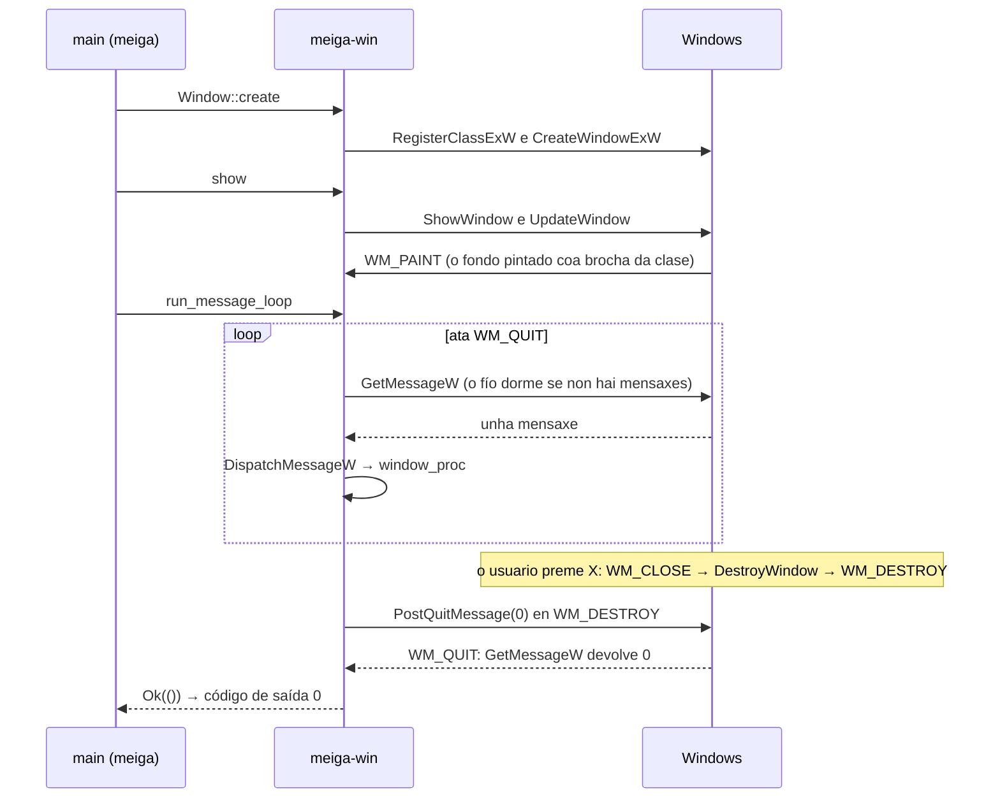

# Código › `meiga-win`

> Estado: subfase 1.1. Contén a xanela, o bucle de mensaxes e o tipo dos erros de Windows.

**Responsabilidade:** a capa de plataforma. Envolve todo o que é específico de Windows: ConPTY, a detección das shells instaladas, o sistema de arquivos, o portapapeis, a xanela Win32 e a xestión do DPI. Ver [Arquitectura](../arquitectura.md#2-estrutura-do-código-un-workspace-con-catro-crates).

| Arquivo | Contido |
|---|---|
| [`Cargo.toml`](#cratesmeiga-wincargotoml) | As dependencias: `meiga-core` e `windows-sys`. |
| [`src/lib.rs`](#cratesmeiga-winsrclibrs) | A raíz do crate: os módulos. |
| [`src/error.rs`](#cratesmeiga-winsrcerrorrs) | `Error`: unha chamada a Windows que fallou. |
| [`src/window.rs`](#cratesmeiga-winsrcwindowrs) | A xanela, o bucle de mensaxes e a mensaxe de erro. |

Os conceptos de Win32 (xanelas, clases, mensaxes, bucle de mensaxes) explícanse en [Tecnoloxías › Xanelas Win32](../tecnoloxias.md#22-xanelas-win32-e-o-bucle-de-mensaxes).

## `crates/meiga-win/Cargo.toml`

```toml
[package]
name = "meiga-win"
description = "Windows platform layer of meiga: ConPTY, shell profiles, file system, clipboard and Win32 windowing."
version.workspace = true
edition.workspace = true
rust-version.workspace = true
license.workspace = true
repository.workspace = true
publish.workspace = true

[dependencies]
meiga-core.workspace = true
windows-sys = { workspace = true, features = [
    "Win32_Foundation",
    "Win32_Graphics_Gdi",
    "Win32_System_LibraryLoader",
    "Win32_UI_WindowsAndMessaging",
] }

[lints]
workspace = true
```

Os metadatos e as regras de calidade son os comúns, como en [`meiga-render`](meiga-render.md#cratesmeiga-rendercargotoml). A novidade é `windows-sys`, as declaracións das APIs de Windows para Rust ([Tecnoloxías › windows-sys](../tecnoloxias.md#21-windows-sys-as-apis-de-windows-desde-rust)):

- `workspace = true`: a versión vén do `Cargo.toml` raíz ([Código › workspace](workspace.md#cargotoml-raíz)), así que todos os crates que a usen terán a mesma.
- `features`: `windows-sys` divide as APIs nos mesmos espazos de nomes que usa a documentación de Microsoft, e cada *feature* activa un deles. Só se compila o que se activa:

| *Feature* | Que trae | Que se usa |
|---|---|---|
| `Win32_Foundation` | Os tipos básicos. | `HWND`, `RECT`, `COLORREF`, `WPARAM`, `LPARAM`, `LRESULT`. |
| `Win32_Graphics_Gdi` | GDI, a API clásica de debuxo. | `CreateSolidBrush`, `DeleteObject`, `UpdateWindow`. |
| `Win32_System_LibraryLoader` | A carga de DLL e módulos. | `GetModuleHandleW`. |
| `Win32_UI_WindowsAndMessaging` | As xanelas, as mensaxes, os cursores e as caixas de mensaxe. | O resto. |

## `crates/meiga-win/src/lib.rs`

```rust
//! Windows platform layer of meiga.
//!
//! Wraps ConPTY, shell profile discovery, the file system, the clipboard, the
//! Win32 window and DPI handling. Every `unsafe` block in this crate must
//! explain why it is sound in a `// SAFETY:` comment.

mod error;
pub mod window;

pub use error::Error;
```

- A documentación do crate lembra a súa regra principal: este é o lugar con máis código `unsafe` do proxecto, e cada bloque ten que explicar por que é seguro. Clippy compróbao (`undocumented_unsafe_blocks`, ver [Tecnoloxías › *Lints*](../tecnoloxias.md#7-lints-rustc-e-clippy)).
- `mod error;` declara o módulo `error` (`src/error.rs`) sen `pub`: é privado.
- `pub use error::Error;` publica o tipo `Error` na raíz do crate. Os outros crates escriben `meiga_win::Error`, e non `meiga_win::error::Error`: o módulo só contén ese tipo, e non achega nada ao nome.
- `pub mod window;` declara o módulo `window` (`src/window.rs`) como público: `meiga_win::window::Window`.

## `crates/meiga-win/src/error.rs`

```rust
//! Errors from Windows API calls.

use std::{fmt, io};

/// A Windows API call that failed.
#[derive(Debug)]
pub struct Error {
    function: &'static str,
    os_error: Option<io::Error>,
}

impl Error {
    /// Builds the error of `function` from the last error code of the calling
    /// thread (`GetLastError`), so it must be called right after the failure.
    pub(crate) fn last(function: &'static str) -> Self {
        let error = io::Error::last_os_error();
        // Some functions (GDI, for example) fail without setting an error
        // code, and "The operation completed successfully" would mislead.
        let os_error = (error.raw_os_error() != Some(0)).then_some(error);
        Self { function, os_error }
    }
}

impl fmt::Display for Error {
    fn fmt(&self, f: &mut fmt::Formatter<'_>) -> fmt::Result {
        match &self.os_error {
            Some(error) => write!(f, "{} failed: {error}", self.function),
            None => write!(f, "{} failed", self.function),
        }
    }
}

impl std::error::Error for Error {}
```

As funcións de Windows non devolven un `Result`, coma as de Rust. Cada unha indica que fallou á súa maneira (un *handle* nulo, un 0, un -1…) e deixa un **código de erro** nunha variábel de cada fío, que se le con `GetLastError`. `Error` garda que función fallou e ese código.

- `function: &'static str`: o nome da función, por exemplo `"CreateWindowExW"`. `&'static str` é unha referencia a un texto que existe durante todo o programa, como os literais entre comiñas: non hai que copialo nin liberalo.
- `io::Error::last_os_error()`, da biblioteca estándar, le `GetLastError` e devolve un erro de Rust co código e co texto que dá Windows para el (no idioma de Windows), por exemplo `Access is denied. (os error 5)`.
- `pub(crate)`: só este crate pode crear erros. Hai que chamar a `last` xusto despois do fallo, porque calquera outra chamada a Windows pode cambiar o código.
- **O código 0.** Algunhas funcións, como as de GDI, poden fallar sen deixar ningún código. Entón `GetLastError` devolve 0, que significa «The operation completed successfully», e a mensaxe sería contraditoria. Nese caso gárdase `None`:
  - `raw_os_error()` devolve o número do código (`Some(0)` para o 0);
  - `condición.then_some(valor)` devolve `Some(valor)` se a condición é certa e `None` se non.
- `#[derive(Debug)]`: permite mostrar o erro con `{:?}`, como esixe o *trait* `std::error::Error`.
- `Display` é o texto para as persoas, por exemplo `RegisterClassExW failed: Class already exists. (os error 1410)`, ou só `CreateSolidBrush failed` se non hai código. É o texto que mostra a mensaxe de erro de meiga.
- `impl std::error::Error for Error {}` converte o tipo nun erro estándar de Rust, que funciona con `?` e con `Box<dyn std::error::Error>`. Non implementa `source()`, que serve para encadear un erro coa súa causa: o texto de Windows xa vai na mensaxe, e repetiríase ao mostrar a cadea de erros.

## `crates/meiga-win/src/window.rs`

A xanela de meiga, o bucle de mensaxes e unha mensaxe de erro. Os fragmentos de código desta sección son extractos: omiten os comentarios `// SAFETY:`, que no arquivo van antes de cada bloque `unsafe`, e algún outro comentario.

Así vive a xanela, desde que se crea ata que a pecha o usuario:



### Importacións e constantes

```rust
use std::ptr;

use meiga_core::color::Rgb;
use windows_sys::Win32::Foundation::{COLORREF, HWND, LPARAM, LRESULT, RECT, WPARAM};
use windows_sys::Win32::Graphics::Gdi::{CreateSolidBrush, DeleteObject, UpdateWindow};
...

/// Name of the window class of meiga windows.
const CLASS_NAME: &str = "meiga";
```

- As funcións, os tipos e as constantes de `windows-sys` levan exactamente os nomes da documentación de Microsoft (`CreateWindowExW`, `WM_DESTROY`…), así que se poden buscar alí directamente.
- `ptr::null()` e `ptr::null_mut()` crean punteiros nulos, o `NULL` de C, que as APIs de Windows usan para «ningún» ou «o valor por defecto».
- `CLASS_NAME`: o nome da clase de xanela de meiga. `tools/check-window.ps1` compróbao.

### `WindowOptions` e `Window`

```rust
/// How a new window looks.
pub struct WindowOptions<'a> {
    /// Text of the title bar.
    pub title: &'a str,
    /// Colour that fills the client area.
    pub background: Rgb,
}

/// A top-level window.
///
/// The window belongs to the thread that creates it and lives until the user
/// closes it, which ends [`run_message_loop`].
pub struct Window {
    handle: HWND,
}
```

- `WindowOptions` agrupa o aspecto da xanela nova: o título e a cor do fondo (a *área cliente*, a parte da xanela que debuxa o programa, sen a barra de título nin os bordos). `<'a>` é un **tempo de vida** (*lifetime*): o título é un texto prestado, e o compilador garante que `WindowOptions` non se usa despois de que ese texto deixe de existir.
- `Window` garda o **HWND**, o *handle* da xanela: un número opaco que a identifica ante Windows. En `windows-sys`, `HWND` é un punteiro (`*mut c_void`), e por iso Rust non deixa pasar unha `Window` a outro fío (os punteiros non son `Send`). É xusto a regra de Win32: unha xanela pertence ao fío que a crea, e as súas mensaxes chegan só a ese fío.
- `Window` non implementa `Drop` (o código que se executa ao destruír un valor): a xanela vive ata que a pecha o usuario, e entón Windows destrúea. Se o proceso remata antes, Windows destrúe as súas xanelas.

### `Window::create`

```rust
let instance = unsafe { GetModuleHandleW(ptr::null()) };
```

O *handle* do propio `meiga.exe` (`HINSTANCE`). Cun nome nulo, `GetModuleHandleW` devolve o do executábel do proceso, que está cargado mentres o proceso corre. Identifica o módulo que rexistra a clase.

```rust
let cursor = unsafe { LoadCursorW(ptr::null_mut(), IDC_ARROW) };
```

A frecha normal do rato. Os cursores do sistema cárganse sen *handle* de módulo. Sen cursor na clase, o rato quedaría coa forma que tiña ao entrar na xanela, por exemplo a de redimensionar.

```rust
let background = unsafe { CreateSolidBrush(colorref(options.background)) };
```

Unha **brocha** (*brush*) de GDI dunha cor sólida, para pintar o fondo. A brocha pasa a ser da clase: Windows píntao con ela e bórraa cando se borra o rexistro da clase, como moi tarde ao rematar o proceso.

```rust
let class_name = wide(CLASS_NAME);
let class = WNDCLASSEXW {
    cbSize: size_of::<WNDCLASSEXW>() as u32,
    lpfnWndProc: Some(window_proc),
    hInstance: instance,
    hCursor: cursor,
    hbrBackground: background,
    lpszClassName: class_name.as_ptr(),
    ..Default::default()
};
if unsafe { RegisterClassExW(&class) } == 0 {
    let error = Error::last("RegisterClassExW");
    unsafe { DeleteObject(background) };
    return Err(error);
}
```

- Unha **clase de xanela** é o molde das xanelas: o nome, a función que trata as súas mensaxes (o *window procedure*), o cursor e a brocha do fondo.
- `cbSize`: moitas estruturas de Windows levan o seu propio tamaño, para que Windows saiba que versión da estrutura recibe. `size_of` dáo en bytes, e `as u32` convérteo ao tipo do campo.
- `lpfnWndProc: Some(window_proc)`: a función que recibirá as mensaxes. En `windows-sys` é un `Option`, porque en C pode ser nula.
- `..Default::default()`: os campos que non se nomean quedan a cero. Entre eles, `style`: a clase non leva `CS_HREDRAW` nin `CS_VREDRAW`, que farían que Windows repintase a xanela enteira cada vez que cambia de tamaño. Sen eles, só se pinta a parte nova que queda á vista: menos traballo, como manda o principio de debuxar só o que cambia.
- Se o rexistro falla, ningunha clase é dona da brocha, e bórrase con `DeleteObject` para non perdela. O erro lese antes, porque `DeleteObject` podería cambiar o código.
- Unha clase só se pode rexistrar unha vez por proceso: por iso `create` documenta que se chama unha soa vez. Cando meiga teña varias xanelas (mellora futura F6), o rexistro separarase da creación.

```rust
let title = wide(options.title);
let handle = unsafe {
    CreateWindowExW(
        0,
        class_name.as_ptr(),
        title.as_ptr(),
        WS_OVERLAPPEDWINDOW,
        CW_USEDEFAULT, CW_USEDEFAULT, CW_USEDEFAULT, CW_USEDEFAULT,
        ptr::null_mut(), ptr::null_mut(), instance, ptr::null(),
    )
};
```

Crea a xanela, aínda oculta:

| Argumento | Valor | Significado |
|---|---|---|
| Estilo estendido | `0` | Ningún. |
| Clase e título | `class_name`, `title` | Textos en UTF-16 rematados en 0 (ver [Conversións](#conversións)). Teñen que existir mentres dura a chamada: son variábeis da función, e viven ata o seu final. |
| Estilo | `WS_OVERLAPPEDWINDOW` | Unha xanela normal: barra de título, bordo para redimensionar e botóns de minimizar, maximizar e pechar. Sen `WS_VISIBLE`, nace oculta. |
| Posición e tamaño | `CW_USEDEFAULT` | Windows escolle, en cascada respecto das últimas xanelas abertas. |
| Pai, menú e datos | nulos | Unha xanela de nivel superior, sen menú. |

### `Window::show`

```rust
unsafe { ShowWindow(self.handle, SW_SHOWDEFAULT) };
if unsafe { UpdateWindow(self.handle) } == 0 {
    return Err(Error::last("UpdateWindow"));
}
```

- `SW_SHOWDEFAULT` mostra a xanela como pediu quen lanzou meiga: por exemplo, minimizada se o acceso directo di «Executar: minimizada». O valor que devolve `ShowWindow` é a visibilidade anterior, non un erro, así que non se comproba.
- `UpdateWindow` envía `WM_PAINT` no momento, se hai algo que pintar, e non volta ata que a xanela está pintada. Así, cando empeza o bucle de mensaxes, o primeiro fotograma xa está feito. Por iso `measure-startup.ps1` mide ata ese punto (ver [Código › medición](perf.md#toolsperfmeasure-startupps1)).

### `run_message_loop`

```rust
pub fn run_message_loop() -> Result<(), Error> {
    let mut message = MSG::default();
    loop {
        match unsafe { GetMessageW(&mut message, ptr::null_mut(), 0, 0) } {
            0 => return Ok(()),
            -1 => return Err(Error::last("GetMessageW")),
            _ => {
                unsafe {
                    TranslateMessage(&message);
                    DispatchMessageW(&message);
                }
            }
        }
    }
}
```

O **bucle de mensaxes**, o corazón dun programa de Windows:

- `GetMessageW` colle a seguinte mensaxe da cola do fío, de calquera das súas xanelas (`ptr::null_mut()`) e de calquera tipo (`0, 0`). **Se a cola está baleira, o fío dorme**: Windows non o planifica ata que chega unha mensaxe. Por iso meiga non gasta nada en repouso, o principio número 1.
- O que devolve: un número positivo se colleu unha mensaxe; 0 se a mensaxe é `WM_QUIT`, o aviso de que o programa debe rematar; e -1 se hai un erro (por exemplo, un punteiro non válido).
- `TranslateMessage` converte as pulsacións de teclas (`WM_KEYDOWN`) en caracteres (`WM_CHAR`), segundo a distribución do teclado e as teclas mortas. Aínda non se usa: o teclado chega na subfase 1.7, que decidirá como tratalo.
- `DispatchMessageW` chama ao *window procedure* da xanela á que vai a mensaxe.
- `MSG::default()`: unha estrutura a cero. `windows-sys` implementa `Default` así nas súas estruturas.

### `show_error`

```rust
pub fn show_error(title: &str, text: &str) {
    let title = wide(title);
    let text = wide(text);
    unsafe {
        MessageBoxW(
            ptr::null_mut(),
            text.as_ptr(),
            title.as_ptr(),
            MB_OK | MB_ICONERROR,
        )
    };
}
```

Mostra unha caixa de mensaxe co botón Aceptar (`MB_OK`) e a icona de erro (`MB_ICONERROR`). `|` combina as dúas opcións, que son bits dun mesmo número. Non ten xanela dona (`ptr::null_mut()`), porque se pode mostrar cando a xanela de meiga aínda non existe. A función non volta ata que o usuario a pecha.

### `window_proc`

```rust
unsafe extern "system" fn window_proc(
    window: HWND,
    message: u32,
    wparam: WPARAM,
    lparam: LPARAM,
) -> LRESULT {
    match message {
        WM_DPICHANGED => { … }
        WM_DESTROY => {
            unsafe { PostQuitMessage(0) };
            0
        }
        _ => {
            unsafe { DefWindowProcW(window, message, wparam, lparam) }
        }
    }
}
```

O ***window procedure***: a función que trata as mensaxes das xanelas de meiga. Non a chama meiga, senón Windows (desde `DispatchMessageW` ou directamente, coas mensaxes que se *envían* en vez de *publicarse* na cola).

- `extern "system"`: a convención de chamada das APIs de Windows, a forma de pasar os argumentos que Windows espera. `unsafe` forma parte do tipo que pide Windows (`WNDPROC`). Como `unsafe_op_in_unsafe_fn` está activado, cada operación insegura leva o seu propio bloque `unsafe` e o seu comentario `// SAFETY:`.
- `message` é o número da mensaxe, e `wparam` e `lparam` os seus datos: o que significan depende de cada mensaxe. O valor que devolve (`LRESULT`) tamén.

| Mensaxe | Cando chega | Que fai meiga |
|---|---|---|
| `WM_DPICHANGED` | A xanela pasa a un monitor con outra escala (por exemplo, do 150 % ao 100 %), ou cambia a escala do monitor. | Aplica o tamaño e a posición que suxire Windows, para que a xanela manteña o seu tamaño físico. |
| `WM_DESTROY` | A xanela estase destruíndo, por exemplo porque o usuario a pechou. | `PostQuitMessage(0)` publica `WM_QUIT`, e o bucle de mensaxes remata. |
| Calquera outra | — | `DefWindowProcW`, o comportamento por defecto de Windows: mover, redimensionar, minimizar, maximizar, pechar (`WM_CLOSE` destrúe a xanela), pintar o fondo coa brocha da clase (`WM_ERASEBKGND`) e marcar a xanela como pintada (`WM_PAINT`). |

```rust
WM_DPICHANGED => {
    let suggested = unsafe { &*(lparam as *const RECT) };
    unsafe {
        SetWindowPos(
            window,
            ptr::null_mut(),
            suggested.left,
            suggested.top,
            suggested.right - suggested.left,
            suggested.bottom - suggested.top,
            SWP_NOZORDER | SWP_NOACTIVATE,
        )
    };
    0
}
```

- En `WM_DPICHANGED`, `lparam` é a dirección dun `RECT` (as coordenadas dos catro lados) co rectángulo que suxire Windows. `lparam as *const RECT` converte o número nun punteiro, e `&*` convérteo nunha referencia de Rust. É seguro porque Windows garante que o rectángulo existe mentres se trata a mensaxe.
- `SetWindowPos` move e redimensiona a xanela: `SWP_NOZORDER` non a pon diante nin detrás doutras, e `SWP_NOACTIVATE` non lle dá o foco.
- Coa escala por monitor (ver [Tecnoloxías › Manifesto](../tecnoloxias.md#23-manifesto-da-aplicación-e-dpi)), Windows axusta só a barra de título e os bordos. O contido da xanela é cousa de meiga: o tamaño das letras chegará coas fontes, na subfase 1.3, e o resto dos cambios de escala, na 1.9.
- Devolve 0: a mensaxe está tratada.

### Conversións

```rust
/// Converts a colour to a GDI `COLORREF`, which stores it as `0x00BBGGRR`.
const fn colorref(color: Rgb) -> COLORREF {
    color.r as u32 | (color.g as u32) << 8 | (color.b as u32) << 16
}

/// Converts `text` to the null-terminated UTF-16 that the `W` functions of
/// Windows expect.
fn wide(text: &str) -> Vec<u16> {
    text.encode_utf16().chain(Some(0)).collect()
}
```

- **`colorref`.** GDI garda as cores nun número de 32 bits, `COLORREF`, co vermello no byte máis baixo: `0x00BBGGRR`. `as u32` amplía cada canle de 8 a 32 bits, `<<` desprázaa 8 ou 16 bits á esquerda e `|` xúntaas.
- **`wide`.** As funcións de Windows que rematan en `W` (de *wide*) usan textos en UTF-16 rematados nun 0, como en C. Os textos de Rust son UTF-8 e levan a súa lonxitude, sen 0 ao final. `encode_utf16()` dá as unidades UTF-16 do texto, `.chain(Some(0))` engade o 0 ao final e `collect()` xúntaas nun `Vec<u16>`. Quen chama ten que manter o vector vivo mentres Windows usa o punteiro (`as_ptr()`).

### Proba

```rust
#[test]
fn colorref_stores_blue_green_red() {
    assert_eq!(colorref(Rgb::new(0x12, 0x34, 0x56)), 0x0056_3412);
}
```

Comproba a orde das canles de `COLORREF`. Trocar o vermello e o azul é un erro habitual que só se notaría nunha cor rara, porque ningunha comprobación automática mira os píxeles. O resto deste arquivo necesita unha xanela de verdade e compróbao `tools/check-window.ps1` co `meiga.exe` de *release* (ver [Código › ferramentas](ferramentas.md#toolscheck-windowps1)).
