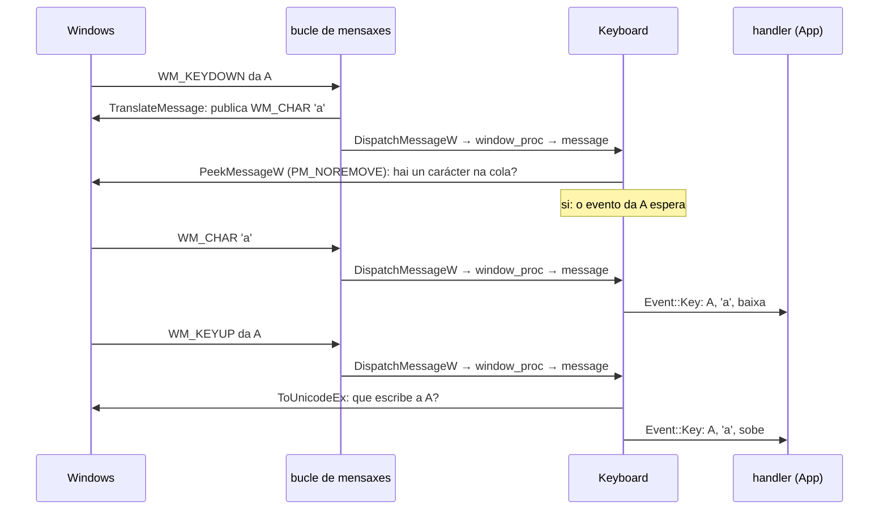
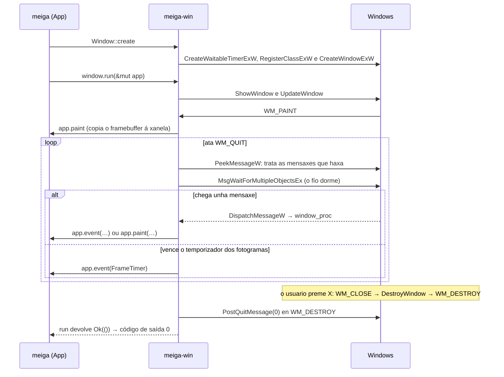
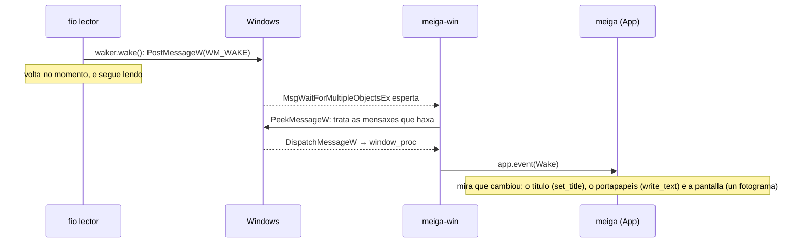
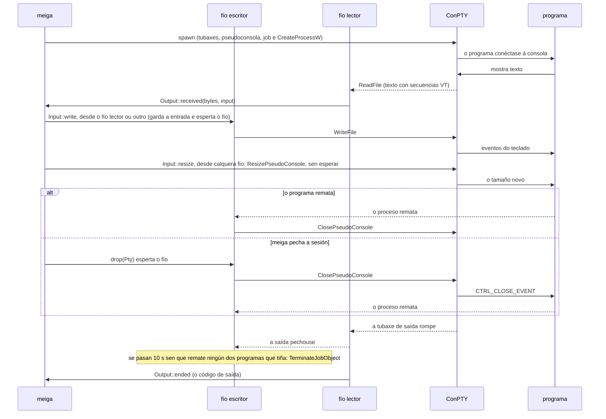

# Código › `meiga-win`

> Estado: subfase 1.9. Contén a xanela, o bucle de mensaxes co temporizador dos fotogramas, os eventos que recibe o programa, o teclado, que converte as mensaxes das teclas en eventos coma os da consola, o rato, cos seus tres botóns, a roda, as teclas modificadoras, a súa captura, a forma do punteiro e o aviso de cando sae da xanela, o DPI da xanela, tamén cando cambia, e o seu título, se está en primeiro plano, o aviso que a esperta desde outro fío, os axustes do cursor e do rato de Windows, a caixa de mensaxe que pregunta antes de pegar, o portapapeis, as sesións de ConPTY, cuxo tamaño se pode cambiar, cun exemplo que as mostra e as grava, e o tipo dos erros de Windows.

**Responsabilidade:** a capa de plataforma. Envolve todo o que é específico de Windows: ConPTY, a detección das shells instaladas, o sistema de arquivos, o portapapeis, a xanela Win32 e a xestión do DPI. Ver [Arquitectura](../arquitectura.md#2-estrutura-do-código-un-workspace-con-catro-crates).

| Arquivo | Contido |
|---|---|
| [`Cargo.toml`](#cratesmeiga-wincargotoml) | As dependencias: `meiga-core` e `windows-sys`. |
| [`src/lib.rs`](#cratesmeiga-winsrclibrs) | A raíz do crate: os módulos, os tipos que se publican e a conversión dos textos a UTF-16. |
| [`src/error.rs`](#cratesmeiga-winsrcerrorrs) | `Error`: unha chamada a Windows que fallou, e o erro que deu. |
| [`src/event.rs`](#cratesmeiga-winsrceventrs) | Os eventos da xanela, tamén os do rato e o cambio de escala, e o *trait* `Handler`, que os recibe. |
| [`src/keyboard.rs`](#cratesmeiga-winsrckeyboardrs) | O teclado da xanela: as mensaxes das teclas e dos seus caracteres, xuntas en eventos de tecla, e as que son para Windows. |
| [`src/window.rs`](#cratesmeiga-winsrcwindowrs) | A xanela, o seu DPI, tamén cando cambia, e o seu título, o bucle de mensaxes, o temporizador dos fotogramas, o `Waker` que a esperta desde outro fío, a captura do rato, a forma do punteiro e o aviso de cando sae da xanela, se está en primeiro plano, os axustes do cursor e do rato de Windows, a caixa de mensaxe que pregunta e a mensaxe de erro. |
| [`src/clipboard.rs`](#cratesmeiga-winsrcclipboardrs) | O portapapeis de Windows: ler e escribir texto. |
| [`src/conpty.rs`](#cratesmeiga-winsrcconptyrs) | As sesións: un programa nunha pseudoconsola, cos seus fíos lector e escritor, e a súa entrada, que se pode usar desde calquera fío, tamén para cambiar o tamaño da pseudoconsola. |
| [`tests/conpty.rs`](#cratesmeiga-wintestsconptyrs) | Probas de integración: programas de verdade nos dous ConPTY. |
| [`examples/conpty.rs`](#cratesmeiga-winexamplesconptyrs) | Un programa de consola que mostra o que escribe un programa nunha pseudoconsola, e envíalle o que se teclea. |

Os conceptos de Win32 (xanelas, clases, mensaxes, bucle de mensaxes) explícanse en [Tecnoloxías › Xanelas Win32](../tecnoloxias.md#22-xanelas-win32-e-o-bucle-de-mensaxes); os temporizadores, en [Tecnoloxías › Temporizadores](../tecnoloxias.md#26-temporizadores-e-a-espera-do-fío-da-interface); os avisos desde outros fíos, en [Tecnoloxías › Avisar á xanela desde outro fío](../tecnoloxias.md#36-avisar-á-xanela-desde-outro-fío-postmessage); o cursor, o foco e o título, en [Tecnoloxías › O cursor de Windows](../tecnoloxias.md#38-o-cursor-de-windows-pestanexo-tempo-e-grosor) e [› O foco e o título](../tecnoloxias.md#39-o-foco-e-o-título-da-xanela); o teclado, en [Tecnoloxías › O teclado en Windows](../tecnoloxias.md#41-o-teclado-en-windows); o rato, en [Tecnoloxías › O rato en Windows](../tecnoloxias.md#44-o-rato-en-windows); o portapapeis e a caixa que pregunta antes de pegar, en [Tecnoloxías › O portapapeis de Windows](../tecnoloxias.md#46-o-portapapeis-de-windows) e [› Pegar no terminal](../tecnoloxias.md#47-pegar-no-terminal-o-filtro-e-o-bracketed-paste); o cambio de escala e a saída do punteiro, en [Tecnoloxías › A escala cambia](../tecnoloxias.md#50-a-escala-cambia-wm_dpichanged) e [› O punteiro sae da xanela](../tecnoloxias.md#51-o-punteiro-sae-da-xanela-trackmouseevent); e o ConPTY, os procesos e as tubaxes, en [Tecnoloxías › ConPTY](../tecnoloxias.md#31-conpty-a-pseudoconsola-de-windows) e [Tecnoloxías › Procesos, tubaxes e eventos](../tecnoloxias.md#32-procesos-tubaxes-e-eventos), e o cambio do tamaño dunha pseudoconsola, en [Tecnoloxías › Cambiar o tamaño do ConPTY](../tecnoloxias.md#48-cambiar-o-tamaño-do-conpty-o-seu-reflow-e-a-pregunta-polo-cursor). O camiño dun clic, da xanela á selección, ao portapapeis ou ao programa, está en [Arquitectura › O rato, a selección e o portapapeis](../arquitectura.md#o-rato-a-selección-e-o-portapapeis), e o dun cambio de tamaño, da xanela ao ConPTY, en [Arquitectura › O historial, o tamaño e o zoom](../arquitectura.md#o-historial-o-tamaño-e-o-zoom).

O crate ten 23 probas unitarias nos arquivos de `src/` (22 na subfase 1.8) e as 9 de integración de [`tests/conpty.rs`](#cratesmeiga-wintestsconptyrs) (8 na 1.8): `cargo test -p meiga-win` córreas todas.

## `crates/meiga-win/Cargo.toml`

```toml
[package]
name = "meiga-win"
description = "Windows platform layer of meiga: ConPTY, shell profiles, file system, clipboard and Win32 windowing."
version.workspace = true
edition.workspace = true
rust-version.workspace = true
license.workspace = true
repository.workspace = true
publish.workspace = true

[dependencies]
meiga-core.workspace = true
windows-sys = { workspace = true, features = [
    "Win32_Foundation",
    "Win32_Graphics_Gdi",
    # CreateWaitableTimerExW, CreatePipe, CreateEventW, CreateJobObjectW and
    # CreateProcessW take SECURITY_ATTRIBUTES.
    "Win32_Security",
    # ReadFile and WriteFile, which take an OVERLAPPED of Win32_System_IO.
    "Win32_Storage_FileSystem",
    # The pseudoconsole functions of kernel32: CreatePseudoConsole,
    # ResizePseudoConsole and ClosePseudoConsole.
    "Win32_System_Console",
    # The clipboard, and the global memory of its data.
    "Win32_System_DataExchange",
    "Win32_System_IO",
    # The job of the programs of each pseudoconsole.
    "Win32_System_JobObjects",
    "Win32_System_LibraryLoader",
    "Win32_System_Memory",
    "Win32_System_Pipes",
    "Win32_System_Threading",
    "Win32_UI_HiDpi",
    "Win32_UI_Input_KeyboardAndMouse",
    "Win32_UI_WindowsAndMessaging",
] }

[lints]
workspace = true
```

Os metadatos e as regras de calidade son os comúns, como en [`meiga-render`](meiga-render.md#cratesmeiga-rendercargotoml). A dependencia principal é `windows-sys`, as declaracións das APIs de Windows para Rust ([Tecnoloxías › windows-sys](../tecnoloxias.md#21-windows-sys-as-apis-de-windows-desde-rust)):

- `workspace = true`: a versión vén do `Cargo.toml` raíz ([Código › workspace](workspace.md#cargotoml-raíz)), así que todos os crates que a usen terán a mesma.
- `features`: `windows-sys` divide as APIs nos mesmos espazos de nomes que usa a documentación de Microsoft, e cada *feature* activa un deles. Só se compila o que se activa:

| *Feature* | Que trae | Que se usa |
|---|---|---|
| `Win32_Foundation` | Os tipos básicos. | `HWND`, `HANDLE`, `RECT`, `WPARAM`, `LPARAM`, `LRESULT`, `FALSE`, `TRUE`, `CloseHandle` e os resultados das esperas (`WAIT_OBJECT_0`, `WAIT_TIMEOUT` e `WAIT_FAILED`). Desde a subfase 1.8, tamén `POINT`, para o punto da roda, e a memoria global do portapapeis: o seu tipo, `HGLOBAL`, e `GlobalFree`. |
| `Win32_Graphics_Gdi` | GDI, a API clásica de debuxo. | `BeginPaint`, `EndPaint`, `InvalidateRect`, `ValidateRect` e `UpdateWindow`. Desde a 1.8, tamén `ScreenToClient`, que pasa o punto da roda á área cliente. |
| `Win32_Security` | A seguridade dos obxectos de Windows. | Nada directamente: `CreateWaitableTimerExW`, `CreatePipe`, `CreateEventW`, `CreateJobObjectW` e `CreateProcessW` reciben uns `SECURITY_ATTRIBUTES`, e `windows-sys` só declara cada función se existen os tipos que usa. Por iso vai co comentario. |
| `Win32_Storage_FileSystem` | Os arquivos e o que se le e escribe coma eles. | `ReadFile` e `WriteFile`, para as tubaxes, desde a subfase 1.4. |
| `Win32_System_Console` | A consola. | `CreatePseudoConsole`, `ClosePseudoConsole`, `HPCON` e `COORD`, desde a 1.4, e `ResizePseudoConsole`, desde a 1.9. |
| `Win32_System_DataExchange` | O intercambio de datos entre programas, coma o portapapeis. | `OpenClipboard`, `CloseClipboard`, `EmptyClipboard`, `GetClipboardData` e `SetClipboardData`, desde a subfase 1.8. |
| `Win32_System_IO` | A E/S solapada. | Nada directamente: `ReadFile` e `WriteFile` reciben un `OVERLAPPED`, que meiga pasa nulo. O comentario de `Win32_Storage_FileSystem` explícao. |
| `Win32_System_JobObjects` | Os *jobs*, que agrupan procesos. | `CreateJobObjectW`, `SetInformationJobObject`, `JOBOBJECT_EXTENDED_LIMIT_INFORMATION`, `JOB_OBJECT_LIMIT_BREAKAWAY_OK`, `QueryInformationJobObject`, `JOBOBJECT_BASIC_PROCESS_ID_LIST` e `TerminateJobObject`, desde a 1.4. |
| `Win32_System_LibraryLoader` | A carga de DLL e módulos. | `GetModuleHandleW` e, desde a 1.4, `LoadLibraryExW`, `GetProcAddress` e as opcións da busca das DLL. |
| `Win32_System_Memory` | A memoria: a global, a virtual, os *heaps*… | `GlobalAlloc`, `GlobalLock`, `GlobalSize`, `GlobalUnlock` e `GMEM_MOVEABLE`, desde a 1.8: a memoria onde vai o texto do portapapeis. |
| `Win32_System_Pipes` | As tubaxes. | `CreatePipe`, desde a 1.4. |
| `Win32_System_Threading` | Fíos, procesos e obxectos de sincronización. | O temporizador: `CreateWaitableTimerExW`, `SetWaitableTimer`, `CancelWaitableTimer` e `INFINITE`. Desde a 1.4, tamén os procesos e os eventos: `CreateProcessW`, `STARTUPINFOEXW`, a lista de atributos e os seus dous atributos, `OpenProcess` e `PROCESS_SYNCHRONIZE`, `CreateEventW`, `SetEvent`, as esperas e `GetExitCodeProcess`. A estrutura dos límites estendidos dos *jobs* tamén a necesita, porque leva uns `IO_COUNTERS`. |
| `Win32_UI_HiDpi` | A escala e o DPI. | `GetDpiForWindow`, desde a subfase 1.3. |
| `Win32_UI_Input_KeyboardAndMouse` | O teclado e o rato. | `SetCapture`, `GetCapture` e `ReleaseCapture`, que capturan o rato; desde a subfase 1.7, o teclado: `GetKeyboardState`, `ToUnicodeEx`, `GetKeyboardLayout`, `MapVirtualKeyW` e os códigos de tecla virtual (`VK_…`); desde a 1.8, `GetKeyState`, que di se Alt está premido cos eventos do rato, e `GetDoubleClickTime`; e, desde a 1.9, `TrackMouseEvent`, coa súa estrutura, `TRACKMOUSEEVENT`, e `TME_LEAVE`, que piden o aviso de cando o punteiro sae da xanela. |
| `Win32_UI_WindowsAndMessaging` | As xanelas, as mensaxes, os temporizadores das xanelas, os cursores e as caixas de mensaxe. | O resto. |

Algunhas constantes defínense no propio código en vez de activar a súa *feature*, que traería milleiros de declaracións por uns poucos números: os bits dos botóns e das teclas modificadoras nas mensaxes do rato (`MK_LBUTTON`…), de `Win32_System_SystemServices` (ver [`event.rs`](#cratesmeiga-winsrceventrs)); desde a subfase 1.8, o formato do texto no portapapeis, `CF_UNICODETEXT`, de `Win32_System_Ole` (ver [`clipboard.rs`](#cratesmeiga-winsrcclipboardrs)); e, desde a 1.9, a mensaxe que chega cando o punteiro sae da xanela, `WM_MOUSELEAVE`, de `Win32_UI_Controls` (ver [`decode`](#decode)). Outra, `WHEEL_PAGE`, o `WHEEL_PAGESCROLL` de Windows, non está en `windows-sys` (ver [`mouse_settings`](#mousesettings-e-mouse_settings)). O tipo `HRESULT` está en `windows_sys::core`, que non necesita ningunha *feature*.

A subfase 1.6 non necesitou ningunha *feature* nova: `PostMessageW`, `SetWindowTextW`, `GetCaretBlinkTime`, `SystemParametersInfoW`, `WM_APP` e as mensaxes do foco están todas en `Win32_UI_WindowsAndMessaging`. A 1.7 tampouco: as funcións do teclado están en `Win32_UI_Input_KeyboardAndMouse`, que xa estaba pola captura do rato, e as súas mensaxes (`WM_KEYUP`, `WM_CHAR`…) e `PeekMessageW`, en `Win32_UI_WindowsAndMessaging`. A 1.8 necesitou dúas, para o portapapeis: `Win32_System_DataExchange`, coas súas funcións, e `Win32_System_Memory`, coa memoria global onde vai o texto. O resto xa estaba nas que había: as mensaxes do rato, `WM_SETCURSOR`, `SetCursor`, `GetForegroundWindow`, as medidas do dobre clic e as preferencias da roda (`SM_CXDOUBLECLK`, `SPI_GETWHEELSCROLLLINES`…) e as opcións das caixas de mensaxe, en `Win32_UI_WindowsAndMessaging`; `GetKeyState` e `GetDoubleClickTime`, en `Win32_UI_Input_KeyboardAndMouse`; e `ScreenToClient`, en `Win32_Graphics_Gdi`. A 1.9 non necesitou ningunha: `ResizePseudoConsole` está en `Win32_System_Console`, coas outras funcións das pseudoconsolas; `TrackMouseEvent`, en `Win32_UI_Input_KeyboardAndMouse`, coma a captura do rato; e as funcións que usa a proba do cambio de escala, `SendMessageW` e `GetWindowRect`, en `Win32_UI_WindowsAndMessaging`.

## `crates/meiga-win/src/lib.rs`

```rust
//! Windows platform layer of meiga.
//!
//! Wraps ConPTY, shell profile discovery, the file system, the clipboard, the
//! Win32 window and DPI handling. Every `unsafe` block in this crate must
//! explain why it is sound in a `// SAFETY:` comment.

pub mod clipboard;
pub mod conpty;
mod error;
pub mod event;
mod keyboard;
pub mod window;

pub use error::Error;
// The handles of a window and of a device context, which the binary passes
// from this crate to meiga-render. They are raw pointers: copying them is
// safe, and only the functions of Windows use them.
pub use windows_sys::Win32::Foundation::HWND;
pub use windows_sys::Win32::Graphics::Gdi::HDC;

/// Converts `text` to the null-terminated UTF-16 that the `W` functions of
/// Windows expect.
pub(crate) fn wide(text: &str) -> Vec<u16> {
    text.encode_utf16().chain(Some(0)).collect()
}
```

- A documentación do crate lembra a súa regra principal: este é o lugar con máis código `unsafe` do proxecto, e cada bloque ten que explicar por que é seguro. Clippy compróbao (`undocumented_unsafe_blocks`, ver [Tecnoloxías › *Lints*](../tecnoloxias.md#7-lints-rustc-e-clippy)).
- `mod error;` declara o módulo `error` (`src/error.rs`) sen `pub`: é privado.
- `pub use error::Error;` publica o tipo `Error` na raíz do crate. Os outros crates escriben `meiga_win::Error`, e non `meiga_win::error::Error`: o módulo só contén ese tipo, e non achega nada ao nome.
- `pub mod clipboard;`, `pub mod conpty;`, `pub mod event;` e `pub mod window;` declaran os catro módulos públicos: `meiga_win::clipboard::read_text`, `meiga_win::conpty::Conpty`, `meiga_win::event::Event`, `meiga_win::window::Window`. `conpty` existe desde a subfase 1.4, e `clipboard`, desde a 1.8.
- `mod keyboard;`, desde a subfase 1.7, é privado coma `error`: só o usa a xanela, e os outros crates reciben as teclas coma eventos.
- **`HWND` e `HDC`.** O programa (`meiga`) recibe destes tipos de `meiga-win` e pásaos a `meiga-render`, que presenta o *framebuffer* na xanela. Publicalos eiquí permite que o programa os nomee sen depender de `windows-sys`. En `windows-sys`, os dous son o mesmo tipo, `*mut c_void`, un punteiro sen tipo: copialos é seguro, e só os usan as funcións de Windows, sempre dentro dos crates que teñen `unsafe`. Por iso o programa segue con `#![forbid(unsafe_code)]`.
- **`wide`.** As funcións de Windows que rematan en `W` (de *wide*) usan textos en UTF-16 rematados nun 0, como en C. Os textos de Rust son UTF-8 e levan a súa lonxitude, sen 0 ao final. `encode_utf16()` dá as unidades UTF-16 do texto, `.chain(Some(0))` engade o 0 ao final e `collect()` xúntaas nun `Vec<u16>`. Quen chama ten que manter o vector vivo mentres Windows usa o punteiro (`as_ptr()`). Ata a subfase 1.3 estaba en `window.rs`; desde a 1.4 está eiquí, porque tamén a usa `conpty.rs`. Con `pub(crate)`, véna todos os módulos do crate, pero non os outros crates.

## `crates/meiga-win/src/error.rs`

```rust
//! Errors from Windows API calls.

use std::{fmt, io};

use windows_sys::core::HRESULT;

/// A Windows API call that failed.
#[derive(Debug)]
pub struct Error {
    function: &'static str,
    os_error: Option<io::Error>,
}

impl Error {
    /// Builds the error of `function` from the last error code of the calling
    /// thread (`GetLastError`), so it must be called right after the failure.
    pub(crate) fn last(function: &'static str) -> Self {
        let error = io::Error::last_os_error();
        // Some functions (GDI, for example) fail without setting an error
        // code, and "The operation completed successfully" would mislead.
        let os_error = (error.raw_os_error() != Some(0)).then_some(error);
        Self { function, os_error }
    }

    /// Builds the error of `function` from `error`.
    pub(crate) fn new(function: &'static str, error: io::Error) -> Self {
        Self {
            function,
            os_error: Some(error),
        }
    }

    /// Builds the error of `function` from the `HRESULT` that it returned.
    pub(crate) fn hresult(function: &'static str, result: HRESULT) -> Self {
        // The HRESULTs of facility 7 (FACILITY_WIN32) carry a Windows error
        // code in their low 16 bits, which has a message of its own.
        let code = result as u32;
        let error = if code & 0xffff_0000 == 0x8007_0000 {
            io::Error::from_raw_os_error((code & 0xffff) as i32)
        } else {
            io::Error::other(format!("HRESULT 0x{code:08X}"))
        };
        Self::new(function, error)
    }

    /// The error that Windows gave, if it gave one: for example, the one of
    /// `CreateProcessW` when the program does not exist, of kind
    /// [`io::ErrorKind::NotFound`].
    pub fn os_error(&self) -> Option<&io::Error> {
        self.os_error.as_ref()
    }
}

impl fmt::Display for Error {
    fn fmt(&self, f: &mut fmt::Formatter<'_>) -> fmt::Result {
        match &self.os_error {
            Some(error) => write!(f, "{} failed: {error}", self.function),
            None => write!(f, "{} failed", self.function),
        }
    }
}

impl std::error::Error for Error {}
```

As funcións de Windows non devolven un `Result`, coma as de Rust. Cada unha indica que fallou á súa maneira (un *handle* nulo, un 0, un -1…) e deixa un **código de erro** nunha variábel de cada fío, que se le con `GetLastError`. `Error` garda que función fallou e ese código.

- `function: &'static str`: o nome da función, por exemplo `"CreateWindowExW"`. `&'static str` é unha referencia a un texto que existe durante todo o programa, como os literais entre comiñas: non hai que copialo nin liberalo.
- `io::Error::last_os_error()`, da biblioteca estándar, le `GetLastError` e devolve un erro de Rust co código e co texto que dá Windows para el (no idioma de Windows), por exemplo `Access is denied. (os error 5)`.
- `pub(crate)`: só este crate pode crear erros. Hai que chamar a `last` xusto despois do fallo, porque calquera outra chamada a Windows pode cambiar o código.
- **O código 0.** Algunhas funcións, como as de GDI, poden fallar sen deixar ningún código. Entón `GetLastError` devolve 0, que significa «The operation completed successfully», e a mensaxe sería contraditoria. Nese caso gárdase `None`:
  - `raw_os_error()` devolve o número do código (`Some(0)` para o 0);
  - `condición.then_some(valor)` devolve `Some(valor)` se a condición é certa e `None` se non.
- `#[derive(Debug)]`: permite mostrar o erro con `{:?}`, como esixe o *trait* `std::error::Error`.
- `Display` é o texto para as persoas, por exemplo `RegisterClassExW failed: Class already exists. (os error 1410)`, ou só `SetTimer failed` se non hai código. É o texto que mostra a mensaxe de erro de meiga.
- `impl std::error::Error for Error {}` converte o tipo nun erro estándar de Rust, que funciona con `?` e con `Box<dyn std::error::Error>`. Non implementa `source()`, que serve para encadear un erro coa súa causa: o texto de Windows xa vai na mensaxe, e repetiríase ao mostrar a cadea de erros.

Desde a subfase 1.4, hai outras dúas maneiras de crear un `Error`, para as sesións de [ConPTY](#cratesmeiga-winsrcconptyrs):

- **`new`**: un erro que non vén de `GetLastError`. Por exemplo, cando non se pode crear un fío (a biblioteca estándar devolve un `io::Error`), ou cando o propio módulo rexeita algo antes de chamar a Windows: un tamaño que non cabe, unha liña de comandos cun carácter nulo ou un arquivo que falta. O nome é o da función que fallaría, para que a mensaxe diga en que paso foi: `LoadLibraryExW failed: …\conpty.dll does not exist`.
- **`hresult`**: as funcións que crean unha pseudoconsola e, desde a subfase 1.9, as que lle cambian o tamaño non deixan o erro en `GetLastError`, senón que devolven un **`HRESULT`**: un número de 32 bits que, se é negativo, indica un erro. Os 16 bits de abaixo son o código, e os bits 16–26, a *facility*, que di de onde vén o código. Os da *facility* 7 (`FACILITY_WIN32`) levan dentro un código de erro de Windows: `0x80070057` é o erro 87, `ERROR_INVALID_PARAMETER`, que con este formato se chama `E_INVALIDARG`.
  - `result as u32` le os mesmos 32 bits sen signo, onde as máscaras en hexadecimal son máis claras.
  - `code & 0xffff_0000 == 0x8007_0000` comproba que é un erro (o bit 31) da *facility* 7. Para eses, `from_raw_os_error` dá o mesmo texto que daría `GetLastError` co código 87.
  - Os demais móstranse como número: por exemplo, `HRESULT 0x8000FFFF` (`E_UNEXPECTED`).

Desde a subfase 1.6, **`os_error`** deixa ver o erro que garda o `Error`, para que quen o recibe poida decidir segundo a causa, e non só mostrala. O programa úsao ao lanzar a shell: se PowerShell 7 non está instalado, `CreateProcessW` non atopa `pwsh` e falla co erro 2, `ERROR_FILE_NOT_FOUND`, que a biblioteca estándar clasifica como `io::ErrorKind::NotFound`; entón meiga proba con Windows PowerShell ([Código › meiga](meiga.md#cratesmeigasrcsessionrs), [Tecnoloxías › A liña de comandos](../tecnoloxias.md#40-a-liña-de-comandos-en-windows)).

- Ao contrario que os outros métodos, é `pub`: os outros crates poden ler a causa dun erro, pero seguen sen poder crear erros.
- `as_ref()` converte o `&Option<io::Error>` do campo nun `Option<&io::Error>`: dá unha referencia ao erro, sen copialo nin sacalo do `Error`. Tampouco se podería devolver unha copia, porque `io::Error` non implementa `Clone`.
- Devolve `None` cando Windows non deu ningún código (o código 0 de `last`). Cos erros de `new` e `hresult`, devolve o `io::Error` que recibiron, que non sempre vén de Windows: o dun arquivo do ConPTY que falta, por exemplo, tamén é `NotFound`.
- **Un método, e non `source()`.** Con `source()`, o texto de Windows sairía dúas veces ao mostrar a cadea de erros, como se explica arriba. `os_error` dálle a causa só a quen a pide.

**Proba.** `hresults_of_windows_errors_keep_their_error_code`: `0x80070057` dá unha mensaxe que empeza por `CreatePseudoConsole failed: ` e remata en `(os error 87)` (o texto do medio depende do idioma de Windows), e `0x8000FFFF` dá `CreatePseudoConsole failed: HRESULT 0x8000FFFF`.

`meiga-render` ten o seu propio `Error`, igual, para as funcións de GDI (ver [Código › meiga-render](meiga-render.md#cratesmeiga-rendersrcerrorrs)): os dous crates non dependen un do outro.

## `crates/meiga-win/src/event.rs`

O que lle pasa á xanela, traducido das mensaxes de Windows a tipos de Rust, e o *trait* que recibe eses eventos. Este módulo non ten `unsafe` (`#![forbid(unsafe_code)]`): só le números. Desde a subfase 1.6 define tamén [`WM_WAKE`](#wm_wake), a mensaxe coa que outro fío esperta a xanela; desde a 1.8, os eventos do rato teñen os tres botóns, a roda e as teclas modificadoras ([Tecnoloxías › O rato en Windows](../tecnoloxias.md#44-o-rato-en-windows)); e desde a 1.9, hai dous eventos máis: o cambio de escala, que chega antes ca o tamaño novo da xanela ([Tecnoloxías › A escala cambia](../tecnoloxias.md#50-a-escala-cambia-wm_dpichanged)), e a saída do punteiro ([Tecnoloxías › O punteiro sae da xanela](../tecnoloxias.md#51-o-punteiro-sae-da-xanela-trackmouseevent)).

### `Handler`

```rust
/// An error from the code that handles the events. It ends the message loop.
pub type HandlerError = Box<dyn StdError>;

pub trait Handler {
    /// Something happened in the window.
    fn event(&mut self, window: &Window, event: Event) -> Result<(), HandlerError>;

    /// Windows asks to paint `area` of the window in `dc`, for example
    /// because it is shown for the first time or because it grew.
    fn paint(&mut self, window: &Window, dc: HDC, area: Rect) -> Result<(), HandlerError>;
}
```

- Un ***trait*** é un conxunto de funcións que un tipo pode implementar, como unha interface. `meiga-win` non sabe que fai o programa: só sabe chamar a quen implemente `Handler`. No programa implementao `App` (ver [Código › meiga](meiga.md#cratesmeigasrcapprs)).
- `&mut self`: o *handler* pode cambiar o seu estado en cada evento. `&Window`: recibe tamén a xanela, para pedirlle cousas (un temporizador, cambiar o título, capturar o rato…).
- `HandlerError` é un **alias**, outro nome para un tipo: `Box<dyn StdError>`, calquera erro nunha caixa. `dyn StdError` significa «un valor de calquera tipo que implemente `std::error::Error`», e a caixa (`Box`) gárdao na memoria dinámica, porque cada tipo de erro ten un tamaño distinto. Así, o *handler* pode devolver erros de `meiga-win`, de `meiga-render` ou de entrada e saída, e `?` convérteos solos.
- **Unha regra importante**, na documentación do *trait*: o *handler* non pode chamar a funcións que envían unha mensaxe á xanela e agardan a resposta, como `SetWindowPos`. A xanela chamaría ao *handler* de novo antes de que remate a primeira chamada, e Rust non permite dúas referencias `&mut` ao mesmo valor á vez; ese evento perderíase (ver [`State`](#state-e-installed-o-handler-dentro-do-window-procedure)). [`set_title`](#windowset_title) si se pode chamar, porque a mensaxe que envía non chega ao *handler*. Desde a subfase 1.8, o programa chama a dúas que si perden eventos, sabéndoo: [`release_mouse`](#a-captura-do-rato-e-o-repintado), cuxo aviso non lle fai falta, e a caixa de [`confirm`](#windowconfirm), despois da cal compensa o que se perdeu.

### `Event` e `mouse::Button`

```rust
use meiga_core::mouse::{Button, Modifiers};
…
pub enum Event {
    Resized { size: Size, minimized: bool },
    DpiChanged { dpi: u32 },
    SizeMoveStarted,
    SizeMoveEnded,
    MouseDown {
        button: Button,
        at: Point,
        modifiers: Modifiers,
    },
    MouseUp {
        button: Button,
        at: Point,
        modifiers: Modifiers,
    },
    MouseMoved {
        at: Point,
        button: Option<Button>,
        modifiers: Modifiers,
    },
    Wheel {
        at: Point,
        delta: i16,
        horizontal: bool,
        modifiers: Modifiers,
    },
    CaptureLost,
    MouseLeft,
    Key(KeyEvent),
    Focus { focused: bool },
    FrameTimer,
    Wake,
}
```

Un `enum` de Rust é un tipo que pode ser **unha** de varias variantes, e cada variante pode levar os seus propios datos. As coordenadas son píxeles desde a esquina superior esquerda da área cliente, a parte da xanela que debuxa meiga.

| Evento | Mensaxe de Windows | Cando |
|---|---|---|
| `Resized` | `WM_SIZE` | A área cliente cambiou de tamaño, ou a xanela se minimizou ou se restaurou. Unha xanela minimizada ten tamaño 0 × 0. |
| `DpiChanged` | `WM_DPICHANGED` | Desde a subfase 1.9. A xanela pasou a un monitor con outra escala, ou cambiou a escala do seu monitor: ten `dpi` puntos por polgada. O seu tamaño novo, se cambia, chega xusto despois, con `Resized`. |
| `SizeMoveStarted` e `SizeMoveEnded` | `WM_ENTERSIZEMOVE` e `WM_EXITSIZEMOVE` | O usuario empeza e remata de mover ou redimensionar a xanela. Entre os dous, Windows executa o seu propio bucle de mensaxes (ver [os bucles modais](#os-bucles-modais-de-windows)). |
| `MouseDown` e `MouseUp` | `WM_LBUTTONDOWN`, `WM_LBUTTONUP`, `WM_MBUTTONDOWN`, `WM_MBUTTONUP`, `WM_RBUTTONDOWN` e `WM_RBUTTONUP` | Premer e soltar o botón esquerdo, o do medio ou o dereito, coas teclas modificadoras que estaban premidas. O do medio e as teclas, desde a subfase 1.8. |
| `MouseMoved` | `WM_MOUSEMOVE` | O rato moveuse, co primeiro botón que está premido, se hai algún. Windows tamén envía `WM_MOUSEMOVE` sen que o rato se mova, por exemplo cando cambia a captura. |
| `Wheel` | `WM_MOUSEWHEEL` e `WM_MOUSEHWHEEL` | Desde a subfase 1.8. A roda xirou, ou inclinouse cara a un lado. |
| `CaptureLost` | `WM_CAPTURECHANGED` | A xanela deixa de recibir todo o rato (ver [`capture_mouse`](#a-captura-do-rato-e-o-repintado)), por exemplo porque outra xanela o colleu. |
| `MouseLeft` | `WM_MOUSELEAVE` | Desde a subfase 1.9. O punteiro saíu da área cliente: unha vez despois de cada [`track_mouse_leave`](#windowtrack_mouse_leave). |
| `Key` | `WM_KEYDOWN`, `WM_KEYUP`, `WM_SYSKEYDOWN`, `WM_SYSKEYUP` e as mensaxes dos caracteres | Desde a subfase 1.7. Unha tecla baixou ou subiu, co carácter que escribe, se escribe algún: un [`KeyEvent`](meiga-core.md#keyevent), coma os da consola de Windows. Non os dá `decode`, senón o [teclado da xanela](#cratesmeiga-winsrckeyboardrs). Alt+F4 e Alt+Espazo nunca chegan coma eventos: trátaos Windows, que pecha a xanela e abre o seu menú. |
| `Focus` | `WM_SETFOCUS` e `WM_KILLFOCUS` | Desde a subfase 1.6. A xanela gañou o foco do teclado (`focused: true`) ou perdeuno (`false`): por exemplo, ao facer clic nela ou noutra xanela, ou con Alt+Tab. |
| `FrameTimer` | — | Venceu o temporizador dos fotogramas (ver [o temporizador](#o-temporizador-dos-fotogramas)). |
| `Wake` | `WM_WAKE` | Desde a 1.6. Outro fío espertou a xanela co seu [`Waker`](#windowwaker-e-waker). |

- **O tamaño e a escala.** Desde a subfase 1.9, o programa calcula con `Resized` a grella que enche a área cliente, sen a franxa da barra de desprazamento, e dálla ao terminal e ao programa da sesión, como moito unha vez por intervalo dos fotogramas; e con `DpiChanged` crea a fonte, a barra de desprazamento e o cursor para a escala nova ([Arquitectura › O historial, o tamaño e o zoom](../arquitectura.md#o-historial-o-tamaño-e-o-zoom), [Código › meiga › `view.rs`](meiga.md#cratesmeigasrcviewrs)). `DpiChanged` non o dá `decode`, senón o [*window procedure*](#window_proc), antes de que a xanela colla o tamaño que suxire Windows: así a fonte nova xa está lista cando chega o `Resized`, e a grella cambia unha soa vez ([Tecnoloxías › A escala cambia](../tecnoloxias.md#50-a-escala-cambia-wm_dpichanged)).
- **Os botóns e as teclas modificadoras** son, desde a subfase 1.8, tipos de `meiga-core`, que o programa usa tamén para contar os clics e escribir os informes do rato ([Código › meiga-core › `mouse.rs`](meiga-core.md#cratesmeiga-coresrcmousers)): `Button`, o esquerdo (`Left`), o do medio (`Middle`) ou o dereito (`Right`), e `Modifiers`, se estaban premidos Maiús (`shift`), Alt (`alt`) e Ctrl (`ctrl`). Ata a 1.7, o botón era `MouseButton`, deste módulo, só co esquerdo e o dereito, e os eventos non levaban as teclas.
- **`MouseMoved`** leva o primeiro botón premido na orde esquerdo, do medio e dereito, ou `None` se non hai ningún: os informes dos movementos que reciben os programas só levan un ([Tecnoloxías › O rato nos programas](../tecnoloxias.md#45-o-rato-nos-programas-modos-e-formatos)). Ata a 1.7, `left_down` só dicía se o esquerdo estaba premido.
- **`Wheel`.** `delta` é o xiro, en 120 avos dunha parte da roda (*notch*): positivo cara adiante ou, se é `horizontal`, cara á dereita. Algúns ratos e *touchpads* xiran a anacos, que o programa suma ata facer partes enteiras ou, desde a subfase 1.9, filas enteiras do historial ([Código › meiga-core › `mouse.rs`](meiga-core.md#cratesmeiga-coresrcmousers)). `at` é onde está o punteiro, na área cliente coma nos outros eventos, aínda que Windows o envíe en coordenadas da pantalla ([`window_proc`](#window_proc)).
- **`MouseLeft`** só chega se se pide, con [`track_mouse_leave`](#windowtrack_mouse_leave), e unha vez por petición: Windows non avisa de que o punteiro saíu da área cliente se non llo piden. O programa úsao para a barra de desprazamento: o polgar, que se ensancha mentres o punteiro está sobre a franxa, estréitase cando sae dela, tamén se sae da xanela directamente desde a franxa ([Código › meiga › `mouse.rs`](meiga.md#cratesmeigasrcmousers), [Código › meiga › `scrollbar.rs`](meiga.md#cratesmeigasrcscrollbarrs)).
- **`Key`** leva un [`KeyEvent`](meiga-core.md#keyevent) de `meiga-core`: a tecla, onde está no teclado, o seu carácter, se baixou ou subiu, as teclas modificadoras e as repeticións. Ata a subfase 1.6, o evento era `KeyDown`, só co código de tecla virtual e se se repetía, e o programa só usaba a P, para as marcas dos fotogramas. Desde a 1.7, todas as teclas van ao programa do terminal, e as marcas actívanse coa opción `--marks` ([Código › meiga › `options.rs`](meiga.md#cratesmeigasrcoptionsrs)).
- Os tipos derivan `Clone`, `Copy`, `Debug`, `PartialEq` e `Eq`: son pequenos, cópianse ao pasalos, móstranse nas mensaxes de diagnóstico e compáranse nas probas.
- **O foco.** O programa úsao para o cursor do terminal, coma o Windows Terminal: só pestanexa coa xanela enfocada, e sen o foco é un rectángulo baleiro. Ao recuperalo, volta ler os [axustes do cursor](#caretsettings-e-caret_settings), que poden cambiar mentres meiga corre ([Tecnoloxías › O foco e o título](../tecnoloxias.md#39-o-foco-e-o-título-da-xanela), [Código › meiga](meiga.md#cratesmeigasrcviewrs)). Desde a subfase 1.7, tamén lle avisa ao programa da sesión, se o pediu (`ESC [ ? 1004 h`). Desde a 1.8, ao recuperalo le tamén os [axustes do rato](#mousesettings-e-mouse_settings); e, antes de deixar que un programa copie ao portapapeis, mira ademais se a xanela está en primeiro plano ([`is_foreground`](#windowis_foreground)), porque o foco non abonda.
- **`Wake` non leva datos.** Só di «mira o que cambiou»: o que cambiou gárdao quen avisa nun lugar que comparte co *handler*, baixo un *lock*. No programa, o fío lector da sesión garda así se cambiaron a pantalla ou o título e, desde a subfase 1.8, se o programa copiou texto ao portapapeis con OSC 52 ([Código › meiga](meiga.md#cratesmeigasrcsessionrs)). Deste xeito, moitos cambios seguidos caben nun só aviso, e o evento segue sendo pequeno e `Copy`, coma os outros.

### `decode`

```rust
pub(crate) fn decode(
    message: u32,
    wparam: WPARAM,
    lparam: LPARAM,
    alt: impl FnOnce() -> bool,
) -> Option<Event> {
    let at = || point(lparam);
    let modifiers = |alt: bool| Modifiers {
        shift: wparam & MK_SHIFT != 0,
        alt,
        ctrl: wparam & MK_CONTROL != 0,
    };
    Some(match message {
        WM_SIZE => Event::Resized {
            size: Size::new(u32::from(low_word(lparam)), u32::from(high_word(lparam))),
            minimized: wparam == SIZE_MINIMIZED as WPARAM,
        },
        WM_LBUTTONDOWN | WM_MBUTTONDOWN | WM_RBUTTONDOWN => Event::MouseDown {
            button: match message {
                WM_LBUTTONDOWN => Button::Left,
                WM_MBUTTONDOWN => Button::Middle,
                _ => Button::Right,
            },
            at: at(),
            modifiers: modifiers(alt()),
        },
        WM_LBUTTONUP | WM_MBUTTONUP | WM_RBUTTONUP => Event::MouseUp { … },
        WM_MOUSEMOVE => Event::MouseMoved {
            at: at(),
            button: [
                (MK_LBUTTON, Button::Left),
                (MK_MBUTTON, Button::Middle),
                (MK_RBUTTON, Button::Right),
            ]
            .into_iter()
            .find_map(|(flag, button)| (wparam & flag != 0).then_some(button)),
            modifiers: modifiers(alt()),
        },
        // The flags are in the low word of wParam, and the turn, signed, in
        // the high one.
        WM_MOUSEWHEEL | WM_MOUSEHWHEEL => Event::Wheel {
            at: at(),
            delta: (wparam >> 16) as u16 as i16,
            horizontal: message == WM_MOUSEHWHEEL,
            modifiers: modifiers(alt()),
        },
        WM_CAPTURECHANGED => Event::CaptureLost,
        WM_MOUSELEAVE => Event::MouseLeft,
        WM_SETFOCUS => Event::Focus { focused: true },
        WM_KILLFOCUS => Event::Focus { focused: false },
        WM_WAKE => Event::Wake,
        _ => return None,
    })
}
```

Traduce unha mensaxe ao seu evento, ou devolve `None` se non é ningunha destas. É unha función pura, sen ningunha chamada a Windows, e por iso ten probas. As mensaxes do teclado non pasan por eiquí desde a subfase 1.7: o seu evento necesita saber máis cousas, que lle pregunta a Windows o [teclado da xanela](#cratesmeiga-winsrckeyboardrs). Nin o evento de `WM_DPICHANGED`, desde a 1.9: ten que chegar antes de que a xanela colla o tamaño novo, e dáo o [*window procedure*](#window_proc).

- Cada mensaxe leva os seus datos en dous números, `wParam` e `lParam`, de 64 bits. Que significa cada bit depende da mensaxe:

| Mensaxe | `wParam` | `lParam` |
|---|---|---|
| `WM_SIZE` | O tipo de cambio: `SIZE_MINIMIZED` (1) se se minimizou. | O ancho nos 16 bits baixos e o alto nos 16 seguintes. |
| Rato | Os botóns e as teclas que están premidos, un bit cada un: `MK_LBUTTON` (1), `MK_RBUTTON` (2), `MK_SHIFT` (4), `MK_CONTROL` (8) e `MK_MBUTTON` (`0x10`). | A *x* nos 16 bits baixos e a *y* nos 16 seguintes, **con signo**. |
| Roda (`WM_MOUSEWHEEL` e `WM_MOUSEHWHEEL`) | Os mesmos bits nos 16 baixos, e o xiro, con signo, nos 16 seguintes. | O punto, coma nas outras, pero desde a esquina superior esquerda da pantalla. |

- As mensaxes do foco, `WM_WAKE` e, desde a subfase 1.9, `WM_MOUSELEAVE` non necesitan os seus datos. En `WM_SETFOCUS` e `WM_KILLFOCUS`, `wParam` é a outra xanela, a que perde ou a que recibe o foco, e meiga non o usa; o [`Waker`](#windowwaker-e-waker) envía `WM_WAKE` con 0 e 0; e `WM_MOUSELEAVE` chega sempre con 0 e 0.
- `low_word` e `high_word` collen os 16 bits baixos (`value as u16`) e os 16 seguintes (`(value >> 16) as u16`). `as` en Rust trunca: quedan os bits baixos.
- **As coordenadas con signo.** Mentres a xanela ten o rato capturado, recibe tamén os movementos fóra dela: á esquerda ou por riba, as coordenadas son negativas. `point` convérteas primeiro a `i16`, que interpreta os 16 bits como un número con signo (`0xFFFD` é -3), e despois a `i32`. O punto da roda, que é da pantalla, tamén pode ser negativo: nun monitor á esquerda ou por riba do principal.
- `let at = || point(lparam);` é un ***closure***, unha función pequena sen nome que usa as variábeis de onde se define. Só se chama nas mensaxes do rato. `modifiers`, desde a subfase 1.8, é outro: recibe Alt, e le Maiús e Ctrl dos bits do `wParam`.
- **Alt.** As mensaxes do rato non din se Alt está premido. `decode` recíbeo nun *closure*, `alt`, que só chama nas mensaxes do rato: o [*window procedure*](#window_proc) pásalle un que llo pregunta a Windows, e as probas, un que dá sempre o mesmo. Así `decode` segue sen chamar a Windows, e coas outras mensaxes ninguén pregunta. `impl FnOnce() -> bool` acepta calquera *closure* que devolva un `bool` e se poida chamar unha vez: cada mensaxe chámao como moito unha vez.
- **Os botóns.** Nas mensaxes dos botóns, o `match` de dentro escolle o botón polo número da mensaxe; `_` é o dereito, porque alí só chegan as tres da rama de fóra. En `WM_MOUSEMOVE`, `find_map` percorre os pares de bit e botón, na orde esquerdo, do medio e dereito, e devolve o primeiro botón que ten o seu bit no `wParam`, ou `None`. `then_some` dá `Some(button)` se o bit está, e `None` se non.
- **A roda.** `(wparam >> 16) as u16 as i16` colle os 16 bits do xiro e interprétaos con signo, coma `point`: `0xFF88` é -120, unha parte cara atrás ou cara á esquerda. `horizontal` di cal das dúas mensaxes chegou. O punto queda en coordenadas da pantalla: pásao á área cliente a xanela, que sabe onde está ([`window_proc`](#window_proc)).
- `MK_LBUTTON`, `MK_RBUTTON`, `MK_SHIFT`, `MK_CONTROL` e `MK_MBUTTON` son constantes do propio módulo: en `windows-sys` están na *feature* `Win32_System_SystemServices`, que traería milleiros de declaracións por elas. Ata a subfase 1.7, só había `MK_LBUTTON`. Desde a 1.9, tamén `WM_MOUSELEAVE` (`0x02A3`), a mensaxe de [`track_mouse_leave`](#windowtrack_mouse_leave): está en `Win32_UI_Controls`, que tamén traería milleiros de declaracións por ela ([Tecnoloxías › O punteiro sae da xanela](../tecnoloxias.md#51-o-punteiro-sae-da-xanela-trackmouseevent)).

### `WM_WAKE`

```rust
/// The message of [`Waker`](crate::window::Waker): the first one that
/// Windows leaves to the programs for their own windows.
pub(crate) const WM_WAKE: u32 = WM_APP;
```

Desde a subfase 1.6. A mensaxe que publica o [`Waker`](#windowwaker-e-waker) para espertar a xanela desde outro fío, e que `decode` traduce a `Event::Wake`. Cada mensaxe de Windows é un número, e Windows reparte os números en rangos ([Tecnoloxías › Avisar á xanela desde outro fío](../tecnoloxias.md#36-avisar-á-xanela-desde-outro-fío-postmessage)):

| Números | Para quen son |
|---|---|
| Ata `0x03FF` | Para Windows: `WM_SIZE`, `WM_PAINT`, `WM_SETFOCUS`… |
| De `WM_USER` (`0x0400`) a `0x7FFF` | Para cada clase de xanela. Os controles de Windows, como os botóns ou as listas, usan os seus, así que o mesmo número significa cousas distintas en cada clase. |
| De `WM_APP` (`0x8000`) a `0xBFFF` | Para o propio programa, en todas as súas xanelas. Ningunha mensaxe de Windows nin dos controles usa estes números. |
| De `0xC000` a `0xFFFF` | Para falar con outros programas: `RegisterWindowMessageW` dálle a un nome un número que é o mesmo en todo o sistema. |

- **Por que `WM_APP`.** É o primeiro número do rango do programa, onde ningunha mensaxe de Windows nin dun control pode confundirse cun aviso. Un número do rango de `WM_USER` tamén funcionaría hoxe, porque a xanela é dunha clase propia, pero eses números só significan algo dentro dunha clase, e Microsoft reserva o rango de `WM_APP` para as mensaxes propias dun programa. `RegisterWindowMessageW` non fai falta: o aviso nunca sae de meiga.
- Está neste módulo, xunto a `decode`, que o traduce, e `window.rs` impórtao para envialo. Con `pub(crate)`, os outros crates non o ven: avisan co `Waker`.

### Probas

Seis probas de `decode` con mensaxes construídas a man (catro na subfase 1.7). O `decode` das probas chama ao do módulo cun Alt que nunca está premido (`|| false`); `NONE` é un `Modifiers` sen ningunha tecla premida, e `xy`, o `lParam` dun punto.

| Proba | Que comproba |
|---|---|
| `size_comes_from_the_two_words_of_lparam` | O ancho e o alto de `WM_SIZE`, e que `SIZE_MINIMIZED` dá `minimized: true`. |
| `mouse_coordinates_can_be_negative` | As coordenadas negativas de `WM_LBUTTONDOWN` (-3, 40) e de `WM_MOUSEMOVE` (10, -20), sen teclas modificadoras; e que o movemento sen botóns dá `button: None`. |
| `mouse_messages_say_the_buttons_and_the_modifier_keys` | Desde a subfase 1.8. `WM_MBUTTONUP` con Maiús e Ctrl, e `WM_RBUTTONDOWN` co Alt que dá o *closure*; e o botón de `WM_MOUSEMOVE`, o primeiro dos premidos: o do medio ou o esquerdo antes ca o dereito, o dereito con Maiús se é o único botón, e ningún se só está Maiús. |
| `the_wheel_turns_forward_or_back` | Desde a 1.8. `WM_MOUSEWHEEL` con -240, dúas partes cara atrás, e Ctrl; e `WM_MOUSEHWHEEL` con 30, un cuarto de parte cara á dereita, nun punto con coordenadas negativas, que `decode` deixa como está. |
| `focus_and_wake_messages_are_events` | Desde a subfase 1.6. `WM_SETFOCUS` dá `Focus { focused: true }`, `WM_KILLFOCUS` dá `Focus { focused: false }` e `WM_WAKE` dá `Wake`. |
| `other_messages_are_not_events` | Unha mensaxe calquera (`0x0400`, `WM_USER`) dá `None`, e desde a 1.6 tamén a seguinte a `WM_WAKE`: dos números do programa, só `WM_WAKE` é un evento. |

Ata a subfase 1.7 había outra, `keys_tell_when_they_repeat`, que comprobaba `KeyDown` e desapareceu con ese evento: as probas do teclado están en [`keyboard.rs`](#probas-do-teclado).

## `crates/meiga-win/src/keyboard.rs`

Desde a subfase 1.7. O **teclado da xanela**: xunta as mensaxes das teclas e dos seus caracteres en eventos de tecla enteiros, coma os que le un programa da consola de Windows ([ADR 0014](../adr/0014-o-teclado.md), [Tecnoloxías › O teclado en Windows](../tecnoloxias.md#41-o-teclado-en-windows)). O programa convérteos despois no que le a sesión ([Código › meiga-core › `input.rs`](meiga-core.md#cratesmeiga-coresrcinputrs)). É un módulo privado: só o usa o [*window procedure*](#window_proc), que lle pasa as mensaxes do teclado e envía ao *handler* os eventos que dá. Os fragmentos de código levan os comentarios `// SAFETY:`, porque explican as opcións das funcións de Windows.

**Por que hai que xuntar dúas mensaxes.** Un evento da consola leva a tecla e o carácter que escribe, pero Windows dáos en mensaxes distintas: `WM_KEYDOWN`, coa tecla, e despois o `WM_CHAR` que publica `TranslateMessage`, co carácter. O evento dunha tecla que escribe algo espera polo seu carácter:



### `is_keyboard_message` e `Destination`

```rust
pub(crate) const fn is_keyboard_message(message: u32) -> bool {
    matches!(
        message,
        WM_KEYDOWN
            | WM_KEYUP
            | WM_SYSKEYDOWN
            | WM_SYSKEYUP
            | WM_CHAR
            | WM_DEADCHAR
            | WM_SYSCHAR
            | WM_SYSDEADCHAR
    )
}

#[derive(Clone, Copy, Debug, PartialEq, Eq)]
pub(crate) enum Destination {
    Program,
    Windows,
}
```

- **`is_keyboard_message`** di se unha mensaxe é do teclado: as oito que trata este módulo. `matches!` compara un valor cun patrón, eiquí varias constantes separadas por `|`.
- **`Destination`** di quen trata a mensaxe. `Program`: o programa, aínda que o evento chegue máis tarde, ou non chegue. `Windows`: o *window procedure* pásalla a `DefWindowProcW`, que pecha a xanela con Alt+F4 e abre o seu menú con Alt+Espazo. As outras teclas do sistema, coma Alt só ou F10, van ao programa, e Windows non as ve: non entran no modo do menú ([ADR 0014](../adr/0014-o-teclado.md)).

### `Keyboard` e `Waiting`

```rust
#[derive(Default)]
pub(crate) struct Keyboard {
    waiting: Cell<Option<Waiting>>,
}

#[derive(Clone, Copy)]
struct Waiting {
    event: KeyEvent,
    system: bool,
}
```

- **`waiting`** é o evento dunha tecla que espera polo seu carácter, se o hai. Nunca hai máis dun: a mensaxe seguinte, sexa o carácter ou outra tecla, despáchao.
- **`system`** di en que mensaxes chega o carácter: `WM_SYSCHAR` e `WM_SYSDEADCHAR`, se Alt está premido, e `WM_CHAR` e `WM_DEADCHAR`, se non.
- **`Cell`.** O *window procedure* só ten unha referencia compartida ao estado da xanela ([`State`](#state-e-installed-o-handler-dentro-do-window-procedure)), e `Cell` permite cambiar o seu contido a través dela: `take` saca o valor e deixa `None`, e `set` pon outro. Abonda con `Cell`, sen o `RefCell` do *handler*: o valor sácase e ponse enteiro, e nunca se presta o seu interior.

### `message` e `handle`

```rust
pub(crate) fn message(
    &self,
    window: HWND,
    message: u32,
    wparam: WPARAM,
    lparam: LPARAM,
    send: &mut dyn FnMut(KeyEvent),
) -> Destination {
    self.handle(&Windows(window), message, wparam, lparam, send)
}

fn handle(
    &self,
    system: &impl System,
    message: u32,
    wparam: WPARAM,
    lparam: LPARAM,
    send: &mut dyn FnMut(KeyEvent),
) -> Destination {
    // The virtual-key code, or the UTF-16 unit of the character, is in
    // the low 16 bits; the details of the key, in the low 32 bits.
    let (value, bits) = (wparam as u16, KeyBits(lparam as u32));
    match message {
        WM_KEYDOWN | WM_KEYUP | WM_SYSKEYDOWN | WM_SYSKEYUP => {
            self.key(system, message, value, bits, send)
        }
        _ => self.character(system, message, value, bits, send),
    }
}
```

- **`message`** é o que chama o *window procedure*. Cada mensaxe dá ningún evento, un ou dous, e van a `send`: o *window procedure* pásalle un *closure* que os envía ao *handler* coma `Event::Key`.
- **`handle`** fai o traballo, e pregúntalle a Windows a través dun [`System`](#system-e-windows-o-que-se-lle-pregunta-a-windows): `message` dálle o de verdade, e as probas, un falso. `&impl System` acepta calquera tipo que implemente o *trait*, e o compilador crea unha copia da función para cada un, sen custo ao executar.
- `wparam as u16` colle os 16 bits baixos, e `lparam as u32`, os 32 que teñen datos ([`KeyBits`](#keybits-e-keystate)).

### `key`: unha tecla baixa ou sobe

```rust
fn key(
    &self,
    system: &impl System,
    message: u32,
    key: u16,
    bits: KeyBits,
    send: &mut dyn FnMut(KeyEvent),
) -> Destination {
    if let Some(waiting) = self.waiting.take() {
        let character = system.take_character(waiting.system);
        send(KeyEvent {
            character,
            ..waiting.event
        });
    }
    let keys = system.key_state();
    let controls = control_keys(&keys, bits.extended());
    if matches!(message, WM_SYSKEYDOWN | WM_SYSKEYUP) && for_windows(key, controls) {
        return Destination::Windows;
    }
    // The Windows keys are for the shortcuts of Windows, as in Windows
    // Terminal, and the keys that an IME takes, for the IME.
    if matches!(key, 0 | VK_LWIN | VK_RWIN | VK_PROCESSKEY) || key >= 0xff {
        return Destination::Program;
    }
    let mut event = KeyEvent {
        key,
        scan: bits.scan(),
        character: 0,
        down: !bits.up(),
        controls,
        repeat: bits.repeat(),
    };
    // Of the keys that go up, only Alt writes a character: the one of
    // the code typed with it on the numeric keypad. A character in the
    // queue when another key goes up is of a key before it, such as the
    // second one of a dead key that does not join, posted with the keys.
    if (event.down || key == VK_MENU)
        && let Some(system) = system.posted_character()
    {
        self.waiting.set(Some(Waiting { event, system }));
        return Destination::Program;
    }
    // A key that goes up writes nothing, but its event says what it
    // writes, as in Windows Terminal.
    if !event.down {
        event.character = system.character(key, event.scan, &keys);
    }
    send(event);
    Destination::Program
}
```

Paso a paso:

1. **Se unha tecla espera polo seu carácter,** esta mensaxe chegou antes ca el. Pasa coas teclas que publica outro programa, coma `check-keyboard.ps1`: `TranslateMessage` deixa os caracteres despois das mensaxes que xa estaban na cola ([Tecnoloxías › O teclado en Windows](../tecnoloxias.md#41-o-teclado-en-windows), *Simular teclas*). O carácter da tecla que espera é o primeiro da cola: `take_character` sácao, e o seu evento vai antes ca o desta tecla.
2. **As modificadoras** saen do estado das teclas de cando se publicou a mensaxe ([`control_keys`](#for_windows-e-control_keys)).
3. **Alt+F4 e Alt+Espazo** son para Windows. Só chegan en `WM_SYSKEYDOWN` e `WM_SYSKEYUP`, as mensaxes das teclas con Alt.
4. **As teclas que non van a ningures:** as de Windows (`VK_LWIN` e `VK_RWIN`), que xa usa o sistema para os seus atallos, coma no Windows Terminal; `VK_PROCESSKEY`, unha tecla que colleu un IME ([Tecnoloxías › O IME](../tecnoloxias.md#43-o-ime-e-o-panel-de-emoji)); e os códigos 0 e desde `0xFF`, que non son teclas.
5. **O evento,** cos datos do `lParam`, aínda sen carácter.
6. **Se hai un carácter na cola** e a tecla baixa, é o seu: o evento espera por el. Das teclas que soben só espera Alt (`VK_MENU`), que escribe o carácter do código que se tecleou con el no teclado numérico. Calquera outra tecla que sobe deixa na cola os caracteres que hai, que son das teclas de antes: por exemplo, o segundo de ´ e x, que non se xuntan, cando a X sobe antes de que cheguen os seus dous caracteres. Pasa coas teclas publicadas. A primeira versión facía esperar tamén a tecla que sobe, que levaba ese carácter, e a CI atopouno ([Subfases › 1.7](../subfases/1.7-teclado.md#resultados)).
7. **Se non, o evento vai xa.** Unha tecla sen carácter, coma unha frecha, non espera. Ao subir, o evento leva o carácter que escribe a tecla, coma no Windows Terminal: pregúntaselle a Windows con [`character`](#system-e-windows-o-que-se-lle-pregunta-a-windows).

- `..waiting.event` é a **sintaxe de actualización** dun `struct`: un `KeyEvent` cos campos que se escriben e, os demais, os de `waiting.event`.
- `if (…) && let Some(system) = …` é unha ***let chain***, da edición 2024 de Rust: unha condición e un patrón no mesmo `if`. O corpo só se executa se se cumpren os dous, e `system` só existe dentro del. Clippy pídea en vez de dous `if` aniñados (`collapsible_if`).

### `character`: o carácter dunha tecla

```rust
fn character(
    &self,
    system: &impl System,
    message: u32,
    unit: u16,
    bits: KeyBits,
    send: &mut dyn FnMut(KeyEvent),
) -> Destination {
    // The space of Alt+Space opens the menu of the window, as its key.
    if message == WM_SYSCHAR && unit == u16::from(b' ') {
        let controls = control_keys(&system.key_state(), bits.extended());
        if for_windows(VK_SPACE, controls) {
            return Destination::Windows;
        }
    }
    // A dead key writes nothing yet: its character goes with the next
    // key, as in the console of Windows.
    let dead = matches!(message, WM_DEADCHAR | WM_SYSDEADCHAR);
    let character = if dead { 0 } else { unit };
    if let Some(waiting) = self.waiting.take() {
        send(KeyEvent {
            character,
            ..waiting.event
        });
    } else if !dead {
        // A character without a key waiting for it: the second one of a
        // dead key and a key that do not join (´ and x write ´x), or one
        // from an IME. The key comes from the scan code, if it has one.
        let scan = bits.scan();
        let key = if scan == 0 {
            0
        } else {
            system.key_at(scan, bits.extended())
        };
        send(KeyEvent {
            key,
            scan,
            character,
            down: !bits.up(),
            controls: control_keys(&system.key_state(), bits.extended()),
            repeat: bits.repeat(),
        });
    }
    Destination::Program
}
```

- **O espazo de Alt+Espazo** vai a Windows, coma a súa tecla: con el, `DefWindowProcW` abre o menú da xanela.
- **Unha tecla morta** non escribe nada aínda: o seu evento vai co carácter 0, e o carácter composto chega coa tecla seguinte, coma na consola de Windows. O seu `WM_DEADCHAR` sempre chega despois da tecla, que o espera; sen ela, non fai nada.
- **Un carácter coa súa tecla esperando** completa o evento, que vai xa.
- **Un carácter sen tecla** vai nun evento propio: o segundo de ´ e x, que escriben ´x, porque a X só espera polo primeiro; ou un do IME ou do panel de emoji, que chega sen ningunha tecla ([Tecnoloxías › O IME](../tecnoloxias.md#43-o-ime-e-o-panel-de-emoji)). A tecla sae do código de exploración do `lParam` ([`key_at`](#system-e-windows-o-que-se-lle-pregunta-a-windows)); os do IME, que non o teñen, van coa tecla 0.

### `for_windows` e `control_keys`

```rust
fn for_windows(key: u16, controls: ControlKeys) -> bool {
    controls.alt() && !controls.ctrl() && matches!(key, VK_F4 | VK_SPACE)
}

fn control_keys(keys: &KeyState, extended: bool) -> ControlKeys {
    let mut controls = ControlKeys::empty();
    for (key, control) in [
        (VK_RMENU, ControlKeys::RIGHT_ALT),
        (VK_LMENU, ControlKeys::LEFT_ALT),
        (VK_RCONTROL, ControlKeys::RIGHT_CTRL),
        (VK_LCONTROL, ControlKeys::LEFT_CTRL),
        (VK_SHIFT, ControlKeys::SHIFT),
    ] {
        if keys.down(key) {
            controls |= control;
        }
    }
    for (key, control) in [
        (VK_NUMLOCK, ControlKeys::NUM_LOCK),
        (VK_SCROLL, ControlKeys::SCROLL_LOCK),
        (VK_CAPITAL, ControlKeys::CAPS_LOCK),
    ] {
        if keys.toggled(key) {
            controls |= control;
        }
    }
    if extended {
        controls |= ControlKeys::ENHANCED;
    }
    controls
}
```

- **`for_windows`**: Alt+F4 e Alt+Espazo, coma no Windows Terminal. Con Ctrl, non: Ctrl e Alt son tamén AltGr ([Tecnoloxías › O teclado en Windows](../tecnoloxias.md#41-o-teclado-en-windows)), e Ctrl+Alt+F4 vai ao programa.
- **`control_keys`** converte o estado das teclas nos bits da consola. Windows garda as modificadoras de cada lado (`VK_LMENU` e `VK_RMENU`, `VK_LCONTROL` e `VK_RCONTROL`), e o evento di cal está premida; de Maiús abonda con saber se o está, coma na consola. Das teclas de bloqueo, mira se están activadas. AltGr dá o Ctrl esquerdo e o Alt dereito, coma o describe Windows.
- Os pares nun *array* e o `for` evitan repetir oito veces o mesmo `if`.

### `KeyBits` e `KeyState`

```rust
#[derive(Clone, Copy)]
struct KeyBits(u32);

impl KeyBits {
    fn repeat(self) -> u16 {
        (self.0 as u16).max(1)
    }

    fn scan(self) -> u16 {
        ((self.0 >> 16) & 0xff) as u16
    }

    fn extended(self) -> bool {
        self.0 & (1 << 24) != 0
    }

    fn up(self) -> bool {
        self.0 & (1 << 31) != 0
    }
}

struct KeyState([u8; 256]);

impl KeyState {
    fn down(&self, key: u16) -> bool {
        self.0[usize::from(key & 0xff)] & 0x80 != 0
    }

    fn toggled(&self, key: u16) -> bool {
        self.0[usize::from(key & 0xff)] & 0x01 != 0
    }
}
```

- **`KeyBits`** le o `lParam` dunha mensaxe de tecla ou de carácter ([Tecnoloxías › O teclado en Windows](../tecnoloxias.md#41-o-teclado-en-windows)): as repeticións, nos bits 0–15, e polo menos 1; o código de exploración, nos 16–23; se a tecla é estendida, no 24; e se sobe, no 31. As mensaxes dos caracteres levan os da súa tecla.
- **`KeyState`** son os 256 bytes de `GetKeyboardState`, un por código de tecla virtual: o bit alto (`0x80`), se a tecla está abaixo, e o baixo (`0x01`), se está activada. `key & 0xff` deixa o índice dentro do *array*, así que nunca falla.

### `System` e `Windows`: o que se lle pregunta a Windows

```rust
trait System {
    fn key_state(&self) -> KeyState;
    fn posted_character(&self) -> Option<bool>;
    fn take_character(&self, system: bool) -> u16;
    fn character(&self, key: u16, scan: u16, keys: &KeyState) -> u16;
    fn key_at(&self, scan: u16, extended: bool) -> u16;
}

const fn character_messages(system: bool) -> (u32, u32) {
    if system {
        (WM_SYSCHAR, WM_SYSDEADCHAR)
    } else {
        (WM_CHAR, WM_DEADCHAR)
    }
}
```

**`System`** son as cinco preguntas que o teclado lle fai a Windows:

| Función | Que responde |
|---|---|
| `key_state` | O estado das teclas. |
| `posted_character` | Se hai un carácter na cola: `Some(false)` en `WM_CHAR` ou `WM_DEADCHAR`, `Some(true)` en `WM_SYSCHAR` ou `WM_SYSDEADCHAR`, e `None` se non hai ningún. |
| `take_character` | Saca da cola o primeiro carácter dun tipo ou do outro: a súa unidade UTF-16, ou 0 se é dunha tecla morta ou se non hai ningún. |
| `character` | O que escribe unha tecla co estado das teclas, ou 0. |
| `key_at` | A tecla dun código de exploración, ou 0. |

- **`character_messages`** dá o rango das mensaxes dos caracteres, sen Alt ou con el. Cada par vai seguido, `WM_CHAR` (`0x0102`) e `WM_DEADCHAR` (`0x0103`), e `WM_SYSCHAR` (`0x0106`) e `WM_SYSDEADCHAR` (`0x0107`): o rango colle o carácter e a tecla morta, e ningunha outra mensaxe.

```rust
struct Windows(HWND);

impl Windows {
    fn peek(&self, (first, last): (u32, u32), remove: u32) -> Option<MSG> {
        let mut message = MSG::default();
        // SAFETY: `message` is a valid MSG for PeekMessageW to fill in. The
        // range only has character messages, which are posted, not input.
        let found = unsafe { PeekMessageW(&mut message, self.0, first, last, remove) } != 0;
        found.then_some(message)
    }
}

impl System for Windows {
    fn key_state(&self) -> KeyState {
        let mut keys = KeyState([0; 256]);
        // SAFETY: GetKeyboardState fills in the 256 bytes of the array. If it
        // fails, they stay 0: every key is up.
        unsafe { GetKeyboardState(keys.0.as_mut_ptr()) };
        keys
    }

    fn posted_character(&self) -> Option<bool> {
        [false, true]
            .into_iter()
            .find(|&system| self.peek(character_messages(system), PM_NOREMOVE).is_some())
    }

    fn take_character(&self, system: bool) -> u16 {
        let (first, last) = character_messages(system);
        match self.peek((first, last), PM_REMOVE) {
            // The UTF-16 unit is in the low 16 bits.
            Some(message) if message.message == first => message.wParam as u16,
            _ => 0,
        }
    }
```

- **`peek`** busca na cola da xanela a primeira mensaxe do rango con [`PeekMessageW`](https://learn.microsoft.com/windows/win32/api/winuser/nf-winuser-peekmessagew): con `PM_NOREMOVE` déixaa alí, e con `PM_REMOVE` sácaa, e a xanela xa non a recibe. Os caracteres son mensaxes publicadas, e o rango non colle ningunha mensaxe de entrada: as teclas e o rato que esperan na cola seguen alí, na súa orde. `then_some` converte o `bool` nun `Option`.
- **`key_state`**: se `GetKeyboardState` falla, todas as teclas quedan arriba, e o evento vai sen modificadoras, en vez de non ir.
- **`posted_character`** mira primeiro os caracteres sen Alt e despois os con Alt. `find` dá o primeiro valor que cumpre a condición, ou `None`.
- **`take_character`**: a garda do `match` (`if message.message == first`) distingue o carácter, `WM_CHAR` ou `WM_SYSCHAR`, da tecla morta, que dá 0.

```rust
    fn character(&self, key: u16, scan: u16, keys: &KeyState) -> u16 {
        let mut buffer = [0_u16; 2];
        // SAFETY: the state has the 256 bytes of every key, and the buffer
        // has room for the 2 units that it says. Bit 0 of the flags: as if a
        // menu were open, so that the keys of the keypad with Alt do not
        // count for a character code. Bit 2: the state of the keyboard does
        // not change, as a dead key that went down before (Windows 10 1607
        // and later). GetKeyboardLayout(0): the layout of this thread.
        let written = unsafe {
            ToUnicodeEx(
                u32::from(key),
                u32::from(scan),
                keys.0.as_ptr(),
                buffer.as_mut_ptr(),
                2,
                0b101,
                GetKeyboardLayout(0),
            )
        };
        // -1: a dead key. 2: a dead key went down before, and the key does
        // not join with it: it is not the character of this key alone.
        if matches!(written, 1 | -1) {
            buffer[0]
        } else {
            0
        }
    }

    fn key_at(&self, scan: u16, extended: bool) -> u16 {
        // The scan codes of the extended keys start with E0.
        let code = u32::from(scan) | if extended { 0xe000 } else { 0 };
        // SAFETY: MapVirtualKeyW has no preconditions, and returns 0 if no
        // key has the scan code.
        let key = unsafe { MapVirtualKeyW(code, MAPVK_VSC_TO_VK_EX) };
        u16::try_from(key).unwrap_or(0)
    }
}
```

- **`character`** pregunta con [`ToUnicodeEx`](https://learn.microsoft.com/windows/win32/api/winuser/nf-winuser-tounicodeex) que escribe a tecla, co estado das teclas da mensaxe e a distribución do fío (`GetKeyboardLayout(0)`). Os *flags* `0b101`: o bit 0, coma se houbese un menú aberto, para que as teclas do teclado numérico con Alt non conten coma un código de carácter; e o bit 2, para non cambiar o estado do teclado: sen el, preguntar por unha tecla morta deixaríaa pendente, e a tecla seguinte escribiría outra cousa. Devolve cantas unidades escribiu: 1, un carácter; -1, unha tecla morta, co seu acento; e 2, que unha tecla morta pendente non se xunta con esta tecla, así que eses dous caracteres non son os da tecla soa: dá 0, coma cando non escribe nada.
- **`key_at`** pregunta con [`MapVirtualKeyW`](https://learn.microsoft.com/windows/win32/api/winuser/nf-winuser-mapvirtualkeyw) que tecla está nun código de exploración. `MAPVK_VSC_TO_VK_EX` distingue as teclas de cada lado, coma `VK_LSHIFT` e `VK_RSHIFT`, e as estendidas van co prefixo `0xE0`. O resultado é un `u32`: `u16::try_from` convérteo, e dá 0 se non cabe.

### Probas do teclado

Dez probas, cun Windows falso, `Fake`, que responde ás preguntas de `System`: ten as teclas que están abaixo e as activadas, unha cola coas mensaxes dos caracteres que publicaría `TranslateMessage`, o que escribe cada tecla ao subir e a tecla de cada código de exploración. `Test` pásalle as mensaxes ao teclado e garda os eventos que envía, e `next_character` fai coma o bucle de mensaxes: dálle á xanela a seguinte mensaxe da cola.

| Proba | Que comproba |
|---|---|
| `a_key_that_writes_a_character_waits_for_it` | A A baixa e non envía nada ata que chega o seu `WM_CHAR`; entón, o evento co carácter. Ao subir, o evento leva o carácter sen ningunha mensaxe máis. |
| `keys_without_a_character_go_at_once` | A frecha esquerda, unha tecla estendida, vai de inmediato; e unha repetida tres veces máis rápido do que a xanela a colle, nun evento coas tres. |
| `posted_key_messages_keep_the_order_of_their_keys` | A e B publicadas á vez, coma as envía un programa, cos caracteres despois de todas: cada evento leva o seu, na orde das teclas. |
| `a_dead_key_goes_down_without_its_character` | ´ baixa co carácter 0, e o seu `WM_DEADCHAR` non envía nada máis. |
| `a_character_without_its_key_takes_the_key_of_its_scan_code` | ´ e x: o evento da X leva o ´, e o x vai noutro, coa tecla do seu código de exploración. Un carácter do IME, sen código, vai coa tecla 0. |
| `a_key_that_goes_up_leaves_the_characters_of_the_keys_before_it` | ´ e x publicadas: a X sobe antes de que cheguen os seus dous caracteres, e o segundo non é para o evento de subir. O caso que atopou a CI. |
| `the_character_of_alt_and_the_keypad_goes_when_alt_goes_up` | Alt+0225: o á vai no evento de Alt ao subir, coma o espera .NET. |
| `the_control_keys_come_from_the_state_of_the_keys` | AltGr+2 con Bloq Maiús e Bloq Num activados, e a frecha esquerda co Alt esquerdo, o Ctrl dereito, Maiús e Bloq Despr: os bits de cada caso. |
| `alt_f4_and_alt_space_go_to_windows` | Alt+F4, Alt+Espazo e o seu espazo van a Windows, sen eventos; Alt só, F10 e Ctrl+Alt+F4, ao programa. |
| `the_windows_keys_and_the_keys_of_an_ime_do_not_go_to_the_program` | As teclas de Windows e `VK_PROCESSKEY` non dan ningún evento. |

Co Windows de verdade compróbao [`tools/check-keyboard.ps1`](ferramentas.md#toolscheck-keyboardps1): publica as mensaxes das teclas na xanela de meiga e mira o que le PowerShell no terminal.

## `crates/meiga-win/src/window.rs`

A xanela de meiga, o bucle de mensaxes, o temporizador dos fotogramas e unha mensaxe de erro. Desde a subfase 1.6, tamén o seu título, o aviso que a esperta desde outro fío e os axustes do cursor de Windows; desde a 1.7, as mensaxes do teclado van ao [teclado da xanela](#cratesmeiga-winsrckeyboardrs); desde a 1.8, o rato: a súa captura, a forma do punteiro, o punto da roda e os axustes do rato de Windows, xunto coa caixa de mensaxe que pregunta antes de pegar e se a xanela está en primeiro plano; e desde a 1.9, o cambio de escala, que o *handler* coñece antes ca o tamaño novo, e o aviso de cando o punteiro sae da área cliente. Os fragmentos de código desta sección son extractos: omiten os comentarios `// SAFETY:`, que no arquivo van antes de cada bloque `unsafe`, e algún outro comentario.

Así vive a xanela, desde que se crea ata que a pecha o usuario:



### Importacións e constantes

```rust
use std::cell::{Cell, RefCell};
use std::ptr;
use std::time::{Duration, Instant};

use meiga_core::geometry::{Point, Rect, Size};
use meiga_core::mouse::ClickSettings;
use windows_sys::Win32::Foundation::{ … };
…
/// Name of the window class of meiga windows.
const CLASS_NAME: &str = "meiga";

/// Identifier of the window timer that replaces the frame timer while
/// Windows runs its own message loop.
const FRAME_TIMER_ID: usize = 1;
```

- As funcións, os tipos e as constantes de `windows-sys` levan exactamente os nomes da documentación de Microsoft (`CreateWindowExW`, `WM_DESTROY`…), así que se poden buscar alí directamente.
- `ptr::null()` e `ptr::null_mut()` crean punteiros nulos, o `NULL` de C, que as APIs de Windows usan para «ningún» ou «o valor por defecto».
- `CLASS_NAME`: o nome da clase de xanela de meiga. `tools/check-window.ps1` compróbao.
- `FRAME_TIMER_ID`: o número do temporizador de xanela que substitúe o dos fotogramas nos bucles modais. Cada temporizador dunha xanela identifícase cun número, e chega con el na mensaxe `WM_TIMER`.
- `MAX_BLINK_MS` e `DEFAULT_CARET_TIMEOUT`, desde a subfase 1.6, son o tempo máis longo do pestanexo e o tempo de espera por defecto do cursor: explícanse con [`caret_settings`](#caretsettings-e-caret_settings).
- `Point` e `ClickSettings`, de `meiga-core`, desde a subfase 1.8: o punto da roda, que a xanela pasa á área cliente, e as medidas do dobre clic, que van nos [axustes do rato](#mousesettings-e-mouse_settings).
- `TrackMouseEvent`, `TRACKMOUSEEVENT` e `TME_LEAVE`, de `Win32_UI_Input_KeyboardAndMouse`, desde a subfase 1.9: o aviso de cando o punteiro sae da área cliente ([`track_mouse_leave`](#windowtrack_mouse_leave)).

### `WindowOptions` e `Window`

```rust
/// How a new window looks.
pub struct WindowOptions<'a> {
    /// Text of the title bar.
    pub title: &'a str,
}

pub struct Window {
    handle: HWND,
    timer: FrameTimer,
    arrow: HCURSOR,
    text: HCURSOR,
    /// The pointer over the client area.
    pointer: Cell<HCURSOR>,
}
```

- `WindowOptions` agrupa o aspecto da xanela nova; polo de agora, só o título. `<'a>` é un **tempo de vida** (*lifetime*): o título é un texto prestado, e o compilador garante que `WindowOptions` non se usa despois de que ese texto deixe de existir. Na subfase 1.1 levaba tamén a cor do fondo; desde a 1.2, o fondo debúxao o programa no seu *framebuffer*. Desde a 1.6, o título pódese cambiar despois con [`set_title`](#windowset_title).
- `Window` garda o **HWND**, o *handle* da xanela: un número opaco que a identifica ante Windows. En `windows-sys`, `HWND` é un punteiro (`*mut c_void`), e por iso Rust non deixa pasar unha `Window` a outro fío (os punteiros non son `Send`). É xusto a regra de Win32: unha xanela pertence ao fío que a crea, e as súas mensaxes chegan só a ese fío. Para avisala desde outro fío está o [`Waker`](#windowwaker-e-waker).
- `timer` é o [temporizador dos fotogramas](#o-temporizador-dos-fotogramas), que vive tanto coma a xanela.
- `arrow` e `text`, desde a subfase 1.8, son os dous punteiros do rato que carga [`create`](#windowcreate): a frecha e a barra de texto. `pointer` é o que se mostra na área cliente, e empeza coa frecha: cámbiao [`set_pointer`](#windowset_pointer-e-pointer). Vai nun `Cell`, coma o estado do temporizador, porque cambia a través de `&self`. `HCURSOR`, o *handle* dun cursor, é en `windows-sys` un punteiro sen tipo, coma `HWND`.
- **`Drop`.** Ao destruír unha `Window`, se a xanela aínda existe (`IsWindow`), destrúese con `DestroyWindow`. Normalmente xa non existe, porque a pechou o usuario; pero se `run` remata por un erro, ou se o programa falla antes de `run`, a xanela non queda orfa. Destruíla deixa un `WM_QUIT` na cola, que [`show_error`](#is_remote_session-e-show_error) ten en conta. Despois, o `Drop` de `FrameTimer` pecha o temporizador.

### `Window::create`

```rust
let timer = FrameTimer::new()?;
let instance = unsafe { GetModuleHandleW(ptr::null()) };
```

- Primeiro créase o temporizador dos fotogramas: se Windows non o puidese crear, non tería sentido seguir.
- `GetModuleHandleW(null)` dá o *handle* do propio `meiga.exe` (`HINSTANCE`), que está cargado mentres o proceso corre. Identifica o módulo que rexistra a clase.

```rust
let (arrow, text) = unsafe {
    (
        LoadCursorW(ptr::null_mut(), IDC_ARROW),
        LoadCursorW(ptr::null_mut(), IDC_IBEAM),
    )
};
if arrow.is_null() || text.is_null() {
    return Err(Error::last("LoadCursorW"));
}
```

A frecha normal do rato e, desde a subfase 1.8, a barra de texto (`IDC_IBEAM`): os dous punteiros que usa a xanela ([`set_pointer`](#windowset_pointer-e-pointer)). Os cursores do sistema cárganse sen *handle* de módulo, e nunca se destrúen: a `Window` pode gardalos mentres viva. A clase leva a frecha: sen cursor na clase, o rato quedaría coa forma que tiña ao entrar na xanela, por exemplo a de redimensionar.

```rust
let class_name = wide(CLASS_NAME);
let class = WNDCLASSEXW {
    cbSize: size_of::<WNDCLASSEXW>() as u32,
    lpfnWndProc: Some(window_proc),
    hInstance: instance,
    hCursor: arrow,
    lpszClassName: class_name.as_ptr(),
    ..Default::default()
};
if unsafe { RegisterClassExW(&class) } == 0 {
    return Err(Error::last("RegisterClassExW"));
}
```

- Unha **clase de xanela** é o molde das xanelas: o nome, a función que trata as súas mensaxes (o *window procedure*), o cursor e a brocha do fondo.
- `cbSize`: moitas estruturas de Windows levan o seu propio tamaño, para que Windows saiba que versión da estrutura recibe. `size_of` dáo en bytes, e `as u32` convérteo ao tipo do campo.
- `lpfnWndProc: Some(window_proc)`: a función que recibirá as mensaxes. En `windows-sys` é un `Option`, porque en C pode ser nula.
- **Sen brocha.** Na subfase 1.1, a clase levaba unha brocha coa que Windows pintaba o fondo (`WM_ERASEBKGND`). Agora o programa pinta todos os píxeles en `WM_PAINT`, desde o seu *framebuffer*: borrar antes o fondo sería pintar dúas veces, e ademais faría parpadear a xanela, porque se vería un instante o fondo antes do contido.
- `..Default::default()`: os campos que non se nomean quedan a cero. Entre eles, `style`: a clase non leva `CS_HREDRAW` nin `CS_VREDRAW`, que farían que Windows repintase a xanela enteira cada vez que cambia de tamaño. Sen eles, só se pinta a parte nova que queda á vista: menos traballo, como manda o principio de debuxar só o que cambia.
- Unha clase só se pode rexistrar unha vez por proceso: por iso `create` documenta que se chama unha soa vez. Cando meiga teña varias xanelas (mellora futura F6), o rexistro separarase da creación.

```rust
let title = wide(options.title);
let handle = unsafe {
    CreateWindowExW(
        0,
        class_name.as_ptr(),
        title.as_ptr(),
        WS_OVERLAPPEDWINDOW,
        CW_USEDEFAULT, CW_USEDEFAULT, CW_USEDEFAULT, CW_USEDEFAULT,
        ptr::null_mut(), ptr::null_mut(), instance, ptr::null(),
    )
};
```

Crea a xanela, aínda oculta:

| Argumento | Valor | Significado |
|---|---|---|
| Estilo estendido | `0` | Ningún. |
| Clase e título | `class_name`, `title` | Textos en UTF-16 rematados en 0 (ver [Conversións](#conversións)). Teñen que existir mentres dura a chamada: son variábeis da función, e viven ata o seu final. |
| Estilo | `WS_OVERLAPPEDWINDOW` | Unha xanela normal: barra de título, bordo para redimensionar e botóns de minimizar, maximizar e pechar. Sen `WS_VISIBLE`, nace oculta. |
| Posición e tamaño | `CW_USEDEFAULT` | Windows escolle, en cascada respecto das últimas xanelas abertas. |
| Pai, menú e datos | nulos | Unha xanela de nivel superior, sen menú. |

`CreateWindowExW` envía xa algunhas mensaxes á xanela, entre elas un `WM_SIZE`, antes de que exista o *handler*: van a `DefWindowProcW`. Por iso o programa le o tamaño inicial con `client_size` antes de chamar a `run`.

### `Window::client_size`

```rust
pub fn client_size(&self) -> Result<Size, Error> {
    let mut rect = RECT::default();
    if unsafe { GetClientRect(self.handle, &mut rect) } == 0 {
        return Err(Error::last("GetClientRect"));
    }
    Ok(Size::new(rect.right.max(0) as u32, rect.bottom.max(0) as u32))
}
```

O tamaño da área cliente: a xanela sen a barra de título nin os bordos. `GetClientRect` devolve un rectángulo que empeza sempre en (0, 0), así que `right` e `bottom` son o ancho e o alto. `.max(0)` evita converter un número negativo a `u32`, que daría un número enorme.

### `Window::dpi`

```rust
pub fn dpi(&self) -> u32 {
    match unsafe { GetDpiForWindow(self.handle) } {
        0 => USER_DEFAULT_SCREEN_DPI,
        dpi => dpi,
    }
}
```

Os puntos por polgada do monitor da xanela: 96 ao 100 % de escala, 120 ao 125 % e 144 ao 150 %. O programa créa con el a fonte do texto, para que os glifos teñan o seu tamaño real ([Tecnoloxías › Manifesto e DPI](../tecnoloxias.md#23-manifesto-da-aplicación-e-dpi)).

- `GetDpiForWindow` dá o DPI que corresponde á escala da xanela: como meiga é *per monitor* v2, o do monitor onde está.
- Devolve 0 se o *handle* non é dunha xanela, que non pode pasar mentres exista a `Window`. Nese caso, o DPI por defecto, 96 (`USER_DEFAULT_SCREEN_DPI`), en vez dun erro.
- Cando a xanela pasa a outro monitor, ou cambia a escala do seu monitor, o DPI cambia. O programa leo ao arrancar e, desde a subfase 1.9, recibe o novo co evento [`DpiChanged`](#event-e-mousebutton), antes ca o tamaño novo da xanela ([`window_proc`](#window_proc)). Desde a revisión do código da 1.9, tamén o le cando se pecha a caixa de [`confirm`](#windowconfirm), por se cambiou mentres estaba aberta.

### `Window::is_minimized`

```rust
pub fn is_minimized(&self) -> bool {
    unsafe { IsIconic(self.handle) != 0 }
}
```

Desde a revisión do código da subfase 1.9: se a xanela está minimizada. [`IsIconic`](https://learn.microsoft.com/windows/win32/api/winuser/nf-winuser-isiconic) acepta calquera *handle*, e devolve un `BOOL` distinto de 0 se a xanela está minimizada. Ao pecharse a caixa de [`confirm`](#windowconfirm), o programa dálle á vista o tamaño da xanela coma se acabase de chegar nun `Resized`, que di tamén se está minimizada ([Código › meiga › `respond`](meiga.md#respond-o-que-pide-a-vista)). Minimizada, [`client_size`](#windowclient_size) dá 0 × 0, coma o `WM_SIZE` dunha xanela que se minimiza.

### `Window::run`

```rust
pub fn run(&self, handler: &mut dyn Handler) -> Result<(), HandlerError> {
    let state = State {
        window: self,
        handler: RefCell::new(handler),
        failure: RefCell::new(None),
        keyboard: Keyboard::default(),
    };
    let _installed = Installed::new(self.handle, &state);

    unsafe { ShowWindow(self.handle, SW_SHOWDEFAULT) };
    let result = if unsafe { UpdateWindow(self.handle) } == 0 {
        Err(Error::last("UpdateWindow"))
    } else {
        self.pump(&state)
    };
    if let Some(failure) = state.failure.take() {
        return Err(failure);
    }
    result.map_err(Into::into)
}
```

Mostra a xanela, píntaa e entrega os seus eventos ao *handler* ata que se pecha.

- `&mut dyn Handler`: unha referencia a calquera valor que implemente `Handler`. `dyn` significa que o tipo concreto se coñece ao executar, non ao compilar: `meiga-win` non sabe nada de `App`.
- `State` e `Installed` (ver [máis abaixo](#state-e-installed-o-handler-dentro-do-window-procedure)) gardan na xanela o necesario para que o *window procedure* chegue ao *handler*. `_installed` vive ata o final da función; o guión baixo do nome di que non se usa, pero, ao contrario que `_` só, non se destrúe no momento.
- `SW_SHOWDEFAULT` mostra a xanela como pediu quen lanzou meiga: por exemplo, maximizada se o acceso directo di «Executar: maximizada». O valor que devolve `ShowWindow` é a visibilidade anterior, non un erro, así que non se comproba. Se o tamaño cambia, `ShowWindow` envía `WM_SIZE`, que xa chega ao *handler*.
- `UpdateWindow` envía `WM_PAINT` no momento, se hai algo que pintar, e non volta ata que a xanela está pintada. Así, cando empeza o bucle de mensaxes, o primeiro fotograma xa está feito. Por iso `measure-startup.ps1` mide ata ese punto (ver [Código › medición](perf.md#toolsperfmeasure-startupps1)).
- `pump` é o bucle de mensaxes. Cando remata, se o *handler* fallou nalgún momento, devólvese o seu erro, que é a causa de todo. Se non, o do bucle, convertido en `HandlerError` con `map_err(Into::into)`.

### O bucle de mensaxes: `pump`

```rust
fn pump(&self, state: &State<'_>) -> Result<(), Error> {
    let mut message = MSG::default();
    loop {
        while unsafe { PeekMessageW(&mut message, ptr::null_mut(), 0, 0, PM_REMOVE) } != 0 {
            if message.message == WM_QUIT {
                return Ok(());
            }
            unsafe {
                TranslateMessage(&message);
                DispatchMessageW(&message);
            }
        }
        let woke = unsafe {
            MsgWaitForMultipleObjectsEx(
                1,
                &self.timer.handle,
                INFINITE,
                QS_ALLINPUT,
                MWMO_INPUTAVAILABLE,
            )
        };
        if woke == WAIT_OBJECT_0 {
            self.frame_timer_due(state);
        } else if woke == WAIT_FAILED {
            return Err(Error::last("MsgWaitForMultipleObjectsEx"));
        }
    }
}
```

O **bucle de mensaxes**, o corazón dun programa de Windows. Na subfase 1.1 era `GetMessageW`, que só sabe esperar mensaxes; agora ten que esperar tamén o temporizador dos fotogramas ([ADR 0008](../adr/0008-temporizador-dos-fotogramas.md)):

1. **Baleirar a cola.** `PeekMessageW` con `PM_REMOVE` colle a seguinte mensaxe, se a hai, e devolve 0 se a cola está baleira. Cada mensaxe pasa por `TranslateMessage`, que converte as pulsacións de teclas (`WM_KEYDOWN`) en caracteres (`WM_CHAR`) segundo a distribución do teclado e os publica na cola, onde os busca o [teclado da xanela](#cratesmeiga-winsrckeyboardrs), e por `DispatchMessageW`, que chama ao *window procedure* da súa xanela. Ao chegar `WM_QUIT`, o aviso de que o programa debe rematar, o bucle remata.
2. **Durmir.** `MsgWaitForMultipleObjectsEx` bloquea o fío ata que pasa unha destas cousas: chega unha mensaxe (`QS_ALLINPUT`: calquera tipo de mensaxe, tamén as que publica outro fío, como a do [`Waker`](#windowwaker-e-waker)) ou se sinala algún dos obxectos da lista, que eiquí é só o temporizador. `INFINITE`: sen tempo máximo. Mentres espera, **o fío non usa a CPU**, igual ca con `GetMessageW`: se non hai ningún fotograma pendente, o temporizador non está activo, e só esperta unha mensaxe.
3. **Que o espertou.** `WAIT_OBJECT_0` (o primeiro obxecto da lista) é o temporizador: `frame_timer_due` entrega o evento. Calquera outro valor bo, `WAIT_OBJECT_0 + 1`, significa que hai mensaxes, e o bucle volta ao paso 1. `WAIT_FAILED` é un erro.

- **`MWMO_INPUTAVAILABLE`.** Sen esta opción, `MsgWaitForMultipleObjectsEx` só esperta coas mensaxes que chegan **despois** da última vez que o fío mirou a cola. Algunhas funcións miran a cola sen sacar as mensaxes; con esta opción, esperta tamén se xa hai algunha esperando, e o bucle nunca queda durmido con mensaxes pendentes.
- `WaitForInputIdle`, que usan as ferramentas de comprobación e medición, segue funcionando: Windows considera o proceso listo cando o seu fío da interface espera sen mensaxes pendentes, tamén nesta función.

### O temporizador dos fotogramas

```rust
struct FrameTimer {
    handle: HANDLE,
    /// When it is due, while it is started.
    due: Cell<Option<Instant>>,
    /// Whether a message loop of Windows is running.
    modal: Cell<bool>,
}
```

O temporizador co que o programa pide un fotograma para dentro dun tempo ([ADR 0008](../adr/0008-temporizador-dos-fotogramas.md)). É un ***waitable timer*** de alta resolución: un obxecto de Windows que se sinala no momento pedido, e polo que o bucle de mensaxes espera. Os temporizadores das xanelas (`SetTimer`) só disparan nos tics do reloxo do sistema, cada 15,6 ms por defecto, e converterían 30 fotogramas por segundo en 21 (ver [Tecnoloxías › Temporizadores](../tecnoloxias.md#26-temporizadores-e-a-espera-do-fío-da-interface)).

- `due`: cando vence o fotograma pendente, ou `None` se non hai ningún.
- `modal`: se Windows está a executar un bucle de mensaxes propio (ver [os bucles modais](#os-bucles-modais-de-windows)).
- **`Cell`.** Os métodos de `Window` reciben `&self`, unha referencia compartida, que en Rust non permite cambiar nada. `Cell` permite cambiar o valor que garda tamén a través de `&self`, sempre copiándoo enteiro (`get`, `set`, `take`), sen referencias ao seu interior. É seguro porque `Window` non pode pasar a outro fío. `Window` necesita `&self` porque o *handler* a recibe así, e o *window procedure* tamén chega a ela.

```rust
fn new() -> Result<Self, Error> {
    let create = |flags| {
        unsafe { CreateWaitableTimerExW(ptr::null(), ptr::null(), flags, TIMER_ALL_ACCESS) }
    };
    let mut handle = create(CREATE_WAITABLE_TIMER_HIGH_RESOLUTION);
    if handle.is_null() {
        handle = create(0);
    }
    if handle.is_null() {
        return Err(Error::last("CreateWaitableTimerExW"));
    }
    Ok(Self { handle, due: Cell::new(None), modal: Cell::new(false) })
}
```

- `CreateWaitableTimerExW` crea o temporizador: sen atributos de seguridade nin nome (só é deste proceso), e con todos os permisos (`TIMER_ALL_ACCESS`).
- Sen `CREATE_WAITABLE_TIMER_MANUAL_RESET`, o temporizador **reiníciase só**: cando o bucle de mensaxes esperta por el, volta ao estado sen sinalar.
- `CREATE_WAITABLE_TIMER_HIGH_RESOLUTION` existe desde Windows 10 1803. meiga necesita a 1809, así que sempre debería funcionar; se non, créase un temporizador normal, que segue sendo mellor ca nada.
- O `Drop` de `FrameTimer` pecha o *handle* con `CloseHandle`.

```rust
pub fn start_frame_timer(&self, delay: Duration) -> Result<(), Error> {
    let due_time = due_time(delay);
    let started =
        unsafe { SetWaitableTimer(self.timer.handle, &due_time, 0, None, ptr::null(), 0) };
    if started == 0 {
        return Err(Error::last("SetWaitableTimer"));
    }
    let now = Instant::now();
    self.timer.due.set(Some(now.checked_add(delay).unwrap_or(now)));
    if self.timer.modal.get() {
        self.start_window_timer(delay)?;
    }
    Ok(())
}
```

- `SetWaitableTimer` programa o temporizador. O momento vai en `due_time`, en unidades de 100 ns e **negativo**, que para Windows significa «desde agora» en vez dunha data (ver [Conversións](#conversións)). Sen período (`0`) dispara unha soa vez, e sen función de aviso (`None`) só se sinala.
- Programalo de novo substitúe o momento anterior e borra o sinal se xa disparara sen que ninguén o esperase.
- `due` garda cando vence. `Instant` é un instante do reloxo monótono do sistema, que nunca vai cara atrás. `checked_add` devolve `None` se a suma non cabe; nese caso, case imposíbel, úsase `now`.
- Durante un bucle modal prográmase tamén o temporizador de xanela.

```rust
pub fn stop_frame_timer(&self) {
    if self.timer.due.take().is_some() {
        unsafe {
            CancelWaitableTimer(self.timer.handle);
            KillTimer(self.handle, FRAME_TIMER_ID);
        }
    }
}
```

Cancela o fotograma pendente, se o hai. `take()` devolve o valor e deixa `None`. `CancelWaitableTimer` detén o temporizador, pero **non borra o sinal** se xa disparara: o bucle espertaría unha vez máis. Por iso `frame_timer_due` mira `due` antes de facer nada.

```rust
fn frame_timer_due(&self, state: &State<'_>) {
    if self.timer.due.take().is_none() {
        return;
    }
    unsafe {
        CancelWaitableTimer(self.timer.handle);
        KillTimer(self.handle, FRAME_TIMER_ID);
    }
    state.dispatch(Event::FrameTimer);
}
```

Venceu o temporizador, ou o temporizador de xanela que o substitúe. Se `due` xa está baleiro, o fotograma xa o entregou o outro dos dous temporizadores, ou cancelouse despois de disparar, e non se fai nada. Se non, cancélanse os dous e o *handler* recibe `FrameTimer`.

### Os bucles modais de Windows

Cando o usuario move ou redimensiona a xanela, ou abre o seu menú (Alt+Espazo), Windows executa **o seu propio bucle de mensaxes** ata que remata: un **bucle modal**. Mentres tanto, `pump` está parado dentro de `DispatchMessageW`, e ninguén espera o temporizador dos fotogramas. As mensaxes seguen chegando ao *window procedure*, tamén `WM_TIMER`.

```rust
fn enter_modal_loop(&self) {
    self.timer.modal.set(true);
    if let Some(due) = self.timer.due.get() {
        let _ = self.start_window_timer(due.saturating_duration_since(Instant::now()));
    }
}

fn leave_modal_loop(&self) {
    self.timer.modal.set(false);
    unsafe { KillTimer(self.handle, FRAME_TIMER_ID) };
}

fn start_window_timer(&self, delay: Duration) -> Result<(), Error> {
    if unsafe { SetTimer(self.handle, FRAME_TIMER_ID, timer_millis(delay), None) } == 0 {
        return Err(Error::last("SetTimer"));
    }
    Ok(())
}
```

- Ao empezar un bucle modal (`WM_ENTERSIZEMOVE` ou `WM_ENTERMENULOOP`), se hai un fotograma pendente, prográmase tamén cun **temporizador de xanela**: `SetTimer` publica `WM_TIMER` cando vence, e esa mensaxe si chega a través do bucle de Windows.
- Ao rematar (`WM_EXITSIZEMOVE` ou `WM_EXITMENULOOP`), cancélase con `KillTimer`. Se o fotograma segue pendente, o temporizador principal entrégao cando `pump` volta esperar.
- `saturating_duration_since` dá o tempo que falta, ou cero se xa pasou.
- Se `SetTimer` falla, o fotograma agarda ao final do bucle modal: non é motivo para parar meiga.
- Os temporizadores de xanela só disparan nos tics do reloxo, así que durante un bucle modal hai uns 21 fotogramas por segundo en vez de 30. Mentres se move unha xanela, non se nota.
- Desde a subfase 1.9, mentres se arrastra o bordo da xanela, a grella cambia ao ritmo dos fotogramas: o último tamaño, se chega antes de que pase un intervalo desde o cambio anterior, espera por este temporizador de xanela ([ADR 0016](../adr/0016-o-historial-o-tamano-e-o-zoom.md)).
- A caixa de [`confirm`](#windowconfirm), desde a subfase 1.8, tamén ten o seu bucle modal, pero o temporizador non se substitúe: o *handler* está esperando pola caixa e, se o substituíse un temporizador de xanela, ao vencer `frame_timer_due` daría o fotograma por entregado e `FrameTimer` perderíase (ver [`State`](#state-e-installed-o-handler-dentro-do-window-procedure)). O fotograma pendente chega cando se pecha a caixa e `pump` volta esperar.

### `WM_PAINT`: `paint`

```rust
fn paint(&self, state: &State<'_>) {
    let mut paint = PAINTSTRUCT::default();
    let dc = unsafe { BeginPaint(self.handle, &mut paint) };
    if dc.is_null() {
        unsafe { ValidateRect(self.handle, ptr::null()) };
        return;
    }
    let area = Rect::new(paint.rcPaint.left, paint.rcPaint.top, paint.rcPaint.right, paint.rcPaint.bottom);
    let result = state.deliver(|handler, window| handler.paint(window, dc, area));
    unsafe { EndPaint(self.handle, &paint) };
    state.check(result);
}
```

- `BeginPaint` prepara o pintado: devolve un **contexto de dispositivo** (*device context*, `HDC`), o obxecto de GDI no que se debuxa, xa recortado á parte da xanela que hai que pintar, e marca esa parte como válida. `rcPaint` é o rectángulo que a contén.
- O *handler* pinta, e `EndPaint` remata o pintado. O resultado do *handler* compróbase despois de `EndPaint`: se fallou, a xanela destrúese, e non se debe facer con `BeginPaint` sen pechar.
- Se `BeginPaint` falla, non hai onde pintar, pero valídase igual a xanela (`ValidateRect` con `null`: toda ela). Mentres unha xanela ten algo sen pintar, Windows segue enviando `WM_PAINT`, e o bucle non durmiría nunca.
- Que pasa en `WM_PAINT` e como o resolve o programa explícase en [Tecnoloxías › Pintar nunha xanela](../tecnoloxias.md#25-pintar-nunha-xanela-wm_paint-e-dwm).

### A captura do rato e o repintado

```rust
pub fn capture_mouse(&self) {
    unsafe { SetCapture(self.handle) };
}

pub fn release_mouse(&self) {
    unsafe {
        if GetCapture() == self.handle {
            ReleaseCapture();
        }
    }
}

pub fn invalidate(&self, area: Option<Rect>) {
    let rect = area.map(|area| RECT { left: area.left, top: area.top, right: area.right, bottom: area.bottom });
    let rect = rect.as_ref().map_or(ptr::null(), ptr::from_ref);
    unsafe { InvalidateRect(self.handle, rect, 0) };
}
```

- **Capturar o rato.** Normalmente, cada xanela recibe o rato só mentres está enriba dela. Ao arrastrar, iso fai que se perda o movemento ao saír da xanela, e mesmo o momento de soltar o botón. `SetCapture` envía todo o rato a esta xanela ata `ReleaseCapture`, tamén fóra dela, onde as coordenadas poden ser negativas ([`decode`](#decode)). Se outra xanela o colle, chega `WM_CAPTURECHANGED`, o evento `CaptureLost` ([Tecnoloxías › O rato en Windows](../tecnoloxias.md#44-o-rato-en-windows)).
- **Quen o captura.** Desde a subfase 1.8, o programa captura o rato cando baixa o botón esquerdo para seleccionar, ou un botón que vai ao programa da sesión, e sóltao cando sobe o último: así segue unha selección que se arrastra fóra da xanela ([Código › meiga › `mouse.rs`](meiga.md#cratesmeigasrcmousers)). Desde a 1.9, tamén cando o botón esquerdo baixa sobre a franxa da barra de desprazamento: así segue o polgar que se arrastra, ou as páxinas que pasa un clic na franxa, ata que se solta. Da subfase 1.2 á 1.5 só o facía a demo, para debuxar rectángulos, e na 1.6 e na 1.7, ninguén.
- `release_mouse` só o solta se o ten esta xanela, para non quitarllo a outra.
- `ReleaseCapture` envía `WM_CAPTURECHANGED` a esta mesma xanela antes de voltar. O programa chámaa desde o *handler*, e ese aviso non lle chega (ver [`State`](#state-e-installed-o-handler-dentro-do-window-procedure)), e é o correcto: o *handler* xa sabe que soltou o rato. Por iso `CaptureLost` só chega cando a captura remata fóra das chamadas ao *handler*: por exemplo, cando outra xanela colle o rato.
- **`invalidate`** pídelle a Windows un `WM_PAINT` dunha zona, ou da xanela enteira con `None`. O programa úsao cando non pode presentar un fotograma: o `WM_PAINT` repíntao máis tarde. Desde a subfase 1.8, tamén cando se pecha a caixa de [`confirm`](#windowconfirm): os `WM_PAINT` de mentres estaba aberta perdéronse. `ptr::from_ref` converte a referencia nun punteiro, e `map_or` dá o punteiro nulo se non hai rectángulo. O último argumento, `0` (`FALSE`), di que non hai que borrar o fondo antes.

### `Window::track_mouse_leave`

```rust
pub fn track_mouse_leave(&self) {
    let mut track = TRACKMOUSEEVENT {
        cbSize: size_of::<TRACKMOUSEEVENT>() as u32,
        dwFlags: TME_LEAVE,
        hwndTrack: self.handle,
        dwHoverTime: 0,
    };
    unsafe { TrackMouseEvent(&mut track) };
}
```

Desde a subfase 1.9. Pídelle a Windows un aviso para cando o punteiro saia da área cliente: o evento [`MouseLeft`](#event-e-mousebutton), unha vez ([Tecnoloxías › O punteiro sae da xanela](../tecnoloxias.md#51-o-punteiro-sae-da-xanela-trackmouseevent)).

- **Por que fai falta.** Windows envía `WM_MOUSEMOVE` mentres o punteiro se move por riba da área cliente, pero nada cando sae dela: salvo que teña o rato [capturado](#a-captura-do-rato-e-o-repintado), a xanela non sabe que o punteiro xa non está.
- **`TRACKMOUSEEVENT`** di o que se pide: `cbSize`, o tamaño da estrutura, coma en [`create`](#windowcreate); `dwFlags`, `TME_LEAVE`, o aviso da saída; `hwndTrack`, a xanela; e `dwHoverTime`, o tempo do aviso de cando o punteiro se para enriba dela (`TME_HOVER`), que non se pide e vai a 0. `TrackMouseEvent` recibe un punteiro mutábel (`&mut track`) porque, con outra opción, `TME_QUERY`, escribe na estrutura o que está pedido; con `TME_LEAVE`, só a le.
- **Unha vez.** Cando o punteiro sae, Windows envía `WM_MOUSELEAVE`, que [`decode`](#decode) traduce a `MouseLeft`, e o seguimento remata: para outro aviso, hai que chamala outra vez. A captura do rato tamén o pode rematar.
- **Quen a chama.** O programa, cando o punteiro entra na franxa da barra de desprazamento, para estreitar o polgar cando saia, tamén se sae da xanela directamente desde a franxa, sen ningún outro `WM_MOUSEMOVE`; e outra vez ao soltar o botón sobre a franxa, porque a captura puido rematar o seguimento. Fóra da franxa non a chama: nin mensaxes nin temporizadores ([Código › meiga › `mouse.rs`](meiga.md#cratesmeigasrcmousers)).
- **Non devolve nada.** Se `TrackMouseEvent` falla, o aviso non chega, e para o programa o punteiro só segue máis tempo sobre a xanela: o polgar queda ancho ata o seguinte movemento por riba dela. Non é motivo para parar meiga.

### `Window::is_foreground`

```rust
pub fn is_foreground(&self) -> bool {
    unsafe { GetForegroundWindow() == self.handle }
}
```

Desde a subfase 1.8. Se a xanela é a de primeiro plano: a que está a usar o usuario, a da barra de título activa ([Tecnoloxías › O foco e o título](../tecnoloxias.md#39-o-foco-e-o-título-da-xanela)).

- **Non é o mesmo ca o foco.** Unha xanela que abre un programa en segundo plano, coma unha comprobación automática, pode recibir o foco do seu fío ([`Focus`](#event-e-mousebutton)) sen estar en primeiro plano; e pode non haber ningunha en primeiro plano, por exemplo co cliente do Escritorio remoto minimizado. Atopouno a comprobación do rato, cando un programa copiou ao portapapeis desde unha xanela que tiña o foco e non estaba en primeiro plano ([Subfases › 1.8](../subfases/1.8-rato.md#resultados)).
- **Para que.** O programa mira as dúas cousas antes de poñer no portapapeis o texto que copia un programa da sesión con OSC 52: un programa non pode cambiar o portapapeis desde unha xanela que non se está a usar ([ADR 0015](../adr/0015-o-rato-a-seleccion-e-o-portapapeis.md), [Código › meiga](meiga.md#cratesmeigasrcapprs)).
- `GetForegroundWindow` dá a xanela de primeiro plano de todo o sistema, sexa do programa que sexa, ou nulo se non hai ningunha. Comparar os dous *handles* abonda: cada xanela ten o seu.

### `Window::set_title`

```rust
pub fn set_title(&self, title: &str) {
    let title = wide(title);
    unsafe { SetWindowTextW(self.handle, title.as_ptr()) };
}
```

Desde a subfase 1.6. Cambia o texto da barra de título, que tamén mostra a barra de tarefas ([Tecnoloxías › O foco e o título](../tecnoloxias.md#39-o-foco-e-o-título-da-xanela)). O programa chámaa cando o programa da sesión cambia o seu título: co título novo ou, se non pon ningún, con «meiga» ([Código › meiga](meiga.md#cratesmeigasrcapprs)).

- `wide` converte o título ao UTF-16 rematado en 0 que espera Windows (ver [`lib.rs`](#cratesmeiga-winsrclibrs)). O vector vive ata o final da función, despois da chamada.
- **Pódese chamar desde o *handler*.** `SetWindowTextW` non cambia o texto ela mesma: envíalle `WM_SETTEXT` á xanela e agarda, coma as funcións das que advirte [`Handler`](#handler). Pero esa mensaxe non chega ao *handler*: [`window_proc`](#window_proc) pásaa a `DefWindowProcW`, que garda o texto e redebuxa a barra de título. Por iso non se perde ningún evento cando o programa a chama desde o *handler*, ao recibir `Wake`.
- Non devolve erro: se fallase, o título quedaría como estaba, e iso non é motivo para parar meiga.

### `Window::set_pointer` e `Pointer`

```rust
#[derive(Clone, Copy, Debug, PartialEq, Eq)]
pub enum Pointer {
    /// The arrow: the clicks go to the program in the terminal.
    Arrow,
    /// The I-beam of text: the clicks select text.
    Text,
}

pub fn set_pointer(&self, pointer: Pointer) {
    self.pointer.set(match pointer {
        Pointer::Arrow => self.arrow,
        Pointer::Text => self.text,
    });
}
```

Desde a subfase 1.8. A forma do punteiro do rato na área cliente: a frecha (`Arrow`), cando os clics van ao programa do terminal, ou a barra de texto (`Text`), cando seleccionan texto ([Tecnoloxías › O rato en Windows](../tecnoloxias.md#44-o-rato-en-windows)). O programa pon a barra de texto ao arrancar o terminal, e en cada movemento escolle a forma segundo se o programa da sesión pediu o rato e se Maiús está premido ([ADR 0015](../adr/0015-o-rato-a-seleccion-e-o-portapapeis.md), [Código › meiga › `mouse.rs`](meiga.md#cratesmeigasrcmousers)).

- **Só garda a forma.** `set_pointer` non cambia o punteiro que se ve: garda en `pointer` o cursor que corresponde, e o [*window procedure*](#window_proc) pono cando Windows o pide con `WM_SETCURSOR`, que chega antes de cada movemento mentres o rato non está capturado. Por iso a forma nova vese desde o seguinte movemento, e o programa, que a escolle ao recibir un, pon sempre a do seguinte.
- **Un tipo propio.** `Pointer` só ten as dúas formas que usa meiga, e os cursores quedan dentro da `Window`, que os cargou en [`create`](#windowcreate): o programa escolle a forma sen ver ningún *handle* de Windows.
- `Cell::set` cambia o cursor gardado a través de `&self`, coma no temporizador.

### `Window::confirm`

```rust
pub fn confirm(&self, title: &str, text: &str) -> bool {
    let title = wide(title);
    let text = wide(text);
    let chosen = unsafe {
        MessageBoxW(
            self.handle,
            text.as_ptr(),
            title.as_ptr(),
            MB_OKCANCEL | MB_ICONWARNING | MB_DEFBUTTON2,
        )
    };
    chosen == IDOK
}
```

Desde a subfase 1.8. Pregúntalle ao usuario, nunha caixa de mensaxe de Windows, se quere seguir, e devolve se escolleu *OK*. O programa úsaa antes de pegar varias liñas nun programa que non pediu o *bracketed paste*, onde cada liña podería executarse ao chegar ([ADR 0015](../adr/0015-o-rato-a-seleccion-e-o-portapapeis.md), [Tecnoloxías › Pegar no terminal](../tecnoloxias.md#47-pegar-no-terminal-o-filtro-e-o-bracketed-paste), [Código › meiga › `clipboard.rs`](meiga.md#cratesmeigasrcclipboardrs)).

| Opción | Que fai |
|---|---|
| `MB_OKCANCEL` | Os botóns *OK* e *Cancel*, no idioma de Windows. |
| `MB_ICONWARNING` | A icona de aviso. |
| `MB_DEFBUTTON2` | O botón escollido é o segundo, *Cancel*: Intro non pega nada. |

- **Con dona.** Ao contrario que a de [`show_error`](#is_remote_session-e-show_error), esta caixa ten dona, a xanela (`self.handle`): vai diante dela, e o usuario ten que responder antes de seguir na xanela.
- **A resposta.** `MessageBoxW` devolve o botón escollido, `IDOK` ou `IDCANCEL`; Esc e o botón de pechar da caixa tamén dan `IDCANCEL`. Se falla, devolve 0. `confirm` só devolve `true` con `IDOK`.
- **O seu bucle de mensaxes.** `MessageBoxW` non volta ata que se pecha a caixa, e mentres tanto o seu propio bucle de mensaxes reparte tamén as da xanela. Os seus eventos non chegan ao *handler*, que está esperando por esta chamada: pérdense, coma di a documentación da función. Cales son, e como o compensa o programa, explícase en [`State`](#state-e-installed-o-handler-dentro-do-window-procedure).
- Os textos van en UTF-16 rematado en 0 (ver [`lib.rs`](#cratesmeiga-winsrclibrs)), e viven ata o final da función, despois da chamada.

### `Window::waker` e `Waker`

```rust
pub fn waker(&self) -> Waker {
    Waker(self.handle as usize)
}

#[derive(Clone, Debug)]
pub struct Waker(
    /// The handle of the window, as a number, which can go to other threads.
    usize,
);

impl Waker {
    pub fn wake(&self) {
        unsafe { PostMessageW(self.0 as HWND, WM_WAKE, 0, 0) };
    }
}
```

Desde a subfase 1.6. O que esperta a xanela desde outro fío: `wake` deixa unha mensaxe, [`WM_WAKE`](#wm_wake), na cola da xanela, e o *handler* recibe [`Event::Wake`](#event-e-mousebutton) cando o bucle de mensaxes a colle. O programa dálle un ao fío lector da sesión, que avisa así de que o programa cambiou a pantalla ou o título ([ADR 0013](../adr/0013-da-saida-a-pantalla.md)) e, desde a subfase 1.8, de que copiou texto ao portapapeis ([ADR 0015](../adr/0015-o-rato-a-seleccion-e-o-portapapeis.md)):



- **Por que un número.** A `Window` non pode saír do seu fío (ver [`Window`](#windowoptions-e-window)), e o `HWND` tampouco, porque é un punteiro, e os punteiros non son `Send`. O `Waker` gárdao como `usize`, que si o é: pódese clonar e enviar a calquera fío. Non se perde nada, porque o `HWND` non apunta a ningunha memoria do programa: é só o número co que Windows identifica a xanela. `wake` volta convertelo en `HWND` (`self.0 as HWND`) para pasarllo a `PostMessageW`, que se pode chamar desde calquera fío.
- **Por que `PostMessageW`** ([Tecnoloxías › Avisar á xanela desde outro fío](../tecnoloxias.md#36-avisar-á-xanela-desde-outro-fío-postmessage)):
  - `PostMessageW` deixa a mensaxe na cola da xanela e volta no momento: o fío lector segue lendo.
  - `SendMessageW` agardaría a que o fío da interface atendese a mensaxe. Mentres tanto, o fío lector non lería a saída, e se a interface estivese a agardar por algo que ten o fío lector, como o *lock* do terminal, ningún dos dous avanzaría.
  - `PostThreadMessageW` deixaría a mensaxe na cola do fío, sen xanela. Microsoft avisa de que esas mensaxes se perden mentres o fío está nun bucle modal, como o que fai Windows mentres se move ou se redimensiona a xanela ([os bucles modais](#os-bucles-modais-de-windows)): o bucle de Windows pásalle cada mensaxe a `DispatchMessageW`, que non sabe a onde levar unha mensaxe sen xanela. Coa xanela, a mensaxe chega a `window_proc` tamén entón.
- **Cando chega.** `MsgWaitForMultipleObjectsEx` esperta coa mensaxe, porque `QS_ALLINPUT` inclúe as mensaxes publicadas (ver [`pump`](#o-bucle-de-mensaxes-pump)), e `DispatchMessageW` lévaa a `window_proc`, que a traduce con [`decode`](#decode). Se chega antes de que empece `run`, por exemplo porque o programa escribiu moi rápido, agarda na cola ata que empeza o bucle: non se perde.
- **Un aviso pendente como moito.** Cada chamada deixa unha mensaxe máis na cola, e unha cola admite como moito 10 000 mensaxes publicadas. Quen usa o `Waker` non debe avisar outra vez mentres o seu aviso está pendente. O `Waker` non o comproba el mesmo, porque non sabe cando fai falta outro aviso: o fío lector de meiga non volta avisar ata que a xanela copia a pantalla, así que mentres está minimizada, que non a copia, a saída non a esperta máis dunha vez, agás para que remate á súa hora unha actualización sincronizada ([Código › meiga](meiga.md#cratesmeigasrcsessionrs)).
- **Despois de pechar a xanela.** O fío lector pode seguir vivo un tempo despois de destruírse a xanela, co seu `Waker`. `PostMessageW` acepta calquera *handle*, e falla sen efectos se xa non é dunha xanela. Por iso `wake` non devolve nada: o fío que avisa non podería facer nada cun erro.
- **Tamén desde o propio fío.** A vista do terminal garda outro `Waker`, e úsao no fío da interface: cando atopa ela un título novo, ao rematar unha actualización sincronizada, avísase a si mesma, e a xanela colle o título ao tratar o `Wake`, coma sempre; desde a subfase 1.8, igual co texto que copiou o programa ao portapapeis ([Código › meiga](meiga.md#cratesmeigasrcviewrs)).

### `is_remote_session` e `show_error`

```rust
pub fn is_remote_session() -> bool {
    unsafe { GetSystemMetrics(SM_REMOTESESSION) != 0 }
}
```

Se o programa corre nunha sesión de Escritorio remoto. Pode cambiar mentres corre: por exemplo, se o usuario se conecta á mesma sesión desde outro ordenador. O programa pregúntao en cada fotograma, para escoller o intervalo (30 ou 60 fps, ver [Código › meiga-core](meiga-core.md#cratesmeiga-coresrcpacingrs)); `GetSystemMetrics` só le un valor que Windows ten en memoria, e custa uns nanosegundos.

```rust
pub fn show_error(title: &str, text: &str) {
    let title = wide(title);
    let text = wide(text);
    let mut quit = MSG::default();
    let pending =
        unsafe { PeekMessageW(&mut quit, ptr::null_mut(), WM_QUIT, WM_QUIT, PM_REMOVE) } != 0;
    unsafe { MessageBoxW(ptr::null_mut(), text.as_ptr(), title.as_ptr(), MB_OK | MB_ICONERROR) };
    if pending {
        unsafe { PostQuitMessage(quit.wParam as i32) };
    }
}
```

Mostra unha caixa de mensaxe co botón Aceptar (`MB_OK`) e a icona de erro (`MB_ICONERROR`). `|` combina as dúas opcións, que son bits dun mesmo número. Non ten xanela dona (`ptr::null_mut()`), porque se pode mostrar cando a xanela de meiga aínda non existe ou xa non existe. A función non volta ata que o usuario a pecha.

- **O `WM_QUIT` pendente.** A caixa ten o seu propio bucle de mensaxes, que remata en canto atopa un `WM_QUIT`. Se meiga falla ao arrancar, a xanela destrúese antes de mostrar o erro (o `Drop` de `Window`), e `WM_DESTROY` deixa un `WM_QUIT` na cola: a caixa pecharíase soa, sen que se vise. Por iso, antes de mostrala, `PeekMessageW` saca o `WM_QUIT` que haxa (o filtro de `WM_QUIT` a `WM_QUIT` só colle esa mensaxe) e, despois, `PostQuitMessage` publícao outra vez co mesmo código, que vai no seu `wParam`. Comprobouse cunha copia de meiga que falla despois de crear a xanela: sen isto, remataba co código 1 sen mostrar nada.

### `CaretSettings` e `caret_settings`

```rust
const MAX_BLINK_MS: u32 = 10_000;
const DEFAULT_CARET_TIMEOUT: Duration = Duration::from_secs(5);

#[derive(Clone, Copy, Debug, PartialEq, Eq)]
pub struct CaretSettings {
    pub blink: Option<Duration>,
    pub timeout: Duration,
    pub width: u32,
}

pub fn caret_settings() -> CaretSettings {
    let (enabled, blink) = unsafe {
        (
            GetSystemMetrics(SM_CARETBLINKINGENABLED as i32),
            GetCaretBlinkTime(),
        )
    };
    let blink = (enabled != 0 && (1..=MAX_BLINK_MS).contains(&blink))
        .then(|| Duration::from_millis(u64::from(blink)));
    let timeout = system_parameter(SPI_GETCARETTIMEOUT)
        .filter(|&ms| ms > 0)
        .map_or(DEFAULT_CARET_TIMEOUT, |ms| Duration::from_millis(u64::from(ms)));
    let width = system_parameter(SPI_GETCARETWIDTH)
        .filter(|&width| width > 0)
        .unwrap_or(1);
    CaretSettings { blink, timeout, width }
}

fn system_parameter(action: u32) -> Option<u32> {
    let mut value = 0_u32;
    let read = unsafe { SystemParametersInfoW(action, 0, ptr::from_mut(&mut value).cast(), 0) };
    (read != 0).then_some(value)
}
```

Desde a subfase 1.6. Como quere o usuario o cursor do texto, que Windows chama *caret* para distinguilo do cursor do rato ([Tecnoloxías › O cursor de Windows](../tecnoloxias.md#38-o-cursor-de-windows-pestanexo-tempo-e-grosor)). meiga debuxa o seu propio cursor, pero fai caso destes axustes, coma o Windows Terminal ([ADR 0013](../adr/0013-da-saida-a-pantalla.md)):

| Campo | De onde vén | Que é |
|---|---|---|
| `blink` | `GetSystemMetrics(SM_CARETBLINKINGENABLED)` e `GetCaretBlinkTime` | O tempo que o cursor está visíbel, e despois oculto, mentres pestanexa; `None` se non pestanexa. |
| `timeout` | `SystemParametersInfoW(SPI_GETCARETTIMEOUT)` | Canto tempo pestanexa despois da última actividade, antes de quedar fixo e visíbel. |
| `width` | `SystemParametersInfoW(SPI_GETCARETWIDTH)` | O grosor en píxeles á escala do 100 %: o «grosor do cursor de texto» da accesibilidade. |

- **Unha función, e non un método de `Window`:** os axustes son do usuario, non da xanela, coma [`is_remote_session`](#is_remote_session-e-show_error). Cada chamada le os valores dese momento, porque poden cambiar mentres meiga corre: por exemplo, cando o usuario se conecta á sesión por Escritorio remoto, que desactiva o pestanexo. Por iso o programa chámaa ao arrancar e cada vez que a xanela recupera o foco ([`Focus`](#event-e-mousebutton), [Código › meiga](meiga.md#cratesmeigasrcviewrs)).
- **O pestanexo, coma no Windows Terminal.** O cursor só pestanexa se `SM_CARETBLINKINGENABLED` non é 0 e `GetCaretBlinkTime` dá un tempo de 1 a 10 000 ms (`MAX_BLINK_MS`). Os outros valores non son tempos: `GetCaretBlinkTime` dá `INFINITE` cando o usuario quita o pestanexo, e 0 cando falla. Windows só deixa escoller entre 200 e 1 200 ms; o límite de 10 s é o do Windows Terminal, e deixa fóra eses dous casos e calquera outro valor sen sentido.
  - `SM_CARETBLINKINGENABLED` é un `u32` en `windows-sys`, e `GetSystemMetrics` recibe un `i32`: `as i32` convérteo, e o número, `0x2002`, cabe.
  - `(1..=MAX_BLINK_MS).contains(&blink)` comproba que o tempo está no rango, cos dous extremos (`..=`).
  - `condición.then(|| …)` dá `Some` co valor do *closure* se a condición é certa, e `None` se non. Ao contrario que `then_some`, só calcula o valor se fai falta.
  - `u64::from(blink)` converte o `u32` no `u64` que pide `Duration::from_millis`. `from` só existe para as conversións que non perden nada, ao contrario que `as`.
- **O tempo de espera** é o que deixa a xanela en repouso: cando pasa sen actividade, o cursor queda fixo e visíbel, e non hai máis fotogramas ata que algo cambia. É `SPI_GETCARETTIMEOUT`, que o Windows Terminal e o conhost non usan. Se Windows non o dá, por exemplo nunha versión que non o ten, úsase o seu valor por defecto, 5 s (`DEFAULT_CARET_TIMEOUT`); e un 0 tómase igual, porque o cursor deixaría de pestanexar no mesmo momento en que empeza. `map_or` dá o valor por defecto se non hai número, e se o hai, aplícalle o *closure*.
- **O grosor** úsano a barra, o subliñado e o contorno do cursor, multiplicado pola escala da xanela e redondeado ([Código › meiga](meiga.md#cratesmeigasrcviewrs)). Se Windows non o dá, ou dá 0, úsase 1, o seu valor por defecto: un cursor de grosor 0 non se vería.
- **`system_parameter`** le un axuste que Windows dá como un número de 32 bits (un `DWORD`). `SystemParametersInfoW` serve para centos de axustes, e cada un usa os argumentos á súa maneira: con estes dous, `pvParam` apunta ao `u32` onde Windows escribe o valor, e `uiParam` e `fWinIni` son 0, porque só se le. `ptr::from_mut(&mut value)` converte a referencia nun punteiro, e `cast()`, no punteiro sen tipo (`*mut c_void`) que pide a función. Devolve `None` se a chamada falla.
- `CaretSettings` deriva `Clone`, `Copy`, `Debug`, `PartialEq` e `Eq`, coma os eventos: son tres números, que se copian ao pasalos.

### `MouseSettings` e `mouse_settings`

```rust
const WHEEL_PAGE: u32 = u32::MAX;

#[derive(Clone, Copy, Debug, PartialEq, Eq)]
pub struct MouseSettings {
    pub clicks: ClickSettings,
    pub wheel_lines: Option<u32>,
    pub wheel_chars: u32,
}

pub fn mouse_settings() -> MouseSettings {
    let defaults = ClickSettings::default();
    let (time, width, height) = unsafe {
        (
            GetDoubleClickTime(),
            GetSystemMetrics(SM_CXDOUBLECLK),
            GetSystemMetrics(SM_CYDOUBLECLK),
        )
    };
    let clicks = ClickSettings {
        time: Some(time)
            .filter(|&ms| ms > 0)
            .map_or(defaults.time, |ms| Duration::from_millis(u64::from(ms))),
        width: u32::try_from(width).unwrap_or(defaults.width),
        height: u32::try_from(height).unwrap_or(defaults.height),
    };
    let wheel_lines = match system_parameter(SPI_GETWHEELSCROLLLINES) {
        Some(WHEEL_PAGE) => None,
        Some(lines) => Some(lines),
        None => Some(3),
    };
    MouseSettings {
        clicks,
        wheel_lines,
        wheel_chars: system_parameter(SPI_GETWHEELSCROLLCHARS).unwrap_or(3),
    }
}
```

Desde a subfase 1.8. Como quere o usuario o rato: cando dous clics son un dobre clic, e canto despraza a roda ([Tecnoloxías › O rato en Windows](../tecnoloxias.md#44-o-rato-en-windows)):

| Campo | De onde vén | Que é |
|---|---|---|
| `clicks` | `GetDoubleClickTime`, e `GetSystemMetrics` con `SM_CXDOUBLECLK` e `SM_CYDOUBLECLK` | O tempo máximo entre dous clics para que sexan un dobre clic, e o ancho e o alto do rectángulo arredor do primeiro onde ten que caer o segundo, en píxeles. Un `ClickSettings` de `meiga-core`, que os conta ([Código › meiga-core › `mouse.rs`](meiga-core.md#cratesmeiga-coresrcmousers)). |
| `wheel_lines` | `SystemParametersInfoW(SPI_GETWHEELSCROLLLINES)` | As liñas que despraza cada parte da roda, ou `None` se despraza unha pantalla. |
| `wheel_chars` | `SystemParametersInfoW(SPI_GETWHEELSCROLLCHARS)` | Os caracteres que despraza cada parte da roda cara a un lado. |

- **Unha función, coma [`caret_settings`](#caretsettings-e-caret_settings):** os axustes son do usuario, e poden cambiar mentres meiga corre, por exemplo ao conectarse por Escritorio remoto. O programa chámaa ao arrancar o terminal e cada vez que a xanela recupera o foco ([Código › meiga › `mouse.rs`](meiga.md#cratesmeigasrcmousers)).
- **meiga conta os clics.** Windows só detecta os dobres clics nas xanelas dunha clase con `CS_DBLCLKS`, e nunca os triplos. A clase de meiga non o leva ([`create`](#windowcreate)): o segundo clic chega coma o primeiro, cun `WM_LBUTTONDOWN`, e o programa contao coas mesmas medidas ca Windows ([ADR 0015](../adr/0015-o-rato-a-seleccion-e-o-portapapeis.md)).
- **Os valores por defecto** son os de Windows: 500 ms e 4 × 4 píxeles (`ClickSettings::default()`), e 3 liñas e 3 caracteres por parte da roda. Úsanse cando Windows non dá o seu:
  - `GetDoubleClickTime` dá milisegundos, e un 0 non sería un tempo. `Some(time).filter(…)` converte o número nun `Option`, que é `None` se non cumpre a condición; e `map_or`, coma no cursor, dá o valor por defecto se é `None` e, se non, aplícalle o *closure*.
  - `GetSystemMetrics` dá un `i32`. `u32::try_from` convérteo, e só falla, e dá o valor por defecto, cun número negativo.
  - `system_parameter`, a mesma ca nos axustes do cursor, dá `None` se `SystemParametersInfoW` falla.
- **Unha pantalla por parte.** Nas preferencias do rato, cada parte da roda pode desprazar unha pantalla en vez dunhas liñas: entón `SPI_GETWHEELSCROLLLINES` dá `WHEEL_PAGESCROLL`, o número máis alto dun `u32` (`0xFFFFFFFF`). `windows-sys` non trae esa constante, e o código defínea co nome `WHEEL_PAGE`. Unha constante pode ser un patrón do `match`: `Some(WHEEL_PAGE)` só encaixa con ese número, e dá `None`. O programa usa as liñas e os caracteres para as frechas que envía a roda na pantalla alternativa e, cunha pantalla por parte, as filas da grella; e, desde a subfase 1.9, as liñas para desprazar o historial na pantalla principal, ou unha pantalla por parte ([Código › meiga › `mouse.rs`](meiga.md#cratesmeigasrcmousers)).
- `MouseSettings` deriva os mesmos *traits* ca `CaretSettings`: son uns poucos números, que se copian ao pasalos.

### `State` e `Installed`: o *handler* dentro do *window procedure*

O *window procedure* é unha función que chama Windows, e só recibe a xanela e a mensaxe. Para chegar ao *handler*, `run` garda na propia xanela un punteiro ao seu estado, nun espazo que Windows reserva para cada xanela (`GWLP_USERDATA`).

```rust
struct State<'a> {
    window: &'a Window,
    handler: RefCell<&'a mut dyn Handler>,
    failure: RefCell<Option<HandlerError>>,
    keyboard: Keyboard,
}
```

- `window`: a `Window`, que o *handler* recibe en cada evento.
- `handler`: o *handler*, dentro dun `RefCell`. Como `Cell`, permite cambiar o seu contido a través dunha referencia compartida (`&State`), pero dando referencias ao interior: `borrow_mut()` dá unha referencia `&mut`, e o `RefCell` comproba **ao executar** que non hai outra á vez.
- `failure`: o primeiro erro do *handler*.
- `keyboard`: desde a subfase 1.7, o [teclado da xanela](#cratesmeiga-winsrckeyboardrs), coa tecla que espera polo seu carácter. Vive en `State`, coma o *handler*, porque o necesita o *window procedure* en cada mensaxe do teclado.

```rust
fn deliver(
    &self,
    call: impl FnOnce(&mut dyn Handler, &Window) -> Result<(), HandlerError>,
) -> Result<(), HandlerError> {
    if self.failure.borrow().is_some() {
        return Ok(());
    }
    let Ok(mut handler) = self.handler.try_borrow_mut() else {
        return Ok(());
    };
    call(&mut **handler, self.window)
}

fn check(&self, result: Result<(), HandlerError>) {
    if let Err(error) = result {
        *self.failure.borrow_mut() = Some(error);
        unsafe { DestroyWindow(self.window.handle) };
    }
}
```

- **Mensaxes dentro doutras.** Algunhas funcións de Windows envían mensaxes á xanela e esperan a resposta: `ReleaseCapture`, `SetWindowPos`, `DestroyWindow`… Se o *handler* chama a unha delas, o *window procedure* recibe a nova mensaxe **mentres o *handler* aínda está a traballar**. Darlle outra referencia `&mut` ao *handler* nese momento sería un erro de memoria que Rust prohíbe. `try_borrow_mut` detecta o caso, e esa mensaxe non se entrega. Por iso o *trait* `Handler` advirte de que non se chamen esas funcións desde o *handler*. Pódese facer cando ese evento non fai falta: desde a subfase 1.8, o programa solta o rato desde o *handler* ([`release_mouse`](#a-captura-do-rato-e-o-repintado)), e o `WM_CAPTURECHANGED` que envía `ReleaseCapture` pérdese así. Deste xeito, `CaptureLost` só chega cando a captura remata fóra das chamadas ao *handler*: por exemplo, cando outra xanela colle o rato.
- **Unha caixa de mensaxe dentro do *handler*.** Desde a subfase 1.8, o *handler* tamén abre a caixa que pregunta antes de pegar ([`confirm`](#windowconfirm)), e `MessageBoxW` non volta ata que se pecha. Mentres tanto, a xanela segue recibindo mensaxes, as que lle envía Windows e as da cola, que reparte o bucle de mensaxes da caixa: o *window procedure* recíbeas dentro da chamada ao *handler*, `try_borrow_mut` falla, e os seus eventos pérdense. Así, o *handler* non recibe:
  - as teclas nin os botóns do rato que soben coa caixa aberta, coma a tecla ou o botón que a abriu: van á caixa ou, se chegan á xanela, pérdense;
  - `WM_KILLFOCUS` nin `WM_SETFOCUS`: a caixa colle o foco e, ao pecharse, devólvello á xanela, así que os dous avisos pérdense xuntos;
  - `WM_CAPTURECHANGED`: ao abrirse a caixa, Windows envíalle á xanela `WM_CANCELMODE`, e `DefWindowProcW` solta a captura do rato;
  - os avisos do [`Waker`](#windowwaker-e-waker), nin os `WM_PAINT`, que `BeginPaint` dá por pintados igual;
  - `WM_SIZE` nin `WM_DPICHANGED`: se a xanela cambia de tamaño ou de escala, por exemplo porque outro programa a redimensiona ou porque cambia a escala do monitor. A xanela colle igual o tamaño que suxire o cambio de escala, porque o aplica o *window procedure*, pero o *handler* non o sabe. A propia xanela non se pode mover nin redimensionar co rato, porque a caixa a desactiva.

  O programa compénsao cando se pecha a caixa: esquece as teclas que collera e os botóns do rato, o programa da sesión recibe a soltura dos botóns cuxa pulsación recibira, unha selección que se estaba a arrastrar remata onde estaba e cópiase, desde a revisión do código da subfase 1.9 a vista colle a escala e o tamaño que ten entón a xanela, e a xanela redebúxase enteira e le o que cambiou mentres tanto ([Código › meiga › `respond`](meiga.md#respond-o-que-pide-a-vista), [Tecnoloxías › Pegar no terminal](../tecnoloxias.md#47-pegar-no-terminal-o-filtro-e-o-bracketed-paste)). `check-mouse.ps1` compróbao publicando mensaxes na xanela coa caixa aberta, e `check-resize.ps1` cambiando o seu tamaño ([Código › ferramentas › `check-mouse.ps1`](ferramentas.md#toolscheck-mouseps1) e [`check-resize.ps1`](ferramentas.md#toolscheck-resizeps1)).
- `let Ok(…) = … else { return … };` é un ***let-else***: se o valor non encaixa no patrón, execútase o `else`, que ten que saír da función.
- `&mut **handler`: `handler` é unha referencia que garda o `RefCell` (un `RefMut`), que apunta a outra referencia (`&mut dyn Handler`); os dous `*` chegan ao *handler*.
- `impl FnOnce(…)`: calquera función ou *closure* que se poida chamar unha vez con eses argumentos. `dispatch` pásalle `handler.event(window, event)`, e `paint`, `handler.paint(window, dc, area)`.
- **Erros.** Se o *handler* falla, `check` garda o erro e destrúe a xanela. Ao destruírse, `WM_DESTROY` publica `WM_QUIT`, o bucle remata e `run` devolve o erro. Mentres se destrúe chegan máis mensaxes, pero `deliver` xa non as entrega, porque hai un erro gardado.

```rust
struct Installed(HWND);

impl Installed {
    fn new(window: HWND, state: &State<'_>) -> Self {
        unsafe { SetWindowLongPtrW(window, GWLP_USERDATA, ptr::from_ref(state) as isize) };
        Self(window)
    }
}

impl Drop for Installed {
    fn drop(&mut self) {
        unsafe { SetWindowLongPtrW(self.0, GWLP_USERDATA, 0) };
    }
}
```

- `SetWindowLongPtrW(…, GWLP_USERDATA, …)` garda un número na xanela: eiquí, a dirección do `State`.
- **O patrón *guard*.** `Installed` borra o punteiro cando se destrúe, ao final de `run`. Rust destrúe as variábeis locais na orde inversa á que se crearon, así que `Installed` desaparece antes ca `State`: a xanela nunca garda o punteiro a un `State` que xa non existe, nin sequera se `run` remata cun erro. Se a xanela xa non existe, `SetWindowLongPtrW` falla sen efectos.

### `window_proc`

```rust
unsafe extern "system" fn window_proc(
    window: HWND,
    message: u32,
    wparam: WPARAM,
    lparam: LPARAM,
) -> LRESULT {
    let state = unsafe { (GetWindowLongPtrW(window, GWLP_USERDATA) as *const State<'_>).as_ref() };
    match message {
        WM_DPICHANGED => { … return 0; }
        WM_ERASEBKGND => return 1,
        WM_DESTROY => {
            unsafe { PostQuitMessage(0) };
            return 0;
        }
        _ => {}
    }

    let Some(state) = state else {
        return unsafe { DefWindowProcW(window, message, wparam, lparam) };
    };
    let this = state.window;
    match message {
        WM_PAINT => this.paint(state),
        WM_TIMER if wparam == FRAME_TIMER_ID => this.frame_timer_due(state),
        WM_ENTERSIZEMOVE => {
            this.enter_modal_loop();
            state.dispatch(Event::SizeMoveStarted);
        }
        WM_EXITSIZEMOVE => {
            this.leave_modal_loop();
            state.dispatch(Event::SizeMoveEnded);
        }
        WM_ENTERMENULOOP => this.enter_modal_loop(),
        WM_EXITMENULOOP => this.leave_modal_loop(),
        // Over the client area, the pointer that the handler chose.
        WM_SETCURSOR if (lparam & 0xffff) as u32 == HTCLIENT => {
            unsafe { SetCursor(this.pointer.get()) };
            return 1;
        }
        _ if is_keyboard_message(message) => {
            let mut send = |key| state.dispatch(Event::Key(key));
            let destination = state
                .keyboard
                .message(window, message, wparam, lparam, &mut send);
            if destination == Destination::Windows {
                return unsafe { DefWindowProcW(window, message, wparam, lparam) };
            }
        }
        _ => {
            // The mouse messages do not say whether Alt is down. The high
            // bit of the state of the key says it, as the thread got the
            // message.
            let alt = || unsafe { GetKeyState(i32::from(VK_MENU)) } < 0;
            match decode(message, wparam, lparam, alt) {
                Some(Event::Wheel {
                    at,
                    delta,
                    horizontal,
                    modifiers,
                }) => state.dispatch(Event::Wheel {
                    at: this.client_point(at),
                    delta,
                    horizontal,
                    modifiers,
                }),
                Some(event) => state.dispatch(event),
                None => return unsafe { DefWindowProcW(window, message, wparam, lparam) },
            }
        }
    }
    0
}
```

O ***window procedure***: a función que trata as mensaxes das xanelas de meiga. Non a chama meiga, senón Windows (desde `DispatchMessageW` ou directamente, coas mensaxes que se *envían* en vez de *publicarse* na cola).

- `extern "system"`: a convención de chamada das APIs de Windows, a forma de pasar os argumentos que Windows espera. `unsafe` forma parte do tipo que pide Windows (`WNDPROC`). Como `unsafe_op_in_unsafe_fn` está activado, cada operación insegura leva o seu propio bloque `unsafe` e o seu comentario `// SAFETY:`.
- `message` é o número da mensaxe, e `wparam` e `lparam` os seus datos: o que significan depende de cada mensaxe. O valor que devolve (`LRESULT`) tamén.
- **Primeiro, o estado.** `GetWindowLongPtrW` le o punteiro que gardou `Installed`. `as *const State<'_>` convérteo nun punteiro, e `.as_ref()` nunha referencia, ou en `None` se é nulo, fóra de `run`. Ata a subfase 1.8 líase despois do primeiro `match`; desde a 1.9, antes, porque tamén o usa `WM_DPICHANGED`.
- **Despois, as mensaxes que se tratan aínda que non haxa *handler*.** Poden chegar antes de `run` ou despois:

| Mensaxe | Cando chega | Que fai meiga |
|---|---|---|
| `WM_DPICHANGED` | A xanela pasa a un monitor con outra escala (por exemplo, do 150 % ao 100 %), ou cambia a escala do monitor. | Desde a subfase 1.9, se hai *handler*, dálle primeiro o DPI novo (`DpiChanged`). Despois aplica o tamaño e a posición que suxire Windows, para que a xanela manteña o seu tamaño físico. |
| `WM_ERASEBKGND` | Antes de pintar, Windows pide borrar o fondo. | Devolve 1, «xa está borrado», sen facer nada: o *handler* pinta todos os píxeles. |
| `WM_DESTROY` | A xanela estase destruíndo, por exemplo porque o usuario a pechou. | `PostQuitMessage(0)` publica `WM_QUIT`, e o bucle de mensaxes remata. |

- **Sen estado**, fóra de `run`, as demais mensaxes van a `DefWindowProcW`.
- **As mensaxes que van ao *handler*:**

| Mensaxe | Que fai meiga |
|---|---|
| `WM_PAINT` | [`paint`](#wm_paint-paint): o *handler* pinta a zona que pide Windows. |
| `WM_TIMER` co número `FRAME_TIMER_ID` | O temporizador de xanela dun bucle modal: [`frame_timer_due`](#o-temporizador-dos-fotogramas). `if wparam == …` é unha **garda** do `match`: a rama só se escolle se, ademais, se cumpre a condición. Os outros temporizadores irían a `DefWindowProcW`. |
| `WM_ENTERSIZEMOVE` e `WM_EXITSIZEMOVE` | Empeza ou remata un [bucle modal](#os-bucles-modais-de-windows), e o *handler* recibe `SizeMoveStarted` ou `SizeMoveEnded`. |
| `WM_ENTERMENULOOP` e `WM_EXITMENULOOP` | Empeza ou remata o bucle modal do menú. |
| `WM_SETCURSOR`, na área cliente | Desde a subfase 1.8. Pon o punteiro que escolleu o *handler* ([`set_pointer`](#windowset_pointer-e-pointer)), e devolve 1, «xa está posto». Nos bordos e na barra de título, a mensaxe vai a `DefWindowProcW`. |
| As do teclado (`is_keyboard_message`) | Desde a subfase 1.7. O [teclado da xanela](#cratesmeiga-winsrckeyboardrs) xúntaas en eventos de tecla, e o *closure* `send` envía cada un ao *handler* coma `Event::Key`. As de Alt+F4 e Alt+Espazo van a `DefWindowProcW`, que pecha a xanela ou abre o seu menú. `_ if …` é unha garda sen patrón: a rama colle calquera mensaxe que cumpra a condición. |
| As de [`decode`](#decode) | O *handler* recibe o evento. Desde a subfase 1.6, tamén os cambios do foco e os avisos doutros fíos (`WM_WAKE`). Desde a 1.8, os eventos do rato levan tamén Alt, e o punto da roda pásase á área cliente. Desde a 1.9, tamén a saída do punteiro (`WM_MOUSELEAVE`), se se pediu con [`track_mouse_leave`](#windowtrack_mouse_leave). |
| Calquera outra | `DefWindowProcW`, o comportamento por defecto de Windows: mover, redimensionar, minimizar, maximizar, pechar (`WM_CLOSE` destrúe a xanela), cambiar o título (`WM_SETTEXT`, ver [`set_title`](#windowset_title))… |

- Devolver 0 indica que a mensaxe está tratada.

```rust
// The window moved to a monitor with another scale, or the scale of
// its monitor changed. The handler learns it first, to have its font
// ready for the size that comes next. The window takes the size and
// position that Windows suggests, so it keeps its physical size.
WM_DPICHANGED => {
    if let Some(state) = state {
        // Both words of wParam have the new DPI: horizontal and
        // vertical, which are the same.
        let dpi = u32::from(wparam as u16);
        state.dispatch(Event::DpiChanged { dpi });
    }
    let suggested = unsafe { &*(lparam as *const RECT) };
    unsafe {
        SetWindowPos(
            window,
            ptr::null_mut(),
            suggested.left,
            suggested.top,
            suggested.right - suggested.left,
            suggested.bottom - suggested.top,
            SWP_NOZORDER | SWP_NOACTIVATE,
        )
    };
    return 0;
}
```

- **Primeiro, o *handler*.** Desde a subfase 1.9, se `run` está a correr, o *handler* recibe o DPI novo (`Event::DpiChanged`) antes de que a xanela cambie de tamaño: así a vista do terminal crea a fonte, a barra de desprazamento e o cursor para a escala nova, e cando chega o `Resized` calcula a grella coas celas novas. Ao revés, a grella cambiaría dúas veces, a primeira coas celas vellas, e o terminal e o programa repartirían o texto para un tamaño que non dura ([Tecnoloxías › A escala cambia](../tecnoloxias.md#50-a-escala-cambia-wm_dpichanged), [ADR 0016](../adr/0016-o-historial-o-tamano-e-o-zoom.md), [Código › meiga › `view.rs`](meiga.md#cratesmeigasrcviewrs)).
- **O DPI** vai dúas veces no `wParam`: o horizontal nos 16 bits baixos e o vertical nos 16 seguintes, que son iguais. `wparam as u16` colle os 16 bits baixos, e `u32::from` convérteos no `u32` do evento.
- En `WM_DPICHANGED`, `lparam` é a dirección dun `RECT` (as coordenadas dos catro lados) co rectángulo que suxire Windows. `lparam as *const RECT` converte o número nun punteiro, e `&*` convérteo nunha referencia de Rust. É seguro porque Windows garante que o rectángulo existe mentres se trata a mensaxe.
- `SetWindowPos` move e redimensiona a xanela: `SWP_NOZORDER` non a pon diante nin detrás doutras, e `SWP_NOACTIVATE` non lle dá o foco. Envía `WM_SIZE`, que chega ao *handler* como `Resized` antes de que volte. Chámaa o *window procedure* cando o *handler* xa rematou co `DpiChanged`: por iso o `Resized` non se perde, como pasaría se a chamase o propio *handler* (ver [`State`](#state-e-installed-o-handler-dentro-do-window-procedure)).
- Coa escala por monitor (ver [Tecnoloxías › Manifesto](../tecnoloxias.md#23-manifesto-da-aplicación-e-dpi)), Windows axusta só a barra de título e os bordos. O contido da xanela é cousa de meiga: desde a subfase 1.3, o tamaño das letras sae do DPI da xanela ao arrancar (ver [`Window::dpi`](#windowdpi)) e, desde a 1.9, tamén do que chega con `DpiChanged`.
- **A orde compróbaa unha proba** (ver as probas de `window.rs`, máis abaixo): envíalle `WM_DPICHANGED` á xanela desde o seu propio fío, e mira que o DPI chega ao *handler* antes ca o tamaño. É a única comprobación automática da orde: `WM_DPICHANGED` leva un punteiro, e non se pode publicar desde outro programa. O resto dun cambio de escala compróbase a man.

Desde a subfase 1.8, o segundo `match` pon tamén o punteiro e completa os eventos do rato ([Tecnoloxías › O rato en Windows](../tecnoloxias.md#44-o-rato-en-windows)):

- **O punteiro.** Windows envía `WM_SETCURSOR` cada vez que o rato se move por riba da xanela, antes de `WM_MOUSEMOVE`, para que escolla o punteiro; mentres a xanela ten o rato capturado, non a envía, e o punteiro non cambia. Os 16 bits baixos do `lParam` din onde está o punteiro: `HTCLIENT`, na área cliente. Alí, `SetCursor` pon o cursor de `pointer`, e devolver 1 (`TRUE`) di que xa está: `DefWindowProcW` poría o da clase, a frecha. Nos bordos e na barra de título, `DefWindowProcW` pon os de Windows, coma as frechas de redimensionar.
- **Alt.** As mensaxes do rato non din se Alt está premido, e `decode` pregúntao co *closure* `alt` ([`decode`](#decode)), só nas mensaxes do rato. `GetKeyState(VK_MENU)` dá o estado de Alt segundo as mensaxes que xa colleu o fío da súa cola, e non o de agora: o de cando chegou esta. O bit alto do resultado, un `i16`, di se a tecla está abaixo, así que abaixo é negativo. `i32::from` converte o código da tecla, un `u16`, no `i32` que recibe a función.
- **A roda.** Windows envía `WM_MOUSEWHEEL` e `WM_MOUSEHWHEEL` á xanela que ten o foco ou, coa opción de Windows que despraza as xanelas inactivas ao pasar por riba delas, á que está debaixo do punteiro; e o seu punto vén en coordenadas da pantalla. O *window procedure* pásao á área cliente con `client_point` antes de entregar o evento, así que o *handler* recibe todos os puntos do rato igual, desde a esquina da área cliente. Coa xanela enfocada, o punteiro pode estar fóra dela, e o punto tamén: o programa usa a cela máis próxima ([Código › meiga-core › `mouse.rs`](meiga-core.md#cratesmeiga-coresrcmousers)).

```rust
fn client_point(&self, on_screen: Point) -> Point {
    let mut point = POINT {
        x: on_screen.x,
        y: on_screen.y,
    };
    unsafe { ScreenToClient(self.handle, &mut point) };
    Point::new(point.x, point.y)
}
```

- `ScreenToClient` réstalle ao punto a posición na pantalla da esquina superior esquerda da área cliente: o mesmo punto, visto desde a xanela. Cambia no sitio un `POINT` de Windows; `Point` é o de `meiga-core`. Se falla, o punto queda como estaba.
- É un método privado da `Window`: só o usa o *window procedure*.

### Conversións

```rust
fn due_time(delay: Duration) -> i64 {
    -i64::try_from(delay.as_nanos().div_ceil(100))
        .unwrap_or(i64::MAX)
        .max(1)
}

fn timer_millis(delay: Duration) -> u32 {
    u32::try_from(delay.as_nanos().div_ceil(1_000_000))
        .unwrap_or(USER_TIMER_MAXIMUM)
        .clamp(USER_TIMER_MINIMUM, USER_TIMER_MAXIMUM)
}
```

- **`due_time`.** Os *waitable timers* reciben o momento en unidades de 100 ns. Un número positivo é unha data, e un negativo, un tempo desde agora. `div_ceil` divide redondeando cara arriba, para que o temporizador nunca dispare antes de tempo; `try_from` falla se o número non cabe nun `i64`, e entón úsase o máximo; e `.max(1)` evita o 0, que significaría «agora mesmo» como data absoluta.
- **`timer_millis`.** `SetTimer` recibe milisegundos, entre `USER_TIMER_MINIMUM` (10) e `USER_TIMER_MAXIMUM`. `clamp` deixa o número dentro dos límites.

A conversión dos textos a UTF-16, `wide`, que estaba neste arquivo ata a subfase 1.3, pasou a [`lib.rs`](#cratesmeiga-winsrclibrs) na 1.4, porque tamén a usa `conpty.rs`. A das cores para GDI (`colorref`), que estaba eiquí na subfase 1.1, pasou a [`meiga-render`](meiga-render.md#cratesmeiga-rendersrcgdirs), que é quen pinta.

### Probas

```rust
use windows_sys::Win32::Graphics::Gdi::HDC;
use windows_sys::Win32::UI::WindowsAndMessaging::{GetWindowRect, SendMessageW};

use super::*;

/// Keeps the events that reach it.
#[derive(Default)]
struct Recorder(Vec<Event>);

impl Handler for Recorder {
    fn event(&mut self, _window: &Window, event: Event) -> Result<(), HandlerError> {
        self.0.push(event);
        Ok(())
    }

    fn paint(&mut self, _window: &Window, _dc: HDC, _area: Rect) -> Result<(), HandlerError> {
        Ok(())
    }
}

// The only test that creates a window: a process registers the window
// class once.
#[test]
fn a_new_scale_reaches_the_handler_before_the_new_size() {
    let window = Window::create(&WindowOptions { title: "meiga" }).unwrap();
    let mut recorder = Recorder::default();
    {
        let state = State {
            window: &window,
            handler: RefCell::new(&mut recorder),
            failure: RefCell::new(None),
            keyboard: Keyboard::default(),
        };
        let _installed = Installed::new(window.handle(), &state);
        let suggested = RECT {
            left: 40,
            top: 30,
            right: 817,
            bottom: 585,
        };
        unsafe {
            SendMessageW(
                window.handle(),
                WM_DPICHANGED,
                144 | (144 << 16),
                ptr::from_ref(&suggested) as LPARAM,
            )
        };
    }
    let mut rect = RECT::default();
    unsafe { GetWindowRect(window.handle(), &mut rect) };
    assert_eq!(
        (rect.left, rect.top, rect.right, rect.bottom),
        (40, 30, 817, 585)
    );
    let resized = Event::Resized {
        size: window.client_size().unwrap(),
        minimized: false,
    };
    let events = &recorder.0;
    assert_eq!(events.first(), Some(&Event::DpiChanged { dpi: 144 }));
    assert!(events.contains(&resized), "{events:?}");
}
```

| Proba | Que comproba |
|---|---|
| `a_new_scale_reaches_the_handler_before_the_new_size` | Desde a subfase 1.9. Con `WM_DPICHANGED`, a xanela colle o rectángulo que suxire Windows, e o *handler* recibe o DPI novo antes ca o tamaño novo. |
| `waitable_timers_count_in_hundreds_of_nanoseconds_from_now` | 33 334 µs son -333 340 unidades de 100 ns; 150 ns redondean a -2; e cero dá -1. |
| `window_timers_round_up_within_their_limits` | 33 334 µs son 34 ms; 2 ms suben ao mínimo de 10; e o máximo de `Duration` queda no máximo de `SetTimer`. |

Desde a subfase 1.9, unha das probas crea unha xanela de verdade, para comprobar a orde dos eventos dun cambio de escala ([`window_proc`](#window_proc)):

- **O módulo das probas** importa `HDC`, para a firma de `paint`, e as dúas funcións que só usa esta proba, `SendMessageW` e `GetWindowRect`. `use super::*` trae o resto do arquivo, tamén o privado, coma `State` e `Installed`: un módulo ve os elementos privados dos módulos que o conteñen.
- **`Recorder`** é o *handler* da proba: garda os eventos que lle chegan, na orde na que chegan, e non pinta nada. `#[derive(Default)]` dálle un vector baleiro.
- **Sen `run`.** A proba crea a xanela, que queda oculta, e instala ela mesma o estado co `Recorder`, como fai [`run`](#windowrun), pero sen bucle de mensaxes. `SendMessageW`, desde o fío da xanela, chama directamente ao *window procedure*, e non volta ata que este remata. Envía `WM_DPICHANGED` con 144 DPI, o 150 %, no horizontal e no vertical (`144 | (144 << 16)`), e coa dirección do rectángulo suxerido no `lParam`: o rectángulo vive ata despois da chamada.
- **O bloque entre chaves** destrúe `_installed` e `state` antes de mirar os eventos: a xanela deixa de gardar o punteiro ao estado, e `state` solta o `recorder`, que tiña prestado (`&mut`) e que Rust non deixa ler mentres tanto.
- **O que comproba:** que a xanela colleu o rectángulo suxerido (`GetWindowRect` dá o da xanela enteira, cos bordos, en coordenadas da pantalla); que o primeiro evento é `DpiChanged { dpi: 144 }`; e que despois chega un `Resized` co tamaño da área cliente, que se le con `client_size` porque depende dos bordos que lle pon Windows á xanela.
- **Falla coa orde ao revés.** Comprobouse cambiando a orde en `window_proc`, primeiro `SetWindowPos` e despois o evento: o primeiro evento é entón o `Resized`, e a proba falla.
- **A única que crea unha xanela.** Cargo compila as probas unitarias dun crate nun só programa, que as corre en varios fíos, e a clase de xanela só se pode rexistrar unha vez por proceso ([`create`](#windowcreate)): unha segunda xanela fallaría en `RegisterClassExW`.
- **A única comprobación automática da orde.** As comprobacións de `tools/` publican as mensaxes das teclas e do rato na xanela de meiga desde outro programa, pero `WM_DPICHANGED` leva un punteiro, e non se pode publicar. O resto dun cambio de escala, a fonte, a barra e o cursor novos e a grella coas súas celas, compróbase a man ([Tecnoloxías › A escala cambia](../tecnoloxias.md#50-a-escala-cambia-wm_dpichanged)).

O resto deste arquivo necesita a xanela de meiga funcionando, co seu bucle de mensaxes. Compróbano `tools/check-window.ps1` e `tools/check-present.ps1` co `meiga.exe` de *release* (ver [Código › ferramentas](ferramentas.md#toolscheck-presentps1)). Desde a subfase 1.6, [`check-window.ps1`](ferramentas.md#toolscheck-windowps1) comproba tamén que o título da xanela pasa a ser o que pon `cmd` no terminal, o que proba o `Waker` e `set_title`; e `check-present.ps1` cambia a pantalla escribindo no terminal, así que eses cambios chegan á xanela cun `Wake`. `caret_settings` depende da configuración de cada Windows, e non ten probas eiquí: as decisións que se toman cos seus valores próbanse no programa, con axustes escritos a man ([Código › meiga](meiga.md#cratesmeigasrcviewrs)). Desde a 1.7, [`check-keyboard.ps1`](ferramentas.md#toolscheck-keyboardps1) publica as mensaxes das teclas na xanela, e comproba que as do teclado chegan ao *handler* e, a través del, ao programa do terminal. Desde a 1.8, [`check-mouse.ps1`](ferramentas.md#toolscheck-mouseps1) publica tamén as do rato, algunhas coa caixa de [`confirm`](#windowconfirm) aberta, e comproba o que len os programas do terminal e o que queda no portapapeis: os clics, os movementos, os arrastres e a roda, cun punto da pantalla que ten que chegar á cela debaixo del; a captura que se perde, por outra xanela ou pola caixa; as liñas por parte da roda, as das preferencias do rato; e o primeiro plano: se a xanela o está, un programa pode copiar ao portapapeis, e se non, non. `mouse_settings`, coma `caret_settings`, depende da configuración de cada Windows, e non ten probas eiquí. Desde a 1.9, [`check-resize.ps1`](ferramentas.md#toolscheck-resizeps1) cambia o tamaño da xanela e comproba que o programa do terminal recibe a grella que a enche, sen a franxa da barra de desprazamento, e que a pantalla de meiga ten as mesmas filas ca a consola do ConPTY, o que proba `Resized` e o cambio de tamaño da pseudoconsola, tamén cando o tamaño cambia coa caixa de [`confirm`](#windowconfirm) aberta; e despois, que a roda, as teclas e a barra de desprazamento moven a vista do historial, e que o zoom cambia a grella. A saída do punteiro ([`track_mouse_leave`](#windowtrack_mouse_leave)) compróbase a man, coma o resto do cambio de escala.

## `crates/meiga-win/src/clipboard.rs`

Desde a subfase 1.8. O **portapapeis** de Windows, con texto: `read_text` le o que ten, e `write_text` pon un texto novo ([ADR 0015](../adr/0015-o-rato-a-seleccion-e-o-portapapeis.md), [Tecnoloxías › O portapapeis de Windows](../tecnoloxias.md#46-o-portapapeis-de-windows)). O programa úsaas para copiar a selección, para pegar e para o texto que copia un programa da sesión con OSC 52 ([Código › meiga › `clipboard.rs`](meiga.md#cratesmeigasrcclipboardrs), [Arquitectura › O rato, a selección e o portapapeis](../arquitectura.md#o-rato-a-selección-e-o-portapapeis)). As dúas reciben a [`Window`](#windowoptions-e-window), porque o portapapeis ábrese para unha xanela, e só se poden chamar desde o fío dela: unha referencia a unha `Window` non pode ir a outro fío. Os fragmentos de código levan os comentarios `// SAFETY:`, coma os do [teclado](#cratesmeiga-winsrckeyboardrs): explican de quen é a memoria en cada momento.

### `CF_UNICODETEXT` e `RETRIES`

```rust
/// The format of text in UTF-16 (`CF_UNICODETEXT`). It is in the
/// `Win32_System_Ole` feature of `windows-sys`, which would bring
/// thousands of declarations for this one constant.
const CF_UNICODETEXT: u32 = 13;

/// How long to wait before trying again to open the clipboard, while
/// another program has it open: 150 ms at most, as Windows Terminal.
const RETRIES: [Duration; 4] = [
    Duration::from_millis(10),
    Duration::from_millis(20),
    Duration::from_millis(40),
    Duration::from_millis(80),
];
```

- **`CF_UNICODETEXT`**, o formato número 13, é o texto en UTF-16. O portapapeis garda cada dato en varios formatos, e Windows converte este nos antigos (`CF_TEXT` e `CF_OEMTEXT`) para os programas que os piden. Coma os bits do rato en [`event.rs`](#decode), defínese eiquí, e non coa súa *feature*. En `windows-sys` é un `u16`, e as funcións do portapapeis reciben un `u32`: a constante xa é dese tipo.
- **`RETRIES`**: canto esperar antes de cada novo intento de abrir o portapapeis, mentres outro programa o ten aberto: 10, 20, 40 e 80 ms. Son cinco intentos e, como moito, 150 ms de espera, coma no Windows Terminal. Outros programas ábreno un intre despois de cada cambio, coma o historial do portapapeis (Win + V), e pode coincidir cun copiar ou un pegar de meiga. Se segue aberto despois do último intento, a función devolve o erro de `OpenClipboard`, e o programa non copia nin pega, sen avisar ([ADR 0015](../adr/0015-o-rato-a-seleccion-e-o-portapapeis.md), decisión 14).

### `read_text`

```rust
pub fn read_text(window: &Window) -> Result<Option<String>, Error> {
    let _open = Open::new(window)?;
    // SAFETY: the clipboard is open. The data belongs to it, and stays
    // valid while it is open.
    let data = unsafe { GetClipboardData(CF_UNICODETEXT) };
    if data.is_null() {
        return Ok(None);
    }
    // SAFETY: the data of CF_UNICODETEXT is global memory.
    let units = unsafe { GlobalLock(data) }.cast::<u16>();
    if units.is_null() {
        return Err(Error::last("GlobalLock"));
    }
    // SAFETY: the memory is locked, and has GlobalSize bytes, which are
    // read as UTF-16 code units: any value is one. Global memory is
    // aligned to 8 bytes at least.
    let all = unsafe { std::slice::from_raw_parts(units, GlobalSize(data) / 2) };
    // The text ends at the first NUL: the memory can be bigger.
    let end = all.iter().position(|&unit| unit == 0).unwrap_or(all.len());
    let text = String::from_utf16_lossy(&all[..end]);
    // SAFETY: it unlocks the lock above. `all` is not used after it.
    unsafe { GlobalUnlock(data) };
    Ok(Some(text))
}
```

Paso a paso:

1. **Abrir o portapapeis.** [`Open`](#open-e-global) ábreo, e péchao ao final da función, cando se destrúe `_open`: tamén se volta antes cun erro.
2. **O dato.** `GetClipboardData(CF_UNICODETEXT)` dá o *handle* da memoria do texto, que segue sendo do portapapeis: meiga non a libera, e só vale mentres o portapapeis está aberto. Se un programa copiou o texto noutro formato, coma `CF_TEXT`, Windows convérteo. Se non hai texto, por exemplo cunha imaxe, dá nulo, e a función devolve `Ok(None)`.
3. **Ler a memoria.** É unha memoria global móbil (`GMEM_MOVEABLE`), que non ten unha dirección fixa: `GlobalLock` dá a súa dirección, e mentres está bloqueada, Windows non a move. `cast::<u16>()` converte o punteiro sen tipo nun punteiro a unidades UTF-16.
4. **O texto.** `GlobalSize` dá o tamaño da memoria en bytes, que pode ser maior ca o texto: o texto remata no primeiro NUL, que busca `position`, ou, se non o hai, ao final da memoria. `from_raw_parts` crea un *slice* de Rust sobre esa memoria, sen copiala. O comentario `// SAFETY:` explica por que se pode: as unidades UTF-16 teñen que estar aliñadas a 2 bytes, e a memoria global estao polo menos a 8; e calquera valor é unha unidade, así que ler bytes que non son texto non é un erro de memoria. `String::from_utf16_lossy` copia as unidades nun texto de Rust, en UTF-8, e cambia as que non forman un carácter, coma a metade dun par sen a outra, por `U+FFFD` (�).
5. **Desbloquear** con `GlobalUnlock`, despois de copiar o texto e antes de que `_open` peche o portapapeis.

- **Tres resultados:** o texto; `None`, se o portapapeis non ten texto; ou un erro, por exemplo se outro programa o ten aberto. O programa trata o erro coma un portapapeis sen texto.
- O texto vén coma o garda Windows, con CR LF ao final das liñas: ao pegar, o filtro converte cada fin de liña nun CR ([Tecnoloxías › Pegar no terminal](../tecnoloxias.md#47-pegar-no-terminal-o-filtro-e-o-bracketed-paste), [Código › meiga-core › `paste.rs`](meiga-core.md#cratesmeiga-coresrcpasters)).
- `GetClipboardData` devolve un `HANDLE`, e `GlobalLock` recibe un `HGLOBAL`: en `windows-sys` son o mesmo tipo, un punteiro sen tipo.

### `write_text` e `units`

```rust
pub fn write_text(window: &Window, text: &str) -> Result<(), Error> {
    let units = units(text);
    // SAFETY: GlobalAlloc has no preconditions. It returns null on failure.
    let memory = Global(unsafe { GlobalAlloc(GMEM_MOVEABLE, units.len() * 2) });
    if memory.0.is_null() {
        return Err(Error::last("GlobalAlloc"));
    }
    // SAFETY: the memory was just allocated.
    let data = unsafe { GlobalLock(memory.0) }.cast::<u16>();
    if data.is_null() {
        return Err(Error::last("GlobalLock"));
    }
    // SAFETY: the memory has room for all the units, and does not overlap
    // the vector. Then it unlocks the lock above.
    unsafe {
        ptr::copy_nonoverlapping(units.as_ptr(), data, units.len());
        GlobalUnlock(memory.0);
    }
    let _open = Open::new(window)?;
    // SAFETY: the clipboard is open, by the window, which owns it after
    // emptying it: SetClipboardData fails if nobody owns it.
    if unsafe { EmptyClipboard() } == 0 {
        return Err(Error::last("EmptyClipboard"));
    }
    // SAFETY: the clipboard is open and empty, and the memory is unlocked
    // global memory with the text and its NUL.
    if unsafe { SetClipboardData(CF_UNICODETEXT, memory.0) }.is_null() {
        return Err(Error::last("SetClipboardData"));
    }
    // The memory belongs to the clipboard now.
    std::mem::forget(memory);
    Ok(())
}
```

Paso a paso:

1. **O texto en UTF-16**, coma o garda o portapapeis: `units`, máis abaixo.
2. **A memoria global.** `GlobalAlloc` reserva `units.len() * 2` bytes, móbiles (`GMEM_MOVEABLE`), coma os quere o portapapeis. Vai nun [`Global`](#open-e-global), que a libera se a función volta antes cun erro.
3. **Copiar o texto.** `GlobalLock` dá a dirección da memoria; `ptr::copy_nonoverlapping`, o `memcpy` de C, copia nela as unidades; e `GlobalUnlock` desbloquéaa, porque o portapapeis recíbea desbloqueada.
4. **Abrir e baleirar o portapapeis.** A memoria prepárase antes de abrilo, para telo aberto o menos posíbel: outros programas poden estar esperando por el. `EmptyClipboard` borra o que tiña e fai a xanela a súa dona: sen dona, `SetClipboardData` fallaría.
5. **Poñer o texto.** `SetClipboardData` dálle a memoria ao portapapeis, que desde ese momento é súa: `mem::forget` esquece o `Global` sen destruílo, para que non a libere. Se `SetClipboardData` falla, a memoria segue sendo de meiga, e o `Global` libéraa ao saír.
6. **Pechar.** `_open` pecha o portapapeis ao final da función.

```rust
fn units(text: &str) -> Vec<u16> {
    let mut units = Vec::with_capacity(text.len() + 1);
    let mut after_cr = false;
    for unit in text.encode_utf16() {
        if unit == u16::from(b'\n') && !after_cr {
            units.push(u16::from(b'\r'));
        }
        after_cr = unit == u16::from(b'\r');
        units.push(unit);
    }
    units.push(0);
    units
}
```

- **CR LF.** O programa copia a selección con LF ao final das filas ([ADR 0015](../adr/0015-o-rato-a-seleccion-e-o-portapapeis.md), decisión 3), e Windows espera CR LF: `units` pon un CR antes de cada LF que non o leva xa. `after_cr` lembra se a unidade anterior era un CR, para non duplicalo nun CR LF.
- **O NUL do final** marca onde remata o texto.
- **A capacidade.** Un texto de *n* bytes en UTF-8 ten como moito *n* unidades UTF-16, así que `with_capacity(text.len() + 1)` reserva sitio para todas e para o NUL: só os CR que se engaden poden facer medrar o vector.
- `u16::from(b'\n')` é o LF, 10, coma unidade UTF-16: os caracteres ASCII teñen o mesmo número nos dous.

### `Open` e `Global`

```rust
struct Open;

impl Open {
    fn new(window: &Window) -> Result<Self, Error> {
        let mut retries = RETRIES.iter();
        loop {
            // SAFETY: the window is of this thread, and stays while the
            // clipboard is open.
            if unsafe { OpenClipboard(window.handle()) } != 0 {
                return Ok(Self);
            }
            match retries.next() {
                Some(&delay) => thread::sleep(delay),
                None => return Err(Error::last("OpenClipboard")),
            }
        }
    }
}

impl Drop for Open {
    fn drop(&mut self) {
        // SAFETY: the clipboard was opened by this thread in `new`.
        unsafe { CloseClipboard() };
    }
}

struct Global(HGLOBAL);

impl Drop for Global {
    fn drop(&mut self) {
        if !self.0.is_null() {
            // SAFETY: the memory was allocated with GlobalAlloc, and nobody
            // else owns it.
            unsafe { GlobalFree(self.0) };
        }
    }
}
```

- **`Open`** é o portapapeis aberto: outro *guard*, coma [`Installed`](#state-e-installed-o-handler-dentro-do-window-procedure). Non ten campos, só o seu `Drop`, que pecha o portapapeis con `CloseClipboard` cando se destrúe, tamén se a función que o abriu volta antes cun erro.
- **Os intentos.** `OpenClipboard` abre o portapapeis para a xanela (`window.handle()`, o seu `HWND`), ou falla se outro programa o ten aberto. Entón o fío dorme o seguinte tempo de `RETRIES` e téntao outra vez. `retries` é un iterador sobre o *array*: `next()` dá o seguinte tempo, ou `None` cando se acaban, e entón a función devolve o erro do último intento.
- **Durmir no fío da interface.** Mentres espera, a xanela non trata as súas mensaxes; pero son como moito 150 ms, e só cando outro programa ten o portapapeis aberto.
- **`Global`** é unha memoria global, que se libera con `GlobalFree` cando se destrúe, se non é nula. Así, `write_text` non a perde en ningún dos seus erros e, cando a memoria pasa a ser do portapapeis, `mem::forget` evita liberala.
- `HGLOBAL` e `GlobalFree` están en `Win32_Foundation`, e o resto da memoria global, en `Win32_System_Memory` (ver [`Cargo.toml`](#cratesmeiga-wincargotoml)).

**Proba.** `lines_end_with_cr_lf_and_the_text_with_nul`: `units` converte `un\ndous\r\ntrés €\n😀` en `un\r\ndous\r\ntrés €\r\n😀` cun NUL ao final: os LF sós levan un CR antes, o CR LF queda igual, e o é, o € e o 😀, que ocupa dúas unidades, pasan tal cal. Un texto baleiro é só o NUL. O resto do módulo necesita o portapapeis de verdade: compróbao [`check-mouse.ps1`](ferramentas.md#toolscheck-mouseps1), que mira o que copia meiga no portapapeis, e pega o que pon nel.

## `crates/meiga-win/src/conpty.rs`

Desde a subfase 1.4. As **sesións**: un programa, normalmente unha shell, que corre nunha pseudoconsola e fala con meiga por dúas tubaxes ([Tecnoloxías › ConPTY](../tecnoloxias.md#31-conpty-a-pseudoconsola-de-windows)). meiga le da tubaxe de saída o que mostra o programa, texto UTF-8 con secuencias VT, e escribe na tubaxe de entrada as respostas ás preguntas que fai o programa e, desde a subfase 1.7, as teclas. Desde a 1.9, o tamaño da pseudoconsola cambia co da grella do terminal ([Tecnoloxías › Cambiar o tamaño do ConPTY](../tecnoloxias.md#48-cambiar-o-tamaño-do-conpty-o-seu-reflow-e-a-pregunta-polo-cursor)). Cada sesión ten dous fíos, que dormen mentres non hai nada que facer ([ADR 0005](../adr/0005-fios-e-fotogramas.md)), e pódese pechar en calquera momento sen esperar. O programa, e os que este arranque, corren nun *job* da sesión, para poder rematalos todos se a sesión se bloquea ao pechala ([ADR 0011](../adr/0011-fin-e-peche-das-sesions.md)). O seu sitio na arquitectura explícase en [Arquitectura › Sesións](../arquitectura.md#sesións-a-shell-o-conpty-e-os-dous-fíos).

Así se usa:

```rust
use meiga_core::geometry::GridSize;
use meiga_win::conpty::{Conpty, Input, Output};

struct Screen;

impl Output for Screen {
    fn received(&mut self, bytes: &[u8], input: &Input) {
        // VT text to interpret, on the reader thread of the session. The
        // answers to the questions that it asks go back through `input`.
    }

    fn ended(&mut self, exit_code: Option<u32>) {
        // The session ended.
    }
}

let pty = Conpty::load().spawn("pwsh -NoLogo", GridSize::new(120, 30), Screen)?;
pty.write(b"dir\r");
pty.resize(GridSize::new(100, 40))?; // The grid changed size.
let input = pty.input(); // To write from elsewhere, also from another thread.
drop(pty); // Closes the session, without waiting.
```

Desde a subfase 1.6, o `Output` de meiga dálle a saída ao núcleo do terminal, respóndelle ao programa e avisa á xanela ([Código › meiga](meiga.md#cratesmeigasrcsessionrs)); e desde a 1.9, a vista do terminal cambia o tamaño da pseudoconsola cando cambia a grella ([Código › meiga › `view.rs`](meiga.md#cratesmeigasrcviewrs)). Tamén usan as sesións as [probas](#cratesmeiga-wintestsconptyrs) e o [exemplo](#cratesmeiga-winexamplesconptyrs).

Unha sesión, de principio a fin:



Os fragmentos de código desta sección son extractos: coma en [`window.rs`](#cratesmeiga-winsrcwindowrs), omiten os comentarios `// SAFETY:` e algún outro.

### Constantes e tipos

```rust
const LIBRARY: &str = "conpty.dll";
const HOST: &str = "OpenConsole.exe";
const GLYPH_WIDTH_WCSWIDTH: u32 = 0x10;
const READ_SIZE: u32 = 64 * 1024;
const CLOSE_TIMEOUT_MS: u32 = 10_000;
const EXIT_TIMEOUT_MS: u32 = CLOSE_TIMEOUT_MS + 1_000;
const KILLED_EXIT_CODE: u32 = 1;

type CreateFn = unsafe extern "system" fn(COORD, HANDLE, HANDLE, u32, *mut HPCON) -> HRESULT;
type CloseFn = unsafe extern "system" fn(HPCON);
type ResizeFn = unsafe extern "system" fn(HPCON, COORD) -> HRESULT;
type AnyFn = unsafe extern "system" fn() -> isize;
```

| Nome | Que é |
|---|---|
| `LIBRARY` e `HOST` | Os dous arquivos do ConPTY empaquetado. Fan falta os dous: sen `OpenConsole.exe` ao lado, `conpty.dll` arrancaría o `conhost.exe` de Windows, sen avisar. |
| `GLYPH_WIDTH_WCSWIDTH` | O *flag* `PSEUDOCONSOLE_GLYPH_WIDTH_WCSWIDTH`: o ConPTY mide os caracteres coma o núcleo do terminal. Só o entende o empaquetado ([ADR 0004](../adr/0004-conpty-empaquetado.md)). |
| `READ_SIZE` | O tamaño de cada lectura da tubaxe de saída, e do búfer da propia tubaxe: 64 KiB ([ADR 0005](../adr/0005-fios-e-fotogramas.md)). |
| `CLOSE_TIMEOUT_MS` | Canto espera o fío escritor, despois de pechar a pseudoconsola, a que remate a sesión ou, polo menos, outro dos programas que tiña: 10 s. Windows pídelles aos programas dunha consola que rematen dun en dun, e dálle 5 s a cada un antes de rematalo el: mentres unha sesión remata, remata un programa polo menos cada 5 s. Unha sesión na que non remata ningún durante o dobre está bloqueada, e o fío escritor remata os programas do seu *job*. |
| `EXIT_TIMEOUT_MS` | Canto espera o fío lector, despois de pecharse a saída, a que remate o programa, para saber o seu código de saída: 1 s máis ca o anterior. Se a sesión se pechou e o programa segue vivo, o fío escritor remátao cando pasa ese tempo sen que remate ningún outro. |
| `KILLED_EXIT_CODE` | O código de saída dos programas que remata o fío escritor: 1, o mesmo que usa `std::process::Child::kill`. |
| `CreateFn`, `CloseFn` e `ResizeFn` | As firmas das funcións que crean e pechan unha pseudoconsola e, desde a subfase 1.9, a da que lle cambia o tamaño, que recibe o tamaño novo nun `COORD` e devolve un `HRESULT`, coma a que a crea. As do ConPTY empaquetado (`ConptyCreatePseudoConsole`, `ConptyClosePseudoConsole` e `ConptyResizePseudoConsole`) son iguais ás de `kernel32`. `extern "system"` é a convención de chamada das APIs de Windows. |
| `AnyFn` | Unha función calquera, como a devolve `GetProcAddress`, antes de convertela na súa firma real. |

### `Source` e `Conpty`

```rust
#[derive(Clone, Debug, PartialEq, Eq)]
pub enum Source {
    Bundled(PathBuf),
    System,
}

#[derive(Clone, Debug)]
pub struct Conpty {
    source: Source,
    create: CreateFn,
    close: CloseFn,
    resize: ResizeFn,
    flags: u32,
}
```

- **`Source`** di de onde vén un ConPTY: o empaquetado, co cartafol dos seus dous arquivos, ou o de Windows. `PartialEq` e `Eq` permiten comparalo, por exemplo nas probas.
- **`Conpty`** garda as funcións que crean e pechan as pseudoconsolas e, desde a subfase 1.9, a que lles cambia o tamaño; os *flags* coas que se crean; e a súa orixe, que devolve `source()`. Clonalo copia tres punteiros, un número e a orixe, así que cada sesión pode ter o seu.

### `Conpty::load`, `bundled` e `system`

```rust
pub fn load() -> Self {
    let exe = std::env::current_exe().ok();
    exe.as_deref()
        .and_then(Path::parent)
        .and_then(|folder| Self::bundled(folder).ok())
        .unwrap_or_else(Self::system)
}
```

`load` é o que usa meiga, desde a subfase 1.6, para a sesión do terminal: o ConPTY empaquetado, se os dous arquivos están no cartafol de `meiga.exe`, ou se non, o de Windows. Nunca falla, porque o de Windows sempre está (desde Windows 10 1809).

- `current_exe` dá a ruta do executábel. `.ok()` converte o `Result` nun `Option`, e `as_deref`, o `Option<PathBuf>` nun `Option<&Path>`.
- `Path::parent` dá o cartafol. `and_then` encadea os pasos: o primeiro que dea `None` corta a cadea.
- `unwrap_or_else(Self::system)` usa o de Windows se algún paso non deu nada.

```rust
pub fn bundled(folder: &Path) -> Result<Self, Error> {
    let folder =
        std::path::absolute(folder).map_err(|error| Error::new("GetFullPathNameW", error))?;
    for file in [LIBRARY, HOST] {
        let path = folder.join(file);
        if !path.is_file() {
            let message = format!("{} does not exist", path.display());
            return Err(Error::new(
                "LoadLibraryExW",
                io::Error::new(io::ErrorKind::NotFound, message),
            ));
        }
    }
    let name: Vec<u16> = folder
        .join(LIBRARY)
        .as_os_str()
        .encode_wide()
        .chain(Some(0))
        .collect();
    let module = unsafe {
        LoadLibraryExW(
            name.as_ptr(),
            ptr::null_mut(),
            LOAD_LIBRARY_SEARCH_DLL_LOAD_DIR | LOAD_LIBRARY_SEARCH_SYSTEM32,
        )
    };
    if module.is_null() {
        return Err(Error::last("LoadLibraryExW"));
    }
    // The module is never freed: the functions below point into it.
    let function = |name: &CStr| {
        unsafe { GetProcAddress(module, name.as_ptr().cast()) }
            .ok_or_else(|| Error::last("GetProcAddress"))
    };
    let create = function(c"ConptyCreatePseudoConsole")?;
    let close = function(c"ConptyClosePseudoConsole")?;
    let resize = function(c"ConptyResizePseudoConsole")?;
    let (create, close, resize) = unsafe {
        (
            mem::transmute::<AnyFn, CreateFn>(create),
            mem::transmute::<AnyFn, CloseFn>(close),
            mem::transmute::<AnyFn, ResizeFn>(resize),
        )
    };
    Ok(Self {
        source: Source::Bundled(folder),
        create,
        close,
        resize,
        flags: GLYPH_WIDTH_WCSWIDTH,
    })
}
```

- `std::path::absolute` completa a ruta do cartafol, sen mirar o disco: con `LOAD_LIBRARY_SEARCH_DLL_LOAD_DIR`, `LoadLibraryExW` só acepta rutas completas. Por dentro chama a `GetFullPathNameW`, e por iso o seu erro leva ese nome.
- Comproba que están os dous arquivos antes de cargar nada. O erro, `NotFound`, di cal falta.
- `encode_wide` converte a ruta a UTF-16 tal cal. Non se usa [`wide`](#cratesmeiga-winsrclibrs), que recibe un `&str`: unha ruta de Windows pode non ser UTF-8 válido.
- `LoadLibraryExW` carga a DLL coa ruta completa, e as dúas opcións limitan onde busca Windows as DLL que ela necesite: o seu propio cartafol e System32 ([Tecnoloxías › Procesos, tubaxes e eventos](../tecnoloxias.md#32-procesos-tubaxes-e-eventos)).
- A DLL non se descarga nunca: os punteiros ás súas funcións quedan nos `Conpty`, que poden vivir ata o final do programa.
- `GetProcAddress` busca cada función polo seu nome, un texto de C rematado en 0: `c"…"` é un literal `CStr`, que xa o leva. En `windows-sys` devolve un `Option`, `None` se non a atopa, e `ok_or_else` convérteo nun erro.
- Desde a subfase 1.9 busca tres funcións: tamén `ConptyResizePseudoConsole`, a que cambia o tamaño dunha pseudoconsola ([Tecnoloxías › Cambiar o tamaño do ConPTY](../tecnoloxias.md#48-cambiar-o-tamaño-do-conpty-o-seu-reflow-e-a-pregunta-polo-cursor)). Se a DLL non tivese algunha, `bundled` fallaría, e `load` usaría o ConPTY de Windows.
- `mem::transmute` converte o punteiro xenérico na firma real da función. O compilador non a pode comprobar: é a que declara o `conpty.h` do paquete NuGet, e esa é a responsabilidade do `unsafe`.
- O empaquetado mide os caracteres con `wcswidth`.

```rust
pub fn system() -> Self {
    Self {
        source: Source::System,
        create: CreatePseudoConsole,
        close: ClosePseudoConsole,
        resize: ResizePseudoConsole,
        flags: 0,
    }
}
```

As funcións de `kernel32`, desde a subfase 1.9 tamén `ResizePseudoConsole`, xa teñen a firma correcta, porque as declara `windows-sys`: convertelas en punteiros non necesita `unsafe`, só chamalas. Os *flags* son 0, porque o de Windows non coñece o de `wcswidth`.

### `Conpty::spawn`

```rust
pub fn spawn<O: Output>(
    &self,
    command_line: &str,
    size: GridSize,
    output: O,
) -> Result<Pty, Error> {
    let size = coord(size, "CreatePseudoConsole")?;
    let mut command_line = command_line_of(command_line)?;
    let wake = event(false)?;
    let output_closed = event(true)?;
    let job = job()?;
    let (input_read, input_write) = pipe(0)?;
    let (output_read, output_write) = pipe(READ_SIZE)?;
    let console = self.create(size, &input_read, &output_write)?;
    // ConPTY keeps copies of its ends of the pipes. Without ours, the
    // pipes break when ConPTY ends, so the reader and the writer do not
    // wait for ever.
    drop((input_read, output_write));
    let (process, process_id) = match start(&mut command_line, &console, &job) {
        Ok(started) => started,
        Err(error) => {
            // Before Windows 11 24H2, ClosePseudoConsole waits until
            // ConPTY ends, and ConPTY may be waiting to write its
            // output: close the output pipe first.
            drop(output_read);
            drop(console);
            return Err(error);
        }
    };
    // The pseudoconsole stays here until the writer takes it: if the
    // writer does not start, it is closed below, after the programs end.
    let shared = Arc::new(Shared {
        event: wake,
        output_closed,
        process,
        job,
        state: Mutex::new(State {
            console: Some(console),
            ..State::default()
        }),
    });

    let writer = {
        let shared = Arc::clone(&shared);
        thread::Builder::new()
            .name(format!("conpty writer {process_id}"))
            .spawn(move || write_input(&shared, input_write))
    };
    if let Err(error) = writer {
        // End the programs before their pseudoconsole closes, which must
        // not happen while a program connects to it, and close the
        // output first, as above.
        shared.terminate();
        drop(output_read);
        let console = shared.lock().console.take();
        drop(console);
        return Err(Error::new("CreateThread", error));
    }
    let pty = Pty {
        input: Input { shared },
        process_id,
    };
    let reader = {
        let shared = Arc::clone(&pty.input.shared);
        thread::Builder::new()
            .name(format!("conpty reader {process_id}"))
            .spawn(move || read_output(output_read, shared, output))
    };
    match reader {
        Ok(_) => Ok(pty),
        Err(error) => {
            // Nobody reads the output: end the programs, and tell the
            // writer, which closes the session when `pty` drops, not to
            // wait for the output. `output` is never called.
            pty.input.shared.terminate();
            pty.input.shared.close_output();
            Err(Error::new("CreateThread", error))
        }
    }
}
```

Lanza o programa e crea a súa sesión, nesta orde:

1. Comproba o tamaño e a liña de comandos antes de crear nada ([os axudantes](#os-axudantes-coord-command_line_of-event-job-e-pipe)).
2. Crea os dous eventos e o *job*: todo o que pode fallar antes de que arranque o programa. Despois, as dúas tubaxes: a de entrada, co tamaño que escolla Windows (0), porque o que se envía, o que se teclea e as respostas ao programa, é pouco, e a de saída, con 64 KiB.
3. Crea a pseudoconsola, que le do extremo de lectura da entrada e escribe no de escritura da saída. O ConPTY fai as súas propias copias deles, así que meiga pecha as súas no momento: se non, cando rematase o ConPTY as tubaxes non romperían, e os fíos lector e escritor esperarían para sempre.
4. Lanza o programa na pseudoconsola e no *job* ([`start`](#start-e-attributes)). Se falla, pecha a pseudoconsola, pero antes a tubaxe de saída: antes de Windows 11 24H2, `ClosePseudoConsole` espera ata que remata o ConPTY, e o ConPTY podería estar esperando a escribir unha saída que xa ninguén lería.
5. Garda no `Shared` os eventos, o proceso, o *job* e a pseudoconsola, que queda alí ata que a colle o fío escritor.
6. Crea os dous fíos, co identificador do proceso no nome (`conpty writer 1234`), que se ve nos depuradores e nos perfís. Entre os dous crea o `Pty`, coa entrada da sesión ([`Input`](#input)), e o fío lector recibe outra referencia ao estado (`Arc::clone`), coa que fará a súa propia entrada.

O fío escritor créase primeiro, porque é o que pecha a sesión. Se non se pode crear, `spawn` fai o que faría el, nunha orde que nunca bloquea: remata os programas do *job*, pecha a tubaxe de saída e, por último, a pseudoconsola. Pechala antes, mentres o programa aínda se pode estar a conectar a ela, podería deixar o ConPTY e o programa esperando ([ADR 0011](../adr/0011-fin-e-peche-das-sesions.md)). Se o que non se pode crear é o lector, `spawn` remata os programas e avisa ao escritor de que non espere pola saída, que xa ninguén le; despois, o `Pty` destrúese ao devolver o erro, e o escritor pecha a sesión como se a pechase meiga. En ningún dos dous casos se chama a `output`, que se destrúe coa función do fío que non se creou.

Windows busca o programa como fai sempre `CreateProcessW` ([Tecnoloxías › Procesos, tubaxes e eventos](../tecnoloxias.md#32-procesos-tubaxes-e-eventos)), e a liña de comandos leva os argumentos con comiñas, como os espera o programa: `spawn` non os toca. Se non o atopa, `spawn` devolve o erro de `CreateProcessW`, de tipo `NotFound`, que [`os_error`](#cratesmeiga-winsrcerrorrs) deixa ver: así sabe meiga que ten que probar con outra shell.

### `Output`

```rust
pub trait Output: Send + 'static {
    fn received(&mut self, bytes: &[u8], input: &Input);
    fn ended(&mut self, exit_code: Option<u32>);
}
```

Quen usa unha sesión implementa este *trait*. O fío lector chama a `received` con cada bloque que le, e a `ended` unha vez, ao final.

- `Send + 'static`: o valor móvese ao fío lector, así que ten que poder pasar dun fío a outro (`Send`), e non pode levar referencias a datos que desaparezan antes ca el (`'static`).
- Un bloque pode acabar no medio dunha secuencia VT ou dun carácter UTF-8, que continúa no seguinte. O núcleo do terminal, desde a subfase 1.5, xa o ten en conta.
- Mentres `received` traballa, non se le nada e, se a tubaxe se enche, o programa espera. Por iso ten que voltar axiña.
- **`input`**, desde a subfase 1.6, é a entrada da propia sesión, para responderlle ao programa desde este fío. Os programas pregúntanlle cousas ao terminal na súa saída, por exemplo os seus atributos (`ESC [ c`) ou a cor do fondo (`ESC ] 11 ; ? ST`), e esperan a resposta na súa entrada, como se se teclease ([Tecnoloxías › As secuencias de control](../tecnoloxias.md#35-as-secuencias-de-control)). O `Output` de meiga dálle cada bloque ao terminal e envía as respostas que este prepara ([Código › meiga](meiga.md#cratesmeigasrcsessionrs)).
- **Por que desde o fío lector** ([ADR 0013](../adr/0013-da-saida-a-pantalla.md)). É o que le as preguntas, así que pode responder no momento, xusto despois de ler o bloque, e na mesma orde ca elas. Se respondese a xanela, a resposta agardaría a que a interface atendese o seu aviso, e as respostas que enviase ela poderían cruzarse coas que xa enviase o fío lector. A orde importa: moitos programas preguntan pola cor do fondo e despois polos atributos do terminal, unha pregunta á que responden todos os terminais; se a segunda resposta chega antes, o programa conclúe que o terminal non sabe dar a cor.
- Responder non bloquea o fío lector: [`Input::write`](#input) só garda os bytes e esperta o fío escritor, que é quen espera pola tubaxe.
- `input` chega en cada chamada porque o `Output` se crea antes ca a sesión, para pasarllo a `spawn`, cando a entrada aínda non existe. É unha referencia á entrada do fío lector: quen a queira gardar pode clonala.
- `ended` chega despois do último `received`, co código de saída do programa, ou `None` se aínda segue vivo uns segundos despois de pecharse a saída: só pasaría se fallase o propio ConPTY. Non recibe a entrada: cando se pecha a saída, o ConPTY xa rematou, e ninguén a le.

### `Pty`

```rust
pub struct Pty {
    input: Input,
    process_id: u32,
}

impl Pty {
    pub fn write(&self, bytes: &[u8]) {
        self.input.write(bytes);
    }

    pub fn input(&self) -> Input {
        self.input.clone()
    }

    pub fn process_id(&self) -> u32 {
        self.process_id
    }

    pub fn resize(&self, size: GridSize) -> Result<(), Error> {
        self.input.resize(size)
    }
}

impl Drop for Pty {
    fn drop(&mut self) {
        self.input.shared.lock().closing = true;
        self.input.shared.wake();
    }
}
```

O `Pty` é a sesión desde o lado de meiga: o que devolve `spawn`. Non garda os fíos, senón dúas cousas: a entrada da sesión, [`Input`](#input), que leva dentro o estado que comparte con eles, coa pseudoconsola, que pecha o fío escritor; e o identificador do proceso (`process_id`). Pechar a sesión é destruílo.

- **`write`** envía bytes ao programa, como se se teclearan: é o [`write`](#input) da súa entrada, que nunca espera. Ata a subfase 1.5, o código de `write` estaba eiquí.
- **`input`**, desde a 1.6, dá unha copia da entrada, para quen ten que escribirlle ao programa sen ser o dono da sesión, neste fío ou noutro. En meiga, a vista do terminal garda unha, coa que responde as poucas preguntas que atopa ela, ao rematar unha actualización sincronizada ([ADR 0013](../adr/0013-da-saida-a-pantalla.md), [Código › meiga](meiga.md#cratesmeigasrcviewrs)), desde a subfase 1.7 envía as teclas e os eventos de foco, e desde a 1.9 cambia o tamaño da pseudoconsola.
- **`resize`**, desde a subfase 1.9, cambia o tamaño da pseudoconsola: é o [`resize`](#input) da súa entrada, coma `write`. O programa usa o da copia da vista; as [probas de integración](#cratesmeiga-wintestsconptyrs), o do `Pty`.
- **A entrada non mantén aberta a sesión.** As copias da entrada poden estar en calquera parte, tamén no fío lector, que ten a súa ata que remata a sesión. Se a sesión se pechase ao destruírse a última copia, non se pecharía nunca: o fío lector non solta a súa ata o final. Por iso o peche está no `Drop` do `Pty`, que é un só. Despois, as copias que queden xa non envían nada, nin cambian o tamaño.
- **`Drop`** marca a sesión como pechada e esperta o fío escritor, que fai o resto. Non espera por nada ([ADR 0011](../adr/0011-fin-e-peche-das-sesions.md)). Chega ao estado a través da súa entrada, `self.input.shared`: os campos privados de `Input` vense desde todo o módulo.

### `Input`

```rust
#[derive(Clone)]
pub struct Input {
    shared: Arc<Shared>,
}

impl Input {
    pub fn write(&self, bytes: &[u8]) {
        let wake = {
            let mut state = self.shared.lock();
            if state.closing || state.finished || bytes.is_empty() {
                return;
            }
            state.input.extend_from_slice(bytes);
            // If there was input already, the writer has been woken up for
            // it and has not taken it yet.
            state.input.len() == bytes.len()
        };
        if wake {
            self.shared.wake();
        }
    }

    pub fn resize(&self, size: GridSize) -> Result<(), Error> {
        let size = coord(size, "ResizePseudoConsole")?;
        let state = self.shared.lock();
        let Some(console) = state.console.as_ref().filter(|_| !state.closing) else {
            return Ok(());
        };
        let result = unsafe { (console.resize)(console.handle, size) };
        if result < 0 {
            return Err(Error::hresult("ResizePseudoConsole", result));
        }
        Ok(())
    }
}
```

Desde a subfase 1.6. A entrada dunha sesión: o que lle envía bytes ao programa, desde calquera fío. Ata a 1.5 só podía escribir o dono do `Pty`; agora escriben tamén o fío lector, coas respostas ás preguntas do programa ([`Output`](#output)), e a vista do terminal de meiga, coa súa copia ([ADR 0013](../adr/0013-da-saida-a-pantalla.md)). Desde a 1.9, tamén cambia o tamaño da pseudoconsola (`resize`).

- Só garda un **`Arc<Shared>`**, o estado da sesión ([`Shared`](#shared-state-e-pseudoconsole)). Un `Arc` (*atomically reference counted*) é un punteiro a un valor que se comparte entre fíos: conta cantas copias hai del, e libera o valor cando desaparece a última. Clonar a `Input` (`#[derive(Clone)]`) só copia o punteiro e suma 1 ao contador: é barato, e todas as copias escriben na mesma entrada.
- Pódese pasar a outro fío e usar desde varios á vez (é `Send` e `Sync`), porque `Shared` só ten *handles* e un `Mutex`: o compilador dedúceo só, sen ningún `unsafe`.
- Cada copia mantén vivo o `Shared`, cos seus *handles*, ata que se destrúe; pero non mantén aberta a sesión (ver [`Pty`](#pty)).
- **`write`** non escribe na tubaxe: engade os bytes á entrada pendente e esperta o fío escritor, que os envía. Así, quen chama nunca se bloquea, aínda que o programa tarde en ler. Para o fío lector, que escribe as respostas, é aínda máis importante ca para a xanela: se esperase pola tubaxe de entrada, deixaría de ler a saída mentres tanto.
- Só esperta o fío se a entrada estaba baleira. Se xa había entrada, o fío xa está avisado e aínda non a colleu: levará todo xunto. Ao pegar un texto grande ou ao teclear moi rápido, afórrase un `SetEvent` por cada anaco.
- `wake` chámase cando o `Mutex` xa está solto, ao rematar o bloque entre chaves: o fío escritor, ao espertar, colle o `Mutex`, e así non o atopa ocupado.
- Cando a sesión se está a pechar ou xa rematou, `write` non fai nada: non hai a quen enviarllo. Tampouco cando non hai bytes, que só espertarían o fío escritor para nada.

Desde a subfase 1.9, **`resize`** cambia o tamaño da pseudoconsola ([Tecnoloxías › Cambiar o tamaño do ConPTY](../tecnoloxias.md#48-cambiar-o-tamaño-do-conpty-o-seu-reflow-e-a-pregunta-polo-cursor)):

- **O que fai o ConPTY.** Reparte o seu búfer ao ancho novo (*reflow*) e avisa ao programa, que pode mostrarse de novo para o tamaño novo. Ao terminal non lle escribe nada; pero, a seguinte vez que o programa pregunta onde está o cursor da consola, o ConPTY pregúntalle antes ao terminal onde está o seu (`ESC [ 6 n`), e espera a resposta ata 500 ms. En meiga, respóndea o terminal desde o fío lector, coma as outras preguntas ([`Output`](#output)).
- **Non espera polo ConPTY.** A función do ConPTY só escribe o tamaño novo na súa tubaxe de sinais, e volta: o ConPTY aplícao cando le a mensaxe. Por iso se pode chamar desde o fío da interface, e mesmo co *lock* do terminal collido: meiga cambia primeiro o tamaño do terminal e despois o da pseudoconsola, sen soltar ese *lock*, para que ningunha saída do programa da sesión chegue entre os dous ([ADR 0016](../adr/0016-o-historial-o-tamano-e-o-zoom.md), [Código › meiga › `view.rs`](meiga.md#cratesmeigasrcviewrs)).
- **Co `Mutex` do estado.** A pseudoconsola está no estado da sesión ata que o fío escritor a colle para pechala, co mesmo `Mutex` ([`write_input`](#o-fío-escritor-write_input-e-write_all)). `resize` chama a función mentres ten ese `Mutex`, así que a pseudoconsola segue aberta durante a chamada. Como a función non espera, o `Mutex` está collido pouco tempo, e quen escribe desde outro fío non queda esperando polo ConPTY. `as_ref` dá unha referencia á pseudoconsola, sen sacala do estado.
- **Cando non fai nada.** Se a sesión se está a pechar (`closing`), ou se xa rematou e o fío escritor colleu a pseudoconsola para pechala, `resize` non fai nada, coma `write`, e devolve `Ok`: xa non hai a quen avisar. `filter` dá `None` se a sesión se está a pechar, e entón o *let-else* volta sen erro.
- **Os erros.** Primeiro, [`coord`](#os-axudantes-coord-command_line_of-event-job-e-pipe) comproba que o tamaño cabe nun `COORD`, co nome `ResizePseudoConsole` para a mensaxe. Despois, un `HRESULT` negativo é un erro, coma ao crear a pseudoconsola ([`Error::hresult`](#cratesmeiga-winsrcerrorrs)). meiga non fai nada co erro: o programa da sesión queda co tamaño de antes, e o seu texto pode verse mal ata o seguinte cambio.

### `Shared`, `State` e `PseudoConsole`

```rust
struct Shared {
    event: OwnedHandle,
    output_closed: OwnedHandle,
    process: OwnedHandle,
    job: OwnedHandle,
    state: Mutex<State>,
}

impl Shared {
    fn lock(&self) -> MutexGuard<'_, State> {
        self.state.lock().unwrap_or_else(PoisonError::into_inner)
    }

    fn wake(&self) {
        unsafe { SetEvent(self.event.as_raw_handle()) };
    }

    fn close_output(&self) {
        unsafe { SetEvent(self.output_closed.as_raw_handle()) };
    }

    fn wait_for_end(&self) {
        let handles = [
            self.output_closed.as_raw_handle(),
            self.process.as_raw_handle(),
        ];
        // Only these count: a program that starts later could hide that
        // others end, or, starting others, keep the session waiting.
        let programs = self.programs();
        let mut ended = 0;
        loop {
            let result =
                unsafe { WaitForMultipleObjects(2, handles.as_ptr(), TRUE, CLOSE_TIMEOUT_MS) };
            // Waiting for all, any result in this range means that both are
            // signalled.
            if (WAIT_OBJECT_0..WAIT_OBJECT_0 + 2).contains(&result) {
                return;
            }
            let now = programs.iter().filter(|program| has_ended(program)).count();
            if result != WAIT_TIMEOUT || now <= ended {
                break;
            }
            ended = now;
        }
        self.terminate();
    }

    fn programs(&self) -> Vec<OwnedHandle> {
        // The list starts with two counts, and the identifiers follow.
        let header = mem::offset_of!(JOBOBJECT_BASIC_PROCESS_ID_LIST, ProcessIdList)
            / mem::size_of::<usize>();
        let mut capacity = 64;
        // The job can gain programs between two tries.
        for _ in 0..4 {
            let mut list = vec![0_usize; header + capacity];
            let listed = unsafe {
                QueryInformationJobObject(
                    self.job.as_raw_handle(),
                    JobObjectBasicProcessIdList,
                    list.as_mut_ptr().cast(),
                    u32::try_from(mem::size_of_val(list.as_slice())).unwrap_or(u32::MAX),
                    ptr::null_mut(),
                )
            } != 0;
            let (assigned, returned) = unsafe {
                let counts = list.as_ptr().cast::<JOBOBJECT_BASIC_PROCESS_ID_LIST>();
                (
                    (*counts).NumberOfAssignedProcesses as usize,
                    (*counts).NumberOfProcessIdsInList as usize,
                )
            };
            if listed && returned >= assigned {
                let ids = list.get(header..header + returned).unwrap_or_default();
                return ids.iter().filter_map(|&id| open_to_wait(id)).collect();
            }
            capacity = assigned.max(capacity) * 2;
        }
        Vec::new()
    }

    fn terminate(&self) {
        unsafe { TerminateJobObject(self.job.as_raw_handle(), KILLED_EXIT_CODE) };
    }
}

#[derive(Default)]
struct State {
    input: Vec<u8>,
    closing: bool,
    finished: bool,
    console: Option<PseudoConsole>,
}

struct PseudoConsole {
    handle: HPCON,
    close: CloseFn,
    resize: ResizeFn,
}

impl Drop for PseudoConsole {
    fn drop(&mut self) {
        unsafe { (self.close)(self.handle) };
    }
}
```

- **`Shared`** é o que comparten o `Pty`, as copias da súa entrada e os dous fíos, nun `Arc`, que o mantén vivo ata que desaparece a última referencia, sexa cal sexa. Leva:
  - `event`, o evento que esperta o fío escritor. É de reinicio automático ([Tecnoloxías › Procesos, tubaxes e eventos](../tecnoloxias.md#32-procesos-tubaxes-e-eventos)): cada `SetEvent` espértao unha vez.
  - `output_closed`, o evento co que o fío lector avisa de que se pechou a saída. É de reinicio manual: unha vez sinalado, sígueo estando.
  - `process`, o proceso do programa, e `job`, o *job* da sesión.
  - `state`, o estado, nun `Mutex`.
- `lock` colle o `Mutex` aínda que estea envelenado (`PoisonError::into_inner`): cada cambio do estado é unha soa asignación, un intercambio, un engadido ou un `take`, e un *panic* non o pode deixar a medias.
- `wake` e `close_output` sinalan os dous eventos.
- **`wait_for_end`** chámao o fío escritor despois de pechar a pseudoconsola. Espera a que se peche a saída e remate o programa: `WaitForMultipleObjects` con `TRUE` espera os dous. Mentres tanto, os programas que tiña a sesión ao pecharse teñen que ir rematando, porque Windows lles pide que rematen dun en dun e dálle 5 s a cada un ([Tecnoloxías › ConPTY](../tecnoloxias.md#31-conpty-a-pseudoconsola-de-windows)). Por iso apúntaos ao empezar (`programs`), espera en voltas de 10 s e, despois de cada unha, conta cantos deles remataron (`ended`). Se rematou algún máis, a sesión segue rematando, e espera outra volta. Se non, ou se a espera falla, a sesión está bloqueada: normalmente, porque un programa se estaba a conectar á consola cando se pechou, e espera polo ConPTY, mentres o ConPTY espera por el. Pode ser o programa da sesión ou un que arrancou este, como a shell detrás de `cmd /c` ou un programa lanzado con `start /b`. Entón remata todos os programas do *job*, e o ConPTY remata con eles ([ADR 0011](../adr/0011-fin-e-peche-das-sesions.md)).
- Só contan os programas apuntados ao empezar. Os que arrancan despois, como un programa de limpeza que lanza outro ao pecharse, poderían agochar que rematan os demais, se se contasen os programas vivos; e un programa que arranca outros sen parar, como un editor que lanza `git`, faría que sempre rematase algún, se se contasen todos os que rematan.
- O número de voltas ten un límite: en cada unha ten que rematar polo menos un dos programas apuntados.
- **`programs`** pídelle ao *job* a lista dos seus procesos (`JobObjectBasicProcessIdList`) e ábreos para esperar por eles. A lista é unha estrutura de tamaño variábel: dous contadores, os procesos que ten o *job* e os que caben na lista, e despois os identificadores. A memoria é un `Vec<usize>`, aliñado coma a estrutura, e `header` son as palabras que ocupan os dous contadores (`offset_of!` dá onde empezan os identificadores). Se non caben todos, volta probar cun búfer maior: o *job* pode ter algún programa máis entre dous intentos. Se nunca caben, ou Windows non dá a lista, devolve unha lista baleira, e `wait_for_end` remata o *job* na primeira volta sen rematar a sesión.
- **`terminate`** remata todos os procesos do *job* co código 1 (`TerminateJobObject`). O ConPTY non está no *job*: arráncao meiga, antes ca o programa.
- **`State`**: a entrada que o fío escritor aínda non colleu; `closing`, se se pechou a sesión; `finished`, se o fío escritor xa pechou a pseudoconsola; e a pseudoconsola, ata que a colle o fío escritor para pechala. Mentres está eiquí, desde a subfase 1.9, [`Input::resize`](#input) pode cambiarlle o tamaño, co `Mutex` collido. `#[derive(Default)]` dá o estado inicial: sen entrada, os dous a `false` e sen pseudoconsola. `spawn` pon a pseudoconsola ao crealo, e o resto vén do `Default` (`..State::default()`).
- **`PseudoConsole`** garda o `HPCON` e as funcións do mesmo ConPTY que o creou: a que o pecha e, desde a subfase 1.9, a que lle cambia o tamaño. Péchase ao destruílo (`Drop`): así péchase unha vez e sempre, tamén cando algo falla.

### O fío escritor: `write_input` e `write_all`

```rust
fn write_input(shared: &Shared, pipe: OwnedHandle) {
    let handles = [shared.event.as_raw_handle(), shared.process.as_raw_handle()];
    let mut pending = Vec::new();
    loop {
        let woken = unsafe { WaitForMultipleObjects(2, handles.as_ptr(), FALSE, INFINITE) };
        if woken != WAIT_OBJECT_0 {
            // The program ended, or the wait failed and nothing can be
            // waited for any more.
            break;
        }
        let closing = {
            let mut state = shared.lock();
            mem::swap(&mut state.input, &mut pending);
            state.closing
        };
        if closing {
            break;
        }
        if !write_all(&pipe, &pending) {
            // ConPTY closed its end of the input pipe: it has ended.
            break;
        }
        pending.clear();
    }
    let console = {
        let mut state = shared.lock();
        state.finished = true;
        state.console.take()
    };
    drop(pipe);
    drop(console);
    shared.wait_for_end();
}
```

- Dorme ata que se sinala o evento ou remata o proceso (`WaitForMultipleObjects` con `FALSE`: chega calquera dos dous). Mentres non hai entrada, non fai nada.
- `WAIT_OBJECT_0` é o primeiro da lista, o evento. Calquera outro resultado (o proceso rematou, ou a espera fallou) remata o bucle: xa non hai a quen enviar a entrada.
- Co evento, intercambia (`mem::swap`) a entrada do estado cun vector baleiro, `pending`: colle toda a entrada sen copiala, e solta o `Mutex` antes de escribir, así que `Pty::write` nunca espera polo `WriteFile`. Despois de escribir, `pending.clear()` baléirao sen liberar a súa memoria, e no seguinte intercambio volta ao estado: os dous vectores reutilízanse.
- Se a sesión se pechou, remata sen escribir o que quedase: ninguén o vai ver.
- Ao saír do bucle, marca `finished`, para que `write` non garde nada máis, e colle a pseudoconsola (`Option::take` deixa `None` no seu sitio), todo co mesmo `Mutex`. Desde a subfase 1.9, ese `Mutex` protexe tamén a pseudoconsola de [`Input::resize`](#input), que só a usa mentres o ten: unha vez collida, ninguén lle cambia o tamaño, e o fío escritor pódea pechar sen o `Mutex`. Despois pecha a tubaxe de entrada e a pseudoconsola. Co ConPTY empaquetado, e co de Windows desde Windows 11 24H2, `ClosePseudoConsole` volta no momento. Antes de 24H2, o de Windows espera ata que remata o ConPTY: por iso se chama neste fío, e non no da interface. Non espera para sempre, porque o fío lector segue lendo a saída.
- Por último, `wait_for_end` comproba que a sesión remata, tanto se a pechou meiga coma se rematou o programa. Se rematou o programa, pero un dos que arrancou se estaba a conectar á consola, a sesión tamén pode quedar bloqueada.

```rust
fn write_all(pipe: &OwnedHandle, mut bytes: &[u8]) -> bool {
    while !bytes.is_empty() {
        let length = u32::try_from(bytes.len()).unwrap_or(u32::MAX);
        let mut written = 0;
        if unsafe {
            WriteFile(
                pipe.as_raw_handle(),
                bytes.as_ptr(),
                length,
                &mut written,
                ptr::null_mut(),
            )
        } == 0
            || written == 0
        {
            return false;
        }
        bytes = bytes.get(written as usize..).unwrap_or_default();
    }
    true
}
```

- `WriteFile` recibe a lonxitude nun `u32`: un bloque de máis de 4 GiB escribiríase en varias veces. Cada chamada di cantos bytes escribiu, e o bucle segue co resto.
- Se falla, ou escribe 0 bytes, a tubaxe rompeu: o ConPTY pechou o seu extremo, porque rematou.
- `bytes.get(written as usize..)` dá o resto. Con `[]` sería igual, pero un índice fóra do vector provocaría un *panic*; `get` dá `None`, e `unwrap_or_default`, un anaco baleiro.

### O fío lector: `read_output` e `exit_code`

```rust
fn read_output<O: Output>(pipe: OwnedHandle, shared: Arc<Shared>, mut output: O) {
    let input = Input { shared };
    let mut buffer = vec![0; READ_SIZE as usize];
    loop {
        let mut read = 0;
        if unsafe {
            ReadFile(
                pipe.as_raw_handle(),
                buffer.as_mut_ptr(),
                READ_SIZE,
                &mut read,
                ptr::null_mut(),
            )
        } == 0
        {
            // ERROR_BROKEN_PIPE: ConPTY has ended. Any other error ends the
            // session too.
            break;
        }
        // Reading 0 bytes means that ConPTY wrote 0 bytes, not that it ended.
        if let Some(bytes) = buffer
            .get(..read as usize)
            .filter(|bytes| !bytes.is_empty())
        {
            output.received(bytes, &input);
        }
    }
    drop(pipe);
    input.shared.close_output();
    output.ended(exit_code(&input.shared.process));
}
```

- **A entrada do fío lector.** Desde a subfase 1.6, a función recibe o `Arc<Shared>`, e non unha referencia ao `Shared`, e fai con el a súa propia [`Input`](#input), a que lle pasa a `received` con cada bloque para responder ao programa. A `Input` ten que ser dona do seu `Arc`, e o fío xa tiña un, o que clonou `spawn` para el: móveo á función, sen clonalo outra vez. Coma antes, ese `Arc` mantén vivo o estado mentres o fío le.
- `received` recibe a entrada por referencia (`&input`): non hai que clonala nin tocar o contador do `Arc` en cada bloque.
- O búfer de 64 KiB resérvase unha vez, ao arrancar o fío, e reutilízase en cada lectura.
- `ReadFile` bloquea o fío ata que hai saída, e devolve o que haxa, ata 64 KiB. Cando falla, a sesión rematou: normalmente con `ERROR_BROKEN_PIPE`, porque o ConPTY rematou e pechou o seu extremo.
- Unha lectura de 0 bytes non é o fin: o ConPTY escribiu 0 bytes. Non se lle pasa a `received`.
- Ao rematar, pecha a tubaxe, avisa ao fío escritor de que se pechou a saída e chama a `ended` co código de saída. Chega ao estado a través da entrada (`input.shared`).

```rust
fn exit_code(process: &OwnedHandle) -> Option<u32> {
    if unsafe { WaitForSingleObject(process.as_raw_handle(), EXIT_TIMEOUT_MS) } != WAIT_OBJECT_0 {
        return None;
    }
    let mut code = 0;
    (unsafe { GetExitCodeProcess(process.as_raw_handle(), &mut code) } != 0).then_some(code)
}
```

Cando se pecha a saída, o ConPTY xa rematou, e o programa normalmente tamén, ou remata nun momento. Pode tardar máis en dous casos: o programa dunha sesión bloqueada, que remata cando o fío escritor remata o *job*; e un programa cuxa consola se pechou mentres se conectaba a ela, que remata só pouco despois, co código `0xC0000142` ([Tecnoloxías › Procesos, tubaxes e eventos](../tecnoloxias.md#32-procesos-tubaxes-e-eventos)). Por iso `exit_code` espera ata 11 s.

### `has_ended` e `open_to_wait`

```rust
fn has_ended(process: &OwnedHandle) -> bool {
    unsafe { WaitForSingleObject(process.as_raw_handle(), 0) == WAIT_OBJECT_0 }
}

fn open_to_wait(id: usize) -> Option<OwnedHandle> {
    let id = u32::try_from(id).ok()?;
    let handle = unsafe { OpenProcess(PROCESS_SYNCHRONIZE, FALSE, id) };
    (!handle.is_null()).then(|| unsafe { OwnedHandle::from_raw_handle(handle) })
}
```

Os dous axudan a `wait_for_end` a contar os programas que remataron:

- `has_ended` espera polo proceso 0 ms: só mira se xa rematou, sen bloquear o fío.
- `open_to_wait` abre un proceso polo seu identificador, pedindo só o dereito `SYNCHRONIZE`, o de esperar por el, e sen que o herden os procesos novos (`FALSE`). Se o proceso xa non existe, devolve `None`, e non conta. Mentres o *handle* estea aberto, Windows non reutiliza o identificador, así que o proceso polo que se espera é sempre o mesmo.
- A lista do *job* dá os identificadores como `usize`, pero os dos procesos son de 32 bits: `u32::try_from` descarta un que non caiba, que Windows nunca dá.

### `start` e `Attributes`

```rust
fn start(
    command_line: &mut [u16],
    console: &PseudoConsole,
    job: &OwnedHandle,
) -> Result<(OwnedHandle, u32), Error> {
    let jobs = [job.as_raw_handle()];
    let mut attributes = Attributes::new(console, &jobs)?;
    let mut startup = STARTUPINFOEXW::default();
    startup.StartupInfo.cb = mem::size_of::<STARTUPINFOEXW>() as u32;
    // Without standard handles of its own, the program takes the ones of
    // the pseudoconsole, and never the ones of meiga.
    startup.StartupInfo.dwFlags = STARTF_USESTDHANDLES;
    startup.lpAttributeList = attributes.as_mut_ptr();
    let mut process = PROCESS_INFORMATION::default();
    let started = unsafe {
        CreateProcessW(
            ptr::null(),
            command_line.as_mut_ptr(),
            ptr::null(),
            ptr::null(),
            FALSE,
            EXTENDED_STARTUPINFO_PRESENT,
            ptr::null(),
            ptr::null(),
            ptr::from_ref(&startup).cast::<STARTUPINFOW>(),
            &mut process,
        )
    };
    if started == 0 {
        return Err(Error::last("CreateProcessW"));
    }
    let (handle, thread) = unsafe {
        (
            OwnedHandle::from_raw_handle(process.hProcess),
            OwnedHandle::from_raw_handle(process.hThread),
        )
    };
    drop(thread);
    Ok((handle, process.dwProcessId))
}
```

Lanza o programa na pseudoconsola e no *job* ([Tecnoloxías › Procesos, tubaxes e eventos](../tecnoloxias.md#32-procesos-tubaxes-e-eventos)):

- `jobs` é a lista de *jobs* do programa: só o da sesión. Declárase antes ca `attributes`, porque a lista de atributos apunta a ela, e en Rust as variábeis destrúense na orde contraria á que se declaran: así, `jobs` dura máis ca a lista.
- `STARTUPINFOEXW::default()` énchea de ceros, e `cb` di o seu tamaño: o da estrutura ampliada.
- `STARTF_USESTDHANDLES`, cos *handles* estándar nulos: o programa usa os da pseudoconsola, e nunca os de meiga.
- `lpAttributeList`: a lista cos atributos da pseudoconsola e do *job*.
- O primeiro argumento de `CreateProcessW`, o nome do programa, vai nulo: Windows sácao da liña de comandos, e búscao. A liña de comandos ten que ser escribíbel (`&mut [u16]`), porque Windows pode modificala.
- `FALSE`: o programa non herda ningún *handle* de meiga.
- `EXTENDED_STARTUPINFO_PRESENT`: a estrutura é a ampliada. `CreateProcessW` declara un punteiro a `STARTUPINFOW`, e `cast` convérteo: a ampliada empeza por ela.
- As variábeis de contorno e o cartafol actual, nulos, son os de meiga.
- Devolve o *handle* do proceso, que se pecha só (`OwnedHandle`), e o seu identificador. O do primeiro fío do programa non fai falta, e péchase no momento.

```rust
struct Attributes<'a> {
    memory: Vec<usize>,
    jobs: PhantomData<&'a [HANDLE]>,
}

impl<'a> Attributes<'a> {
    fn new(console: &PseudoConsole, jobs: &'a [HANDLE]) -> Result<Self, Error> {
        let mut size = 0;
        unsafe { InitializeProcThreadAttributeList(ptr::null_mut(), 2, 0, &mut size) };
        let mut memory = vec![0_usize; size.div_ceil(mem::size_of::<usize>())];
        let list: LPPROC_THREAD_ATTRIBUTE_LIST = memory.as_mut_ptr().cast();
        if unsafe { InitializeProcThreadAttributeList(list, 2, 0, &mut size) } == 0 {
            return Err(Error::last("InitializeProcThreadAttributeList"));
        }
        // From now on, dropping it deletes the list.
        let mut attributes = Self {
            memory,
            jobs: PhantomData,
        };
        // The value of this attribute is the handle of the pseudoconsole
        // itself, not a pointer to it, as Microsoft documents.
        attributes.update(
            PROC_THREAD_ATTRIBUTE_PSEUDOCONSOLE,
            ptr::without_provenance(console.handle as usize),
            mem::size_of::<HPCON>(),
        )?;
        attributes.update(
            PROC_THREAD_ATTRIBUTE_JOB_LIST,
            jobs.as_ptr().cast(),
            mem::size_of_val(jobs),
        )?;
        Ok(attributes)
    }

    fn update(&mut self, attribute: u32, value: *const c_void, size: usize) -> Result<(), Error> {
        if unsafe {
            UpdateProcThreadAttribute(
                self.as_mut_ptr(),
                0,
                attribute as usize,
                value,
                size,
                ptr::null_mut(),
                ptr::null(),
            )
        } == 0
        {
            return Err(Error::last("UpdateProcThreadAttribute"));
        }
        Ok(())
    }
}

impl Drop for Attributes<'_> {
    fn drop(&mut self) {
        unsafe { DeleteProcThreadAttributeList(self.as_mut_ptr()) };
    }
}
```

- A lista de atributos é opaca: na primeira chamada, Windows di cantos bytes necesita para dous atributos e, na segunda, prepáraa.
- A memoria é un `Vec<usize>`, e non de bytes, para que estea aliñada coma un `usize` (8 bytes en x64), como espera Windows. `div_ceil` redondea cara arriba o número de elementos.
- O `Attributes` créase despois de preparar a lista, porque o seu `Drop` a borra, e só se pode borrar unha lista preparada.
- `update` engade un atributo. O valor do atributo `PROC_THREAD_ATTRIBUTE_PSEUDOCONSOLE` é o propio `HPCON`, e non un punteiro a el, como documenta Microsoft. `ptr::without_provenance` converte o número nun punteiro que non apunta a ningunha memoria de Rust.
- O valor de `PROC_THREAD_ATTRIBUTE_JOB_LIST` si é un punteiro: á lista de *jobs*, cos seus bytes (`size_of_val`, o tamaño dun *handle* por cada *job*). Microsoft pide que o valor dure ata que se borre a lista (`DeleteProcThreadAttributeList`), é dicir, tanto coma o `Attributes`. Iso é o que di o tempo de vida `'a`: o `Attributes` toma prestada a lista de *jobs*, e o compilador non deixa que se destrúa antes. `PhantomData` é un campo sen tamaño que só serve para levar ese préstamo.
- Mover o `Vec` ao `Attributes` non move a súa memoria, así que o punteiro `list` segue valendo.

### Os axudantes: `coord`, `command_line_of`, `event`, `job` e `pipe`

```rust
fn coord(size: GridSize, function: &'static str) -> Result<COORD, Error> {
    match (i16::try_from(size.columns), i16::try_from(size.rows)) {
        (Ok(columns @ 1..), Ok(rows @ 1..)) => Ok(COORD {
            X: columns,
            Y: rows,
        }),
        _ => {
            let message = format!("{} x {} cells is not a valid size", size.columns, size.rows);
            Err(Error::new(
                function,
                io::Error::new(io::ErrorKind::InvalidInput, message),
            ))
        }
    }
}
```

- Un `COORD` garda as dúas medidas en números de 16 bits con signo, e o ConPTY necesita polo menos unha cela: de 1 a 32 767 columnas e filas.
- `columns @ 1..` é un patrón: acepta o valor se é 1 ou máis, e gárdao en `columns`.
- `function`, desde a subfase 1.9, é o nome da función para a mensaxe de erro: `CreatePseudoConsole` en [`spawn`](#conptyspawn), e `ResizePseudoConsole` en [`Input::resize`](#input). Así, o erro di en que paso foi: por exemplo, `ResizePseudoConsole failed: 80 x 0 cells is not a valid size`.

`command_line_of` rexeita un carácter nulo, que cortaría a liña de comandos sen avisar, e convértea a UTF-16 con [`wide`](#cratesmeiga-winsrclibrs). `event` crea un evento sen sinalar e sen nome, de reinicio automático ou, se se lle pide, manual. `pipe` crea unha tubaxe co tamaño pedido e sen `SECURITY_ATTRIBUTES`, así que os seus *handles* non se herdan. Os *handles* novos van nun `OwnedHandle` desde o momento en que se crean, para que sempre se pechen.

```rust
fn job() -> Result<OwnedHandle, Error> {
    let handle = unsafe { CreateJobObjectW(ptr::null(), ptr::null()) };
    if handle.is_null() {
        return Err(Error::last("CreateJobObjectW"));
    }
    let job = unsafe { OwnedHandle::from_raw_handle(handle) };
    // Without it, the programs that ask to leave the job, with
    // CREATE_BREAKAWAY_FROM_JOB, would not start. It is an extended limit.
    let mut limits = JOBOBJECT_EXTENDED_LIMIT_INFORMATION::default();
    limits.BasicLimitInformation.LimitFlags = JOB_OBJECT_LIMIT_BREAKAWAY_OK;
    if unsafe {
        SetInformationJobObject(
            job.as_raw_handle(),
            JobObjectExtendedLimitInformation,
            ptr::from_ref(&limits).cast(),
            mem::size_of::<JOBOBJECT_EXTENDED_LIMIT_INFORMATION>() as u32,
        )
    } == 0
    {
        return Err(Error::last("SetInformationJobObject"));
    }
    Ok(job)
}
```

`job` crea o *job* da sesión, sen nome ([Tecnoloxías › Procesos, tubaxes e eventos](../tecnoloxias.md#32-procesos-tubaxes-e-eventos)):

- Só ten un límite, `JOB_OBJECT_LIMIT_BREAKAWAY_OK`: os programas que piden saír do *job* poden facelo. Sen el, Windows non deixaría arrancalos. É un límite estendido, así que vai na estrutura `JOBOBJECT_EXTENDED_LIMIT_INFORMATION`, dentro da básica: coa básica, `SetInformationJobObject` falla co erro 87, `ERROR_INVALID_PARAMETER`.
- Non leva `JOB_OBJECT_LIMIT_KILL_ON_JOB_CLOSE`: cando se pecha o seu *handle*, ao destruírse o `Shared`, os programas que aínda estean no *job* seguen vivos ([ADR 0011](../adr/0011-fin-e-peche-das-sesions.md)).

### Probas

| Proba | Que comproba |
|---|---|
| `sizes_must_fit_in_a_coord` | 80 × 25 dá o mesmo `COORD`; 32 767 columnas valen; 32 768 columnas, ou 0 filas, non. Desde a subfase 1.9, o erro leva o nome da función que recibe `coord`: con `ResizePseudoConsole`, a súa mensaxe empeza por `ResizePseudoConsole`. |
| `command_lines_cannot_have_null_characters` | `cmd` convértese en `[99, 109, 100, 0]`, rematado en 0, e unha liña de comandos cun carácter nulo é un erro. |

O resto do módulo necesita programas de verdade: compróbano as [probas de integración](#cratesmeiga-wintestsconptyrs).

## `crates/meiga-win/tests/conpty.rs`

Probas de integración: Cargo compila cada arquivo de `tests/` como un programa á parte, que usa o crate como calquera outro, só pola súa API pública. Estas lanzan `cmd` nos dous ConPTY.

```rust
fn bundled() -> Conpty {
    let exe = std::env::current_exe().unwrap();
    let folder = exe
        .ancestors()
        .map(|folder| folder.join("conpty"))
        .find(|folder| folder.join("conpty.dll").is_file())
        .expect("the ConPTY of meiga is not in the target folder: run tools\\fetch-conpty.ps1");
    Conpty::bundled(&folder).unwrap()
}
```

- `bundled` busca o ConPTY empaquetado nos cartafoles por riba do programa da proba, que corre en `target\debug\deps\`, e atópao en `target\conpty\`, onde o deixa [`fetch-conpty.ps1`](ferramentas.md#toolsfetch-conptyps1). `ancestors` dá o cartafol do programa e todos os de enriba. Se non o atopa, a proba falla con esa mensaxe.
- `Channel` é o `Output` das probas: envía cada evento por unha canle (`mpsc`) ao fío da proba. Non responde ao programa: desde a subfase 1.6 recibe a entrada en `received`, pero non a usa (`_input`; o guión baixo di que non se usa, e o compilador non avisa).
- `Answering`, desde a 1.6, é coma `Channel`, pero co primeiro bloque que mostra o programa escribe unha liña coa entrada que recibe, desde o fío lector, como fai un terminal ao responder unha pregunta. `Option::take` dálle a liña a primeira vez, e deixa `None` para as seguintes.
- `Transcript` garda o que mostrou a sesión. `wait_for` espera ata que a saída contén un texto, e `wait_for_end`, ata o fin da sesión, e devolve o código de saída. Cada espera ten un límite de 60 s: se se superase, a proba fallaría mostrando a saída que levaba, en vez de quedar colgada.
- O arquivo empeza por `#![allow(clippy::unwrap_used, clippy::expect_used)]`: [`clippy.toml`](workspace.md#clippytoml) permite `unwrap` e `expect` nas funcións de proba, pero non nas auxiliares, como `bundled`.

| Proba | Que comproba |
|---|---|
| `the_bundled_conpty_runs_a_program_and_reads_what_it_shows` | `cmd /c echo ola`, no ConPTY empaquetado, mostra `ola` e un salto de liña (`\r\n`), e remata co código 0. |
| `the_conpty_of_windows_runs_a_program_and_reads_what_it_shows` | O mesmo, co ConPTY de Windows. |
| `the_session_tells_the_exit_code_of_the_program` | `cmd /c exit 7` remata co código 7. |
| `what_is_written_reaches_the_program` | Despois do *prompt* de `cmd /k`, escribe `set M=ola`, `echo %M%%M%` e `exit 5`, cada un cun `\r`. A saída contén `olaola`, que só pode vir de `cmd`, porque non está no que se escribe, e o código é 5. |
| `the_reader_thread_can_answer_the_program` | Desde a subfase 1.6. `cmd /d /v:on /c "set /p M=& echo !M!!M!"` le unha liña e móstraa dúas veces. `Answering` escribe `ola\r` desde o fío lector, co primeiro bloque que mostra a sesión. A saída contén `olaola`, e o código é 0: o que escribe o fío lector, dentro de `received`, chega ao programa, e escribir non o bloquea. |
| `the_program_gets_the_new_size` | Desde a subfase 1.9. Despois do *prompt* de `cmd /k`, cambia o tamaño da pseudoconsola de 80 × 25 a 123 × 37 e lanza Windows PowerShell, que mostra o tamaño da súa consola despois dunha marca: a saída ten que conter `size=123x37`. Despois, `exit 3` remata a sesión co código 3, e outro cambio de tamaño, coa sesión rematada, non fai nada nin dá erro. |
| `dropping_a_session_closes_it_without_waiting` | Destruír o `Pty` despois do *prompt* leva menos de 100 ms, e `cmd` remata co código `0xC000013A`: porque se pechou a súa consola, non porque o rematase meiga. |
| `a_session_dropped_while_its_program_starts_ends_too` | Destruír o `Pty` xusto despois de `spawn`, mentres `cmd` se está a conectar á consola, tamén remata a sesión: co código `0xC000013A`; `1`, se o tivo que rematar o fío escritor; ou `0xC0000142`, se a consola se pechou antes de que se conectase. |
| `sessions_dropped_while_the_shell_of_a_launcher_starts_end_too` | O mesmo cando o que se está a conectar é o `cmd /k` que arranca `cmd /c`. Como ese momento é moi curto, 20 fíos lanzan unha sesión cada un e destrúena 10, 12, 14… ata 48 ms despois. Todas teñen que rematar, cos mesmos códigos. Rematando só o programa da sesión, como facía a primeira versión, algunhas quedan bloqueadas, e a proba falla aos 60 s. |

A liña de comandos de `the_reader_thread_can_answer_the_program` fai todo nun só `cmd`, sen esperar polo *prompt*:

- `/d` desactiva os comandos `AutoRun` do rexistro, que se executarían antes e poderían mostrar algo ou cambiar o contorno da proba.
- `/v:on` activa a expansión retardada das variábeis: `!M!` substitúese cando se executa o `echo`, despois de `set /p`. `%M%` substituiríase ao ler a liña enteira, cando `M` aínda non existe.
- `set /p M=` le unha liña da entrada na variábel `M`, sen ningún texto antes, e `&` encadea o `echo`. A liña pode chegar antes de que `set /p` a pida: agarda na consola ata que a le.
- `olaola` só pode vir de `cmd`: a consola mostra o que se escribe, `ola`, pero non dúas veces seguidas.

En `the_program_gets_the_new_size`, Windows PowerShell mostra o ancho e o alto da súa consola, `[Console]::WindowWidth` e `WindowHeight`, despois de `size=`: é o tamaño que ve o programa, e a proba comproba que o ConPTY aplicou o de `resize`. A liña que o lanza, que a consola tamén mostra, leva `'size=' +`, e nunca `size=123x37`: só a saída o pode dar. Na primeira versión, a proba escribía `mode con`, que mostra as liñas e as columnas da consola cos seus nomes no idioma de Windows, e buscaba `123` e `37` en calquera parte; pero `mode con` mostra tamén a páxina de códigos, que nos Windows en inglés de Estados Unidos é a 437: alí, o `37` estaría sempre, aínda que o alto fose outro. Atopouno a revisión da documentación. Unha copia de `meiga-win` que lle dá ao ConPTY unha fila menos pasaba aquela proba nun Windows coa páxina de códigos 437, e falla a nova, coma outra que non lle cambia o tamaño.

Cargo corre as probas en paralelo, cada unha coa súa sesión. A última leva uns 10 s, e ás veces 20: con tantas sesións arrancando á vez, case sempre se bloquea algunha, e o fío escritor remata os seus programas cando pasan 10 s sen que remate ningún. Por iso cada espera das probas chega a 60 s.

## `crates/meiga-win/examples/conpty.rs`

Un exemplo: Cargo compila cada arquivo de `examples/` como un programa que usa o crate. Este lanza un programa nunha pseudoconsola e mostra o que escribe, bloque a bloque e cos caracteres de control á vista, e envíalle cada liña que se escribe na consola. Serve para ver o que envía de verdade o ConPTY ([Tecnoloxías › ConPTY](../tecnoloxias.md#31-conpty-a-pseudoconsola-de-windows)), antes de que meiga o interprete.

```powershell
cargo run -p meiga-win --example conpty                     # cmd, no ConPTY de meiga
cargo run -p meiga-win --example conpty -- --system         # cmd, no ConPTY de Windows
cargo run -p meiga-win --example conpty -- cmd /c echo ola  # calquera liña de comandos
cargo run -p meiga-win --example conpty -- --record ola.mrec cmd /c echo ola  # e gravalo
```

As opcións van antes da liña de comandos:

| Opción | Que fai |
|---|---|
| `--system` | Usa o ConPTY de Windows en vez do de meiga. |
| `--record <arquivo>` | Desde a subfase 1.5, grava tamén o que envía a sesión, bloque a bloque e co momento de cada un, para dárllelo despois a un terminal de meiga co exemplo `replay` ([Código › meiga-core](meiga-core.md#cratesmeiga-coreexamplesreplayrs)). O formato está en [`recording.rs`](meiga-core.md#cratesmeiga-coresrctermrecordingrs). |
| `--quiet` | Desde a 1.5, non mostra os bloques, só o final da sesión: para gravar moita saída sen esperar pola consola. |

Por exemplo, con `cmd /c echo ola`:

```text
ConPTY: C:\…\meiga\target\conpty
Running `cmd /c echo ola` (process …). Type a line and Enter to send it; Ctrl+Z and Enter close the session.
      … ms      4 B  ␛[1t
      … ms     19 B  ␛[c␛[?1004h␛[?9001h
      … ms      5 B  ␛[?7l
      … ms      5 B  ␛[?7h
      … ms      5 B  ola␍␊
      … ms     16 B  ␛[?1004l␛[?9001l
      … ms  The session ended: exit code 0 (0x00000000).
```

Con `--record`, ao final engade unha liña coa gravación: `Recorded 6 blocks, 54 bytes: ola.mrec`.

- `SIZE` é o tamaño da pseudoconsola, 120 × 30: o dunha xanela de consola por defecto. As gravacións levan ese tamaño.
- `Printer`, o `Output` do exemplo, mostra cada bloque nunha liña: os milisegundos desde que arrancou o exemplo, os bytes e o texto. Se hai gravación, antes engade o bloque a ela. Se non pode escribir nela, avisa e deixa de gravar, pero a sesión segue.
- Desde a subfase 1.6, `Printer` recibe tamén a entrada da sesión en `received`, pero non a usa (`_input`): o exemplo mostra o que envía o ConPTY tal cal, e non é un terminal. As preguntas, como o `␛[c` do principio, móstranse e quedan sen resposta.
- `visible` mostra cada carácter de control (de 0 a 31) co seu símbolo de Unicode, que está na mesma posición a partir de `U+2400`: ␛ é ESC, ␍ é CR, ␊ é LF e ␇ é BEL. DEL móstrase como ␡. `utf8_chunks` separa os anacos de UTF-8 válido dos bytes que non o son, que se mostran como `\xNN`: así se ve un carácter partido entre dous bloques.
- `ended` mostra o código de saída, en decimal e en hexadecimal, e remata o exemplo con ese código (`process::exit`), desde o fío lector. En PowerShell, `$LASTEXITCODE` móstrao como un número con signo: `0xC000013A` é `-1073741510`. Antes, remata a gravación con `finish`: `process::exit` non destrúe nada, así que o que quedase no búfer da gravación perderíase.
- `options` le as opcións mentres os argumentos empezan por `--` (`next_if`, dun iterador `Peekable`, que mira o seguinte sen consumilo se non cumpre a condición). O resto é a liña de comandos, cos argumentos xuntos con espazos. Unha opción que non existe mostra o uso e remata co código 2.
- O fío principal le as liñas da consola e envíaas co `\r` de Intro. Ctrl+Z e Intro, o fin da entrada en Windows, pechan a sesión (`drop(pty)`). Despois, o fío principal espera (`thread::park`, nun bucle, porque pode voltar sen motivo) a que o fío lector remate o exemplo.
- Se a entrada estándar xa está pechada ao arrancar, por exemplo con `< nul`, o exemplo pecha a sesión no primeiro instante, mentres o programa aínda se conecta á consola: é o caso no que o fío escritor remata o programa, cando pasan 10 s sen que remate ningún, ou no que o programa remata só co código `0xC0000142`.
- `bundled` busca o ConPTY coma as probas, desde `target\debug\examples\`. Se non o atopa, o exemplo remata co código 2 e unha mensaxe que pide executar `fetch-conpty.ps1` ou usar `--system`.
