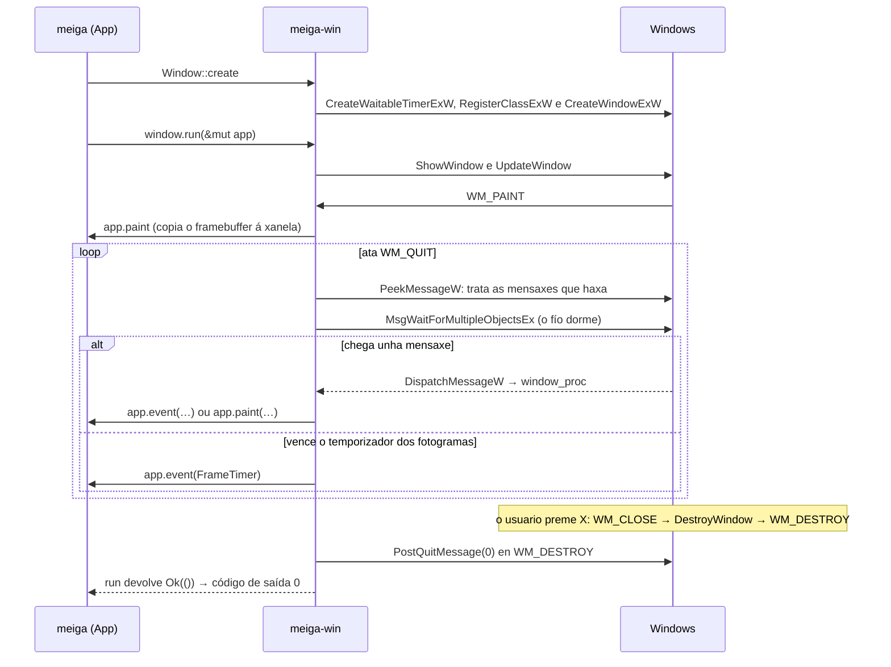

# Código › `meiga-win`

> Estado: subfase 1.2. Contén a xanela, o bucle de mensaxes co temporizador dos fotogramas, os eventos que recibe o programa e o tipo dos erros de Windows.

**Responsabilidade:** a capa de plataforma. Envolve todo o que é específico de Windows: ConPTY, a detección das shells instaladas, o sistema de arquivos, o portapapeis, a xanela Win32 e a xestión do DPI. Ver [Arquitectura](../arquitectura.md#2-estrutura-do-código-un-workspace-con-catro-crates).

| Arquivo | Contido |
|---|---|
| [`Cargo.toml`](#cratesmeiga-wincargotoml) | As dependencias: `meiga-core` e `windows-sys`. |
| [`src/lib.rs`](#cratesmeiga-winsrclibrs) | A raíz do crate: os módulos e os tipos que se publican. |
| [`src/error.rs`](#cratesmeiga-winsrcerrorrs) | `Error`: unha chamada a Windows que fallou. |
| [`src/event.rs`](#cratesmeiga-winsrceventrs) | Os eventos da xanela e o *trait* `Handler`, que os recibe. |
| [`src/window.rs`](#cratesmeiga-winsrcwindowrs) | A xanela, o bucle de mensaxes, o temporizador dos fotogramas e a mensaxe de erro. |

Os conceptos de Win32 (xanelas, clases, mensaxes, bucle de mensaxes) explícanse en [Tecnoloxías › Xanelas Win32](../tecnoloxias.md#22-xanelas-win32-e-o-bucle-de-mensaxes), e os temporizadores, en [Tecnoloxías › Temporizadores](../tecnoloxias.md#26-temporizadores-e-a-espera-do-fío-da-interface).

## `crates/meiga-win/Cargo.toml`

```toml
[package]
name = "meiga-win"
description = "Windows platform layer of meiga: ConPTY, shell profiles, file system, clipboard and Win32 windowing."
version.workspace = true
edition.workspace = true
rust-version.workspace = true
license.workspace = true
repository.workspace = true
publish.workspace = true

[dependencies]
meiga-core.workspace = true
windows-sys = { workspace = true, features = [
    "Win32_Foundation",
    "Win32_Graphics_Gdi",
    # CreateWaitableTimerExW takes SECURITY_ATTRIBUTES.
    "Win32_Security",
    "Win32_System_LibraryLoader",
    "Win32_System_Threading",
    "Win32_UI_Input_KeyboardAndMouse",
    "Win32_UI_WindowsAndMessaging",
] }

[lints]
workspace = true
```

Os metadatos e as regras de calidade son os comúns, como en [`meiga-render`](meiga-render.md#cratesmeiga-rendercargotoml). A dependencia principal é `windows-sys`, as declaracións das APIs de Windows para Rust ([Tecnoloxías › windows-sys](../tecnoloxias.md#21-windows-sys-as-apis-de-windows-desde-rust)):

- `workspace = true`: a versión vén do `Cargo.toml` raíz ([Código › workspace](workspace.md#cargotoml-raíz)), así que todos os crates que a usen terán a mesma.
- `features`: `windows-sys` divide as APIs nos mesmos espazos de nomes que usa a documentación de Microsoft, e cada *feature* activa un deles. Só se compila o que se activa:

| *Feature* | Que trae | Que se usa |
|---|---|---|
| `Win32_Foundation` | Os tipos básicos. | `HWND`, `HANDLE`, `RECT`, `WPARAM`, `LPARAM`, `LRESULT`, `CloseHandle` e os resultados das esperas (`WAIT_OBJECT_0`, `WAIT_FAILED`). |
| `Win32_Graphics_Gdi` | GDI, a API clásica de debuxo. | `BeginPaint`, `EndPaint`, `InvalidateRect`, `ValidateRect` e `UpdateWindow`. |
| `Win32_Security` | A seguridade dos obxectos de Windows. | Nada directamente: `CreateWaitableTimerExW` recibe uns `SECURITY_ATTRIBUTES`, e `windows-sys` só declara a función se o tipo existe. Por iso vai co comentario. |
| `Win32_System_LibraryLoader` | A carga de DLL e módulos. | `GetModuleHandleW`. |
| `Win32_System_Threading` | Fíos, procesos e obxectos de sincronización. | O temporizador: `CreateWaitableTimerExW`, `SetWaitableTimer`, `CancelWaitableTimer` e `INFINITE`. |
| `Win32_UI_Input_KeyboardAndMouse` | O teclado e o rato. | `SetCapture`, `GetCapture` e `ReleaseCapture`. |
| `Win32_UI_WindowsAndMessaging` | As xanelas, as mensaxes, os temporizadores das xanelas, os cursores e as caixas de mensaxe. | O resto. |

Unha constante, `MK_LBUTTON`, defínese no propio código en vez de activar a súa *feature*, `Win32_System_SystemServices`, que traería milleiros de declaracións por un único número (ver [`event.rs`](#cratesmeiga-winsrceventrs)).

## `crates/meiga-win/src/lib.rs`

```rust
//! Windows platform layer of meiga.
//!
//! Wraps ConPTY, shell profile discovery, the file system, the clipboard, the
//! Win32 window and DPI handling. Every `unsafe` block in this crate must
//! explain why it is sound in a `// SAFETY:` comment.

mod error;
pub mod event;
pub mod window;

pub use error::Error;
// The handles of a window and of a device context, which the binary passes
// from this crate to meiga-render. They are raw pointers: copying them is
// safe, and only the functions of Windows use them.
pub use windows_sys::Win32::Foundation::HWND;
pub use windows_sys::Win32::Graphics::Gdi::HDC;
```

- A documentación do crate lembra a súa regra principal: este é o lugar con máis código `unsafe` do proxecto, e cada bloque ten que explicar por que é seguro. Clippy compróbao (`undocumented_unsafe_blocks`, ver [Tecnoloxías › *Lints*](../tecnoloxias.md#7-lints-rustc-e-clippy)).
- `mod error;` declara o módulo `error` (`src/error.rs`) sen `pub`: é privado.
- `pub use error::Error;` publica o tipo `Error` na raíz do crate. Os outros crates escriben `meiga_win::Error`, e non `meiga_win::error::Error`: o módulo só contén ese tipo, e non achega nada ao nome.
- `pub mod event;` e `pub mod window;` declaran os dous módulos públicos: `meiga_win::event::Event`, `meiga_win::window::Window`.
- **`HWND` e `HDC`.** O programa (`meiga`) recibe destes tipos de `meiga-win` e pásaos a `meiga-render`, que presenta o *framebuffer* na xanela. Publicalos eiquí permite que o programa os nomee sen depender de `windows-sys`. En `windows-sys`, os dous son o mesmo tipo, `*mut c_void`, un punteiro sen tipo: copialos é seguro, e só os usan as funcións de Windows, sempre dentro dos crates que teñen `unsafe`. Por iso o programa segue con `#![forbid(unsafe_code)]`.

## `crates/meiga-win/src/error.rs`

```rust
//! Errors from Windows API calls.

use std::{fmt, io};

/// A Windows API call that failed.
#[derive(Debug)]
pub struct Error {
    function: &'static str,
    os_error: Option<io::Error>,
}

impl Error {
    /// Builds the error of `function` from the last error code of the calling
    /// thread (`GetLastError`), so it must be called right after the failure.
    pub(crate) fn last(function: &'static str) -> Self {
        let error = io::Error::last_os_error();
        // Some functions (GDI, for example) fail without setting an error
        // code, and "The operation completed successfully" would mislead.
        let os_error = (error.raw_os_error() != Some(0)).then_some(error);
        Self { function, os_error }
    }
}

impl fmt::Display for Error {
    fn fmt(&self, f: &mut fmt::Formatter<'_>) -> fmt::Result {
        match &self.os_error {
            Some(error) => write!(f, "{} failed: {error}", self.function),
            None => write!(f, "{} failed", self.function),
        }
    }
}

impl std::error::Error for Error {}
```

As funcións de Windows non devolven un `Result`, coma as de Rust. Cada unha indica que fallou á súa maneira (un *handle* nulo, un 0, un -1…) e deixa un **código de erro** nunha variábel de cada fío, que se le con `GetLastError`. `Error` garda que función fallou e ese código.

- `function: &'static str`: o nome da función, por exemplo `"CreateWindowExW"`. `&'static str` é unha referencia a un texto que existe durante todo o programa, como os literais entre comiñas: non hai que copialo nin liberalo.
- `io::Error::last_os_error()`, da biblioteca estándar, le `GetLastError` e devolve un erro de Rust co código e co texto que dá Windows para el (no idioma de Windows), por exemplo `Access is denied. (os error 5)`.
- `pub(crate)`: só este crate pode crear erros. Hai que chamar a `last` xusto despois do fallo, porque calquera outra chamada a Windows pode cambiar o código.
- **O código 0.** Algunhas funcións, como as de GDI, poden fallar sen deixar ningún código. Entón `GetLastError` devolve 0, que significa «The operation completed successfully», e a mensaxe sería contraditoria. Nese caso gárdase `None`:
  - `raw_os_error()` devolve o número do código (`Some(0)` para o 0);
  - `condición.then_some(valor)` devolve `Some(valor)` se a condición é certa e `None` se non.
- `#[derive(Debug)]`: permite mostrar o erro con `{:?}`, como esixe o *trait* `std::error::Error`.
- `Display` é o texto para as persoas, por exemplo `RegisterClassExW failed: Class already exists. (os error 1410)`, ou só `SetTimer failed` se non hai código. É o texto que mostra a mensaxe de erro de meiga.
- `impl std::error::Error for Error {}` converte o tipo nun erro estándar de Rust, que funciona con `?` e con `Box<dyn std::error::Error>`. Non implementa `source()`, que serve para encadear un erro coa súa causa: o texto de Windows xa vai na mensaxe, e repetiríase ao mostrar a cadea de erros.

`meiga-render` ten o seu propio `Error`, igual, para as funcións de GDI (ver [Código › meiga-render](meiga-render.md#cratesmeiga-rendersrcerrorrs)): os dous crates non dependen un do outro.

## `crates/meiga-win/src/event.rs`

O que lle pasa á xanela, traducido das mensaxes de Windows a tipos de Rust, e o *trait* que recibe eses eventos. Este módulo non ten `unsafe` (`#![forbid(unsafe_code)]`): só le números.

### `Handler`

```rust
/// An error from the code that handles the events. It ends the message loop.
pub type HandlerError = Box<dyn StdError>;

pub trait Handler {
    /// Something happened in the window.
    fn event(&mut self, window: &Window, event: Event) -> Result<(), HandlerError>;

    /// Windows asks to paint `area` of the window in `dc`, for example
    /// because it is shown for the first time or because it grew.
    fn paint(&mut self, window: &Window, dc: HDC, area: Rect) -> Result<(), HandlerError>;
}
```

- Un ***trait*** é un conxunto de funcións que un tipo pode implementar, como unha interface. `meiga-win` non sabe que fai o programa: só sabe chamar a quen implemente `Handler`. No programa implementao `App` (ver [Código › meiga](meiga.md#cratesmeigasrcapprs)).
- `&mut self`: o *handler* pode cambiar o seu estado en cada evento. `&Window`: recibe tamén a xanela, para pedirlle cousas (un temporizador, capturar o rato…).
- `HandlerError` é un **alias**, outro nome para un tipo: `Box<dyn StdError>`, calquera erro nunha caixa. `dyn StdError` significa «un valor de calquera tipo que implemente `std::error::Error`», e a caixa (`Box`) gárdao na memoria dinámica, porque cada tipo de erro ten un tamaño distinto. Así, o *handler* pode devolver erros de `meiga-win`, de `meiga-render` ou de entrada e saída, e `?` convérteos solos.
- **Unha regra importante**, na documentación do *trait*: o *handler* non pode chamar a funcións que envían unha mensaxe á xanela e agardan a resposta, como `SetWindowPos`. A xanela chamaría ao *handler* de novo antes de que remate a primeira chamada, e Rust non permite dúas referencias `&mut` ao mesmo valor á vez; ese evento perderíase (ver [`State`](#state-e-installed-o-handler-dentro-do-window-procedure)).

### `Event`, `MouseButton` e `Key`

```rust
pub enum Event {
    Resized { size: Size, minimized: bool },
    SizeMoveStarted,
    SizeMoveEnded,
    MouseDown { button: MouseButton, at: Point },
    MouseUp { button: MouseButton, at: Point },
    MouseMoved { at: Point, left_down: bool },
    CaptureLost,
    KeyDown { key: Key, repeat: bool },
    FrameTimer,
}

pub enum MouseButton {
    Left,
    Right,
}

pub struct Key(pub u16);

impl Key {
    pub const ESCAPE: Key = Key(0x1b);
    pub const P: Key = Key(0x50);
}
```

Un `enum` de Rust é un tipo que pode ser **unha** de varias variantes, e cada variante pode levar os seus propios datos. As coordenadas son píxeles desde a esquina superior esquerda da área cliente, a parte da xanela que debuxa meiga.

| Evento | Mensaxe de Windows | Cando |
|---|---|---|
| `Resized` | `WM_SIZE` | A área cliente cambiou de tamaño, ou a xanela se minimizou ou se restaurou. Unha xanela minimizada ten tamaño 0 × 0. |
| `SizeMoveStarted` e `SizeMoveEnded` | `WM_ENTERSIZEMOVE` e `WM_EXITSIZEMOVE` | O usuario empeza e remata de mover ou redimensionar a xanela. Entre os dous, Windows executa o seu propio bucle de mensaxes (ver [os bucles modais](#os-bucles-modais-de-windows)). |
| `MouseDown` e `MouseUp` | `WM_LBUTTONDOWN`, `WM_LBUTTONUP`, `WM_RBUTTONDOWN` e `WM_RBUTTONUP` | Premer e soltar o botón esquerdo ou o dereito. |
| `MouseMoved` | `WM_MOUSEMOVE` | O rato moveuse; `left_down` di se o botón esquerdo está premido. |
| `CaptureLost` | `WM_CAPTURECHANGED` | A xanela deixa de recibir todo o rato (ver [`capture_mouse`](#o-rato-e-o-repintado)), por exemplo porque outra xanela o colleu. |
| `KeyDown` | `WM_KEYDOWN` | Premeuse unha tecla; `repeat` indica que é a repetición automática dunha tecla que segue premida. |
| `FrameTimer` | — | Venceu o temporizador dos fotogramas (ver [o temporizador](#o-temporizador-dos-fotogramas)). |

- `Key` garda un **código de tecla virtual** de Windows (*virtual-key code*), o número que identifica unha tecla física: `0x1B` é Esc e `0x50`, a P. É un `struct` cun único campo (`Key(pub u16)`), un ***newtype***: un tipo novo para un número, que impide confundilo con calquera outro `u16`. Polo de agora só hai as dúas teclas que usa a demo; o teclado completo chega na subfase 1.7.
- Os tipos derivan `Clone`, `Copy`, `Debug`, `PartialEq` e `Eq`: son pequenos, cópianse ao pasalos, móstranse nas mensaxes de diagnóstico e compáranse nas probas.

### `decode`

```rust
pub(crate) fn decode(message: u32, wparam: WPARAM, lparam: LPARAM) -> Option<Event> {
    let at = || point(lparam);
    Some(match message {
        WM_SIZE => Event::Resized {
            size: Size::new(u32::from(low_word(lparam)), u32::from(high_word(lparam))),
            minimized: wparam == SIZE_MINIMIZED as WPARAM,
        },
        WM_LBUTTONDOWN => Event::MouseDown { button: MouseButton::Left, at: at() },
        …
        WM_MOUSEMOVE => Event::MouseMoved {
            at: at(),
            left_down: wparam & MK_LBUTTON != 0,
        },
        WM_CAPTURECHANGED => Event::CaptureLost,
        WM_KEYDOWN => Event::KeyDown {
            key: Key(wparam as u16),
            repeat: lparam & KEY_WAS_DOWN != 0,
        },
        _ => return None,
    })
}
```

Traduce unha mensaxe ao seu evento, ou devolve `None` se non é ningunha destas. É unha función pura, sen ningunha chamada a Windows, e por iso ten probas.

- Cada mensaxe leva os seus datos en dous números, `wParam` e `lParam`, de 64 bits. Que significa cada bit depende da mensaxe:

| Mensaxe | `wParam` | `lParam` |
|---|---|---|
| `WM_SIZE` | O tipo de cambio: `SIZE_MINIMIZED` (1) se se minimizou. | O ancho nos 16 bits baixos e o alto nos 16 seguintes. |
| Rato | Os botóns e teclas premidos: o bit `MK_LBUTTON` (1) é o botón esquerdo. | A *x* nos 16 bits baixos e a *y* nos 16 seguintes, **con signo**. |
| `WM_KEYDOWN` | O código de tecla virtual. | Detalles da pulsación; o bit 30 (`KEY_WAS_DOWN`) indica que a tecla xa estaba premida. |

- `low_word` e `high_word` collen os 16 bits baixos (`value as u16`) e os 16 seguintes (`(value >> 16) as u16`). `as` en Rust trunca: quedan os bits baixos.
- **As coordenadas con signo.** Mentres a xanela ten o rato capturado, recibe tamén os movementos fóra dela: á esquerda ou por riba, as coordenadas son negativas. `point` convérteas primeiro a `i16`, que interpreta os 16 bits como un número con signo (`0xFFFD` é -3), e despois a `i32`.
- `let at = || point(lparam);` é un ***closure***, unha función pequena sen nome que usa as variábeis de onde se define. Só se chama nas mensaxes do rato.
- `MK_LBUTTON` e `KEY_WAS_DOWN` son constantes do propio módulo. `MK_LBUTTON` está na *feature* `Win32_System_SystemServices` de `windows-sys`, que traería milleiros de declaracións por un único número.

### Probas

Catro probas de `decode` con mensaxes construídas a man:

| Proba | Que comproba |
|---|---|
| `size_comes_from_the_two_words_of_lparam` | O ancho e o alto de `WM_SIZE`, e que `SIZE_MINIMIZED` dá `minimized: true`. |
| `mouse_coordinates_can_be_negative` | As coordenadas negativas (-3, -20) e o botón esquerdo de `WM_MOUSEMOVE`. |
| `keys_tell_when_they_repeat` | O código da tecla e o bit da repetición. |
| `other_messages_are_not_events` | Unha mensaxe calquera (`0x0400`) dá `None`. |

## `crates/meiga-win/src/window.rs`

A xanela de meiga, o bucle de mensaxes, o temporizador dos fotogramas e unha mensaxe de erro. Os fragmentos de código desta sección son extractos: omiten os comentarios `// SAFETY:`, que no arquivo van antes de cada bloque `unsafe`, e algún outro comentario.

Así vive a xanela, desde que se crea ata que a pecha o usuario:



### Importacións e constantes

```rust
use std::cell::{Cell, RefCell};
use std::ptr;
use std::time::{Duration, Instant};

use meiga_core::geometry::{Rect, Size};
use windows_sys::Win32::Foundation::{ … };
…
/// Name of the window class of meiga windows.
const CLASS_NAME: &str = "meiga";

/// Identifier of the window timer that replaces the frame timer while
/// Windows runs its own message loop.
const FRAME_TIMER_ID: usize = 1;
```

- As funcións, os tipos e as constantes de `windows-sys` levan exactamente os nomes da documentación de Microsoft (`CreateWindowExW`, `WM_DESTROY`…), así que se poden buscar alí directamente.
- `ptr::null()` e `ptr::null_mut()` crean punteiros nulos, o `NULL` de C, que as APIs de Windows usan para «ningún» ou «o valor por defecto».
- `CLASS_NAME`: o nome da clase de xanela de meiga. `tools/check-window.ps1` compróbao.
- `FRAME_TIMER_ID`: o número do temporizador de xanela que substitúe o dos fotogramas nos bucles modais. Cada temporizador dunha xanela identifícase cun número, e chega con el na mensaxe `WM_TIMER`.

### `WindowOptions` e `Window`

```rust
/// How a new window looks.
pub struct WindowOptions<'a> {
    /// Text of the title bar.
    pub title: &'a str,
}

pub struct Window {
    handle: HWND,
    timer: FrameTimer,
}
```

- `WindowOptions` agrupa o aspecto da xanela nova; polo de agora, só o título. `<'a>` é un **tempo de vida** (*lifetime*): o título é un texto prestado, e o compilador garante que `WindowOptions` non se usa despois de que ese texto deixe de existir. Na subfase 1.1 levaba tamén a cor do fondo; desde a 1.2, o fondo debúxao o programa no seu *framebuffer*.
- `Window` garda o **HWND**, o *handle* da xanela: un número opaco que a identifica ante Windows. En `windows-sys`, `HWND` é un punteiro (`*mut c_void`), e por iso Rust non deixa pasar unha `Window` a outro fío (os punteiros non son `Send`). É xusto a regra de Win32: unha xanela pertence ao fío que a crea, e as súas mensaxes chegan só a ese fío.
- `timer` é o [temporizador dos fotogramas](#o-temporizador-dos-fotogramas), que vive tanto coma a xanela.
- **`Drop`.** Ao destruír unha `Window`, se a xanela aínda existe (`IsWindow`), destrúese con `DestroyWindow`. Normalmente xa non existe, porque a pechou o usuario; pero se `run` remata por un erro, ou se o programa falla antes de `run`, a xanela non queda orfa. Destruíla deixa un `WM_QUIT` na cola, que [`show_error`](#is_remote_session-e-show_error) ten en conta. Despois, o `Drop` de `FrameTimer` pecha o temporizador.

### `Window::create`

```rust
let timer = FrameTimer::new()?;
let instance = unsafe { GetModuleHandleW(ptr::null()) };
```

- Primeiro créase o temporizador dos fotogramas: se Windows non o puidese crear, non tería sentido seguir.
- `GetModuleHandleW(null)` dá o *handle* do propio `meiga.exe` (`HINSTANCE`), que está cargado mentres o proceso corre. Identifica o módulo que rexistra a clase.

```rust
let cursor = unsafe { LoadCursorW(ptr::null_mut(), IDC_ARROW) };
```

A frecha normal do rato. Os cursores do sistema cárganse sen *handle* de módulo. Sen cursor na clase, o rato quedaría coa forma que tiña ao entrar na xanela, por exemplo a de redimensionar.

```rust
let class_name = wide(CLASS_NAME);
let class = WNDCLASSEXW {
    cbSize: size_of::<WNDCLASSEXW>() as u32,
    lpfnWndProc: Some(window_proc),
    hInstance: instance,
    hCursor: cursor,
    lpszClassName: class_name.as_ptr(),
    ..Default::default()
};
if unsafe { RegisterClassExW(&class) } == 0 {
    return Err(Error::last("RegisterClassExW"));
}
```

- Unha **clase de xanela** é o molde das xanelas: o nome, a función que trata as súas mensaxes (o *window procedure*), o cursor e a brocha do fondo.
- `cbSize`: moitas estruturas de Windows levan o seu propio tamaño, para que Windows saiba que versión da estrutura recibe. `size_of` dáo en bytes, e `as u32` convérteo ao tipo do campo.
- `lpfnWndProc: Some(window_proc)`: a función que recibirá as mensaxes. En `windows-sys` é un `Option`, porque en C pode ser nula.
- **Sen brocha.** Na subfase 1.1, a clase levaba unha brocha coa que Windows pintaba o fondo (`WM_ERASEBKGND`). Agora o programa pinta todos os píxeles en `WM_PAINT`, desde o seu *framebuffer*: borrar antes o fondo sería pintar dúas veces, e ademais faría parpadear a xanela, porque se vería un instante o fondo antes do contido.
- `..Default::default()`: os campos que non se nomean quedan a cero. Entre eles, `style`: a clase non leva `CS_HREDRAW` nin `CS_VREDRAW`, que farían que Windows repintase a xanela enteira cada vez que cambia de tamaño. Sen eles, só se pinta a parte nova que queda á vista: menos traballo, como manda o principio de debuxar só o que cambia.
- Unha clase só se pode rexistrar unha vez por proceso: por iso `create` documenta que se chama unha soa vez. Cando meiga teña varias xanelas (mellora futura F6), o rexistro separarase da creación.

```rust
let title = wide(options.title);
let handle = unsafe {
    CreateWindowExW(
        0,
        class_name.as_ptr(),
        title.as_ptr(),
        WS_OVERLAPPEDWINDOW,
        CW_USEDEFAULT, CW_USEDEFAULT, CW_USEDEFAULT, CW_USEDEFAULT,
        ptr::null_mut(), ptr::null_mut(), instance, ptr::null(),
    )
};
```

Crea a xanela, aínda oculta:

| Argumento | Valor | Significado |
|---|---|---|
| Estilo estendido | `0` | Ningún. |
| Clase e título | `class_name`, `title` | Textos en UTF-16 rematados en 0 (ver [Conversións](#conversións)). Teñen que existir mentres dura a chamada: son variábeis da función, e viven ata o seu final. |
| Estilo | `WS_OVERLAPPEDWINDOW` | Unha xanela normal: barra de título, bordo para redimensionar e botóns de minimizar, maximizar e pechar. Sen `WS_VISIBLE`, nace oculta. |
| Posición e tamaño | `CW_USEDEFAULT` | Windows escolle, en cascada respecto das últimas xanelas abertas. |
| Pai, menú e datos | nulos | Unha xanela de nivel superior, sen menú. |

`CreateWindowExW` envía xa algunhas mensaxes á xanela, entre elas un `WM_SIZE`, antes de que exista o *handler*: van a `DefWindowProcW`. Por iso o programa le o tamaño inicial con `client_size` antes de chamar a `run`.

### `Window::client_size`

```rust
pub fn client_size(&self) -> Result<Size, Error> {
    let mut rect = RECT::default();
    if unsafe { GetClientRect(self.handle, &mut rect) } == 0 {
        return Err(Error::last("GetClientRect"));
    }
    Ok(Size::new(rect.right.max(0) as u32, rect.bottom.max(0) as u32))
}
```

O tamaño da área cliente: a xanela sen a barra de título nin os bordos. `GetClientRect` devolve un rectángulo que empeza sempre en (0, 0), así que `right` e `bottom` son o ancho e o alto. `.max(0)` evita converter un número negativo a `u32`, que daría un número enorme.

### `Window::run`

```rust
pub fn run(&self, handler: &mut dyn Handler) -> Result<(), HandlerError> {
    let state = State {
        window: self,
        handler: RefCell::new(handler),
        failure: RefCell::new(None),
    };
    let _installed = Installed::new(self.handle, &state);

    unsafe { ShowWindow(self.handle, SW_SHOWDEFAULT) };
    let result = if unsafe { UpdateWindow(self.handle) } == 0 {
        Err(Error::last("UpdateWindow"))
    } else {
        self.pump(&state)
    };
    if let Some(failure) = state.failure.take() {
        return Err(failure);
    }
    result.map_err(Into::into)
}
```

Mostra a xanela, píntaa e entrega os seus eventos ao *handler* ata que se pecha.

- `&mut dyn Handler`: unha referencia a calquera valor que implemente `Handler`. `dyn` significa que o tipo concreto se coñece ao executar, non ao compilar: `meiga-win` non sabe nada de `App`.
- `State` e `Installed` (ver [máis abaixo](#state-e-installed-o-handler-dentro-do-window-procedure)) gardan na xanela o necesario para que o *window procedure* chegue ao *handler*. `_installed` vive ata o final da función; o guión baixo do nome di que non se usa, pero, ao contrario que `_` só, non se destrúe no momento.
- `SW_SHOWDEFAULT` mostra a xanela como pediu quen lanzou meiga: por exemplo, maximizada se o acceso directo di «Executar: maximizada». O valor que devolve `ShowWindow` é a visibilidade anterior, non un erro, así que non se comproba. Se o tamaño cambia, `ShowWindow` envía `WM_SIZE`, que xa chega ao *handler*.
- `UpdateWindow` envía `WM_PAINT` no momento, se hai algo que pintar, e non volta ata que a xanela está pintada. Así, cando empeza o bucle de mensaxes, o primeiro fotograma xa está feito. Por iso `measure-startup.ps1` mide ata ese punto (ver [Código › medición](perf.md#toolsperfmeasure-startupps1)).
- `pump` é o bucle de mensaxes. Cando remata, se o *handler* fallou nalgún momento, devólvese o seu erro, que é a causa de todo. Se non, o do bucle, convertido en `HandlerError` con `map_err(Into::into)`.

### O bucle de mensaxes: `pump`

```rust
fn pump(&self, state: &State<'_>) -> Result<(), Error> {
    let mut message = MSG::default();
    loop {
        while unsafe { PeekMessageW(&mut message, ptr::null_mut(), 0, 0, PM_REMOVE) } != 0 {
            if message.message == WM_QUIT {
                return Ok(());
            }
            unsafe {
                TranslateMessage(&message);
                DispatchMessageW(&message);
            }
        }
        let woke = unsafe {
            MsgWaitForMultipleObjectsEx(
                1,
                &self.timer.handle,
                INFINITE,
                QS_ALLINPUT,
                MWMO_INPUTAVAILABLE,
            )
        };
        if woke == WAIT_OBJECT_0 {
            self.frame_timer_due(state);
        } else if woke == WAIT_FAILED {
            return Err(Error::last("MsgWaitForMultipleObjectsEx"));
        }
    }
}
```

O **bucle de mensaxes**, o corazón dun programa de Windows. Na subfase 1.1 era `GetMessageW`, que só sabe esperar mensaxes; agora ten que esperar tamén o temporizador dos fotogramas ([ADR 0008](../adr/0008-temporizador-dos-fotogramas.md)):

1. **Baleirar a cola.** `PeekMessageW` con `PM_REMOVE` colle a seguinte mensaxe, se a hai, e devolve 0 se a cola está baleira. Cada mensaxe pasa por `TranslateMessage`, que converte as pulsacións de teclas (`WM_KEYDOWN`) en caracteres (`WM_CHAR`) segundo a distribución do teclado, e por `DispatchMessageW`, que chama ao *window procedure* da súa xanela. Ao chegar `WM_QUIT`, o aviso de que o programa debe rematar, o bucle remata.
2. **Durmir.** `MsgWaitForMultipleObjectsEx` bloquea o fío ata que pasa unha destas cousas: chega unha mensaxe (`QS_ALLINPUT`: calquera tipo de mensaxe) ou se sinala algún dos obxectos da lista, que eiquí é só o temporizador. `INFINITE`: sen tempo máximo. Mentres espera, **o fío non usa a CPU**, igual ca con `GetMessageW`: se non hai ningún fotograma pendente, o temporizador non está activo, e só esperta unha mensaxe.
3. **Que o espertou.** `WAIT_OBJECT_0` (o primeiro obxecto da lista) é o temporizador: `frame_timer_due` entrega o evento. Calquera outro valor bo, `WAIT_OBJECT_0 + 1`, significa que hai mensaxes, e o bucle volta ao paso 1. `WAIT_FAILED` é un erro.

- **`MWMO_INPUTAVAILABLE`.** Sen esta opción, `MsgWaitForMultipleObjectsEx` só esperta coas mensaxes que chegan **despois** da última vez que o fío mirou a cola. Algunhas funcións miran a cola sen sacar as mensaxes; con esta opción, esperta tamén se xa hai algunha esperando, e o bucle nunca queda durmido con mensaxes pendentes.
- `WaitForInputIdle`, que usan as ferramentas de comprobación e medición, segue funcionando: Windows considera o proceso listo cando o seu fío da interface espera sen mensaxes pendentes, tamén nesta función.

### O temporizador dos fotogramas

```rust
struct FrameTimer {
    handle: HANDLE,
    /// When it is due, while it is started.
    due: Cell<Option<Instant>>,
    /// Whether a message loop of Windows is running.
    modal: Cell<bool>,
}
```

O temporizador co que o programa pide un fotograma para dentro dun tempo ([ADR 0008](../adr/0008-temporizador-dos-fotogramas.md)). É un ***waitable timer*** de alta resolución: un obxecto de Windows que se sinala no momento pedido, e polo que o bucle de mensaxes espera. Os temporizadores das xanelas (`SetTimer`) só disparan nos tics do reloxo do sistema, cada 15,6 ms por defecto, e converterían 30 fotogramas por segundo en 21 (ver [Tecnoloxías › Temporizadores](../tecnoloxias.md#26-temporizadores-e-a-espera-do-fío-da-interface)).

- `due`: cando vence o fotograma pendente, ou `None` se non hai ningún.
- `modal`: se Windows está a executar un bucle de mensaxes propio (ver [os bucles modais](#os-bucles-modais-de-windows)).
- **`Cell`.** Os métodos de `Window` reciben `&self`, unha referencia compartida, que en Rust non permite cambiar nada. `Cell` permite cambiar o valor que garda tamén a través de `&self`, sempre copiándoo enteiro (`get`, `set`, `take`), sen referencias ao seu interior. É seguro porque `Window` non pode pasar a outro fío. `Window` necesita `&self` porque o *handler* a recibe así, e o *window procedure* tamén chega a ela.

```rust
fn new() -> Result<Self, Error> {
    let create = |flags| {
        unsafe { CreateWaitableTimerExW(ptr::null(), ptr::null(), flags, TIMER_ALL_ACCESS) }
    };
    let mut handle = create(CREATE_WAITABLE_TIMER_HIGH_RESOLUTION);
    if handle.is_null() {
        handle = create(0);
    }
    if handle.is_null() {
        return Err(Error::last("CreateWaitableTimerExW"));
    }
    Ok(Self { handle, due: Cell::new(None), modal: Cell::new(false) })
}
```

- `CreateWaitableTimerExW` crea o temporizador: sen atributos de seguridade nin nome (só é deste proceso), e con todos os permisos (`TIMER_ALL_ACCESS`).
- Sen `CREATE_WAITABLE_TIMER_MANUAL_RESET`, o temporizador **reiníciase só**: cando o bucle de mensaxes esperta por el, volta ao estado sen sinalar.
- `CREATE_WAITABLE_TIMER_HIGH_RESOLUTION` existe desde Windows 10 1803. meiga necesita a 1809, así que sempre debería funcionar; se non, créase un temporizador normal, que segue sendo mellor ca nada.
- O `Drop` de `FrameTimer` pecha o *handle* con `CloseHandle`.

```rust
pub fn start_frame_timer(&self, delay: Duration) -> Result<(), Error> {
    let due_time = due_time(delay);
    let started =
        unsafe { SetWaitableTimer(self.timer.handle, &due_time, 0, None, ptr::null(), 0) };
    if started == 0 {
        return Err(Error::last("SetWaitableTimer"));
    }
    let now = Instant::now();
    self.timer.due.set(Some(now.checked_add(delay).unwrap_or(now)));
    if self.timer.modal.get() {
        self.start_window_timer(delay)?;
    }
    Ok(())
}
```

- `SetWaitableTimer` programa o temporizador. O momento vai en `due_time`, en unidades de 100 ns e **negativo**, que para Windows significa «desde agora» en vez dunha data (ver [Conversións](#conversións)). Sen período (`0`) dispara unha soa vez, e sen función de aviso (`None`) só se sinala.
- Programalo de novo substitúe o momento anterior e borra o sinal se xa disparara sen que ninguén o esperase.
- `due` garda cando vence. `Instant` é un instante do reloxo monótono do sistema, que nunca vai cara atrás. `checked_add` devolve `None` se a suma non cabe; nese caso, case imposíbel, úsase `now`.
- Durante un bucle modal prográmase tamén o temporizador de xanela.

```rust
pub fn stop_frame_timer(&self) {
    if self.timer.due.take().is_some() {
        unsafe {
            CancelWaitableTimer(self.timer.handle);
            KillTimer(self.handle, FRAME_TIMER_ID);
        }
    }
}
```

Cancela o fotograma pendente, se o hai. `take()` devolve o valor e deixa `None`. `CancelWaitableTimer` detén o temporizador, pero **non borra o sinal** se xa disparara: o bucle espertaría unha vez máis. Por iso `frame_timer_due` mira `due` antes de facer nada.

```rust
fn frame_timer_due(&self, state: &State<'_>) {
    if self.timer.due.take().is_none() {
        return;
    }
    unsafe {
        CancelWaitableTimer(self.timer.handle);
        KillTimer(self.handle, FRAME_TIMER_ID);
    }
    state.dispatch(Event::FrameTimer);
}
```

Venceu o temporizador, ou o temporizador de xanela que o substitúe. Se `due` xa está baleiro, o fotograma xa o entregou o outro dos dous temporizadores, ou cancelouse despois de disparar, e non se fai nada. Se non, cancélanse os dous e o *handler* recibe `FrameTimer`.

### Os bucles modais de Windows

Cando o usuario move ou redimensiona a xanela, ou abre o seu menú (Alt+Espazo), Windows executa **o seu propio bucle de mensaxes** ata que remata: un **bucle modal**. Mentres tanto, `pump` está parado dentro de `DispatchMessageW`, e ninguén espera o temporizador dos fotogramas. As mensaxes seguen chegando ao *window procedure*, tamén `WM_TIMER`.

```rust
fn enter_modal_loop(&self) {
    self.timer.modal.set(true);
    if let Some(due) = self.timer.due.get() {
        let _ = self.start_window_timer(due.saturating_duration_since(Instant::now()));
    }
}

fn leave_modal_loop(&self) {
    self.timer.modal.set(false);
    unsafe { KillTimer(self.handle, FRAME_TIMER_ID) };
}

fn start_window_timer(&self, delay: Duration) -> Result<(), Error> {
    if unsafe { SetTimer(self.handle, FRAME_TIMER_ID, timer_millis(delay), None) } == 0 {
        return Err(Error::last("SetTimer"));
    }
    Ok(())
}
```

- Ao empezar un bucle modal (`WM_ENTERSIZEMOVE` ou `WM_ENTERMENULOOP`), se hai un fotograma pendente, prográmase tamén cun **temporizador de xanela**: `SetTimer` publica `WM_TIMER` cando vence, e esa mensaxe si chega a través do bucle de Windows.
- Ao rematar (`WM_EXITSIZEMOVE` ou `WM_EXITMENULOOP`), cancélase con `KillTimer`. Se o fotograma segue pendente, o temporizador principal entrégao cando `pump` volta esperar.
- `saturating_duration_since` dá o tempo que falta, ou cero se xa pasou.
- Se `SetTimer` falla, o fotograma agarda ao final do bucle modal: non é motivo para parar meiga.
- Os temporizadores de xanela só disparan nos tics do reloxo, así que durante un bucle modal hai uns 21 fotogramas por segundo en vez de 30. Mentres se move unha xanela, non se nota.

### `WM_PAINT`: `paint`

```rust
fn paint(&self, state: &State<'_>) {
    let mut paint = PAINTSTRUCT::default();
    let dc = unsafe { BeginPaint(self.handle, &mut paint) };
    if dc.is_null() {
        unsafe { ValidateRect(self.handle, ptr::null()) };
        return;
    }
    let area = Rect::new(paint.rcPaint.left, paint.rcPaint.top, paint.rcPaint.right, paint.rcPaint.bottom);
    let result = state.deliver(|handler, window| handler.paint(window, dc, area));
    unsafe { EndPaint(self.handle, &paint) };
    state.check(result);
}
```

- `BeginPaint` prepara o pintado: devolve un **contexto de dispositivo** (*device context*, `HDC`), o obxecto de GDI no que se debuxa, xa recortado á parte da xanela que hai que pintar, e marca esa parte como válida. `rcPaint` é o rectángulo que a contén.
- O *handler* pinta, e `EndPaint` remata o pintado. O resultado do *handler* compróbase despois de `EndPaint`: se fallou, a xanela destrúese, e non se debe facer con `BeginPaint` sen pechar.
- Se `BeginPaint` falla, non hai onde pintar, pero valídase igual a xanela (`ValidateRect` con `null`: toda ela). Mentres unha xanela ten algo sen pintar, Windows segue enviando `WM_PAINT`, e o bucle non durmiría nunca.
- Que pasa en `WM_PAINT` e como o resolve o programa explícase en [Tecnoloxías › Pintar nunha xanela](../tecnoloxias.md#25-pintar-nunha-xanela-wm_paint-e-dwm).

### O rato e o repintado

```rust
pub fn capture_mouse(&self) {
    unsafe { SetCapture(self.handle) };
}

pub fn release_mouse(&self) {
    unsafe {
        if GetCapture() == self.handle {
            ReleaseCapture();
        }
    }
}

pub fn invalidate(&self, area: Option<Rect>) {
    let rect = area.map(|area| RECT { left: area.left, top: area.top, right: area.right, bottom: area.bottom });
    let rect = rect.as_ref().map_or(ptr::null(), ptr::from_ref);
    unsafe { InvalidateRect(self.handle, rect, 0) };
}
```

- **Capturar o rato.** Normalmente, cada xanela recibe o rato só mentres está enriba dela. Ao arrastrar, iso fai que se perda o movemento ao saír da xanela, e mesmo o momento de soltar o botón. `SetCapture` envía todo o rato a esta xanela ata `ReleaseCapture`. Se outra xanela o colle, chega `WM_CAPTURECHANGED` (o evento `CaptureLost`).
- `release_mouse` só o solta se o ten esta xanela, para non quitarllo a outra.
- `ReleaseCapture` envía `WM_CAPTURECHANGED` a esta mesma xanela antes de voltar. Como se chama desde o *handler*, ese aviso non lle chega (ver [`State`](#state-e-installed-o-handler-dentro-do-window-procedure)), e é o correcto: o *handler* xa sabe que soltou o rato.
- **`invalidate`** pídelle a Windows un `WM_PAINT` dunha zona, ou da xanela enteira con `None`. O programa úsao cando non pode presentar un fotograma: o `WM_PAINT` repíntao máis tarde. `ptr::from_ref` converte a referencia nun punteiro, e `map_or` dá o punteiro nulo se non hai rectángulo. O último argumento, `0` (`FALSE`), di que non hai que borrar o fondo antes.

### `is_remote_session` e `show_error`

```rust
pub fn is_remote_session() -> bool {
    unsafe { GetSystemMetrics(SM_REMOTESESSION) != 0 }
}
```

Se o programa corre nunha sesión de Escritorio remoto. Pode cambiar mentres corre: por exemplo, se o usuario se conecta á mesma sesión desde outro ordenador. O programa pregúntao en cada fotograma, para escoller o intervalo (30 ou 60 fps, ver [Código › meiga-core](meiga-core.md#cratesmeiga-coresrcpacingrs)); `GetSystemMetrics` só le un valor que Windows ten en memoria, e custa uns nanosegundos.

```rust
pub fn show_error(title: &str, text: &str) {
    let title = wide(title);
    let text = wide(text);
    let mut quit = MSG::default();
    let pending =
        unsafe { PeekMessageW(&mut quit, ptr::null_mut(), WM_QUIT, WM_QUIT, PM_REMOVE) } != 0;
    unsafe { MessageBoxW(ptr::null_mut(), text.as_ptr(), title.as_ptr(), MB_OK | MB_ICONERROR) };
    if pending {
        unsafe { PostQuitMessage(quit.wParam as i32) };
    }
}
```

Mostra unha caixa de mensaxe co botón Aceptar (`MB_OK`) e a icona de erro (`MB_ICONERROR`). `|` combina as dúas opcións, que son bits dun mesmo número. Non ten xanela dona (`ptr::null_mut()`), porque se pode mostrar cando a xanela de meiga aínda non existe ou xa non existe. A función non volta ata que o usuario a pecha.

- **O `WM_QUIT` pendente.** A caixa ten o seu propio bucle de mensaxes, que remata en canto atopa un `WM_QUIT`. Se meiga falla ao arrancar, a xanela destrúese antes de mostrar o erro (o `Drop` de `Window`), e `WM_DESTROY` deixa un `WM_QUIT` na cola: a caixa pecharíase soa, sen que se vise. Por iso, antes de mostrala, `PeekMessageW` saca o `WM_QUIT` que haxa (o filtro de `WM_QUIT` a `WM_QUIT` só colle esa mensaxe) e, despois, `PostQuitMessage` vólveo publicar co mesmo código, que vai no seu `wParam`. Comprobouse cunha copia de meiga que falla despois de crear a xanela: sen isto, remataba co código 1 sen mostrar nada.

### `State` e `Installed`: o *handler* dentro do *window procedure*

O *window procedure* é unha función que chama Windows, e só recibe a xanela e a mensaxe. Para chegar ao *handler*, `run` garda na propia xanela un punteiro ao seu estado, nun espazo que Windows reserva para cada xanela (`GWLP_USERDATA`).

```rust
struct State<'a> {
    window: &'a Window,
    handler: RefCell<&'a mut dyn Handler>,
    failure: RefCell<Option<HandlerError>>,
}
```

- `window`: a `Window`, que o *handler* recibe en cada evento.
- `handler`: o *handler*, dentro dun `RefCell`. Como `Cell`, permite cambiar o seu contido a través dunha referencia compartida (`&State`), pero dando referencias ao interior: `borrow_mut()` dá unha referencia `&mut`, e o `RefCell` comproba **ao executar** que non hai outra á vez.
- `failure`: o primeiro erro do *handler*.

```rust
fn deliver(
    &self,
    call: impl FnOnce(&mut dyn Handler, &Window) -> Result<(), HandlerError>,
) -> Result<(), HandlerError> {
    if self.failure.borrow().is_some() {
        return Ok(());
    }
    let Ok(mut handler) = self.handler.try_borrow_mut() else {
        return Ok(());
    };
    call(&mut **handler, self.window)
}

fn check(&self, result: Result<(), HandlerError>) {
    if let Err(error) = result {
        *self.failure.borrow_mut() = Some(error);
        unsafe { DestroyWindow(self.window.handle) };
    }
}
```

- **Mensaxes dentro doutras.** Algunhas funcións de Windows envían mensaxes á xanela e esperan a resposta: `ReleaseCapture`, `SetWindowPos`, `DestroyWindow`… Se o *handler* chama a unha delas, o *window procedure* recibe a nova mensaxe **mentres o *handler* aínda está a traballar**. Darlle outra referencia `&mut` ao *handler* nese momento sería un erro de memoria que Rust prohíbe. `try_borrow_mut` detecta o caso, e esa mensaxe non se entrega. Por iso o *trait* `Handler` advirte de que non se chamen esas funcións desde o *handler*.
- `let Ok(…) = … else { return … };` é un ***let-else***: se o valor non encaixa no patrón, execútase o `else`, que ten que saír da función.
- `&mut **handler`: `handler` é unha referencia que garda o `RefCell` (un `RefMut`), que apunta a outra referencia (`&mut dyn Handler`); os dous `*` chegan ao *handler*.
- `impl FnOnce(…)`: calquera función ou *closure* que se poida chamar unha vez con eses argumentos. `dispatch` pásalle `handler.event(window, event)`, e `paint`, `handler.paint(window, dc, area)`.
- **Erros.** Se o *handler* falla, `check` garda o erro e destrúe a xanela. Ao destruírse, `WM_DESTROY` publica `WM_QUIT`, o bucle remata e `run` devolve o erro. Mentres se destrúe chegan máis mensaxes, pero `deliver` xa non as entrega, porque hai un erro gardado.

```rust
struct Installed(HWND);

impl Installed {
    fn new(window: HWND, state: &State<'_>) -> Self {
        unsafe { SetWindowLongPtrW(window, GWLP_USERDATA, ptr::from_ref(state) as isize) };
        Self(window)
    }
}

impl Drop for Installed {
    fn drop(&mut self) {
        unsafe { SetWindowLongPtrW(self.0, GWLP_USERDATA, 0) };
    }
}
```

- `SetWindowLongPtrW(…, GWLP_USERDATA, …)` garda un número na xanela: eiquí, a dirección do `State`.
- **O patrón *guard*.** `Installed` borra o punteiro cando se destrúe, ao final de `run`. Rust destrúe as variábeis locais na orde inversa á que se crearon, así que `Installed` desaparece antes ca `State`: a xanela nunca garda o punteiro a un `State` que xa non existe, nin sequera se `run` remata cun erro. Se a xanela xa non existe, `SetWindowLongPtrW` falla sen efectos.

### `window_proc`

```rust
unsafe extern "system" fn window_proc(
    window: HWND,
    message: u32,
    wparam: WPARAM,
    lparam: LPARAM,
) -> LRESULT {
    match message {
        WM_DPICHANGED => { … return 0; }
        WM_ERASEBKGND => return 1,
        WM_DESTROY => {
            unsafe { PostQuitMessage(0) };
            return 0;
        }
        _ => {}
    }
    let state = unsafe { (GetWindowLongPtrW(window, GWLP_USERDATA) as *const State<'_>).as_ref() };
    let Some(state) = state else {
        return unsafe { DefWindowProcW(window, message, wparam, lparam) };
    };
    let this = state.window;
    match message {
        WM_PAINT => this.paint(state),
        WM_TIMER if wparam == FRAME_TIMER_ID => this.frame_timer_due(state),
        WM_ENTERSIZEMOVE => {
            this.enter_modal_loop();
            state.dispatch(Event::SizeMoveStarted);
        }
        WM_EXITSIZEMOVE => {
            this.leave_modal_loop();
            state.dispatch(Event::SizeMoveEnded);
        }
        WM_ENTERMENULOOP => this.enter_modal_loop(),
        WM_EXITMENULOOP => this.leave_modal_loop(),
        _ => match decode(message, wparam, lparam) {
            Some(event) => state.dispatch(event),
            None => return unsafe { DefWindowProcW(window, message, wparam, lparam) },
        },
    }
    0
}
```

O ***window procedure***: a función que trata as mensaxes das xanelas de meiga. Non a chama meiga, senón Windows (desde `DispatchMessageW` ou directamente, coas mensaxes que se *envían* en vez de *publicarse* na cola).

- `extern "system"`: a convención de chamada das APIs de Windows, a forma de pasar os argumentos que Windows espera. `unsafe` forma parte do tipo que pide Windows (`WNDPROC`). Como `unsafe_op_in_unsafe_fn` está activado, cada operación insegura leva o seu propio bloque `unsafe` e o seu comentario `// SAFETY:`.
- `message` é o número da mensaxe, e `wparam` e `lparam` os seus datos: o que significan depende de cada mensaxe. O valor que devolve (`LRESULT`) tamén.
- **Primeiro, as mensaxes que non necesitan o *handler*.** Poden chegar antes de `run` ou despois:

| Mensaxe | Cando chega | Que fai meiga |
|---|---|---|
| `WM_DPICHANGED` | A xanela pasa a un monitor con outra escala (por exemplo, do 150 % ao 100 %), ou cambia a escala do monitor. | Aplica o tamaño e a posición que suxire Windows, para que a xanela manteña o seu tamaño físico. |
| `WM_ERASEBKGND` | Antes de pintar, Windows pide borrar o fondo. | Devolve 1, «xa está borrado», sen facer nada: o *handler* pinta todos os píxeles. |
| `WM_DESTROY` | A xanela estase destruíndo, por exemplo porque o usuario a pechou. | `PostQuitMessage(0)` publica `WM_QUIT`, e o bucle de mensaxes remata. |

- **Despois, o estado.** `GetWindowLongPtrW` le o punteiro que gardou `Installed`. `as *const State<'_>` convérteo nun punteiro, e `.as_ref()` nunha referencia, ou en `None` se é nulo: fóra de `run`, todo vai a `DefWindowProcW`.
- **As mensaxes que van ao *handler*:**

| Mensaxe | Que fai meiga |
|---|---|
| `WM_PAINT` | [`paint`](#wm_paint-paint): o *handler* pinta a zona que pide Windows. |
| `WM_TIMER` co número `FRAME_TIMER_ID` | O temporizador de xanela dun bucle modal: [`frame_timer_due`](#o-temporizador-dos-fotogramas). `if wparam == …` é unha **garda** do `match`: a rama só se escolle se, ademais, se cumpre a condición. Os outros temporizadores irían a `DefWindowProcW`. |
| `WM_ENTERSIZEMOVE` e `WM_EXITSIZEMOVE` | Empeza ou remata un [bucle modal](#os-bucles-modais-de-windows), e o *handler* recibe `SizeMoveStarted` ou `SizeMoveEnded`. |
| `WM_ENTERMENULOOP` e `WM_EXITMENULOOP` | Empeza ou remata o bucle modal do menú. |
| As de [`decode`](#decode) | O *handler* recibe o evento. |
| Calquera outra | `DefWindowProcW`, o comportamento por defecto de Windows: mover, redimensionar, minimizar, maximizar, pechar (`WM_CLOSE` destrúe a xanela)… |

- Devolver 0 indica que a mensaxe está tratada.

```rust
WM_DPICHANGED => {
    let suggested = unsafe { &*(lparam as *const RECT) };
    unsafe {
        SetWindowPos(
            window,
            ptr::null_mut(),
            suggested.left,
            suggested.top,
            suggested.right - suggested.left,
            suggested.bottom - suggested.top,
            SWP_NOZORDER | SWP_NOACTIVATE,
        )
    };
    return 0;
}
```

- En `WM_DPICHANGED`, `lparam` é a dirección dun `RECT` (as coordenadas dos catro lados) co rectángulo que suxire Windows. `lparam as *const RECT` converte o número nun punteiro, e `&*` convérteo nunha referencia de Rust. É seguro porque Windows garante que o rectángulo existe mentres se trata a mensaxe.
- `SetWindowPos` move e redimensiona a xanela: `SWP_NOZORDER` non a pon diante nin detrás doutras, e `SWP_NOACTIVATE` non lle dá o foco. Envía `WM_SIZE`, que chega ao *handler* como `Resized`.
- Coa escala por monitor (ver [Tecnoloxías › Manifesto](../tecnoloxias.md#23-manifesto-da-aplicación-e-dpi)), Windows axusta só a barra de título e os bordos. O contido da xanela é cousa de meiga: o tamaño das letras chegará coas fontes, na subfase 1.3, e o resto dos cambios de escala, na 1.9.

### Conversións

```rust
fn due_time(delay: Duration) -> i64 {
    -i64::try_from(delay.as_nanos().div_ceil(100))
        .unwrap_or(i64::MAX)
        .max(1)
}

fn timer_millis(delay: Duration) -> u32 {
    u32::try_from(delay.as_nanos().div_ceil(1_000_000))
        .unwrap_or(USER_TIMER_MAXIMUM)
        .clamp(USER_TIMER_MINIMUM, USER_TIMER_MAXIMUM)
}

fn wide(text: &str) -> Vec<u16> {
    text.encode_utf16().chain(Some(0)).collect()
}
```

- **`due_time`.** Os *waitable timers* reciben o momento en unidades de 100 ns. Un número positivo é unha data, e un negativo, un tempo desde agora. `div_ceil` divide redondeando cara arriba, para que o temporizador nunca dispare antes de tempo; `try_from` falla se o número non cabe nun `i64`, e entón úsase o máximo; e `.max(1)` evita o 0, que significaría «agora mesmo» como data absoluta.
- **`timer_millis`.** `SetTimer` recibe milisegundos, entre `USER_TIMER_MINIMUM` (10) e `USER_TIMER_MAXIMUM`. `clamp` deixa o número dentro dos límites.
- **`wide`.** As funcións de Windows que rematan en `W` (de *wide*) usan textos en UTF-16 rematados nun 0, como en C. Os textos de Rust son UTF-8 e levan a súa lonxitude, sen 0 ao final. `encode_utf16()` dá as unidades UTF-16 do texto, `.chain(Some(0))` engade o 0 ao final e `collect()` xúntaas nun `Vec<u16>`. Quen chama ten que manter o vector vivo mentres Windows usa o punteiro (`as_ptr()`).

A conversión das cores para GDI (`colorref`), que estaba neste arquivo na subfase 1.1, pasou a [`meiga-render`](meiga-render.md#cratesmeiga-rendersrcgdirs), que é quen pinta.

### Probas

| Proba | Que comproba |
|---|---|
| `waitable_timers_count_in_hundreds_of_nanoseconds_from_now` | 33 334 µs son -333 340 unidades de 100 ns; 150 ns redondean a -2; e cero dá -1. |
| `window_timers_round_up_within_their_limits` | 33 334 µs son 34 ms; 2 ms suben ao mínimo de 10; e o máximo de `Duration` queda no máximo de `SetTimer`. |

O resto deste arquivo necesita unha xanela de verdade. Compróbano `tools/check-window.ps1` e `tools/check-present.ps1` co `meiga.exe` de *release* (ver [Código › ferramentas](ferramentas.md#toolscheck-presentps1)).
