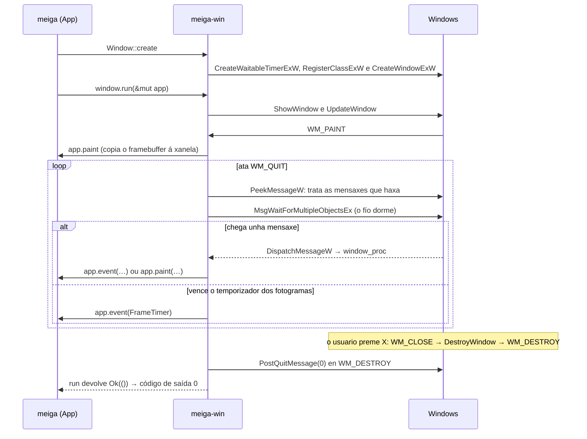
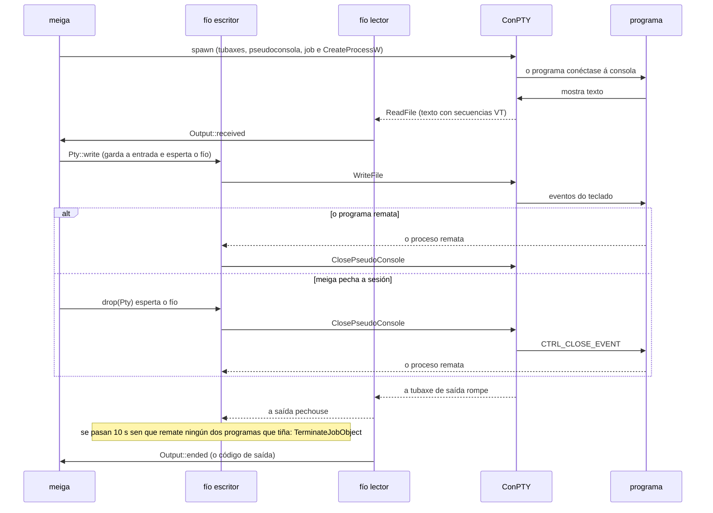

# Código › `meiga-win`

> Estado: subfase 1.4. Contén a xanela, o bucle de mensaxes co temporizador dos fotogramas, os eventos que recibe o programa, o DPI da xanela, as sesións de ConPTY e o tipo dos erros de Windows.

**Responsabilidade:** a capa de plataforma. Envolve todo o que é específico de Windows: ConPTY, a detección das shells instaladas, o sistema de arquivos, o portapapeis, a xanela Win32 e a xestión do DPI. Ver [Arquitectura](../arquitectura.md#2-estrutura-do-código-un-workspace-con-catro-crates).

| Arquivo | Contido |
|---|---|
| [`Cargo.toml`](#cratesmeiga-wincargotoml) | As dependencias: `meiga-core` e `windows-sys`. |
| [`src/lib.rs`](#cratesmeiga-winsrclibrs) | A raíz do crate: os módulos, os tipos que se publican e a conversión dos textos a UTF-16. |
| [`src/error.rs`](#cratesmeiga-winsrcerrorrs) | `Error`: unha chamada a Windows que fallou. |
| [`src/event.rs`](#cratesmeiga-winsrceventrs) | Os eventos da xanela e o *trait* `Handler`, que os recibe. |
| [`src/window.rs`](#cratesmeiga-winsrcwindowrs) | A xanela, o seu DPI, o bucle de mensaxes, o temporizador dos fotogramas e a mensaxe de erro. |
| [`src/conpty.rs`](#cratesmeiga-winsrcconptyrs) | As sesións: un programa nunha pseudoconsola, cos seus fíos lector e escritor. |
| [`tests/conpty.rs`](#cratesmeiga-wintestsconptyrs) | Probas de integración: programas de verdade nos dous ConPTY. |
| [`examples/conpty.rs`](#cratesmeiga-winexamplesconptyrs) | Un programa de consola que mostra o que escribe un programa nunha pseudoconsola, e envíalle o que se teclea. |

Os conceptos de Win32 (xanelas, clases, mensaxes, bucle de mensaxes) explícanse en [Tecnoloxías › Xanelas Win32](../tecnoloxias.md#22-xanelas-win32-e-o-bucle-de-mensaxes); os temporizadores, en [Tecnoloxías › Temporizadores](../tecnoloxias.md#26-temporizadores-e-a-espera-do-fío-da-interface); e o ConPTY, os procesos e as tubaxes, en [Tecnoloxías › ConPTY](../tecnoloxias.md#31-conpty-a-pseudoconsola-de-windows) e [Tecnoloxías › Procesos, tubaxes e eventos](../tecnoloxias.md#32-procesos-tubaxes-e-eventos).

## `crates/meiga-win/Cargo.toml`

```toml
[package]
name = "meiga-win"
description = "Windows platform layer of meiga: ConPTY, shell profiles, file system, clipboard and Win32 windowing."
version.workspace = true
edition.workspace = true
rust-version.workspace = true
license.workspace = true
repository.workspace = true
publish.workspace = true

[dependencies]
meiga-core.workspace = true
windows-sys = { workspace = true, features = [
    "Win32_Foundation",
    "Win32_Graphics_Gdi",
    # CreateWaitableTimerExW, CreatePipe, CreateEventW, CreateJobObjectW and
    # CreateProcessW take SECURITY_ATTRIBUTES.
    "Win32_Security",
    # ReadFile and WriteFile, which take an OVERLAPPED of Win32_System_IO.
    "Win32_Storage_FileSystem",
    # The pseudoconsole functions of kernel32: CreatePseudoConsole and
    # ClosePseudoConsole.
    "Win32_System_Console",
    "Win32_System_IO",
    # The job of the programs of each pseudoconsole.
    "Win32_System_JobObjects",
    "Win32_System_LibraryLoader",
    "Win32_System_Pipes",
    "Win32_System_Threading",
    "Win32_UI_HiDpi",
    "Win32_UI_Input_KeyboardAndMouse",
    "Win32_UI_WindowsAndMessaging",
] }

[lints]
workspace = true
```

Os metadatos e as regras de calidade son os comúns, como en [`meiga-render`](meiga-render.md#cratesmeiga-rendercargotoml). A dependencia principal é `windows-sys`, as declaracións das APIs de Windows para Rust ([Tecnoloxías › windows-sys](../tecnoloxias.md#21-windows-sys-as-apis-de-windows-desde-rust)):

- `workspace = true`: a versión vén do `Cargo.toml` raíz ([Código › workspace](workspace.md#cargotoml-raíz)), así que todos os crates que a usen terán a mesma.
- `features`: `windows-sys` divide as APIs nos mesmos espazos de nomes que usa a documentación de Microsoft, e cada *feature* activa un deles. Só se compila o que se activa:

| *Feature* | Que trae | Que se usa |
|---|---|---|
| `Win32_Foundation` | Os tipos básicos. | `HWND`, `HANDLE`, `RECT`, `WPARAM`, `LPARAM`, `LRESULT`, `FALSE`, `TRUE`, `CloseHandle` e os resultados das esperas (`WAIT_OBJECT_0`, `WAIT_TIMEOUT` e `WAIT_FAILED`). |
| `Win32_Graphics_Gdi` | GDI, a API clásica de debuxo. | `BeginPaint`, `EndPaint`, `InvalidateRect`, `ValidateRect` e `UpdateWindow`. |
| `Win32_Security` | A seguridade dos obxectos de Windows. | Nada directamente: `CreateWaitableTimerExW`, `CreatePipe`, `CreateEventW`, `CreateJobObjectW` e `CreateProcessW` reciben uns `SECURITY_ATTRIBUTES`, e `windows-sys` só declara cada función se existen os tipos que usa. Por iso vai co comentario. |
| `Win32_Storage_FileSystem` | Os arquivos e o que se le e escribe coma eles. | `ReadFile` e `WriteFile`, para as tubaxes, desde a subfase 1.4. |
| `Win32_System_Console` | A consola. | `CreatePseudoConsole`, `ClosePseudoConsole`, `HPCON` e `COORD`, desde a 1.4. |
| `Win32_System_IO` | A E/S solapada. | Nada directamente: `ReadFile` e `WriteFile` reciben un `OVERLAPPED`, que meiga pasa nulo. O comentario de `Win32_Storage_FileSystem` explícao. |
| `Win32_System_JobObjects` | Os *jobs*, que agrupan procesos. | `CreateJobObjectW`, `SetInformationJobObject`, `JOBOBJECT_EXTENDED_LIMIT_INFORMATION`, `JOB_OBJECT_LIMIT_BREAKAWAY_OK`, `QueryInformationJobObject`, `JOBOBJECT_BASIC_PROCESS_ID_LIST` e `TerminateJobObject`, desde a 1.4. |
| `Win32_System_LibraryLoader` | A carga de DLL e módulos. | `GetModuleHandleW` e, desde a 1.4, `LoadLibraryExW`, `GetProcAddress` e as opcións da busca das DLL. |
| `Win32_System_Pipes` | As tubaxes. | `CreatePipe`, desde a 1.4. |
| `Win32_System_Threading` | Fíos, procesos e obxectos de sincronización. | O temporizador: `CreateWaitableTimerExW`, `SetWaitableTimer`, `CancelWaitableTimer` e `INFINITE`. Desde a 1.4, tamén os procesos e os eventos: `CreateProcessW`, `STARTUPINFOEXW`, a lista de atributos e os seus dous atributos, `OpenProcess` e `PROCESS_SYNCHRONIZE`, `CreateEventW`, `SetEvent`, as esperas e `GetExitCodeProcess`. A estrutura dos límites estendidos dos *jobs* tamén a necesita, porque leva uns `IO_COUNTERS`. |
| `Win32_UI_HiDpi` | A escala e o DPI. | `GetDpiForWindow`, desde a subfase 1.3. |
| `Win32_UI_Input_KeyboardAndMouse` | O teclado e o rato. | `SetCapture`, `GetCapture` e `ReleaseCapture`. |
| `Win32_UI_WindowsAndMessaging` | As xanelas, as mensaxes, os temporizadores das xanelas, os cursores e as caixas de mensaxe. | O resto. |

Unha constante, `MK_LBUTTON`, defínese no propio código en vez de activar a súa *feature*, `Win32_System_SystemServices`, que traería milleiros de declaracións por un único número (ver [`event.rs`](#cratesmeiga-winsrceventrs)). O tipo `HRESULT` está en `windows_sys::core`, que non necesita ningunha *feature*.

## `crates/meiga-win/src/lib.rs`

```rust
//! Windows platform layer of meiga.
//!
//! Wraps ConPTY, shell profile discovery, the file system, the clipboard, the
//! Win32 window and DPI handling. Every `unsafe` block in this crate must
//! explain why it is sound in a `// SAFETY:` comment.

pub mod conpty;
mod error;
pub mod event;
pub mod window;

pub use error::Error;
// The handles of a window and of a device context, which the binary passes
// from this crate to meiga-render. They are raw pointers: copying them is
// safe, and only the functions of Windows use them.
pub use windows_sys::Win32::Foundation::HWND;
pub use windows_sys::Win32::Graphics::Gdi::HDC;

/// Converts `text` to the null-terminated UTF-16 that the `W` functions of
/// Windows expect.
pub(crate) fn wide(text: &str) -> Vec<u16> {
    text.encode_utf16().chain(Some(0)).collect()
}
```

- A documentación do crate lembra a súa regra principal: este é o lugar con máis código `unsafe` do proxecto, e cada bloque ten que explicar por que é seguro. Clippy compróbao (`undocumented_unsafe_blocks`, ver [Tecnoloxías › *Lints*](../tecnoloxias.md#7-lints-rustc-e-clippy)).
- `mod error;` declara o módulo `error` (`src/error.rs`) sen `pub`: é privado.
- `pub use error::Error;` publica o tipo `Error` na raíz do crate. Os outros crates escriben `meiga_win::Error`, e non `meiga_win::error::Error`: o módulo só contén ese tipo, e non achega nada ao nome.
- `pub mod conpty;`, `pub mod event;` e `pub mod window;` declaran os tres módulos públicos: `meiga_win::conpty::Conpty`, `meiga_win::event::Event`, `meiga_win::window::Window`. `conpty` existe desde a subfase 1.4.
- **`HWND` e `HDC`.** O programa (`meiga`) recibe destes tipos de `meiga-win` e pásaos a `meiga-render`, que presenta o *framebuffer* na xanela. Publicalos eiquí permite que o programa os nomee sen depender de `windows-sys`. En `windows-sys`, os dous son o mesmo tipo, `*mut c_void`, un punteiro sen tipo: copialos é seguro, e só os usan as funcións de Windows, sempre dentro dos crates que teñen `unsafe`. Por iso o programa segue con `#![forbid(unsafe_code)]`.
- **`wide`.** As funcións de Windows que rematan en `W` (de *wide*) usan textos en UTF-16 rematados nun 0, como en C. Os textos de Rust son UTF-8 e levan a súa lonxitude, sen 0 ao final. `encode_utf16()` dá as unidades UTF-16 do texto, `.chain(Some(0))` engade o 0 ao final e `collect()` xúntaas nun `Vec<u16>`. Quen chama ten que manter o vector vivo mentres Windows usa o punteiro (`as_ptr()`). Ata a subfase 1.3 estaba en `window.rs`; desde a 1.4 está eiquí, porque tamén a usa `conpty.rs`. Con `pub(crate)`, véna todos os módulos do crate, pero non os outros crates.

## `crates/meiga-win/src/error.rs`

```rust
//! Errors from Windows API calls.

use std::{fmt, io};

use windows_sys::core::HRESULT;

/// A Windows API call that failed.
#[derive(Debug)]
pub struct Error {
    function: &'static str,
    os_error: Option<io::Error>,
}

impl Error {
    /// Builds the error of `function` from the last error code of the calling
    /// thread (`GetLastError`), so it must be called right after the failure.
    pub(crate) fn last(function: &'static str) -> Self {
        let error = io::Error::last_os_error();
        // Some functions (GDI, for example) fail without setting an error
        // code, and "The operation completed successfully" would mislead.
        let os_error = (error.raw_os_error() != Some(0)).then_some(error);
        Self { function, os_error }
    }

    /// Builds the error of `function` from `error`.
    pub(crate) fn new(function: &'static str, error: io::Error) -> Self {
        Self {
            function,
            os_error: Some(error),
        }
    }

    /// Builds the error of `function` from the `HRESULT` that it returned.
    pub(crate) fn hresult(function: &'static str, result: HRESULT) -> Self {
        // The HRESULTs of facility 7 (FACILITY_WIN32) carry a Windows error
        // code in their low 16 bits, which has a message of its own.
        let code = result as u32;
        let error = if code & 0xffff_0000 == 0x8007_0000 {
            io::Error::from_raw_os_error((code & 0xffff) as i32)
        } else {
            io::Error::other(format!("HRESULT 0x{code:08X}"))
        };
        Self::new(function, error)
    }
}

impl fmt::Display for Error {
    fn fmt(&self, f: &mut fmt::Formatter<'_>) -> fmt::Result {
        match &self.os_error {
            Some(error) => write!(f, "{} failed: {error}", self.function),
            None => write!(f, "{} failed", self.function),
        }
    }
}

impl std::error::Error for Error {}
```

As funcións de Windows non devolven un `Result`, coma as de Rust. Cada unha indica que fallou á súa maneira (un *handle* nulo, un 0, un -1…) e deixa un **código de erro** nunha variábel de cada fío, que se le con `GetLastError`. `Error` garda que función fallou e ese código.

- `function: &'static str`: o nome da función, por exemplo `"CreateWindowExW"`. `&'static str` é unha referencia a un texto que existe durante todo o programa, como os literais entre comiñas: non hai que copialo nin liberalo.
- `io::Error::last_os_error()`, da biblioteca estándar, le `GetLastError` e devolve un erro de Rust co código e co texto que dá Windows para el (no idioma de Windows), por exemplo `Access is denied. (os error 5)`.
- `pub(crate)`: só este crate pode crear erros. Hai que chamar a `last` xusto despois do fallo, porque calquera outra chamada a Windows pode cambiar o código.
- **O código 0.** Algunhas funcións, como as de GDI, poden fallar sen deixar ningún código. Entón `GetLastError` devolve 0, que significa «The operation completed successfully», e a mensaxe sería contraditoria. Nese caso gárdase `None`:
  - `raw_os_error()` devolve o número do código (`Some(0)` para o 0);
  - `condición.then_some(valor)` devolve `Some(valor)` se a condición é certa e `None` se non.
- `#[derive(Debug)]`: permite mostrar o erro con `{:?}`, como esixe o *trait* `std::error::Error`.
- `Display` é o texto para as persoas, por exemplo `RegisterClassExW failed: Class already exists. (os error 1410)`, ou só `SetTimer failed` se non hai código. É o texto que mostra a mensaxe de erro de meiga.
- `impl std::error::Error for Error {}` converte o tipo nun erro estándar de Rust, que funciona con `?` e con `Box<dyn std::error::Error>`. Non implementa `source()`, que serve para encadear un erro coa súa causa: o texto de Windows xa vai na mensaxe, e repetiríase ao mostrar a cadea de erros.

Desde a subfase 1.4, hai outras dúas maneiras de crear un `Error`, para as sesións de [ConPTY](#cratesmeiga-winsrcconptyrs):

- **`new`**: un erro que non vén de `GetLastError`. Por exemplo, cando non se pode crear un fío (a biblioteca estándar devolve un `io::Error`), ou cando o propio módulo rexeita algo antes de chamar a Windows: un tamaño que non cabe, unha liña de comandos cun carácter nulo ou un arquivo que falta. O nome é o da función que fallaría, para que a mensaxe diga en que paso foi: `LoadLibraryExW failed: …\conpty.dll does not exist`.
- **`hresult`**: as funcións que crean unha pseudoconsola non deixan o erro en `GetLastError`, senón que devolven un **`HRESULT`**: un número de 32 bits que, se é negativo, indica un erro. Os 16 bits de abaixo son o código, e os bits 16–26, a *facility*, que di de onde vén o código. Os da *facility* 7 (`FACILITY_WIN32`) levan dentro un código de erro de Windows: `0x80070057` é o erro 87, `ERROR_INVALID_PARAMETER`, que con este formato se chama `E_INVALIDARG`.
  - `result as u32` le os mesmos 32 bits sen signo, onde as máscaras en hexadecimal son máis claras.
  - `code & 0xffff_0000 == 0x8007_0000` comproba que é un erro (o bit 31) da *facility* 7. Para eses, `from_raw_os_error` dá o mesmo texto que daría `GetLastError` co código 87.
  - Os demais móstranse como número: por exemplo, `HRESULT 0x8000FFFF` (`E_UNEXPECTED`).

**Proba.** `hresults_of_windows_errors_keep_their_error_code`: `0x80070057` dá unha mensaxe que empeza por `CreatePseudoConsole failed: ` e remata en `(os error 87)` (o texto do medio depende do idioma de Windows), e `0x8000FFFF` dá `CreatePseudoConsole failed: HRESULT 0x8000FFFF`.

`meiga-render` ten o seu propio `Error`, igual, para as funcións de GDI (ver [Código › meiga-render](meiga-render.md#cratesmeiga-rendersrcerrorrs)): os dous crates non dependen un do outro.

## `crates/meiga-win/src/event.rs`

O que lle pasa á xanela, traducido das mensaxes de Windows a tipos de Rust, e o *trait* que recibe eses eventos. Este módulo non ten `unsafe` (`#![forbid(unsafe_code)]`): só le números.

### `Handler`

```rust
/// An error from the code that handles the events. It ends the message loop.
pub type HandlerError = Box<dyn StdError>;

pub trait Handler {
    /// Something happened in the window.
    fn event(&mut self, window: &Window, event: Event) -> Result<(), HandlerError>;

    /// Windows asks to paint `area` of the window in `dc`, for example
    /// because it is shown for the first time or because it grew.
    fn paint(&mut self, window: &Window, dc: HDC, area: Rect) -> Result<(), HandlerError>;
}
```

- Un ***trait*** é un conxunto de funcións que un tipo pode implementar, como unha interface. `meiga-win` non sabe que fai o programa: só sabe chamar a quen implemente `Handler`. No programa implementao `App` (ver [Código › meiga](meiga.md#cratesmeigasrcapprs)).
- `&mut self`: o *handler* pode cambiar o seu estado en cada evento. `&Window`: recibe tamén a xanela, para pedirlle cousas (un temporizador, capturar o rato…).
- `HandlerError` é un **alias**, outro nome para un tipo: `Box<dyn StdError>`, calquera erro nunha caixa. `dyn StdError` significa «un valor de calquera tipo que implemente `std::error::Error`», e a caixa (`Box`) gárdao na memoria dinámica, porque cada tipo de erro ten un tamaño distinto. Así, o *handler* pode devolver erros de `meiga-win`, de `meiga-render` ou de entrada e saída, e `?` convérteos solos.
- **Unha regra importante**, na documentación do *trait*: o *handler* non pode chamar a funcións que envían unha mensaxe á xanela e agardan a resposta, como `SetWindowPos`. A xanela chamaría ao *handler* de novo antes de que remate a primeira chamada, e Rust non permite dúas referencias `&mut` ao mesmo valor á vez; ese evento perderíase (ver [`State`](#state-e-installed-o-handler-dentro-do-window-procedure)).

### `Event`, `MouseButton` e `Key`

```rust
pub enum Event {
    Resized { size: Size, minimized: bool },
    SizeMoveStarted,
    SizeMoveEnded,
    MouseDown { button: MouseButton, at: Point },
    MouseUp { button: MouseButton, at: Point },
    MouseMoved { at: Point, left_down: bool },
    CaptureLost,
    KeyDown { key: Key, repeat: bool },
    FrameTimer,
}

pub enum MouseButton {
    Left,
    Right,
}

pub struct Key(pub u16);

impl Key {
    pub const ESCAPE: Key = Key(0x1b);
    pub const P: Key = Key(0x50);
}
```

Un `enum` de Rust é un tipo que pode ser **unha** de varias variantes, e cada variante pode levar os seus propios datos. As coordenadas son píxeles desde a esquina superior esquerda da área cliente, a parte da xanela que debuxa meiga.

| Evento | Mensaxe de Windows | Cando |
|---|---|---|
| `Resized` | `WM_SIZE` | A área cliente cambiou de tamaño, ou a xanela se minimizou ou se restaurou. Unha xanela minimizada ten tamaño 0 × 0. |
| `SizeMoveStarted` e `SizeMoveEnded` | `WM_ENTERSIZEMOVE` e `WM_EXITSIZEMOVE` | O usuario empeza e remata de mover ou redimensionar a xanela. Entre os dous, Windows executa o seu propio bucle de mensaxes (ver [os bucles modais](#os-bucles-modais-de-windows)). |
| `MouseDown` e `MouseUp` | `WM_LBUTTONDOWN`, `WM_LBUTTONUP`, `WM_RBUTTONDOWN` e `WM_RBUTTONUP` | Premer e soltar o botón esquerdo ou o dereito. |
| `MouseMoved` | `WM_MOUSEMOVE` | O rato moveuse; `left_down` di se o botón esquerdo está premido. |
| `CaptureLost` | `WM_CAPTURECHANGED` | A xanela deixa de recibir todo o rato (ver [`capture_mouse`](#o-rato-e-o-repintado)), por exemplo porque outra xanela o colleu. |
| `KeyDown` | `WM_KEYDOWN` | Premeuse unha tecla; `repeat` indica que é a repetición automática dunha tecla que segue premida. |
| `FrameTimer` | — | Venceu o temporizador dos fotogramas (ver [o temporizador](#o-temporizador-dos-fotogramas)). |

- `Key` garda un **código de tecla virtual** de Windows (*virtual-key code*), o número que identifica unha tecla física: `0x1B` é Esc e `0x50`, a P. É un `struct` cun único campo (`Key(pub u16)`), un ***newtype***: un tipo novo para un número, que impide confundilo con calquera outro `u16`. Polo de agora só hai as dúas teclas que usa a demo; o teclado completo chega na subfase 1.7.
- Os tipos derivan `Clone`, `Copy`, `Debug`, `PartialEq` e `Eq`: son pequenos, cópianse ao pasalos, móstranse nas mensaxes de diagnóstico e compáranse nas probas.

### `decode`

```rust
pub(crate) fn decode(message: u32, wparam: WPARAM, lparam: LPARAM) -> Option<Event> {
    let at = || point(lparam);
    Some(match message {
        WM_SIZE => Event::Resized {
            size: Size::new(u32::from(low_word(lparam)), u32::from(high_word(lparam))),
            minimized: wparam == SIZE_MINIMIZED as WPARAM,
        },
        WM_LBUTTONDOWN => Event::MouseDown { button: MouseButton::Left, at: at() },
        …
        WM_MOUSEMOVE => Event::MouseMoved {
            at: at(),
            left_down: wparam & MK_LBUTTON != 0,
        },
        WM_CAPTURECHANGED => Event::CaptureLost,
        WM_KEYDOWN => Event::KeyDown {
            key: Key(wparam as u16),
            repeat: lparam & KEY_WAS_DOWN != 0,
        },
        _ => return None,
    })
}
```

Traduce unha mensaxe ao seu evento, ou devolve `None` se non é ningunha destas. É unha función pura, sen ningunha chamada a Windows, e por iso ten probas.

- Cada mensaxe leva os seus datos en dous números, `wParam` e `lParam`, de 64 bits. Que significa cada bit depende da mensaxe:

| Mensaxe | `wParam` | `lParam` |
|---|---|---|
| `WM_SIZE` | O tipo de cambio: `SIZE_MINIMIZED` (1) se se minimizou. | O ancho nos 16 bits baixos e o alto nos 16 seguintes. |
| Rato | Os botóns e teclas premidos: o bit `MK_LBUTTON` (1) é o botón esquerdo. | A *x* nos 16 bits baixos e a *y* nos 16 seguintes, **con signo**. |
| `WM_KEYDOWN` | O código de tecla virtual. | Detalles da pulsación; o bit 30 (`KEY_WAS_DOWN`) indica que a tecla xa estaba premida. |

- `low_word` e `high_word` collen os 16 bits baixos (`value as u16`) e os 16 seguintes (`(value >> 16) as u16`). `as` en Rust trunca: quedan os bits baixos.
- **As coordenadas con signo.** Mentres a xanela ten o rato capturado, recibe tamén os movementos fóra dela: á esquerda ou por riba, as coordenadas son negativas. `point` convérteas primeiro a `i16`, que interpreta os 16 bits como un número con signo (`0xFFFD` é -3), e despois a `i32`.
- `let at = || point(lparam);` é un ***closure***, unha función pequena sen nome que usa as variábeis de onde se define. Só se chama nas mensaxes do rato.
- `MK_LBUTTON` e `KEY_WAS_DOWN` son constantes do propio módulo. `MK_LBUTTON` está na *feature* `Win32_System_SystemServices` de `windows-sys`, que traería milleiros de declaracións por un único número.

### Probas

Catro probas de `decode` con mensaxes construídas a man:

| Proba | Que comproba |
|---|---|
| `size_comes_from_the_two_words_of_lparam` | O ancho e o alto de `WM_SIZE`, e que `SIZE_MINIMIZED` dá `minimized: true`. |
| `mouse_coordinates_can_be_negative` | As coordenadas negativas (-3, -20) e o botón esquerdo de `WM_MOUSEMOVE`. |
| `keys_tell_when_they_repeat` | O código da tecla e o bit da repetición. |
| `other_messages_are_not_events` | Unha mensaxe calquera (`0x0400`) dá `None`. |

## `crates/meiga-win/src/window.rs`

A xanela de meiga, o bucle de mensaxes, o temporizador dos fotogramas e unha mensaxe de erro. Os fragmentos de código desta sección son extractos: omiten os comentarios `// SAFETY:`, que no arquivo van antes de cada bloque `unsafe`, e algún outro comentario.

Así vive a xanela, desde que se crea ata que a pecha o usuario:



### Importacións e constantes

```rust
use std::cell::{Cell, RefCell};
use std::ptr;
use std::time::{Duration, Instant};

use meiga_core::geometry::{Rect, Size};
use windows_sys::Win32::Foundation::{ … };
…
/// Name of the window class of meiga windows.
const CLASS_NAME: &str = "meiga";

/// Identifier of the window timer that replaces the frame timer while
/// Windows runs its own message loop.
const FRAME_TIMER_ID: usize = 1;
```

- As funcións, os tipos e as constantes de `windows-sys` levan exactamente os nomes da documentación de Microsoft (`CreateWindowExW`, `WM_DESTROY`…), así que se poden buscar alí directamente.
- `ptr::null()` e `ptr::null_mut()` crean punteiros nulos, o `NULL` de C, que as APIs de Windows usan para «ningún» ou «o valor por defecto».
- `CLASS_NAME`: o nome da clase de xanela de meiga. `tools/check-window.ps1` compróbao.
- `FRAME_TIMER_ID`: o número do temporizador de xanela que substitúe o dos fotogramas nos bucles modais. Cada temporizador dunha xanela identifícase cun número, e chega con el na mensaxe `WM_TIMER`.

### `WindowOptions` e `Window`

```rust
/// How a new window looks.
pub struct WindowOptions<'a> {
    /// Text of the title bar.
    pub title: &'a str,
}

pub struct Window {
    handle: HWND,
    timer: FrameTimer,
}
```

- `WindowOptions` agrupa o aspecto da xanela nova; polo de agora, só o título. `<'a>` é un **tempo de vida** (*lifetime*): o título é un texto prestado, e o compilador garante que `WindowOptions` non se usa despois de que ese texto deixe de existir. Na subfase 1.1 levaba tamén a cor do fondo; desde a 1.2, o fondo debúxao o programa no seu *framebuffer*.
- `Window` garda o **HWND**, o *handle* da xanela: un número opaco que a identifica ante Windows. En `windows-sys`, `HWND` é un punteiro (`*mut c_void`), e por iso Rust non deixa pasar unha `Window` a outro fío (os punteiros non son `Send`). É xusto a regra de Win32: unha xanela pertence ao fío que a crea, e as súas mensaxes chegan só a ese fío.
- `timer` é o [temporizador dos fotogramas](#o-temporizador-dos-fotogramas), que vive tanto coma a xanela.
- **`Drop`.** Ao destruír unha `Window`, se a xanela aínda existe (`IsWindow`), destrúese con `DestroyWindow`. Normalmente xa non existe, porque a pechou o usuario; pero se `run` remata por un erro, ou se o programa falla antes de `run`, a xanela non queda orfa. Destruíla deixa un `WM_QUIT` na cola, que [`show_error`](#is_remote_session-e-show_error) ten en conta. Despois, o `Drop` de `FrameTimer` pecha o temporizador.

### `Window::create`

```rust
let timer = FrameTimer::new()?;
let instance = unsafe { GetModuleHandleW(ptr::null()) };
```

- Primeiro créase o temporizador dos fotogramas: se Windows non o puidese crear, non tería sentido seguir.
- `GetModuleHandleW(null)` dá o *handle* do propio `meiga.exe` (`HINSTANCE`), que está cargado mentres o proceso corre. Identifica o módulo que rexistra a clase.

```rust
let cursor = unsafe { LoadCursorW(ptr::null_mut(), IDC_ARROW) };
```

A frecha normal do rato. Os cursores do sistema cárganse sen *handle* de módulo. Sen cursor na clase, o rato quedaría coa forma que tiña ao entrar na xanela, por exemplo a de redimensionar.

```rust
let class_name = wide(CLASS_NAME);
let class = WNDCLASSEXW {
    cbSize: size_of::<WNDCLASSEXW>() as u32,
    lpfnWndProc: Some(window_proc),
    hInstance: instance,
    hCursor: cursor,
    lpszClassName: class_name.as_ptr(),
    ..Default::default()
};
if unsafe { RegisterClassExW(&class) } == 0 {
    return Err(Error::last("RegisterClassExW"));
}
```

- Unha **clase de xanela** é o molde das xanelas: o nome, a función que trata as súas mensaxes (o *window procedure*), o cursor e a brocha do fondo.
- `cbSize`: moitas estruturas de Windows levan o seu propio tamaño, para que Windows saiba que versión da estrutura recibe. `size_of` dáo en bytes, e `as u32` convérteo ao tipo do campo.
- `lpfnWndProc: Some(window_proc)`: a función que recibirá as mensaxes. En `windows-sys` é un `Option`, porque en C pode ser nula.
- **Sen brocha.** Na subfase 1.1, a clase levaba unha brocha coa que Windows pintaba o fondo (`WM_ERASEBKGND`). Agora o programa pinta todos os píxeles en `WM_PAINT`, desde o seu *framebuffer*: borrar antes o fondo sería pintar dúas veces, e ademais faría parpadear a xanela, porque se vería un instante o fondo antes do contido.
- `..Default::default()`: os campos que non se nomean quedan a cero. Entre eles, `style`: a clase non leva `CS_HREDRAW` nin `CS_VREDRAW`, que farían que Windows repintase a xanela enteira cada vez que cambia de tamaño. Sen eles, só se pinta a parte nova que queda á vista: menos traballo, como manda o principio de debuxar só o que cambia.
- Unha clase só se pode rexistrar unha vez por proceso: por iso `create` documenta que se chama unha soa vez. Cando meiga teña varias xanelas (mellora futura F6), o rexistro separarase da creación.

```rust
let title = wide(options.title);
let handle = unsafe {
    CreateWindowExW(
        0,
        class_name.as_ptr(),
        title.as_ptr(),
        WS_OVERLAPPEDWINDOW,
        CW_USEDEFAULT, CW_USEDEFAULT, CW_USEDEFAULT, CW_USEDEFAULT,
        ptr::null_mut(), ptr::null_mut(), instance, ptr::null(),
    )
};
```

Crea a xanela, aínda oculta:

| Argumento | Valor | Significado |
|---|---|---|
| Estilo estendido | `0` | Ningún. |
| Clase e título | `class_name`, `title` | Textos en UTF-16 rematados en 0 (ver [Conversións](#conversións)). Teñen que existir mentres dura a chamada: son variábeis da función, e viven ata o seu final. |
| Estilo | `WS_OVERLAPPEDWINDOW` | Unha xanela normal: barra de título, bordo para redimensionar e botóns de minimizar, maximizar e pechar. Sen `WS_VISIBLE`, nace oculta. |
| Posición e tamaño | `CW_USEDEFAULT` | Windows escolle, en cascada respecto das últimas xanelas abertas. |
| Pai, menú e datos | nulos | Unha xanela de nivel superior, sen menú. |

`CreateWindowExW` envía xa algunhas mensaxes á xanela, entre elas un `WM_SIZE`, antes de que exista o *handler*: van a `DefWindowProcW`. Por iso o programa le o tamaño inicial con `client_size` antes de chamar a `run`.

### `Window::client_size`

```rust
pub fn client_size(&self) -> Result<Size, Error> {
    let mut rect = RECT::default();
    if unsafe { GetClientRect(self.handle, &mut rect) } == 0 {
        return Err(Error::last("GetClientRect"));
    }
    Ok(Size::new(rect.right.max(0) as u32, rect.bottom.max(0) as u32))
}
```

O tamaño da área cliente: a xanela sen a barra de título nin os bordos. `GetClientRect` devolve un rectángulo que empeza sempre en (0, 0), así que `right` e `bottom` son o ancho e o alto. `.max(0)` evita converter un número negativo a `u32`, que daría un número enorme.

### `Window::dpi`

```rust
pub fn dpi(&self) -> u32 {
    match unsafe { GetDpiForWindow(self.handle) } {
        0 => USER_DEFAULT_SCREEN_DPI,
        dpi => dpi,
    }
}
```

Os puntos por polgada do monitor da xanela: 96 ao 100 % de escala, 120 ao 125 % e 144 ao 150 %. O programa créa con el a fonte do texto, para que os glifos teñan o seu tamaño real ([Tecnoloxías › Manifesto e DPI](../tecnoloxias.md#23-manifesto-da-aplicación-e-dpi)).

- `GetDpiForWindow` dá o DPI que corresponde á escala da xanela: como meiga é *per monitor* v2, o do monitor onde está.
- Devolve 0 se o *handle* non é dunha xanela, que non pode pasar mentres exista a `Window`. Nese caso, o DPI por defecto, 96 (`USER_DEFAULT_SCREEN_DPI`), en vez dun erro.
- Cando a xanela pasa a outro monitor, o DPI cambia. Polo de agora o programa só o le ao arrancar; os cambios trátanse na subfase 1.9.

### `Window::run`

```rust
pub fn run(&self, handler: &mut dyn Handler) -> Result<(), HandlerError> {
    let state = State {
        window: self,
        handler: RefCell::new(handler),
        failure: RefCell::new(None),
    };
    let _installed = Installed::new(self.handle, &state);

    unsafe { ShowWindow(self.handle, SW_SHOWDEFAULT) };
    let result = if unsafe { UpdateWindow(self.handle) } == 0 {
        Err(Error::last("UpdateWindow"))
    } else {
        self.pump(&state)
    };
    if let Some(failure) = state.failure.take() {
        return Err(failure);
    }
    result.map_err(Into::into)
}
```

Mostra a xanela, píntaa e entrega os seus eventos ao *handler* ata que se pecha.

- `&mut dyn Handler`: unha referencia a calquera valor que implemente `Handler`. `dyn` significa que o tipo concreto se coñece ao executar, non ao compilar: `meiga-win` non sabe nada de `App`.
- `State` e `Installed` (ver [máis abaixo](#state-e-installed-o-handler-dentro-do-window-procedure)) gardan na xanela o necesario para que o *window procedure* chegue ao *handler*. `_installed` vive ata o final da función; o guión baixo do nome di que non se usa, pero, ao contrario que `_` só, non se destrúe no momento.
- `SW_SHOWDEFAULT` mostra a xanela como pediu quen lanzou meiga: por exemplo, maximizada se o acceso directo di «Executar: maximizada». O valor que devolve `ShowWindow` é a visibilidade anterior, non un erro, así que non se comproba. Se o tamaño cambia, `ShowWindow` envía `WM_SIZE`, que xa chega ao *handler*.
- `UpdateWindow` envía `WM_PAINT` no momento, se hai algo que pintar, e non volta ata que a xanela está pintada. Así, cando empeza o bucle de mensaxes, o primeiro fotograma xa está feito. Por iso `measure-startup.ps1` mide ata ese punto (ver [Código › medición](perf.md#toolsperfmeasure-startupps1)).
- `pump` é o bucle de mensaxes. Cando remata, se o *handler* fallou nalgún momento, devólvese o seu erro, que é a causa de todo. Se non, o do bucle, convertido en `HandlerError` con `map_err(Into::into)`.

### O bucle de mensaxes: `pump`

```rust
fn pump(&self, state: &State<'_>) -> Result<(), Error> {
    let mut message = MSG::default();
    loop {
        while unsafe { PeekMessageW(&mut message, ptr::null_mut(), 0, 0, PM_REMOVE) } != 0 {
            if message.message == WM_QUIT {
                return Ok(());
            }
            unsafe {
                TranslateMessage(&message);
                DispatchMessageW(&message);
            }
        }
        let woke = unsafe {
            MsgWaitForMultipleObjectsEx(
                1,
                &self.timer.handle,
                INFINITE,
                QS_ALLINPUT,
                MWMO_INPUTAVAILABLE,
            )
        };
        if woke == WAIT_OBJECT_0 {
            self.frame_timer_due(state);
        } else if woke == WAIT_FAILED {
            return Err(Error::last("MsgWaitForMultipleObjectsEx"));
        }
    }
}
```

O **bucle de mensaxes**, o corazón dun programa de Windows. Na subfase 1.1 era `GetMessageW`, que só sabe esperar mensaxes; agora ten que esperar tamén o temporizador dos fotogramas ([ADR 0008](../adr/0008-temporizador-dos-fotogramas.md)):

1. **Baleirar a cola.** `PeekMessageW` con `PM_REMOVE` colle a seguinte mensaxe, se a hai, e devolve 0 se a cola está baleira. Cada mensaxe pasa por `TranslateMessage`, que converte as pulsacións de teclas (`WM_KEYDOWN`) en caracteres (`WM_CHAR`) segundo a distribución do teclado, e por `DispatchMessageW`, que chama ao *window procedure* da súa xanela. Ao chegar `WM_QUIT`, o aviso de que o programa debe rematar, o bucle remata.
2. **Durmir.** `MsgWaitForMultipleObjectsEx` bloquea o fío ata que pasa unha destas cousas: chega unha mensaxe (`QS_ALLINPUT`: calquera tipo de mensaxe) ou se sinala algún dos obxectos da lista, que eiquí é só o temporizador. `INFINITE`: sen tempo máximo. Mentres espera, **o fío non usa a CPU**, igual ca con `GetMessageW`: se non hai ningún fotograma pendente, o temporizador non está activo, e só esperta unha mensaxe.
3. **Que o espertou.** `WAIT_OBJECT_0` (o primeiro obxecto da lista) é o temporizador: `frame_timer_due` entrega o evento. Calquera outro valor bo, `WAIT_OBJECT_0 + 1`, significa que hai mensaxes, e o bucle volta ao paso 1. `WAIT_FAILED` é un erro.

- **`MWMO_INPUTAVAILABLE`.** Sen esta opción, `MsgWaitForMultipleObjectsEx` só esperta coas mensaxes que chegan **despois** da última vez que o fío mirou a cola. Algunhas funcións miran a cola sen sacar as mensaxes; con esta opción, esperta tamén se xa hai algunha esperando, e o bucle nunca queda durmido con mensaxes pendentes.
- `WaitForInputIdle`, que usan as ferramentas de comprobación e medición, segue funcionando: Windows considera o proceso listo cando o seu fío da interface espera sen mensaxes pendentes, tamén nesta función.

### O temporizador dos fotogramas

```rust
struct FrameTimer {
    handle: HANDLE,
    /// When it is due, while it is started.
    due: Cell<Option<Instant>>,
    /// Whether a message loop of Windows is running.
    modal: Cell<bool>,
}
```

O temporizador co que o programa pide un fotograma para dentro dun tempo ([ADR 0008](../adr/0008-temporizador-dos-fotogramas.md)). É un ***waitable timer*** de alta resolución: un obxecto de Windows que se sinala no momento pedido, e polo que o bucle de mensaxes espera. Os temporizadores das xanelas (`SetTimer`) só disparan nos tics do reloxo do sistema, cada 15,6 ms por defecto, e converterían 30 fotogramas por segundo en 21 (ver [Tecnoloxías › Temporizadores](../tecnoloxias.md#26-temporizadores-e-a-espera-do-fío-da-interface)).

- `due`: cando vence o fotograma pendente, ou `None` se non hai ningún.
- `modal`: se Windows está a executar un bucle de mensaxes propio (ver [os bucles modais](#os-bucles-modais-de-windows)).
- **`Cell`.** Os métodos de `Window` reciben `&self`, unha referencia compartida, que en Rust non permite cambiar nada. `Cell` permite cambiar o valor que garda tamén a través de `&self`, sempre copiándoo enteiro (`get`, `set`, `take`), sen referencias ao seu interior. É seguro porque `Window` non pode pasar a outro fío. `Window` necesita `&self` porque o *handler* a recibe así, e o *window procedure* tamén chega a ela.

```rust
fn new() -> Result<Self, Error> {
    let create = |flags| {
        unsafe { CreateWaitableTimerExW(ptr::null(), ptr::null(), flags, TIMER_ALL_ACCESS) }
    };
    let mut handle = create(CREATE_WAITABLE_TIMER_HIGH_RESOLUTION);
    if handle.is_null() {
        handle = create(0);
    }
    if handle.is_null() {
        return Err(Error::last("CreateWaitableTimerExW"));
    }
    Ok(Self { handle, due: Cell::new(None), modal: Cell::new(false) })
}
```

- `CreateWaitableTimerExW` crea o temporizador: sen atributos de seguridade nin nome (só é deste proceso), e con todos os permisos (`TIMER_ALL_ACCESS`).
- Sen `CREATE_WAITABLE_TIMER_MANUAL_RESET`, o temporizador **reiníciase só**: cando o bucle de mensaxes esperta por el, volta ao estado sen sinalar.
- `CREATE_WAITABLE_TIMER_HIGH_RESOLUTION` existe desde Windows 10 1803. meiga necesita a 1809, así que sempre debería funcionar; se non, créase un temporizador normal, que segue sendo mellor ca nada.
- O `Drop` de `FrameTimer` pecha o *handle* con `CloseHandle`.

```rust
pub fn start_frame_timer(&self, delay: Duration) -> Result<(), Error> {
    let due_time = due_time(delay);
    let started =
        unsafe { SetWaitableTimer(self.timer.handle, &due_time, 0, None, ptr::null(), 0) };
    if started == 0 {
        return Err(Error::last("SetWaitableTimer"));
    }
    let now = Instant::now();
    self.timer.due.set(Some(now.checked_add(delay).unwrap_or(now)));
    if self.timer.modal.get() {
        self.start_window_timer(delay)?;
    }
    Ok(())
}
```

- `SetWaitableTimer` programa o temporizador. O momento vai en `due_time`, en unidades de 100 ns e **negativo**, que para Windows significa «desde agora» en vez dunha data (ver [Conversións](#conversións)). Sen período (`0`) dispara unha soa vez, e sen función de aviso (`None`) só se sinala.
- Programalo de novo substitúe o momento anterior e borra o sinal se xa disparara sen que ninguén o esperase.
- `due` garda cando vence. `Instant` é un instante do reloxo monótono do sistema, que nunca vai cara atrás. `checked_add` devolve `None` se a suma non cabe; nese caso, case imposíbel, úsase `now`.
- Durante un bucle modal prográmase tamén o temporizador de xanela.

```rust
pub fn stop_frame_timer(&self) {
    if self.timer.due.take().is_some() {
        unsafe {
            CancelWaitableTimer(self.timer.handle);
            KillTimer(self.handle, FRAME_TIMER_ID);
        }
    }
}
```

Cancela o fotograma pendente, se o hai. `take()` devolve o valor e deixa `None`. `CancelWaitableTimer` detén o temporizador, pero **non borra o sinal** se xa disparara: o bucle espertaría unha vez máis. Por iso `frame_timer_due` mira `due` antes de facer nada.

```rust
fn frame_timer_due(&self, state: &State<'_>) {
    if self.timer.due.take().is_none() {
        return;
    }
    unsafe {
        CancelWaitableTimer(self.timer.handle);
        KillTimer(self.handle, FRAME_TIMER_ID);
    }
    state.dispatch(Event::FrameTimer);
}
```

Venceu o temporizador, ou o temporizador de xanela que o substitúe. Se `due` xa está baleiro, o fotograma xa o entregou o outro dos dous temporizadores, ou cancelouse despois de disparar, e non se fai nada. Se non, cancélanse os dous e o *handler* recibe `FrameTimer`.

### Os bucles modais de Windows

Cando o usuario move ou redimensiona a xanela, ou abre o seu menú (Alt+Espazo), Windows executa **o seu propio bucle de mensaxes** ata que remata: un **bucle modal**. Mentres tanto, `pump` está parado dentro de `DispatchMessageW`, e ninguén espera o temporizador dos fotogramas. As mensaxes seguen chegando ao *window procedure*, tamén `WM_TIMER`.

```rust
fn enter_modal_loop(&self) {
    self.timer.modal.set(true);
    if let Some(due) = self.timer.due.get() {
        let _ = self.start_window_timer(due.saturating_duration_since(Instant::now()));
    }
}

fn leave_modal_loop(&self) {
    self.timer.modal.set(false);
    unsafe { KillTimer(self.handle, FRAME_TIMER_ID) };
}

fn start_window_timer(&self, delay: Duration) -> Result<(), Error> {
    if unsafe { SetTimer(self.handle, FRAME_TIMER_ID, timer_millis(delay), None) } == 0 {
        return Err(Error::last("SetTimer"));
    }
    Ok(())
}
```

- Ao empezar un bucle modal (`WM_ENTERSIZEMOVE` ou `WM_ENTERMENULOOP`), se hai un fotograma pendente, prográmase tamén cun **temporizador de xanela**: `SetTimer` publica `WM_TIMER` cando vence, e esa mensaxe si chega a través do bucle de Windows.
- Ao rematar (`WM_EXITSIZEMOVE` ou `WM_EXITMENULOOP`), cancélase con `KillTimer`. Se o fotograma segue pendente, o temporizador principal entrégao cando `pump` volta esperar.
- `saturating_duration_since` dá o tempo que falta, ou cero se xa pasou.
- Se `SetTimer` falla, o fotograma agarda ao final do bucle modal: non é motivo para parar meiga.
- Os temporizadores de xanela só disparan nos tics do reloxo, así que durante un bucle modal hai uns 21 fotogramas por segundo en vez de 30. Mentres se move unha xanela, non se nota.

### `WM_PAINT`: `paint`

```rust
fn paint(&self, state: &State<'_>) {
    let mut paint = PAINTSTRUCT::default();
    let dc = unsafe { BeginPaint(self.handle, &mut paint) };
    if dc.is_null() {
        unsafe { ValidateRect(self.handle, ptr::null()) };
        return;
    }
    let area = Rect::new(paint.rcPaint.left, paint.rcPaint.top, paint.rcPaint.right, paint.rcPaint.bottom);
    let result = state.deliver(|handler, window| handler.paint(window, dc, area));
    unsafe { EndPaint(self.handle, &paint) };
    state.check(result);
}
```

- `BeginPaint` prepara o pintado: devolve un **contexto de dispositivo** (*device context*, `HDC`), o obxecto de GDI no que se debuxa, xa recortado á parte da xanela que hai que pintar, e marca esa parte como válida. `rcPaint` é o rectángulo que a contén.
- O *handler* pinta, e `EndPaint` remata o pintado. O resultado do *handler* compróbase despois de `EndPaint`: se fallou, a xanela destrúese, e non se debe facer con `BeginPaint` sen pechar.
- Se `BeginPaint` falla, non hai onde pintar, pero valídase igual a xanela (`ValidateRect` con `null`: toda ela). Mentres unha xanela ten algo sen pintar, Windows segue enviando `WM_PAINT`, e o bucle non durmiría nunca.
- Que pasa en `WM_PAINT` e como o resolve o programa explícase en [Tecnoloxías › Pintar nunha xanela](../tecnoloxias.md#25-pintar-nunha-xanela-wm_paint-e-dwm).

### O rato e o repintado

```rust
pub fn capture_mouse(&self) {
    unsafe { SetCapture(self.handle) };
}

pub fn release_mouse(&self) {
    unsafe {
        if GetCapture() == self.handle {
            ReleaseCapture();
        }
    }
}

pub fn invalidate(&self, area: Option<Rect>) {
    let rect = area.map(|area| RECT { left: area.left, top: area.top, right: area.right, bottom: area.bottom });
    let rect = rect.as_ref().map_or(ptr::null(), ptr::from_ref);
    unsafe { InvalidateRect(self.handle, rect, 0) };
}
```

- **Capturar o rato.** Normalmente, cada xanela recibe o rato só mentres está enriba dela. Ao arrastrar, iso fai que se perda o movemento ao saír da xanela, e mesmo o momento de soltar o botón. `SetCapture` envía todo o rato a esta xanela ata `ReleaseCapture`. Se outra xanela o colle, chega `WM_CAPTURECHANGED` (o evento `CaptureLost`).
- `release_mouse` só o solta se o ten esta xanela, para non quitarllo a outra.
- `ReleaseCapture` envía `WM_CAPTURECHANGED` a esta mesma xanela antes de voltar. Como se chama desde o *handler*, ese aviso non lle chega (ver [`State`](#state-e-installed-o-handler-dentro-do-window-procedure)), e é o correcto: o *handler* xa sabe que soltou o rato.
- **`invalidate`** pídelle a Windows un `WM_PAINT` dunha zona, ou da xanela enteira con `None`. O programa úsao cando non pode presentar un fotograma: o `WM_PAINT` repíntao máis tarde. `ptr::from_ref` converte a referencia nun punteiro, e `map_or` dá o punteiro nulo se non hai rectángulo. O último argumento, `0` (`FALSE`), di que non hai que borrar o fondo antes.

### `is_remote_session` e `show_error`

```rust
pub fn is_remote_session() -> bool {
    unsafe { GetSystemMetrics(SM_REMOTESESSION) != 0 }
}
```

Se o programa corre nunha sesión de Escritorio remoto. Pode cambiar mentres corre: por exemplo, se o usuario se conecta á mesma sesión desde outro ordenador. O programa pregúntao en cada fotograma, para escoller o intervalo (30 ou 60 fps, ver [Código › meiga-core](meiga-core.md#cratesmeiga-coresrcpacingrs)); `GetSystemMetrics` só le un valor que Windows ten en memoria, e custa uns nanosegundos.

```rust
pub fn show_error(title: &str, text: &str) {
    let title = wide(title);
    let text = wide(text);
    let mut quit = MSG::default();
    let pending =
        unsafe { PeekMessageW(&mut quit, ptr::null_mut(), WM_QUIT, WM_QUIT, PM_REMOVE) } != 0;
    unsafe { MessageBoxW(ptr::null_mut(), text.as_ptr(), title.as_ptr(), MB_OK | MB_ICONERROR) };
    if pending {
        unsafe { PostQuitMessage(quit.wParam as i32) };
    }
}
```

Mostra unha caixa de mensaxe co botón Aceptar (`MB_OK`) e a icona de erro (`MB_ICONERROR`). `|` combina as dúas opcións, que son bits dun mesmo número. Non ten xanela dona (`ptr::null_mut()`), porque se pode mostrar cando a xanela de meiga aínda non existe ou xa non existe. A función non volta ata que o usuario a pecha.

- **O `WM_QUIT` pendente.** A caixa ten o seu propio bucle de mensaxes, que remata en canto atopa un `WM_QUIT`. Se meiga falla ao arrancar, a xanela destrúese antes de mostrar o erro (o `Drop` de `Window`), e `WM_DESTROY` deixa un `WM_QUIT` na cola: a caixa pecharíase soa, sen que se vise. Por iso, antes de mostrala, `PeekMessageW` saca o `WM_QUIT` que haxa (o filtro de `WM_QUIT` a `WM_QUIT` só colle esa mensaxe) e, despois, `PostQuitMessage` vólveo publicar co mesmo código, que vai no seu `wParam`. Comprobouse cunha copia de meiga que falla despois de crear a xanela: sen isto, remataba co código 1 sen mostrar nada.

### `State` e `Installed`: o *handler* dentro do *window procedure*

O *window procedure* é unha función que chama Windows, e só recibe a xanela e a mensaxe. Para chegar ao *handler*, `run` garda na propia xanela un punteiro ao seu estado, nun espazo que Windows reserva para cada xanela (`GWLP_USERDATA`).

```rust
struct State<'a> {
    window: &'a Window,
    handler: RefCell<&'a mut dyn Handler>,
    failure: RefCell<Option<HandlerError>>,
}
```

- `window`: a `Window`, que o *handler* recibe en cada evento.
- `handler`: o *handler*, dentro dun `RefCell`. Como `Cell`, permite cambiar o seu contido a través dunha referencia compartida (`&State`), pero dando referencias ao interior: `borrow_mut()` dá unha referencia `&mut`, e o `RefCell` comproba **ao executar** que non hai outra á vez.
- `failure`: o primeiro erro do *handler*.

```rust
fn deliver(
    &self,
    call: impl FnOnce(&mut dyn Handler, &Window) -> Result<(), HandlerError>,
) -> Result<(), HandlerError> {
    if self.failure.borrow().is_some() {
        return Ok(());
    }
    let Ok(mut handler) = self.handler.try_borrow_mut() else {
        return Ok(());
    };
    call(&mut **handler, self.window)
}

fn check(&self, result: Result<(), HandlerError>) {
    if let Err(error) = result {
        *self.failure.borrow_mut() = Some(error);
        unsafe { DestroyWindow(self.window.handle) };
    }
}
```

- **Mensaxes dentro doutras.** Algunhas funcións de Windows envían mensaxes á xanela e esperan a resposta: `ReleaseCapture`, `SetWindowPos`, `DestroyWindow`… Se o *handler* chama a unha delas, o *window procedure* recibe a nova mensaxe **mentres o *handler* aínda está a traballar**. Darlle outra referencia `&mut` ao *handler* nese momento sería un erro de memoria que Rust prohíbe. `try_borrow_mut` detecta o caso, e esa mensaxe non se entrega. Por iso o *trait* `Handler` advirte de que non se chamen esas funcións desde o *handler*.
- `let Ok(…) = … else { return … };` é un ***let-else***: se o valor non encaixa no patrón, execútase o `else`, que ten que saír da función.
- `&mut **handler`: `handler` é unha referencia que garda o `RefCell` (un `RefMut`), que apunta a outra referencia (`&mut dyn Handler`); os dous `*` chegan ao *handler*.
- `impl FnOnce(…)`: calquera función ou *closure* que se poida chamar unha vez con eses argumentos. `dispatch` pásalle `handler.event(window, event)`, e `paint`, `handler.paint(window, dc, area)`.
- **Erros.** Se o *handler* falla, `check` garda o erro e destrúe a xanela. Ao destruírse, `WM_DESTROY` publica `WM_QUIT`, o bucle remata e `run` devolve o erro. Mentres se destrúe chegan máis mensaxes, pero `deliver` xa non as entrega, porque hai un erro gardado.

```rust
struct Installed(HWND);

impl Installed {
    fn new(window: HWND, state: &State<'_>) -> Self {
        unsafe { SetWindowLongPtrW(window, GWLP_USERDATA, ptr::from_ref(state) as isize) };
        Self(window)
    }
}

impl Drop for Installed {
    fn drop(&mut self) {
        unsafe { SetWindowLongPtrW(self.0, GWLP_USERDATA, 0) };
    }
}
```

- `SetWindowLongPtrW(…, GWLP_USERDATA, …)` garda un número na xanela: eiquí, a dirección do `State`.
- **O patrón *guard*.** `Installed` borra o punteiro cando se destrúe, ao final de `run`. Rust destrúe as variábeis locais na orde inversa á que se crearon, así que `Installed` desaparece antes ca `State`: a xanela nunca garda o punteiro a un `State` que xa non existe, nin sequera se `run` remata cun erro. Se a xanela xa non existe, `SetWindowLongPtrW` falla sen efectos.

### `window_proc`

```rust
unsafe extern "system" fn window_proc(
    window: HWND,
    message: u32,
    wparam: WPARAM,
    lparam: LPARAM,
) -> LRESULT {
    match message {
        WM_DPICHANGED => { … return 0; }
        WM_ERASEBKGND => return 1,
        WM_DESTROY => {
            unsafe { PostQuitMessage(0) };
            return 0;
        }
        _ => {}
    }
    let state = unsafe { (GetWindowLongPtrW(window, GWLP_USERDATA) as *const State<'_>).as_ref() };
    let Some(state) = state else {
        return unsafe { DefWindowProcW(window, message, wparam, lparam) };
    };
    let this = state.window;
    match message {
        WM_PAINT => this.paint(state),
        WM_TIMER if wparam == FRAME_TIMER_ID => this.frame_timer_due(state),
        WM_ENTERSIZEMOVE => {
            this.enter_modal_loop();
            state.dispatch(Event::SizeMoveStarted);
        }
        WM_EXITSIZEMOVE => {
            this.leave_modal_loop();
            state.dispatch(Event::SizeMoveEnded);
        }
        WM_ENTERMENULOOP => this.enter_modal_loop(),
        WM_EXITMENULOOP => this.leave_modal_loop(),
        _ => match decode(message, wparam, lparam) {
            Some(event) => state.dispatch(event),
            None => return unsafe { DefWindowProcW(window, message, wparam, lparam) },
        },
    }
    0
}
```

O ***window procedure***: a función que trata as mensaxes das xanelas de meiga. Non a chama meiga, senón Windows (desde `DispatchMessageW` ou directamente, coas mensaxes que se *envían* en vez de *publicarse* na cola).

- `extern "system"`: a convención de chamada das APIs de Windows, a forma de pasar os argumentos que Windows espera. `unsafe` forma parte do tipo que pide Windows (`WNDPROC`). Como `unsafe_op_in_unsafe_fn` está activado, cada operación insegura leva o seu propio bloque `unsafe` e o seu comentario `// SAFETY:`.
- `message` é o número da mensaxe, e `wparam` e `lparam` os seus datos: o que significan depende de cada mensaxe. O valor que devolve (`LRESULT`) tamén.
- **Primeiro, as mensaxes que non necesitan o *handler*.** Poden chegar antes de `run` ou despois:

| Mensaxe | Cando chega | Que fai meiga |
|---|---|---|
| `WM_DPICHANGED` | A xanela pasa a un monitor con outra escala (por exemplo, do 150 % ao 100 %), ou cambia a escala do monitor. | Aplica o tamaño e a posición que suxire Windows, para que a xanela manteña o seu tamaño físico. |
| `WM_ERASEBKGND` | Antes de pintar, Windows pide borrar o fondo. | Devolve 1, «xa está borrado», sen facer nada: o *handler* pinta todos os píxeles. |
| `WM_DESTROY` | A xanela estase destruíndo, por exemplo porque o usuario a pechou. | `PostQuitMessage(0)` publica `WM_QUIT`, e o bucle de mensaxes remata. |

- **Despois, o estado.** `GetWindowLongPtrW` le o punteiro que gardou `Installed`. `as *const State<'_>` convérteo nun punteiro, e `.as_ref()` nunha referencia, ou en `None` se é nulo: fóra de `run`, todo vai a `DefWindowProcW`.
- **As mensaxes que van ao *handler*:**

| Mensaxe | Que fai meiga |
|---|---|
| `WM_PAINT` | [`paint`](#wm_paint-paint): o *handler* pinta a zona que pide Windows. |
| `WM_TIMER` co número `FRAME_TIMER_ID` | O temporizador de xanela dun bucle modal: [`frame_timer_due`](#o-temporizador-dos-fotogramas). `if wparam == …` é unha **garda** do `match`: a rama só se escolle se, ademais, se cumpre a condición. Os outros temporizadores irían a `DefWindowProcW`. |
| `WM_ENTERSIZEMOVE` e `WM_EXITSIZEMOVE` | Empeza ou remata un [bucle modal](#os-bucles-modais-de-windows), e o *handler* recibe `SizeMoveStarted` ou `SizeMoveEnded`. |
| `WM_ENTERMENULOOP` e `WM_EXITMENULOOP` | Empeza ou remata o bucle modal do menú. |
| As de [`decode`](#decode) | O *handler* recibe o evento. |
| Calquera outra | `DefWindowProcW`, o comportamento por defecto de Windows: mover, redimensionar, minimizar, maximizar, pechar (`WM_CLOSE` destrúe a xanela)… |

- Devolver 0 indica que a mensaxe está tratada.

```rust
WM_DPICHANGED => {
    let suggested = unsafe { &*(lparam as *const RECT) };
    unsafe {
        SetWindowPos(
            window,
            ptr::null_mut(),
            suggested.left,
            suggested.top,
            suggested.right - suggested.left,
            suggested.bottom - suggested.top,
            SWP_NOZORDER | SWP_NOACTIVATE,
        )
    };
    return 0;
}
```

- En `WM_DPICHANGED`, `lparam` é a dirección dun `RECT` (as coordenadas dos catro lados) co rectángulo que suxire Windows. `lparam as *const RECT` converte o número nun punteiro, e `&*` convérteo nunha referencia de Rust. É seguro porque Windows garante que o rectángulo existe mentres se trata a mensaxe.
- `SetWindowPos` move e redimensiona a xanela: `SWP_NOZORDER` non a pon diante nin detrás doutras, e `SWP_NOACTIVATE` non lle dá o foco. Envía `WM_SIZE`, que chega ao *handler* como `Resized`.
- Coa escala por monitor (ver [Tecnoloxías › Manifesto](../tecnoloxias.md#23-manifesto-da-aplicación-e-dpi)), Windows axusta só a barra de título e os bordos. O contido da xanela é cousa de meiga: o tamaño das letras chegará coas fontes, na subfase 1.3, e o resto dos cambios de escala, na 1.9.

### Conversións

```rust
fn due_time(delay: Duration) -> i64 {
    -i64::try_from(delay.as_nanos().div_ceil(100))
        .unwrap_or(i64::MAX)
        .max(1)
}

fn timer_millis(delay: Duration) -> u32 {
    u32::try_from(delay.as_nanos().div_ceil(1_000_000))
        .unwrap_or(USER_TIMER_MAXIMUM)
        .clamp(USER_TIMER_MINIMUM, USER_TIMER_MAXIMUM)
}
```

- **`due_time`.** Os *waitable timers* reciben o momento en unidades de 100 ns. Un número positivo é unha data, e un negativo, un tempo desde agora. `div_ceil` divide redondeando cara arriba, para que o temporizador nunca dispare antes de tempo; `try_from` falla se o número non cabe nun `i64`, e entón úsase o máximo; e `.max(1)` evita o 0, que significaría «agora mesmo» como data absoluta.
- **`timer_millis`.** `SetTimer` recibe milisegundos, entre `USER_TIMER_MINIMUM` (10) e `USER_TIMER_MAXIMUM`. `clamp` deixa o número dentro dos límites.

A conversión dos textos a UTF-16, `wide`, que estaba neste arquivo ata a subfase 1.3, pasou a [`lib.rs`](#cratesmeiga-winsrclibrs) na 1.4, porque tamén a usa `conpty.rs`. A das cores para GDI (`colorref`), que estaba eiquí na subfase 1.1, pasou a [`meiga-render`](meiga-render.md#cratesmeiga-rendersrcgdirs), que é quen pinta.

### Probas

| Proba | Que comproba |
|---|---|
| `waitable_timers_count_in_hundreds_of_nanoseconds_from_now` | 33 334 µs son -333 340 unidades de 100 ns; 150 ns redondean a -2; e cero dá -1. |
| `window_timers_round_up_within_their_limits` | 33 334 µs son 34 ms; 2 ms suben ao mínimo de 10; e o máximo de `Duration` queda no máximo de `SetTimer`. |

O resto deste arquivo necesita unha xanela de verdade. Compróbano `tools/check-window.ps1` e `tools/check-present.ps1` co `meiga.exe` de *release* (ver [Código › ferramentas](ferramentas.md#toolscheck-presentps1)).

## `crates/meiga-win/src/conpty.rs`

Desde a subfase 1.4. As **sesións**: un programa, normalmente unha shell, que corre nunha pseudoconsola e fala con meiga por dúas tubaxes ([Tecnoloxías › ConPTY](../tecnoloxias.md#31-conpty-a-pseudoconsola-de-windows)). meiga escribe na tubaxe de entrada o que se teclea, e le da tubaxe de saída o que mostra o programa: texto UTF-8 con secuencias VT. Cada sesión ten dous fíos, que dormen mentres non hai nada que facer ([ADR 0005](../adr/0005-fios-e-fotogramas.md)), e pódese pechar en calquera momento sen esperar. O programa, e os que este arranque, corren nun *job* da sesión, para poder rematalos todos se a sesión se bloquea ao pechala ([ADR 0011](../adr/0011-fin-e-peche-das-sesions.md)). O seu sitio na arquitectura explícase en [Arquitectura › Sesións](../arquitectura.md#sesións-a-shell-o-conpty-e-os-dous-fíos).

Así se usa:

```rust
use meiga_core::geometry::GridSize;
use meiga_win::conpty::{Conpty, Output};

struct Screen;

impl Output for Screen {
    fn received(&mut self, bytes: &[u8]) {
        // VT text to interpret, on the reader thread of the session.
    }

    fn ended(&mut self, exit_code: Option<u32>) {
        // The session ended.
    }
}

let pty = Conpty::load().spawn("pwsh -NoLogo", GridSize::new(120, 30), Screen)?;
pty.write(b"dir\r");
drop(pty); // Closes the session, without waiting.
```

Na subfase 1.6, o `Output` de meiga pasará a saída ao núcleo do terminal e avisará á xanela. Ata entón, as sesións úsanas as [probas](#cratesmeiga-wintestsconptyrs) e o [exemplo](#cratesmeiga-winexamplesconptyrs).

Unha sesión, de principio a fin:



Os fragmentos de código desta sección son extractos: coma en [`window.rs`](#cratesmeiga-winsrcwindowrs), omiten os comentarios `// SAFETY:` e algún outro.

### Constantes e tipos

```rust
const LIBRARY: &str = "conpty.dll";
const HOST: &str = "OpenConsole.exe";
const GLYPH_WIDTH_WCSWIDTH: u32 = 0x10;
const READ_SIZE: u32 = 64 * 1024;
const CLOSE_TIMEOUT_MS: u32 = 10_000;
const EXIT_TIMEOUT_MS: u32 = CLOSE_TIMEOUT_MS + 1_000;
const KILLED_EXIT_CODE: u32 = 1;

type CreateFn = unsafe extern "system" fn(COORD, HANDLE, HANDLE, u32, *mut HPCON) -> HRESULT;
type CloseFn = unsafe extern "system" fn(HPCON);
type AnyFn = unsafe extern "system" fn() -> isize;
```

| Nome | Que é |
|---|---|
| `LIBRARY` e `HOST` | Os dous arquivos do ConPTY empaquetado. Fan falta os dous: sen `OpenConsole.exe` ao lado, `conpty.dll` arrancaría o `conhost.exe` de Windows, sen avisar. |
| `GLYPH_WIDTH_WCSWIDTH` | O *flag* `PSEUDOCONSOLE_GLYPH_WIDTH_WCSWIDTH`: o ConPTY mide os caracteres coma o núcleo do terminal. Só o entende o empaquetado ([ADR 0004](../adr/0004-conpty-empaquetado.md)). |
| `READ_SIZE` | O tamaño de cada lectura da tubaxe de saída, e do búfer da propia tubaxe: 64 KiB ([ADR 0005](../adr/0005-fios-e-fotogramas.md)). |
| `CLOSE_TIMEOUT_MS` | Canto espera o fío escritor, despois de pechar a pseudoconsola, a que remate a sesión ou, polo menos, outro dos programas que tiña: 10 s. Windows pídelles aos programas dunha consola que rematen dun en dun, e dálle 5 s a cada un antes de rematalo el: mentres unha sesión remata, remata un programa polo menos cada 5 s. Unha sesión na que non remata ningún durante o dobre está bloqueada, e o fío escritor remata os programas do seu *job*. |
| `EXIT_TIMEOUT_MS` | Canto espera o fío lector, despois de pecharse a saída, a que remate o programa, para saber o seu código de saída: 1 s máis ca o anterior. Se a sesión se pechou e o programa segue vivo, o fío escritor remátao cando pasa ese tempo sen que remate ningún outro. |
| `KILLED_EXIT_CODE` | O código de saída dos programas que remata o fío escritor: 1, o mesmo que usa `std::process::Child::kill`. |
| `CreateFn` e `CloseFn` | As firmas das funcións que crean e pechan unha pseudoconsola. As do ConPTY empaquetado (`ConptyCreatePseudoConsole` e `ConptyClosePseudoConsole`) son iguais ás de `kernel32`. `extern "system"` é a convención de chamada das APIs de Windows. |
| `AnyFn` | Unha función calquera, como a devolve `GetProcAddress`, antes de convertela na súa firma real. |

### `Source` e `Conpty`

```rust
#[derive(Clone, Debug, PartialEq, Eq)]
pub enum Source {
    Bundled(PathBuf),
    System,
}

#[derive(Clone, Debug)]
pub struct Conpty {
    source: Source,
    create: CreateFn,
    close: CloseFn,
    flags: u32,
}
```

- **`Source`** di de onde vén un ConPTY: o empaquetado, co cartafol dos seus dous arquivos, ou o de Windows. `PartialEq` e `Eq` permiten comparalo, por exemplo nas probas.
- **`Conpty`** garda as dúas funcións, os *flags* coas que se crean as pseudoconsolas e a súa orixe, que devolve `source()`. Clonalo copia dous punteiros, un número e a orixe, así que cada sesión pode ter o seu.

### `Conpty::load`, `bundled` e `system`

```rust
pub fn load() -> Self {
    let exe = std::env::current_exe().ok();
    exe.as_deref()
        .and_then(Path::parent)
        .and_then(|folder| Self::bundled(folder).ok())
        .unwrap_or_else(Self::system)
}
```

`load` é o que usará meiga: o ConPTY empaquetado, se os dous arquivos están no cartafol de `meiga.exe`, ou se non, o de Windows. Nunca falla, porque o de Windows sempre está (desde Windows 10 1809).

- `current_exe` dá a ruta do executábel. `.ok()` converte o `Result` nun `Option`, e `as_deref`, o `Option<PathBuf>` nun `Option<&Path>`.
- `Path::parent` dá o cartafol. `and_then` encadea os pasos: o primeiro que dea `None` corta a cadea.
- `unwrap_or_else(Self::system)` usa o de Windows se algún paso non deu nada.

```rust
pub fn bundled(folder: &Path) -> Result<Self, Error> {
    let folder =
        std::path::absolute(folder).map_err(|error| Error::new("GetFullPathNameW", error))?;
    for file in [LIBRARY, HOST] {
        let path = folder.join(file);
        if !path.is_file() {
            let message = format!("{} does not exist", path.display());
            return Err(Error::new(
                "LoadLibraryExW",
                io::Error::new(io::ErrorKind::NotFound, message),
            ));
        }
    }
    let name: Vec<u16> = folder
        .join(LIBRARY)
        .as_os_str()
        .encode_wide()
        .chain(Some(0))
        .collect();
    let module = unsafe {
        LoadLibraryExW(
            name.as_ptr(),
            ptr::null_mut(),
            LOAD_LIBRARY_SEARCH_DLL_LOAD_DIR | LOAD_LIBRARY_SEARCH_SYSTEM32,
        )
    };
    if module.is_null() {
        return Err(Error::last("LoadLibraryExW"));
    }
    // The module is never freed: the functions below point into it.
    let function = |name: &CStr| {
        unsafe { GetProcAddress(module, name.as_ptr().cast()) }
            .ok_or_else(|| Error::last("GetProcAddress"))
    };
    let create = function(c"ConptyCreatePseudoConsole")?;
    let close = function(c"ConptyClosePseudoConsole")?;
    let (create, close) = unsafe {
        (
            mem::transmute::<AnyFn, CreateFn>(create),
            mem::transmute::<AnyFn, CloseFn>(close),
        )
    };
    Ok(Self {
        source: Source::Bundled(folder),
        create,
        close,
        flags: GLYPH_WIDTH_WCSWIDTH,
    })
}
```

- `std::path::absolute` completa a ruta do cartafol, sen mirar o disco: con `LOAD_LIBRARY_SEARCH_DLL_LOAD_DIR`, `LoadLibraryExW` só acepta rutas completas. Por dentro chama a `GetFullPathNameW`, e por iso o seu erro leva ese nome.
- Comproba que están os dous arquivos antes de cargar nada. O erro, `NotFound`, di cal falta.
- `encode_wide` converte a ruta a UTF-16 tal cal. Non se usa [`wide`](#cratesmeiga-winsrclibrs), que recibe un `&str`: unha ruta de Windows pode non ser UTF-8 válido.
- `LoadLibraryExW` carga a DLL coa ruta completa, e as dúas opcións limitan onde busca Windows as DLL que ela necesite: o seu propio cartafol e System32 ([Tecnoloxías › Procesos, tubaxes e eventos](../tecnoloxias.md#32-procesos-tubaxes-e-eventos)).
- A DLL non se descarga nunca: os punteiros ás súas funcións quedan nos `Conpty`, que poden vivir ata o final do programa.
- `GetProcAddress` busca cada función polo seu nome, un texto de C rematado en 0: `c"…"` é un literal `CStr`, que xa o leva. En `windows-sys` devolve un `Option`, `None` se non a atopa, e `ok_or_else` convérteo nun erro.
- `mem::transmute` converte o punteiro xenérico na firma real da función. O compilador non a pode comprobar: é a que declara o `conpty.h` do paquete NuGet, e esa é a responsabilidade do `unsafe`.
- O empaquetado mide os caracteres con `wcswidth`.

```rust
pub fn system() -> Self {
    Self {
        source: Source::System,
        create: CreatePseudoConsole,
        close: ClosePseudoConsole,
        flags: 0,
    }
}
```

As funcións de `kernel32` xa teñen a firma correcta, porque as declara `windows-sys`: convertelas en punteiros non necesita `unsafe`, só chamalas. Os *flags* son 0, porque o de Windows non coñece o de `wcswidth`.

### `Conpty::spawn`

```rust
pub fn spawn<O: Output>(
    &self,
    command_line: &str,
    size: GridSize,
    output: O,
) -> Result<Pty, Error> {
    let size = coord(size)?;
    let mut command_line = command_line_of(command_line)?;
    let wake = event(false)?;
    let output_closed = event(true)?;
    let job = job()?;
    let (input_read, input_write) = pipe(0)?;
    let (output_read, output_write) = pipe(READ_SIZE)?;
    let console = self.create(size, &input_read, &output_write)?;
    // ConPTY keeps copies of its ends of the pipes. Without ours, the
    // pipes break when ConPTY ends, so the reader and the writer do not
    // wait for ever.
    drop((input_read, output_write));
    let (process, process_id) = match start(&mut command_line, &console, &job) {
        Ok(started) => started,
        Err(error) => {
            // Before Windows 11 24H2, ClosePseudoConsole waits until
            // ConPTY ends, and ConPTY may be waiting to write its
            // output: close the output pipe first.
            drop(output_read);
            drop(console);
            return Err(error);
        }
    };
    // The pseudoconsole stays here until the writer takes it: if the
    // writer does not start, it is closed below, after the programs end.
    let shared = Arc::new(Shared {
        event: wake,
        output_closed,
        process,
        job,
        state: Mutex::new(State {
            console: Some(console),
            ..State::default()
        }),
    });

    let writer = {
        let shared = Arc::clone(&shared);
        thread::Builder::new()
            .name(format!("conpty writer {process_id}"))
            .spawn(move || write_input(&shared, input_write))
    };
    if let Err(error) = writer {
        // End the programs before their pseudoconsole closes, which must
        // not happen while a program connects to it, and close the
        // output first, as above.
        shared.terminate();
        drop(output_read);
        let console = shared.lock().console.take();
        drop(console);
        return Err(Error::new("CreateThread", error));
    }
    let pty = Pty { shared, process_id };
    let reader = {
        let shared = Arc::clone(&pty.shared);
        thread::Builder::new()
            .name(format!("conpty reader {process_id}"))
            .spawn(move || read_output(output_read, &shared, output))
    };
    match reader {
        Ok(_) => Ok(pty),
        Err(error) => {
            // Nobody reads the output: end the programs, and tell the
            // writer, which closes the session when `pty` drops, not to
            // wait for the output. `output` is never called.
            pty.shared.terminate();
            pty.shared.close_output();
            Err(Error::new("CreateThread", error))
        }
    }
}
```

Lanza o programa e crea a súa sesión, nesta orde:

1. Comproba o tamaño e a liña de comandos antes de crear nada ([os axudantes](#os-axudantes-coord-command_line_of-event-job-e-pipe)).
2. Crea os dous eventos e o *job*: todo o que pode fallar antes de que arranque o programa. Despois, as dúas tubaxes: a de entrada, co tamaño que escolla Windows (0), porque o que se teclea é pouco, e a de saída, con 64 KiB.
3. Crea a pseudoconsola, que le do extremo de lectura da entrada e escribe no de escritura da saída. O ConPTY fai as súas propias copias deles, así que meiga pecha as súas no momento: se non, cando rematase o ConPTY as tubaxes non romperían, e os fíos lector e escritor esperarían para sempre.
4. Lanza o programa na pseudoconsola e no *job* ([`start`](#start-e-attributes)). Se falla, pecha a pseudoconsola, pero antes a tubaxe de saída: antes de Windows 11 24H2, `ClosePseudoConsole` espera ata que remata o ConPTY, e o ConPTY podería estar esperando a escribir unha saída que xa ninguén lería.
5. Garda no `Shared` os eventos, o proceso, o *job* e a pseudoconsola, que queda alí ata que a colle o fío escritor.
6. Crea os dous fíos, co identificador do proceso no nome (`conpty writer 1234`), que se ve nos depuradores e nos perfís.

O fío escritor créase primeiro, porque é o que pecha a sesión. Se non se pode crear, `spawn` fai o que faría el, nunha orde que nunca bloquea: remata os programas do *job*, pecha a tubaxe de saída e, por último, a pseudoconsola. Pechala antes, mentres o programa aínda se pode estar a conectar a ela, podería deixar o ConPTY e o programa esperando ([ADR 0011](../adr/0011-fin-e-peche-das-sesions.md)). Se o que non se pode crear é o lector, `spawn` remata os programas e avisa ao escritor de que non espere pola saída, que xa ninguén le; despois, o `Pty` destrúese ao devolver o erro, e o escritor pecha a sesión como se a pechase meiga. En ningún dos dous casos se chama a `output`, que se destrúe coa función do fío que non se creou.

Windows busca o programa como fai sempre `CreateProcessW` ([Tecnoloxías › Procesos, tubaxes e eventos](../tecnoloxias.md#32-procesos-tubaxes-e-eventos)), e a liña de comandos leva os argumentos con comiñas, como os espera o programa: `spawn` non os toca.

### `Output`

```rust
pub trait Output: Send + 'static {
    fn received(&mut self, bytes: &[u8]);
    fn ended(&mut self, exit_code: Option<u32>);
}
```

Quen usa unha sesión implementa este *trait*. O fío lector chama a `received` con cada bloque que le, e a `ended` unha vez, ao final.

- `Send + 'static`: o valor móvese ao fío lector, así que ten que poder pasar dun fío a outro (`Send`), e non pode levar referencias a datos que desaparezan antes ca el (`'static`).
- Un bloque pode acabar no medio dunha secuencia VT ou dun carácter UTF-8, que continúa no seguinte. O núcleo do terminal, desde a subfase 1.5, xa o ten en conta.
- Mentres `received` traballa, non se le nada e, se a tubaxe se enche, o programa espera. Por iso ten que voltar axiña.
- `ended` chega despois do último `received`, co código de saída do programa, ou `None` se aínda segue vivo uns segundos despois de pecharse a saída: só pasaría se fallase o propio ConPTY.

### `Pty`

```rust
pub struct Pty {
    shared: Arc<Shared>,
    process_id: u32,
}

impl Pty {
    pub fn write(&self, bytes: &[u8]) {
        let wake = {
            let mut state = self.shared.lock();
            if state.closing || state.finished || bytes.is_empty() {
                return;
            }
            state.input.extend_from_slice(bytes);
            // If there was input already, the writer has been woken up for
            // it and has not taken it yet.
            state.input.len() == bytes.len()
        };
        if wake {
            self.shared.wake();
        }
    }

    pub fn process_id(&self) -> u32 {
        self.process_id
    }
}

impl Drop for Pty {
    fn drop(&mut self) {
        self.shared.lock().closing = true;
        self.shared.wake();
    }
}
```

O `Pty` é a sesión desde o lado de meiga: o que devolve `spawn`. Non garda os fíos, senón o estado que comparte con eles, coa pseudoconsola, que pecha o fío escritor, e o identificador do proceso (`process_id`).

- **`write`** non escribe na tubaxe: engade os bytes á entrada pendente e esperta o fío escritor, que os envía. Así, o fío que chama, que en meiga será o da interface, nunca se bloquea, aínda que o programa tarde en ler.
- Só esperta o fío se a entrada estaba baleira. Se xa había entrada, o fío xa está avisado e aínda non a colleu: levará todo xunto. Ao pegar un texto grande ou ao teclear moi rápido, afórrase un `SetEvent` por cada anaco.
- `wake` chámase cando o `Mutex` xa está solto, ao rematar o bloque entre chaves: o fío escritor, ao espertar, colle o `Mutex`, e así non o atopa ocupado.
- Cando a sesión se está a pechar ou xa rematou, `write` non fai nada: non hai a quen enviarllo.
- **`Drop`** marca a sesión como pechada e esperta o fío escritor, que fai o resto. Non espera por nada ([ADR 0011](../adr/0011-fin-e-peche-das-sesions.md)).

### `Shared`, `State` e `PseudoConsole`

```rust
struct Shared {
    event: OwnedHandle,
    output_closed: OwnedHandle,
    process: OwnedHandle,
    job: OwnedHandle,
    state: Mutex<State>,
}

impl Shared {
    fn lock(&self) -> MutexGuard<'_, State> {
        self.state.lock().unwrap_or_else(PoisonError::into_inner)
    }

    fn wake(&self) {
        unsafe { SetEvent(self.event.as_raw_handle()) };
    }

    fn close_output(&self) {
        unsafe { SetEvent(self.output_closed.as_raw_handle()) };
    }

    fn wait_for_end(&self) {
        let handles = [
            self.output_closed.as_raw_handle(),
            self.process.as_raw_handle(),
        ];
        // Only these count: a program that starts later could hide that
        // others end, or, starting others, keep the session waiting.
        let programs = self.programs();
        let mut ended = 0;
        loop {
            let result =
                unsafe { WaitForMultipleObjects(2, handles.as_ptr(), TRUE, CLOSE_TIMEOUT_MS) };
            // Waiting for all, any result in this range means that both are
            // signalled.
            if (WAIT_OBJECT_0..WAIT_OBJECT_0 + 2).contains(&result) {
                return;
            }
            let now = programs.iter().filter(|program| has_ended(program)).count();
            if result != WAIT_TIMEOUT || now <= ended {
                break;
            }
            ended = now;
        }
        self.terminate();
    }

    fn programs(&self) -> Vec<OwnedHandle> {
        // The list starts with two counts, and the identifiers follow.
        let header = mem::offset_of!(JOBOBJECT_BASIC_PROCESS_ID_LIST, ProcessIdList)
            / mem::size_of::<usize>();
        let mut capacity = 64;
        // The job can gain programs between two tries.
        for _ in 0..4 {
            let mut list = vec![0_usize; header + capacity];
            let listed = unsafe {
                QueryInformationJobObject(
                    self.job.as_raw_handle(),
                    JobObjectBasicProcessIdList,
                    list.as_mut_ptr().cast(),
                    u32::try_from(mem::size_of_val(list.as_slice())).unwrap_or(u32::MAX),
                    ptr::null_mut(),
                )
            } != 0;
            let (assigned, returned) = unsafe {
                let counts = list.as_ptr().cast::<JOBOBJECT_BASIC_PROCESS_ID_LIST>();
                (
                    (*counts).NumberOfAssignedProcesses as usize,
                    (*counts).NumberOfProcessIdsInList as usize,
                )
            };
            if listed && returned >= assigned {
                let ids = list.get(header..header + returned).unwrap_or_default();
                return ids.iter().filter_map(|&id| open_to_wait(id)).collect();
            }
            capacity = assigned.max(capacity) * 2;
        }
        Vec::new()
    }

    fn terminate(&self) {
        unsafe { TerminateJobObject(self.job.as_raw_handle(), KILLED_EXIT_CODE) };
    }
}

#[derive(Default)]
struct State {
    input: Vec<u8>,
    closing: bool,
    finished: bool,
    console: Option<PseudoConsole>,
}

struct PseudoConsole {
    handle: HPCON,
    close: CloseFn,
}

impl Drop for PseudoConsole {
    fn drop(&mut self) {
        unsafe { (self.close)(self.handle) };
    }
}
```

- **`Shared`** é o que comparten o `Pty` e os dous fíos, nun `Arc`:
  - `event`, o evento que esperta o fío escritor. É de reinicio automático ([Tecnoloxías › Procesos, tubaxes e eventos](../tecnoloxias.md#32-procesos-tubaxes-e-eventos)): cada `SetEvent` espértao unha vez.
  - `output_closed`, o evento co que o fío lector avisa de que se pechou a saída. É de reinicio manual: unha vez sinalado, sígueo estando.
  - `process`, o proceso do programa, e `job`, o *job* da sesión.
  - `state`, o estado, nun `Mutex`.
- `lock` colle o `Mutex` aínda que estea envelenado (`PoisonError::into_inner`): cada cambio do estado é unha soa asignación, un intercambio, un engadido ou un `take`, e un *panic* non o pode deixar a medias.
- `wake` e `close_output` sinalan os dous eventos.
- **`wait_for_end`** chámao o fío escritor despois de pechar a pseudoconsola. Espera a que se peche a saída e remate o programa: `WaitForMultipleObjects` con `TRUE` espera os dous. Mentres tanto, os programas que tiña a sesión ao pecharse teñen que ir rematando, porque Windows lles pide que rematen dun en dun e dálle 5 s a cada un ([Tecnoloxías › ConPTY](../tecnoloxias.md#31-conpty-a-pseudoconsola-de-windows)). Por iso apúntaos ao empezar (`programs`), espera en voltas de 10 s e, despois de cada unha, conta cantos deles remataron (`ended`). Se rematou algún máis, a sesión segue rematando, e espera outra volta. Se non, ou se a espera falla, a sesión está bloqueada: normalmente, porque un programa se estaba a conectar á consola cando se pechou, e espera polo ConPTY, mentres o ConPTY espera por el. Pode ser o programa da sesión ou un que arrancou este, como a shell detrás de `cmd /c` ou un programa lanzado con `start /b`. Entón remata todos os programas do *job*, e o ConPTY remata con eles ([ADR 0011](../adr/0011-fin-e-peche-das-sesions.md)).
- Só contan os programas apuntados ao empezar. Os que arrancan despois, como un programa de limpeza que lanza outro ao pecharse, poderían agochar que rematan os demais, se se contasen os programas vivos; e un programa que arranca outros sen parar, como un editor que lanza `git`, faría que sempre rematase algún, se se contasen todos os que rematan.
- O número de voltas ten un límite: en cada unha ten que rematar polo menos un dos programas apuntados.
- **`programs`** pídelle ao *job* a lista dos seus procesos (`JobObjectBasicProcessIdList`) e ábreos para esperar por eles. A lista é unha estrutura de tamaño variábel: dous contadores, os procesos que ten o *job* e os que caben na lista, e despois os identificadores. A memoria é un `Vec<usize>`, aliñado coma a estrutura, e `header` son as palabras que ocupan os dous contadores (`offset_of!` dá onde empezan os identificadores). Se non caben todos, volta probar cun búfer maior: o *job* pode ter algún programa máis entre dous intentos. Se nunca caben, ou Windows non dá a lista, devolve unha lista baleira, e `wait_for_end` remata o *job* na primeira volta sen rematar a sesión.
- **`terminate`** remata todos os procesos do *job* co código 1 (`TerminateJobObject`). O ConPTY non está no *job*: arráncao meiga, antes ca o programa.
- **`State`**: a entrada que o fío escritor aínda non colleu; `closing`, se se pechou a sesión; `finished`, se o fío escritor xa pechou a pseudoconsola; e a pseudoconsola, ata que a colle o fío escritor para pechala. `#[derive(Default)]` dá o estado inicial: sen entrada, os dous a `false` e sen pseudoconsola. `spawn` pon a pseudoconsola ao crealo, e o resto vén do `Default` (`..State::default()`).
- **`PseudoConsole`** garda o `HPCON` e a función que o pecha, a do mesmo ConPTY que o creou. Péchase ao destruílo (`Drop`): así péchase unha vez e sempre, tamén cando algo falla.

### O fío escritor: `write_input` e `write_all`

```rust
fn write_input(shared: &Shared, pipe: OwnedHandle) {
    let handles = [shared.event.as_raw_handle(), shared.process.as_raw_handle()];
    let mut pending = Vec::new();
    loop {
        let woken = unsafe { WaitForMultipleObjects(2, handles.as_ptr(), FALSE, INFINITE) };
        if woken != WAIT_OBJECT_0 {
            // The program ended, or the wait failed and nothing can be
            // waited for any more.
            break;
        }
        let closing = {
            let mut state = shared.lock();
            mem::swap(&mut state.input, &mut pending);
            state.closing
        };
        if closing {
            break;
        }
        if !write_all(&pipe, &pending) {
            // ConPTY closed its end of the input pipe: it has ended.
            break;
        }
        pending.clear();
    }
    let console = {
        let mut state = shared.lock();
        state.finished = true;
        state.console.take()
    };
    drop(pipe);
    drop(console);
    shared.wait_for_end();
}
```

- Dorme ata que se sinala o evento ou remata o proceso (`WaitForMultipleObjects` con `FALSE`: chega calquera dos dous). Mentres non hai entrada, non fai nada.
- `WAIT_OBJECT_0` é o primeiro da lista, o evento. Calquera outro resultado (o proceso rematou, ou a espera fallou) remata o bucle: xa non hai a quen enviar a entrada.
- Co evento, intercambia (`mem::swap`) a entrada do estado cun vector baleiro, `pending`: colle toda a entrada sen copiala, e solta o `Mutex` antes de escribir, así que `Pty::write` nunca espera polo `WriteFile`. Despois de escribir, `pending.clear()` baléirao sen liberar a súa memoria, e no seguinte intercambio volta ao estado: os dous vectores reutilízanse.
- Se a sesión se pechou, remata sen escribir o que quedase: ninguén o vai ver.
- Ao saír do bucle, marca `finished`, para que `write` non garde nada máis, e colle a pseudoconsola (`Option::take` deixa `None` no seu sitio), todo co mesmo `Mutex`. Despois pecha a tubaxe de entrada e a pseudoconsola. Co ConPTY empaquetado, e co de Windows desde Windows 11 24H2, `ClosePseudoConsole` volta no momento. Antes de 24H2, o de Windows espera ata que remata o ConPTY: por iso se chama neste fío, e non no da interface. Non espera para sempre, porque o fío lector segue lendo a saída.
- Por último, `wait_for_end` comproba que a sesión remata, tanto se a pechou meiga coma se rematou o programa. Se rematou o programa, pero un dos que arrancou se estaba a conectar á consola, a sesión tamén pode quedar bloqueada.

```rust
fn write_all(pipe: &OwnedHandle, mut bytes: &[u8]) -> bool {
    while !bytes.is_empty() {
        let length = u32::try_from(bytes.len()).unwrap_or(u32::MAX);
        let mut written = 0;
        if unsafe {
            WriteFile(
                pipe.as_raw_handle(),
                bytes.as_ptr(),
                length,
                &mut written,
                ptr::null_mut(),
            )
        } == 0
            || written == 0
        {
            return false;
        }
        bytes = bytes.get(written as usize..).unwrap_or_default();
    }
    true
}
```

- `WriteFile` recibe a lonxitude nun `u32`: un bloque de máis de 4 GiB escribiríase en varias veces. Cada chamada di cantos bytes escribiu, e o bucle segue co resto.
- Se falla, ou escribe 0 bytes, a tubaxe rompeu: o ConPTY pechou o seu extremo, porque rematou.
- `bytes.get(written as usize..)` dá o resto. Con `[]` sería igual, pero un índice fóra do vector provocaría un *panic*; `get` dá `None`, e `unwrap_or_default`, un anaco baleiro.

### O fío lector: `read_output` e `exit_code`

```rust
fn read_output<O: Output>(pipe: OwnedHandle, shared: &Shared, mut output: O) {
    let mut buffer = vec![0; READ_SIZE as usize];
    loop {
        let mut read = 0;
        if unsafe {
            ReadFile(
                pipe.as_raw_handle(),
                buffer.as_mut_ptr(),
                READ_SIZE,
                &mut read,
                ptr::null_mut(),
            )
        } == 0
        {
            // ERROR_BROKEN_PIPE: ConPTY has ended. Any other error ends the
            // session too.
            break;
        }
        // Reading 0 bytes means that ConPTY wrote 0 bytes, not that it ended.
        if let Some(bytes) = buffer
            .get(..read as usize)
            .filter(|bytes| !bytes.is_empty())
        {
            output.received(bytes);
        }
    }
    drop(pipe);
    shared.close_output();
    output.ended(exit_code(&shared.process));
}
```

- O búfer de 64 KiB resérvase unha vez, ao arrancar o fío, e reutilízase en cada lectura.
- `ReadFile` bloquea o fío ata que hai saída, e devolve o que haxa, ata 64 KiB. Cando falla, a sesión rematou: normalmente con `ERROR_BROKEN_PIPE`, porque o ConPTY rematou e pechou o seu extremo.
- Unha lectura de 0 bytes non é o fin: o ConPTY escribiu 0 bytes. Non se lle pasa a `received`.
- Ao rematar, pecha a tubaxe, avisa ao fío escritor de que se pechou a saída e chama a `ended` co código de saída.

```rust
fn exit_code(process: &OwnedHandle) -> Option<u32> {
    if unsafe { WaitForSingleObject(process.as_raw_handle(), EXIT_TIMEOUT_MS) } != WAIT_OBJECT_0 {
        return None;
    }
    let mut code = 0;
    (unsafe { GetExitCodeProcess(process.as_raw_handle(), &mut code) } != 0).then_some(code)
}
```

Cando se pecha a saída, o ConPTY xa rematou, e o programa normalmente tamén, ou remata nun momento. Pode tardar máis en dous casos: o programa dunha sesión bloqueada, que remata cando o fío escritor remata o *job*; e un programa cuxa consola se pechou mentres se conectaba a ela, que remata só pouco despois, co código `0xC0000142` ([Tecnoloxías › Procesos, tubaxes e eventos](../tecnoloxias.md#32-procesos-tubaxes-e-eventos)). Por iso `exit_code` espera ata 11 s.

### `has_ended` e `open_to_wait`

```rust
fn has_ended(process: &OwnedHandle) -> bool {
    unsafe { WaitForSingleObject(process.as_raw_handle(), 0) == WAIT_OBJECT_0 }
}

fn open_to_wait(id: usize) -> Option<OwnedHandle> {
    let id = u32::try_from(id).ok()?;
    let handle = unsafe { OpenProcess(PROCESS_SYNCHRONIZE, FALSE, id) };
    (!handle.is_null()).then(|| unsafe { OwnedHandle::from_raw_handle(handle) })
}
```

Os dous axudan a `wait_for_end` a contar os programas que remataron:

- `has_ended` espera polo proceso 0 ms: só mira se xa rematou, sen bloquear o fío.
- `open_to_wait` abre un proceso polo seu identificador, pedindo só o dereito `SYNCHRONIZE`, o de esperar por el, e sen que o herden os procesos novos (`FALSE`). Se o proceso xa non existe, devolve `None`, e non conta. Mentres o *handle* estea aberto, Windows non reutiliza o identificador, así que o proceso polo que se espera é sempre o mesmo.
- A lista do *job* dá os identificadores como `usize`, pero os dos procesos son de 32 bits: `u32::try_from` descarta un que non caiba, que Windows nunca dá.

### `start` e `Attributes`

```rust
fn start(
    command_line: &mut [u16],
    console: &PseudoConsole,
    job: &OwnedHandle,
) -> Result<(OwnedHandle, u32), Error> {
    let jobs = [job.as_raw_handle()];
    let mut attributes = Attributes::new(console, &jobs)?;
    let mut startup = STARTUPINFOEXW::default();
    startup.StartupInfo.cb = mem::size_of::<STARTUPINFOEXW>() as u32;
    // Without standard handles of its own, the program takes the ones of
    // the pseudoconsole, and never the ones of meiga.
    startup.StartupInfo.dwFlags = STARTF_USESTDHANDLES;
    startup.lpAttributeList = attributes.as_mut_ptr();
    let mut process = PROCESS_INFORMATION::default();
    let started = unsafe {
        CreateProcessW(
            ptr::null(),
            command_line.as_mut_ptr(),
            ptr::null(),
            ptr::null(),
            FALSE,
            EXTENDED_STARTUPINFO_PRESENT,
            ptr::null(),
            ptr::null(),
            ptr::from_ref(&startup).cast::<STARTUPINFOW>(),
            &mut process,
        )
    };
    if started == 0 {
        return Err(Error::last("CreateProcessW"));
    }
    let (handle, thread) = unsafe {
        (
            OwnedHandle::from_raw_handle(process.hProcess),
            OwnedHandle::from_raw_handle(process.hThread),
        )
    };
    drop(thread);
    Ok((handle, process.dwProcessId))
}
```

Lanza o programa na pseudoconsola e no *job* ([Tecnoloxías › Procesos, tubaxes e eventos](../tecnoloxias.md#32-procesos-tubaxes-e-eventos)):

- `jobs` é a lista de *jobs* do programa: só o da sesión. Declárase antes ca `attributes`, porque a lista de atributos apunta a ela, e en Rust as variábeis destrúense na orde contraria á que se declaran: así, `jobs` dura máis ca a lista.
- `STARTUPINFOEXW::default()` énchea de ceros, e `cb` di o seu tamaño: o da estrutura ampliada.
- `STARTF_USESTDHANDLES`, cos *handles* estándar nulos: o programa usa os da pseudoconsola, e nunca os de meiga.
- `lpAttributeList`: a lista cos atributos da pseudoconsola e do *job*.
- O primeiro argumento de `CreateProcessW`, o nome do programa, vai nulo: Windows sácao da liña de comandos, e búscao. A liña de comandos ten que ser escribíbel (`&mut [u16]`), porque Windows pode modificala.
- `FALSE`: o programa non herda ningún *handle* de meiga.
- `EXTENDED_STARTUPINFO_PRESENT`: a estrutura é a ampliada. `CreateProcessW` declara un punteiro a `STARTUPINFOW`, e `cast` convérteo: a ampliada empeza por ela.
- As variábeis de contorno e o cartafol actual, nulos, son os de meiga.
- Devolve o *handle* do proceso, que se pecha só (`OwnedHandle`), e o seu identificador. O do primeiro fío do programa non fai falta, e péchase no momento.

```rust
struct Attributes<'a> {
    memory: Vec<usize>,
    jobs: PhantomData<&'a [HANDLE]>,
}

impl<'a> Attributes<'a> {
    fn new(console: &PseudoConsole, jobs: &'a [HANDLE]) -> Result<Self, Error> {
        let mut size = 0;
        unsafe { InitializeProcThreadAttributeList(ptr::null_mut(), 2, 0, &mut size) };
        let mut memory = vec![0_usize; size.div_ceil(mem::size_of::<usize>())];
        let list: LPPROC_THREAD_ATTRIBUTE_LIST = memory.as_mut_ptr().cast();
        if unsafe { InitializeProcThreadAttributeList(list, 2, 0, &mut size) } == 0 {
            return Err(Error::last("InitializeProcThreadAttributeList"));
        }
        // From now on, dropping it deletes the list.
        let mut attributes = Self {
            memory,
            jobs: PhantomData,
        };
        // The value of this attribute is the handle of the pseudoconsole
        // itself, not a pointer to it, as Microsoft documents.
        attributes.update(
            PROC_THREAD_ATTRIBUTE_PSEUDOCONSOLE,
            ptr::without_provenance(console.handle as usize),
            mem::size_of::<HPCON>(),
        )?;
        attributes.update(
            PROC_THREAD_ATTRIBUTE_JOB_LIST,
            jobs.as_ptr().cast(),
            mem::size_of_val(jobs),
        )?;
        Ok(attributes)
    }

    fn update(&mut self, attribute: u32, value: *const c_void, size: usize) -> Result<(), Error> {
        if unsafe {
            UpdateProcThreadAttribute(
                self.as_mut_ptr(),
                0,
                attribute as usize,
                value,
                size,
                ptr::null_mut(),
                ptr::null(),
            )
        } == 0
        {
            return Err(Error::last("UpdateProcThreadAttribute"));
        }
        Ok(())
    }
}

impl Drop for Attributes<'_> {
    fn drop(&mut self) {
        unsafe { DeleteProcThreadAttributeList(self.as_mut_ptr()) };
    }
}
```

- A lista de atributos é opaca: na primeira chamada, Windows di cantos bytes necesita para dous atributos e, na segunda, prepáraa.
- A memoria é un `Vec<usize>`, e non de bytes, para que estea aliñada coma un `usize` (8 bytes en x64), como espera Windows. `div_ceil` redondea cara arriba o número de elementos.
- O `Attributes` créase despois de preparar a lista, porque o seu `Drop` a borra, e só se pode borrar unha lista preparada.
- `update` engade un atributo. O valor do atributo `PROC_THREAD_ATTRIBUTE_PSEUDOCONSOLE` é o propio `HPCON`, e non un punteiro a el, como documenta Microsoft. `ptr::without_provenance` converte o número nun punteiro que non apunta a ningunha memoria de Rust.
- O valor de `PROC_THREAD_ATTRIBUTE_JOB_LIST` si é un punteiro: á lista de *jobs*, cos seus bytes (`size_of_val`, o tamaño dun *handle* por cada *job*). Microsoft pide que o valor dure ata que se borre a lista (`DeleteProcThreadAttributeList`), é dicir, tanto coma o `Attributes`. Iso é o que di o tempo de vida `'a`: o `Attributes` toma prestada a lista de *jobs*, e o compilador non deixa que se destrúa antes. `PhantomData` é un campo sen tamaño que só serve para levar ese préstamo.
- Mover o `Vec` ao `Attributes` non move a súa memoria, así que o punteiro `list` segue valendo.

### Os axudantes: `coord`, `command_line_of`, `event`, `job` e `pipe`

```rust
fn coord(size: GridSize) -> Result<COORD, Error> {
    match (i16::try_from(size.columns), i16::try_from(size.rows)) {
        (Ok(columns @ 1..), Ok(rows @ 1..)) => Ok(COORD {
            X: columns,
            Y: rows,
        }),
        _ => {
            let message = format!("{} x {} cells is not a valid size", size.columns, size.rows);
            Err(Error::new(
                "CreatePseudoConsole",
                io::Error::new(io::ErrorKind::InvalidInput, message),
            ))
        }
    }
}
```

- Un `COORD` garda as dúas medidas en números de 16 bits con signo, e o ConPTY necesita polo menos unha cela: de 1 a 32 767 columnas e filas.
- `columns @ 1..` é un patrón: acepta o valor se é 1 ou máis, e gárdao en `columns`.

`command_line_of` rexeita un carácter nulo, que cortaría a liña de comandos sen avisar, e convértea a UTF-16 con [`wide`](#cratesmeiga-winsrclibrs). `event` crea un evento sen sinalar e sen nome, de reinicio automático ou, se se lle pide, manual. `pipe` crea unha tubaxe co tamaño pedido e sen `SECURITY_ATTRIBUTES`, así que os seus *handles* non se herdan. Os *handles* novos van nun `OwnedHandle` desde o momento en que se crean, para que sempre se pechen.

```rust
fn job() -> Result<OwnedHandle, Error> {
    let handle = unsafe { CreateJobObjectW(ptr::null(), ptr::null()) };
    if handle.is_null() {
        return Err(Error::last("CreateJobObjectW"));
    }
    let job = unsafe { OwnedHandle::from_raw_handle(handle) };
    // Without it, the programs that ask to leave the job, with
    // CREATE_BREAKAWAY_FROM_JOB, would not start. It is an extended limit.
    let mut limits = JOBOBJECT_EXTENDED_LIMIT_INFORMATION::default();
    limits.BasicLimitInformation.LimitFlags = JOB_OBJECT_LIMIT_BREAKAWAY_OK;
    if unsafe {
        SetInformationJobObject(
            job.as_raw_handle(),
            JobObjectExtendedLimitInformation,
            ptr::from_ref(&limits).cast(),
            mem::size_of::<JOBOBJECT_EXTENDED_LIMIT_INFORMATION>() as u32,
        )
    } == 0
    {
        return Err(Error::last("SetInformationJobObject"));
    }
    Ok(job)
}
```

`job` crea o *job* da sesión, sen nome ([Tecnoloxías › Procesos, tubaxes e eventos](../tecnoloxias.md#32-procesos-tubaxes-e-eventos)):

- Só ten un límite, `JOB_OBJECT_LIMIT_BREAKAWAY_OK`: os programas que piden saír do *job* poden facelo. Sen el, Windows non deixaría arrancalos. É un límite estendido, así que vai na estrutura `JOBOBJECT_EXTENDED_LIMIT_INFORMATION`, dentro da básica: coa básica, `SetInformationJobObject` falla co erro 87, `ERROR_INVALID_PARAMETER`.
- Non leva `JOB_OBJECT_LIMIT_KILL_ON_JOB_CLOSE`: cando se pecha o seu *handle*, ao destruírse o `Shared`, os programas que aínda estean no *job* seguen vivos ([ADR 0011](../adr/0011-fin-e-peche-das-sesions.md)).

### Probas

| Proba | Que comproba |
|---|---|
| `sizes_must_fit_in_a_coord` | 80 × 25 dá o mesmo `COORD`; 32 767 columnas valen; 32 768 columnas, ou 0 filas, non. |
| `command_lines_cannot_have_null_characters` | `cmd` convértese en `[99, 109, 100, 0]`, rematado en 0, e unha liña de comandos cun carácter nulo é un erro. |

O resto do módulo necesita programas de verdade: compróbano as [probas de integración](#cratesmeiga-wintestsconptyrs).

## `crates/meiga-win/tests/conpty.rs`

Probas de integración: Cargo compila cada arquivo de `tests/` como un programa á parte, que usa o crate como calquera outro, só pola súa API pública. Estas lanzan `cmd` nos dous ConPTY.

```rust
fn bundled() -> Conpty {
    let exe = std::env::current_exe().unwrap();
    let folder = exe
        .ancestors()
        .map(|folder| folder.join("conpty"))
        .find(|folder| folder.join("conpty.dll").is_file())
        .expect("the ConPTY of meiga is not in the target folder: run tools\\fetch-conpty.ps1");
    Conpty::bundled(&folder).unwrap()
}
```

- `bundled` busca o ConPTY empaquetado nos cartafoles por riba do programa da proba, que corre en `target\debug\deps\`, e atópao en `target\conpty\`, onde o deixa [`fetch-conpty.ps1`](ferramentas.md#toolsfetch-conptyps1). `ancestors` dá o cartafol do programa e todos os de enriba. Se non o atopa, a proba falla con esa mensaxe.
- `Channel` é o `Output` das probas: envía cada evento por unha canle (`mpsc`) ao fío da proba.
- `Transcript` garda o que mostrou a sesión. `wait_for` espera ata que a saída contén un texto, e `wait_for_end`, ata o fin da sesión, e devolve o código de saída. Cada espera ten un límite de 60 s: se se superase, a proba fallaría mostrando a saída que levaba, en vez de quedar colgada.
- O arquivo empeza por `#![allow(clippy::unwrap_used, clippy::expect_used)]`: [`clippy.toml`](workspace.md#clippytoml) permite `unwrap` e `expect` nas funcións de proba, pero non nas auxiliares, como `bundled`.

| Proba | Que comproba |
|---|---|
| `the_bundled_conpty_runs_a_program_and_reads_what_it_shows` | `cmd /c echo ola`, no ConPTY empaquetado, mostra `ola` e un salto de liña (`\r\n`), e remata co código 0. |
| `the_conpty_of_windows_runs_a_program_and_reads_what_it_shows` | O mesmo, co ConPTY de Windows. |
| `the_session_tells_the_exit_code_of_the_program` | `cmd /c exit 7` remata co código 7. |
| `what_is_written_reaches_the_program` | Despois do *prompt* de `cmd /k`, escribe `set M=ola`, `echo %M%%M%` e `exit 5`, cada un cun `\r`. A saída contén `olaola`, que só pode vir de `cmd`, porque non está no que se escribe, e o código é 5. |
| `dropping_a_session_closes_it_without_waiting` | Destruír o `Pty` despois do *prompt* leva menos de 100 ms, e `cmd` remata co código `0xC000013A`: porque se pechou a súa consola, non porque o rematase meiga. |
| `a_session_dropped_while_its_program_starts_ends_too` | Destruír o `Pty` xusto despois de `spawn`, mentres `cmd` se está a conectar á consola, tamén remata a sesión: co código `0xC000013A`; `1`, se o tivo que rematar o fío escritor; ou `0xC0000142`, se a consola se pechou antes de que se conectase. |
| `sessions_dropped_while_the_shell_of_a_launcher_starts_end_too` | O mesmo cando o que se está a conectar é o `cmd /k` que arranca `cmd /c`. Como ese momento é moi curto, 20 fíos lanzan unha sesión cada un e destrúena 10, 12, 14… ata 48 ms despois. Todas teñen que rematar, cos mesmos códigos. Rematando só o programa da sesión, como facía a primeira versión, algunhas quedan bloqueadas, e a proba falla aos 60 s. |

Cargo corre as probas en paralelo, cada unha coa súa sesión. A última leva uns 10 s, e ás veces 20: con tantas sesións arrancando á vez, case sempre se bloquea algunha, e o fío escritor remata os seus programas cando pasan 10 s sen que remate ningún. Por iso cada espera das probas chega a 60 s.

## `crates/meiga-win/examples/conpty.rs`

Un exemplo: Cargo compila cada arquivo de `examples/` como un programa que usa o crate. Este lanza un programa nunha pseudoconsola e mostra o que escribe, bloque a bloque e cos caracteres de control á vista, e envíalle cada liña que se escribe na consola. Serve para ver o que envía de verdade o ConPTY ([Tecnoloxías › ConPTY](../tecnoloxias.md#31-conpty-a-pseudoconsola-de-windows)), antes de que meiga o interprete.

```powershell
cargo run -p meiga-win --example conpty                     # cmd, no ConPTY de meiga
cargo run -p meiga-win --example conpty -- --system         # cmd, no ConPTY de Windows
cargo run -p meiga-win --example conpty -- cmd /c echo ola  # calquera liña de comandos
```

Por exemplo, con `cmd /c echo ola`:

```text
ConPTY: C:\…\meiga\target\conpty
Running `cmd /c echo ola` (process …). Type a line and Enter to send it; Ctrl+Z and Enter close the session.
      … ms      4 B  ␛[1t
      … ms     19 B  ␛[c␛[?1004h␛[?9001h
      … ms      5 B  ␛[?7l
      … ms      5 B  ␛[?7h
      … ms      5 B  ola␍␊
      … ms     16 B  ␛[?1004l␛[?9001l
      … ms  The session ended: exit code 0 (0x00000000).
```

- `Printer`, o `Output` do exemplo, mostra cada bloque nunha liña: os milisegundos desde que arrancou o exemplo, os bytes e o texto.
- `visible` mostra cada carácter de control (de 0 a 31) co seu símbolo de Unicode, que está na mesma posición a partir de `U+2400`: ␛ é ESC, ␍ é CR, ␊ é LF e ␇ é BEL. DEL móstrase como ␡. `utf8_chunks` separa os anacos de UTF-8 válido dos bytes que non o son, que se mostran como `\xNN`: así se ve un carácter partido entre dous bloques.
- `ended` mostra o código de saída, en decimal e en hexadecimal, e remata o exemplo con ese código (`process::exit`), desde o fío lector. En PowerShell, `$LASTEXITCODE` móstrao como un número con signo: `0xC000013A` é `-1073741510`.
- O fío principal le as liñas da consola e envíaas co `\r` de Intro. Ctrl+Z e Intro, o fin da entrada en Windows, pechan a sesión (`drop(pty)`). Despois, o fío principal espera (`thread::park`, nun bucle, porque pode voltar sen motivo) a que o fío lector remate o exemplo.
- Se a entrada estándar xa está pechada ao arrancar, por exemplo con `< nul`, o exemplo pecha a sesión no primeiro instante, mentres o programa aínda se conecta á consola: é o caso no que o fío escritor remata o programa, cando pasan 10 s sen que remate ningún, ou no que o programa remata só co código `0xC0000142`.
- `bundled` busca o ConPTY coma as probas, desde `target\debug\examples\`. Se non o atopa, o exemplo remata co código 2 e unha mensaxe que pide executar `fetch-conpty.ps1` ou usar `--system`.
