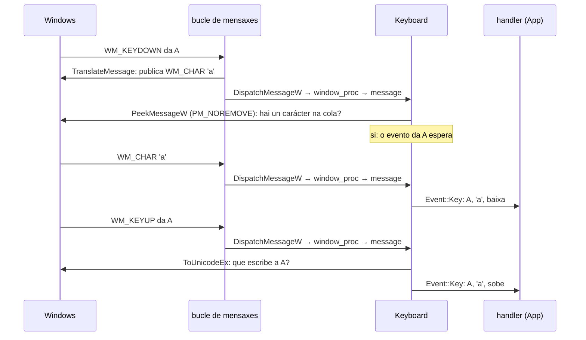
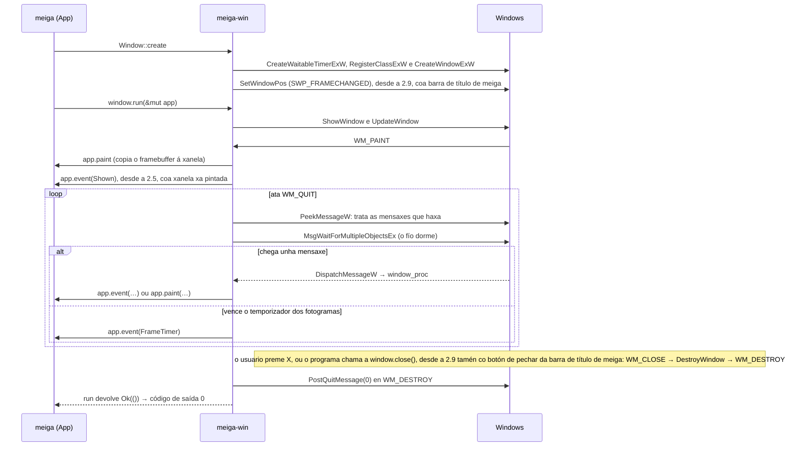
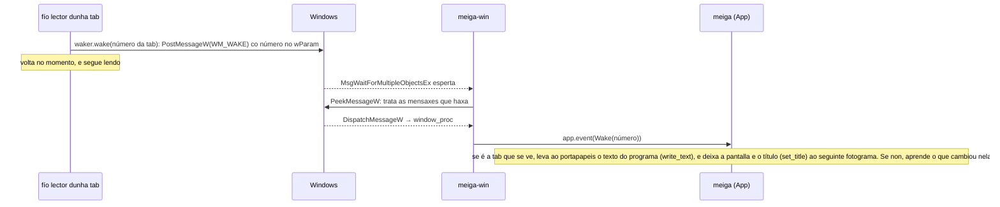
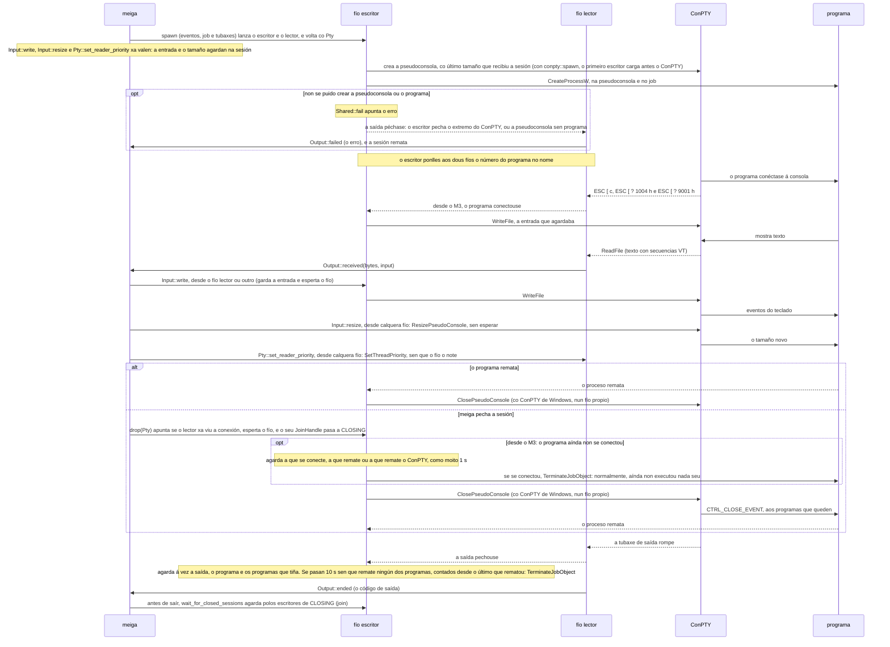

# Código › `meiga-win`

> Estado: subfase 3.3. Contén a xanela, que o programa tamén pode pechar, minimizar, maximizar e restaurar, coa barra de título de meiga, da que o programa lle di que é cada parte, o bucle de mensaxes co temporizador dos fotogramas, os eventos que recibe o programa, entre eles o de que a xanela xa está na pantalla e pintada e o dun botón que baixa onde manexa o rato Windows, o teclado, que converte as mensaxes das teclas en eventos coma os da consola, o rato, cos seus tres botóns, a roda, as teclas modificadoras, a súa captura, a forma do punteiro e o aviso de cando sae da xanela, o DPI da xanela, tamén cando cambia, e o seu título, se está en primeiro plano, o aviso que a esperta desde outro fío, cun número que di quen avisa, os axustes do cursor e do rato de Windows, a caixa de mensaxe que pregunta antes de pegar e a que só avisa, o portapapeis, as sesións de ConPTY, que crea o seu fío escritor, co cartafol e o contorno do seu programa, ás que se lles pode cambiar o tamaño e a prioridade do fío lector, tamén mentres se crean, e a lista das sesións pechadas, polas que agarda un proceso antes de saír, cun exemplo que as mostra e as grava, as shells instaladas, que atopa sen lanzar ningún proceso, o contorno de meiga e o cartafol do sistema, o tipo dos erros de Windows e un exemplo que proba na consola o campo de texto de `meiga-core`. Na 2.3 e na 2.4 non cambiou o código. Na 2.5 chegaron `profiles.rs`, coas shells instaladas, o contorno de meiga e o cartafol do sistema; `Command`, co que unha sesión recibe tamén o cartafol onde empeza o seu programa e o seu contorno; `Event::Shown`, o aviso de que a xanela xa está na pantalla e pintada; e `Window::alert`, a caixa de mensaxe que só avisa. Na 2.6, na 2.7 e na 2.8 non cambiou o código. No M2, o fío escritor dunha sesión pechada ve rematar cada un dos programas que tiña, e unha sesión bloqueada remata 10 s despois do último deles, e non 10 ou 20 s despois de pecharse; o `Pty` garda o seu fío escritor e, ao pecharse a sesión, pásao á lista `CLOSING`, pola que agarda `wait_for_closed_sessions`: meiga chámaa antes de saír, e o exemplo `conpty` tamén; co ConPTY de Windows, o escritor pecha a pseudoconsola nun fío propio, que ninguén agarda, porque antes de Windows 11 24H2 ese peche agarda a que remate o ConPTY, cunha proba unitaria; e chegaron dúas probas de integración, que lanzan coma axudante o propio programa das probas. Na 2.9, a xanela quita a barra de título de Windows, e o programa dille que é cada parte da súa barra de tabs, que é a barra de título, para que ela llo diga a Windows ([ADR 0027](../adr/0027-a-barra-de-tabs-coma-barra-de-titulo.md)): os botóns da xanela, que debuxa o programa, minimizan, maximizan ou restauran e pechan coma os de Windows; o botón dereito nas partes libres da barra abre o menú da xanela, e Alt+Espazo ábreo debaixo da barra; a banda enriba das tabs redimensiona a xanela restaurada; a xanela maximizada deixa sitio para a barra de tarefas que se oculta, e a máis pequena ten sitio para a barra máis estreita; e o aviso da saída do punteiro chega cando sae da xanela, e non cando pasa a unha parte da barra que non é área cliente para Windows. Chegaron catro probas unitarias, dúas en `event.rs` e dúas en `window.rs`. Na 2.10 non cambiou o código. No M3, o fío escritor de cada sesión crea a pseudoconsola e o programa, e `spawn` volta no momento, sen agardar por Windows ([ADR 0028](../adr/0028-as-sesions-fora-do-fio-da-xanela.md)): mentres tanto, a sesión garda a entrada e o tamaño, e o fío lector xa está, coa súa prioridade; un programa que non arranca dío o lector, co método novo `Output::failed`; a función nova `conpty::spawn`, a que usa meiga, usa o ConPTY que está ao lado do executábel, que carga unha vez o primeiro escritor; os fíos reciben o número do programa no seu nome cando este arranca, e `Pty::process_id` é opcional; e chegaron vinte probas unitarias en `conpty.rs`, a maioría con ConPTY falsos, e oito de integración. Na 3.1 non cambiou o código do crate: chegou unha proba de integración, que comproba que o ConPTY empaquetado lle pasa ao terminal sen cambios as secuencias do título dun programa e o reinicio da pantalla, cun programa axudante novo, `titler` ([ADR 0029](../adr/0029-o-titulo-da-tab-e-os-titulos-gardados.md)). Na 3.2 non cambiou o código do crate: chegou un exemplo, `field`, que proba a man na consola o campo de texto de `meiga-core` ([ADR 0030](../adr/0030-o-campo-de-texto.md)), coas teclas que dá a consola, que son as que recibe meiga, e co portapapeis de Windows, a través dunha xanela do crate que nunca se mostra. Na 3.3, a xanela dálle ao programa un evento novo, `Event::FrameMouseDown`, cando un botón do rato baixa onde manexa o rato Windows, tamén cun dobre clic: coa barra de título de meiga, nas partes libres da barra, na banda ou no marco; e sen ela, na barra de título ou no marco de Windows. Chega antes de que Windows mova, redimensione, maximice ou restaure a xanela, e meiga pecha así o seu menú, se está aberto, e garda o nome dunha tab que se está a editar ([ADR 0031](../adr/0031-o-nome-das-tabs.md), decisión 5). Compróbano a proba da barra de título de meiga e unha proba nova, cunha xanela sen ela: o crate ten 52 probas unitarias.

**Responsabilidade:** a capa de plataforma. Envolve todo o que é específico de Windows: ConPTY, a detección das shells instaladas e o contorno dos seus programas, o sistema de arquivos, o portapapeis, a xanela Win32 e a xestión do DPI. Ver [Arquitectura](../arquitectura.md#2-estrutura-do-código-un-workspace-con-catro-crates).

| Arquivo | Contido |
|---|---|
| [`Cargo.toml`](#cratesmeiga-wincargotoml) | As dependencias: `meiga-core` e `windows-sys`. |
| [`src/lib.rs`](#cratesmeiga-winsrclibrs) | A raíz do crate: os módulos, os tipos que se publican e a conversión dos textos a UTF-16. |
| [`src/error.rs`](#cratesmeiga-winsrcerrorrs) | `Error`: unha chamada a Windows que fallou, e o erro que deu. |
| [`src/event.rs`](#cratesmeiga-winsrceventrs) | Os eventos da xanela, tamén os do rato, o cambio de escala e o aviso de que a xanela xa está pintada, e o *trait* `Handler`, que os recibe. Desde a subfase 2.9, tamén as mensaxes do rato no marco da xanela. Desde a 3.3, o evento dun botón que baixa onde manexa o rato Windows. |
| [`src/keyboard.rs`](#cratesmeiga-winsrckeyboardrs) | O teclado da xanela: as mensaxes das teclas e dos seus caracteres, xuntas en eventos de tecla, e as que son para Windows. |
| [`src/window.rs`](#cratesmeiga-winsrcwindowrs) | A xanela, o seu DPI, tamén cando cambia, o seu título e o seu peche desde o programa, o bucle de mensaxes, o temporizador dos fotogramas, o `Waker` que a esperta desde outro fío cun número, a captura do rato, a forma do punteiro e o aviso de cando sae da xanela, se está en primeiro plano, os axustes do cursor e do rato de Windows, a caixa de mensaxe que pregunta, a que só avisa e a mensaxe de erro. Desde a subfase 2.9, a barra de título de meiga: o marco propio, o que é cada parte da barra para Windows, os botóns e o menú da xanela, a xanela máis pequena e a barra de tarefas que se oculta. Desde a 3.3, o aviso dos botóns que baixan onde manexa o rato Windows, antes de que actúe. |
| [`src/clipboard.rs`](#cratesmeiga-winsrcclipboardrs) | O portapapeis de Windows: ler e escribir texto. |
| [`src/conpty.rs`](#cratesmeiga-winsrcconptyrs) | As sesións: un programa nunha pseudoconsola, co cartafol onde empeza e o seu contorno, cos seus fíos lector e escritor, a prioridade do lector, que se pode cambiar mentres a sesión corre, e a súa entrada, que se pode usar desde calquera fío, tamén para cambiar o tamaño da pseudoconsola. Desde o mantemento M2, tamén a espera polas sesións pechadas, que fai un proceso antes de saír. Desde o mantemento M3, o fío escritor crea a pseudoconsola e o programa, e a sesión recibe mentres tanto a entrada, o tamaño e a prioridade; un programa que non arranca dío o `Output`; e `spawn`, sen `Conpty`, usa o ConPTY que está ao lado do executábel, que carga o primeiro escritor. |
| [`src/profiles.rs`](#cratesmeiga-winsrcprofilesrs) | As shells instaladas, atopadas sen lanzar ningún proceso, nos cartafoles onde as deixan os seus instaladores e no rexistro de Windows; o contorno de meiga e o cartafol do sistema. |
| [`tests/conpty.rs`](#cratesmeiga-wintestsconptyrs) | Probas de integración: programas de verdade nos dous ConPTY, tamén nun cartafol e cun contorno; e, desde o M2, unha sesión que tarda en pecharse e un proceso que agarda polas súas sesións antes de saír; e, desde o M3, o que pasa mentres o escritor crea a sesión, os programas que non arrancan, o ConPTY que está ao lado do executábel e os erros do empaquetado; e, desde a 3.1, as secuencias do título e o reinicio da pantalla, que o ConPTY empaquetado pasa sen cambios. |
| [`tests/profiles.rs`](#cratesmeiga-wintestsprofilesrs) | Probas de integración: as shells do equipo onde corren e o contorno do programa da proba. |
| [`examples/conpty.rs`](#cratesmeiga-winexamplesconptyrs) | Un programa de consola que mostra o que escribe un programa nunha pseudoconsola, e envíalle o que se teclea. Desde o M2, se pecha a sesión, agarda a que remate antes de saír. Desde o M3, se o programa non arranca, dío e sae co código 2. |
| [`examples/field.rs`](#cratesmeiga-winexamplesfieldrs) | Desde a subfase 3.2, un programa de consola que proba a man o campo de texto de `meiga-core`: móstrao nunha liña, coas teclas da consola, que son as que recibe meiga, e copia e pega co portapapeis de Windows. |

Os conceptos de Win32 (xanelas, clases, mensaxes, bucle de mensaxes) explícanse en [Tecnoloxías › Xanelas Win32](../tecnoloxias.md#22-xanelas-win32-e-o-bucle-de-mensaxes); os temporizadores, en [Tecnoloxías › Temporizadores](../tecnoloxias.md#26-temporizadores-e-a-espera-do-fío-da-interface); os avisos desde outros fíos, en [Tecnoloxías › Avisar á xanela desde outro fío](../tecnoloxias.md#36-avisar-á-xanela-desde-outro-fío-postmessage); o cursor, o foco e o título, en [Tecnoloxías › O cursor de Windows](../tecnoloxias.md#38-o-cursor-de-windows-pestanexo-tempo-e-grosor) e [› O foco e o título](../tecnoloxias.md#39-o-foco-e-o-título-da-xanela); o teclado, en [Tecnoloxías › O teclado en Windows](../tecnoloxias.md#41-o-teclado-en-windows); o rato, en [Tecnoloxías › O rato en Windows](../tecnoloxias.md#44-o-rato-en-windows); o portapapeis e a caixa que pregunta antes de pegar, en [Tecnoloxías › O portapapeis de Windows](../tecnoloxias.md#46-o-portapapeis-de-windows) e [› Pegar no terminal](../tecnoloxias.md#47-pegar-no-terminal-o-filtro-e-o-bracketed-paste); o cambio de escala e a saída do punteiro, en [Tecnoloxías › A escala cambia](../tecnoloxias.md#50-a-escala-cambia-wm_dpichanged) e [› O punteiro sae da xanela](../tecnoloxias.md#51-o-punteiro-sae-da-xanela-trackmouseevent); o marco da xanela e a barra de título de meiga, en [Tecnoloxías › O marco da xanela e a barra de título](../tecnoloxias.md#62-o-marco-da-xanela-e-a-barra-de-título); o ConPTY, os procesos e as tubaxes, en [Tecnoloxías › ConPTY](../tecnoloxias.md#31-conpty-a-pseudoconsola-de-windows) e [Tecnoloxías › Procesos, tubaxes e eventos](../tecnoloxias.md#32-procesos-tubaxes-e-eventos), e o cambio do tamaño dunha pseudoconsola, en [Tecnoloxías › Cambiar o tamaño do ConPTY](../tecnoloxias.md#48-cambiar-o-tamaño-do-conpty-o-seu-reflow-e-a-pregunta-polo-cursor); a prioridade dos fíos, en [Tecnoloxías › A prioridade dos fíos](../tecnoloxias.md#54-a-prioridade-dos-fíos-setthreadpriority); a creación das sesións fóra do fío da xanela, e os nomes dos fíos, en [Tecnoloxías › Crear os procesos fóra do fío da interface](../tecnoloxias.md#63-crear-os-procesos-fóra-do-fío-da-interface); o que fai o ConPTY cos títulos dun programa, que comproba unha proba de integración, en [Tecnoloxías › Os títulos da tab](../tecnoloxias.md#65-os-títulos-da-tab); os eventos de tecla da consola, que le o exemplo `field`, en [Tecnoloxías › As teclas no terminal](../tecnoloxias.md#42-as-teclas-no-terminal-win32-input-mode-e-vt), e os grafemas e as palabras do campo de texto que proba, en [Tecnoloxías › Os grafemas e as palabras dun campo de texto](../tecnoloxias.md#66-os-grafemas-e-as-palabras-dun-campo-de-texto); e as shells instaladas, o rexistro de Windows e o contorno e o cartafol dos programas, en [Tecnoloxías › Os perfís e a configuración](../tecnoloxias.md#57-os-perfís-e-a-configuración-toml-o-contorno-e-as-shells-de-windows). O camiño dun clic, da xanela á selección, ao portapapeis ou ao programa, está en [Arquitectura › O rato, a selección e o portapapeis](../arquitectura.md#o-rato-a-selección-e-o-portapapeis); o dun cambio de tamaño, da xanela ao ConPTY, en [Arquitectura › O historial, o tamaño e o zoom](../arquitectura.md#o-historial-o-tamaño-e-o-zoom); e o dun perfil, do arquivo de configuración e das shells instaladas á sesión dunha tab, en [Arquitectura › Os perfís e a configuración](../arquitectura.md#os-perfís-e-a-configuración); e o da barra de título de meiga, do programa a Windows, en [Arquitectura › As tabs na barra de título](../arquitectura.md#as-tabs-na-barra-de-título); e o do campo de texto, en [Arquitectura › O campo de texto](../arquitectura.md#o-campo-de-texto). As tabs, cada unha coa súa sesión, e o que fan as que non se ven, coa prioridade do seu fío lector máis baixa, decídense no [ADR 0019](../adr/0019-varias-sesions-e-tabs-en-segundo-plano.md); e os perfís, coas shells que atopa meiga e o contorno e o cartafol dos seus programas, no [ADR 0022](../adr/0022-os-perfis-e-a-configuracion.md); e a barra de tabs coma barra de título, no [ADR 0027](../adr/0027-a-barra-de-tabs-coma-barra-de-titulo.md); e as sesións que crea o seu fío escritor, fóra do fío da xanela, no [ADR 0028](../adr/0028-as-sesions-fora-do-fio-da-xanela.md); e o campo de texto, que proba o exemplo `field`, no [ADR 0030](../adr/0030-o-campo-de-texto.md).

O crate ten 52 probas unitarias nos arquivos de `src/`, unha delas nova na 3.3, en `window.rs` (51 desde o M3, que trouxo vinte, en `conpty.rs`; 31 na 2.9, que trouxo catro, dúas en `event.rs` e dúas en `window.rs`; 27 no M2, que trouxo unha en `conpty.rs`; 26 na 2.5, que trouxo unha en `conpty.rs` e dúas en `profiles.rs`; e 23 na 2.4, as mesmas ca na subfase 1.9), e 25 de integración: as 23 de [`tests/conpty.rs`](#cratesmeiga-wintestsconptyrs) (22 no M3, 14 ata a 2.10, 12 ata a 2.8, 10 na 2.4 e 9 na 1.9) e as 2 de [`tests/profiles.rs`](#cratesmeiga-wintestsprofilesrs), novas na 2.5. `cargo test -p meiga-win` córreas todas. Desde o M2, `tests/conpty.rs` ten ademais `helper`, unha proba ignorada que non comproba nada: é a entrada dos programas axudantes das outras, e Cargo non a corre: cóntaa á parte (`23 passed; 1 ignored`). A 3.2 non trouxo ningunha proba: o seu exemplo, [`field`](#cratesmeiga-winexamplesfieldrs), próbase a man. A 3.3 trouxo unha, en `window.rs`, que comproba o evento novo, `FrameMouseDown`, nunha xanela sen a barra de título de meiga; a proba da barra de título de meiga compróbao tamén ([Probas](#probas-1)). `cargo test` compila tamén os dous exemplos, sen correlos, e a CI revísaos con Clippy (`--all-targets`).

## `crates/meiga-win/Cargo.toml`

```toml
[package]
name = "meiga-win"
description = "Windows platform layer of meiga: ConPTY, shell profiles, file system, clipboard and Win32 windowing."
version.workspace = true
edition.workspace = true
rust-version.workspace = true
license.workspace = true
repository.workspace = true
publish.workspace = true

[dependencies]
meiga-core.workspace = true
windows-sys = { workspace = true, features = [
    "Win32_Foundation",
    "Win32_Graphics_Gdi",
    # CreateWaitableTimerExW, CreatePipe, CreateEventW, CreateJobObjectW and
    # CreateProcessW take SECURITY_ATTRIBUTES.
    "Win32_Security",
    # ReadFile and WriteFile, which take an OVERLAPPED of Win32_System_IO.
    "Win32_Storage_FileSystem",
    # The pseudoconsole functions of kernel32: CreatePseudoConsole,
    # ResizePseudoConsole and ClosePseudoConsole.
    "Win32_System_Console",
    # The clipboard, and the global memory of its data.
    "Win32_System_DataExchange",
    # The environment of meiga, which the programs of the tabs get with a few
    # changes.
    "Win32_System_Environment",
    "Win32_System_IO",
    # The job of the programs of each pseudoconsole.
    "Win32_System_JobObjects",
    "Win32_System_LibraryLoader",
    "Win32_System_Memory",
    "Win32_System_Pipes",
    # The registry, where WSL keeps its distributions and Git for Windows its
    # folder.
    "Win32_System_Registry",
    # GetSystemDirectoryW: the folder of cmd.exe, wsl.exe and Windows
    # PowerShell.
    "Win32_System_SystemInformation",
    "Win32_System_Threading",
    "Win32_UI_HiDpi",
    "Win32_UI_Input_KeyboardAndMouse",
    "Win32_UI_WindowsAndMessaging",
] }

[lints]
workspace = true
```

Os metadatos e as regras de calidade son os comúns, como en [`meiga-render`](meiga-render.md#cratesmeiga-rendercargotoml). A dependencia principal é `windows-sys`, as declaracións das APIs de Windows para Rust ([Tecnoloxías › windows-sys](../tecnoloxias.md#21-windows-sys-as-apis-de-windows-desde-rust)):

- `workspace = true`: a versión vén do `Cargo.toml` raíz ([Código › workspace](workspace.md#cargotoml-raíz)), así que todos os crates que a usen terán a mesma.
- `features`: `windows-sys` divide as APIs nos mesmos espazos de nomes que usa a documentación de Microsoft, e cada *feature* activa un deles. Só se compila o que se activa:

| *Feature* | Que trae | Que se usa |
|---|---|---|
| `Win32_Foundation` | Os tipos básicos. | `HWND`, `HANDLE`, `RECT`, `WPARAM`, `LPARAM`, `LRESULT`, `FALSE`, `TRUE`, `CloseHandle` e os resultados das esperas (`WAIT_OBJECT_0`, `WAIT_TIMEOUT` e `WAIT_FAILED`). Desde a subfase 1.8, tamén `POINT`, para o punto da roda, e a memoria global do portapapeis: o seu tipo, `HGLOBAL`, e `GlobalFree`. Desde a 2.5, `ERROR_SUCCESS` e `ERROR_MORE_DATA`, dous dos resultados das funcións do rexistro. Desde o mantemento M2, `TRUE` só o usan as probas de integración: [`wait_for_end`](#a-espera-do-fin-wait_for_end) xa non agarda por todos os obxectos á vez. Desde a 2.9, `ERROR_CLASS_ALREADY_EXISTS`, o erro de `RegisterClassExW` cunha clase xa rexistrada ([`create`](#windowcreate)). Desde o mantemento M3, nas probas unitarias de `conpty.rs`, `LocalFree`, que libera o nome dun fío que dá `GetThreadDescription`. |
| `Win32_Graphics_Gdi` | GDI, a API clásica de debuxo. | `BeginPaint`, `EndPaint`, `InvalidateRect`, `ValidateRect` e `UpdateWindow`. Desde a 1.8, tamén `ScreenToClient`, que pasa o punto da roda á área cliente. Desde a 2.9, `MonitorFromRect`, `GetMonitorInfoW`, `MONITORINFO` e `MONITOR_DEFAULTTONEAREST`, o monitor da xanela maximizada ([a barra de tarefas que se oculta](#a-barra-de-tarefas-que-se-oculta-appbardata-app_bar_message-e-leave_room_for_hidden_taskbars)); e `ClientToScreen`, que pasa un punto da área cliente á pantalla, para o menú que abre Alt+Espazo ([`screen_point`](#o-menú-co-teclado-keyboard_menu-screen_point-e-is_alt_space)) e nas probas. |
| `Win32_Security` | A seguridade dos obxectos de Windows. | Nada directamente: `CreateWaitableTimerExW`, `CreatePipe`, `CreateEventW`, `CreateJobObjectW` e `CreateProcessW` reciben uns `SECURITY_ATTRIBUTES`, e `windows-sys` só declara cada función se existen os tipos que usa. Por iso vai co comentario. |
| `Win32_Storage_FileSystem` | Os arquivos e o que se le e escribe coma eles. | `ReadFile` e `WriteFile`, para as tubaxes, desde a subfase 1.4; e, desde a 2.5, `GetFileAttributesW`, `INVALID_FILE_ATTRIBUTES` e `FILE_ATTRIBUTE_DIRECTORY`, que din se un programa existe ([`is_file`](#is_file)). |
| `Win32_System_Console` | A consola. | `CreatePseudoConsole`, `ClosePseudoConsole`, `HPCON` e `COORD`, desde a 1.4, e `ResizePseudoConsole`, desde a 1.9. Desde o M2, nas probas de integración, `SetConsoleCtrlHandler` e `CTRL_CLOSE_EVENT`, cos que os programas axudantes atenden o peche da súa consola. Desde a 3.1, tamén nas probas de integración, `GetStdHandle`, `STD_OUTPUT_HANDLE`, `GetConsoleMode`, `SetConsoleMode`, `ENABLE_PROCESSED_OUTPUT` e `ENABLE_VIRTUAL_TERMINAL_PROCESSING`, cos que o axudante `titler` activa na súa consola o procesamento das secuencias de control. Desde a 3.2, no exemplo [`field`](#cratesmeiga-winexamplesfieldrs): a entrada da consola, con `STD_INPUT_HANDLE`, `ReadConsoleInputW`, `INPUT_RECORD`, `KEY_EVENT` e `KEY_EVENT_RECORD`; os modos que quita da entrada, `ENABLE_PROCESSED_INPUT`, `ENABLE_LINE_INPUT`, `ENABLE_ECHO_INPUT` e `ENABLE_VIRTUAL_TERMINAL_INPUT`, co seu tipo, `CONSOLE_MODE`; o ancho da consola, con `GetConsoleScreenBufferInfo` e `CONSOLE_SCREEN_BUFFER_INFO`; e, coma o `titler`, `GetStdHandle`, `STD_OUTPUT_HANDLE`, `GetConsoleMode`, `SetConsoleMode` e `ENABLE_VIRTUAL_TERMINAL_PROCESSING`. |
| `Win32_System_DataExchange` | O intercambio de datos entre programas, coma o portapapeis. | `OpenClipboard`, `CloseClipboard`, `EmptyClipboard`, `GetClipboardData` e `SetClipboardData`, desde a subfase 1.8. |
| `Win32_System_Environment` | As variábeis de contorno. | `GetEnvironmentStringsW` e `FreeEnvironmentStringsW`, desde a subfase 2.5: o bloque co contorno de meiga ([`environment`](#environment)). |
| `Win32_System_IO` | A E/S solapada. | Nada directamente: `ReadFile` e `WriteFile` reciben un `OVERLAPPED`, que meiga pasa nulo. O comentario de `Win32_Storage_FileSystem` explícao. |
| `Win32_System_JobObjects` | Os *jobs*, que agrupan procesos. | `CreateJobObjectW`, `SetInformationJobObject`, `JOBOBJECT_EXTENDED_LIMIT_INFORMATION`, `JOB_OBJECT_LIMIT_BREAKAWAY_OK`, `QueryInformationJobObject`, `JOBOBJECT_BASIC_PROCESS_ID_LIST` e `TerminateJobObject`, desde a 1.4. Desde o M2, nas probas de integración, tamén `AssignProcessToJobObject`, `JOB_OBJECT_LIMIT_KILL_ON_JOB_CLOSE`, `JobObjectBasicAccountingInformation` e `JOBOBJECT_BASIC_ACCOUNTING_INFORMATION`: o *job* dunha proba, que conta os seus programas e remata os que queden. |
| `Win32_System_LibraryLoader` | A carga de DLL e módulos. | `GetModuleHandleW` e, desde a 1.4, `LoadLibraryExW`, `GetProcAddress` e as opcións da busca das DLL. Desde a 2.9, tamén para `shell32.dll` ([`app_bar_message`](#a-barra-de-tarefas-que-se-oculta-appbardata-app_bar_message-e-leave_room_for_hidden_taskbars)). |
| `Win32_System_Memory` | A memoria: a global, a virtual, os *heaps*… | `GlobalAlloc`, `GlobalLock`, `GlobalSize`, `GlobalUnlock` e `GMEM_MOVEABLE`, desde a 1.8: a memoria onde vai o texto do portapapeis. |
| `Win32_System_Pipes` | As tubaxes. | `CreatePipe`, desde a 1.4. |
| `Win32_System_Registry` | O rexistro de Windows. | Desde a subfase 2.5, `RegOpenKeyExW`, `RegEnumKeyExW`, `RegGetValueW` e `RegCloseKey`, co tipo das chaves, `HKEY`, as dúas raíces que le meiga, `HKEY_CURRENT_USER` e `HKEY_LOCAL_MACHINE`, o dereito `KEY_ENUMERATE_SUB_KEYS` e as opcións `RRF_RT_REG_SZ` e `RRF_RT_REG_DWORD`, que din que tipo de valor se le: as distribucións de WSL e o cartafol de Git for Windows ([`profiles.rs`](#cratesmeiga-winsrcprofilesrs)). |
| `Win32_System_SystemInformation` | A información do sistema: a súa versión, o hardware, os seus cartafoles… | `GetSystemDirectoryW`, desde a 2.5: o cartafol do sistema ([`system_folder`](#system_folder)). |
| `Win32_System_Threading` | Fíos, procesos e obxectos de sincronización. | O temporizador: `CreateWaitableTimerExW`, `SetWaitableTimer`, `CancelWaitableTimer` e `INFINITE`. Desde a 1.4, tamén os procesos e os eventos: `CreateProcessW`, `STARTUPINFOEXW`, a lista de atributos e os seus dous atributos, `OpenProcess` e `PROCESS_SYNCHRONIZE`, `CreateEventW`, `SetEvent`, as esperas e `GetExitCodeProcess`. A estrutura dos límites estendidos dos *jobs* tamén a necesita, porque leva uns `IO_COUNTERS`. Desde a 2.2, a prioridade dos fíos: `SetThreadPriority`, o tipo `THREAD_PRIORITY` e as dúas prioridades que usa meiga, `THREAD_PRIORITY_NORMAL` e `THREAD_PRIORITY_BELOW_NORMAL`, coas que cambia a do fío lector dunha sesión; e, nas probas de integración, `GetCurrentThread` e `GetThreadPriority`, coas que a le. Desde a 2.5, `CREATE_UNICODE_ENVIRONMENT`, a opción de `CreateProcessW` para un bloque do contorno en UTF-16. Desde o M3, os nomes dos fíos: `SetThreadDescription`, co que o escritor dunha sesión lles pon aos seus dous fíos o número do programa, e `GetCurrentThread`, co que un fío se nomea a si mesmo ([os nomes dos fíos](#os-nomes-dos-fíos-keep_reader-started-name_thread-e-name_reader)); nas probas unitarias, `GetThreadDescription`, que le o nome dun fío; e, nas probas de integración, `OpenProcess`, `PROCESS_QUERY_LIMITED_INFORMATION`, `QueryFullProcessImageNameW` e `PROCESS_NAME_WIN32`, cos que `image_name` le o nome do programa dun proceso. |
| `Win32_UI_HiDpi` | A escala e o DPI. | `GetDpiForWindow`, desde a subfase 1.3. Desde a 2.9, `GetSystemMetricsForDpi`, o marco de Windows a un DPI ([`frame`](#window_dpi-e-frame)). |
| `Win32_UI_Input_KeyboardAndMouse` | O teclado e o rato. | `SetCapture`, `GetCapture` e `ReleaseCapture`, que capturan o rato; desde a subfase 1.7, o teclado: `GetKeyboardState`, `ToUnicodeEx`, `GetKeyboardLayout`, `MapVirtualKeyW` e os códigos de tecla virtual (`VK_…`); desde a 1.8, `GetKeyState`, que di se Alt está premido cos eventos do rato, e `GetDoubleClickTime`; e, desde a 1.9, `TrackMouseEvent`, coa súa estrutura, `TRACKMOUSEEVENT`, e `TME_LEAVE`, que piden o aviso de cando o punteiro sae da xanela. Desde a 2.9, `TME_NONCLIENT`, o aviso de cando sae das partes da xanela que non son área cliente ([`track_mouse_leave`](#windowtrack_mouse_leave)), e `VK_SHIFT` e `VK_CONTROL`, coas que a xanela pregunta polas teclas modificadoras nas mensaxes do rato no marco. |
| `Win32_UI_WindowsAndMessaging` | As xanelas, as mensaxes, os temporizadores das xanelas, os cursores e as caixas de mensaxe. | O resto. |

Algunhas constantes defínense no propio código en vez de activar a súa *feature*, que traería milleiros de declaracións por uns poucos números: os bits dos botóns e das teclas modificadoras nas mensaxes do rato (`MK_LBUTTON`…), de `Win32_System_SystemServices` (ver [`event.rs`](#cratesmeiga-winsrceventrs)); desde a subfase 1.8, o formato do texto no portapapeis, `CF_UNICODETEXT`, de `Win32_System_Ole` (ver [`clipboard.rs`](#cratesmeiga-winsrcclipboardrs)); e, desde a 1.9, a mensaxe que chega cando o punteiro sae da xanela, `WM_MOUSELEAVE`, de `Win32_UI_Controls` (ver [`decode`](#decode)); e, desde o M2, os obxectos que agarda como moito `WaitForMultipleObjects`, `MAXIMUM_WAIT_OBJECTS`, tamén de `Win32_System_SystemServices` (ver [`conpty.rs`](#constantes-e-tipos)); e, desde a 2.9, a estrutura `APPBARDATA` e as constantes de `SHAppBarMessage` (`ABM_GETSTATE`…), de `Win32_UI_Shell` (ver [a barra de tarefas que se oculta](#a-barra-de-tarefas-que-se-oculta-appbardata-app_bar_message-e-leave_room_for_hidden_taskbars)). Outra, `WHEEL_PAGE`, o `WHEEL_PAGESCROLL` de Windows, non está en `windows-sys` (ver [`mouse_settings`](#mousesettings-e-mouse_settings)). O tipo `HRESULT` está en `windows_sys::core`, que non necesita ningunha *feature*, coma `BOOL`, que usan desde o M2 as probas de integración, e `PWSTR`, o texto que dá `GetThreadDescription` nas probas unitarias de `conpty.rs`, desde o M3.

A subfase 1.6 non necesitou ningunha *feature* nova: `PostMessageW`, `SetWindowTextW`, `GetCaretBlinkTime`, `SystemParametersInfoW`, `WM_APP` e as mensaxes do foco están todas en `Win32_UI_WindowsAndMessaging`. A 1.7 tampouco: as funcións do teclado están en `Win32_UI_Input_KeyboardAndMouse`, que xa estaba pola captura do rato, e as súas mensaxes (`WM_KEYUP`, `WM_CHAR`…) e `PeekMessageW`, en `Win32_UI_WindowsAndMessaging`. A 1.8 necesitou dúas, para o portapapeis: `Win32_System_DataExchange`, coas súas funcións, e `Win32_System_Memory`, coa memoria global onde vai o texto. O resto xa estaba nas que había: as mensaxes do rato, `WM_SETCURSOR`, `SetCursor`, `GetForegroundWindow`, as medidas do dobre clic e as preferencias da roda (`SM_CXDOUBLECLK`, `SPI_GETWHEELSCROLLLINES`…) e as opcións das caixas de mensaxe, en `Win32_UI_WindowsAndMessaging`; `GetKeyState` e `GetDoubleClickTime`, en `Win32_UI_Input_KeyboardAndMouse`; e `ScreenToClient`, en `Win32_Graphics_Gdi`. A 1.9 non necesitou ningunha: `ResizePseudoConsole` está en `Win32_System_Console`, coas outras funcións das pseudoconsolas; `TrackMouseEvent`, en `Win32_UI_Input_KeyboardAndMouse`, coma a captura do rato; e as funcións que usa a proba do cambio de escala, `SendMessageW` e `GetWindowRect`, en `Win32_UI_WindowsAndMessaging`. A 2.2 tampouco: `SetThreadPriority`, as prioridades dos fíos, `GetCurrentThread` e `GetThreadPriority` están en `Win32_System_Threading`, coas outras funcións dos fíos; e `WM_CLOSE`, a mensaxe coa que o programa pecha a xanela, en `Win32_UI_WindowsAndMessaging`, coas outras mensaxes. A 2.3 e a 2.4 non cambiaron o crate. A 2.5 necesitou tres, coma din os seus comentarios: `Win32_System_Environment`, para o contorno de meiga, que reciben os programas das tabs con poucos cambios; `Win32_System_Registry`, para o rexistro, onde WSL garda as súas distribucións e Git for Windows o seu cartafol; e `Win32_System_SystemInformation`, para `GetSystemDirectoryW`, o cartafol de `cmd.exe`, `wsl.exe` e Windows PowerShell. O resto xa estaba: `GetFileAttributesW`, en `Win32_Storage_FileSystem`, coma `ReadFile`; `ERROR_SUCCESS` e `ERROR_MORE_DATA`, en `Win32_Foundation`; e `CREATE_UNICODE_ENVIRONMENT`, en `Win32_System_Threading`, con `CreateProcessW`. A 2.6, a 2.7 e a 2.8 non cambiaron o crate. O M2 non necesitou ningunha *feature* nova: `WaitForMultipleObjects` xa estaba en `Win32_System_Threading`; e o que usan as súas probas de integración, en `Win32_System_Console`, coas funcións das pseudoconsolas, en `Win32_System_JobObjects`, coas dos *jobs*, e en `Win32_Foundation`. A 2.9 tampouco: as mensaxes do marco, `WM_GETMINMAXINFO`, `WM_SYSCOMMAND`, as respostas de `WM_NCHITTEST`, o menú da xanela e as súas ordes, `SWP_FRAMECHANGED`, `IsZoomed`, `GetCursorPos`, `WindowFromPoint` e `GetWindowRect` están en `Win32_UI_WindowsAndMessaging`; `GetSystemMetricsForDpi`, en `Win32_UI_HiDpi`, con `GetDpiForWindow`; `TME_NONCLIENT`, en `Win32_UI_Input_KeyboardAndMouse`, con `TME_LEAVE`; o monitor da xanela, en `Win32_Graphics_Gdi`; e `ERROR_CLASS_ALREADY_EXISTS`, en `Win32_Foundation`. `Win32_UI_Shell`, a de `SHAppBarMessage`, non: meiga carga a función ela mesma, e define a súa estrutura e as súas constantes. A 2.10 non cambiou o crate. O M3 non necesitou ningunha *feature* nova: `SetThreadDescription`, `GetThreadDescription` e `QueryFullProcessImageNameW` están en `Win32_System_Threading`, coas outras funcións dos fíos e dos procesos; e `LocalFree`, en `Win32_Foundation`. A 3.1 tampouco: o que usa a súa proba de integración para o modo da consola está en `Win32_System_Console`, coas funcións das pseudoconsolas. A 3.2 tampouco: o exemplo `field` usa a consola, en `Win32_System_Console`; a espera coas mensaxes, `MsgWaitForMultipleObjects`, `PeekMessageW` e `DispatchMessageW`, en `Win32_UI_WindowsAndMessaging`, coma o bucle de mensaxes da xanela; `HANDLE` e `WAIT_OBJECT_0`, en `Win32_Foundation`; e `INFINITE`, en `Win32_System_Threading`. A 3.3 tampouco: as mensaxes dos botóns que baixan no marco, que a xanela trata tamén sen a barra de título de meiga (`WM_NCLBUTTONDOWN`…), están en `Win32_UI_WindowsAndMessaging`, coas outras mensaxes do marco.

**As DLL.** Cada función de `windows-sys` di de que DLL vén, e `meiga.exe` importa as DLL das funcións que usa. As do rexistro (`RegOpenKeyExW`, `RegEnumKeyExW`, `RegGetValueW` e `RegCloseKey`) están en `advapi32.dll`, que `meiga.exe` non importaba ata a 2.5; as outras funcións novas, `GetEnvironmentStringsW`, `FreeEnvironmentStringsW`, `GetSystemDirectoryW` e `GetFileAttributesW`, en `kernel32.dll`, coma as dos procesos e as tubaxes. Desde a 2.5, [`check-imports.ps1`](ferramentas.md#toolscheck-importsps1) mostra `meiga.exe imports: kernel32.dll, dwrite.dll, ntdll.dll, oleaut32.dll, combase.dll, api-ms-win-core-synch-l1-2-0.dll, gdi32.dll, user32.dll, advapi32.dll`: todas son do sistema ([Código › meiga](meiga.md#comprobacións-feitas)). A 2.9 non engade ningunha: as súas funcións novas están en `user32.dll`, coma as outras das xanelas, tamén as do monitor e `GetSystemMetricsForDpi`. `SHAppBarMessage` está en `shell32.dll`, que non vai na táboa de importacións: meiga cárgaa mentres corre, só do cartafol do sistema, e só a primeira vez que se maximiza unha xanela ([`app_bar_message`](#a-barra-de-tarefas-que-se-oculta-appbardata-app_bar_message-e-leave_room_for_hidden_taskbars)). `dwmapi.dll` segue sen cargarse: meiga non estende o marco do DWM na área cliente ([ADR 0027](../adr/0027-a-barra-de-tabs-coma-barra-de-titulo.md), decisión 11). O M3 tampouco engade ningunha: `SetThreadDescription` está en `kernel32.dll`, coma as outras funcións dos fíos.

## `crates/meiga-win/src/lib.rs`

```rust
//! Windows platform layer of meiga.
//!
//! Wraps ConPTY, the discovery of the shells and the environment of their
//! programs, the file system, the clipboard, the Win32 window and DPI
//! handling. Every `unsafe` block in this crate must
//! explain why it is sound in a `// SAFETY:` comment.

pub mod clipboard;
pub mod conpty;
mod error;
pub mod event;
mod keyboard;
pub mod profiles;
pub mod window;

pub use error::Error;
// The handles of a window and of a device context, which the binary passes
// from this crate to meiga-render. They are raw pointers: copying them is
// safe, and only the functions of Windows use them.
pub use windows_sys::Win32::Foundation::HWND;
pub use windows_sys::Win32::Graphics::Gdi::HDC;

/// Converts `text` to the null-terminated UTF-16 that the `W` functions of
/// Windows expect.
pub(crate) fn wide(text: &str) -> Vec<u16> {
    text.encode_utf16().chain(Some(0)).collect()
}
```

- A documentación do crate lembra a súa regra principal: este é o lugar con máis código `unsafe` do proxecto, e cada bloque ten que explicar por que é seguro. Clippy compróbao (`undocumented_unsafe_blocks`, ver [Tecnoloxías › *Lints*](../tecnoloxias.md#7-lints-rustc-e-clippy)). Desde a subfase 2.5, di tamén o que fai o crate coas shells: atopalas e preparar o contorno dos seus programas.
- `mod error;` declara o módulo `error` (`src/error.rs`) sen `pub`: é privado.
- `pub use error::Error;` publica o tipo `Error` na raíz do crate. Os outros crates escriben `meiga_win::Error`, e non `meiga_win::error::Error`: o módulo só contén ese tipo, e non achega nada ao nome.
- `pub mod clipboard;`, `pub mod conpty;`, `pub mod event;`, `pub mod profiles;` e `pub mod window;` declaran os cinco módulos públicos: `meiga_win::clipboard::read_text`, `meiga_win::conpty::Conpty`, `meiga_win::event::Event`, `meiga_win::profiles::detect`, `meiga_win::window::Window`. `conpty` existe desde a subfase 1.4; `clipboard`, desde a 1.8; e `profiles`, desde a 2.5. Os seus tipos e funcións non se publican na raíz, coma `Error`: os outros crates nómeanos co seu módulo, coma `meiga_win::conpty::Command`, desde a 2.5 o que corre unha sesión, ou `meiga_win::profiles::environment`.
- `mod keyboard;`, desde a subfase 1.7, é privado coma `error`: só o usa a xanela, e os outros crates reciben as teclas coma eventos.
- **`HWND` e `HDC`.** O programa (`meiga`) recibe destes tipos de `meiga-win` e pásaos a `meiga-render`, que presenta o *framebuffer* na xanela. Publicalos eiquí permite que o programa os nomee sen depender de `windows-sys`. En `windows-sys`, os dous son o mesmo tipo, `*mut c_void`, un punteiro sen tipo: copialos é seguro, e só os usan as funcións de Windows, sempre dentro dos crates que teñen `unsafe`. Por iso o programa segue con `#![forbid(unsafe_code)]`.
- **`wide`.** As funcións de Windows que rematan en `W` (de *wide*) usan textos en UTF-16 rematados nun 0, como en C. Os textos de Rust son UTF-8 e levan a súa lonxitude, sen 0 ao final. `encode_utf16()` dá as unidades UTF-16 do texto, `.chain(Some(0))` engade o 0 ao final e `collect()` xúntaas nun `Vec<u16>`. Quen chama ten que manter o vector vivo mentres Windows usa o punteiro (`as_ptr()`). Ata a subfase 1.3 estaba en `window.rs`; desde a 1.4 está eiquí, porque tamén a usa `conpty.rs`. Con `pub(crate)`, véna todos os módulos do crate, pero non os outros crates.

## `crates/meiga-win/src/error.rs`

```rust
//! Errors from Windows API calls.

use std::{fmt, io};

use windows_sys::core::HRESULT;

/// A Windows API call that failed.
#[derive(Debug)]
pub struct Error {
    function: &'static str,
    os_error: Option<io::Error>,
}

impl Error {
    /// Builds the error of `function` from the last error code of the calling
    /// thread (`GetLastError`), so it must be called right after the failure.
    pub(crate) fn last(function: &'static str) -> Self {
        let error = io::Error::last_os_error();
        // Some functions (GDI, for example) fail without setting an error
        // code, and "The operation completed successfully" would mislead.
        let os_error = (error.raw_os_error() != Some(0)).then_some(error);
        Self { function, os_error }
    }

    /// Builds the error of `function` from `error`.
    pub(crate) fn new(function: &'static str, error: io::Error) -> Self {
        Self {
            function,
            os_error: Some(error),
        }
    }

    /// Builds the error of `function` from the `HRESULT` that it returned.
    pub(crate) fn hresult(function: &'static str, result: HRESULT) -> Self {
        // The HRESULTs of facility 7 (FACILITY_WIN32) carry a Windows error
        // code in their low 16 bits, which has a message of its own.
        let code = result as u32;
        let error = if code & 0xffff_0000 == 0x8007_0000 {
            io::Error::from_raw_os_error((code & 0xffff) as i32)
        } else {
            io::Error::other(format!("HRESULT 0x{code:08X}"))
        };
        Self::new(function, error)
    }

    /// The error that Windows gave, if it gave one: for example, the one of
    /// `CreateProcessW` when the program does not exist, of kind
    /// [`io::ErrorKind::NotFound`].
    pub fn os_error(&self) -> Option<&io::Error> {
        self.os_error.as_ref()
    }
}

impl fmt::Display for Error {
    fn fmt(&self, f: &mut fmt::Formatter<'_>) -> fmt::Result {
        match &self.os_error {
            Some(error) => write!(f, "{} failed: {error}", self.function),
            None => write!(f, "{} failed", self.function),
        }
    }
}

impl std::error::Error for Error {}
```

As funcións de Windows non devolven un `Result`, coma as de Rust. Cada unha indica que fallou á súa maneira (un *handle* nulo, un 0, un -1…) e deixa un **código de erro** nunha variábel de cada fío, que se le con `GetLastError`. `Error` garda que función fallou e ese código.

- `function: &'static str`: o nome da función, por exemplo `"CreateWindowExW"`. `&'static str` é unha referencia a un texto que existe durante todo o programa, como os literais entre comiñas: non hai que copialo nin liberalo.
- `io::Error::last_os_error()`, da biblioteca estándar, le `GetLastError` e devolve un erro de Rust co código e co texto que dá Windows para el (no idioma de Windows), por exemplo `Access is denied. (os error 5)`.
- `pub(crate)`: só este crate pode crear erros. Hai que chamar a `last` xusto despois do fallo, porque calquera outra chamada a Windows pode cambiar o código.
- **O código 0.** Algunhas funcións, como as de GDI, poden fallar sen deixar ningún código. Entón `GetLastError` devolve 0, que significa «The operation completed successfully», e a mensaxe sería contraditoria. Nese caso gárdase `None`:
  - `raw_os_error()` devolve o número do código (`Some(0)` para o 0);
  - `condición.then_some(valor)` devolve `Some(valor)` se a condición é certa e `None` se non.
- `#[derive(Debug)]`: permite mostrar o erro con `{:?}`, como esixe o *trait* `std::error::Error`.
- `Display` é o texto para as persoas, por exemplo `RegisterClassExW failed: Class already exists. (os error 1410)`, ou só `SetTimer failed` se non hai código. É o texto que mostra a mensaxe de erro de meiga.
- `impl std::error::Error for Error {}` converte o tipo nun erro estándar de Rust, que funciona con `?` e con `Box<dyn std::error::Error>`. Non implementa `source()`, que serve para encadear un erro coa súa causa: o texto de Windows xa vai na mensaxe, e repetiríase ao mostrar a cadea de erros.

Desde a subfase 1.4, hai outras dúas maneiras de crear un `Error`, para as sesións de [ConPTY](#cratesmeiga-winsrcconptyrs):

- **`new`**: un erro que non vén de `GetLastError`. Por exemplo, cando non se pode crear un fío (a biblioteca estándar devolve un `io::Error`), ou cando o propio módulo rexeita algo antes de chamar a Windows: un tamaño que non cabe, unha liña de comandos cun carácter nulo ou un arquivo que falta e, desde a subfase 2.5, un cartafol cun carácter nulo ou un bloque do contorno que non remata en dous nulos. O nome é o da función que fallaría, para que a mensaxe diga en que paso foi: `LoadLibraryExW failed: …\conpty.dll does not exist`.
- **`hresult`**: as funcións que crean unha pseudoconsola e, desde a subfase 1.9, as que lle cambian o tamaño non deixan o erro en `GetLastError`, senón que devolven un **`HRESULT`**: un número de 32 bits que, se é negativo, indica un erro. Os 16 bits de abaixo son o código, e os bits 16–26, a *facility*, que di de onde vén o código. Os da *facility* 7 (`FACILITY_WIN32`) levan dentro un código de erro de Windows: `0x80070057` é o erro 87, `ERROR_INVALID_PARAMETER`, que con este formato se chama `E_INVALIDARG`.
  - `result as u32` le os mesmos 32 bits sen signo, onde as máscaras en hexadecimal son máis claras.
  - `code & 0xffff_0000 == 0x8007_0000` comproba que é un erro (o bit 31) da *facility* 7. Para eses, `from_raw_os_error` dá o mesmo texto que daría `GetLastError` co código 87.
  - Os demais móstranse como número: por exemplo, `HRESULT 0x8000FFFF` (`E_UNEXPECTED`).

Desde a subfase 1.6, **`os_error`** deixa ver o erro que garda o `Error`, para que quen o recibe poida decidir segundo a causa, e non só mostrala. Ata a 2.4, o programa usábao ao lanzar a shell: se PowerShell 7 non estaba instalado, `CreateProcessW` non atopaba `pwsh` e fallaba co erro 2, `ERROR_FILE_NOT_FOUND`, que a biblioteca estándar clasifica como `io::ErrorKind::NotFound`; entón meiga probaba con Windows PowerShell ([Tecnoloxías › A liña de comandos](../tecnoloxias.md#40-a-liña-de-comandos-en-windows)). Desde a 2.5, meiga atopa as shells antes de lanzalas, coas súas rutas completas ([`profiles.rs`](#cratesmeiga-winsrcprofilesrs)), e se un programa non arranca, a súa tab mostra o erro ([Código › meiga › `session.rs`](meiga.md#cratesmeigasrcsessionrs)): o programa deixou de usalo. Desde o mantemento M3 úsao outra vez, para mostrar unha segunda liña cando o que non existe é o cartafol do programa, o erro 267, `ERROR_DIRECTORY`, coma o Windows Terminal ([ADR 0028](../adr/0028-as-sesions-fora-do-fio-da-xanela.md), decisión 4). Úsano tamén as probas: as de integración miran o código do erro de `CreateProcessW` cando non existen o programa ou o seu cartafol, e os de `Conpty::bundled` ([`tests/conpty.rs`](#cratesmeiga-wintestsconptyrs)); e as unitarias de `conpty.rs`, o dun ConPTY que non crea a pseudoconsola ([Probas](#probas-2)).

- Ao contrario que os outros métodos, é `pub`: os outros crates poden ler a causa dun erro, pero seguen sen poder crear erros.
- `as_ref()` converte o `&Option<io::Error>` do campo nun `Option<&io::Error>`: dá unha referencia ao erro, sen copialo nin sacalo do `Error`. Tampouco se podería devolver unha copia, porque `io::Error` non implementa `Clone`.
- Devolve `None` cando Windows non deu ningún código (o código 0 de `last`). Cos erros de `new` e `hresult`, devolve o `io::Error` que recibiron, que non sempre vén de Windows: o dun arquivo do ConPTY que falta, por exemplo, tamén é `NotFound`.
- **Un método, e non `source()`.** Con `source()`, o texto de Windows sairía dúas veces ao mostrar a cadea de erros, como se explica arriba. `os_error` dálle a causa só a quen a pide.

**Proba.** `hresults_of_windows_errors_keep_their_error_code`: `0x80070057` dá unha mensaxe que empeza por `CreatePseudoConsole failed: ` e remata en `(os error 87)` (o texto do medio depende do idioma de Windows), e `0x8000FFFF` dá `CreatePseudoConsole failed: HRESULT 0x8000FFFF`.

`meiga-render` ten o seu propio `Error`, igual, para as funcións de GDI (ver [Código › meiga-render](meiga-render.md#cratesmeiga-rendersrcerrorrs)): os dous crates non dependen un do outro.

## `crates/meiga-win/src/event.rs`

O que lle pasa á xanela, traducido das mensaxes de Windows a tipos de Rust, e o *trait* que recibe eses eventos. Este módulo non ten `unsafe` (`#![forbid(unsafe_code)]`): só le números. Desde a subfase 1.6 define tamén [`WM_WAKE`](#wm_wake), a mensaxe coa que outro fío esperta a xanela, que desde a 2.2 leva un número; desde a 1.8, os eventos do rato teñen os tres botóns, a roda e as teclas modificadoras ([Tecnoloxías › O rato en Windows](../tecnoloxias.md#44-o-rato-en-windows)); e desde a 1.9, hai dous eventos máis: o cambio de escala, que chega antes ca o tamaño novo da xanela ([Tecnoloxías › A escala cambia](../tecnoloxias.md#50-a-escala-cambia-wm_dpichanged)), e a saída do punteiro ([Tecnoloxías › O punteiro sae da xanela](../tecnoloxias.md#51-o-punteiro-sae-da-xanela-trackmouseevent)); e desde a 2.5, outro, `Shown`, cando a xanela xa está na pantalla e pintada. Desde a 2.9, coa barra de título de meiga, este módulo traduce tamén as mensaxes do rato no marco da xanela ([`decode_nonclient`](#nonclient-decode_nonclient-e-point)), mentres que a saída do punteiro xa non a traduce `decode`, senón que a trata a xanela ([ADR 0027](../adr/0027-a-barra-de-tabs-coma-barra-de-titulo.md)). Desde a 3.3, hai outro evento, `FrameMouseDown`: un botón baixou onde manexa o rato Windows, coa barra de título de meiga ou sen ela, e Windows actúa cando volta o *handler* ([ADR 0031](../adr/0031-o-nome-das-tabs.md), decisión 5).

### `Handler`

```rust
/// An error from the code that handles the events. It ends the message loop.
pub type HandlerError = Box<dyn StdError>;

pub trait Handler {
    /// Something happened in the window.
    fn event(&mut self, window: &Window, event: Event) -> Result<(), HandlerError>;

    /// Windows asks to paint `area` of the window in `dc`, for example
    /// because it is shown for the first time or because it grew.
    fn paint(&mut self, window: &Window, dc: HDC, area: Rect) -> Result<(), HandlerError>;
}
```

- Un ***trait*** é un conxunto de funcións que un tipo pode implementar, como unha interface. `meiga-win` non sabe que fai o programa: só sabe chamar a quen implemente `Handler`. No programa implementao `App` (ver [Código › meiga](meiga.md#cratesmeigasrcapprs)).
- `&mut self`: o *handler* pode cambiar o seu estado en cada evento. `&Window`: recibe tamén a xanela, para pedirlle cousas (un temporizador, cambiar o título, capturar o rato…).
- `HandlerError` é un **alias**, outro nome para un tipo: `Box<dyn StdError>`, calquera erro nunha caixa. `dyn StdError` significa «un valor de calquera tipo que implemente `std::error::Error`», e a caixa (`Box`) gárdao na memoria dinámica, porque cada tipo de erro ten un tamaño distinto. Así, o *handler* pode devolver erros de `meiga-win`, de `meiga-render` ou de entrada e saída, e `?` convérteos solos.
- **Unha regra importante**, na documentación do *trait*: o *handler* non pode chamar a funcións que envían unha mensaxe á xanela e agardan a resposta, como `SetWindowPos`. A xanela chamaría ao *handler* de novo antes de que remate a primeira chamada, e Rust non permite dúas referencias `&mut` ao mesmo valor á vez; ese evento perderíase (ver [`State`](#state-e-installed-o-handler-dentro-do-window-procedure)). [`set_title`](#windowset_title) si se pode chamar, porque a mensaxe que envía non chega ao *handler*; e, desde a subfase 2.2, [`close`](#windowclose), que publica a súa mensaxe e non agarda, coma desde a 2.9 [`minimize` e `toggle_maximize`](#windowminimize-windowtoggle_maximize-e-command); e [`set_title_bar`](#windowset_title_bar), que só garda a barra. Desde a subfase 1.8, o programa chama a algunhas que si perden eventos, sabéndoo: [`release_mouse`](#a-captura-do-rato-e-o-repintado), cuxo aviso non lle fai falta, e a caixa de [`confirm`](#windowconfirm) e, desde a 2.5, a de [`alert`](#windowalert), despois das que compensa o que se perdeu.

### `Event` e `mouse::Button`

```rust
use meiga_core::mouse::{Button, Modifiers};
…
pub enum Event {
    Resized { size: Size, minimized: bool },
    DpiChanged { dpi: u32 },
    SizeMoveStarted,
    SizeMoveEnded,
    MouseDown {
        button: Button,
        at: Point,
        modifiers: Modifiers,
    },
    MouseUp {
        button: Button,
        at: Point,
        modifiers: Modifiers,
    },
    MouseMoved {
        at: Point,
        button: Option<Button>,
        modifiers: Modifiers,
    },
    Wheel {
        at: Point,
        delta: i16,
        horizontal: bool,
        modifiers: Modifiers,
    },
    CaptureLost,
    MouseLeft,
    FrameMouseDown,
    Key(KeyEvent),
    Focus { focused: bool },
    FrameTimer,
    Wake(u64),
    Shown,
}
```

Un `enum` de Rust é un tipo que pode ser **unha** de varias variantes, e cada variante pode levar os seus propios datos. As coordenadas son píxeles desde a esquina superior esquerda da área cliente, a parte da xanela que debuxa meiga.

| Evento | Mensaxe de Windows | Cando |
|---|---|---|
| `Resized` | `WM_SIZE` | A área cliente cambiou de tamaño, ou a xanela se minimizou ou se restaurou. Unha xanela minimizada ten tamaño 0 × 0. |
| `DpiChanged` | `WM_DPICHANGED` | Desde a subfase 1.9. A xanela pasou a un monitor con outra escala, ou cambiou a escala do seu monitor: ten `dpi` puntos por polgada. O seu tamaño novo, se cambia, chega xusto despois, con `Resized`. |
| `SizeMoveStarted` e `SizeMoveEnded` | `WM_ENTERSIZEMOVE` e `WM_EXITSIZEMOVE` | O usuario empeza e remata de mover ou redimensionar a xanela. Entre os dous, Windows executa o seu propio bucle de mensaxes (ver [os bucles modais](#os-bucles-modais-de-windows)). |
| `MouseDown` e `MouseUp` | `WM_LBUTTONDOWN`, `WM_LBUTTONUP`, `WM_MBUTTONDOWN`, `WM_MBUTTONUP`, `WM_RBUTTONDOWN` e `WM_RBUTTONUP` | Premer e soltar o botón esquerdo, o do medio ou o dereito, coas teclas modificadoras que estaban premidas. O do medio e as teclas, desde a subfase 1.8. Desde a 2.9, coa barra de título de meiga, tamén os botóns que se premen e se soltan nos botóns da xanela, que chegan coma mensaxes do marco (`WM_NCLBUTTONDOWN`…), co punto na área cliente ([`nonclient_mouse`](#o-rato-no-marco-nonclient_mouse)). Os que baixan onde manexa o rato Windows, coa barra de título de meiga ou sen ela, chegan desde a 3.3 coma `FrameMouseDown`, e os que soben alí non chegan. |
| `MouseMoved` | `WM_MOUSEMOVE` | O rato moveuse, co primeiro botón que está premido, se hai algún. Windows tamén envía `WM_MOUSEMOVE` sen que o rato se mova, por exemplo cando cambia a captura. Desde a subfase 2.9, coa barra de título de meiga, tamén `WM_NCMOUSEMOVE` nas partes da barra que non son área cliente para Windows, sen botón ([`nonclient_mouse`](#o-rato-no-marco-nonclient_mouse)). |
| `Wheel` | `WM_MOUSEWHEEL` e `WM_MOUSEHWHEEL` | Desde a subfase 1.8. A roda xirou, ou inclinouse cara a un lado. |
| `CaptureLost` | `WM_CAPTURECHANGED` | A xanela deixa de recibir todo o rato (ver [`capture_mouse`](#a-captura-do-rato-e-o-repintado)), por exemplo porque outra xanela o colleu. |
| `MouseLeft` | `WM_MOUSELEAVE` e, desde a 2.9, `WM_NCMOUSELEAVE` | Desde a subfase 1.9. O punteiro saíu da área cliente: unha vez despois de cada [`track_mouse_leave`](#windowtrack_mouse_leave). Desde a 2.9, coa barra de título de meiga, cando sae da xanela ou chega ao marco que a redimensiona: pasar da área cliente ás partes libres da barra, á banda ou aos botóns da xanela non é saír ([`mouse_left`](#leave-rearm-e-mouse_left)). Non o dá `decode`, senón a xanela. O marco non é do *handler*, pero desde a 3.3 sabe dos botóns que baixan nel, con `FrameMouseDown`. |
| `FrameMouseDown` | `WM_NCLBUTTONDOWN`, `WM_NCMBUTTONDOWN`, `WM_NCRBUTTONDOWN` e os seus dobres clics (`WM_NCLBUTTONDBLCLK`…) | Desde a subfase 3.3. Un botón do rato baixou onde manexa o rato Windows: coa barra de título de meiga, nas partes libres da barra, fóra dos botóns da xanela, na banda ou no marco ([`nonclient_mouse`](#o-rato-no-marco-nonclient_mouse)); sen ela, en calquera parte da barra de título ou do marco de Windows ([`window_proc`](#window_proc)). Cando volta o *handler*, Windows fai o seu: move ou redimensiona a xanela, ou maximízaa ou restáuraa co dobre clic. Non o dá `decode`, senón a xanela. |
| `Key` | `WM_KEYDOWN`, `WM_KEYUP`, `WM_SYSKEYDOWN`, `WM_SYSKEYUP` e as mensaxes dos caracteres | Desde a subfase 1.7. Unha tecla baixou ou subiu, co carácter que escribe, se escribe algún: un [`KeyEvent`](meiga-core.md#keyevent), coma os da consola de Windows. Non os dá `decode`, senón o [teclado da xanela](#cratesmeiga-winsrckeyboardrs). Alt+F4 e Alt+Espazo nunca chegan coma eventos: van a Windows, que pecha a xanela ou lle pide o seu menú; desde a subfase 2.9, coa barra de título de meiga, ábreo a propia xanela, debaixo da barra ([O menú co teclado](#o-menú-co-teclado-keyboard_menu-screen_point-e-is_alt_space)). |
| `Focus` | `WM_SETFOCUS` e `WM_KILLFOCUS` | Desde a subfase 1.6. A xanela gañou o foco do teclado (`focused: true`) ou perdeuno (`false`): por exemplo, ao facer clic nela ou noutra xanela, ou con Alt+Tab. |
| `FrameTimer` | — | Venceu o temporizador dos fotogramas (ver [o temporizador](#o-temporizador-dos-fotogramas)). |
| `Wake` | `WM_WAKE` | Desde a 1.6. Outro fío espertou a xanela co seu [`Waker`](#windowwaker-e-waker). Desde a 2.2, co número que lle deu ao avisar. |
| `Shown` | — | Desde a subfase 2.5. A xanela está na pantalla por primeira vez, pintada: unha vez, ao empezar [`run`](#windowrun). |

- **O tamaño e a escala.** Desde a subfase 1.9, o programa calcula con `Resized` a grella que enche a área cliente, sen a franxa da barra de desprazamento, e dálla ao terminal e ao programa da sesión, como moito unha vez por intervalo dos fotogramas; e con `DpiChanged` crea a fonte, a barra de desprazamento e o cursor para a escala nova ([Arquitectura › O historial, o tamaño e o zoom](../arquitectura.md#o-historial-o-tamaño-e-o-zoom), [Código › meiga › `view.rs`](meiga.md#cratesmeigasrcviewrs)). `DpiChanged` non o dá `decode`, senón o [*window procedure*](#window_proc), antes de que a xanela colla o tamaño que suxire Windows: así a fonte nova xa está lista cando chega o `Resized`, e a grella cambia unha soa vez ([Tecnoloxías › A escala cambia](../tecnoloxias.md#50-a-escala-cambia-wm_dpichanged)). Desde a subfase 2.9, maximizar ou restaurar a xanela chega coma un `Resized`, co tamaño novo, que non di se está maximizada: o programa pregúntallo á xanela con [`is_maximized`](#windowis_maximized), cando fai a barra de tabs.
- **Os botóns e as teclas modificadoras** son, desde a subfase 1.8, tipos de `meiga-core`, que o programa usa tamén para contar os clics e escribir os informes do rato ([Código › meiga-core › `mouse.rs`](meiga-core.md#cratesmeiga-coresrcmousers)): `Button`, o esquerdo (`Left`), o do medio (`Middle`) ou o dereito (`Right`), e `Modifiers`, se estaban premidos Maiús (`shift`), Alt (`alt`) e Ctrl (`ctrl`). Ata a 1.7, o botón era `MouseButton`, deste módulo, só co esquerdo e o dereito, e os eventos non levaban as teclas.
- **`MouseMoved`** leva o primeiro botón premido na orde esquerdo, do medio e dereito, ou `None` se non hai ningún: os informes dos movementos que reciben os programas só levan un ([Tecnoloxías › O rato nos programas](../tecnoloxias.md#45-o-rato-nos-programas-modos-e-formatos)). Ata a 1.7, `left_down` só dicía se o esquerdo estaba premido.
- **`Wheel`.** `delta` é o xiro, en 120 avos dunha parte da roda (*notch*): positivo cara adiante ou, se é `horizontal`, cara á dereita. Algúns ratos e *touchpads* xiran a anacos, que o programa suma ata facer partes enteiras ou, desde a subfase 1.9, filas enteiras do historial ([Código › meiga-core › `mouse.rs`](meiga-core.md#cratesmeiga-coresrcmousers)). `at` é onde está o punteiro, na área cliente coma nos outros eventos, aínda que Windows o envíe en coordenadas da pantalla ([`window_proc`](#window_proc)).
- **`MouseLeft`** só chega se se pide, con [`track_mouse_leave`](#windowtrack_mouse_leave), e unha vez por petición: Windows non avisa de que o punteiro saíu da área cliente se non llo piden. O programa úsao para a barra de desprazamento: o polgar, que se ensancha mentres o punteiro está sobre a franxa, estréitase cando sae dela, tamén se sae da xanela directamente desde a franxa ([Código › meiga › `mouse.rs`](meiga.md#cratesmeigasrcmousers), [Código › meiga › `scrollbar.rs`](meiga.md#cratesmeigasrcscrollbarrs)). Desde a subfase 2.3, tamén para a barra de tabs, que deixa de resaltar o que había debaixo do punteiro, e desde a 2.4, para os menús ([Código › meiga › `tabs.rs`](meiga.md#cratesmeigasrctabsrs)). Desde a 2.9, coa barra de título de meiga, chega cando o punteiro sae da xanela ou chega ao marco de Windows, e non cando pasa a unha parte da barra que non é área cliente para Windows ([`track_mouse_leave`](#windowtrack_mouse_leave)).
- **`FrameMouseDown`**, desde a subfase 3.3, di só que un botón baixou onde manexa o rato Windows, sen ningún dato: nin o botón, nin o punto, nin as teclas modificadoras. Coa barra de título de meiga, iso é nas partes libres da barra, na banda e no marco ([`nonclient_mouse`](#o-rato-no-marco-nonclient_mouse)); e sen ela, en toda a barra de título de Windows, tamén nos seus botóns, e no marco ([`window_proc`](#window_proc)). Coma di a súa documentación, cando volta o *handler*, Windows fai o seu: arrastra ou redimensiona a xanela, ou maximízaa ou restáuraa co dobre clic; e a xanela abre o seu menú cando o botón dereito sobe na barra de título. O programa úsao, coma calquera botón que baixa fóra do menú e do campo, para pechar o seu menú, se está aberto ([ADR 0021](../adr/0021-os-menus-e-o-menu-da-tab.md), decisión 9), e para gardar o nome dunha tab que se está a editar antes de que Windows actúe; e esquece os clics da barra de tabs: coma en Windows, un clic nunha tab, un botón no marco e outro clic na tab non son un dobre clic ([ADR 0031](../adr/0031-o-nome-das-tabs.md), decisións 1 e 5, [Código › meiga › `frame_mouse_down`](meiga.md#os-botóns-no-marco-da-xanela-frame_mouse_down)). Ata a 3.2, eses botóns ían só a Windows, e o *handler* non sabía deles.
- **`Key`** leva un [`KeyEvent`](meiga-core.md#keyevent) de `meiga-core`: a tecla, onde está no teclado, o seu carácter, se baixou ou subiu, as teclas modificadoras e as repeticións. Ata a subfase 1.6, o evento era `KeyDown`, só co código de tecla virtual e se se repetía, e o programa só usaba a P, para as marcas dos fotogramas. Desde a 1.7, todas as teclas van ao programa do terminal, e as marcas actívanse coa opción `--marks` ([Código › meiga › `options.rs`](meiga.md#cratesmeigasrcoptionsrs)).
- Os tipos derivan `Clone`, `Copy`, `Debug`, `PartialEq` e `Eq`: son pequenos, cópianse ao pasalos, móstranse nas mensaxes de diagnóstico e compáranse nas probas.
- **O foco.** O programa úsao para o cursor do terminal, coma o Windows Terminal: só pestanexa coa xanela enfocada, e sen o foco é un rectángulo baleiro. Ao recuperalo, volta ler os [axustes do cursor](#caretsettings-e-caret_settings), que poden cambiar mentres meiga corre ([Tecnoloxías › O foco e o título](../tecnoloxias.md#39-o-foco-e-o-título-da-xanela), [Código › meiga](meiga.md#cratesmeigasrcviewrs)). Desde a subfase 1.7, tamén lle avisa ao programa da sesión, se o pediu (`ESC [ ? 1004 h`). Desde a 1.8, ao recuperalo le tamén os [axustes do rato](#mousesettings-e-mouse_settings); e, antes de deixar que un programa copie ao portapapeis, mira ademais se a xanela está en primeiro plano ([`is_foreground`](#windowis_foreground)), porque o foco non abonda.
- **`Wake` só leva un número.** Di «mira o que cambiou» e, desde a subfase 2.2, quen o di: o número que lle pasou ao [`Waker`](#windowwaker-e-waker) quen avisa. O que cambiou non vai no evento: gárdao quen avisa nun lugar que comparte co *handler*, baixo un *lock*. No programa, o fío lector de cada sesión garda así se cambiaron a pantalla ou o título e, desde a subfase 1.8, se o programa copiou texto ao portapapeis con OSC 52 ([Código › meiga › `session.rs`](meiga.md#cratesmeigasrcsessionrs)). Deste xeito, moitos cambios seguidos caben nun só aviso, e o evento segue sendo pequeno e `Copy`, coma os outros. Ata a subfase 2.1, `Wake` non levaba datos: había unha soa sesión, e o aviso sempre era do seu terminal. Desde a 2.2, cada tab ten a súa sesión, e o seu fío lector avisa co número do identificador da tab ([`TabId::get`](meiga-core.md#tabid-e-windowid)): a xanela volta facer o identificador co número e mira só o terminal desa tab ([ADR 0019](../adr/0019-varias-sesions-e-tabs-en-segundo-plano.md), [Código › meiga › `tabs.rs`](meiga.md#cratesmeigasrctabsrs)). Para `meiga-win`, o número é só un `u64`: non sabe que é unha tab, e quen avisa escolle que significa.
- **`Shown`**, desde a subfase 2.5, non vén de ningunha mensaxe, nin o dá `decode`: dáo [`run`](#windowrun), unha vez, en canto `UpdateWindow` pinta a xanela por primeira vez, antes de empezar o bucle de mensaxes. Di que o usuario xa ve a xanela: o que ten que esperar por iso, coma unha caixa de mensaxe diante dela, pode vir agora. O programa mostra entón os erros do arquivo de configuración, se os hai, coa caixa de [`alert`](#windowalert) ([ADR 0022](../adr/0022-os-perfis-e-a-configuracion.md), decisión 8, [Código › meiga](meiga.md#cratesmeigasrcapprs)); antes, a caixa podería aparecer sen a xanela detrás, ou diante dunha xanela aínda sen pintar. A súa documentación di que chega antes ca calquera outro evento. Chega antes ca os do bucle de mensaxes; pero os das mensaxes que lle envía á xanela `ShowWindow` ao mostrala, coma un `Resized` se cambia o tamaño ou o `Focus` de cando se activa, chegan antes ca el ([`run`](#windowrun)).

### `decode`

```rust
pub(crate) fn decode(
    message: u32,
    wparam: WPARAM,
    lparam: LPARAM,
    alt: impl FnOnce() -> bool,
) -> Option<Event> {
    let at = || point(lparam);
    let modifiers = |alt: bool| Modifiers {
        shift: wparam & MK_SHIFT != 0,
        alt,
        ctrl: wparam & MK_CONTROL != 0,
    };
    Some(match message {
        WM_SIZE => Event::Resized {
            size: Size::new(u32::from(low_word(lparam)), u32::from(high_word(lparam))),
            minimized: wparam == SIZE_MINIMIZED as WPARAM,
        },
        WM_LBUTTONDOWN | WM_MBUTTONDOWN | WM_RBUTTONDOWN => Event::MouseDown {
            button: match message {
                WM_LBUTTONDOWN => Button::Left,
                WM_MBUTTONDOWN => Button::Middle,
                _ => Button::Right,
            },
            at: at(),
            modifiers: modifiers(alt()),
        },
        WM_LBUTTONUP | WM_MBUTTONUP | WM_RBUTTONUP => Event::MouseUp { … },
        WM_MOUSEMOVE => Event::MouseMoved {
            at: at(),
            button: [
                (MK_LBUTTON, Button::Left),
                (MK_MBUTTON, Button::Middle),
                (MK_RBUTTON, Button::Right),
            ]
            .into_iter()
            .find_map(|(flag, button)| (wparam & flag != 0).then_some(button)),
            modifiers: modifiers(alt()),
        },
        // The flags are in the low word of wParam, and the turn, signed, in
        // the high one.
        WM_MOUSEWHEEL | WM_MOUSEHWHEEL => Event::Wheel {
            at: at(),
            delta: (wparam >> 16) as u16 as i16,
            horizontal: message == WM_MOUSEHWHEEL,
            modifiers: modifiers(alt()),
        },
        WM_CAPTURECHANGED => Event::CaptureLost,
        WM_SETFOCUS => Event::Focus { focused: true },
        WM_KILLFOCUS => Event::Focus { focused: false },
        WM_WAKE => Event::Wake(wparam as u64),
        _ => return None,
    })
}
```

Traduce unha mensaxe ao seu evento, ou devolve `None` se non é ningunha destas. É unha función pura, sen ningunha chamada a Windows, e por iso ten probas. As mensaxes do teclado non pasan por eiquí desde a subfase 1.7: o seu evento necesita saber máis cousas, que lle pregunta a Windows o [teclado da xanela](#cratesmeiga-winsrckeyboardrs). Nin o evento de `WM_DPICHANGED`, desde a 1.9: ten que chegar antes de que a xanela colla o tamaño novo, e dáo o [*window procedure*](#window_proc). Nin, desde a 2.9, a saída do punteiro (`WM_MOUSELEAVE`), que trata a xanela ([`mouse_left`](#leave-rearm-e-mouse_left)), nin as mensaxes do rato no marco, que traduce [`decode_nonclient`](#nonclient-decode_nonclient-e-point).

- Cada mensaxe leva os seus datos en dous números, `wParam` e `lParam`, de 64 bits. Que significa cada bit depende da mensaxe:

| Mensaxe | `wParam` | `lParam` |
|---|---|---|
| `WM_SIZE` | O tipo de cambio: `SIZE_MINIMIZED` (1) se se minimizou. | O ancho nos 16 bits baixos e o alto nos 16 seguintes. |
| Rato | Os botóns e as teclas que están premidos, un bit cada un: `MK_LBUTTON` (1), `MK_RBUTTON` (2), `MK_SHIFT` (4), `MK_CONTROL` (8) e `MK_MBUTTON` (`0x10`). | A *x* nos 16 bits baixos e a *y* nos 16 seguintes, **con signo**. |
| Roda (`WM_MOUSEWHEEL` e `WM_MOUSEHWHEEL`) | Os mesmos bits nos 16 baixos, e o xiro, con signo, nos 16 seguintes. | O punto, coma nas outras, pero desde a esquina superior esquerda da pantalla. |
| `WM_WAKE` | Desde a subfase 2.2, o número do aviso: o que lle deu ao [`Waker`](#windowwaker-e-waker) quen avisa. | 0. |

- As mensaxes do foco non necesitan os seus datos. En `WM_SETFOCUS` e `WM_KILLFOCUS`, `wParam` é a outra xanela, a que perde ou a que recibe o foco, e meiga non o usa. Tampouco `WM_MOUSELEAVE`, que chega sempre con 0 e 0, e que `decode` traduciu a `MouseLeft` desde a subfase 1.9 ata a 2.8. `WM_WAKE` tampouco os necesitaba ata a subfase 2.1: o [`Waker`](#windowwaker-e-waker) enviábaa con 0 e 0.
- **O número de `WM_WAKE`.** Desde a subfase 2.2, `decode` dá o `wParam` enteiro co evento: `wparam as u64`. En `windows-sys`, `WPARAM` é un `usize`, que ten o tamaño dun punteiro, e meiga só se compila para x64 (`x86_64-pc-windows-msvc`), cousa que `window.rs` comproba ao compilar (ver [`Waker`](#windowwaker-e-waker)): o `usize` e o `u64` teñen os mesmos 64 bits, e a conversión non perde nada. Así, o *handler* recibe o mesmo número que lle deu ao `Waker` quen avisa, como comproba a [proba](#probas) cun número que usa os 64 bits. O `lParam` non leva nada: o `Waker` envíao a 0.
- `low_word` e `high_word` collen os 16 bits baixos (`value as u16`) e os 16 seguintes (`(value >> 16) as u16`). `as` en Rust trunca: quedan os bits baixos.
- **As coordenadas con signo.** Mentres a xanela ten o rato capturado, recibe tamén os movementos fóra dela: á esquerda ou por riba, as coordenadas son negativas. `point` convérteas primeiro a `i16`, que interpreta os 16 bits como un número con signo (`0xFFFD` é -3), e despois a `i32`. O punto da roda, que é da pantalla, tamén pode ser negativo: nun monitor á esquerda ou por riba do principal. Desde a 2.9, `point` é `pub(crate)`: úsao tamén a xanela, co punto de `WM_NCHITTEST`, e `decode_nonclient`, cos das mensaxes do marco, que tamén son da pantalla ([`point`](#nonclient-decode_nonclient-e-point)).
- `let at = || point(lparam);` é un ***closure***, unha función pequena sen nome que usa as variábeis de onde se define. Só se chama nas mensaxes do rato. `modifiers`, desde a subfase 1.8, é outro: recibe Alt, e le Maiús e Ctrl dos bits do `wParam`.
- **Alt.** As mensaxes do rato non din se Alt está premido. `decode` recíbeo nun *closure*, `alt`, que só chama nas mensaxes do rato: o [*window procedure*](#window_proc) pásalle un que llo pregunta a Windows, e as probas, un que dá sempre o mesmo. Así `decode` segue sen chamar a Windows, e coas outras mensaxes ninguén pregunta. `impl FnOnce() -> bool` acepta calquera *closure* que devolva un `bool` e se poida chamar unha vez: cada mensaxe chámao como moito unha vez.
- **Os botóns.** Nas mensaxes dos botóns, o `match` de dentro escolle o botón polo número da mensaxe; `_` é o dereito, porque alí só chegan as tres da rama de fóra. En `WM_MOUSEMOVE`, `find_map` percorre os pares de bit e botón, na orde esquerdo, do medio e dereito, e devolve o primeiro botón que ten o seu bit no `wParam`, ou `None`. `then_some` dá `Some(button)` se o bit está, e `None` se non.
- **A roda.** `(wparam >> 16) as u16 as i16` colle os 16 bits do xiro e interprétaos con signo, coma `point`: `0xFF88` é -120, unha parte cara atrás ou cara á esquerda. `horizontal` di cal das dúas mensaxes chegou. O punto queda en coordenadas da pantalla: pásao á área cliente a xanela, que sabe onde está ([`window_proc`](#window_proc)).
- `MK_LBUTTON`, `MK_RBUTTON`, `MK_SHIFT`, `MK_CONTROL` e `MK_MBUTTON` son constantes do propio módulo: en `windows-sys` están na *feature* `Win32_System_SystemServices`, que traería milleiros de declaracións por elas. Ata a subfase 1.7, só había `MK_LBUTTON`. Desde a 1.9, tamén `WM_MOUSELEAVE` (`0x02A3`), a mensaxe de [`track_mouse_leave`](#windowtrack_mouse_leave): está en `Win32_UI_Controls`, que tamén traería milleiros de declaracións por ela ([Tecnoloxías › O punteiro sae da xanela](../tecnoloxias.md#51-o-punteiro-sae-da-xanela-trackmouseevent)). Desde a 2.9 é `pub(crate)`, coma di o seu comentario: trátaa a propia xanela, que a importa.

### `NonClient`, `decode_nonclient` e `point`

```rust
/// A mouse message of the frame of the window, the non-client area: the
/// event, with its point from the top-left corner of the screen, and what
/// the pointer is over for Windows, its answer to `WM_NCHITTEST`, such as
/// `HTCAPTION` or `HTCLOSE`.
#[derive(Clone, Copy, Debug, PartialEq, Eq)]
pub(crate) struct NonClient {
    pub(crate) event: Event,
    pub(crate) hit: u32,
}

/// The event of a mouse message of the frame of the window, or `None` if it
/// is not one of them. These messages do not say which buttons and modifier
/// keys are down: a move comes without a button, and `modifiers` gives the
/// keys. A double click comes as a button that goes down: Windows sends
/// them over the frame also to windows without `CS_DBLCLKS`.
pub(crate) fn decode_nonclient(
    message: u32,
    wparam: WPARAM,
    lparam: LPARAM,
    modifiers: impl FnOnce() -> Modifiers,
) -> Option<NonClient> {
    let (button, down) = match message {
        WM_NCMOUSEMOVE => (None, false),
        WM_NCLBUTTONDOWN | WM_NCLBUTTONDBLCLK => (Some(Button::Left), true),
        WM_NCLBUTTONUP => (Some(Button::Left), false),
        WM_NCMBUTTONDOWN | WM_NCMBUTTONDBLCLK => (Some(Button::Middle), true),
        WM_NCMBUTTONUP => (Some(Button::Middle), false),
        WM_NCRBUTTONDOWN | WM_NCRBUTTONDBLCLK => (Some(Button::Right), true),
        WM_NCRBUTTONUP => (Some(Button::Right), false),
        _ => return None,
    };
    let at = point(lparam);
    let modifiers = modifiers();
    let event = match button {
        None => Event::MouseMoved {
            at,
            button: None,
            modifiers,
        },
        Some(button) if down => Event::MouseDown {
            button,
            at,
            modifiers,
        },
        Some(button) => Event::MouseUp {
            button,
            at,
            modifiers,
        },
    };
    Some(NonClient {
        event,
        hit: wparam as u32,
    })
}

/// The point of a mouse message. Each coordinate is a signed 16-bit number,
/// because it is negative to the left of or above the window while the mouse
/// is captured, and on a monitor on the left of or above the main one.
pub(crate) fn point(lparam: LPARAM) -> Point {
    Point::new(
        i32::from(low_word(lparam) as i16),
        i32::from(high_word(lparam) as i16),
    )
}
```

Desde a subfase 2.9. Coa barra de título de meiga, as partes da barra que non son área cliente para Windows, as partes libres, a banda e os botóns da xanela, reciben as mensaxes do rato do marco, a área non cliente: `WM_NCMOUSEMOVE`, `WM_NCLBUTTONDOWN`… A xanela trátaas ela mesma ([`nonclient_mouse`](#o-rato-no-marco-nonclient_mouse)), e `decode_nonclient` tradúceas, coma `decode` as da área cliente ([ADR 0027](../adr/0027-a-barra-de-tabs-coma-barra-de-titulo.md), decisión 4). Sen ela, non se traducen: desde a 3.3, o *window procedure* só lle di ao *handler*, con `FrameMouseDown`, que baixou un botón ([`window_proc`](#window_proc)).

- **`NonClient`** é o resultado: o evento, `MouseMoved`, `MouseDown` ou `MouseUp`, co seu punto na pantalla, e `hit`, a parte da xanela onde está o punteiro para Windows, a resposta de `WM_NCHITTEST` que leva o `wParam` (`HTCAPTION`, `HTCLOSE`…). A xanela pasa o punto á área cliente se o evento vai ao *handler*; e, desde a 3.3, un botón que baixa fóra dos botóns da xanela vai ao *handler* coma `FrameMouseDown`, sen o punto ([`nonclient_mouse`](#o-rato-no-marco-nonclient_mouse)). É `pub(crate)`, coma os seus campos: só o usa `window.rs`.
- **Os datos.** O `wParam` destas mensaxes non leva os botóns e as teclas premidos, coma o das da área cliente, senón a resposta de `WM_NCHITTEST`; e o `lParam`, o punto da pantalla, coma o da roda. Por iso os movementos van sen botón, e as teclas modificadoras chegan cun *closure*, `modifiers`, que lle pregunta a Windows a xanela, coma Alt en `decode`. `decode_nonclient` só o chama coas mensaxes do marco.
- **O primeiro `match`** dá o botón e se baixa: `None` nos movementos, e o botón esquerdo, o do medio ou o dereito, que baixa (`true`) ou sobe (`false`). O segundo fai o evento.
- **Os dobres clics** (`WM_NCLBUTTONDBLCLK`…) son un botón que baixa: Windows envíaos no marco tamén ás xanelas sen `CS_DBLCLKS`, coma a de meiga ([axustes do rato](#mousesettings-e-mouse_settings)), no canto do segundo `WM_NCLBUTTONDOWN`. Así un dobre clic nun botón da xanela son dous clics, coma na área cliente; e, desde a 3.3, un dobre clic nas partes libres da barra, na banda ou no marco son dous `FrameMouseDown`.
- **`point`** fai o punto dun `lParam`, con signo ([`decode`](#decode)). Desde a 2.9 é `pub(crate)`: úsao tamén a xanela, co punto de `WM_NCHITTEST`.
- **`WM_MOUSELEAVE`**, o aviso de que o punteiro saíu da área cliente, é tamén `pub(crate)` desde a 2.9: `decode` xa non o traduce, e trátao a xanela, xunto con `WM_NCMOUSELEAVE` ([`mouse_left`](#leave-rearm-e-mouse_left)). As mensaxes do marco están en `Win32_UI_WindowsAndMessaging`, que meiga xa usa.

### `WM_WAKE`

```rust
/// The message of [`Waker`](crate::window::Waker): the first one that
/// Windows leaves to the programs for their own windows.
pub(crate) const WM_WAKE: u32 = WM_APP;
```

Desde a subfase 1.6. A mensaxe que publica o [`Waker`](#windowwaker-e-waker) para espertar a xanela desde outro fío, e que `decode` traduce a `Event::Wake`, desde a subfase 2.2 co número que leva no `wParam`. Cada mensaxe de Windows é un número, e Windows reparte os números en rangos ([Tecnoloxías › Avisar á xanela desde outro fío](../tecnoloxias.md#36-avisar-á-xanela-desde-outro-fío-postmessage)):

| Números | Para quen son |
|---|---|
| Ata `0x03FF` | Para Windows: `WM_SIZE`, `WM_PAINT`, `WM_SETFOCUS`… |
| De `WM_USER` (`0x0400`) a `0x7FFF` | Para cada clase de xanela. Os controles de Windows, como os botóns ou as listas, usan os seus, así que o mesmo número significa cousas distintas en cada clase. |
| De `WM_APP` (`0x8000`) a `0xBFFF` | Para o propio programa, en todas as súas xanelas. Ningunha mensaxe de Windows nin dos controles usa estes números. |
| De `0xC000` a `0xFFFF` | Para falar con outros programas: `RegisterWindowMessageW` dálle a un nome un número que é o mesmo en todo o sistema. |

- **Por que `WM_APP`.** É o primeiro número do rango do programa, onde ningunha mensaxe de Windows nin dun control pode confundirse cun aviso. Un número do rango de `WM_USER` tamén funcionaría hoxe, porque a xanela é dunha clase propia, pero eses números só significan algo dentro dunha clase, e Microsoft reserva o rango de `WM_APP` para as mensaxes propias dun programa. `RegisterWindowMessageW` non fai falta: o aviso nunca sae de meiga.
- Está neste módulo, xunto a `decode`, que o traduce, e `window.rs` impórtao para envialo. Con `pub(crate)`, os outros crates non o ven: avisan co `Waker`.

### Probas

Oito probas con mensaxes construídas a man: seis de `decode` (catro na subfase 1.7) e, desde a 2.9, dúas de `decode_nonclient`. O `decode` das probas chama ao do módulo cun Alt que nunca está premido (`|| false`); `NONE` é un `Modifiers` sen ningunha tecla premida, e `xy`, o `lParam` dun punto. O `decode_nonclient` das probas chama ao do módulo cunhas teclas modificadoras nas que só está Maiús, e as dúas respostas de `WM_NCHITTEST` que usan, `HTCAPTION` (2) e `HTCLOSE` (20), van definidas nas probas, coma constantes do tipo do `wParam`.

| Proba | Que comproba |
|---|---|
| `size_comes_from_the_two_words_of_lparam` | O ancho e o alto de `WM_SIZE`, e que `SIZE_MINIMIZED` dá `minimized: true`. |
| `mouse_coordinates_can_be_negative` | As coordenadas negativas de `WM_LBUTTONDOWN` (-3, 40) e de `WM_MOUSEMOVE` (10, -20), sen teclas modificadoras; e que o movemento sen botóns dá `button: None`. |
| `mouse_messages_say_the_buttons_and_the_modifier_keys` | Desde a subfase 1.8. `WM_MBUTTONUP` con Maiús e Ctrl, e `WM_RBUTTONDOWN` co Alt que dá o *closure*; e o botón de `WM_MOUSEMOVE`, o primeiro dos premidos: o do medio ou o esquerdo antes ca o dereito, o dereito con Maiús se é o único botón, e ningún se só está Maiús. |
| `the_wheel_turns_forward_or_back` | Desde a 1.8. `WM_MOUSEWHEEL` con -240, dúas partes cara atrás, e Ctrl; e `WM_MOUSEHWHEEL` con 30, un cuarto de parte cara á dereita, nun punto con coordenadas negativas, que `decode` deixa como está. |
| `focus_and_wake_messages_are_events` | Desde a subfase 1.6. `WM_SETFOCUS` dá `Focus { focused: true }`, `WM_KILLFOCUS` dá `Focus { focused: false }` e `WM_WAKE` dá `Wake`. Desde a 2.2, `Wake` co número do `wParam`: `Wake(0)` con 0, e `Wake(0x0123_4567_89ab_cdef)` cun número que ten bits a 1 nos 32 altos, que se perderían se a conversión cortase o `wParam` a 32 bits. |
| `other_messages_are_not_events` | Unha mensaxe calquera (`0x0400`, `WM_USER`) dá `None`, e desde a 1.6 tamén a seguinte a `WM_WAKE`: dos números do programa, só `WM_WAKE` é un evento. Desde a 2.9, tamén `WM_MOUSELEAVE` e `WM_NCMOUSEMOVE`, que trata a xanela. |
| `mouse_messages_of_the_frame_say_where_on_the_screen_and_what_is_there` | Desde a subfase 2.9. `WM_NCMOUSEMOVE` na barra de título dunha xanela arriba dun monitor que está por riba do principal, cun punto negativo e sen botón; `WM_NCLBUTTONDBLCLK` no botón de pechar, que é un botón que baixa; `WM_NCRBUTTONUP` e `WM_NCMBUTTONDOWN` na barra de título. Todas levan o punto da pantalla e as teclas que dá o *closure*; e as tres primeiras, a parte da xanela do `wParam` en `hit`. |
| `other_messages_are_not_of_the_frame` | Desde a 2.9. As mensaxes do rato da área cliente, `WM_MOUSEMOVE` e `WM_LBUTTONDOWN`, e `WM_NCMOUSELEAVE` (`0x02A2`), que trata a xanela, dan `None`. |

Unha copia de meiga na que o dobre clic no marco non é un botón que baixa falla `mouse_messages_of_the_frame_say_where_on_the_screen_and_what_is_there`, na aserción de `WM_NCLBUTTONDBLCLK`.

Ata a subfase 1.7 había outra, `keys_tell_when_they_repeat`, que comprobaba `KeyDown` e desapareceu con ese evento: as probas do teclado están en [`keyboard.rs`](#probas-do-teclado).

## `crates/meiga-win/src/keyboard.rs`

Desde a subfase 1.7. O **teclado da xanela**: xunta as mensaxes das teclas e dos seus caracteres en eventos de tecla enteiros, coma os que le un programa da consola de Windows ([ADR 0014](../adr/0014-o-teclado.md), [Tecnoloxías › O teclado en Windows](../tecnoloxias.md#41-o-teclado-en-windows)). O programa convérteos despois no que le a sesión ([Código › meiga-core › `input.rs`](meiga-core.md#cratesmeiga-coresrcinputrs)). É un módulo privado: só o usa o [*window procedure*](#window_proc), que lle pasa as mensaxes do teclado e envía ao *handler* os eventos que dá. Os fragmentos de código levan os comentarios `// SAFETY:`, porque explican as opcións das funcións de Windows.

**Por que hai que xuntar dúas mensaxes.** Un evento da consola leva a tecla e o carácter que escribe, pero Windows dáos en mensaxes distintas: `WM_KEYDOWN`, coa tecla, e despois o `WM_CHAR` que publica `TranslateMessage`, co carácter. O evento dunha tecla que escribe algo espera polo seu carácter:



### `is_keyboard_message` e `Destination`

```rust
pub(crate) const fn is_keyboard_message(message: u32) -> bool {
    matches!(
        message,
        WM_KEYDOWN
            | WM_KEYUP
            | WM_SYSKEYDOWN
            | WM_SYSKEYUP
            | WM_CHAR
            | WM_DEADCHAR
            | WM_SYSCHAR
            | WM_SYSDEADCHAR
    )
}

#[derive(Clone, Copy, Debug, PartialEq, Eq)]
pub(crate) enum Destination {
    Program,
    Windows,
}
```

- **`is_keyboard_message`** di se unha mensaxe é do teclado: as oito que trata este módulo. `matches!` compara un valor cun patrón, eiquí varias constantes separadas por `|`.
- **`Destination`** di quen trata a mensaxe. `Program`: o programa, aínda que o evento chegue máis tarde, ou non chegue. `Windows`: o *window procedure* pásalla a `DefWindowProcW`, que pecha a xanela con Alt+F4 e, con Alt+Espazo, lle pide á xanela o seu menú; desde a subfase 2.9, coa barra de título de meiga, ábreo a xanela, debaixo da barra ([O menú co teclado](#o-menú-co-teclado-keyboard_menu-screen_point-e-is_alt_space)). As outras teclas do sistema, coma Alt só ou F10, van ao programa, e Windows non as ve: non entran no modo do menú ([ADR 0014](../adr/0014-o-teclado.md)).

### `Keyboard` e `Waiting`

```rust
#[derive(Default)]
pub(crate) struct Keyboard {
    waiting: Cell<Option<Waiting>>,
}

#[derive(Clone, Copy)]
struct Waiting {
    event: KeyEvent,
    system: bool,
}
```

- **`waiting`** é o evento dunha tecla que espera polo seu carácter, se o hai. Nunca hai máis dun: a mensaxe seguinte, sexa o carácter ou outra tecla, despáchao.
- **`system`** di en que mensaxes chega o carácter: `WM_SYSCHAR` e `WM_SYSDEADCHAR`, se Alt está premido, e `WM_CHAR` e `WM_DEADCHAR`, se non.
- **`Cell`.** O *window procedure* só ten unha referencia compartida ao estado da xanela ([`State`](#state-e-installed-o-handler-dentro-do-window-procedure)), e `Cell` permite cambiar o seu contido a través dela: `take` saca o valor e deixa `None`, e `set` pon outro. Abonda con `Cell`, sen o `RefCell` do *handler*: o valor sácase e ponse enteiro, e nunca se presta o seu interior.

### `message` e `handle`

```rust
pub(crate) fn message(
    &self,
    window: HWND,
    message: u32,
    wparam: WPARAM,
    lparam: LPARAM,
    send: &mut dyn FnMut(KeyEvent),
) -> Destination {
    self.handle(&Windows(window), message, wparam, lparam, send)
}

fn handle(
    &self,
    system: &impl System,
    message: u32,
    wparam: WPARAM,
    lparam: LPARAM,
    send: &mut dyn FnMut(KeyEvent),
) -> Destination {
    // The virtual-key code, or the UTF-16 unit of the character, is in
    // the low 16 bits; the details of the key, in the low 32 bits.
    let (value, bits) = (wparam as u16, KeyBits(lparam as u32));
    match message {
        WM_KEYDOWN | WM_KEYUP | WM_SYSKEYDOWN | WM_SYSKEYUP => {
            self.key(system, message, value, bits, send)
        }
        _ => self.character(system, message, value, bits, send),
    }
}
```

- **`message`** é o que chama o *window procedure*. Cada mensaxe dá ningún evento, un ou dous, e van a `send`: o *window procedure* pásalle un *closure* que os envía ao *handler* coma `Event::Key`.
- **`handle`** fai o traballo, e pregúntalle a Windows a través dun [`System`](#system-e-windows-o-que-se-lle-pregunta-a-windows): `message` dálle o de verdade, e as probas, un falso. `&impl System` acepta calquera tipo que implemente o *trait*, e o compilador crea unha copia da función para cada un, sen custo ao executar.
- `wparam as u16` colle os 16 bits baixos, e `lparam as u32`, os 32 que teñen datos ([`KeyBits`](#keybits-e-keystate)).

### `key`: unha tecla baixa ou sobe

```rust
fn key(
    &self,
    system: &impl System,
    message: u32,
    key: u16,
    bits: KeyBits,
    send: &mut dyn FnMut(KeyEvent),
) -> Destination {
    if let Some(waiting) = self.waiting.take() {
        let character = system.take_character(waiting.system);
        send(KeyEvent {
            character,
            ..waiting.event
        });
    }
    let keys = system.key_state();
    let controls = control_keys(&keys, bits.extended());
    if matches!(message, WM_SYSKEYDOWN | WM_SYSKEYUP) && for_windows(key, controls) {
        return Destination::Windows;
    }
    // The Windows keys are for the shortcuts of Windows, as in Windows
    // Terminal, and the keys that an IME takes, for the IME.
    if matches!(key, 0 | VK_LWIN | VK_RWIN | VK_PROCESSKEY) || key >= 0xff {
        return Destination::Program;
    }
    let mut event = KeyEvent {
        key,
        scan: bits.scan(),
        character: 0,
        down: !bits.up(),
        controls,
        repeat: bits.repeat(),
    };
    // Of the keys that go up, only Alt writes a character: the one of
    // the code typed with it on the numeric keypad. A character in the
    // queue when another key goes up is of a key before it, such as the
    // second one of a dead key that does not join, posted with the keys.
    if (event.down || key == VK_MENU)
        && let Some(system) = system.posted_character()
    {
        self.waiting.set(Some(Waiting { event, system }));
        return Destination::Program;
    }
    // A key that goes up writes nothing, but its event says what it
    // writes, as in Windows Terminal.
    if !event.down {
        event.character = system.character(key, event.scan, &keys);
    }
    send(event);
    Destination::Program
}
```

Paso a paso:

1. **Se unha tecla espera polo seu carácter,** esta mensaxe chegou antes ca el. Pasa coas teclas que publica outro programa, coma `check-keyboard.ps1`: `TranslateMessage` deixa os caracteres despois das mensaxes que xa estaban na cola ([Tecnoloxías › O teclado en Windows](../tecnoloxias.md#41-o-teclado-en-windows), *Simular teclas*). O carácter da tecla que espera é o primeiro da cola: `take_character` sácao, e o seu evento vai antes ca o desta tecla.
2. **As modificadoras** saen do estado das teclas de cando se publicou a mensaxe ([`control_keys`](#for_windows-e-control_keys)).
3. **Alt+F4 e Alt+Espazo** son para Windows. Só chegan en `WM_SYSKEYDOWN` e `WM_SYSKEYUP`, as mensaxes das teclas con Alt.
4. **As teclas que non van a ningures:** as de Windows (`VK_LWIN` e `VK_RWIN`), que xa usa o sistema para os seus atallos, coma no Windows Terminal; `VK_PROCESSKEY`, unha tecla que colleu un IME ([Tecnoloxías › O IME](../tecnoloxias.md#43-o-ime-e-o-panel-de-emoji)); e os códigos 0 e desde `0xFF`, que non son teclas.
5. **O evento,** cos datos do `lParam`, aínda sen carácter.
6. **Se hai un carácter na cola** e a tecla baixa, é o seu: o evento espera por el. Das teclas que soben só espera Alt (`VK_MENU`), que escribe o carácter do código que se tecleou con el no teclado numérico. Calquera outra tecla que sobe deixa na cola os caracteres que hai, que son das teclas de antes: por exemplo, o segundo de ´ e x, que non se xuntan, cando a X sobe antes de que cheguen os seus dous caracteres. Pasa coas teclas publicadas. A primeira versión facía esperar tamén a tecla que sobe, que levaba ese carácter, e a CI atopouno ([Subfases › 1.7](../subfases/1.7-teclado.md#resultados)).
7. **Se non, o evento vai xa.** Unha tecla sen carácter, coma unha frecha, non espera. Ao subir, o evento leva o carácter que escribe a tecla, coma no Windows Terminal: pregúntaselle a Windows con [`character`](#system-e-windows-o-que-se-lle-pregunta-a-windows).

- `..waiting.event` é a **sintaxe de actualización** dun `struct`: un `KeyEvent` cos campos que se escriben e, os demais, os de `waiting.event`.
- `if (…) && let Some(system) = …` é unha ***let chain***, da edición 2024 de Rust: unha condición e un patrón no mesmo `if`. O corpo só se executa se se cumpren os dous, e `system` só existe dentro del. Clippy pídea en vez de dous `if` aniñados (`collapsible_if`).

### `character`: o carácter dunha tecla

```rust
fn character(
    &self,
    system: &impl System,
    message: u32,
    unit: u16,
    bits: KeyBits,
    send: &mut dyn FnMut(KeyEvent),
) -> Destination {
    // The space of Alt+Space opens the menu of the window, as its key.
    if message == WM_SYSCHAR && unit == u16::from(b' ') {
        let controls = control_keys(&system.key_state(), bits.extended());
        if for_windows(VK_SPACE, controls) {
            return Destination::Windows;
        }
    }
    // A dead key writes nothing yet: its character goes with the next
    // key, as in the console of Windows.
    let dead = matches!(message, WM_DEADCHAR | WM_SYSDEADCHAR);
    let character = if dead { 0 } else { unit };
    if let Some(waiting) = self.waiting.take() {
        send(KeyEvent {
            character,
            ..waiting.event
        });
    } else if !dead {
        // A character without a key waiting for it: the second one of a
        // dead key and a key that do not join (´ and x write ´x), or one
        // from an IME. The key comes from the scan code, if it has one.
        let scan = bits.scan();
        let key = if scan == 0 {
            0
        } else {
            system.key_at(scan, bits.extended())
        };
        send(KeyEvent {
            key,
            scan,
            character,
            down: !bits.up(),
            controls: control_keys(&system.key_state(), bits.extended()),
            repeat: bits.repeat(),
        });
    }
    Destination::Program
}
```

- **O espazo de Alt+Espazo** vai a Windows, coma a súa tecla: con el, `DefWindowProcW` pídelle á xanela o seu menú (`WM_SYSCOMMAND`, con `SC_KEYMENU` e o espazo), que desde a subfase 2.9, coa barra de título de meiga, abre a xanela ([O menú co teclado](#o-menú-co-teclado-keyboard_menu-screen_point-e-is_alt_space)).
- **Unha tecla morta** non escribe nada aínda: o seu evento vai co carácter 0, e o carácter composto chega coa tecla seguinte, coma na consola de Windows. O seu `WM_DEADCHAR` sempre chega despois da tecla, que o espera; sen ela, non fai nada.
- **Un carácter coa súa tecla esperando** completa o evento, que vai xa.
- **Un carácter sen tecla** vai nun evento propio: o segundo de ´ e x, que escriben ´x, porque a X só espera polo primeiro; ou un do IME ou do panel de emoji, que chega sen ningunha tecla ([Tecnoloxías › O IME](../tecnoloxias.md#43-o-ime-e-o-panel-de-emoji)). A tecla sae do código de exploración do `lParam` ([`key_at`](#system-e-windows-o-que-se-lle-pregunta-a-windows)), coma na consola de Windows; os do IME, que non o teñen, van coa tecla 0. Esa tecla pode non ser a que sobe despois: co Bloq Num activado, o 2 de ´2, escrito no teclado numérico, chega coa tecla da frecha abaixo, e a tecla sobe coa do 2. Desde a terceira revisión do código da 2.4, a vista recoñéceo polo sitio da tecla ([Código › meiga › `DownKey`](meiga.md#as-teclas-e-o-foco-key-e-focus)).

### `for_windows` e `control_keys`

```rust
fn for_windows(key: u16, controls: ControlKeys) -> bool {
    controls.alt() && !controls.ctrl() && matches!(key, VK_F4 | VK_SPACE)
}

fn control_keys(keys: &KeyState, extended: bool) -> ControlKeys {
    let mut controls = ControlKeys::empty();
    for (key, control) in [
        (VK_RMENU, ControlKeys::RIGHT_ALT),
        (VK_LMENU, ControlKeys::LEFT_ALT),
        (VK_RCONTROL, ControlKeys::RIGHT_CTRL),
        (VK_LCONTROL, ControlKeys::LEFT_CTRL),
        (VK_SHIFT, ControlKeys::SHIFT),
    ] {
        if keys.down(key) {
            controls |= control;
        }
    }
    for (key, control) in [
        (VK_NUMLOCK, ControlKeys::NUM_LOCK),
        (VK_SCROLL, ControlKeys::SCROLL_LOCK),
        (VK_CAPITAL, ControlKeys::CAPS_LOCK),
    ] {
        if keys.toggled(key) {
            controls |= control;
        }
    }
    if extended {
        controls |= ControlKeys::ENHANCED;
    }
    controls
}
```

- **`for_windows`**: Alt+F4 e Alt+Espazo, coma no Windows Terminal. Con Ctrl, non: Ctrl e Alt son tamén AltGr ([Tecnoloxías › O teclado en Windows](../tecnoloxias.md#41-o-teclado-en-windows)), e Ctrl+Alt+F4 vai ao programa.
- **`control_keys`** converte o estado das teclas nos bits da consola. Windows garda as modificadoras de cada lado (`VK_LMENU` e `VK_RMENU`, `VK_LCONTROL` e `VK_RCONTROL`), e o evento di cal está premida; de Maiús abonda con saber se o está, coma na consola. Das teclas de bloqueo, mira se están activadas. AltGr dá o Ctrl esquerdo e o Alt dereito, coma o describe Windows.
- Os pares nun *array* e o `for` evitan repetir oito veces o mesmo `if`.

### `KeyBits` e `KeyState`

```rust
#[derive(Clone, Copy)]
struct KeyBits(u32);

impl KeyBits {
    fn repeat(self) -> u16 {
        (self.0 as u16).max(1)
    }

    fn scan(self) -> u16 {
        ((self.0 >> 16) & 0xff) as u16
    }

    fn extended(self) -> bool {
        self.0 & (1 << 24) != 0
    }

    fn up(self) -> bool {
        self.0 & (1 << 31) != 0
    }
}

struct KeyState([u8; 256]);

impl KeyState {
    fn down(&self, key: u16) -> bool {
        self.0[usize::from(key & 0xff)] & 0x80 != 0
    }

    fn toggled(&self, key: u16) -> bool {
        self.0[usize::from(key & 0xff)] & 0x01 != 0
    }
}
```

- **`KeyBits`** le o `lParam` dunha mensaxe de tecla ou de carácter ([Tecnoloxías › O teclado en Windows](../tecnoloxias.md#41-o-teclado-en-windows)): as repeticións, nos bits 0–15, e polo menos 1; o código de exploración, nos 16–23; se a tecla é estendida, no 24; e se sobe, no 31. As mensaxes dos caracteres levan os da súa tecla.
- **`KeyState`** son os 256 bytes de `GetKeyboardState`, un por código de tecla virtual: o bit alto (`0x80`), se a tecla está abaixo, e o baixo (`0x01`), se está activada. `key & 0xff` deixa o índice dentro do *array*, así que nunca falla.

### `System` e `Windows`: o que se lle pregunta a Windows

```rust
trait System {
    fn key_state(&self) -> KeyState;
    fn posted_character(&self) -> Option<bool>;
    fn take_character(&self, system: bool) -> u16;
    fn character(&self, key: u16, scan: u16, keys: &KeyState) -> u16;
    fn key_at(&self, scan: u16, extended: bool) -> u16;
}

const fn character_messages(system: bool) -> (u32, u32) {
    if system {
        (WM_SYSCHAR, WM_SYSDEADCHAR)
    } else {
        (WM_CHAR, WM_DEADCHAR)
    }
}
```

**`System`** son as cinco preguntas que o teclado lle fai a Windows:

| Función | Que responde |
|---|---|
| `key_state` | O estado das teclas. |
| `posted_character` | Se hai un carácter na cola: `Some(false)` en `WM_CHAR` ou `WM_DEADCHAR`, `Some(true)` en `WM_SYSCHAR` ou `WM_SYSDEADCHAR`, e `None` se non hai ningún. |
| `take_character` | Saca da cola o primeiro carácter dun tipo ou do outro: a súa unidade UTF-16, ou 0 se é dunha tecla morta ou se non hai ningún. |
| `character` | O que escribe unha tecla co estado das teclas, ou 0. |
| `key_at` | A tecla dun código de exploración, ou 0. |

- **`character_messages`** dá o rango das mensaxes dos caracteres, sen Alt ou con el. Cada par vai seguido, `WM_CHAR` (`0x0102`) e `WM_DEADCHAR` (`0x0103`), e `WM_SYSCHAR` (`0x0106`) e `WM_SYSDEADCHAR` (`0x0107`): o rango colle o carácter e a tecla morta, e ningunha outra mensaxe.

```rust
struct Windows(HWND);

impl Windows {
    fn peek(&self, (first, last): (u32, u32), remove: u32) -> Option<MSG> {
        let mut message = MSG::default();
        // SAFETY: `message` is a valid MSG for PeekMessageW to fill in. The
        // range only has character messages, which are posted, not input.
        let found = unsafe { PeekMessageW(&mut message, self.0, first, last, remove) } != 0;
        found.then_some(message)
    }
}

impl System for Windows {
    fn key_state(&self) -> KeyState {
        let mut keys = KeyState([0; 256]);
        // SAFETY: GetKeyboardState fills in the 256 bytes of the array. If it
        // fails, they stay 0: every key is up.
        unsafe { GetKeyboardState(keys.0.as_mut_ptr()) };
        keys
    }

    fn posted_character(&self) -> Option<bool> {
        [false, true]
            .into_iter()
            .find(|&system| self.peek(character_messages(system), PM_NOREMOVE).is_some())
    }

    fn take_character(&self, system: bool) -> u16 {
        let (first, last) = character_messages(system);
        match self.peek((first, last), PM_REMOVE) {
            // The UTF-16 unit is in the low 16 bits.
            Some(message) if message.message == first => message.wParam as u16,
            _ => 0,
        }
    }
```

- **`peek`** busca na cola da xanela a primeira mensaxe do rango con [`PeekMessageW`](https://learn.microsoft.com/windows/win32/api/winuser/nf-winuser-peekmessagew): con `PM_NOREMOVE` déixaa alí, e con `PM_REMOVE` sácaa, e a xanela xa non a recibe. Os caracteres son mensaxes publicadas, e o rango non colle ningunha mensaxe de entrada: as teclas e o rato que esperan na cola seguen alí, na súa orde. `then_some` converte o `bool` nun `Option`.
- **`key_state`**: se `GetKeyboardState` falla, todas as teclas quedan arriba, e o evento vai sen modificadoras, en vez de non ir.
- **`posted_character`** mira primeiro os caracteres sen Alt e despois os con Alt. `find` dá o primeiro valor que cumpre a condición, ou `None`.
- **`take_character`**: a garda do `match` (`if message.message == first`) distingue o carácter, `WM_CHAR` ou `WM_SYSCHAR`, da tecla morta, que dá 0.

```rust
    fn character(&self, key: u16, scan: u16, keys: &KeyState) -> u16 {
        let mut buffer = [0_u16; 2];
        // SAFETY: the state has the 256 bytes of every key, and the buffer
        // has room for the 2 units that it says. Bit 0 of the flags: as if a
        // menu were open, so that the keys of the keypad with Alt do not
        // count for a character code. Bit 2: the state of the keyboard does
        // not change, as a dead key that went down before (Windows 10 1607
        // and later). GetKeyboardLayout(0): the layout of this thread.
        let written = unsafe {
            ToUnicodeEx(
                u32::from(key),
                u32::from(scan),
                keys.0.as_ptr(),
                buffer.as_mut_ptr(),
                2,
                0b101,
                GetKeyboardLayout(0),
            )
        };
        // -1: a dead key. 2: a dead key went down before, and the key does
        // not join with it: it is not the character of this key alone.
        if matches!(written, 1 | -1) {
            buffer[0]
        } else {
            0
        }
    }

    fn key_at(&self, scan: u16, extended: bool) -> u16 {
        // The scan codes of the extended keys start with E0.
        let code = u32::from(scan) | if extended { 0xe000 } else { 0 };
        // SAFETY: MapVirtualKeyW has no preconditions, and returns 0 if no
        // key has the scan code.
        let key = unsafe { MapVirtualKeyW(code, MAPVK_VSC_TO_VK_EX) };
        u16::try_from(key).unwrap_or(0)
    }
}
```

- **`character`** pregunta con [`ToUnicodeEx`](https://learn.microsoft.com/windows/win32/api/winuser/nf-winuser-tounicodeex) que escribe a tecla, co estado das teclas da mensaxe e a distribución do fío (`GetKeyboardLayout(0)`). Os *flags* `0b101`: o bit 0, coma se houbese un menú aberto, para que as teclas do teclado numérico con Alt non conten coma un código de carácter; e o bit 2, para non cambiar o estado do teclado: sen el, preguntar por unha tecla morta deixaríaa pendente, e a tecla seguinte escribiría outra cousa. Devolve cantas unidades escribiu: 1, un carácter; -1, unha tecla morta, co seu acento; e 2, que unha tecla morta pendente non se xunta con esta tecla, así que eses dous caracteres non son os da tecla soa: dá 0, coma cando non escribe nada.
- **`key_at`** pregunta con [`MapVirtualKeyW`](https://learn.microsoft.com/windows/win32/api/winuser/nf-winuser-mapvirtualkeyw) que tecla está nun código de exploración. `MAPVK_VSC_TO_VK_EX` distingue as teclas de cada lado, coma `VK_LSHIFT` e `VK_RSHIFT`, e as estendidas van co prefixo `0xE0`. O resultado é un `u32`: `u16::try_from` convérteo, e dá 0 se non cabe.

### Probas do teclado

Dez probas, cun Windows falso, `Fake`, que responde ás preguntas de `System`: ten as teclas que están abaixo e as activadas, unha cola coas mensaxes dos caracteres que publicaría `TranslateMessage`, o que escribe cada tecla ao subir e a tecla de cada código de exploración. `Test` pásalle as mensaxes ao teclado e garda os eventos que envía, e `next_character` fai coma o bucle de mensaxes: dálle á xanela a seguinte mensaxe da cola.

| Proba | Que comproba |
|---|---|
| `a_key_that_writes_a_character_waits_for_it` | A A baixa e non envía nada ata que chega o seu `WM_CHAR`; entón, o evento co carácter. Ao subir, o evento leva o carácter sen ningunha mensaxe máis. |
| `keys_without_a_character_go_at_once` | A frecha esquerda, unha tecla estendida, vai de inmediato; e unha repetida tres veces máis rápido do que a xanela a colle, nun evento coas tres. |
| `posted_key_messages_keep_the_order_of_their_keys` | A e B publicadas á vez, coma as envía un programa, cos caracteres despois de todas: cada evento leva o seu, na orde das teclas. |
| `a_dead_key_goes_down_without_its_character` | ´ baixa co carácter 0, e o seu `WM_DEADCHAR` non envía nada máis. |
| `a_character_without_its_key_takes_the_key_of_its_scan_code` | ´ e x: o evento da X leva o ´, e o x vai noutro, coa tecla do seu código de exploración. Un carácter do IME, sen código, vai coa tecla 0. |
| `a_key_that_goes_up_leaves_the_characters_of_the_keys_before_it` | ´ e x publicadas: a X sobe antes de que cheguen os seus dous caracteres, e o segundo non é para o evento de subir. O caso que atopou a CI. |
| `the_character_of_alt_and_the_keypad_goes_when_alt_goes_up` | Alt+0225: o á vai no evento de Alt ao subir, coma o espera .NET. |
| `the_control_keys_come_from_the_state_of_the_keys` | AltGr+2 con Bloq Maiús e Bloq Num activados, e a frecha esquerda co Alt esquerdo, o Ctrl dereito, Maiús e Bloq Despr: os bits de cada caso. |
| `alt_f4_and_alt_space_go_to_windows` | Alt+F4, Alt+Espazo e o seu espazo van a Windows, sen eventos; Alt só, F10 e Ctrl+Alt+F4, ao programa. |
| `the_windows_keys_and_the_keys_of_an_ime_do_not_go_to_the_program` | As teclas de Windows e `VK_PROCESSKEY` non dan ningún evento. |

Co Windows de verdade compróbao [`tools/check-keyboard.ps1`](ferramentas.md#toolscheck-keyboardps1): publica as mensaxes das teclas na xanela de meiga e mira o que le PowerShell no terminal.

## `crates/meiga-win/src/window.rs`

A xanela de meiga, o bucle de mensaxes, o temporizador dos fotogramas e unha mensaxe de erro. Desde a subfase 1.6, tamén o seu título, o aviso que a esperta desde outro fío e os axustes do cursor de Windows; desde a 1.7, as mensaxes do teclado van ao [teclado da xanela](#cratesmeiga-winsrckeyboardrs); desde a 1.8, o rato: a súa captura, a forma do punteiro, o punto da roda e os axustes do rato de Windows, xunto coa caixa de mensaxe que pregunta antes de pegar e se a xanela está en primeiro plano; desde a 1.9, o cambio de escala, que o *handler* coñece antes ca o tamaño novo, e o aviso de cando o punteiro sae da área cliente; desde a 2.2, o número que leva cada aviso doutro fío e o peche da xanela desde o programa; e desde a 2.5, o aviso de que a xanela xa está na pantalla e pintada, e unha caixa de mensaxe que só avisa, para os erros da configuración. Desde a 2.9, a barra de título de meiga: a xanela quita a barra de título de Windows, dille a Windows que é cada parte da barra que debuxa o programa, e trata o rato no marco, os botóns e o menú da xanela ([ADR 0027](../adr/0027-a-barra-de-tabs-coma-barra-de-titulo.md), [Arquitectura › As tabs na barra de título](../arquitectura.md#as-tabs-na-barra-de-título)). Desde a 3.3, o *handler* sabe dos botóns que baixan onde manexa o rato Windows antes de que Windows actúe ([ADR 0031](../adr/0031-o-nome-das-tabs.md), decisión 5). Os fragmentos de código desta sección son extractos: omiten os comentarios `// SAFETY:`, que no arquivo van antes de cada bloque `unsafe`, e algún outro comentario.

Así vive a xanela, desde que se crea ata que a pecha o usuario ou, desde a subfase 2.2, o programa:



### Importacións e constantes

```rust
use std::cell::{Cell, RefCell};
use std::sync::OnceLock;
use std::time::{Duration, Instant};
use std::{io, mem, ptr};

use meiga_core::geometry::{Point, Rect, Size};
use meiga_core::mouse::{Button, ClickSettings, Modifiers};
use meiga_core::ui::titlebar::{Hit, TitleBar, min_client};
use windows_sys::Win32::Foundation::{ … };
…
/// Name of the window class of meiga windows.
const CLASS_NAME: &str = "meiga";

/// Identifier of the window timer that replaces the frame timer while
/// Windows runs its own message loop.
const FRAME_TIMER_ID: usize = 1;
```

- As funcións, os tipos e as constantes de `windows-sys` levan exactamente os nomes da documentación de Microsoft (`CreateWindowExW`, `WM_DESTROY`…), así que se poden buscar alí directamente.
- `ptr::null()` e `ptr::null_mut()` crean punteiros nulos, o `NULL` de C, que as APIs de Windows usan para «ningún» ou «o valor por defecto».
- `CLASS_NAME`: o nome da clase de xanela de meiga. `tools/check-window.ps1` compróbao.
- `FRAME_TIMER_ID`: o número do temporizador de xanela que substitúe o dos fotogramas nos bucles modais. Cada temporizador dunha xanela identifícase cun número, e chega con el na mensaxe `WM_TIMER`.
- `MAX_BLINK_MS` e `DEFAULT_CARET_TIMEOUT`, desde a subfase 1.6, son o tempo máis longo do pestanexo e o tempo de espera por defecto do cursor: explícanse con [`caret_settings`](#caretsettings-e-caret_settings).
- `Point` e `ClickSettings`, de `meiga-core`, desde a subfase 1.8: o punto da roda, que a xanela pasa á área cliente, e as medidas do dobre clic, que van nos [axustes do rato](#mousesettings-e-mouse_settings).
- `TrackMouseEvent`, `TRACKMOUSEEVENT` e `TME_LEAVE`, de `Win32_UI_Input_KeyboardAndMouse`, desde a subfase 1.9: o aviso de cando o punteiro sae da área cliente ([`track_mouse_leave`](#windowtrack_mouse_leave)).
- `WM_CLOSE`, desde a subfase 2.2: a mensaxe coa que [`close`](#windowclose) pecha a xanela.
- **Desde a subfase 2.9**, o que necesita a barra de título de meiga ([ADR 0027](../adr/0027-a-barra-de-tabs-coma-barra-de-titulo.md)). De `std`, `OnceLock`, que garda a función de `shell32.dll` despois de buscala a primeira vez, e `mem`, co que se lle dá a súa firma ([`app_bar_message`](#a-barra-de-tarefas-que-se-oculta-appbardata-app_bar_message-e-leave_room_for_hidden_taskbars)); e `io`, co que se le o erro da clase que xa está rexistrada ([`create`](#windowcreate)). De `meiga-core`, `Button` e `Modifiers`, cos que a xanela fai os eventos do rato no marco ([`nonclient_mouse`](#o-rato-no-marco-nonclient_mouse)); e `Hit`, `TitleBar` e `min_client`, o que é cada parte da barra para Windows e a área cliente máis pequena ([Código › meiga-core › `ui/titlebar.rs`](meiga-core.md#cratesmeiga-coresrcuititlebarrs)). De [`event.rs`](#cratesmeiga-winsrceventrs), `WM_MOUSELEAVE`, `NonClient`, `decode_nonclient` e `point`: a xanela trata ela mesma a saída do punteiro e as mensaxes do rato no marco. E de `windows-sys`, entre outras, as mensaxes do marco (`WM_NCCALCSIZE`, `WM_NCHITTEST`, `WM_NCMOUSEMOVE`…) e `WM_GETMINMAXINFO`, as respostas de `WM_NCHITTEST` (`HTCAPTION`, `HTTOP`…), `TME_NONCLIENT`, o menú da xanela e as súas ordes (`GetSystemMenu`, `SC_MINIMIZE`…), `GetSystemMetricsForDpi` e o monitor da xanela maximizada (`MonitorFromRect` e `GetMonitorInfoW`), todas en *features* que xa estaban ([`Cargo.toml`](#cratesmeiga-wincargotoml)).
- **Desde a subfase 3.3**, as mensaxes dos botóns que baixan no marco (`WM_NCLBUTTONDOWN`, `WM_NCLBUTTONDBLCLK`…), coas que a xanela, sen a barra de título de meiga, lle di ao *handler* que baixou un botón na barra de título ou no marco de Windows ([`window_proc`](#window_proc)).

### `CUSTOM_FRAME`, `TOP_LEFT_CORNER` e `AUTOHIDE_TASKBAR`

```rust
/// Where the flag of the title bar of meiga ([`WindowOptions::title_bar`])
/// is, in the extra bytes of each window of the class: the window procedure
/// reads it also before [`Window::run`], while Windows creates the window
/// and asks for its frame.
const CUSTOM_FRAME: i32 = 0;

/// How far from its left side the top edge of a window resizes it also to
/// the left, in pixels at any scale: as on a window of Windows 11 with the
/// title bar of Windows, which does not scale it.
const TOP_LEFT_CORNER: i32 = 19;

/// The pixels that a maximized window leaves free on an edge of its monitor
/// with a taskbar that hides itself, so that the pointer can show it, as in
/// Windows Terminal.
const AUTOHIDE_TASKBAR: i32 = 2;
```

Desde a subfase 2.9, as constantes da barra de título de meiga ([ADR 0027](../adr/0027-a-barra-de-tabs-coma-barra-de-titulo.md)):

| Constante | Que é |
|---|---|
| `CUSTOM_FRAME` | Onde vai a marca da barra de título de meiga nos bytes extra de cada xanela da clase: no índice 0, o primeiro. A clase reserva eses bytes ([`create`](#windowcreate)), e [`own_title_bar`](#o-marco-propio-own_title_bar-e-custom_frame) pon a marca. O *window procedure* le a marca en `WM_NCCALCSIZE` e `WM_GETMINMAXINFO`, que chegan tamén antes de [`run`](#windowrun), mentres Windows crea a xanela e calcula o seu marco: daquela aínda non pode chegar á `Window` ([`State`](#state-e-installed-o-handler-dentro-do-window-procedure)), e por iso a marca vai na propia xanela. |
| `TOP_LEFT_CORNER` | Ata onde redimensiona en diagonal o bordo de arriba, desde o lado esquerdo da xanela: 19 píxeles, a calquera escala, coma co marco de Windows, que tampouco os escala ([Tecnoloxías › O marco da xanela e a barra de título](../tecnoloxias.md#62-o-marco-da-xanela-e-a-barra-de-título)). Co marco propio, `DefWindowProcW` só dá esa esquina no marco da esquerda; na banda da barra de meiga, dáa [`hit_test`](#wm_nchittest-e-hit_test-que-é-cada-parte-para-windows), que lle resta o marco da esquerda, porque a barra conta desde a área cliente ([ADR 0027](../adr/0027-a-barra-de-tabs-coma-barra-de-titulo.md), decisión 2). |
| `AUTOHIDE_TASKBAR` | Os píxeles que deixa libres a xanela maximizada nun bordo do monitor onde se oculta a barra de tarefas, para que o punteiro a poida mostrar: 2, coma o Windows Terminal e Chrome (decisión 7, [a barra de tarefas que se oculta](#a-barra-de-tarefas-que-se-oculta-appbardata-app_bar_message-e-leave_room_for_hidden_taskbars)). |

As tres son `i32`: o tipo do índice de `GetWindowLongPtrW` e das coordenadas dun `RECT`, cos que se usan.

### `WindowOptions` e `Window`

```rust
/// How a new window looks.
pub struct WindowOptions<'a> {
    /// The text of the window, which the taskbar shows, and the title bar of
    /// Windows, if the window has it.
    pub title: &'a str,
    /// Whether the window has the title bar of meiga: its client area goes
    /// up to the top of the window, where the title bar of Windows would
    /// be, and the handler draws it, and tells the window what each part of
    /// it is with [`Window::set_title_bar`]. The window keeps the frame of
    /// Windows on its other sides, which resizes it. Without it, the window
    /// has the frame and the title bar of Windows.
    pub title_bar: bool,
}

pub struct Window {
    handle: HWND,
    timer: FrameTimer,
    arrow: HCURSOR,
    text: HCURSOR,
    /// The pointer over the client area.
    pointer: Cell<HCURSOR>,
    /// Whether the window has the title bar of meiga.
    custom: bool,
    /// What each part of the title bar of meiga is, from the handler.
    title_bar: Cell<Option<TitleBar>>,
    /// What the pointer was over for Windows in the last mouse message: its
    /// answer to `WM_NCHITTEST`, `HTCLIENT` over the client area.
    hit: Cell<u32>,
    /// Whether the window watches for the pointer to leave it.
    leave: Cell<Leave>,
    /// Whether the window asked Windows again to tell when the pointer
    /// leaves, after it went from a part of the window to another, since the
    /// pointer last moved.
    retracked: Cell<bool>,
}
```

- `WindowOptions` agrupa o aspecto da xanela nova: o título e, desde a subfase 2.9, se ten a barra de título de meiga. `<'a>` é un **tempo de vida** (*lifetime*): o título é un texto prestado, e o compilador garante que `WindowOptions` non se usa despois de que ese texto deixe de existir. Na subfase 1.1 levaba tamén a cor do fondo; desde a 1.2, o fondo debúxao o programa no seu *framebuffer*. Desde a 1.6, o título pódese cambiar despois con [`set_title`](#windowset_title).
- **`title`** é o texto da xanela: o que mostran a barra de tarefas e Alt+Tab e, se a xanela a ten, a barra de título de Windows. Ata a 2.8, o seu comentario dicía «Text of the title bar». Coa barra de título de meiga, ningunha parte da xanela o debuxa: o título de cada tab vai na súa tab ([ADR 0027](../adr/0027-a-barra-de-tabs-coma-barra-de-titulo.md), decisión 1).
- **`title_bar`**, desde a 2.9: se a xanela ten a barra de título de meiga. A súa área cliente chega entón ata o bordo de arriba da xanela, onde iría a barra de título de Windows; o *handler* debuxa alí a súa barra, e dille á xanela que é cada parte dela ([`set_title_bar`](#windowset_title_bar)); e Windows mantén o seu marco nos outros tres lados, que redimensiona a xanela coma sempre ([`WM_NCCALCSIZE`](#wm_nccalcsize-a-área-cliente-ata-o-bordo-de-arriba)). Sen ela, a xanela ten o marco e a barra de título de Windows, coma ata a 2.8. O programa pídea sempre, salvo nos modos `--bench`, que non teñen barra de tabs ([Código › meiga › `main.rs`](meiga.md#cratesmeigasrcmainrs)); e se Windows non deixa cambiar o marco, a xanela queda co seu ([`own_title_bar`](#o-marco-propio-own_title_bar-e-custom_frame)).
- `Window` garda o **HWND**, o *handle* da xanela: un número opaco que a identifica ante Windows. En `windows-sys`, `HWND` é un punteiro (`*mut c_void`), e por iso Rust non deixa pasar unha `Window` a outro fío (os punteiros non son `Send`). É xusto a regra de Win32: unha xanela pertence ao fío que a crea, e as súas mensaxes chegan só a ese fío. Para avisala desde outro fío está o [`Waker`](#windowwaker-e-waker).
- `timer` é o [temporizador dos fotogramas](#o-temporizador-dos-fotogramas), que vive tanto coma a xanela.
- `arrow` e `text`, desde a subfase 1.8, son os dous punteiros do rato que carga [`create`](#windowcreate): a frecha e a barra de texto. `pointer` é o que se mostra na área cliente, e empeza coa frecha: cámbiao [`set_pointer`](#windowset_pointer-e-pointer). Vai nun `Cell`, coma o estado do temporizador, porque cambia a través de `&self`. `HCURSOR`, o *handle* dun cursor, é en `windows-sys` un punteiro sen tipo, coma `HWND`.
- **Desde a 2.9**, cinco campos máis, para a barra de título de meiga:
  - `custom`, se a ten: se a pediron as opcións e Windows deixou cambiar o marco ([`has_title_bar`](#windowhas_title_bar-e-windowresize_band));
  - `title_bar`, o que lle dixo o *handler* a última vez que é cada parte dela ([`set_title_bar`](#windowset_title_bar)), ou `None` antes da primeira;
  - `hit`, o que había debaixo do punteiro para Windows na última mensaxe do rato: a resposta de `WM_NCHITTEST`, que levan as mensaxes do rato no marco, ou `HTCLIENT` coas da área cliente e ao principio ([`window_proc`](#window_proc));
  - `leave` e `retracked`, se a xanela vixía a saída do punteiro, e se xa pediu o aviso outra vez desde o último movemento ([`Leave`](#leave-rearm-e-mouse_left)).

  Todos menos `custom`, que non cambia, van nun `Cell`, coma `pointer`, porque cambian a través de `&self`. `Cell::get` devolve unha copia, e só vale para tipos `Copy`, coma `TitleBar`: uns poucos números.
- **`Drop`.** Ao destruír unha `Window`, se a xanela aínda existe (`IsWindow`), destrúese con `DestroyWindow`. Normalmente xa non existe, porque a pechou o usuario ou, desde a subfase 2.2, o programa, con [`close`](#windowclose); pero se `run` remata por un erro, ou se o programa falla antes de `run`, a xanela non queda orfa. Destruíla deixa un `WM_QUIT` na cola, que [`show_error`](#is_remote_session-e-show_error) ten en conta. Despois, o `Drop` de `FrameTimer` pecha o temporizador.

### `Window::create`

```rust
let timer = FrameTimer::new()?;
let instance = unsafe { GetModuleHandleW(ptr::null()) };
```

- Primeiro créase o temporizador dos fotogramas: se Windows non o puidese crear, non tería sentido seguir.
- `GetModuleHandleW(null)` dá o *handle* do propio `meiga.exe` (`HINSTANCE`), que está cargado mentres o proceso corre. Identifica o módulo que rexistra a clase.

```rust
let (arrow, text) = unsafe {
    (
        LoadCursorW(ptr::null_mut(), IDC_ARROW),
        LoadCursorW(ptr::null_mut(), IDC_IBEAM),
    )
};
if arrow.is_null() || text.is_null() {
    return Err(Error::last("LoadCursorW"));
}
```

A frecha normal do rato e, desde a subfase 1.8, a barra de texto (`IDC_IBEAM`): os dous punteiros que usa a xanela ([`set_pointer`](#windowset_pointer-e-pointer)). Os cursores do sistema cárganse sen *handle* de módulo, e nunca se destrúen: a `Window` pode gardalos mentres viva. A clase leva a frecha: sen cursor na clase, o rato quedaría coa forma que tiña ao entrar na xanela, por exemplo a de redimensionar.

```rust
let class_name = wide(CLASS_NAME);
let class = WNDCLASSEXW {
    cbSize: size_of::<WNDCLASSEXW>() as u32,
    lpfnWndProc: Some(window_proc),
    // The flag of the title bar of meiga (CUSTOM_FRAME).
    cbWndExtra: size_of::<isize>() as i32,
    hInstance: instance,
    hCursor: arrow,
    lpszClassName: class_name.as_ptr(),
    ..Default::default()
};
if unsafe { RegisterClassExW(&class) } == 0 {
    // Another window of this process registered it: the same class.
    let error = io::Error::last_os_error();
    if error.raw_os_error() != Some(ERROR_CLASS_ALREADY_EXISTS as i32) {
        return Err(Error::new("RegisterClassExW", error));
    }
}
```

- Unha **clase de xanela** é o molde das xanelas: o nome, a función que trata as súas mensaxes (o *window procedure*), o cursor e a brocha do fondo.
- `cbSize`: moitas estruturas de Windows levan o seu propio tamaño, para que Windows saiba que versión da estrutura recibe. `size_of` dáo en bytes, e `as u32` convérteo ao tipo do campo.
- `lpfnWndProc: Some(window_proc)`: a función que recibirá as mensaxes. En `windows-sys` é un `Option`, porque en C pode ser nula.
- **Sen brocha.** Na subfase 1.1, a clase levaba unha brocha coa que Windows pintaba o fondo (`WM_ERASEBKGND`). Agora o programa pinta todos os píxeles en `WM_PAINT`, desde o seu *framebuffer*: borrar antes o fondo sería pintar dúas veces, e ademais faría parpadear a xanela, porque se vería un instante o fondo antes do contido.
- `..Default::default()`: os campos que non se nomean quedan a cero. Entre eles, `style`: a clase non leva `CS_HREDRAW` nin `CS_VREDRAW`, que farían que Windows repintase a xanela enteira cada vez que cambia de tamaño. Sen eles, só se pinta a parte nova que queda á vista: menos traballo, como manda o principio de debuxar só o que cambia.
- **`cbWndExtra`**, desde a subfase 2.9: os bytes extra que Windows reserva en cada xanela da clase para o programa, despois dos seus. Son os dun `isize`, 8, para a marca da barra de título de meiga, no índice [`CUSTOM_FRAME`](#custom_frame-top_left_corner-e-autohide_taskbar), coma di o comentario. Windows ponos a 0 ao crear a xanela, e lense e escríbense con `GetWindowLongPtrW` e `SetWindowLongPtrW`, coma `GWLP_USERDATA`, que ten toda xanela ([`State`](#state-e-installed-o-handler-dentro-do-window-procedure)).
- **Unha clase por proceso.** Unha clase só se pode rexistrar unha vez por proceso: a segunda vez, `RegisterClassExW` falla co erro `ERROR_CLASS_ALREADY_EXISTS` (1410). Ata a 2.8, `create` devolvía ese erro coma calquera outro, e a súa documentación dicía que se chamase unha soa vez por proceso. Desde a 2.9, tómao coma un éxito: a clase xa está rexistrada, e é a mesma, porque só a rexistra este código, coma di o comentario. Así, cada proba que crea unha xanela rexistra a clase, salvo que xa o fixese outra das que corren á vez noutros fíos ([Probas](#probas-1)); e o programa poderá crear máis xanelas cando as teña (mellora futura F6). `io::Error::last_os_error` le o código do erro do fío (`GetLastError`), e `raw_os_error` dá o seu número. Con calquera outro erro, `create` devólveo co nome da función ([`error.rs`](#cratesmeiga-winsrcerrorrs)).

```rust
let title = wide(options.title);
let handle = unsafe {
    CreateWindowExW(
        0,
        class_name.as_ptr(),
        title.as_ptr(),
        WS_OVERLAPPEDWINDOW,
        CW_USEDEFAULT,
        CW_USEDEFAULT,
        CW_USEDEFAULT,
        CW_USEDEFAULT,
        ptr::null_mut(),
        ptr::null_mut(),
        instance,
        ptr::null(),
    )
};
```

Crea a xanela, aínda oculta:

| Argumento | Valor | Significado |
|---|---|---|
| Estilo estendido | `0` | Ningún. |
| Clase e título | `class_name`, `title` | Textos en UTF-16 rematados en 0 (ver [Conversións](#conversións)). Teñen que existir mentres dura a chamada: son variábeis da función, e viven ata o seu final. |
| Estilo | `WS_OVERLAPPEDWINDOW` | Unha xanela normal: barra de título, bordo para redimensionar e botóns de minimizar, maximizar e pechar. Sen `WS_VISIBLE`, nace oculta. Desde a subfase 2.9, tamén coa barra de título de meiga, que só cambia onde vai a área cliente: Windows segue facendo con ela o que fai coas outras xanelas, co seu marco, as ordes do menú da xanela, Win+frechas e os *snap layouts* ([ADR 0027](../adr/0027-a-barra-de-tabs-coma-barra-de-titulo.md), decisión 1); o menú ábreo a xanela, co botón dereito nas partes libres da barra e con Alt+Espazo (decisión 6). |
| Posición e tamaño | `CW_USEDEFAULT` | Windows escolle, en cascada respecto das últimas xanelas abertas. |
| Pai, menú e datos | nulos | Unha xanela de nivel superior, sen menú. |

`CreateWindowExW` envía xa algunhas mensaxes á xanela, entre elas un `WM_SIZE`, antes de que exista o *handler*: van a `DefWindowProcW`. Por iso o programa le o tamaño inicial con `client_size` antes de chamar a `run`.

```rust
let custom = options.title_bar && own_title_bar(handle);
Ok(Self {
    handle,
    timer,
    arrow,
    text,
    pointer: Cell::new(arrow),
    custom,
    title_bar: Cell::new(None),
    hit: Cell::new(HTCLIENT),
    leave: Cell::new(Leave::Off),
    retracked: Cell::new(false),
})
```

Desde a subfase 2.9, se as opcións piden a barra de título de meiga, [`own_title_bar`](#o-marco-propio-own_title_bar-e-custom_frame) pásaa a ela antes de mostrala. A xanela nace co marco e a barra de título de Windows, e o primeiro cálculo da súa área cliente, o que fai `CreateWindowExW`, é o de Windows, coma en Chrome; despois, coa marca nos seus bytes extra, Windows calcúlao outra vez co marco propio ([ADR 0027](../adr/0027-a-barra-de-tabs-coma-barra-de-titulo.md), decisión 1).

- Con `&&`, `own_title_bar` só se chama se as opcións a piden. `custom` queda en `false` sen ela, e tamén se Windows non deixou cambiar o marco.
- Ese cambio tamén lle envía mensaxes á xanela, que tampouco chegan ao *handler*, que aínda non existe: a área cliente crece ata o bordo de arriba, e o programa le o seu tamaño con `client_size` despois.
- Os outros campos novos empezan sen barra (`None`), co punteiro na área cliente (`HTCLIENT`) e sen vixiar a súa saída (`Leave::Off` e `false`).

### `Window::client_size`

```rust
pub fn client_size(&self) -> Result<Size, Error> {
    let mut rect = RECT::default();
    if unsafe { GetClientRect(self.handle, &mut rect) } == 0 {
        return Err(Error::last("GetClientRect"));
    }
    // The client rectangle starts at (0, 0).
    Ok(Size::new(
        rect.right.max(0) as u32,
        rect.bottom.max(0) as u32,
    ))
}
```

O tamaño da área cliente: a xanela sen o marco de Windows e, se a xanela a ten, sen a barra de título de Windows. Coa barra de título de meiga, a área cliente chega ata o bordo de arriba, e inclúe a barra ([`WM_NCCALCSIZE`](#wm_nccalcsize-a-área-cliente-ata-o-bordo-de-arriba)). Ata a 2.8, o comentario dicía «the window without its title bar and borders». `GetClientRect` devolve un rectángulo que empeza sempre en (0, 0), así que `right` e `bottom` son o ancho e o alto. `.max(0)` evita converter un número negativo a `u32`, que daría un número enorme.

### `Window::dpi`

```rust
pub fn dpi(&self) -> u32 {
    window_dpi(self.handle)
}
```

Os puntos por polgada do monitor da xanela: 96 ao 100 % de escala, 120 ao 125 % e 144 ao 150 %. O programa créa con el a fonte do texto, para que os glifos teñan o seu tamaño real ([Tecnoloxías › Manifesto e DPI](../tecnoloxias.md#23-manifesto-da-aplicación-e-dpi)).

Desde a subfase 2.9, o método chama a [`window_dpi`](#window_dpi-e-frame), que ten o código que tiña el ata entón: o *window procedure* tamén necesita o DPI, en `WM_NCCALCSIZE` e `WM_GETMINMAXINFO`, e alí só ten o *handle* da xanela.

- `GetDpiForWindow` dá o DPI que corresponde á escala da xanela: como meiga é *per monitor* v2, o do monitor onde está.
- Devolve 0 se o *handle* non é dunha xanela, que non pode pasar mentres exista a `Window`. Nese caso, o DPI por defecto, 96 (`USER_DEFAULT_SCREEN_DPI`), en vez dun erro.
- Cando a xanela pasa a outro monitor, ou cambia a escala do seu monitor, o DPI cambia. O programa leo ao arrancar e, desde a subfase 1.9, recibe o novo co evento [`DpiChanged`](#event-e-mousebutton), antes ca o tamaño novo da xanela ([`window_proc`](#window_proc)). Desde a revisión do código da 1.9, tamén o le cando se pecha a caixa de [`confirm`](#windowconfirm), por se cambiou mentres estaba aberta.

### `Window::is_minimized`

```rust
pub fn is_minimized(&self) -> bool {
    unsafe { IsIconic(self.handle) != 0 }
}
```

Desde a revisión do código da subfase 1.9: se a xanela está minimizada. [`IsIconic`](https://learn.microsoft.com/windows/win32/api/winuser/nf-winuser-isiconic) acepta calquera *handle*, e devolve un `BOOL` distinto de 0 se a xanela está minimizada. Ao pecharse a caixa de [`confirm`](#windowconfirm), o programa dálle á vista o tamaño da xanela coma se acabase de chegar nun `Resized`, que di tamén se está minimizada ([Código › meiga › `respond`](meiga.md#respond-o-que-pide-a-vista)). Minimizada, [`client_size`](#windowclient_size) dá 0 × 0, coma o `WM_SIZE` dunha xanela que se minimiza.

### `Window::is_maximized`

```rust
pub fn is_maximized(&self) -> bool {
    unsafe { IsZoomed(self.handle) != 0 }
}
```

Desde a subfase 2.9: se a xanela está maximizada. [`IsZoomed`](https://learn.microsoft.com/windows/win32/api/winuser/nf-winuser-iszoomed), coma `IsIconic`, acepta calquera *handle*, e devolve un `BOOL` distinto de 0 se a xanela está maximizada. Úsano a propia xanela, para a banda ([`resize_band`](#windowhas_title_bar-e-windowresize_band)), para o botón que maximiza ou restaura ([`toggle_maximize`](#windowminimize-windowtoggle_maximize-e-command)) e para o menú da xanela ([`system_menu`](#o-menú-da-xanela-system_menu)); e o programa, para a barra de tabs, que maximizada non ten banda e mostra o botón de restaurar ([Código › meiga › `tabs.rs`](meiga.md#cratesmeigasrctabsrs)), cada vez que a xanela cambia de tamaño: o `Resized` non di se está maximizada ([`Event`](#event-e-mousebutton)).

### `Window::has_title_bar` e `Window::resize_band`

```rust
pub const fn has_title_bar(&self) -> bool {
    self.custom
}

pub fn resize_band(&self, dpi: u32) -> u32 {
    if self.custom && !self.is_maximized() {
        frame(dpi)
    } else {
        0
    }
}
```

Desde a subfase 2.9. O que necesita saber do marco da xanela a barra de tabs, que debuxa o programa ([Código › meiga › `tabs.rs`](meiga.md#cratesmeigasrctabsrs)):

- **`has_title_bar`**: se a xanela ten a barra de título de meiga, se a pediron as opcións ([`WindowOptions`](#windowoptions-e-window)) e Windows deixou cambiar o marco ([`own_title_bar`](#o-marco-propio-own_title_bar-e-custom_frame)). Con ela, a barra de tabs leva os botóns da xanela, e o programa dille á xanela que é cada parte dela ([`set_title_bar`](#windowset_title_bar)); sen ela, a barra vai debaixo da barra de título de Windows, co sitio deses botóns baleiro. É `const`: só le un campo, que non cambia.
- **`resize_band`**: cantos píxeles de arriba da área cliente redimensionan a xanela desde o seu bordo de arriba, a **banda** enriba das tabs: tantos coma o marco de Windows a `dpi` ([`frame`](#window_dpi-e-frame)) coa barra de título de meiga e a xanela restaurada, e ningún se non ([ADR 0027](../adr/0027-a-barra-de-tabs-coma-barra-de-titulo.md), decisión 2). A escala 100 % son 8 píxeles, e 11 ao 150 %. Maximizada non hai banda: a fila de arriba da pantalla é do que hai debaixo, unha tab, un botón ou unha parte libre da barra. A barra de tabs baixa as tabs o alto da banda, e píntaa coa súa cor ([Código › meiga-core › `ui/tabbar.rs`](meiga-core.md#cratesmeiga-coresrcuitabbarrs)); o que é a banda para Windows dío [`WM_NCHITTEST`](#wm_nchittest-e-hit_test-que-é-cada-parte-para-windows).
- **Recibe o DPI.** Co cambio de escala, o programa fai a barra para a escala nova ao recibir `DpiChanged`, e pásalle o DPI do evento; noutro caso, o da xanela ([Código › meiga › `tabs.rs`](meiga.md#cratesmeigasrctabsrs)).

Unha copia de meiga sen banda, na que `resize_band` dá sempre 0, falla [a proba de `window.rs`](#probas-1) e o paso 2 de `check-titlebar.ps1`; e outra que ten banda tamén coa xanela maximizada, o paso 7 da comprobación ([Código › ferramentas › `check-titlebar.ps1`](ferramentas.md#toolscheck-titlebarps1)).

### `Window::set_title_bar`

```rust
pub fn set_title_bar(&self, bar: TitleBar) {
    self.title_bar.set(Some(bar));
}
```

Desde a subfase 2.9. O *handler* dille á xanela que é cada parte da súa barra: un [`TitleBar`](meiga-core.md#cratesmeiga-coresrcuititlebarrs) de `meiga-core`, co `Layout` da barra, onde están as tabs, os seus botóns, a banda e os botóns da xanela, e se hai un menú de meiga aberto. A xanela gárdao, e úsao desde a seguinte vez que Windows lle pregunte que hai debaixo do punteiro ([`WM_NCHITTEST`](#wm_nchittest-e-hit_test-que-é-cada-parte-para-windows)).

- **Despois de cada evento.** O programa chámaa ao crear as tabs e despois de cada evento, porque cada un pode mover as partes da barra, ou abrir ou pechar un menú ([Código › meiga › `app.rs`](meiga.md#cratesmeigasrcapprs) e [`tabs.rs`](meiga.md#cratesmeigasrctabsrs)). Só garda uns poucos números nun `Cell`: non chama a Windows, nin agarda.
- **Así a xanela responde sen o programa.** Windows pregunta que hai debaixo do punteiro cada vez que este se move, tamén mentres o *handler* trata outro evento, coma cunha caixa de mensaxe aberta, cando non pode responder ([`State`](#state-e-installed-o-handler-dentro-do-window-procedure)). A barra non cambia entre dous eventos, así que a que deu o *handler* despois do último segue valendo ([ADR 0027](../adr/0027-a-barra-de-tabs-coma-barra-de-titulo.md), decisión 12).
- **Sen a barra de título de meiga**, a xanela non a mira: `WM_NCHITTEST` vai enteira a `DefWindowProcW`. O programa só a chama se a xanela a ten ([`has_title_bar`](#windowhas_title_bar-e-windowresize_band)).

### `Window::run`

```rust
pub fn run(&self, handler: &mut dyn Handler) -> Result<(), HandlerError> {
    let state = State {
        window: self,
        handler: RefCell::new(handler),
        failure: RefCell::new(None),
        keyboard: Keyboard::default(),
    };
    let _installed = Installed::new(self.handle, &state);

    unsafe { ShowWindow(self.handle, SW_SHOWDEFAULT) };
    let result = if unsafe { UpdateWindow(self.handle) } == 0 {
        Err(Error::last("UpdateWindow"))
    } else {
        state.dispatch(Event::Shown);
        self.pump(&state)
    };
    if let Some(failure) = state.failure.take() {
        return Err(failure);
    }
    result.map_err(Into::into)
}
```

Mostra a xanela, píntaa, avisa ao *handler* con `Event::Shown` e entrégalle os seus eventos ata que se pecha.

- `&mut dyn Handler`: unha referencia a calquera valor que implemente `Handler`. `dyn` significa que o tipo concreto se coñece ao executar, non ao compilar: `meiga-win` non sabe nada de `App`.
- `State` e `Installed` (ver [máis abaixo](#state-e-installed-o-handler-dentro-do-window-procedure)) gardan na xanela o necesario para que o *window procedure* chegue ao *handler*. `_installed` vive ata o final da función; o guión baixo do nome di que non se usa, pero, ao contrario que `_` só, non se destrúe no momento.
- `SW_SHOWDEFAULT` mostra a xanela como pediu quen lanzou meiga: por exemplo, maximizada se o acceso directo di «Executar: maximizada». O valor que devolve `ShowWindow` é a visibilidade anterior, non un erro, así que non se comproba. Se o tamaño cambia, `ShowWindow` envía `WM_SIZE`, que xa chega ao *handler*.
- `UpdateWindow` envía `WM_PAINT` no momento, se hai algo que pintar, e non volta ata que a xanela está pintada. Así, cando empeza o bucle de mensaxes, o primeiro fotograma xa está feito. Por iso `measure-startup.ps1` mide ata ese punto (ver [Código › medición](perf.md#toolsperfmeasure-startupps1)).
- **`Shown`.** Desde a subfase 2.5, en canto `UpdateWindow` volta coa xanela pintada, `state.dispatch(Event::Shown)` dálle ao *handler* o evento [`Shown`](#event-e-mousebutton), unha vez, antes do bucle de mensaxes: é o primeiro momento no que o usuario ve a xanela. O programa mostra entón os erros do arquivo de configuración, se os hai, nunha caixa de mensaxe diante dela ([`alert`](#windowalert), [ADR 0022](../adr/0022-os-perfis-e-a-configuracion.md), decisión 8); se non os hai, non fai nada, e o bucle empeza coma antes. Desde a 2.5, `measure-startup.ps1` lanza meiga cun cartafol baleiro en `APPDATA`, sen `config.toml`: o arranque que mide é o dos valores por defecto, que non abre ningunha caixa.
  - `dispatch` entrega `Shown` coma calquera outro evento: se o *handler* xa fallou antes, por exemplo ao pintar, non lle chega; e se devolve un erro, a xanela destrúese, e o bucle remata no seu primeiro `WM_QUIT` (ver [`State`](#state-e-installed-o-handler-dentro-do-window-procedure)).
  - Os eventos das mensaxes que lle envía `ShowWindow` á xanela mentres a mostra, coma un `WM_SIZE` se cambia o tamaño ou o `WM_SETFOCUS` de cando a activa, chegan ao *handler* antes ca `Shown`.
  - Se `UpdateWindow` falla, non hai `Shown`: `run` devolve o erro.
- `pump` é o bucle de mensaxes. Cando remata, se o *handler* fallou nalgún momento, devólvese o seu erro, que é a causa de todo. Se non, o do bucle, convertido en `HandlerError` con `map_err(Into::into)`.

### O bucle de mensaxes: `pump`

```rust
fn pump(&self, state: &State<'_>) -> Result<(), Error> {
    let mut message = MSG::default();
    loop {
        while unsafe { PeekMessageW(&mut message, ptr::null_mut(), 0, 0, PM_REMOVE) } != 0 {
            if message.message == WM_QUIT {
                return Ok(());
            }
            unsafe {
                TranslateMessage(&message);
                DispatchMessageW(&message);
            }
        }
        let woke = unsafe {
            MsgWaitForMultipleObjectsEx(
                1,
                &self.timer.handle,
                INFINITE,
                QS_ALLINPUT,
                MWMO_INPUTAVAILABLE,
            )
        };
        if woke == WAIT_OBJECT_0 {
            self.frame_timer_due(state);
        } else if woke == WAIT_FAILED {
            return Err(Error::last("MsgWaitForMultipleObjectsEx"));
        }
    }
}
```

O **bucle de mensaxes**, o corazón dun programa de Windows. Na subfase 1.1 era `GetMessageW`, que só sabe esperar mensaxes; agora ten que esperar tamén o temporizador dos fotogramas ([ADR 0008](../adr/0008-temporizador-dos-fotogramas.md)):

1. **Baleirar a cola.** `PeekMessageW` con `PM_REMOVE` colle a seguinte mensaxe, se a hai, e devolve 0 se a cola está baleira. Cada mensaxe pasa por `TranslateMessage`, que converte as pulsacións de teclas (`WM_KEYDOWN`) en caracteres (`WM_CHAR`) segundo a distribución do teclado e os publica na cola, onde os busca o [teclado da xanela](#cratesmeiga-winsrckeyboardrs), e por `DispatchMessageW`, que chama ao *window procedure* da súa xanela. Ao chegar `WM_QUIT`, o aviso de que o programa debe rematar, o bucle remata.
2. **Durmir.** `MsgWaitForMultipleObjectsEx` bloquea o fío ata que pasa unha destas cousas: chega unha mensaxe (`QS_ALLINPUT`: calquera tipo de mensaxe, tamén as que publica outro fío, como a do [`Waker`](#windowwaker-e-waker)) ou se sinala algún dos obxectos da lista, que eiquí é só o temporizador. `INFINITE`: sen tempo máximo. Mentres espera, **o fío non usa a CPU**, igual ca con `GetMessageW`: se non hai ningún fotograma pendente, o temporizador non está activo, e só esperta unha mensaxe.
3. **Que o espertou.** `WAIT_OBJECT_0` (o primeiro obxecto da lista) é o temporizador: `frame_timer_due` entrega o evento. Calquera outro valor bo, `WAIT_OBJECT_0 + 1`, significa que hai mensaxes, e o bucle volta ao paso 1. `WAIT_FAILED` é un erro.

- **`MWMO_INPUTAVAILABLE`.** Sen esta opción, `MsgWaitForMultipleObjectsEx` só esperta coas mensaxes que chegan **despois** da última vez que o fío mirou a cola. Algunhas funcións miran a cola sen sacar as mensaxes; con esta opción, esperta tamén se xa hai algunha esperando, e o bucle nunca queda durmido con mensaxes pendentes.
- `WaitForInputIdle`, que usan as ferramentas de comprobación e medición, segue funcionando: Windows considera o proceso listo cando o seu fío da interface espera sen mensaxes pendentes, tamén nesta función.

### O temporizador dos fotogramas

```rust
struct FrameTimer {
    handle: HANDLE,
    /// When it is due, while it is started.
    due: Cell<Option<Instant>>,
    /// Whether a message loop of Windows is running.
    modal: Cell<bool>,
}
```

O temporizador co que o programa pide un fotograma para dentro dun tempo ([ADR 0008](../adr/0008-temporizador-dos-fotogramas.md)). É un ***waitable timer*** de alta resolución: un obxecto de Windows que se sinala no momento pedido, e polo que o bucle de mensaxes espera. Os temporizadores das xanelas (`SetTimer`) só disparan nos tics do reloxo do sistema, cada 15,6 ms por defecto, e converterían 30 fotogramas por segundo en 21 (ver [Tecnoloxías › Temporizadores](../tecnoloxias.md#26-temporizadores-e-a-espera-do-fío-da-interface)).

- `due`: cando vence o fotograma pendente, ou `None` se non hai ningún.
- `modal`: se Windows está a executar un bucle de mensaxes propio (ver [os bucles modais](#os-bucles-modais-de-windows)).
- **`Cell`.** Os métodos de `Window` reciben `&self`, unha referencia compartida, que en Rust non permite cambiar nada. `Cell` permite cambiar o valor que garda tamén a través de `&self`, sempre copiándoo enteiro (`get`, `set`, `take`), sen referencias ao seu interior. É seguro porque `Window` non pode pasar a outro fío. `Window` necesita `&self` porque o *handler* a recibe así, e o *window procedure* tamén chega a ela.

```rust
fn new() -> Result<Self, Error> {
    let create = |flags| {
        unsafe { CreateWaitableTimerExW(ptr::null(), ptr::null(), flags, TIMER_ALL_ACCESS) }
    };
    let mut handle = create(CREATE_WAITABLE_TIMER_HIGH_RESOLUTION);
    if handle.is_null() {
        handle = create(0);
    }
    if handle.is_null() {
        return Err(Error::last("CreateWaitableTimerExW"));
    }
    Ok(Self { handle, due: Cell::new(None), modal: Cell::new(false) })
}
```

- `CreateWaitableTimerExW` crea o temporizador: sen atributos de seguridade nin nome (só é deste proceso), e con todos os permisos (`TIMER_ALL_ACCESS`).
- Sen `CREATE_WAITABLE_TIMER_MANUAL_RESET`, o temporizador **reiníciase só**: cando o bucle de mensaxes esperta por el, volta ao estado sen sinalar.
- `CREATE_WAITABLE_TIMER_HIGH_RESOLUTION` existe desde Windows 10 1803. meiga necesita a 1809, así que sempre debería funcionar; se non, créase un temporizador normal, que segue sendo mellor ca nada.
- O `Drop` de `FrameTimer` pecha o *handle* con `CloseHandle`.

```rust
pub fn start_frame_timer(&self, delay: Duration) -> Result<(), Error> {
    let due_time = due_time(delay);
    let started =
        unsafe { SetWaitableTimer(self.timer.handle, &due_time, 0, None, ptr::null(), 0) };
    if started == 0 {
        return Err(Error::last("SetWaitableTimer"));
    }
    let now = Instant::now();
    self.timer.due.set(Some(now.checked_add(delay).unwrap_or(now)));
    if self.timer.modal.get() {
        self.start_window_timer(delay)?;
    }
    Ok(())
}
```

- `SetWaitableTimer` programa o temporizador. O momento vai en `due_time`, en unidades de 100 ns e **negativo**, que para Windows significa «desde agora» en vez dunha data (ver [Conversións](#conversións)). Sen período (`0`) dispara unha soa vez, e sen función de aviso (`None`) só se sinala.
- Programalo de novo substitúe o momento anterior e borra o sinal se xa disparara sen que ninguén o esperase.
- `due` garda cando vence. `Instant` é un instante do reloxo monótono do sistema, que nunca vai cara atrás. `checked_add` devolve `None` se a suma non cabe; nese caso, case imposíbel, úsase `now`.
- Durante un bucle modal prográmase tamén o temporizador de xanela.

```rust
pub fn stop_frame_timer(&self) {
    if self.timer.due.take().is_some() {
        unsafe {
            CancelWaitableTimer(self.timer.handle);
            KillTimer(self.handle, FRAME_TIMER_ID);
        }
    }
}
```

Cancela o fotograma pendente, se o hai. `take()` devolve o valor e deixa `None`. `CancelWaitableTimer` detén o temporizador, pero **non borra o sinal** se xa disparara: o bucle espertaría unha vez máis. Por iso `frame_timer_due` mira `due` antes de facer nada.

```rust
fn frame_timer_due(&self, state: &State<'_>) {
    if self.timer.due.take().is_none() {
        return;
    }
    unsafe {
        CancelWaitableTimer(self.timer.handle);
        KillTimer(self.handle, FRAME_TIMER_ID);
    }
    state.dispatch(Event::FrameTimer);
}
```

Venceu o temporizador, ou o temporizador de xanela que o substitúe. Se `due` xa está baleiro, o fotograma xa o entregou o outro dos dous temporizadores, ou cancelouse despois de disparar, e non se fai nada. Se non, cancélanse os dous e o *handler* recibe `FrameTimer`.

### Os bucles modais de Windows

Cando o usuario move ou redimensiona a xanela, ou abre o seu menú (Alt+Espazo), Windows executa **o seu propio bucle de mensaxes** ata que remata: un **bucle modal**. Mentres tanto, `pump` está parado dentro de `DispatchMessageW`, e ninguén espera o temporizador dos fotogramas. As mensaxes seguen chegando ao *window procedure*, tamén `WM_TIMER`. Desde a subfase 2.9, coa barra de título de meiga, tamén cando o usuario arrastra a xanela polas partes libres da barra, ou a redimensiona pola banda, que para Windows son a súa barra de título e o seu bordo ([`WM_NCHITTEST`](#wm_nchittest-e-hit_test-que-é-cada-parte-para-windows)); e cando abre o menú da xanela, co botón dereito nas partes libres da barra ou con Alt+Espazo, onde o bucle é o de `TrackPopupMenu` ([`system_menu`](#o-menú-da-xanela-system_menu)). Os fotogramas seguen entón co temporizador de xanela, coma coa barra de título de Windows ([ADR 0027](../adr/0027-a-barra-de-tabs-coma-barra-de-titulo.md), decisión 5). Desde a 3.3, coa barra de título de meiga ou sen ela, o *handler* sabe antes ca Windows do botón que baixa na barra de título ou no marco, con [`FrameMouseDown`](#event-e-mousebutton), e o bucle empeza despois.

```rust
fn enter_modal_loop(&self) {
    self.timer.modal.set(true);
    if let Some(due) = self.timer.due.get() {
        let _ = self.start_window_timer(due.saturating_duration_since(Instant::now()));
    }
}

fn leave_modal_loop(&self) {
    self.timer.modal.set(false);
    unsafe { KillTimer(self.handle, FRAME_TIMER_ID) };
}

fn start_window_timer(&self, delay: Duration) -> Result<(), Error> {
    if unsafe { SetTimer(self.handle, FRAME_TIMER_ID, timer_millis(delay), None) } == 0 {
        return Err(Error::last("SetTimer"));
    }
    Ok(())
}
```

- Ao empezar un bucle modal (`WM_ENTERSIZEMOVE` ou `WM_ENTERMENULOOP`), se hai un fotograma pendente, prográmase tamén cun **temporizador de xanela**: `SetTimer` publica `WM_TIMER` cando vence, e esa mensaxe si chega a través do bucle de Windows.
- Ao rematar (`WM_EXITSIZEMOVE` ou `WM_EXITMENULOOP`), cancélase con `KillTimer`. Se o fotograma segue pendente, o temporizador principal entrégao cando `pump` volta esperar.
- `saturating_duration_since` dá o tempo que falta, ou cero se xa pasou.
- Se `SetTimer` falla, o fotograma agarda ao final do bucle modal: non é motivo para parar meiga.
- Os temporizadores de xanela só disparan nos tics do reloxo, así que durante un bucle modal hai uns 21 fotogramas por segundo en vez de 30. Mentres se move unha xanela, non se nota.
- Desde a subfase 1.9, mentres se arrastra o bordo da xanela, a grella cambia ao ritmo dos fotogramas: o último tamaño, se chega antes de que pase un intervalo desde o cambio anterior, espera por este temporizador de xanela ([ADR 0016](../adr/0016-o-historial-o-tamano-e-o-zoom.md)).
- A caixa de [`confirm`](#windowconfirm), desde a subfase 1.8, e a de [`alert`](#windowalert), desde a 2.5, tamén teñen o seu bucle modal, pero o temporizador non se substitúe: o *handler* está esperando pola caixa e, se o substituíse un temporizador de xanela, ao vencer `frame_timer_due` daría o fotograma por entregado e `FrameTimer` perderíase (ver [`State`](#state-e-installed-o-handler-dentro-do-window-procedure)). O fotograma pendente chega cando se pecha a caixa e `pump` volta esperar.

### `WM_PAINT`: `paint`

```rust
fn paint(&self, state: &State<'_>) {
    let mut paint = PAINTSTRUCT::default();
    let dc = unsafe { BeginPaint(self.handle, &mut paint) };
    if dc.is_null() {
        unsafe { ValidateRect(self.handle, ptr::null()) };
        return;
    }
    let area = Rect::new(paint.rcPaint.left, paint.rcPaint.top, paint.rcPaint.right, paint.rcPaint.bottom);
    let result = state.deliver(|handler, window| handler.paint(window, dc, area));
    unsafe { EndPaint(self.handle, &paint) };
    state.check(result);
}
```

- `BeginPaint` prepara o pintado: devolve un **contexto de dispositivo** (*device context*, `HDC`), o obxecto de GDI no que se debuxa, xa recortado á parte da xanela que hai que pintar, e marca esa parte como válida. `rcPaint` é o rectángulo que a contén.
- O *handler* pinta, e `EndPaint` remata o pintado. O resultado do *handler* compróbase despois de `EndPaint`: se fallou, a xanela destrúese, e non se debe facer con `BeginPaint` sen pechar.
- Se `BeginPaint` falla, non hai onde pintar, pero valídase igual a xanela (`ValidateRect` con `null`: toda ela). Mentres unha xanela ten algo sen pintar, Windows segue enviando `WM_PAINT`, e o bucle non durmiría nunca.
- Que pasa en `WM_PAINT` e como o resolve o programa explícase en [Tecnoloxías › Pintar nunha xanela](../tecnoloxias.md#25-pintar-nunha-xanela-wm_paint-e-dwm).

### A captura do rato e o repintado

```rust
pub fn capture_mouse(&self) {
    unsafe { SetCapture(self.handle) };
}

pub fn release_mouse(&self) {
    unsafe {
        if GetCapture() == self.handle {
            ReleaseCapture();
        }
    }
}

pub fn invalidate(&self, area: Option<Rect>) {
    let rect = area.map(|area| RECT { left: area.left, top: area.top, right: area.right, bottom: area.bottom });
    let rect = rect.as_ref().map_or(ptr::null(), ptr::from_ref);
    unsafe { InvalidateRect(self.handle, rect, 0) };
}
```

- **Capturar o rato.** Normalmente, cada xanela recibe o rato só mentres está enriba dela. Ao arrastrar, iso fai que se perda o movemento ao saír da xanela, e mesmo o momento de soltar o botón. `SetCapture` envía todo o rato a esta xanela ata `ReleaseCapture`, tamén fóra dela, onde as coordenadas poden ser negativas ([`decode`](#decode)). Se outra xanela o colle, chega `WM_CAPTURECHANGED`, o evento `CaptureLost` ([Tecnoloxías › O rato en Windows](../tecnoloxias.md#44-o-rato-en-windows)).
- **Quen o captura.** Desde a subfase 1.8, o programa captura o rato cando baixa o botón esquerdo para seleccionar, ou un botón que vai ao programa da sesión, e sóltao cando sobe o último: así segue unha selección que se arrastra fóra da xanela ([Código › meiga › `mouse.rs`](meiga.md#cratesmeigasrcmousers)). Desde a 1.9, tamén cando o botón esquerdo baixa sobre a franxa da barra de desprazamento: así segue o polgar que se arrastra, ou as páxinas que pasa un clic na franxa, ata que se solta. Desde a 2.3, tamén a barra de tabs, mentres hai un botón premido nela, e desde a 2.4, o menú aberto ([Código › meiga › `tabs.rs`](meiga.md#cratesmeigasrctabsrs)); e desde a 2.9, coa barra de título de meiga, tamén cando se preme un botón da xanela, que chega coma unha mensaxe do marco ([`nonclient_mouse`](#o-rato-no-marco-nonclient_mouse)): o resto da pulsación chega xa coma mensaxes da área cliente. Da subfase 1.2 á 1.5 só o facía a demo, para debuxar rectángulos, e na 1.6 e na 1.7, ninguén.
- `release_mouse` só o solta se o ten esta xanela, para non quitarllo a outra.
- `ReleaseCapture` envía `WM_CAPTURECHANGED` a esta mesma xanela antes de voltar. O programa chámaa desde o *handler*, e ese aviso non lle chega (ver [`State`](#state-e-installed-o-handler-dentro-do-window-procedure)), e é o correcto: o *handler* xa sabe que soltou o rato. Por iso `CaptureLost` só chega cando a captura remata fóra das chamadas ao *handler*: por exemplo, cando outra xanela colle o rato.
- **`invalidate`** pídelle a Windows un `WM_PAINT` dunha zona, ou da xanela enteira con `None`. O programa úsao cando non pode presentar un fotograma: o `WM_PAINT` repíntao máis tarde. Desde a subfase 1.8, tamén cando se pecha a caixa de [`confirm`](#windowconfirm): os `WM_PAINT` de mentres estaba aberta perdéronse. `ptr::from_ref` converte a referencia nun punteiro, e `map_or` dá o punteiro nulo se non hai rectángulo. O último argumento, `0` (`FALSE`), di que non hai que borrar o fondo antes.

### `Window::track_mouse_leave`

```rust
pub fn track_mouse_leave(&self) {
    self.leave.set(Leave::Armed);
    self.track(self.hit.get());
}

fn track(&self, hit: u32) {
    let mut flags = TME_LEAVE;
    if hit != HTCLIENT {
        flags |= TME_NONCLIENT;
    }
    let mut track = TRACKMOUSEEVENT {
        cbSize: size_of::<TRACKMOUSEEVENT>() as u32,
        dwFlags: flags,
        hwndTrack: self.handle,
        dwHoverTime: 0,
    };
    unsafe { TrackMouseEvent(&mut track) };
}
```

Desde a subfase 1.9. Pídelle a Windows un aviso para cando o punteiro saia da área cliente: o evento [`MouseLeft`](#event-e-mousebutton), unha vez ([Tecnoloxías › O punteiro sae da xanela](../tecnoloxias.md#51-o-punteiro-sae-da-xanela-trackmouseevent)). Desde a 2.9, coa barra de título de meiga, que é da área cliente para o *handler*, as partes da barra que non o son para Windows tamén contan coma área cliente: as partes libres, a banda e os botóns da xanela. O aviso chega entón cando o punteiro sae da xanela, ou cando chega ao marco que a redimensiona ([ADR 0027](../adr/0027-a-barra-de-tabs-coma-barra-de-titulo.md), decisións 4 e 12).

- **Por que fai falta.** Windows envía `WM_MOUSEMOVE` mentres o punteiro se move por riba da área cliente, pero nada cando sae dela: salvo que teña o rato [capturado](#a-captura-do-rato-e-o-repintado), a xanela non sabe que o punteiro xa non está.
- **Dous pasos**, desde a 2.9. `track_mouse_leave` apunta que a xanela vixía a saída (`Leave::Armed`, [máis abaixo](#leave-rearm-e-mouse_left)), e `track` pídelle o aviso a Windows. A xanela tamén chama a `track` ela soa, cando o punteiro pasa dunha parte da xanela a outra sen saír dela; o *handler*, a `track_mouse_leave`.
- **`TRACKMOUSEEVENT`** di o que se pide: `cbSize`, o tamaño da estrutura, coma en [`create`](#windowcreate); `dwFlags`, `TME_LEAVE`, o aviso da saída; `hwndTrack`, a xanela; e `dwHoverTime`, o tempo do aviso de cando o punteiro se para enriba dela (`TME_HOVER`), que non se pide e vai a 0. `TrackMouseEvent` recibe un punteiro mutábel (`&mut track`) porque, con outra opción, `TME_QUERY`, escribe na estrutura o que está pedido; con `TME_LEAVE`, só a le.
- **A parte onde está o punteiro.** `TrackMouseEvent` segue unha parte da xanela: a área cliente para Windows, con `TME_LEAVE` só, ou o resto da xanela, tamén con `TME_NONCLIENT`. Se o punteiro está noutra parte, Windows avisa no momento. Por iso, desde a 2.9, `track` recibe onde estaba o punteiro na última mensaxe do rato, `hit`, que garda o [*window procedure*](#window_proc): `HTCLIENT` na área cliente, e outra resposta de `WM_NCHITTEST`, coma `HTCAPTION` ou `HTCLOSE`, nas partes da barra de título de meiga que non son área cliente para Windows ([Tecnoloxías › O marco da xanela e a barra de título](../tecnoloxias.md#62-o-marco-da-xanela-e-a-barra-de-título)). `TME_NONCLIENT` está na mesma *feature* ca `TME_LEAVE`, `Win32_UI_Input_KeyboardAndMouse`, e `|=` engade o seu bit.
- **Unha vez.** Cando o punteiro sae, Windows envía `WM_MOUSELEAVE` ou, se se pediu con `TME_NONCLIENT`, `WM_NCMOUSELEAVE`, e o seguimento remata: para outro aviso, hai que pedilo outra vez. A captura do rato tamén o pode rematar. Ata a 2.8, [`decode`](#decode) traducía `WM_MOUSELEAVE` a `MouseLeft`; desde a 2.9, a xanela trata as dúas mensaxes, e só dá `MouseLeft` se o punteiro saíu de verdade ([`mouse_left`](#leave-rearm-e-mouse_left)).
- **Quen a chama.** O programa, cando o punteiro entra na franxa da barra de desprazamento, para estreitar o polgar cando saia, tamén se sae da xanela directamente desde a franxa, sen ningún outro `WM_MOUSEMOVE`; e outra vez ao soltar o botón sobre a franxa, porque a captura puido rematar o seguimento ([Código › meiga › `mouse.rs`](meiga.md#cratesmeigasrcmousers)). Desde a subfase 2.3, tamén a barra de tabs, cando o punteiro entra nela, para quitar o resalte cando saia, e outra vez ao soltar nela o botón; e desde a 2.4, o menú aberto, co primeiro movemento desde que se abre, e outra vez ao soltar o botón ([Código › meiga › `tabs.rs`](meiga.md#cratesmeigasrctabsrs)). Desde a 2.9, coa barra de título de meiga, o punteiro segue na barra tamén sobre os botóns da xanela, os ocos e a banda, e o aviso chega cando sae da xanela ou chega ao marco de Windows: así, as tabs que se pecharon co rato quedan co seu ancho ata entón ([ADR 0027](../adr/0027-a-barra-de-tabs-coma-barra-de-titulo.md), decisión 12). Fóra desas partes non a chama: nin mensaxes nin temporizadores.
- **Non devolve nada.** Se `TrackMouseEvent` falla, o aviso non chega, e para o programa o punteiro só segue máis tempo sobre a xanela: o polgar queda ancho ata o seguinte movemento por riba dela. Non é motivo para parar meiga.

### `Leave`, `rearm` e `mouse_left`

```rust
/// Whether the window watches for the pointer to leave it, for
/// [`Event::MouseLeft`].
#[derive(Clone, Copy, Debug, PartialEq, Eq)]
enum Leave {
    /// It does not: the handler did not ask, or the event already came.
    Off,
    /// Windows tells it when the pointer leaves the part of the window where
    /// it is: the client area, or the title bar of meiga or its buttons,
    /// which are not of the client area for Windows.
    Armed,
    /// The pointer went from one of those parts to another, which are all
    /// of the handler: the window asks Windows again when the pointer moves.
    Rearm,
}

fn rearm(&self) {
    if self.leave.get() == Leave::Rearm && unsafe { GetCapture() } != self.handle {
        self.leave.set(Leave::Armed);
        self.track(self.hit.get());
    }
}

fn mouse_left(&self, state: &State<'_>) {
    match self.leave.get() {
        Leave::Off => {}
        // It went between the client area and the title bar of meiga,
        // which are both of the handler. The move that took it there
        // comes after this message, which Windows posted: until then,
        // the window does not know where it is for Windows. It asks again
        // once, which is right if the move already came, and else waits
        // for the move: asking with the wrong part, Windows would tell
        // it at once, again and again, before the move.
        _ if self.custom && self.pointer_inside() => {
            if self.retracked.replace(true) {
                self.leave.set(Leave::Rearm);
            } else {
                self.leave.set(Leave::Armed);
                self.track(self.hit.get());
            }
        }
        _ => {
            self.leave.set(Leave::Off);
            state.dispatch(Event::MouseLeft);
        }
    }
}
```

Desde a subfase 2.9. Coa barra de título de meiga, a área cliente do *handler*, todo o que debuxa, non é a de Windows: as partes libres da barra, a banda e os botóns da xanela son para Windows outras partes da xanela (`HTCAPTION`, `HTTOP`, `HTCLOSE`…), coma na súa barra de título, para que as arrastre, redimensione ou mostre os *snap layouts* ([`WM_NCHITTEST`](#wm_nchittest-e-hit_test-que-é-cada-parte-para-windows)). E `TrackMouseEvent` segue só unha parte: cando o punteiro pasa dunha tab a un botón da xanela, Windows avisa de que saíu da área cliente, aínda que segue na barra. A xanela non toma ese aviso por unha saída ([ADR 0027](../adr/0027-a-barra-de-tabs-coma-barra-de-titulo.md), decisión 4): pide outro, para a parte nova, e o *handler* non sabe nada ([Tecnoloxías › O marco da xanela e a barra de título](../tecnoloxias.md#62-o-marco-da-xanela-e-a-barra-de-título)).

- **`Leave`** di se a xanela vixía a saída do punteiro: `Off`, non, porque o *handler* non o pediu ou xa recibiu o evento; `Armed`, si, e Windows avisará cando o punteiro saia da parte onde está; e `Rearm`, o punteiro pasou dunha parte a outra, e a xanela volta pedir o aviso cando se mova. Un `enum` propio, e non dous `bool`, deixa só os tres estados que poden pasar.
- **`mouse_left`** trata os avisos, `WM_MOUSELEAVE` e `WM_NCMOUSELEAVE` ([`window_proc`](#window_proc)). Con `Off`, nada: ninguén o pediu. Se non, mira se o punteiro segue na xanela ([`pointer_inside`](#pointer_inside-e-in_client_area)): se está, pasou entre a área cliente e a barra de título de meiga, que son as dúas do *handler*, e pide outro aviso; se non, ou sen a barra de título de meiga, deixa de vixiar e dá `MouseLeft`, coma ata a 2.8. `_ if …` é unha garda sen patrón, coma en `window_proc`.
- **O aviso chega antes ca o movemento.** Windows publica o aviso da saída cando o punteiro cambia de parte, e o movemento que o levou á parte nova (`WM_MOUSEMOVE` ou `WM_NCMOUSEMOVE`) chega despois. Ata entón, `hit` aínda di a parte vella, e pedir o aviso con ela faría que Windows avisase no momento, outra vez, antes do movemento. Por iso, coma di o comentario, a xanela pídeo unha vez, que acerta se o movemento xa chegou, e a segunda espera polo movemento (`Rearm`). `retracked` di se xa o pediu desde o último movemento: `replace(true)` pono a `true` e devolve o que tiña. O *window procedure* pono a `false` en cada movemento.
- **`rearm`** é o que fai o movemento: se a xanela agarda (`Rearm`), pide o aviso, agora coa parte boa. Non mentres a xanela ten o rato capturado (`GetCapture`): a captura remata o seguimento, e o *handler* pide outro aviso cando solta o rato ([`track_mouse_leave`](#windowtrack_mouse_leave)).
- **Sen a barra de título de meiga**, `custom` é `false`, a garda non se cumpre nunca, e cada aviso é un `MouseLeft`. `WM_NCMOUSELEAVE` nin chega a `mouse_left`.

Ningunha proba nin comprobación automática pasa o punteiro do sistema dunha parte da xanela a outra: as comprobacións envíanlle á xanela as mensaxes do rato, co punteiro noutro sitio, así que Windows avisa no momento, `pointer_inside` dá `false`, e o aviso é sempre unha saída ([Código › ferramentas › `check-titlebar.ps1`](ferramentas.md#toolscheck-titlebarps1)). Os dous camiños de cando o punteiro segue na xanela, e `TME_NONCLIENT`, compróbanse a man.

### `pointer_inside` e `in_client_area`

```rust
fn pointer_inside(&self) -> bool {
    let mut cursor = POINT::default();
    if unsafe { GetCursorPos(&mut cursor) } == 0 {
        return false;
    }
    (unsafe { WindowFromPoint(cursor) } == self.handle)
        && self.in_client_area(self.client_point(Point::new(cursor.x, cursor.y)))
}

fn in_client_area(&self, at: Point) -> bool {
    self.client_size()
        .is_ok_and(|size| Rect::from_size(size).contains_point(at))
}
```

Desde a subfase 2.9. Dúas preguntas da xanela sobre o punteiro:

- **`pointer_inside`**: se o punteiro está na área cliente da xanela, e non enriba doutra xanela que está diante dela. Coa barra de título de meiga, a área cliente chega ata o bordo de arriba: as partes libres da barra, a banda e os botóns da xanela están dentro dela, e o marco de Windows, nos outros tres lados, fóra. [`GetCursorPos`](https://learn.microsoft.com/windows/win32/api/winuser/nf-winuser-getcursorpos) dá o punto do punteiro na pantalla, e [`WindowFromPoint`](https://learn.microsoft.com/windows/win32/api/winuser/nf-winuser-windowfrompoint), a xanela que está nese punto, a de diante; a de meiga non ten xanelas fillas, así que é ela se o punteiro está enriba. Se Windows non pode dicir onde está o punteiro, coma co cliente do Escritorio remoto minimizado, `GetCursorPos` falla, e o punteiro non está, coma di o comentario: o *handler* recibe `MouseLeft`.
- **`in_client_area`**: se un punto da área cliente, desde a súa esquina, está dentro dela. `client_size` dá o seu tamaño, e `is_ok_and` dá `false` se falla. Úsaa tamén [`nonclient_mouse`](#o-rato-no-marco-nonclient_mouse), para saber se o punteiro está na barra ou no marco que redimensiona a xanela.
- O `&&` só chama a `in_client_area` se a xanela é a que está no punto: `WindowFromPoint` tamén a dá co punteiro no seu marco.

### `Window::is_foreground`

```rust
pub fn is_foreground(&self) -> bool {
    unsafe { GetForegroundWindow() == self.handle }
}
```

Desde a subfase 1.8. Se a xanela é a de primeiro plano: a que está a usar o usuario, a que Windows mostra activa ([Tecnoloxías › O foco e o título](../tecnoloxias.md#39-o-foco-e-o-título-da-xanela)).

- **Non é o mesmo ca o foco.** Unha xanela que abre un programa en segundo plano, coma unha comprobación automática, pode recibir o foco do seu fío ([`Focus`](#event-e-mousebutton)) sen estar en primeiro plano; e pode non haber ningunha en primeiro plano, por exemplo co cliente do Escritorio remoto minimizado. Atopouno a comprobación do rato, cando un programa copiou ao portapapeis desde unha xanela que tiña o foco e non estaba en primeiro plano ([Subfases › 1.8](../subfases/1.8-rato.md#resultados)).
- **Para que.** O programa mira as dúas cousas antes de poñer no portapapeis o texto que copia un programa da sesión con OSC 52: un programa non pode cambiar o portapapeis desde unha xanela que non se está a usar ([ADR 0015](../adr/0015-o-rato-a-seleccion-e-o-portapapeis.md), [Código › meiga](meiga.md#cratesmeigasrcapprs)).
- `GetForegroundWindow` dá a xanela de primeiro plano de todo o sistema, sexa do programa que sexa, ou nulo se non hai ningunha. Comparar os dous *handles* abonda: cada xanela ten o seu.

### `Window::set_title`

```rust
pub fn set_title(&self, title: &str) {
    let title = wide(title);
    unsafe { SetWindowTextW(self.handle, title.as_ptr()) };
}
```

Desde a subfase 1.6. Cambia o texto da xanela: o que mostran a barra de tarefas e Alt+Tab e, se a xanela a ten, a barra de título de Windows ([Tecnoloxías › O foco e o título](../tecnoloxias.md#39-o-foco-e-o-título-da-xanela)). Desde a 2.9, coa barra de título de meiga, ningunha parte da xanela o mostra: o título de cada tab vai na súa tab ([`WindowOptions`](#windowoptions-e-window)). O programa chámaa cando o programa da sesión cambia o seu título: co título novo ou, se non pon ningún, con «meiga» ([Código › meiga](meiga.md#cratesmeigasrcapprs)).

- `wide` converte o título ao UTF-16 rematado en 0 que espera Windows (ver [`lib.rs`](#cratesmeiga-winsrclibrs)). O vector vive ata o final da función, despois da chamada.
- **Pódese chamar desde o *handler*.** `SetWindowTextW` non cambia o texto ela mesma: envíalle `WM_SETTEXT` á xanela e agarda, coma as funcións das que advirte [`Handler`](#handler). Pero esa mensaxe non chega ao *handler*: [`window_proc`](#window_proc) pásaa a `DefWindowProcW`, que garda o texto e, se a xanela ten a barra de título de Windows, redebúxaa. Por iso non se perde ningún evento cando o programa a chama desde o *handler*, ao recibir `Wake`.
- Non devolve erro: se fallase, o título quedaría como estaba, e iso non é motivo para parar meiga.

### `Window::close`

```rust
pub fn close(&self) {
    unsafe { PostMessageW(self.handle, WM_CLOSE, 0, 0) };
}
```

Desde a subfase 2.2. Pecha a xanela coma Alt+F4 ou o botón de pechar da barra de título de Windows, pero cando volta o *handler*: publica `WM_CLOSE` na cola da xanela, e o bucle de mensaxes de [`run`](#windowrun) remata despois de tratala. O programa chámaa cando se pecha a última tab: unha xanela de meiga nunca queda sen tabs, e pechar a última pecha a xanela ([ADR 0018](../adr/0018-o-modelo-das-tabs.md), [ADR 0019](../adr/0019-varias-sesions-e-tabs-en-segundo-plano.md), [Código › meiga › `tabs.rs`](meiga.md#cratesmeigasrctabsrs)). Desde a 2.9, tamén co botón de pechar da barra de título de meiga, ao soltar nel o botón esquerdo ([ADR 0027](../adr/0027-a-barra-de-tabs-coma-barra-de-titulo.md), decisión 4).

- **O mesmo camiño ca o usuario.** Alt+F4, o botón de pechar da barra de título de Windows e *Close* no menú da xanela acaban nun `WM_CLOSE`, que o [*window procedure*](#window_proc) pasa a `DefWindowProcW`, coma calquera mensaxe que meiga non trata. `DefWindowProcW` destrúe a xanela con `DestroyWindow`, `WM_DESTROY` publica `WM_QUIT`, e `run` devolve `Ok(())` cando o bucle o atopa: meiga remata co código 0. `close` entra nese camiño polo mesmo `WM_CLOSE`, e con el o botón de pechar da barra de título de meiga, coma os botóns de Windows.
- **Por que publicala, e non chamar a `DestroyWindow`.** O programa chámaa desde o *handler*, ao tratar o atallo que pecha a tab. `DestroyWindow` envíalle á xanela `WM_DESTROY` e outras mensaxes, e agarda por elas: chegarían ao *window procedure* mentres o *handler* aínda traballa, e os seus eventos perderíanse, coma advirte o *trait* [`Handler`](#handler) (ver [`State`](#state-e-installed-o-handler-dentro-do-window-procedure)); e despois o *handler* seguiría cunha xanela que xa non existe. `PostMessageW`, en cambio, deixa a mensaxe na cola e volta no momento: a xanela péchase cando o *handler* xa rematou, como di a documentación de `close`, e as mensaxes da súa destrución trátanse coma cando a pecha o usuario.
- **Sen datos.** `WM_CLOSE` non leva nada: `wParam` e `lParam` van a 0. `PostMessageW` acepta calquera *handle*, e se a xanela xa non existise, fallaría sen efectos.
- **Non devolve nada.** Se `PostMessageW` fallase, por exemplo coa cola chea, a xanela só seguiría aberta, e iso non é motivo para parar meiga.

### `Window::minimize`, `Window::toggle_maximize` e `command`

```rust
pub fn minimize(&self) {
    self.command(SC_MINIMIZE);
}

pub fn toggle_maximize(&self) {
    self.command(if self.is_maximized() {
        SC_RESTORE
    } else {
        SC_MAXIMIZE
    });
}

fn command(&self, command: u32) {
    unsafe { PostMessageW(self.handle, WM_SYSCOMMAND, command as WPARAM, 0) };
}
```

Desde a subfase 2.9. Os botóns de minimizar e de maximizar ou restaurar da barra de título de meiga: o programa chámaas cando se solta o botón esquerdo enriba deles, e co de pechar chama a [`close`](#windowclose) ([ADR 0027](../adr/0027-a-barra-de-tabs-coma-barra-de-titulo.md), decisión 4, [Código › meiga › `tabs.rs`](meiga.md#cratesmeigasrctabsrs)).

- **Coma os botóns de Windows.** `command` publica [`WM_SYSCOMMAND`](https://learn.microsoft.com/windows/win32/menurc/wm-syscommand), a mensaxe das ordes do menú da xanela, coa orde no `wParam`: `SC_MINIMIZE`, `SC_MAXIMIZE` ou `SC_RESTORE`. `DefWindowProcW` faina coma cando se preme un botón da barra de título de Windows, ou se escolle a orde no menú da xanela: coas animacións de Windows, e coa posición e o tamaño da xanela restaurada, que Windows lembra. O `lParam`, que leva o punto do punteiro cando a orde vén do rato, vai a 0.
- **Cando volta o *handler*.** `PostMessageW` deixa a mensaxe na cola, coma en `close`: minimizar ou maximizar envíalle á xanela `WM_SIZE` e outras mensaxes, e agarda por elas, e se chegasen mentres o *handler* traballa, os seus eventos perderíanse ([`State`](#state-e-installed-o-handler-dentro-do-window-procedure)). Así, o *handler* recibe despois os eventos do cambio, coma o `Resized`, coma cando o fai o usuario.
- **`toggle_maximize`** maximiza a xanela ou, se xa está maximizada, restáuraa ([`is_maximized`](#windowis_maximized)): é un só botón, que mostra o glifo de restaurar mentres a xanela está maximizada ([ADR 0027](../adr/0027-a-barra-de-tabs-coma-barra-de-titulo.md), decisión 3).
- **`command`** é privada: úsana estes dous métodos e o [menú da xanela](#o-menú-da-xanela-system_menu), coa orde que escolle o usuario. `command as WPARAM` converte o número da orde, un `u32`, no `usize` do `wParam`.

Unha copia de meiga na que o botón de maximizar sempre maximiza falla o paso 8 de `check-titlebar.ps1`, que restaura a xanela co mesmo botón; e outra na que o de minimizar restaura, o paso 13 ([Código › ferramentas › `check-titlebar.ps1`](ferramentas.md#toolscheck-titlebarps1)).

### `Window::set_pointer` e `Pointer`

```rust
#[derive(Clone, Copy, Debug, PartialEq, Eq)]
pub enum Pointer {
    /// The arrow: the clicks go to the program in the terminal.
    Arrow,
    /// The I-beam of text: the clicks select text.
    Text,
}

pub fn set_pointer(&self, pointer: Pointer) {
    self.pointer.set(match pointer {
        Pointer::Arrow => self.arrow,
        Pointer::Text => self.text,
    });
}
```

Desde a subfase 1.8. A forma do punteiro do rato na área cliente: a frecha (`Arrow`), cando os clics van ao programa do terminal, ou a barra de texto (`Text`), cando seleccionan texto ([Tecnoloxías › O rato en Windows](../tecnoloxias.md#44-o-rato-en-windows)). O programa pon a barra de texto ao arrancar o terminal, e en cada movemento escolle a forma segundo se o programa da sesión pediu o rato e se Maiús está premido ([ADR 0015](../adr/0015-o-rato-a-seleccion-e-o-portapapeis.md), [Código › meiga › `mouse.rs`](meiga.md#cratesmeigasrcmousers)).

- **Só garda a forma.** `set_pointer` non cambia o punteiro que se ve: garda en `pointer` o cursor que corresponde, e o [*window procedure*](#window_proc) pono cando Windows o pide con `WM_SETCURSOR`, que chega antes de cada movemento mentres o rato non está capturado. Por iso a forma nova vese desde o seguinte movemento, e o programa, que a escolle ao recibir un, pon sempre a do seguinte.
- **Só na área cliente para Windows.** Desde a subfase 2.9, coa barra de título de meiga, nas partes libres da barra, na banda e nos botóns da xanela pon o punteiro Windows: a frecha, ou a de redimensionar na banda ([`window_proc`](#window_proc)). Nas tabs e nos botóns da barra, que son área cliente, o programa pon a frecha.
- **Un tipo propio.** `Pointer` só ten as dúas formas que usa meiga, e os cursores quedan dentro da `Window`, que os cargou en [`create`](#windowcreate): o programa escolle a forma sen ver ningún *handle* de Windows.
- `Cell::set` cambia o cursor gardado a través de `&self`, coma no temporizador.

### `Window::confirm`

```rust
pub fn confirm(&self, title: &str, text: &str) -> bool {
    let title = wide(title);
    let text = wide(text);
    let chosen = unsafe {
        MessageBoxW(
            self.handle,
            text.as_ptr(),
            title.as_ptr(),
            MB_OKCANCEL | MB_ICONWARNING | MB_DEFBUTTON2,
        )
    };
    chosen == IDOK
}
```

Desde a subfase 1.8. Pregúntalle ao usuario, nunha caixa de mensaxe de Windows, se quere seguir, e devolve se escolleu *OK*. O programa úsaa antes de pegar varias liñas nun programa que non pediu o *bracketed paste*, onde cada liña podería executarse ao chegar ([ADR 0015](../adr/0015-o-rato-a-seleccion-e-o-portapapeis.md), [Tecnoloxías › Pegar no terminal](../tecnoloxias.md#47-pegar-no-terminal-o-filtro-e-o-bracketed-paste), [Código › meiga › `clipboard.rs`](meiga.md#cratesmeigasrcclipboardrs)).

| Opción | Que fai |
|---|---|
| `MB_OKCANCEL` | Os botóns *OK* e *Cancel*, no idioma de Windows. |
| `MB_ICONWARNING` | A icona de aviso. |
| `MB_DEFBUTTON2` | O botón escollido é o segundo, *Cancel*: Intro non pega nada. |

- **Con dona.** Ao contrario que a de [`show_error`](#is_remote_session-e-show_error), esta caixa ten dona, a xanela (`self.handle`): vai diante dela, e o usuario ten que responder antes de seguir na xanela.
- **A resposta.** `MessageBoxW` devolve o botón escollido, `IDOK` ou `IDCANCEL`; Esc e o botón de pechar da caixa tamén dan `IDCANCEL`. Se falla, devolve 0. `confirm` só devolve `true` con `IDOK`.
- **O seu bucle de mensaxes.** `MessageBoxW` non volta ata que se pecha a caixa, e mentres tanto o seu propio bucle de mensaxes reparte tamén as da xanela. Os seus eventos non chegan ao *handler*, que está esperando por esta chamada: pérdense, coma di a documentación da función. Cales son, e como o compensa o programa, explícase en [`State`](#state-e-installed-o-handler-dentro-do-window-procedure).
- Os textos van en UTF-16 rematado en 0 (ver [`lib.rs`](#cratesmeiga-winsrclibrs)), e viven ata o final da función, despois da chamada.

### `Window::alert`

```rust
pub fn alert(&self, title: &str, text: &str) {
    let title = wide(title);
    let text = wide(text);
    unsafe {
        MessageBoxW(
            self.handle,
            text.as_ptr(),
            title.as_ptr(),
            MB_OK | MB_ICONWARNING,
        )
    };
}
```

Desde a subfase 2.5. Mostra un texto nunha caixa de mensaxe de Windows co botón *OK*, diante da xanela, e non volta ata que o usuario a pecha. O programa úsaa unha vez, ao recibir [`Shown`](#event-e-mousebutton), para os erros do arquivo de configuración, se os hai: co título «meiga», a ruta do arquivo, unha liña por erro, como moito 20 e despois cantos quedan, e o que fixo meiga con eles ([ADR 0022](../adr/0022-os-perfis-e-a-configuracion.md), decisión 8, [Código › meiga › `shells.rs`](meiga.md#cratesmeigasrcshellsrs)).

| Opción | Que fai |
|---|---|
| `MB_OK` | Un só botón, *OK*, no idioma de Windows. |
| `MB_ICONWARNING` | A icona de aviso, coma na de `confirm`: meiga segue, pero ignorou o que estaba mal. |

- **Coma `confirm`.** É a mesma chamada, con outros botóns e sen resposta. A caixa ten dona, a xanela: vai diante dela, e o usuario ten que pechala antes de seguir na xanela. O comentario `// SAFETY:` do bloque `unsafe`, que o extracto omite, é tamén o mesmo: a xanela é deste fío, e os dous textos rematan en 0 e viven ata despois da chamada.
- **O seu bucle de mensaxes.** Mentres está aberta, os eventos da xanela non chegan ao *handler*, que está esperando por esta chamada, coma di a documentación da función e coma coa caixa de `confirm`. Ao pecharse, o programa compénsao igual: a xanela pinta todo outra vez, e mostra o que escribiu mentres tanto o programa da primeira tab, que xa corre ([`State`](#state-e-installed-o-handler-dentro-do-window-procedure), [Código › meiga › `respond`](meiga.md#respond-o-que-pide-a-vista)).
- **Non devolve nada.** Só hai un botón, e o programa segue igual se a caixa se pecha con el, con Esc ou co botón de pechar da caixa, ou se `MessageBoxW` falla e devolve 0.
- **O botón é `IDCANCEL`.** Nunha caixa só con *OK*, Windows dálle ao botón o identificador 2, `IDCANCEL`, e non o 1, `IDOK`: así a pecha tamén Esc, que lle envía á caixa un `WM_COMMAND` con `IDCANCEL`, e `MessageBoxW` devolve igual `IDOK`. Un `WM_COMMAND` con `IDOK` non fai nada. Atopouno unha comprobación a man, que pechaba a caixa enviándolle `IDOK`: a caixa seguía aberta, e meiga parecía bloqueada, porque o seu fío estaba no bucle da caixa. [`tools/check-profiles.ps1`](ferramentas.md#toolscheck-profilesps1) preme o botón co identificador que ten (`GetDlgCtrlID`).
- **E `show_error`.** A caixa de [`show_error`](#is_remote_session-e-show_error) tamén ten só *OK*, pero coa icona de erro e sen dona, porque se pode mostrar sen a xanela: meiga non segue. A de `alert` é un aviso, cunha xanela que segue funcionando detrás.

### `Window::waker` e `Waker`

```rust
pub fn waker(&self) -> Waker {
    Waker(self.handle as usize)
}

#[derive(Clone, Debug)]
pub struct Waker(
    /// The handle of the window, as a number, which can go to other threads.
    usize,
);

// The number of a wake-up goes whole in the wParam of its message: meiga is
// only built for x64, where it has 64 bits.
const _: () = assert!(size_of::<WPARAM>() == size_of::<u64>());

impl Waker {
    pub fn wake(&self, number: u64) {
        let number = number as WPARAM;
        unsafe { PostMessageW(self.0 as HWND, WM_WAKE, number, 0) };
    }
}
```

Desde a subfase 1.6. O que esperta a xanela desde outro fío: `wake` deixa unha mensaxe, [`WM_WAKE`](#wm_wake), na cola da xanela, e o *handler* recibe [`Event::Wake`](#event-e-mousebutton) cando o bucle de mensaxes a colle. Desde a subfase 2.2, cada aviso leva un número, que chega co evento. O programa dálle un `Waker` ao fío lector de cada sesión, que avisa así de que o programa cambiou a pantalla ou o título ([ADR 0013](../adr/0013-da-saida-a-pantalla.md)) e, desde a subfase 1.8, de que copiou texto ao portapapeis ([ADR 0015](../adr/0015-o-rato-a-seleccion-e-o-portapapeis.md)); desde a 2.2, cada tab ten a súa sesión, e o seu fío lector avisa co número da tab ([ADR 0019](../adr/0019-varias-sesions-e-tabs-en-segundo-plano.md)):



- **Por que o *handle* é un número.** A `Window` non pode saír do seu fío (ver [`Window`](#windowoptions-e-window)), e o `HWND` tampouco, porque é un punteiro, e os punteiros non son `Send`. O `Waker` gárdao como `usize`, que si o é: pódese clonar e enviar a calquera fío. Non se perde nada, porque o `HWND` non apunta a ningunha memoria do programa: é só o número co que Windows identifica a xanela. `wake` volta convertelo en `HWND` (`self.0 as HWND`) para pasarllo a `PostMessageW`, que se pode chamar desde calquera fío.
- **O número de cada aviso.** Desde a subfase 2.2, `wake` recibe un `u64`, que vai no `wParam` da mensaxe, de onde o saca [`decode`](#decode) para o evento. O `wParam` é un `WPARAM`, que en `windows-sys` é un `usize`: o tamaño dun punteiro, 64 bits en x64. meiga só se compila para x64 (`x86_64-pc-windows-msvc`), así que `number as WPARAM` non perde ningún bit: no programa, chega enteiro o número do identificador da tab ([`TabId::get`](meiga-core.md#tabid-e-windowid)). O `lParam` segue a 0.
- **A comprobación, ao compilar.** `const _: () = assert!(…)` é unha constante sen nome, que o compilador avalía ao compilar o crate: se `WPARAM` non tivese o tamaño dun `u64`, o `assert!` fallaría alí, e o crate non se compilaría. Así, se algún día se compilase meiga para un Windows de 32 bits, onde `as` cortaría os 32 bits altos do número, o erro saería ao compilar, e non en avisos que chegan con outro número. O comentario de enriba di por que se cumpre: meiga só se compila para x64.
- **Que significa o número.** `meiga-win` non o sabe: escólleo quen avisa, por exemplo para dicir quen é. O programa usa o do identificador da tab da sesión ([`TabId::get`](meiga-core.md#tabid-e-windowid)), e o *handler* volta facer o identificador co número que chega (`TabId::from_raw`). Se é a tab que se ve, leva ao portapapeis o texto do programa, e deixa a pantalla e o título ao seguinte fotograma, desde a 2.3 ([ADR 0020](../adr/0020-a-barra-de-tabs.md), decisión 5); se é unha que non se ve, aprende o que cambiou nela: a hora da súa actualización sincronizada, se deu outro título, se rematou o seu programa e o seu indicador; e se é dunha tab que xa se pechou, cuxo fío lector avisou antes de rematar, non atopa ningunha, e non fai nada ([ADR 0019](../adr/0019-varias-sesions-e-tabs-en-segundo-plano.md), [Código › meiga › `tabs.rs`](meiga.md#cratesmeigasrctabsrs)). Os identificadores das tabs nunca se repiten, así que un aviso que chega tarde non se confunde con outra tab ([ADR 0018](../adr/0018-o-modelo-das-tabs.md)).
- **Por que `PostMessageW`** ([Tecnoloxías › Avisar á xanela desde outro fío](../tecnoloxias.md#36-avisar-á-xanela-desde-outro-fío-postmessage)):
  - `PostMessageW` deixa a mensaxe na cola da xanela e volta no momento: o fío lector segue lendo.
  - `SendMessageW` agardaría a que o fío da interface atendese a mensaxe. Mentres tanto, o fío lector non lería a saída, e se a interface estivese a agardar por algo que ten o fío lector, como o *lock* do terminal, ningún dos dous avanzaría.
  - `PostThreadMessageW` deixaría a mensaxe na cola do fío, sen xanela. Microsoft avisa de que esas mensaxes se perden mentres o fío está nun bucle modal, como o que fai Windows mentres se move ou se redimensiona a xanela ([os bucles modais](#os-bucles-modais-de-windows)): o bucle de Windows pásalle cada mensaxe a `DispatchMessageW`, que non sabe a onde levar unha mensaxe sen xanela. Coa xanela, a mensaxe chega a `window_proc` tamén entón.
- **Cando chega.** `MsgWaitForMultipleObjectsEx` esperta coa mensaxe, porque `QS_ALLINPUT` inclúe as mensaxes publicadas (ver [`pump`](#o-bucle-de-mensaxes-pump)), e `DispatchMessageW` lévaa a `window_proc`, que a traduce con [`decode`](#decode). Se chega antes de que empece `run`, por exemplo porque o programa escribiu moi rápido, agarda na cola ata que empeza o bucle: non se perde.
- **Poucos avisos pendentes.** Cada chamada deixa unha mensaxe máis na cola, que agarda ata que a colle o bucle, e a cola dun fío admite como moito 10 000 mensaxes publicadas. Por iso, coma di a documentación do `Waker`, quen o usa debe publicar só uns poucos avisos co mesmo número mentres agardan: por exemplo, un por cada tipo de cambio, coma o fío lector de meiga. Os de números distintos, no programa os de tabs distintas, poden agardar xuntos, e unha xanela ten decenas de tabs, non miles ([ADR 0018](../adr/0018-o-modelo-das-tabs.md)). O `Waker` non o comproba el mesmo, porque non sabe cando fai falta outro aviso. O fío lector dunha sesión avisa só dos cambios dos que a xanela aínda non sabe, e non volta avisar dun mesmo tipo de cambio ata que a xanela o atende: a pantalla, ata que a copia; o título e o texto para o portapapeis, ata que os colle; e unha actualización sincronizada, ata que sabe cando remata ([Código › meiga › `session.rs`](meiga.md#cratesmeigasrcsessionrs)). Mentres a xanela está minimizada, que non copia a pantalla, a saída non a volta espertar por ela, agás para que remate á súa hora unha actualización sincronizada. Desde a subfase 2.2, o mesmo pasa cunha tab que non se ve, da que a xanela tampouco colle o texto para o portapapeis: a súa saída espértaa como moito unha vez por cada unha desas cousas, e só as súas actualizacións sincronizadas a voltan espertar, para rematalas á súa hora ([ADR 0019](../adr/0019-varias-sesions-e-tabs-en-segundo-plano.md)). Desde a 2.3, a xanela colle tamén os títulos das tabs que non se ven, para a barra de tabs, nun fotograma: mentres o programa o cambia, o título esperta a xanela como moito unha vez por intervalo de fotograma ([ADR 0020](../adr/0020-a-barra-de-tabs.md)).
- **Despois de pechar a xanela.** Os fíos lectores poden seguir vivos un tempo despois de destruírse a xanela, cos seus `Waker`. `PostMessageW` acepta calquera *handle*, e falla sen efectos se xa non é dunha xanela. Por iso `wake` non devolve nada: o fío que avisa non podería facer nada cun erro.
- **Só desde os fíos lectores.** Ata a subfase 2.3, a vista do terminal gardaba outro `Waker` e avisábase a si mesma no fío da interface: cando atopaba ela un título novo ao rematar unha actualización sincronizada, e desde a 1.8, igual co texto que copiara o programa ao portapapeis. Desde a 2.3, a xanela colle os títulos no fotograma, e dálle ao portapapeis no momento o texto dunha actualización sincronizada que remata ela, así que xa non lle fai falta ([Código › meiga](meiga.md#cratesmeigasrcviewrs)).

### O marco propio: `own_title_bar` e `custom_frame`

```rust
fn own_title_bar(window: HWND) -> bool {
    unsafe { SetWindowLongPtrW(window, CUSTOM_FRAME, 1) };
    // Windows asks for the frame again, with WM_NCCALCSIZE, now with the
    // flag.
    let changed = unsafe {
        SetWindowPos(
            window,
            ptr::null_mut(),
            0,
            0,
            0,
            0,
            SWP_FRAMECHANGED | SWP_NOMOVE | SWP_NOSIZE | SWP_NOZORDER | SWP_NOACTIVATE,
        )
    } != 0;
    if !changed {
        unsafe { SetWindowLongPtrW(window, CUSTOM_FRAME, 0) };
    }
    changed && custom_frame(window)
}

fn custom_frame(window: HWND) -> bool {
    unsafe { GetWindowLongPtrW(window, CUSTOM_FRAME) != 0 }
}
```

Desde a subfase 2.9. [`create`](#windowcreate) chama a `own_title_bar` cando as opcións piden a barra de título de meiga, coa xanela xa creada e aínda oculta ([ADR 0027](../adr/0027-a-barra-de-tabs-coma-barra-de-titulo.md), decisión 1):

- **A marca.** `SetWindowLongPtrW` escribe 1 nos bytes extra da xanela, no índice [`CUSTOM_FRAME`](#custom_frame-top_left_corner-e-autohide_taskbar), que a clase reserva e Windows pon a 0 ao crear a xanela. Devolve o valor de antes, 0, que non se usa.
- **O marco outra vez.** `SetWindowPos` con [`SWP_FRAMECHANGED`](https://learn.microsoft.com/windows/win32/api/winuser/nf-winuser-setwindowpos) fai que Windows calcule outra vez a área cliente, con `WM_NCCALCSIZE`, que agora atopa a marca ([`WM_NCCALCSIZE`](#wm_nccalcsize-a-área-cliente-ata-o-bordo-de-arriba)). As outras opcións din que a xanela non se move (`SWP_NOMOVE`), nin cambia de tamaño (`SWP_NOSIZE`), nin de orde entre as outras (`SWP_NOZORDER`), nin colle o foco (`SWP_NOACTIVATE`): por iso a posición, o tamaño e a xanela de despois van a 0 e nulo.
- **Se Windows non deixa.** Se `SetWindowPos` falla, a marca volta a 0, e a xanela segue co marco e a barra de título de Windows, coma ata a 2.8: a barra de tabs vai debaixo, co sitio dos botóns da xanela baleiro. `own_title_bar` devolve se a xanela ten a barra de título de meiga, e `create` gárdao en `custom`.
- **`custom_frame`** le a marca. Úsana `own_title_bar`, ao final, e o [*window procedure*](#window_proc), en `WM_NCCALCSIZE` e `WM_GETMINMAXINFO`, que só teñen o *handle* da xanela. Os bytes extra son 0 ata que `own_title_bar` os cambia: sen a barra de título de meiga, coma nos modos `--bench`, a marca nunca está, e as dúas mensaxes van a `DefWindowProcW`, coma ata a 2.8.

`check-titlebar.ps1` mira o resultado no paso 1: que a área cliente chega ata o bordo de arriba da xanela, e Windows mantén o seu marco nos outros lados ([Código › ferramentas › `check-titlebar.ps1`](ferramentas.md#toolscheck-titlebarps1)); e [a proba de `window.rs`](#probas-1), que unha xanela coa barra de título de meiga a ten (`has_title_bar`), e que a súa área cliente chega ata o bordo de arriba. Unha copia de meiga na que `WM_NCCALCSIZE` non volta poñer o bordo de arriba falla as dúas.

### `window_dpi` e `frame`

```rust
fn window_dpi(window: HWND) -> u32 {
    match unsafe { GetDpiForWindow(window) } {
        0 => USER_DEFAULT_SCREEN_DPI,
        dpi => dpi,
    }
}

fn frame(dpi: u32) -> u32 {
    let metric = |index| unsafe { GetSystemMetricsForDpi(index, dpi) };
    u32::try_from(metric(SM_CXPADDEDBORDER).saturating_add(metric(SM_CYSIZEFRAME))).unwrap_or(0)
}
```

Desde a subfase 2.9, dúas funcións da xanela que non necesitan a `Window`, para o *window procedure*, que só ten o *handle* da xanela, e para os métodos:

- **`window_dpi`** é o código de [`Window::dpi`](#windowdpi) ata a 2.8, co *handle* coma argumento: o DPI do monitor da xanela, ou 96 se Windows dá 0.
- **`frame`** é o grosor do marco de Windows en cada lado da xanela, o que a redimensiona: [`SM_CXPADDEDBORDER`](https://learn.microsoft.com/windows/win32/api/winuser/nf-winuser-getsystemmetrics) máis `SM_CYSIZEFRAME`, coma no Windows Terminal. Son 8 píxeles á escala do 100 %, 9 ao 125 %, 11 ao 150 % e 13 ao 200 %, coma di o comentario; a maior parte non se ve ([Tecnoloxías › O marco da xanela e a barra de título](../tecnoloxias.md#62-o-marco-da-xanela-e-a-barra-de-título)). É o alto da banda ([`resize_band`](#windowhas_title_bar-e-windowresize_band)), o que baixa a área cliente da xanela maximizada ([`WM_NCCALCSIZE`](#wm_nccalcsize-a-área-cliente-ata-o-bordo-de-arriba)) e o que se lle suma á xanela máis pequena ([`WM_GETMINMAXINFO`](#wm_getminmaxinfo-a-xanela-máis-pequena)).
- [`GetSystemMetricsForDpi`](https://learn.microsoft.com/windows/win32/api/winuser/nf-winuser-getsystemmetricsfordpi) dá as métricas de Windows para un DPI calquera, e non para o do sistema, coma `GetSystemMetrics`: a xanela pode estar noutro monitor, e o programa fai a barra para o DPI que chega con [`DpiChanged`](#event-e-mousebutton) antes de que a xanela cambie de tamaño. Está na *feature* `Win32_UI_HiDpi`, coma `GetDpiForWindow`.
- **Sen erros.** `GetSystemMetricsForDpi` dá 0 cunha métrica que non coñece. `saturating_add` suma sen desbordar, e `u32::try_from` dá un erro cun número negativo, que `unwrap_or(0)` fai 0: sen marco, a banda non mide nada, e a xanela segue funcionando.

### A barra de tarefas que se oculta: `AppBarData`, `app_bar_message` e `leave_room_for_hidden_taskbars`

```rust
/// What `SHAppBarMessage` takes: the `APPBARDATA` of shellapi.h, which
/// windows-sys has in a feature that meiga does not use.
#[repr(C)]
struct AppBarData {
    size: u32,
    window: HWND,
    callback_message: u32,
    edge: u32,
    rect: RECT,
    lparam: LPARAM,
}

// As in shellapi.h for x64, where its members have their natural alignment.
const _: () = assert!(size_of::<AppBarData>() == 48);

impl AppBarData {
    fn new(edge: u32, rect: RECT) -> Self {
        Self {
            size: size_of::<Self>() as u32,
            window: ptr::null_mut(),
            callback_message: 0,
            edge,
            rect,
            lparam: 0,
        }
    }
}

/// `SHAppBarMessage`.
type AppBarFn = unsafe extern "system" fn(u32, *mut AppBarData) -> usize;

/// The messages of `SHAppBarMessage` that say whether the taskbar hides
/// itself, and whether it does on an edge of a monitor.
const ABM_GETSTATE: u32 = 4;
const ABM_GETAUTOHIDEBAREX: u32 = 11;

/// What `ABM_GETSTATE` gives when the taskbar hides itself.
const ABS_AUTOHIDE: usize = 1;

/// The edges of a monitor.
const ABE_LEFT: u32 = 0;
const ABE_TOP: u32 = 1;
const ABE_RIGHT: u32 = 2;
const ABE_BOTTOM: u32 = 3;

fn app_bar_message() -> Option<AppBarFn> {
    static FUNCTION: OnceLock<Option<AppBarFn>> = OnceLock::new();
    *FUNCTION.get_or_init(|| {
        let name = wide("shell32.dll");
        let module =
            unsafe { LoadLibraryExW(name.as_ptr(), ptr::null_mut(), LOAD_LIBRARY_SEARCH_SYSTEM32) };
        if module.is_null() {
            return None;
        }
        // The module is never freed: the function points into it.
        let function = unsafe { GetProcAddress(module, c"SHAppBarMessage".as_ptr().cast()) }?;
        Some(unsafe { mem::transmute::<unsafe extern "system" fn() -> isize, AppBarFn>(function) })
    })
}

fn leave_room_for_hidden_taskbars(client: &mut RECT) {
    let Some(app_bar_message) = app_bar_message() else {
        return;
    };
    let mut query = AppBarData::new(0, RECT::default());
    if unsafe { app_bar_message(ABM_GETSTATE, &mut query) } & ABS_AUTOHIDE == 0 {
        return;
    }
    let monitor = unsafe { MonitorFromRect(&*client, MONITOR_DEFAULTTONEAREST) };
    let mut info = MONITORINFO {
        cbSize: size_of::<MONITORINFO>() as u32,
        ..Default::default()
    };
    if unsafe { GetMonitorInfoW(monitor, &mut info) } == 0 {
        return;
    }
    let hides_on = |edge| {
        let mut query = AppBarData::new(edge, info.rcMonitor);
        unsafe { app_bar_message(ABM_GETAUTOHIDEBAREX, &mut query) != 0 }
    };
    if hides_on(ABE_LEFT) {
        client.left += AUTOHIDE_TASKBAR;
    }
    if hides_on(ABE_TOP) {
        client.top += AUTOHIDE_TASKBAR;
    }
    if hides_on(ABE_RIGHT) {
        client.right -= AUTOHIDE_TASKBAR;
    }
    if hides_on(ABE_BOTTOM) {
        client.bottom -= AUTOHIDE_TASKBAR;
    }
}
```

Desde a subfase 2.9. Maximizada, unha xanela cobre a área de traballo do seu monitor, o monitor sen a barra de tarefas. Pero unha barra de tarefas que se oculta soa non lle quita nada á área de traballo: a xanela maximizada tapa entón ese bordo enteiro, e o punteiro xa non pode mostrar a barra de tarefas. Coa barra de título de meiga, a área cliente queda 2 píxeles máis curta nese bordo ([`AUTOHIDE_TASKBAR`](#custom_frame-top_left_corner-e-autohide_taskbar)), coma no Windows Terminal e en Chrome ([ADR 0027](../adr/0027-a-barra-de-tabs-coma-barra-de-titulo.md), decisión 7, [Tecnoloxías › O marco da xanela e a barra de título](../tecnoloxias.md#62-o-marco-da-xanela-e-a-barra-de-título)).

- **`SHAppBarMessage`** pregúntalle ao Explorador pola barra de tarefas. Recibe unha mensaxe e unha estrutura, `APPBARDATA`, e devolve un número, que depende da mensaxe. meiga usa dúas: [`ABM_GETSTATE`](https://learn.microsoft.com/windows/win32/shell/abm-getstate) (4), se a barra de tarefas se oculta soa (o bit `ABS_AUTOHIDE`, 1); e [`ABM_GETAUTOHIDEBAREX`](https://learn.microsoft.com/windows/win32/shell/abm-getautohidebarex) (11), a barra que se oculta nun bordo (`uEdge`, un dos `ABE_*`) do monitor do rectángulo `rc`, ou 0.
- **`AppBarData`** é o `APPBARDATA` de `shellapi.h`. `windows-sys` téno na *feature* `Win32_UI_Shell`, que meiga non usa: traería milleiros de declaracións por unha estrutura e catro constantes, coma `WM_MOUSELEAVE` ([`event.rs`](#cratesmeiga-winsrceventrs)). `#[repr(C)]` pon os campos na orde e coa aliñación de C, e a aserción `const _` compróbao ao compilar: en x64, os 48 bytes de `sizeof(APPBARDATA)` de C. Os nomes dos campos son os de Rust; a orde e os tipos, os de C (`cbSize`, `hWnd`, `uCallbackMessage`, `uEdge`, `rc` e `lParam`). `new` enche o tamaño, como manda Windows, e deixa a cero o que non se usa.
- **`AppBarFn`** é a firma de `SHAppBarMessage`: `unsafe extern "system"`, coma as funcións de `windows-sys`, e o `UINT_PTR` que devolve, un `usize`.
- **`app_bar_message`** dá a función, cargada a primeira vez que se pide. `shell32.dll`, onde está, non a usaba meiga, e cargala leva tempo: por iso non vai na táboa de importacións de `meiga.exe`. meiga cárgaa con [`LoadLibraryExW`](https://learn.microsoft.com/windows/win32/api/libloaderapi/nf-libloaderapi-loadlibraryexw) e `GetProcAddress`, coma `conpty.dll` ([`Conpty::load`](#conptyload-bundled-e-system)), pero só do cartafol do sistema (`LOAD_LIBRARY_SEARCH_SYSTEM32`, tamén para as DLL que necesite ela), e a primeira vez que unha xanela se maximiza. `GetProcAddress` busca a función polo seu nome, un texto de C rematado en 0 (`c"…"`), e dá `None` se non a atopa: `?` devolve entón `None`. `mem::transmute` dálle a firma de `AppBarFn` ao punteiro de función xenérico que devolve `GetProcAddress`, `unsafe extern "system" fn() -> isize`.
- **Unha vez por proceso.** [`OnceLock`](https://doc.rust-lang.org/std/sync/struct.OnceLock.html) garda o resultado nunha variábel `static`: `get_or_init` executa o *closure* a primeira vez, e as outras devolve o gardado, tamén `None`, se non se puido cargar. A DLL nunca se solta (`FreeLibrary`): a función apunta a ela. Sen `shell32.dll`, a xanela maximizada non deixa sitio, e todo o demais segue igual.
- **`leave_room_for_hidden_taskbars`** fai as preguntas, coma o Windows Terminal, no fío da xanela, desde [`WM_NCCALCSIZE`](#wm_nccalcsize-a-área-cliente-ata-o-bordo-de-arriba), coa xanela maximizada: primeiro `ABM_GETSTATE`; e só se a barra de tarefas se oculta, `ABM_GETAUTOHIDEBAREX` en cada bordo do monitor onde vai estar a xanela. O monitor dáo [`MonitorFromRect`](https://learn.microsoft.com/windows/win32/api/winuser/nf-winuser-monitorfromrect) coa área cliente que vai ter a xanela, `client` (o máis próximo, se non está en ningún), e o seu rectángulo, `GetMonitorInfoW` (`rcMonitor`). `&*client` é unha referencia só para ler ao mesmo rectángulo: `*client` é o rectángulo ao que apunta a referencia mutábel, e `&` toma del unha compartida, que Rust converte no punteiro `*const RECT` que pide `MonitorFromRect`. En cada bordo cunha barra que se oculta, o lado da área cliente pásase 2 píxeles para dentro.
- **O monitor da área cliente, e non o da xanela.** Windows envía `WM_NCCALCSIZE` antes de mover a xanela, e `MonitorFromWindow`, coma no Windows Terminal, daría o monitor de onde está: cando se restaura desde a barra de tarefas unha xanela maximizada que estaba minimizada, aínda en (−32000, −32000), o máis próximo a ese punto, que pode ser outro se hai un monitor á esquerda do principal; e, cando Win+Maiús+frecha a leva a outro monitor, o que deixa. Atopouno a revisión independente da subfase 2.9 ([ADR 0027](../adr/0027-a-barra-de-tabs-coma-barra-de-titulo.md), decisión 7, e [Tecnoloxías › O marco da xanela e a barra de título](../tecnoloxias.md#62-o-marco-da-xanela-e-a-barra-de-título), *O monitor*).
- **Mentres agarda.** `SHAppBarMessage` espera a resposta do Explorador, e mentres tanto as mensaxes que lle envíen ao fío chegan ao *window procedure*, coma di o comentario. Chrome pregunta noutro fío por iso; meiga, coma o Windows Terminal, no da xanela, e só coa xanela maximizada.

Os 2 píxeles comprobáronse unha vez, na subfase 2.9, coa barra de tarefas oculta un momento no bordo de abaixo dun só monitor: [`check-titlebar.ps1`](ferramentas.md#toolscheck-titlebarps1), que mira que a área cliente da xanela maximizada é a área de traballo do monitor sen eses 2 píxeles, pasou; e unha copia de meiga que non chama a `leave_room_for_hidden_taskbars` fallou no paso 4. As probas non os comproban, e `check-titlebar.ps1` só os mira onde a barra de tarefas se oculta, que na máquina da subfase non o fai. Con dous monitores non se comprobou que o monitor sexa o bo. Se `ABM_GETAUTOHIDEBAREX` non a atopase, coma di Chrome que lle pasa ás veces, a xanela maximizada taparía o seu bordo, e o punteiro non a mostraría; a tecla Win móstraa igual ([ADR 0027](../adr/0027-a-barra-de-tabs-coma-barra-de-titulo.md#consecuencias)).

### `is_remote_session` e `show_error`

```rust
pub fn is_remote_session() -> bool {
    unsafe { GetSystemMetrics(SM_REMOTESESSION) != 0 }
}
```

Se o programa corre nunha sesión de Escritorio remoto. Pode cambiar mentres corre: por exemplo, se o usuario se conecta á mesma sesión desde outro ordenador. O programa pregúntao en cada fotograma, para escoller o intervalo (30 ou 60 fps, ver [Código › meiga-core](meiga-core.md#cratesmeiga-coresrcpacingrs)); `GetSystemMetrics` só le un valor que Windows ten en memoria, e custa uns nanosegundos.

```rust
pub fn show_error(title: &str, text: &str) {
    let title = wide(title);
    let text = wide(text);
    let mut quit = MSG::default();
    let pending =
        unsafe { PeekMessageW(&mut quit, ptr::null_mut(), WM_QUIT, WM_QUIT, PM_REMOVE) } != 0;
    unsafe { MessageBoxW(ptr::null_mut(), text.as_ptr(), title.as_ptr(), MB_OK | MB_ICONERROR) };
    if pending {
        unsafe { PostQuitMessage(quit.wParam as i32) };
    }
}
```

Mostra unha caixa de mensaxe co botón Aceptar (`MB_OK`) e a icona de erro (`MB_ICONERROR`). `|` combina as dúas opcións, que son bits dun mesmo número. Non ten xanela dona (`ptr::null_mut()`), porque se pode mostrar cando a xanela de meiga aínda non existe ou xa non existe. A función non volta ata que o usuario a pecha.

- **O `WM_QUIT` pendente.** A caixa ten o seu propio bucle de mensaxes, que remata en canto atopa un `WM_QUIT`. Se meiga falla ao arrancar, a xanela destrúese antes de mostrar o erro (o `Drop` de `Window`), e `WM_DESTROY` deixa un `WM_QUIT` na cola: a caixa pecharíase soa, sen que se vise. Por iso, antes de mostrala, `PeekMessageW` saca o `WM_QUIT` que haxa (o filtro de `WM_QUIT` a `WM_QUIT` só colle esa mensaxe) e, despois, `PostQuitMessage` publícao outra vez co mesmo código, que vai no seu `wParam`. Comprobouse cunha copia de meiga que falla despois de crear a xanela: sen isto, remataba co código 1 sen mostrar nada.

### `CaretSettings` e `caret_settings`

```rust
const MAX_BLINK_MS: u32 = 10_000;
const DEFAULT_CARET_TIMEOUT: Duration = Duration::from_secs(5);

#[derive(Clone, Copy, Debug, PartialEq, Eq)]
pub struct CaretSettings {
    pub blink: Option<Duration>,
    pub timeout: Duration,
    pub width: u32,
}

pub fn caret_settings() -> CaretSettings {
    let (enabled, blink) = unsafe {
        (
            GetSystemMetrics(SM_CARETBLINKINGENABLED as i32),
            GetCaretBlinkTime(),
        )
    };
    let blink = (enabled != 0 && (1..=MAX_BLINK_MS).contains(&blink))
        .then(|| Duration::from_millis(u64::from(blink)));
    let timeout = system_parameter(SPI_GETCARETTIMEOUT)
        .filter(|&ms| ms > 0)
        .map_or(DEFAULT_CARET_TIMEOUT, |ms| Duration::from_millis(u64::from(ms)));
    let width = system_parameter(SPI_GETCARETWIDTH)
        .filter(|&width| width > 0)
        .unwrap_or(1);
    CaretSettings { blink, timeout, width }
}

fn system_parameter(action: u32) -> Option<u32> {
    let mut value = 0_u32;
    let read = unsafe { SystemParametersInfoW(action, 0, ptr::from_mut(&mut value).cast(), 0) };
    (read != 0).then_some(value)
}
```

Desde a subfase 1.6. Como quere o usuario o cursor do texto, que Windows chama *caret* para distinguilo do cursor do rato ([Tecnoloxías › O cursor de Windows](../tecnoloxias.md#38-o-cursor-de-windows-pestanexo-tempo-e-grosor)). meiga debuxa o seu propio cursor, pero fai caso destes axustes, coma o Windows Terminal ([ADR 0013](../adr/0013-da-saida-a-pantalla.md)):

| Campo | De onde vén | Que é |
|---|---|---|
| `blink` | `GetSystemMetrics(SM_CARETBLINKINGENABLED)` e `GetCaretBlinkTime` | O tempo que o cursor está visíbel, e despois oculto, mentres pestanexa; `None` se non pestanexa. |
| `timeout` | `SystemParametersInfoW(SPI_GETCARETTIMEOUT)` | Canto tempo pestanexa despois da última actividade, antes de quedar fixo e visíbel. |
| `width` | `SystemParametersInfoW(SPI_GETCARETWIDTH)` | O grosor en píxeles á escala do 100 %: o «grosor do cursor de texto» da accesibilidade. |

- **Unha función, e non un método de `Window`:** os axustes son do usuario, non da xanela, coma [`is_remote_session`](#is_remote_session-e-show_error). Cada chamada le os valores dese momento, porque poden cambiar mentres meiga corre: por exemplo, cando o usuario se conecta á sesión por Escritorio remoto, que desactiva o pestanexo. Por iso o programa chámaa ao arrancar e cada vez que a xanela recupera o foco ([`Focus`](#event-e-mousebutton), [Código › meiga](meiga.md#cratesmeigasrcviewrs)).
- **O pestanexo, coma no Windows Terminal.** O cursor só pestanexa se `SM_CARETBLINKINGENABLED` non é 0 e `GetCaretBlinkTime` dá un tempo de 1 a 10 000 ms (`MAX_BLINK_MS`). Os outros valores non son tempos: `GetCaretBlinkTime` dá `INFINITE` cando o usuario quita o pestanexo, e 0 cando falla. Windows só deixa escoller entre 200 e 1 200 ms; o límite de 10 s é o do Windows Terminal, e deixa fóra eses dous casos e calquera outro valor sen sentido.
  - `SM_CARETBLINKINGENABLED` é un `u32` en `windows-sys`, e `GetSystemMetrics` recibe un `i32`: `as i32` convérteo, e o número, `0x2002`, cabe.
  - `(1..=MAX_BLINK_MS).contains(&blink)` comproba que o tempo está no rango, cos dous extremos (`..=`).
  - `condición.then(|| …)` dá `Some` co valor do *closure* se a condición é certa, e `None` se non. Ao contrario que `then_some`, só calcula o valor se fai falta.
  - `u64::from(blink)` converte o `u32` no `u64` que pide `Duration::from_millis`. `from` só existe para as conversións que non perden nada, ao contrario que `as`.
- **O tempo de espera** é o que deixa a xanela en repouso: cando pasa sen actividade, o cursor queda fixo e visíbel, e non hai máis fotogramas ata que algo cambia. É `SPI_GETCARETTIMEOUT`, que o Windows Terminal e o conhost non usan. Se Windows non o dá, por exemplo nunha versión que non o ten, úsase o seu valor por defecto, 5 s (`DEFAULT_CARET_TIMEOUT`); e un 0 tómase igual, porque o cursor deixaría de pestanexar no mesmo momento en que empeza. `map_or` dá o valor por defecto se non hai número, e se o hai, aplícalle o *closure*.
- **O grosor** úsano a barra, o subliñado e o contorno do cursor, multiplicado pola escala da xanela e redondeado ([Código › meiga](meiga.md#cratesmeigasrcviewrs)). Se Windows non o dá, ou dá 0, úsase 1, o seu valor por defecto: un cursor de grosor 0 non se vería.
- **`system_parameter`** le un axuste que Windows dá como un número de 32 bits (un `DWORD`). `SystemParametersInfoW` serve para centos de axustes, e cada un usa os argumentos á súa maneira: con estes dous, `pvParam` apunta ao `u32` onde Windows escribe o valor, e `uiParam` e `fWinIni` son 0, porque só se le. `ptr::from_mut(&mut value)` converte a referencia nun punteiro, e `cast()`, no punteiro sen tipo (`*mut c_void`) que pide a función. Devolve `None` se a chamada falla.
- `CaretSettings` deriva `Clone`, `Copy`, `Debug`, `PartialEq` e `Eq`, coma os eventos: son tres números, que se copian ao pasalos.

### `MouseSettings` e `mouse_settings`

```rust
const WHEEL_PAGE: u32 = u32::MAX;

#[derive(Clone, Copy, Debug, PartialEq, Eq)]
pub struct MouseSettings {
    pub clicks: ClickSettings,
    pub wheel_lines: Option<u32>,
    pub wheel_chars: u32,
}

pub fn mouse_settings() -> MouseSettings {
    let defaults = ClickSettings::default();
    let (time, width, height) = unsafe {
        (
            GetDoubleClickTime(),
            GetSystemMetrics(SM_CXDOUBLECLK),
            GetSystemMetrics(SM_CYDOUBLECLK),
        )
    };
    let clicks = ClickSettings {
        time: Some(time)
            .filter(|&ms| ms > 0)
            .map_or(defaults.time, |ms| Duration::from_millis(u64::from(ms))),
        width: u32::try_from(width).unwrap_or(defaults.width),
        height: u32::try_from(height).unwrap_or(defaults.height),
    };
    let wheel_lines = match system_parameter(SPI_GETWHEELSCROLLLINES) {
        Some(WHEEL_PAGE) => None,
        Some(lines) => Some(lines),
        None => Some(3),
    };
    MouseSettings {
        clicks,
        wheel_lines,
        wheel_chars: system_parameter(SPI_GETWHEELSCROLLCHARS).unwrap_or(3),
    }
}
```

Desde a subfase 1.8. Como quere o usuario o rato: cando dous clics son un dobre clic, e canto despraza a roda ([Tecnoloxías › O rato en Windows](../tecnoloxias.md#44-o-rato-en-windows)):

| Campo | De onde vén | Que é |
|---|---|---|
| `clicks` | `GetDoubleClickTime`, e `GetSystemMetrics` con `SM_CXDOUBLECLK` e `SM_CYDOUBLECLK` | O tempo máximo entre dous clics para que sexan un dobre clic, e o ancho e o alto do rectángulo arredor do primeiro onde ten que caer o segundo, en píxeles. Un `ClickSettings` de `meiga-core`, que os conta ([Código › meiga-core › `mouse.rs`](meiga-core.md#cratesmeiga-coresrcmousers)). |
| `wheel_lines` | `SystemParametersInfoW(SPI_GETWHEELSCROLLLINES)` | As liñas que despraza cada parte da roda, ou `None` se despraza unha pantalla. |
| `wheel_chars` | `SystemParametersInfoW(SPI_GETWHEELSCROLLCHARS)` | Os caracteres que despraza cada parte da roda cara a un lado. |

- **Unha función, coma [`caret_settings`](#caretsettings-e-caret_settings):** os axustes son do usuario, e poden cambiar mentres meiga corre, por exemplo ao conectarse por Escritorio remoto. O programa chámaa ao arrancar o terminal e cada vez que a xanela recupera o foco ([Código › meiga › `mouse.rs`](meiga.md#cratesmeigasrcmousers)).
- **meiga conta os clics.** Windows só detecta os dobres clics nas xanelas dunha clase con `CS_DBLCLKS`, e nunca os triplos. A clase de meiga non o leva ([`create`](#windowcreate)): o segundo clic chega coma o primeiro, cun `WM_LBUTTONDOWN`, e o programa contao coas mesmas medidas ca Windows ([ADR 0015](../adr/0015-o-rato-a-seleccion-e-o-portapapeis.md)). No marco, Windows envía os dobres clics a todas as xanelas, e trátaos el: desde a subfase 2.9, o dobre clic nas partes libres da barra de título de meiga maximiza e restaura a xanela, coma na barra de título de Windows ([`nonclient_mouse`](#o-rato-no-marco-nonclient_mouse)). Desde a 3.3, o *handler* recibe antes cada un dos dous clics coma un botón que baixa, `FrameMouseDown`, e o programa esquece os clics da barra de tabs: coma en Windows, un clic nunha tab, outro no marco e outro na tab non son un dobre clic ([ADR 0031](../adr/0031-o-nome-das-tabs.md), decisión 1).
- **Os valores por defecto** son os de Windows: 500 ms e 4 × 4 píxeles (`ClickSettings::default()`), e 3 liñas e 3 caracteres por parte da roda. Úsanse cando Windows non dá o seu:
  - `GetDoubleClickTime` dá milisegundos, e un 0 non sería un tempo. `Some(time).filter(…)` converte o número nun `Option`, que é `None` se non cumpre a condición; e `map_or`, coma no cursor, dá o valor por defecto se é `None` e, se non, aplícalle o *closure*.
  - `GetSystemMetrics` dá un `i32`. `u32::try_from` convérteo, e só falla, e dá o valor por defecto, cun número negativo.
  - `system_parameter`, a mesma ca nos axustes do cursor, dá `None` se `SystemParametersInfoW` falla.
- **Unha pantalla por parte.** Nas preferencias do rato, cada parte da roda pode desprazar unha pantalla en vez dunhas liñas: entón `SPI_GETWHEELSCROLLLINES` dá `WHEEL_PAGESCROLL`, o número máis alto dun `u32` (`0xFFFFFFFF`). `windows-sys` non trae esa constante, e o código defínea co nome `WHEEL_PAGE`. Unha constante pode ser un patrón do `match`: `Some(WHEEL_PAGE)` só encaixa con ese número, e dá `None`. O programa usa as liñas e os caracteres para as frechas que envía a roda na pantalla alternativa e, cunha pantalla por parte, as filas da grella; e, desde a subfase 1.9, as liñas para desprazar o historial na pantalla principal, ou unha pantalla por parte ([Código › meiga › `mouse.rs`](meiga.md#cratesmeigasrcmousers)).
- `MouseSettings` deriva os mesmos *traits* ca `CaretSettings`: son uns poucos números, que se copian ao pasalos.

### `State` e `Installed`: o *handler* dentro do *window procedure*

O *window procedure* é unha función que chama Windows, e só recibe a xanela e a mensaxe. Para chegar ao *handler*, `run` garda na propia xanela un punteiro ao seu estado, nun espazo que Windows reserva para cada xanela (`GWLP_USERDATA`).

```rust
struct State<'a> {
    window: &'a Window,
    handler: RefCell<&'a mut dyn Handler>,
    failure: RefCell<Option<HandlerError>>,
    keyboard: Keyboard,
}
```

- `window`: a `Window`, que o *handler* recibe en cada evento.
- `handler`: o *handler*, dentro dun `RefCell`. Como `Cell`, permite cambiar o seu contido a través dunha referencia compartida (`&State`), pero dando referencias ao interior: `borrow_mut()` dá unha referencia `&mut`, e o `RefCell` comproba **ao executar** que non hai outra á vez.
- `failure`: o primeiro erro do *handler*.
- `keyboard`: desde a subfase 1.7, o [teclado da xanela](#cratesmeiga-winsrckeyboardrs), coa tecla que espera polo seu carácter. Vive en `State`, coma o *handler*, porque o necesita o *window procedure* en cada mensaxe do teclado.

```rust
fn deliver(
    &self,
    call: impl FnOnce(&mut dyn Handler, &Window) -> Result<(), HandlerError>,
) -> Result<(), HandlerError> {
    if self.failure.borrow().is_some() {
        return Ok(());
    }
    let Ok(mut handler) = self.handler.try_borrow_mut() else {
        return Ok(());
    };
    call(&mut **handler, self.window)
}

fn check(&self, result: Result<(), HandlerError>) {
    if let Err(error) = result {
        *self.failure.borrow_mut() = Some(error);
        unsafe { DestroyWindow(self.window.handle) };
    }
}
```

- **Mensaxes dentro doutras.** Algunhas funcións de Windows envían mensaxes á xanela e esperan a resposta: `ReleaseCapture`, `SetWindowPos`, `DestroyWindow`… Se o *handler* chama a unha delas, o *window procedure* recibe a nova mensaxe **mentres o *handler* aínda está a traballar**. Darlle outra referencia `&mut` ao *handler* nese momento sería un erro de memoria que Rust prohíbe. `try_borrow_mut` detecta o caso, e esa mensaxe non se entrega. Por iso o *trait* `Handler` advirte de que non se chamen esas funcións desde o *handler*. Pódese facer cando ese evento non fai falta: desde a subfase 1.8, o programa solta o rato desde o *handler* ([`release_mouse`](#a-captura-do-rato-e-o-repintado)), e o `WM_CAPTURECHANGED` que envía `ReleaseCapture` pérdese así. Deste xeito, `CaptureLost` só chega cando a captura remata fóra das chamadas ao *handler*: por exemplo, cando outra xanela colle o rato.
- **Unha caixa de mensaxe dentro do *handler*.** Desde a subfase 1.8, o *handler* tamén abre a caixa que pregunta antes de pegar ([`confirm`](#windowconfirm)) e, desde a 2.5, a que mostra os erros da configuración ([`alert`](#windowalert)), e `MessageBoxW` non volta ata que se pecha. Mentres tanto, a xanela segue recibindo mensaxes, as que lle envía Windows e as da cola, que reparte o bucle de mensaxes da caixa: o *window procedure* recíbeas dentro da chamada ao *handler*, `try_borrow_mut` falla, e os seus eventos pérdense. Así, o *handler* non recibe:
  - as teclas nin os botóns do rato que soben coa caixa aberta, coma a tecla ou o botón que a abriu: van á caixa ou, se chegan á xanela, pérdense;
  - `WM_KILLFOCUS` nin `WM_SETFOCUS`: a caixa colle o foco e, ao pecharse, devólvello á xanela, así que os dous avisos pérdense xuntos;
  - `WM_CAPTURECHANGED`: ao abrirse a caixa, Windows envíalle á xanela `WM_CANCELMODE`, e `DefWindowProcW` solta a captura do rato;
  - os avisos do [`Waker`](#windowwaker-e-waker), desde a subfase 2.2 os de todas as tabs, nin os `WM_PAINT`, que `BeginPaint` dá por pintados igual;
  - `WM_SIZE` nin `WM_DPICHANGED`: se a xanela cambia de tamaño ou de escala, por exemplo porque outro programa a redimensiona ou porque cambia a escala do monitor. A xanela colle igual o tamaño que suxire o cambio de escala, porque o aplica o *window procedure*, pero o *handler* non o sabe. A propia xanela non se pode mover nin redimensionar co rato, porque a caixa a desactiva.

  O programa compénsao cando se pecha a caixa: esquece as teclas que collera e os botóns do rato, o programa da sesión recibe a soltura dos botóns cuxa pulsación recibira, unha selección que se estaba a arrastrar remata onde estaba e cópiase, desde a revisión do código da subfase 1.9 a vista colle a escala e o tamaño que ten entón a xanela, e a xanela redebúxase enteira e le o que cambiou mentres tanto, desde a subfase 2.2 en todas as tabs ([Código › meiga › `respond`](meiga.md#respond-o-que-pide-a-vista), [Tecnoloxías › Pegar no terminal](../tecnoloxias.md#47-pegar-no-terminal-o-filtro-e-o-bracketed-paste)). Desde a 2.5, fai o mesmo cando se pecha a caixa de [`alert`](#windowalert), que se abre con [`Shown`](#event-e-mousebutton) mentres a primeira tab xa corre ([ADR 0022](../adr/0022-os-perfis-e-a-configuracion.md), decisión 8). `check-mouse.ps1` compróbao publicando mensaxes na xanela coa caixa aberta, e `check-resize.ps1` cambiando o seu tamaño ([Código › ferramentas › `check-mouse.ps1`](ferramentas.md#toolscheck-mouseps1) e [`check-resize.ps1`](ferramentas.md#toolscheck-resizeps1)).
- `let Ok(…) = … else { return … };` é un ***let-else***: se o valor non encaixa no patrón, execútase o `else`, que ten que saír da función.
- `&mut **handler`: `handler` é unha referencia que garda o `RefCell` (un `RefMut`), que apunta a outra referencia (`&mut dyn Handler`); os dous `*` chegan ao *handler*.
- `impl FnOnce(…)`: calquera función ou *closure* que se poida chamar unha vez con eses argumentos. `dispatch` pásalle `handler.event(window, event)`, e `paint`, `handler.paint(window, dc, area)`.
- **Erros.** Se o *handler* falla, `check` garda o erro e destrúe a xanela. Ao destruírse, `WM_DESTROY` publica `WM_QUIT`, o bucle remata e `run` devolve o erro. Mentres se destrúe chegan máis mensaxes, pero `deliver` xa non as entrega, porque hai un erro gardado.

```rust
struct Installed(HWND);

impl Installed {
    fn new(window: HWND, state: &State<'_>) -> Self {
        unsafe { SetWindowLongPtrW(window, GWLP_USERDATA, ptr::from_ref(state) as isize) };
        Self(window)
    }
}

impl Drop for Installed {
    fn drop(&mut self) {
        unsafe { SetWindowLongPtrW(self.0, GWLP_USERDATA, 0) };
    }
}
```

- `SetWindowLongPtrW(…, GWLP_USERDATA, …)` garda un número na xanela: eiquí, a dirección do `State`.
- **O patrón *guard*.** `Installed` borra o punteiro cando se destrúe, ao final de `run`. Rust destrúe as variábeis locais na orde inversa á que se crearon, así que `Installed` desaparece antes ca `State`: a xanela nunca garda o punteiro a un `State` que xa non existe, nin sequera se `run` remata cun erro. Se a xanela xa non existe, `SetWindowLongPtrW` falla sen efectos.

### `window_proc`

```rust
unsafe extern "system" fn window_proc(
    window: HWND,
    message: u32,
    wparam: WPARAM,
    lparam: LPARAM,
) -> LRESULT {
    let state = unsafe { (GetWindowLongPtrW(window, GWLP_USERDATA) as *const State<'_>).as_ref() };
    match message {
        WM_DPICHANGED => { … return 0; }
        WM_ERASEBKGND => return 1,
        WM_DESTROY => {
            unsafe { PostQuitMessage(0) };
            return 0;
        }
        // With the title bar of meiga, the client area goes up to the top of
        // the window, and Windows keeps its frame on the other sides.
        WM_NCCALCSIZE if custom_frame(window) => { … }
        // The smallest window has room for the narrowest title bar of meiga,
        // with the frame of Windows on its sides and below it.
        WM_GETMINMAXINFO if custom_frame(window) => { … }
        _ => {}
    }

    let Some(state) = state else {
        return unsafe { DefWindowProcW(window, message, wparam, lparam) };
    };
    let this = state.window;
    match message {
        WM_PAINT => this.paint(state),
        WM_TIMER if wparam == FRAME_TIMER_ID => this.frame_timer_due(state),
        WM_ENTERSIZEMOVE => {
            this.enter_modal_loop();
            state.dispatch(Event::SizeMoveStarted);
        }
        WM_EXITSIZEMOVE => {
            this.leave_modal_loop();
            state.dispatch(Event::SizeMoveEnded);
        }
        WM_ENTERMENULOOP => this.enter_modal_loop(),
        WM_EXITMENULOOP => this.leave_modal_loop(),
        // Alt+Space, which the keyboard leaves to Windows, opens the menu of
        // the window: with the title bar of meiga, the window opens its own.
        WM_SYSCOMMAND if is_alt_space(wparam, lparam) => {
            if !this.keyboard_menu() {
                return unsafe { DefWindowProcW(window, message, wparam, lparam) };
            }
        }
        // Over the client area, the pointer that the handler chose.
        WM_SETCURSOR if (lparam & 0xffff) as u32 == HTCLIENT => {
            unsafe { SetCursor(this.pointer.get()) };
            return 1;
        }
        // With the title bar of meiga, what a point of the client area is for
        // Windows: the title bar drags the window, its top edge resizes it,
        // and its buttons are the ones of the window, so that the one to
        // maximize opens the snap layouts of Windows 11.
        WM_NCHITTEST if this.custom => { … }
        WM_NCMOUSEMOVE..=WM_NCMBUTTONDBLCLK if this.custom => { … }
        WM_MOUSELEAVE => this.mouse_left(state),
        // Without the title bar of meiga, the handler learns too that a
        // button went down on the title bar or the frame of Windows, before
        // Windows does what it does with it.
        WM_NCLBUTTONDOWN | WM_NCLBUTTONDBLCLK | WM_NCMBUTTONDOWN | WM_NCMBUTTONDBLCLK
        | WM_NCRBUTTONDOWN | WM_NCRBUTTONDBLCLK => {
            state.dispatch(Event::FrameMouseDown);
            return unsafe { DefWindowProcW(window, message, wparam, lparam) };
        }
        WM_NCMOUSELEAVE if this.custom => {
            this.mouse_left(state);
            return unsafe { DefWindowProcW(window, message, wparam, lparam) };
        }
        _ if is_keyboard_message(message) => {
            let mut send = |key| state.dispatch(Event::Key(key));
            let destination = state
                .keyboard
                .message(window, message, wparam, lparam, &mut send);
            if destination == Destination::Windows {
                return unsafe { DefWindowProcW(window, message, wparam, lparam) };
            }
        }
        _ => {
            match message {
                // The pointer is over the client area for Windows, or the
                // window has the mouse.
                WM_MOUSEMOVE => {
                    this.hit.set(HTCLIENT);
                    this.retracked.set(false);
                    this.rearm();
                }
                WM_LBUTTONDOWN | WM_LBUTTONUP | WM_MBUTTONDOWN | WM_MBUTTONUP | WM_RBUTTONDOWN
                | WM_RBUTTONUP => this.hit.set(HTCLIENT),
                _ => {}
            }
            // The mouse messages do not say whether Alt is down. The high
            // bit of the state of the key says it, as the thread got the
            // message.
            let alt = || unsafe { GetKeyState(i32::from(VK_MENU)) } < 0;
            match decode(message, wparam, lparam, alt) {
                Some(Event::Wheel {
                    at,
                    delta,
                    horizontal,
                    modifiers,
                }) => state.dispatch(Event::Wheel {
                    at: this.client_point(at),
                    delta,
                    horizontal,
                    modifiers,
                }),
                Some(event) => state.dispatch(event),
                None => return unsafe { DefWindowProcW(window, message, wparam, lparam) },
            }
        }
    }
    0
}
```

O ***window procedure***: a función que trata as mensaxes das xanelas de meiga. Non a chama meiga, senón Windows (desde `DispatchMessageW` ou directamente, coas mensaxes que se *envían* en vez de *publicarse* na cola).

- `extern "system"`: a convención de chamada das APIs de Windows, a forma de pasar os argumentos que Windows espera. `unsafe` forma parte do tipo que pide Windows (`WNDPROC`). Como `unsafe_op_in_unsafe_fn` está activado, cada operación insegura leva o seu propio bloque `unsafe` e o seu comentario `// SAFETY:`.
- `message` é o número da mensaxe, e `wparam` e `lparam` os seus datos: o que significan depende de cada mensaxe. O valor que devolve (`LRESULT`) tamén.
- **Primeiro, o estado.** `GetWindowLongPtrW` le o punteiro que gardou `Installed`. `as *const State<'_>` convérteo nun punteiro, e `.as_ref()` nunha referencia, ou en `None` se é nulo, fóra de `run`. Ata a subfase 1.8 líase despois do primeiro `match`; desde a 1.9, antes, porque tamén o usa `WM_DPICHANGED`.
- **Despois, as mensaxes que se tratan aínda que non haxa *handler*.** Poden chegar antes de `run` ou despois:

| Mensaxe | Cando chega | Que fai meiga |
|---|---|---|
| `WM_DPICHANGED` | A xanela pasa a un monitor con outra escala (por exemplo, do 150 % ao 100 %), ou cambia a escala do monitor. | Desde a subfase 1.9, se hai *handler*, dálle primeiro o DPI novo (`DpiChanged`). Despois aplica o tamaño e a posición que suxire Windows, para que a xanela manteña o seu tamaño físico. |
| `WM_ERASEBKGND` | Antes de pintar, Windows pide borrar o fondo. | Devolve 1, «xa está borrado», sen facer nada: o *handler* pinta todos os píxeles. |
| `WM_DESTROY` | A xanela estase destruíndo, por exemplo porque o usuario a pechou. | `PostQuitMessage(0)` publica `WM_QUIT`, e o bucle de mensaxes remata. |
| `WM_NCCALCSIZE`, coa barra de título de meiga | Windows calcula a área cliente: ao crear a xanela, cada vez que cambia de tamaño, e cando se pide outra vez con `SWP_FRAMECHANGED`. | Desde a subfase 2.9, a área cliente chega ata o bordo de arriba da xanela ([máis abaixo](#wm_nccalcsize-a-área-cliente-ata-o-bordo-de-arriba)). |
| `WM_GETMINMAXINFO`, coa barra de título de meiga | Antes de que a xanela cambie de tamaño, tamén mentres o usuario a redimensiona: Windows pregunta o tamaño máis pequeno e o máis grande. | Desde a 2.9, a xanela máis pequena ten sitio para a barra de título de meiga máis estreita ([máis abaixo](#wm_getminmaxinfo-a-xanela-máis-pequena)). |

- **A marca, e non o estado.** As dúas ramas da 2.9 levan a garda `if custom_frame(window)`: chegan tamén antes de `run`, mentres `CreateWindowExW` e [`own_title_bar`](#o-marco-propio-own_title_bar-e-custom_frame) calculan o marco, e a marca vai nos bytes extra da xanela. Sen ela, van a `DefWindowProcW`, coma ata a 2.8.
- **Sen estado**, fóra de `run`, as demais mensaxes van a `DefWindowProcW`.
- **As mensaxes que van ao *handler*:**

| Mensaxe | Que fai meiga |
|---|---|
| `WM_PAINT` | [`paint`](#wm_paint-paint): o *handler* pinta a zona que pide Windows. |
| `WM_TIMER` co número `FRAME_TIMER_ID` | O temporizador de xanela dun bucle modal: [`frame_timer_due`](#o-temporizador-dos-fotogramas). `if wparam == …` é unha **garda** do `match`: a rama só se escolle se, ademais, se cumpre a condición. Os outros temporizadores irían a `DefWindowProcW`. |
| `WM_ENTERSIZEMOVE` e `WM_EXITSIZEMOVE` | Empeza ou remata un [bucle modal](#os-bucles-modais-de-windows), e o *handler* recibe `SizeMoveStarted` ou `SizeMoveEnded`. |
| `WM_ENTERMENULOOP` e `WM_EXITMENULOOP` | Empeza ou remata o bucle modal dun menú: o da xanela, que abren Alt+Espazo e, desde a subfase 2.9, o botón dereito nas partes libres da barra ([`system_menu`](#o-menú-da-xanela-system_menu)). O *handler* non recibe nada: o menú non lle quita o foco á xanela. |
| `WM_SYSCOMMAND` de Alt+Espazo (`is_alt_space`) | Desde a subfase 2.9. Windows pídelle á xanela o seu menú co teclado. Coa barra de título de meiga, ábreo a xanela ela mesma, debaixo da barra ([`keyboard_menu`](#o-menú-co-teclado-keyboard_menu-screen_point-e-is_alt_space)); sen ela, ou minimizada, a mensaxe vai a `DefWindowProcW`, que o abre coma ata a 2.8. As outras ordes do menú da xanela van a `DefWindowProcW` (última fila). |
| `WM_SETCURSOR`, na área cliente | Desde a subfase 1.8. Pon o punteiro que escolleu o *handler* ([`set_pointer`](#windowset_pointer-e-pointer)), e devolve 1, «xa está posto». No marco, na barra de título de Windows e, desde a 2.9, nas partes da barra de título de meiga que non son área cliente para Windows, a mensaxe vai a `DefWindowProcW`. |
| `WM_NCHITTEST`, coa barra de título de meiga | Desde a subfase 2.9. Dille a Windows que é cada punto da área cliente: a banda, as partes libres da barra, os botóns da xanela ou a área cliente; o marco dío `DefWindowProcW`, coma sempre ([máis abaixo](#wm_nchittest-e-hit_test-que-é-cada-parte-para-windows)). Coa barra que lle deu o *handler*, sen chamalo. |
| As do rato no marco, de `WM_NCMOUSEMOVE` a `WM_NCMBUTTONDBLCLK`, coa barra de título de meiga | Desde a 2.9. O *handler* recibe os movementos por riba da barra e os botóns que se premen e se soltan nos botóns da xanela, e o botón dereito nas partes libres da barra abre o menú da xanela ([máis abaixo](#o-rato-no-marco-nonclient_mouse)). O resto vai tamén a `DefWindowProcW`, que move, redimensiona e maximiza a xanela; desde a 3.3, un botón que baixa nas partes libres da barra, na banda ou no marco chega antes ao *handler*, coma `FrameMouseDown`. |
| `WM_MOUSELEAVE` e, coa barra de título de meiga, `WM_NCMOUSELEAVE` | Desde a 2.9. O punteiro saíu da parte da xanela que se seguía: [`mouse_left`](#leave-rearm-e-mouse_left) dá `MouseLeft` se saíu da xanela, e se non, pide outro aviso. `WM_NCMOUSELEAVE` vai despois a `DefWindowProcW`. |
| As dos botóns que baixan no marco (`WM_NCLBUTTONDOWN`, `WM_NCLBUTTONDBLCLK`…), sen a barra de título de meiga | Desde a subfase 3.3. O *handler* recibe [`FrameMouseDown`](#event-e-mousebutton), coma di o comentario, e despois a mensaxe vai a `DefWindowProcW`, que fai o seu coa súa barra de título e co seu marco: move, redimensiona, maximiza, minimiza ou pecha a xanela, ou abre o seu menú ([ADR 0031](../adr/0031-o-nome-das-tabs.md), decisión 5). A rama non leva garda: coa barra de título de meiga, estas mensaxes cólleas antes a do rango de `WM_NCMOUSEMOVE` a `WM_NCMBUTTONDBLCLK`, que sempre volta, e nunca chegan eiquí. |
| As do teclado (`is_keyboard_message`) | Desde a subfase 1.7. O [teclado da xanela](#cratesmeiga-winsrckeyboardrs) xúntaas en eventos de tecla, e o *closure* `send` envía cada un ao *handler* coma `Event::Key`. As de Alt+F4 e Alt+Espazo van a `DefWindowProcW`, que pecha a xanela ou lle pide o seu menú (fila de `WM_SYSCOMMAND`). `_ if …` é unha garda sen patrón: a rama colle calquera mensaxe que cumpra a condición. |
| As de [`decode`](#decode) | O *handler* recibe o evento. Desde a subfase 1.6, tamén os cambios do foco e os avisos doutros fíos (`WM_WAKE`), que desde a 2.2 levan o seu número. Desde a 1.8, os eventos do rato levan tamén Alt, e o punto da roda pásase á área cliente. Desde a 1.9 ata a 2.8, tamén a saída do punteiro (`WM_MOUSELEAVE`), que desde a 2.9 trata a xanela (fila de enriba). Desde a 2.9, as mensaxes do rato da área cliente gardan antes onde está o punteiro para Windows (máis abaixo). |
| Calquera outra | `DefWindowProcW`, o comportamento por defecto de Windows: mover, redimensionar, minimizar, maximizar, pechar (`WM_CLOSE` destrúe a xanela, tamén o que publica [`close`](#windowclose)), as ordes do menú da xanela (`WM_SYSCOMMAND`, tamén as que publican desde a 2.9 [`minimize`, `toggle_maximize`](#windowminimize-windowtoggle_maximize-e-command) e o [menú da xanela](#o-menú-da-xanela-system_menu), salvo a de Alt+Espazo coa barra de título de meiga), cambiar o título (`WM_SETTEXT`, ver [`set_title`](#windowset_title))… Sen a barra de título de meiga, tamén `WM_NCHITTEST` e as mensaxes do rato no marco, salvo, desde a 3.3, as dos botóns que baixan, que chegan antes ao *handler* (fila dos botóns que baixan no marco). |

- Devolver 0 indica que a mensaxe está tratada.
- As ramas da 2.9 que deixan facer a Windows o seu, e a da 3.3, devolven o que dá `DefWindowProcW`.

```rust
// The window moved to a monitor with another scale, or the scale of
// its monitor changed. The handler learns it first, to have its font
// ready for the size that comes next. The window takes the size and
// position that Windows suggests, so it keeps its physical size.
WM_DPICHANGED => {
    if let Some(state) = state {
        // Both words of wParam have the new DPI: horizontal and
        // vertical, which are the same.
        let dpi = u32::from(wparam as u16);
        state.dispatch(Event::DpiChanged { dpi });
    }
    let suggested = unsafe { &*(lparam as *const RECT) };
    unsafe {
        SetWindowPos(
            window,
            ptr::null_mut(),
            suggested.left,
            suggested.top,
            suggested.right - suggested.left,
            suggested.bottom - suggested.top,
            SWP_NOZORDER | SWP_NOACTIVATE,
        )
    };
    return 0;
}
```

- **Primeiro, o *handler*.** Desde a subfase 1.9, se `run` está a correr, o *handler* recibe o DPI novo (`Event::DpiChanged`) antes de que a xanela cambie de tamaño: así a vista do terminal crea a fonte, a barra de desprazamento e o cursor para a escala nova, e cando chega o `Resized` calcula a grella coas celas novas. Ao revés, a grella cambiaría dúas veces, a primeira coas celas vellas, e o terminal e o programa repartirían o texto para un tamaño que non dura ([Tecnoloxías › A escala cambia](../tecnoloxias.md#50-a-escala-cambia-wm_dpichanged), [ADR 0016](../adr/0016-o-historial-o-tamano-e-o-zoom.md), [Código › meiga › `view.rs`](meiga.md#cratesmeigasrcviewrs)).
- **O DPI** vai dúas veces no `wParam`: o horizontal nos 16 bits baixos e o vertical nos 16 seguintes, que son iguais. `wparam as u16` colle os 16 bits baixos, e `u32::from` convérteos no `u32` do evento.
- En `WM_DPICHANGED`, `lparam` é a dirección dun `RECT` (as coordenadas dos catro lados) co rectángulo que suxire Windows. `lparam as *const RECT` converte o número nun punteiro, e `&*` convérteo nunha referencia de Rust. É seguro porque Windows garante que o rectángulo existe mentres se trata a mensaxe.
- `SetWindowPos` move e redimensiona a xanela: `SWP_NOZORDER` non a pon diante nin detrás doutras, e `SWP_NOACTIVATE` non lle dá o foco. Envía `WM_SIZE`, que chega ao *handler* como `Resized` antes de que volte. Chámaa o *window procedure* cando o *handler* xa rematou co `DpiChanged`: por iso o `Resized` non se perde, como pasaría se a chamase o propio *handler* (ver [`State`](#state-e-installed-o-handler-dentro-do-window-procedure)).
- Coa escala por monitor (ver [Tecnoloxías › Manifesto](../tecnoloxias.md#23-manifesto-da-aplicación-e-dpi)), Windows axusta só o seu marco e, se a xanela a ten, a barra de título de Windows. O contido da xanela é cousa de meiga: desde a subfase 1.3, o tamaño das letras sae do DPI da xanela ao arrancar (ver [`Window::dpi`](#windowdpi)) e, desde a 1.9, tamén do que chega con `DpiChanged`. Desde a 2.9, tamén a barra de título de meiga, que o programa fai para a escala nova ao recibir `DpiChanged`, coa banda do marco a ese DPI ([`resize_band`](#windowhas_title_bar-e-windowresize_band)).
- **A orde compróbaa unha proba** (ver as probas de `window.rs`, máis abaixo): envíalle `WM_DPICHANGED` á xanela desde o seu propio fío, e mira que o DPI chega ao *handler* antes ca o tamaño. É a única comprobación automática da orde: `WM_DPICHANGED` leva un punteiro, e non se pode publicar desde outro programa. O resto dun cambio de escala compróbase a man.

Desde a subfase 1.8, o segundo `match` pon tamén o punteiro e completa os eventos do rato ([Tecnoloxías › O rato en Windows](../tecnoloxias.md#44-o-rato-en-windows)):

- **O punteiro.** Windows envía `WM_SETCURSOR` cada vez que o rato se move por riba da xanela, antes de `WM_MOUSEMOVE`, para que escolla o punteiro; mentres a xanela ten o rato capturado, non a envía, e o punteiro non cambia. Os 16 bits baixos do `lParam` din onde está o punteiro, a resposta de `WM_NCHITTEST`: `HTCLIENT`, na área cliente. Alí, `SetCursor` pon o cursor de `pointer`, e devolver 1 (`TRUE`) di que xa está: `DefWindowProcW` poría o da clase, a frecha. No resto, `DefWindowProcW` pon os de Windows, coma as frechas de redimensionar no marco e, desde a subfase 2.9, na banda, ou a frecha nas partes libres da barra e nos botóns da xanela ([ADR 0027](../adr/0027-a-barra-de-tabs-coma-barra-de-titulo.md), decisión 12).
- **Alt.** As mensaxes do rato non din se Alt está premido, e `decode` pregúntao co *closure* `alt` ([`decode`](#decode)), só nas mensaxes do rato. `GetKeyState(VK_MENU)` dá o estado de Alt segundo as mensaxes que xa colleu o fío da súa cola, e non o de agora: o de cando chegou esta. O bit alto do resultado, un `i16`, di se a tecla está abaixo, así que abaixo é negativo. `i32::from` converte o código da tecla, un `u16`, no `i32` que recibe a función.
- **A roda.** Windows envía `WM_MOUSEWHEEL` e `WM_MOUSEHWHEEL` á xanela que ten o foco ou, coa opción de Windows que despraza as xanelas inactivas ao pasar por riba delas, á que está debaixo do punteiro; e o seu punto vén en coordenadas da pantalla. O *window procedure* pásao á área cliente con `client_point` antes de entregar o evento, así que o *handler* recibe todos os puntos do rato igual, desde a esquina da área cliente. Coa xanela enfocada, o punteiro pode estar fóra dela, e o punto tamén: o programa usa a cela máis próxima ([Código › meiga-core › `mouse.rs`](meiga-core.md#cratesmeiga-coresrcmousers)).

**Onde está o punteiro para Windows.** Desde a subfase 2.9, antes de `decode`, as mensaxes do rato da área cliente gardan en `hit` que o punteiro está nela para Windows (`HTCLIENT`): `WM_MOUSEMOVE` e as dos botóns. Coa barra de título de meiga, o punteiro pode pasar da área cliente a unha parte da barra que non o é para Windows, e voltar; [`nonclient_mouse`](#o-rato-no-marco-nonclient_mouse) garda a parte nova cando chega alí, e [`track`](#windowtrack_mouse_leave) pide con ela o aviso da saída. Mentres a xanela ten o rato capturado, todas as mensaxes do rato son da área cliente, tamén fóra da xanela.

- **`WM_MOUSEMOVE`** di ademais que o punteiro se moveu: `retracked` volta a `false`, e [`rearm`](#leave-rearm-e-mouse_left) pide outra vez o aviso da saída, se o deixou pendente `mouse_left`.
- Os dobres clics da área cliente (`WM_LBUTTONDBLCLK`…) non chegan, porque a clase non ten `CS_DBLCLKS` ([axustes do rato](#mousesettings-e-mouse_settings)).
- **A roda non cambia `hit`.** As súas mensaxes chegan á xanela enfocada, co punteiro en calquera sitio.

```rust
fn client_point(&self, on_screen: Point) -> Point {
    let mut point = POINT {
        x: on_screen.x,
        y: on_screen.y,
    };
    unsafe { ScreenToClient(self.handle, &mut point) };
    Point::new(point.x, point.y)
}
```

- `ScreenToClient` réstalle ao punto a posición na pantalla da esquina superior esquerda da área cliente: o mesmo punto, visto desde a xanela. Cambia no sitio un `POINT` de Windows; `Point` é o de `meiga-core`. Se falla, o punto queda como estaba.
- É un método privado da `Window`. Úsao o *window procedure*, co punto da roda e, desde a subfase 2.9, coas mensaxes do rato no marco ([`nonclient_mouse`](#o-rato-no-marco-nonclient_mouse)) e o punto de `WM_NCHITTEST` ([`hit_test`](#wm_nchittest-e-hit_test-que-é-cada-parte-para-windows)), que son da pantalla; e [`pointer_inside`](#pointer_inside-e-in_client_area), co punto do punteiro.

### `WM_NCCALCSIZE`: a área cliente ata o bordo de arriba

```rust
// With the title bar of meiga, the client area goes up to the top of
// the window, and Windows keeps its frame on the other sides.
WM_NCCALCSIZE if custom_frame(window) => {
    // For WM_NCCALCSIZE, `lparam` points to the rectangle of the
    // window, alone or as the first member of a NCCALCSIZE_PARAMS,
    // and DefWindowProcW leaves the client area in it.
    let rect = lparam as *mut RECT;
    let top = unsafe { (*rect).top };
    let result = unsafe { DefWindowProcW(window, message, wparam, lparam) };
    let mut client = unsafe { *rect };
    client.top = top;
    // Maximized, the window goes beyond its monitor as far as its
    // frame on each side: its client area starts below the frame, at
    // the top of the monitor, as with the title bar of Windows.
    if unsafe { IsZoomed(window) } != 0 {
        client.top += frame(window_dpi(window)) as i32;
        leave_room_for_hidden_taskbars(&mut client);
    }
    unsafe { *rect = client };
    return result;
}
```

Desde a subfase 2.9, coa barra de título de meiga. Windows envía [`WM_NCCALCSIZE`](https://learn.microsoft.com/windows/win32/winmsg/wm-nccalcsize) para saber onde vai a área cliente dentro da xanela: ao creala, cada vez que cambia de tamaño, e cando se pide con `SWP_FRAMECHANGED` ([`own_title_bar`](#o-marco-propio-own_title_bar-e-custom_frame)). O `lParam` apunta ao rectángulo da xanela, só ou coma primeiro membro dunha `NCCALCSIZE_PARAMS`, segundo o `wParam`; e a resposta é a área cliente, no mesmo rectángulo ([Tecnoloxías › O marco da xanela e a barra de título](../tecnoloxias.md#62-o-marco-da-xanela-e-a-barra-de-título)).

- **O bordo de arriba.** meiga garda o lado de arriba do rectángulo, `top`, deixa que `DefWindowProcW` calcule a área cliente co marco de Windows, que lle quita o marco en cada lado e a barra de título de Windows arriba, e volta poñer `top`. A área cliente chega así ao bordo de arriba da xanela, e Windows mantén o seu marco nos lados e abaixo, coma o Windows Terminal e Chrome ([ADR 0027](../adr/0027-a-barra-de-tabs-coma-barra-de-titulo.md), decisión 1). Atende a mensaxe con calquera `wParam`, coma Chrome, e devolve o que devolveu `DefWindowProcW`.
- **Os punteiros.** `lparam as *mut RECT` converte o número nun punteiro ao rectángulo, que vale nas dúas formas, porque o `RECT` vai primeiro en `NCCALCSIZE_PARAMS`. `(*rect).top` le un campo; `*rect` copia o rectángulo enteiro, que é `Copy`; e `*rect = client` escribe o novo. É seguro porque Windows garante que o rectángulo existe mentres se trata a mensaxe.
- **Maximizada**, Windows pon a xanela máis alá do seu monitor, o grosor do marco por cada lado, para que o marco quede fóra. Co bordo de arriba no seu sitio, a área cliente empezaría ese grosor por riba do monitor: meiga báixao o grosor do marco ([`frame`](#window_dpi-e-frame)), e a área cliente empeza arriba do monitor, coma coa barra de título de Windows (decisión 2). Despois deixa sitio para a barra de tarefas que se oculta, se a hai ([`leave_room_for_hidden_taskbars`](#a-barra-de-tarefas-que-se-oculta-appbardata-app_bar_message-e-leave_room_for_hidden_taskbars)). `IsZoomed` e `window_dpi` usan o *handle*: a mensaxe chega tamén antes de `run`.
- **Coa marca.** A garda `if custom_frame(window)` mira a marca da xanela ([`CUSTOM_FRAME`](#custom_frame-top_left_corner-e-autohide_taskbar)): sen ela, a mensaxe vai a `DefWindowProcW`, que deixa a barra de título de Windows.

Unha copia de meiga que non volta poñer o bordo de arriba falla [a proba de `window.rs`](#probas-1) e o paso 1 de `check-titlebar.ps1`; e outra que non baixa a área cliente da xanela maximizada, o paso 4, que mira que esa área cliente é a área de traballo do monitor ([Código › ferramentas › `check-titlebar.ps1`](ferramentas.md#toolscheck-titlebarps1)).

### `WM_GETMINMAXINFO`: a xanela máis pequena

```rust
// The smallest window has room for the narrowest title bar of meiga,
// with the frame of Windows on its sides and below it.
WM_GETMINMAXINFO if custom_frame(window) => {
    let dpi = window_dpi(window);
    let band = frame(dpi);
    let min = min_client(dpi, band);
    let pixels = |value: u32| i32::try_from(value).unwrap_or(i32::MAX);
    let info = unsafe { &mut *(lparam as *mut MINMAXINFO) };
    info.ptMinTrackSize.x = info
        .ptMinTrackSize
        .x
        .max(pixels(min.width.saturating_add(band.saturating_mul(2))));
    info.ptMinTrackSize.y = info
        .ptMinTrackSize
        .y
        .max(pixels(min.height.saturating_add(band)));
    return 0;
}
```

Desde a subfase 2.9, coa barra de título de meiga. Windows envía [`WM_GETMINMAXINFO`](https://learn.microsoft.com/windows/win32/winmsg/wm-getminmaxinfo) antes de cambiar o tamaño da xanela, tamén mentres o usuario arrastra o seu bordo, cunha `MINMAXINFO` cos tamaños que permite, que xa trae os de Windows. `ptMinTrackSize` é o tamaño máis pequeno da xanela enteira, co marco, ao que a pode levar o usuario.

- **O que necesita a barra.** [`min_client`](meiga-core.md#cratesmeiga-coresrcuititlebarrs), de `meiga-core`, dá a área cliente máis pequena a ese DPI, coa banda: o ancho da barra máis estreita, cos tres botóns da xanela, o sitio para arrastrala, o + e o ▾, os ocos, os dous botóns de desprazamento e unha tab de 100 píxeles, 395 píxeles á escala do 100 %; e o alto da barra, sen terminal ([ADR 0027](../adr/0027-a-barra-de-tabs-coma-barra-de-titulo.md), decisión 9). A xanela suma o marco de Windows nos dous lados e embaixo, e arriba nada, coma en `WM_NCCALCSIZE`.
- **Só sobe.** `max` deixa o tamaño de Windows se é máis grande: o mínimo de Windows segue valendo.
- **Sen desbordar.** `saturating_add` e `saturating_mul` suman e multiplican sen pasar do máximo dun `u32`, e o *closure* `pixels` converte ao `i32` dos campos, co máximo se non cabe.
- **O DPI da xanela**, o que ten cando Windows pregunta ([`window_dpi`](#window_dpi-e-frame)): o marco e a barra miden segundo a escala.
- **Tamén maximizada.** `frame` dá o grosor do marco tamén coa xanela maximizada, que non ten banda: o mínimo é sempre o da xanela restaurada. É inofensivo: o usuario só cambia o tamaño dunha xanela restaurada, e unha maximizada mide coma o monitor.
- **Coa marca**, coma `WM_NCCALCSIZE`: chega tamén antes de `run`, e sen a barra de título de meiga quedan os tamaños de Windows. Nos modos `--bench`, que non teñen barra de tabs, non importa. Cunha barra de tabs sen a barra de título de meiga, que só pasa se falla o `SetWindowPos` de [`own_title_bar`](#o-marco-propio-own_title_bar-e-custom_frame), unha xanela estreita deixaría fóra o + e o ▾: a barra garda sempre o sitio dos botóns da xanela, que entón queda baleiro.

Unha copia de meiga sen `WM_GETMINMAXINFO`, outra que non lle suma o marco ao ancho e outra que non llo suma ao alto fallan [a proba de `window.rs`](#probas-1) e o paso 11 de `check-titlebar.ps1` ([Código › ferramentas › `check-titlebar.ps1`](ferramentas.md#toolscheck-titlebarps1)).

### `WM_NCHITTEST` e `hit_test`: que é cada parte para Windows

```rust
// With the title bar of meiga, what a point of the client area is for
// Windows: the title bar drags the window, its top edge resizes it,
// and its buttons are the ones of the window, so that the one to
// maximize opens the snap layouts of Windows 11.
WM_NCHITTEST if this.custom => {
    // The frame of Windows, on the sides and below. The answer stays
    // a LRESULT, because HTERROR is negative.
    let default = unsafe { DefWindowProcW(window, message, wparam, lparam) };
    if default != HTCLIENT as LRESULT {
        return default;
    }
    return this.hit_test(point(lparam)) as LRESULT;
}

fn hit_test(&self, on_screen: Point) -> u32 {
    let Some(bar) = self.title_bar.get() else {
        return HTCLIENT;
    };
    let at = self.client_point(on_screen);
    // The frame on the left of the client area: the top edge resizes the
    // window also to the left as far from the side of the window as on a
    // window with the title bar of Windows.
    let mut rect = RECT::default();
    let left = if unsafe { GetWindowRect(self.handle, &mut rect) } == 0 {
        0
    } else {
        on_screen.x - at.x - rect.left
    };
    match bar.hit(at, TOP_LEFT_CORNER - left) {
        Hit::Client => HTCLIENT,
        Hit::Caption => HTCAPTION,
        Hit::Top => HTTOP,
        Hit::TopLeft => HTTOPLEFT,
        Hit::Minimize => HTMINBUTTON,
        Hit::Maximize => HTMAXBUTTON,
        Hit::Close => HTCLOSE,
    }
}
```

Desde a subfase 2.9, coa barra de título de meiga. Windows envía [`WM_NCHITTEST`](https://learn.microsoft.com/windows/win32/inputdev/wm-nchittest) para saber que hai debaixo do punteiro, cada vez que o rato se move ou se preme un botón, co punto da pantalla no `lParam`. A resposta decide o resto: na área cliente (`HTCLIENT`), as mensaxes do rato son as da área cliente, e van ao *handler*; e no resto, son as do marco (`WM_NCMOUSEMOVE`…), e Windows fai co que hai alí o que fai coa súa barra de título e co seu marco ([Tecnoloxías › O marco da xanela e a barra de título](../tecnoloxias.md#62-o-marco-da-xanela-e-a-barra-de-título)).

- **Primeiro, `DefWindowProcW`.** Co marco propio, dá o marco dos lados e de abaixo (`HTLEFT`, `HTBOTTOM`, as esquinas…), e `HTCLIENT` en toda a área cliente, tamén onde ía a barra de título de Windows. meiga só cambia esa resposta ([ADR 0027](../adr/0027-a-barra-de-tabs-coma-barra-de-titulo.md), decisión 12). A resposta de `DefWindowProcW` queda nun `LRESULT`, coma di o comentario: `HTERROR` é -2.
- **Despois, a barra.** No resto, `hit_test` pásalle o punto, xa na área cliente ([`client_point`](#window_proc)), á barra que lle deu o *handler* despois do último evento ([`set_title_bar`](#windowset_title_bar)), sen chamalo: o *handler* pode estar ocupado con outro evento. Antes da primeira barra (`None`), todo é área cliente. Fóra de `run`, sen estado, responde só `DefWindowProcW`.
- **A esquina.** O bordo de arriba redimensiona en diagonal ata [`TOP_LEFT_CORNER`](#custom_frame-top_left_corner-e-autohide_taskbar) píxeles desde o lado esquerdo da xanela, e a barra conta desde a área cliente: `hit_test` réstalle o marco da esquerda, a distancia entre o lado da xanela (`GetWindowRect`) e o da área cliente, que é `on_screen.x - at.x` na pantalla. Se `GetWindowRect` falla, 0.
- **`Hit`**, de `meiga-core`, di que é o punto para a barra, sen saber de Windows ([Código › meiga-core › `ui/titlebar.rs`](meiga-core.md#cratesmeiga-coresrcuititlebarrs)); `hit_test` tradúceo á resposta de Windows:

| `Hit` | Resposta | Onde | Que fai Windows |
|---|---|---|---|
| `Client` | `HTCLIENT` | As tabs, os seus botóns, o +, o ▾, os botóns de desprazamento e o terminal; e, cun menú de meiga aberto, tamén as partes libres da barra (decisión 10). | Nada: as mensaxes van ao *handler*. |
| `Caption` | `HTCAPTION`, a barra de título | As partes libres da barra: os ocos entre as súas partes e o sitio para arrastrar a xanela (decisión 5). | Arrastra a xanela, tamén a un bordo da pantalla, e maximízaa ou restáuraa co dobre clic. O botón dereito abre o menú da xanela, que abre meiga ([`system_menu`](#o-menú-da-xanela-system_menu)). Desde a 3.3, o *handler* sabe antes dos botóns que baixan ([`nonclient_mouse`](#o-rato-no-marco-nonclient_mouse)). |
| `Top` | `HTTOP` | A banda, coa xanela restaurada (decisión 2). | Redimensiona a xanela desde o bordo de arriba. Desde a 3.3, o *handler* sabe antes dos botóns que baixan. |
| `TopLeft` | `HTTOPLEFT` | A banda, nos seus primeiros píxeles desde o lado esquerdo da xanela. | Redimensiona a xanela en diagonal. Desde a 3.3, o *handler* sabe antes dos botóns que baixan. |
| `Minimize`, `Maximize` e `Close` | `HTMINBUTTON`, `HTMAXBUTTON` e `HTCLOSE` | Os botóns da xanela, en todo o seu alto, tamén por riba da banda (decisión 4). | Windows 11 mostra os *snap layouts* co punteiro no de maximizar. Os clics van ao *handler* ([`nonclient_mouse`](#o-rato-no-marco-nonclient_mouse)). |

Unha copia de meiga que non lle resta o marco da esquerda á esquina, outra que non deixa as respostas do marco que dá `DefWindowProcW` e outra na que o botón de maximizar é a barra de título fallan [a proba de `window.rs`](#probas-1) e o paso 2 de `check-titlebar.ps1`, que mira o que é cada parte da xanela restaurada para Windows ([Código › ferramentas › `check-titlebar.ps1`](ferramentas.md#toolscheck-titlebarps1)).

### O rato no marco: `nonclient_mouse`

```rust
WM_NCMOUSEMOVE..=WM_NCMBUTTONDBLCLK if this.custom => {
    let down = |key: u16| unsafe { GetKeyState(i32::from(key)) } < 0;
    let modifiers = || Modifiers {
        shift: down(VK_SHIFT),
        alt: down(VK_MENU),
        ctrl: down(VK_CONTROL),
    };
    if let Some(mouse) = decode_nonclient(message, wparam, lparam, modifiers)
        && !this.nonclient_mouse(state, mouse)
    {
        return 0;
    }
    return unsafe { DefWindowProcW(window, message, wparam, lparam) };
}

fn nonclient_mouse(&self, state: &State<'_>, mouse: NonClient) -> bool {
    self.hit.set(mouse.hit);
    let button = matches!(mouse.hit, HTMINBUTTON | HTMAXBUTTON | HTCLOSE);
    match mouse.event {
        Event::MouseMoved { at, modifiers, .. } => {
            self.retracked.set(false);
            let at = self.client_point(at);
            if self.in_client_area(at) {
                self.rearm();
                state.dispatch(Event::MouseMoved {
                    at,
                    button: None,
                    modifiers,
                });
            } else if self.leave.get() != Leave::Off {
                // The frame, which resizes the window, is not of the
                // handler.
                self.leave.set(Leave::Off);
                state.dispatch(Event::MouseLeft);
            }
            // Over its buttons, Windows would draw its own ones: the
            // handler draws them. Windows opens the snap layouts of
            // Windows 11 below the button to maximize anyway, because
            // of WM_NCHITTEST.
            !button
        }
        Event::MouseDown {
            button: pressed,
            at,
            modifiers,
        } if button => {
            state.dispatch(Event::MouseDown {
                button: pressed,
                at: self.client_point(at),
                modifiers,
            });
            false
        }
        Event::MouseUp {
            button: released,
            at,
            modifiers,
        } if button => {
            state.dispatch(Event::MouseUp {
                button: released,
                at: self.client_point(at),
                modifiers,
            });
            false
        }
        Event::MouseDown { .. } => {
            state.dispatch(Event::FrameMouseDown);
            true
        }
        // Windows does nothing with the right button on the title bar of
        // meiga: the window opens its menu.
        Event::MouseUp {
            button: Button::Right,
            at,
            ..
        } if mouse.hit == HTCAPTION => {
            self.system_menu(at);
            false
        }
        _ => true,
    }
}
```

Desde a subfase 2.9, coa barra de título de meiga. Nas partes da barra que non son área cliente para Windows, as mensaxes do rato son as do marco: de `WM_NCMOUSEMOVE` (`0x00A0`) a `WM_NCMBUTTONDBLCLK` (`0x00A9`), un rango (`..=`) que colle os movementos e os tres botóns. Levan o punto da pantalla, e no `wParam`, a resposta de `WM_NCHITTEST`. [`decode_nonclient`](#nonclient-decode_nonclient-e-point) tradúceas, e `nonclient_mouse` decide quen as trata: o *handler*, Windows, ou os dous. Desde a 3.3, os dous tamén cos botóns que baixan fóra dos botóns da xanela, coma di a documentación do método: primeiro o *handler*, que recibe `FrameMouseDown`, e despois Windows ([ADR 0031](../adr/0031-o-nome-das-tabs.md), decisión 5).

- **As teclas modificadoras.** Estas mensaxes non din que teclas están premidas, e o *closure* `modifiers` pregúntao a Windows con `GetKeyState`, coma Alt nas da área cliente: Maiús (`VK_SHIFT`), Alt (`VK_MENU`) e Ctrl (`VK_CONTROL`). `decode_nonclient` só o chama coas mensaxes do marco.
- **`if let … && …`** é unha cadea de condicións (*let chain*): se a mensaxe é do rato no marco, e `nonclient_mouse` a trata enteira (`false`), o *window procedure* devolve 0. Se non, a mensaxe vai tamén a `DefWindowProcW`, que arrastra a xanela, redimensiona ou maximiza co dobre clic.
- **Onde está o punteiro.** `nonclient_mouse` garda en `hit` a parte da xanela onde está o punteiro para Windows, para o aviso da saída ([`track_mouse_leave`](#windowtrack_mouse_leave)).

| Mensaxe | Onde | Que fai meiga | A Windows? |
|---|---|---|---|
| Movemento | Na barra: as partes libres, a banda ou os botóns da xanela | O *handler* recibe `MouseMoved`, sen botón, na área cliente, e a xanela volta pedir o aviso da saída se fai falta ([`rearm`](#leave-rearm-e-mouse_left)): a barra resalta o que hai debaixo do punteiro. | Si, salvo nos botóns da xanela: Windows debuxaría os seus por riba dos de meiga. Os *snap layouts* ábreos igual, por `WM_NCHITTEST`. |
| Movemento | No marco, que redimensiona a xanela | Se a xanela vixía a saída, o *handler* recibe `MouseLeft`: o marco non é del (decisión 12), aínda que desde a 3.3 sabe dos botóns que baixan nel. | Si. |
| Botón que baixa ou sobe | Nos botóns da xanela | O *handler* recibe `MouseDown` ou `MouseUp` na área cliente, coma se fose da área cliente: a barra debuxa o botón premido, e actúa ao soltalo ([ADR 0027](../adr/0027-a-barra-de-tabs-coma-barra-de-titulo.md), decisión 4). | Non: actuaría coas métricas da barra de título de Windows, coma di o Windows Terminal. |
| Botón que baixa | Nas partes libres da barra, na banda ou no marco | Desde a subfase 3.3, o *handler* recibe `FrameMouseDown`, sen o botón nin o punto ([ADR 0031](../adr/0031-o-nome-das-tabs.md), decisión 5). Ata a 3.2, nada. | Si, cando volta o *handler*: arrastra, redimensiona, ou maximiza e restaura co dobre clic. |
| O botón dereito que sobe | Nas partes libres da barra (`HTCAPTION`) | Abre o menú da xanela no punteiro ([`system_menu`](#o-menú-da-xanela-system_menu)): Windows non fai nada co botón dereito na barra de título de meiga, coma di o comentario. | Non. |
| Calquera outra, un botón que sobe | Nas partes libres da barra, na banda ou no marco | Nada. | Si. |

- **`!button`** é a resposta dos movementos: `true`, que vaian tamén a Windows, salvo nos botóns da xanela.
- **Sen botón.** Estas mensaxes non din que botóns están premidos, e os movementos do marco van sen botón ([`decode_nonclient`](#nonclient-decode_nonclient-e-point)). Cun botón premido nun botón da xanela, a barra captura o rato ([Código › meiga › `tabs.rs`](meiga.md#cratesmeigasrctabsrs)), e o resto da pulsación chega coma mensaxes da área cliente, tamén fóra da xanela, que si o din.
- **Os dobres clics** chegan coma un botón que baixa ([`decode_nonclient`](#nonclient-decode_nonclient-e-point)). Nas partes libres da barra van, desde a 3.3, primeiro ao *handler*, coma `FrameMouseDown`, e despois a Windows, que maximiza ou restaura a xanela; nos botóns da xanela, só ao *handler*, coma un segundo clic.
- **As gardas** dos brazos (`if button`, `if mouse.hit == HTCAPTION`) escollen polo sitio, e os patróns, pola mensaxe. Os brazos van en orde: o botón dereito nun botón da xanela é do primeiro. Desde a 3.3, o brazo de `Event::MouseDown { .. }`, sen garda, colle os botóns que baixan fóra dos botóns da xanela, porque os outros xa os colleu o de enriba; `{ .. }` non le ningún campo, porque `FrameMouseDown` non leva ningún.
- **`FrameMouseDown`**, desde a subfase 3.3. `state.dispatch` chama ao *handler*, e non volta ata que este remata; só entón `nonclient_mouse` devolve `true`, e o *window procedure* pásalle a mensaxe a `DefWindowProcW`, que empeza a arrastrar ou a redimensionar a xanela nun [bucle modal](#os-bucles-modais-de-windows), ou a maximiza ou a restaura co dobre clic. Así, meiga pecha o seu menú, se está aberto, e garda o nome dunha tab que se está a editar antes de que Windows faga o seu, coma con calquera outro botón que baixa fóra deles, e a barra de tabs esquece os seus clics ([ADR 0021](../adr/0021-os-menus-e-o-menu-da-tab.md), decisión 9, [ADR 0031](../adr/0031-o-nome-das-tabs.md), decisións 1 e 5, [Código › meiga › `frame_mouse_down`](meiga.md#os-botóns-no-marco-da-xanela-frame_mouse_down)). Ata a 3.2, eses botóns ían só a Windows, polo último brazo (`_ => true`), e o *handler* non sabía deles: sen o evento, un clic na parte libre da barra mentres se edita un nome movería ou maximizaría a xanela, e a edición seguiría aberta. Os botóns que soben alí seguen sen chegar ao *handler*. Sen a barra de título de meiga, `nonclient_mouse` non se usa: o *window procedure* dá o mesmo evento cos botóns que baixan na barra de título e no marco de Windows ([`window_proc`](#window_proc)).

Unha copia de meiga que non abre o menú da xanela co botón dereito falla o paso 4 de `check-titlebar.ps1`; outra que lle pasa a Windows os botóns que se premen nos botóns da xanela, o paso 7, porque Windows segue a pulsación el mesmo, esperando polo botón de verdade; e outra que non lle pasa a Windows os botóns das partes libres da barra, o paso 9, porque o dobre clic xa non maximiza a xanela ([Código › ferramentas › `check-titlebar.ps1`](ferramentas.md#toolscheck-titlebarps1)). Desde a 3.3, unha copia sen o brazo de `FrameMouseDown` falla [a proba de `window.rs`](#probas-1), na aserción dos eventos; o paso 7 de `check-rename.ps1`, onde un dobre clic no sitio para arrastrar a xanela, mentres se edita un nome, xa non garda o nome ([Código › ferramentas › `check-rename.ps1`](ferramentas.md#toolscheck-renameps1)); e o paso 8 de `check-menu.ps1`, onde o botón dereito na banda xa non pecha o menú da tab ([Código › ferramentas › `check-menu.ps1`](ferramentas.md#toolscheck-menups1)). Unha que dá o evento, pero non lle deixa a mensaxe a Windows (`false`), pasa a proba, e falla o paso 9 de `check-titlebar.ps1` e o 7 de `check-rename.ps1`, porque o dobre clic xa non maximiza a xanela.

### O menú da xanela: `system_menu`

```rust
fn system_menu(&self, at: Point) {
    let menu = unsafe { GetSystemMenu(self.handle, 0) };
    if menu.is_null() {
        return;
    }
    let maximized = self.is_maximized();
    for (command, enabled) in [
        (SC_RESTORE, maximized),
        (SC_MOVE, !maximized),
        (SC_SIZE, !maximized),
        (SC_MINIMIZE, true),
        (SC_MAXIMIZE, !maximized),
        (SC_CLOSE, true),
    ] {
        let state = if enabled { MF_ENABLED } else { MF_GRAYED };
        unsafe { EnableMenuItem(menu, command, MF_BYCOMMAND | state) };
    }
    unsafe { SetMenuDefaultItem(menu, SC_CLOSE, 0) };
    let command = unsafe {
        TrackPopupMenu(
            menu,
            TPM_RETURNCMD | TPM_RIGHTBUTTON,
            at.x,
            at.y,
            0,
            self.handle,
            ptr::null(),
        )
    };
    if command > 0 {
        self.command(command as u32);
    }
}
```

Desde a subfase 2.9. O botón dereito nas partes libres da barra abre o menú da xanela, o de Windows, ao soltalo, no punteiro, coma no Windows Terminal ([ADR 0027](../adr/0027-a-barra-de-tabs-coma-barra-de-titulo.md), decisión 6). É o mesmo menú que abre Alt+Espazo, que coa barra de título de meiga tamén abre `system_menu`, debaixo da barra ([`keyboard_menu`](#o-menú-co-teclado-keyboard_menu-screen_point-e-is_alt_space)); a tecla segue sendo de Windows, que lle pide o menú á xanela ([ADR 0014](../adr/0014-o-teclado.md), decisión 5). Os seus nomes van na lingua de Windows ([Tecnoloxías › Os menús](../tecnoloxias.md#56-os-menús-windows-winui-e-chrome)).

- **O menú.** [`GetSystemMenu`](https://learn.microsoft.com/windows/win32/api/winuser/nf-winuser-getsystemmenu) dá o menú da xanela; co segundo argumento a 0 (`FALSE`), o da xanela, e non unha copia do de por defecto. Vive tanto coma a xanela. Se non hai, non se abre nada.
- **Os elementos activos**, coma no que abre Windows con Alt+Espazo nunha xanela coa súa barra de título: *Restore*, só maximizada; *Move*, *Size* e *Maximize*, só restaurada; e *Minimize* e *Close*, sempre. Ese menú ábreo Windows, e pon el os elementos activos; este ábreo meiga, e ponos ela, cada vez, segundo estea agora a xanela. [`EnableMenuItem`](https://learn.microsoft.com/windows/win32/api/winuser/nf-winuser-enablemenuitem) busca cada elemento pola súa orde (`MF_BYCOMMAND`), e `MF_ENABLED` ou `MF_GRAYED` actívao ou apágao; devolve o estado de antes, ou -1 se non está, e non se usa.
- ***Close* en negra**, coma no que abre Windows: [`SetMenuDefaultItem`](https://learn.microsoft.com/windows/win32/api/winuser/nf-winuser-setmenudefaultitem) faino o elemento por defecto, pola orde (o último argumento, 0). Chromium pon en negra *Maximize* ou *Restore*, e o Windows Terminal ningún; meiga fai coma Windows.
- **Abrilo.** [`TrackPopupMenu`](https://learn.microsoft.com/windows/win32/api/winuser/nf-winuser-trackpopupmenu) ábreo no punto `at`, que xa vén da pantalla: o do punteiro co botón dereito, e o de debaixo da barra con Alt+Espazo. A xanela é a súa dona. `TPM_RIGHTBUTTON` deixa escoller tamén co botón dereito; e `TPM_RETURNCMD` fai que devolva a orde escollida, ou 0, en vez de enviala. Non volta ata que se pecha o menú: entremedias corre un bucle modal de Windows, con `WM_ENTERMENULOOP` e `WM_EXITMENULOOP` ([os bucles modais](#os-bucles-modais-de-windows)), e as mensaxes chegan ao *window procedure* e ao *handler*, que non está a traballar: `system_menu` chámao o *window procedure*, e non o *handler*. Cando se pecha, a tecla seguinte chega á xanela, coma di o comentario do método: o menú que abre Windows con Alt+Espazo deixa o fío no seu modo do menú despois de Esc, e come a tecla seguinte ([ADR 0027](../adr/0027-a-barra-de-tabs-coma-barra-de-titulo.md), contexto).
- **A orde.** Se o usuario escolleu algunha, `command` publica o seu `WM_SYSCOMMAND`, e `DefWindowProcW` faina cando volta o bucle de mensaxes ([`command`](#windowminimize-windowtoggle_maximize-e-command)). *Close* tamén: `DefWindowProcW` envía entón `WM_CLOSE`, coma Alt+F4.

As copias de meiga que fallan o paso 4 de `check-titlebar.ps1`, que abre o menú coa xanela restaurada: unha que activa *Restore*; unha que non pon *Close* en negra, outra que pon en negra *Maximize*, coma Chromium, e outra que non pon ningún, coma o Windows Terminal; unha que abre o menú cando o botón dereito baixa, e non cando sobe; unha que o abre na esquina da xanela, e non no punteiro; unha que non fai a orde escollida; e unha que lle di ao *handler* que a xanela perdeu o foco cando empeza o bucle do menú (`WM_ENTERMENULOOP`), porque debuxa os botóns da xanela co menú aberto. E a que deixa *Maximize* activo coa xanela maximizada falla o paso 5. A primeira versión da comprobación non miraba o elemento en negra, e a copia sen `SetMenuDefaultItem` pasábaa enteira: desde entón, os pasos 4, 5 e 6 miran que *Close* vai en negra ([Código › ferramentas › `check-titlebar.ps1`](ferramentas.md#toolscheck-titlebarps1)).

### O menú co teclado: `keyboard_menu`, `screen_point` e `is_alt_space`

```rust
fn keyboard_menu(&self) -> bool {
    if !self.custom || self.is_minimized() {
        return false;
    }
    let Some(bar) = self.title_bar.get() else {
        return false;
    };
    self.system_menu(self.screen_point(bar.menu_corner()));
    true
}

fn screen_point(&self, at: Point) -> Point {
    let mut point = POINT { x: at.x, y: at.y };
    unsafe { ClientToScreen(self.handle, &mut point) };
    Point::new(point.x, point.y)
}

fn is_alt_space(wparam: WPARAM, lparam: LPARAM) -> bool {
    (wparam & 0xfff0) as u32 == SC_KEYMENU && lparam == LPARAM::from(b' ')
}
```

Desde a subfase 2.9. Alt+Espazo abre o menú da xanela debaixo da barra, desde o lado esquerdo da xanela, onde empeza o terminal, e sen nada resaltado ([ADR 0027](../adr/0027-a-barra-de-tabs-coma-barra-de-titulo.md), decisión 6). A tecla segue indo a Windows ([`for_windows`](#for_windows-e-control_keys)), que lle pide o menú á xanela cun `WM_SYSCOMMAND`; e a xanela ábreo ela mesma, con [`system_menu`](#o-menú-da-xanela-system_menu). O Windows Terminal tamén o abre el ([`OpenSystemMenu`](https://github.com/microsoft/terminal/blob/v1.25.3131.0/src/cascadia/WindowsTerminal/IslandWindow.cpp#L1741-L1788)), pero cun atallo seu, `alt+space` ([`defaults.json`](https://github.com/microsoft/terminal/blob/v1.25.3131.0/src/cascadia/TerminalSettingsModel/defaults.json#L733)), e a tecla non lle chega a Windows.

- **Por que non o abre Windows.** Coa barra de título de meiga, Windows abriría o seu menú debaixo de onde estaría a súa barra de título, por riba da de meiga, tapando a parte de abaixo das tabs; e despois de Esc deixaría o fío no seu modo do menú, que come a tecla seguinte ([ADR 0027](../adr/0027-a-barra-de-tabs-coma-barra-de-titulo.md), contexto). O Windows Terminal ábreo na esquina de arriba á esquerda da xanela; meiga, debaixo da barra, coma os seus menús co teclado, que se abren debaixo da tab ([ADR 0021](../adr/0021-os-menus-e-o-menu-da-tab.md), decisión 4).
- **`is_alt_space`.** No `WM_SYSCOMMAND`, o `wParam` é a orde, e Windows usa os seus catro bits de abaixo: por iso a máscara `0xfff0`, coma pide a documentación de [`WM_SYSCOMMAND`](https://learn.microsoft.com/windows/win32/menurc/wm-syscommand). `SC_KEYMENU` é a orde do menú co teclado, e o `lParam`, o carácter: o espazo abre o menú da xanela; 0, con Alt só ou F10, e unha letra, con Alt, buscan na barra de menús, que meiga non ten. Esas teclas nunca chegan a Windows, porque van ao programa ([`for_windows`](#for_windows-e-control_keys)), pero a garda mira o espazo igual.
- **`keyboard_menu`.** Sen a barra de título de meiga (`custom`), ou coa xanela minimizada, que non mostra a barra, devolve `false`, e o *window procedure* pásalle a mensaxe a `DefWindowProcW`: abre o menú Windows, coma ata a 2.8. Tamén se o programa aínda non lle deu a barra (`title_bar`). Se non, colle o punto da barra onde vai o menú, [`menu_corner`](meiga-core.md#onde-se-abre-o-menú-da-xanela-co-teclado-menu_corner), pásao á pantalla e abre o menú alí.
- **`screen_point`** é a inversa de `client_point`: [`ClientToScreen`](https://learn.microsoft.com/windows/win32/api/winuser/nf-winuser-clienttoscreen) suma ao punto a posición da área cliente na pantalla. Se falla, o punto queda coma estaba.
- **Sen nada resaltado.** `system_menu` abre o menú igual co botón dereito ca co teclado, e `TrackPopupMenu` ábreo sen ningún elemento resaltado: ↓ resalta o primeiro, tamén se está desactivado, coma *Restore* coa xanela restaurada. O menú que abre o propio Windows con Alt+Espazo ábrese co primeiro elemento resaltado, coma os menús de meiga co teclado ([ADR 0021](../adr/0021-os-menus-e-o-menu-da-tab.md), decisión 6); meiga ábreo sen resalte, coma co botón dereito e coma o Windows Terminal ([ADR 0027](../adr/0027-a-barra-de-tabs-coma-barra-de-titulo.md), decisión 6).

As copias de meiga que fallan o paso 6 de `check-titlebar.ps1`, que abre o menú con Alt+Espazo: unha que deixa a mensaxe a `DefWindowProcW`, porque Windows abre o seu menú máis arriba, por riba da barra; unha que o abre e despois llo pasa igual a Windows, porque, cando Esc pecha o de meiga, Windows abre o seu; unha que manda Alt+Espazo ao programa ([`for_windows`](#for_windows-e-control_keys)), porque non se abre ningún menú; unha que o abre na esquina de arriba á esquerda da xanela, coma o Windows Terminal; unha que non pasa o punto á pantalla; unha que o abre debaixo da fila das tabs, sen contar a banda ([Código › meiga-core › `menu_corner`](meiga-core.md#onde-se-abre-o-menú-da-xanela-co-teclado-menu_corner)); e unha que resalta o primeiro elemento ao abrilo. A proba unitaria [`only_alt_and_the_space_open_the_menu_of_the_window_of_meiga`](#probas-1) mira `is_alt_space` ([Código › ferramentas › `check-titlebar.ps1`](ferramentas.md#toolscheck-titlebarps1)).

### Conversións

```rust
fn due_time(delay: Duration) -> i64 {
    -i64::try_from(delay.as_nanos().div_ceil(100))
        .unwrap_or(i64::MAX)
        .max(1)
}

fn timer_millis(delay: Duration) -> u32 {
    u32::try_from(delay.as_nanos().div_ceil(1_000_000))
        .unwrap_or(USER_TIMER_MAXIMUM)
        .clamp(USER_TIMER_MINIMUM, USER_TIMER_MAXIMUM)
}
```

- **`due_time`.** Os *waitable timers* reciben o momento en unidades de 100 ns. Un número positivo é unha data, e un negativo, un tempo desde agora. `div_ceil` divide redondeando cara arriba, para que o temporizador nunca dispare antes de tempo; `try_from` falla se o número non cabe nun `i64`, e entón úsase o máximo; e `.max(1)` evita o 0, que significaría «agora mesmo» como data absoluta.
- **`timer_millis`.** `SetTimer` recibe milisegundos, entre `USER_TIMER_MINIMUM` (10) e `USER_TIMER_MAXIMUM`. `clamp` deixa o número dentro dos límites.

A conversión dos textos a UTF-16, `wide`, que estaba neste arquivo ata a subfase 1.3, pasou a [`lib.rs`](#cratesmeiga-winsrclibrs) na 1.4, porque tamén a usa `conpty.rs`. A das cores para GDI (`colorref`), que estaba eiquí na subfase 1.1, pasou a [`meiga-render`](meiga-render.md#cratesmeiga-rendersrcgdirs), que é quen pinta.

### Probas

```rust
use meiga_core::ui::tabbar::{CaptionButton, Layout};
use windows_sys::Win32::Graphics::Gdi::HDC;
use windows_sys::Win32::UI::WindowsAndMessaging::{
    HTBOTTOM, HTLEFT, SendMessageW, WM_NCLBUTTONUP,
};

use super::*;

/// Keeps the events that reach it.
#[derive(Default)]
struct Recorder(Vec<Event>);

impl Handler for Recorder {
    fn event(&mut self, _window: &Window, event: Event) -> Result<(), HandlerError> {
        self.0.push(event);
        Ok(())
    }

    fn paint(&mut self, _window: &Window, _dc: HDC, _area: Rect) -> Result<(), HandlerError> {
        Ok(())
    }
}

/// The rectangle of the window on the screen.
fn window_rect(window: &Window) -> RECT {
    let mut rect = RECT::default();
    unsafe { GetWindowRect(window.handle(), &mut rect) };
    rect
}

/// Gives the window `width` × `height` pixels, or as many as it can have.
fn resize(window: &Window, width: i32, height: i32) {
    unsafe {
        SetWindowPos(
            window.handle(),
            ptr::null_mut(),
            0,
            0,
            width,
            height,
            SWP_NOMOVE | SWP_NOZORDER | SWP_NOACTIVATE,
        )
    };
}

/// Sends a mouse message of the frame to the window, at `at`, a point of
/// its client area.
fn send(window: &Window, message: u32, hit: u32, at: Point) -> LRESULT {
    let mut point = POINT { x: at.x, y: at.y };
    unsafe { ClientToScreen(window.handle(), &mut point) };
    // The screen point in two signed words, as Windows sends it.
    let lparam = (point.x as u16 as LPARAM) | ((point.y as u16 as LPARAM) << 16);
    unsafe { SendMessageW(window.handle(), message, hit as WPARAM, lparam) }
}

fn center(rect: Rect) -> Point {
    Point::new(
        rect.left + (rect.right - rect.left) / 2,
        rect.top + (rect.bottom - rect.top) / 2,
    )
}
```

```rust
// Each test that creates a window registers the class, unless another
// one did.
#[test]
fn a_new_scale_reaches_the_handler_before_the_new_size() {
    let window = Window::create(&WindowOptions {
        title: "meiga",
        title_bar: false,
    })
    .unwrap();
    let mut recorder = Recorder::default();
    {
        let state = State {
            window: &window,
            handler: RefCell::new(&mut recorder),
            failure: RefCell::new(None),
            keyboard: Keyboard::default(),
        };
        let _installed = Installed::new(window.handle(), &state);
        let suggested = RECT {
            left: 40,
            top: 30,
            right: 817,
            bottom: 585,
        };
        unsafe {
            SendMessageW(
                window.handle(),
                WM_DPICHANGED,
                144 | (144 << 16),
                ptr::from_ref(&suggested) as LPARAM,
            )
        };
    }
    let rect = window_rect(&window);
    assert_eq!(
        (rect.left, rect.top, rect.right, rect.bottom),
        (40, 30, 817, 585)
    );
    let resized = Event::Resized {
        size: window.client_size().unwrap(),
        minimized: false,
    };
    let events = &recorder.0;
    assert_eq!(events.first(), Some(&Event::DpiChanged { dpi: 144 }));
    assert!(events.contains(&resized), "{events:?}");
}
```

```rust
#[test]
fn the_title_bar_of_meiga_tells_windows_what_each_of_its_parts_is() {
    let window = Window::create(&WindowOptions {
        title: "meiga",
        title_bar: true,
    })
    .unwrap();
    assert!(window.has_title_bar());
    resize(&window, 800, 600);
    // The test is not aware of the DPI: 96.
    let dpi = window.dpi();
    let band = frame(dpi);
    let side = i32::try_from(band).unwrap();
    assert!(side > 0);
    assert_eq!(window.resize_band(dpi), band);

    // The client area goes up to the top of the window, and the frame of
    // Windows stays on the other sides.
    let rect = window_rect(&window);
    assert_eq!(
        window.client_point(Point::new(rect.left, rect.top)),
        Point::new(-side, 0)
    );
    let size = window.client_size().unwrap();
    assert_eq!(
        (
            i32::try_from(size.width).unwrap() + 2 * side,
            i32::try_from(size.height).unwrap() + side
        ),
        (rect.right - rect.left, rect.bottom - rect.top)
    );

    let mut recorder = Recorder::default();
    let layout = Layout::new(dpi, size.width, 3, band);
    let close = center(layout.caption(CaptionButton::Close));
    let left_frame = Point::new(-side / 2, 100);
    let drag = Point::new(layout.captions().left - 1, side + 5);
    {
        let state = State {
            window: &window,
            handler: RefCell::new(&mut recorder),
            failure: RefCell::new(None),
            keyboard: Keyboard::default(),
        };
        let _installed = Installed::new(window.handle(), &state);
        window.set_title_bar(TitleBar::new(layout, false));
        let captions = layout.captions();
        let corner = TOP_LEFT_CORNER - side;
        let bottom = i32::try_from(size.height).unwrap();
        for (at, expected) in [
            (center(layout.caption(CaptionButton::Minimize)), HTMINBUTTON),
            (center(layout.caption(CaptionButton::Maximize)), HTMAXBUTTON),
            (close, HTCLOSE),
            (center(layout.tab(0)), HTCLIENT),
            (drag, HTCAPTION),
            (Point::new(captions.left - 1, 0), HTTOP),
            (Point::new(corner, 0), HTTOP),
            (Point::new(corner - 1, 0), HTTOPLEFT),
            (left_frame, HTLEFT),
            (Point::new(100, bottom + side / 2), HTBOTTOM),
        ] {
            let hit = send(&window, WM_NCHITTEST, 0, at);
            assert_eq!(hit, expected as LRESULT, "{at:?}");
        }

        // The handler draws the buttons of the window, and gets their
        // clicks.
        send(&window, WM_NCLBUTTONDOWN, HTCLOSE, close);
        send(&window, WM_NCLBUTTONUP, HTCLOSE, close);
        // The frame, which resizes the window, is not of the handler.
        window.track_mouse_leave();
        send(&window, WM_NCMOUSEMOVE, HTLEFT, left_frame);
        // But it learns first that a button went down on it, or on the
        // room to drag the window, also as a double click.
        send(&window, WM_NCRBUTTONDOWN, HTLEFT, left_frame);
        send(&window, WM_NCMBUTTONDBLCLK, HTCAPTION, drag);
    }
    let modifiers = Modifiers::default();
    assert_eq!(
        recorder.0,
        [
            Event::MouseDown {
                button: Button::Left,
                at: close,
                modifiers,
            },
            Event::MouseUp {
                button: Button::Left,
                at: close,
                modifiers,
            },
            Event::MouseLeft,
            Event::FrameMouseDown,
            Event::FrameMouseDown,
        ]
    );

    // The smallest window has room for the narrowest title bar.
    resize(&window, 100, 10);
    let rect = window_rect(&window);
    let min = min_client(dpi, band);
    assert_eq!(
        (rect.right - rect.left, rect.bottom - rect.top),
        (
            i32::try_from(min.width + 2 * band).unwrap(),
            i32::try_from(min.height + band).unwrap()
        )
    );
}
```

```rust
#[test]
fn without_the_title_bar_of_meiga_the_handler_learns_of_the_buttons_on_the_frame() {
    let window = Window::create(&WindowOptions {
        title: "meiga",
        title_bar: false,
    })
    .unwrap();
    assert!(!window.has_title_bar());
    let mut recorder = Recorder::default();
    {
        let state = State {
            window: &window,
            handler: RefCell::new(&mut recorder),
            failure: RefCell::new(None),
            keyboard: Keyboard::default(),
        };
        let _installed = Installed::new(window.handle(), &state);
        // On the title bar of Windows, above the client area, and on its
        // frame, the buttons that go down reach the handler first, also
        // as a double click; the moves and the buttons that go up do
        // not.
        let title = Point::new(50, -10);
        let left_frame = Point::new(-2, 50);
        send(&window, WM_NCMOUSEMOVE, HTCAPTION, title);
        send(&window, WM_NCMBUTTONDOWN, HTCAPTION, title);
        send(&window, WM_NCLBUTTONUP, HTCAPTION, title);
        send(&window, WM_NCRBUTTONDBLCLK, HTLEFT, left_frame);
    }
    assert_eq!(recorder.0, [Event::FrameMouseDown, Event::FrameMouseDown]);
}
```

| Proba | Que comproba |
|---|---|
| `a_new_scale_reaches_the_handler_before_the_new_size` | Desde a subfase 1.9. Con `WM_DPICHANGED`, a xanela colle o rectángulo que suxire Windows, e o *handler* recibe o DPI novo antes ca o tamaño novo. Desde a 2.9, nunha xanela sen a barra de título de meiga. |
| `the_title_bar_of_meiga_tells_windows_what_each_of_its_parts_is` | Desde a subfase 2.9. Unha xanela coa barra de título de meiga ten a área cliente ata o bordo de arriba, a banda, o que lle di a Windows de cada parte da barra e do marco, os eventos dos botóns da xanela e do marco, e o seu tamaño máis pequeno. Desde a 3.3, tamén que o *handler* sabe dos botóns que baixan no marco e no sitio para arrastrar a xanela, tamén cun dobre clic (`FrameMouseDown`). |
| `without_the_title_bar_of_meiga_the_handler_learns_of_the_buttons_on_the_frame` | Desde a subfase 3.3. Nunha xanela sen a barra de título de meiga, os botóns que baixan na barra de título e no marco de Windows chegan ao *handler* coma `FrameMouseDown`, tamén cun dobre clic; os movementos e os botóns que soben, non. |
| `only_alt_and_the_space_open_the_menu_of_the_window_of_meiga` | Desde a subfase 2.9. `is_alt_space` recoñece `SC_KEYMENU` co espazo, tamén cos catro bits de abaixo, os de Windows, postos; e non `SC_KEYMENU` sen carácter, o de Alt só, nin cunha letra, nin outra orde co espazo ([O menú co teclado](#o-menú-co-teclado-keyboard_menu-screen_point-e-is_alt_space)). |
| `waitable_timers_count_in_hundreds_of_nanoseconds_from_now` | 33 334 µs son -333 340 unidades de 100 ns; 150 ns redondean a -2; e cero dá -1. |
| `window_timers_round_up_within_their_limits` | 33 334 µs son 34 ms; 2 ms suben ao mínimo de 10; e o máximo de `Duration` queda no máximo de `SetTimer`. |

Desde a subfase 1.9, unha das probas crea unha xanela de verdade, para comprobar a orde dos eventos dun cambio de escala ([`window_proc`](#window_proc)); e desde a 2.9, outra, para comprobar a barra de título de meiga ([ADR 0027](../adr/0027-a-barra-de-tabs-coma-barra-de-titulo.md)); e desde a 3.3, unha terceira, sen esa barra, para os botóns que baixan na barra de título e no marco de Windows ([ADR 0031](../adr/0031-o-nome-das-tabs.md), decisión 5):

- **O módulo das probas** importa `HDC`, para a firma de `paint`, e o que só usan as probas: `SendMessageW`; e, desde a 2.9, as respostas de `WM_NCHITTEST` do marco que mira a proba nova (`HTLEFT` e `HTBOTTOM`), as mensaxes do botón esquerdo no marco, e `CaptionButton` e `Layout`, de `meiga-core`, coas que fai unha barra de tabs. Desde a 3.3, das mensaxes do marco só importa `WM_NCLBUTTONUP`, o botón esquerdo que sobe: as dos botóns que baixan (`WM_NCLBUTTONDOWN`…) xa as importa o arquivo para o *window procedure*, coma `WM_NCMOUSEMOVE`. `GetWindowRect` xa non: desde a 2.9 úsao tamén `hit_test`; nin `ClientToScreen`, que usa tamén `screen_point`. `use super::*` trae o resto do arquivo, tamén o privado, coma `State`, `Installed`, `frame` e `TOP_LEFT_CORNER`, e o que importa, coma `GetWindowRect` e `ClientToScreen`: un módulo ve os elementos privados dos módulos que o conteñen.
- **`Recorder`** é o *handler* da proba: garda os eventos que lle chegan, na orde na que chegan, e non pinta nada. `#[derive(Default)]` dálle un vector baleiro.
- **As funcións das probas**, desde a 2.9: `window_rect`, o rectángulo da xanela enteira, co marco, en coordenadas da pantalla; `resize`, que lle pide un tamaño á xanela, sen movela, e que Windows axusta ao máis pequeno que permite `WM_GETMINMAXINFO`; `send`, que lle envía á xanela unha mensaxe do rato no marco, coa resposta de `WM_NCHITTEST` no `wParam`, e co punto, que se dá na área cliente, pasado á pantalla (`ClientToScreen`) e metido no `lParam` en dúas palabras con signo, coma o envía Windows; e `center`, o centro dun rectángulo, para apuntar a unha parte da barra.
- **Sen `run`.** As tres probas crean a xanela, que queda oculta, e instalan elas mesmas o estado co `Recorder`, como fai [`run`](#windowrun), pero sen bucle de mensaxes. `SendMessageW`, desde o fío da xanela, chama directamente ao *window procedure*, e non volta ata que este remata; as mensaxes que publica Windows quedan na cola, e ninguén as trata. A primeira envía `WM_DPICHANGED` con 144 DPI, o 150 %, no horizontal e no vertical (`144 | (144 << 16)`), e coa dirección do rectángulo suxerido no `lParam`: o rectángulo vive ata despois da chamada.
- **O bloque entre chaves** destrúe `_installed` e `state` antes de mirar os eventos: a xanela deixa de gardar o punteiro ao estado, e `state` solta o `recorder`, que tiña prestado (`&mut`) e que Rust non deixa ler mentres tanto.
- **O que comproba a primeira:** que a xanela colleu o rectángulo suxerido (`window_rect`); que o primeiro evento é `DpiChanged { dpi: 144 }`; e que despois chega un `Resized` co tamaño da área cliente, que se le con `client_size` porque depende dos bordos que lle pon Windows á xanela, sen minimizar.
- **Falla coa orde ao revés.** Comprobouse cambiando a orde en `window_proc`, primeiro `SetWindowPos` e despois o evento: o primeiro evento é entón o `Resized`, e a proba falla.
- **Varias xanelas.** Cargo compila as probas unitarias dun crate nun só programa, que as corre en varios fíos. Ata a 2.8, só unha proba podía crear unha xanela: unha clase só se pode rexistrar unha vez por proceso, e unha segunda xanela fallaría en `RegisterClassExW`. Desde a 2.9, `create` toma a clase xa rexistrada por boa ([`create`](#windowcreate)), coma di o comentario: cada proba crea a súa xanela, no seu fío, e as que chegan despois da primeira usan a súa clase. Ata a 3.2 eran dúas, e desde a 3.3, tres.
- **A única comprobación automática da orde.** As comprobacións de `tools/` publican as mensaxes das teclas e do rato na xanela de meiga desde outro programa, pero `WM_DPICHANGED` leva un punteiro, e non se pode publicar. O resto dun cambio de escala, a fonte, a barra e o cursor novos e a grella coas súas celas, compróbase a man ([Tecnoloxías › A escala cambia](../tecnoloxias.md#50-a-escala-cambia-wm_dpichanged)).

A proba da barra de título de meiga, `the_title_bar_of_meiga_tells_windows_what_each_of_its_parts_is`, crea unha xanela coa barra (`title_bar: true`), e mira:

- **Que a ten** (`has_title_bar`), e que a banda mide coma o marco de Windows (`resize_band` e `frame`). O programa das probas non declara que sabe do DPI, coma di o comentario, e a xanela ten 96: o marco son 8 píxeles.
- **A área cliente.** A esquina de arriba á esquerda da xanela está, desde a área cliente, á esquerda o grosor do marco, e á mesma altura: `WM_NCCALCSIZE` levou a área cliente ata o bordo de arriba, e deixou o marco no lado ([`WM_NCCALCSIZE`](#wm_nccalcsize-a-área-cliente-ata-o-bordo-de-arriba)). E a xanela mide o que a área cliente, máis o marco nos dous lados e embaixo, e nada arriba.
- **Que é cada parte para Windows.** Coa barra dunha barra de tabs de tres tabs, que lle dá a proba coma faría o *handler* (`set_title_bar`), envíalle `WM_NCHITTEST` en dez puntos, e mira as respostas: os tres botóns da xanela; a área cliente nunha tab; a barra de título (`HTCAPTION`) xusto á esquerda dos botóns, por debaixo da banda, no punto que se chama `drag` desde a 3.3, o sitio para arrastrar a xanela; a banda (`HTTOP`) no mesmo sitio, arriba de todo, e no primeiro píxel que xa non é a esquina, `TOP_LEFT_CORNER` píxeles á dereita do lado da xanela; a esquina (`HTTOPLEFT`) no píxel anterior; e o marco da esquerda (`HTLEFT`) e o de abaixo (`HTBOTTOM`), que dá `DefWindowProcW` ([`WM_NCHITTEST`](#wm_nchittest-e-hit_test-que-é-cada-parte-para-windows)). `{at:?}` di na mensaxe da aserción o punto que falla.
- **Os eventos do rato no marco.** Preme e solta o botón esquerdo no botón de pechar, coma o envía Windows (`WM_NCLBUTTONDOWN` e `WM_NCLBUTTONUP` con `HTCLOSE`): o *handler* recibe `MouseDown` e `MouseUp` no centro do botón, en coordenadas da área cliente ([`nonclient_mouse`](#o-rato-no-marco-nonclient_mouse)). Despois pide o aviso da saída (`track_mouse_leave`) e move o punteiro ao marco da esquerda: o *handler* recibe `MouseLeft`, porque o marco, que redimensiona a xanela, non é del. O aviso que Windows publica no momento, porque o punteiro do sistema está noutro sitio, queda na cola: o `MouseLeft` vén do movemento. Desde a 3.3, o botón dereito baixa nese marco, e o do medio fai un dobre clic no sitio para arrastrar a xanela (`drag`): o *handler* recibe dous `FrameMouseDown`, porque, coma di o comentario, sabe antes dos botóns que baixan alí, tamén co dobre clic. Con eses botóns, `DefWindowProcW`, que recibe despois as dúas mensaxes, non fai nada alí: co esquerdo, Windows empezaría a redimensionar a xanela nun bucle modal, ou maximizaríaa co dobre clic. Ningún dos `WM_NCHITTEST` deu un evento. Os eventos levan `Modifiers::default()`, ningunha tecla: a proba supón que ninguén ten premida Maiús, Alt nin Ctrl mentres corre, porque a xanela as pregunta a Windows.
- **A xanela máis pequena.** Pide unha xanela de 100 × 10 píxeles, e Windows dálle a máis pequena que permite `WM_GETMINMAXINFO`: a área cliente máis pequena da barra (`min_client`), máis o marco nos dous lados e embaixo ([`WM_GETMINMAXINFO`](#wm_getminmaxinfo-a-xanela-máis-pequena)). Xa sen o estado instalado: esa rama do *window procedure* non o necesita.

As copias rotas de `window.rs` que fallan esta proba: unha sen banda, na aserción de `resize_band`; unha na que `WM_NCCALCSIZE` non volta poñer o bordo de arriba, na da esquina da xanela; unha que non lle resta o marco da esquerda á esquina, outra que non deixa as respostas do marco que dá `DefWindowProcW`, e outra na que o botón de maximizar é a barra de título (`HTCAPTION`), nas de `WM_NCHITTEST`; e unha sen `WM_GETMINMAXINFO`, outra que non lle suma o marco ao ancho e outra que non llo suma ao alto, na do tamaño máis pequeno; e, desde a 3.3, unha sen o brazo de `FrameMouseDown` en `nonclient_mouse`, na dos eventos. Non comproba a xanela maximizada, o botón dereito que sobe nas partes libres da barra, que abre o menú da xanela nun bucle modal, nin o punteiro: diso encárgase `check-titlebar.ps1` ([Código › ferramentas › `check-titlebar.ps1`](ferramentas.md#toolscheck-titlebarps1)). Tampouco que Windows recibe despois os botóns que baixan fóra dos botóns da xanela: unha copia que non llos deixa pasa a proba, e falla `check-titlebar.ps1` ([`nonclient_mouse`](#o-rato-no-marco-nonclient_mouse)).

A proba da xanela sen a barra de título de meiga, `without_the_title_bar_of_meiga_the_handler_learns_of_the_buttons_on_the_frame`, desde a subfase 3.3, crea unha xanela coa barra de título de Windows (`title_bar: false`), que non ten a de meiga (`has_title_bar`), e envíalle, con `send`, catro mensaxes do rato no marco: un movemento e o botón do medio que baixa na barra de título de Windows (`HTCAPTION`), en `title`, 10 píxeles por riba da área cliente; o botón esquerdo que sobe alí; e un dobre clic do botón dereito no marco da esquerda (`HTLEFT`), en `left_frame`. O *handler* recibe só dous `FrameMouseDown`, coma di o comentario: o do botón que baixa e o do dobre clic, e nada cos movementos nin cos botóns que soben ([`window_proc`](#window_proc)). Coma na proba da barra de título de meiga, con eses botóns `DefWindowProcW`, que recibe despois as mensaxes, non fai nada alí. Unha copia sen a rama nova do *window procedure*, ou na que esta colle tamén os movementos ou os botóns que soben, falla a aserción; unha que dá o evento pero non lle deixa a mensaxe a Windows pásaa, e tampouco a mira ningunha comprobación de `tools/`, porque todas usan a barra de título de meiga.

A de Alt+Espazo, `only_alt_and_the_space_open_the_menu_of_the_window_of_meiga`, fállana dúas copias de `is_alt_space`: unha que acepta con `SC_KEYMENU` calquera carácter, e non só o espazo, na aserción da letra; e outra que non quita os catro bits de abaixo, os de Windows, na do espazo con eles postos.

O resto deste arquivo necesita a xanela de meiga funcionando, co seu bucle de mensaxes. Compróbano `tools/check-window.ps1` e `tools/check-present.ps1` co `meiga.exe` de *release* (ver [Código › ferramentas](ferramentas.md#toolscheck-presentps1)). Desde a subfase 1.6, [`check-window.ps1`](ferramentas.md#toolscheck-windowps1) comproba tamén que o título da xanela pasa a ser o que pon `cmd` no terminal, o que proba o `Waker` e `set_title`; e `check-present.ps1` cambia a pantalla escribindo no terminal, así que eses cambios chegan á xanela cun `Wake`. `caret_settings` depende da configuración de cada Windows, e non ten probas eiquí: as decisións que se toman cos seus valores próbanse no programa, con axustes escritos a man ([Código › meiga](meiga.md#cratesmeigasrcviewrs)). Desde a 1.7, [`check-keyboard.ps1`](ferramentas.md#toolscheck-keyboardps1) publica as mensaxes das teclas na xanela, e comproba que as do teclado chegan ao *handler* e, a través del, ao programa do terminal. Desde a 1.8, [`check-mouse.ps1`](ferramentas.md#toolscheck-mouseps1) publica tamén as do rato, algunhas coa caixa de [`confirm`](#windowconfirm) aberta, e comproba o que len os programas do terminal e o que queda no portapapeis: os clics, os movementos, os arrastres e a roda, cun punto da pantalla que ten que chegar á cela debaixo del; a captura que se perde, por outra xanela ou pola caixa; as liñas por parte da roda, as das preferencias do rato; e o primeiro plano: se a xanela o está, un programa pode copiar ao portapapeis, e se non, non. `mouse_settings`, coma `caret_settings`, depende da configuración de cada Windows, e non ten probas eiquí. Desde a 1.9, [`check-resize.ps1`](ferramentas.md#toolscheck-resizeps1) cambia o tamaño da xanela e comproba que o programa do terminal recibe a grella que a enche, sen a franxa da barra de desprazamento, e que a pantalla de meiga ten as mesmas filas ca a consola do ConPTY, o que proba `Resized` e o cambio de tamaño da pseudoconsola, tamén cando o tamaño cambia coa caixa de [`confirm`](#windowconfirm) aberta; e despois, que a roda, as teclas e a barra de desprazamento moven a vista do historial, e que o zoom cambia a grella. A saída do punteiro ([`track_mouse_leave`](#windowtrack_mouse_leave)), cando o punteiro do sistema sae de verdade, compróbase a man, coma o resto do cambio de escala. Desde a 2.2, `tools/check-tabs.ps1` abre, mostra e pecha tabs cos seus atallos, e comproba que a saída dunha tab que non se ve non debuxa nada, para o que cada aviso ten que levar o número da súa tab, e que pechar a última tab pecha a xanela e meiga remata co código 0, o que proba [`close`](#windowclose). Desde a 2.5, [`check-profiles.ps1`](ferramentas.md#toolscheck-profilesps1) comproba [`Shown`](#event-e-mousebutton) e [`alert`](#windowalert): cun `config.toml` con erros, cando a xanela xa está na pantalla e pintada, aparece unha caixa de mensaxe diante dela, coa xanela como dona, co título «meiga» e un só botón, mentres o programa da primeira tab xa corre; e, ao pecharse a caixa, a xanela pinta todo outra vez. Desde a 2.9, [`check-titlebar.ps1`](ferramentas.md#toolscheck-titlebarps1) comproba a barra de título de meiga en catorce pasos: que a área cliente chega ata o bordo de arriba (paso 1); o que é cada parte da xanela para Windows, restaurada (2) e maximizada (7); que o punteiro nun botón da xanela debuxa só ese botón, cando chega e cando sae, porque, co punteiro do sistema noutro sitio, Windows avisa no momento de que saíu (3); o menú da xanela, restaurada (4), maximizada (5) e con Alt+Espazo (6); os botóns de maximizar e de restaurar (7 e 8); o dobre clic nas partes libres da barra (9); as partes libres cun menú de meiga aberto (10); a xanela máis pequena (11); o foco (12); e os botóns de minimizar (13) e de pechar (14). Con cada parte de `window.rs`, máis arriba, van as copias rotas que falla cada paso. Desde a 3.3, [`check-rename.ps1`](ferramentas.md#toolscheck-renameps1) comproba coa xanela [`FrameMouseDown`](#event-e-mousebutton), mentres se edita o nome dunha tab: un dobre clic no sitio para arrastrar a xanela garda o nome, e despois Windows maximiza a xanela, e outro restáuraa; o botón dereito na banda tamén garda o nome (paso 7); e un clic nunha tab, o botón dereito na banda e outro clic na tab non son un dobre clic (paso 8). E [`check-menu.ps1`](ferramentas.md#toolscheck-menups1) comproba que o botón dereito na banda pecha o menú da tab (paso 8).

## `crates/meiga-win/src/clipboard.rs`

Desde a subfase 1.8. O **portapapeis** de Windows, con texto: `read_text` le o que ten, e `write_text` pon un texto novo ([ADR 0015](../adr/0015-o-rato-a-seleccion-e-o-portapapeis.md), [Tecnoloxías › O portapapeis de Windows](../tecnoloxias.md#46-o-portapapeis-de-windows)). O programa úsaas para copiar a selección, para pegar e para o texto que copia un programa da sesión con OSC 52 ([Código › meiga › `clipboard.rs`](meiga.md#cratesmeigasrcclipboardrs), [Arquitectura › O rato, a selección e o portapapeis](../arquitectura.md#o-rato-a-selección-e-o-portapapeis)). Desde a subfase 3.2, úsaas tamén o exemplo [`field`](#cratesmeiga-winexamplesfieldrs), cunha xanela que nunca mostra. As dúas reciben a [`Window`](#windowoptions-e-window), porque o portapapeis ábrese para unha xanela, e só se poden chamar desde o fío dela: unha referencia a unha `Window` non pode ir a outro fío. Os fragmentos de código levan os comentarios `// SAFETY:`, coma os do [teclado](#cratesmeiga-winsrckeyboardrs): explican de quen é a memoria en cada momento.

### `CF_UNICODETEXT` e `RETRIES`

```rust
/// The format of text in UTF-16 (`CF_UNICODETEXT`). It is in the
/// `Win32_System_Ole` feature of `windows-sys`, which would bring
/// thousands of declarations for this one constant.
const CF_UNICODETEXT: u32 = 13;

/// How long to wait before trying again to open the clipboard, while
/// another program has it open: 150 ms at most, as Windows Terminal.
const RETRIES: [Duration; 4] = [
    Duration::from_millis(10),
    Duration::from_millis(20),
    Duration::from_millis(40),
    Duration::from_millis(80),
];
```

- **`CF_UNICODETEXT`**, o formato número 13, é o texto en UTF-16. O portapapeis garda cada dato en varios formatos, e Windows converte este nos antigos (`CF_TEXT` e `CF_OEMTEXT`) para os programas que os piden. Coma os bits do rato en [`event.rs`](#decode), defínese eiquí, e non coa súa *feature*. En `windows-sys` é un `u16`, e as funcións do portapapeis reciben un `u32`: a constante xa é dese tipo.
- **`RETRIES`**: canto esperar antes de cada novo intento de abrir o portapapeis, mentres outro programa o ten aberto: 10, 20, 40 e 80 ms. Son cinco intentos e, como moito, 150 ms de espera, coma no Windows Terminal. Outros programas ábreno un intre despois de cada cambio, coma o historial do portapapeis (Win + V), e pode coincidir cun copiar ou un pegar de meiga. Se segue aberto despois do último intento, a función devolve o erro de `OpenClipboard`, e o programa non copia nin pega, sen avisar ([ADR 0015](../adr/0015-o-rato-a-seleccion-e-o-portapapeis.md), decisión 14).

### `read_text`

```rust
pub fn read_text(window: &Window) -> Result<Option<String>, Error> {
    let _open = Open::new(window)?;
    // SAFETY: the clipboard is open. The data belongs to it, and stays
    // valid while it is open.
    let data = unsafe { GetClipboardData(CF_UNICODETEXT) };
    if data.is_null() {
        return Ok(None);
    }
    // SAFETY: the data of CF_UNICODETEXT is global memory.
    let units = unsafe { GlobalLock(data) }.cast::<u16>();
    if units.is_null() {
        return Err(Error::last("GlobalLock"));
    }
    // SAFETY: the memory is locked, and has GlobalSize bytes, which are
    // read as UTF-16 code units: any value is one. Global memory is
    // aligned to 8 bytes at least.
    let all = unsafe { std::slice::from_raw_parts(units, GlobalSize(data) / 2) };
    // The text ends at the first NUL: the memory can be bigger.
    let end = all.iter().position(|&unit| unit == 0).unwrap_or(all.len());
    let text = String::from_utf16_lossy(&all[..end]);
    // SAFETY: it unlocks the lock above. `all` is not used after it.
    unsafe { GlobalUnlock(data) };
    Ok(Some(text))
}
```

Paso a paso:

1. **Abrir o portapapeis.** [`Open`](#open-e-global) ábreo, e péchao ao final da función, cando se destrúe `_open`: tamén se volta antes cun erro.
2. **O dato.** `GetClipboardData(CF_UNICODETEXT)` dá o *handle* da memoria do texto, que segue sendo do portapapeis: meiga non a libera, e só vale mentres o portapapeis está aberto. Se un programa copiou o texto noutro formato, coma `CF_TEXT`, Windows convérteo. Se non hai texto, por exemplo cunha imaxe, dá nulo, e a función devolve `Ok(None)`.
3. **Ler a memoria.** É unha memoria global móbil (`GMEM_MOVEABLE`), que non ten unha dirección fixa: `GlobalLock` dá a súa dirección, e mentres está bloqueada, Windows non a move. `cast::<u16>()` converte o punteiro sen tipo nun punteiro a unidades UTF-16.
4. **O texto.** `GlobalSize` dá o tamaño da memoria en bytes, que pode ser maior ca o texto: o texto remata no primeiro NUL, que busca `position`, ou, se non o hai, ao final da memoria. `from_raw_parts` crea un *slice* de Rust sobre esa memoria, sen copiala. O comentario `// SAFETY:` explica por que se pode: as unidades UTF-16 teñen que estar aliñadas a 2 bytes, e a memoria global estao polo menos a 8; e calquera valor é unha unidade, así que ler bytes que non son texto non é un erro de memoria. `String::from_utf16_lossy` copia as unidades nun texto de Rust, en UTF-8, e cambia as que non forman un carácter, coma a metade dun par sen a outra, por `U+FFFD` (�).
5. **Desbloquear** con `GlobalUnlock`, despois de copiar o texto e antes de que `_open` peche o portapapeis.

- **Tres resultados:** o texto; `None`, se o portapapeis non ten texto; ou un erro, por exemplo se outro programa o ten aberto. O programa trata o erro coma un portapapeis sen texto.
- O texto vén coma o garda Windows, con CR LF ao final das liñas: ao pegar, o filtro converte cada fin de liña nun CR ([Tecnoloxías › Pegar no terminal](../tecnoloxias.md#47-pegar-no-terminal-o-filtro-e-o-bracketed-paste), [Código › meiga-core › `paste.rs`](meiga-core.md#cratesmeiga-coresrcpasters)).
- `GetClipboardData` devolve un `HANDLE`, e `GlobalLock` recibe un `HGLOBAL`: en `windows-sys` son o mesmo tipo, un punteiro sen tipo.

### `write_text` e `units`

```rust
pub fn write_text(window: &Window, text: &str) -> Result<(), Error> {
    let units = units(text);
    // SAFETY: GlobalAlloc has no preconditions. It returns null on failure.
    let memory = Global(unsafe { GlobalAlloc(GMEM_MOVEABLE, units.len() * 2) });
    if memory.0.is_null() {
        return Err(Error::last("GlobalAlloc"));
    }
    // SAFETY: the memory was just allocated.
    let data = unsafe { GlobalLock(memory.0) }.cast::<u16>();
    if data.is_null() {
        return Err(Error::last("GlobalLock"));
    }
    // SAFETY: the memory has room for all the units, and does not overlap
    // the vector. Then it unlocks the lock above.
    unsafe {
        ptr::copy_nonoverlapping(units.as_ptr(), data, units.len());
        GlobalUnlock(memory.0);
    }
    let _open = Open::new(window)?;
    // SAFETY: the clipboard is open, by the window, which owns it after
    // emptying it: SetClipboardData fails if nobody owns it.
    if unsafe { EmptyClipboard() } == 0 {
        return Err(Error::last("EmptyClipboard"));
    }
    // SAFETY: the clipboard is open and empty, and the memory is unlocked
    // global memory with the text and its NUL.
    if unsafe { SetClipboardData(CF_UNICODETEXT, memory.0) }.is_null() {
        return Err(Error::last("SetClipboardData"));
    }
    // The memory belongs to the clipboard now.
    std::mem::forget(memory);
    Ok(())
}
```

Paso a paso:

1. **O texto en UTF-16**, coma o garda o portapapeis: `units`, máis abaixo.
2. **A memoria global.** `GlobalAlloc` reserva `units.len() * 2` bytes, móbiles (`GMEM_MOVEABLE`), coma os quere o portapapeis. Vai nun [`Global`](#open-e-global), que a libera se a función volta antes cun erro.
3. **Copiar o texto.** `GlobalLock` dá a dirección da memoria; `ptr::copy_nonoverlapping`, o `memcpy` de C, copia nela as unidades; e `GlobalUnlock` desbloquéaa, porque o portapapeis recíbea desbloqueada.
4. **Abrir e baleirar o portapapeis.** A memoria prepárase antes de abrilo, para telo aberto o menos posíbel: outros programas poden estar esperando por el. `EmptyClipboard` borra o que tiña e fai a xanela a súa dona: sen dona, `SetClipboardData` fallaría.
5. **Poñer o texto.** `SetClipboardData` dálle a memoria ao portapapeis, que desde ese momento é súa: `mem::forget` esquece o `Global` sen destruílo, para que non a libere. Se `SetClipboardData` falla, a memoria segue sendo de meiga, e o `Global` libéraa ao saír.
6. **Pechar.** `_open` pecha o portapapeis ao final da función.

```rust
fn units(text: &str) -> Vec<u16> {
    let mut units = Vec::with_capacity(text.len() + 1);
    let mut after_cr = false;
    for unit in text.encode_utf16() {
        if unit == u16::from(b'\n') && !after_cr {
            units.push(u16::from(b'\r'));
        }
        after_cr = unit == u16::from(b'\r');
        units.push(unit);
    }
    units.push(0);
    units
}
```

- **CR LF.** O programa copia a selección con LF ao final das filas ([ADR 0015](../adr/0015-o-rato-a-seleccion-e-o-portapapeis.md), decisión 3), e Windows espera CR LF: `units` pon un CR antes de cada LF que non o leva xa. `after_cr` lembra se a unidade anterior era un CR, para non duplicalo nun CR LF.
- **O NUL do final** marca onde remata o texto.
- **A capacidade.** Un texto de *n* bytes en UTF-8 ten como moito *n* unidades UTF-16, así que `with_capacity(text.len() + 1)` reserva sitio para todas e para o NUL: só os CR que se engaden poden facer medrar o vector.
- `u16::from(b'\n')` é o LF, 10, coma unidade UTF-16: os caracteres ASCII teñen o mesmo número nos dous.

### `Open` e `Global`

```rust
struct Open;

impl Open {
    fn new(window: &Window) -> Result<Self, Error> {
        let mut retries = RETRIES.iter();
        loop {
            // SAFETY: the window is of this thread, and stays while the
            // clipboard is open.
            if unsafe { OpenClipboard(window.handle()) } != 0 {
                return Ok(Self);
            }
            match retries.next() {
                Some(&delay) => thread::sleep(delay),
                None => return Err(Error::last("OpenClipboard")),
            }
        }
    }
}

impl Drop for Open {
    fn drop(&mut self) {
        // SAFETY: the clipboard was opened by this thread in `new`.
        unsafe { CloseClipboard() };
    }
}

struct Global(HGLOBAL);

impl Drop for Global {
    fn drop(&mut self) {
        if !self.0.is_null() {
            // SAFETY: the memory was allocated with GlobalAlloc, and nobody
            // else owns it.
            unsafe { GlobalFree(self.0) };
        }
    }
}
```

- **`Open`** é o portapapeis aberto: outro *guard*, coma [`Installed`](#state-e-installed-o-handler-dentro-do-window-procedure). Non ten campos, só o seu `Drop`, que pecha o portapapeis con `CloseClipboard` cando se destrúe, tamén se a función que o abriu volta antes cun erro.
- **Os intentos.** `OpenClipboard` abre o portapapeis para a xanela (`window.handle()`, o seu `HWND`), ou falla se outro programa o ten aberto. Entón o fío dorme o seguinte tempo de `RETRIES` e téntao outra vez. `retries` é un iterador sobre o *array*: `next()` dá o seguinte tempo, ou `None` cando se acaban, e entón a función devolve o erro do último intento.
- **Durmir no fío da interface.** Mentres espera, a xanela non trata as súas mensaxes; pero son como moito 150 ms, e só cando outro programa ten o portapapeis aberto.
- **`Global`** é unha memoria global, que se libera con `GlobalFree` cando se destrúe, se non é nula. Así, `write_text` non a perde en ningún dos seus erros e, cando a memoria pasa a ser do portapapeis, `mem::forget` evita liberala.
- `HGLOBAL` e `GlobalFree` están en `Win32_Foundation`, e o resto da memoria global, en `Win32_System_Memory` (ver [`Cargo.toml`](#cratesmeiga-wincargotoml)).

**Proba.** `lines_end_with_cr_lf_and_the_text_with_nul`: `units` converte `un\ndous\r\ntrés €\n😀` en `un\r\ndous\r\ntrés €\r\n😀` cun NUL ao final: os LF sós levan un CR antes, o CR LF queda igual, e o é, o € e o 😀, que ocupa dúas unidades, pasan tal cal. Un texto baleiro é só o NUL. O resto do módulo necesita o portapapeis de verdade: compróbao [`check-mouse.ps1`](ferramentas.md#toolscheck-mouseps1), que mira o que copia meiga no portapapeis, e pega o que pon nel; e, desde a 3.2, pódese probar a man co exemplo [`field`](#cratesmeiga-winexamplesfieldrs).

## `crates/meiga-win/src/conpty.rs`

Desde a subfase 1.4. As **sesións**: un programa, normalmente unha shell, que corre nunha pseudoconsola e fala con meiga por dúas tubaxes ([Tecnoloxías › ConPTY](../tecnoloxias.md#31-conpty-a-pseudoconsola-de-windows)). meiga le da tubaxe de saída o que mostra o programa, texto UTF-8 con secuencias VT, e escribe na tubaxe de entrada as respostas ás preguntas que fai o programa e, desde a subfase 1.7, as teclas. Desde a 1.9, o tamaño da pseudoconsola cambia co da grella do terminal ([Tecnoloxías › Cambiar o tamaño do ConPTY](../tecnoloxias.md#48-cambiar-o-tamaño-do-conpty-o-seu-reflow-e-a-pregunta-polo-cursor)). Cada sesión ten dous fíos, que dormen mentres non hai nada que facer ([ADR 0005](../adr/0005-fios-e-fotogramas.md)), e pódese pechar en calquera momento sen esperar. Desde a subfase 2.2, a prioridade do fío lector pódese baixar e voltar subir mentres a sesión corre: meiga báixaa mentres non se ve a tab da sesión, agás os momentos nos que a xanela ten o *lock* do seu terminal ([ADR 0019](../adr/0019-varias-sesions-e-tabs-en-segundo-plano.md), [Tecnoloxías › A prioridade dos fíos](../tecnoloxias.md#54-a-prioridade-dos-fíos-setthreadpriority)). Desde a subfase 2.5, a sesión recibe nun [`Command`](#command), ademais da liña de comandos do programa, o cartafol onde empeza e o seu contorno, que meiga fai para os programas das súas tabs ([ADR 0022](../adr/0022-os-perfis-e-a-configuracion.md), decisións 9 e 10). O programa, e os que este arranque, corren nun *job* da sesión, para poder rematalos todos se a sesión se bloquea ao pechala ([ADR 0011](../adr/0011-fin-e-peche-das-sesions.md)). Desde o mantemento M2, o fío escritor ve rematar cada un dos programas que tiña a sesión ao pechala, e unha sesión bloqueada remata 10 s despois do último deles ([`wait_for_end`](#a-espera-do-fin-wait_for_end)); e, coma di o comentario do módulo, un proceso que sae mentres pecha sesións remata con el os seus fíos escritores: [`wait_for_closed_sessions`](#as-sesións-pechadas-closing-keep_closing-e-wait_for_closed_sessions) agarda por eles antes ([ADR 0026](../adr/0026-o-peche-das-sesions-ao-sair.md), [Tecnoloxías › O fin dun proceso e dos seus fíos](../tecnoloxias.md#61-o-fin-dun-proceso-e-dos-seus-fíos)). Tamén desde o M2, co ConPTY de Windows, o escritor pecha a pseudoconsola nun fío propio, curto, que ninguén agarda: antes de Windows 11 24H2, ese peche agarda a que remate o ConPTY, e nunha sesión bloqueada o escritor quedaría nel para sempre ([`close_console`](#o-fío-escritor-write_input-create-send_input-close_console-e-write_all)). Desde o mantemento M3, o fío escritor crea tamén a pseudoconsola e o programa nela, coma di o comentario do módulo, para que o fío que abre unha sesión, en meiga o da xanela, nunca agarde a que Windows cree os seus procesos: `spawn` volta no momento, coa sesión, e mentres tanto a sesión garda a entrada e o tamaño, e o fío lector xa está ([ADR 0028](../adr/0028-as-sesions-fora-do-fio-da-xanela.md), [Tecnoloxías › Crear os procesos fóra do fío da interface](../tecnoloxias.md#63-crear-os-procesos-fóra-do-fío-da-interface)). Un programa que non arranca dío o lector, cun método novo do `Output`, [`failed`](#output). E, cando se pecha unha sesión cuxo programa aínda non se conectou á pseudoconsola, o escritor agarda a que se conecte, como moito 1 s, e entón remata os seus programas, en vez de pechala: o ConPTY perde un peche que chega mentres se lle conecta o primeiro programa, tamén xusto despois de escribir a conexión ([`wait_until_connected`](#shared-state-e-pseudoconsole)). E o comentario do módulo di desde o M3 que un proceso que sae mentres abre sesións, e non só mentres as pecha, remata con el os seus escritores, e que `wait_for_closed_sessions` agarda tamén por eles. O seu sitio na arquitectura explícase en [Arquitectura › Sesións](../arquitectura.md#sesións-a-shell-o-conpty-e-os-dous-fíos).

Así se usa:

```rust
use meiga_core::geometry::GridSize;
use meiga_win::conpty::{self, Command, Input, Output, Priority};

struct Screen;

impl Output for Screen {
    fn received(&mut self, bytes: &[u8], input: &Input) {
        // VT text to interpret, on the reader thread of the session. The
        // answers to the questions that it asks go back through `input`.
    }

    fn ended(&mut self, exit_code: Option<u32>) {
        // The session ended.
    }

    fn failed(&mut self, error: meiga_win::Error) {
        // The program could not start: it is not there, for example.
    }
}

// In this folder, with the environment of meiga.
let command = Command {
    folder: Some(r"C:\src"),
    ..Command::new("pwsh -NoLogo")
};
// In the ConPTY next to the executable. It returns at once: the program
// starts on the writer thread of the session.
let pty = conpty::spawn(&command, GridSize::new(120, 30), Screen)?;
pty.write(b"dir\r"); // It waits for the program, if it is still starting.
pty.resize(GridSize::new(100, 40))?; // The grid changed size.
pty.set_reader_priority(Priority::BelowNormal)?; // Its tab is hidden.
let input = pty.input(); // To write from elsewhere, also from another thread.
drop(pty); // Closes the session, without waiting.
conpty::wait_for_closed_sessions(); // Before the process exits.
```

Ata a 2.10, a sesión lanzábase con `Conpty::load().spawn(…)`, coma facía meiga, e o `Output` só tiña `received` e `ended`. Cun ConPTY concreto, `Conpty::system().spawn(…)` ou `Conpty::bundled(…)?.spawn(…)` seguen valendo ([`Conpty::spawn`](#conptyspawn)).

Desde a subfase 1.6, o `Output` de meiga dálle a saída ao núcleo do terminal, respóndelle ao programa e avisa á xanela ([Código › meiga](meiga.md#cratesmeigasrcsessionrs)); desde a 1.9, a vista do terminal cambia o tamaño da pseudoconsola cando cambia a grella ([Código › meiga › `view.rs`](meiga.md#cratesmeigasrcviewrs)); e desde a 2.2, cada tab ten a súa sesión, e o programa cambia a prioridade do seu fío lector cando a tab se oculta ou se mostra, e mentres colle o *lock* do terminal dunha tab oculta ([Código › meiga › `tabs.rs`](meiga.md#cratesmeigasrctabsrs)); e desde a 2.5, o `Command` de cada tab leva a liña de comandos do seu perfil, o seu cartafol e o bloque do contorno que fai meiga ao arrancar ([Código › meiga › `session.rs`](meiga.md#cratesmeigasrcsessionrs)); e desde o M2, `main` agarda polas sesións pechadas antes de saír ([Código › meiga › `main.rs`](meiga.md#cratesmeigasrcmainrs)); e desde o M3, cada tab lanza a súa sesión con `conpty::spawn`, que volta no momento, e o seu `Output` mostra no terminal por que non arrancou o programa, coma o fin dun programa que non é limpo ([Código › meiga › `session.rs`](meiga.md#cratesmeigasrcsessionrs)). Tamén usan as sesións as [probas](#cratesmeiga-wintestsconptyrs) e o [exemplo](#cratesmeiga-winexamplesconptyrs).

Unha sesión, de principio a fin:



Os fragmentos de código desta sección son extractos: coma en [`window.rs`](#cratesmeiga-winsrcwindowrs), omiten os comentarios `// SAFETY:` e algún outro.

### Constantes e tipos

```rust
const LIBRARY: &str = "conpty.dll";
const HOST: &str = "OpenConsole.exe";
const GLYPH_WIDTH_WCSWIDTH: u32 = 0x10;
const READ_SIZE: u32 = 64 * 1024;
const CONNECTED: &[u8] = b"\x1b[?9001h";
const CONNECT_TIMEOUT_MS: u32 = 1_000;
const CONNECT_SCAN: usize = 1024;
const CLOSE_TIMEOUT_MS: u32 = 10_000;
const CLOSE_TIMEOUT: Duration = Duration::from_millis(CLOSE_TIMEOUT_MS as u64);
const MAXIMUM_WAIT_OBJECTS: usize = 64;
const WATCHED: usize = MAXIMUM_WAIT_OBJECTS - 2;
const EXIT_TIMEOUT_MS: u32 = CLOSE_TIMEOUT_MS + 1_000;
const KILLED_EXIT_CODE: u32 = 1;

type CreateFn = unsafe extern "system" fn(COORD, HANDLE, HANDLE, u32, *mut HPCON) -> HRESULT;
type CloseFn = unsafe extern "system" fn(HPCON);
type ResizeFn = unsafe extern "system" fn(HPCON, COORD) -> HRESULT;
type AnyFn = unsafe extern "system" fn() -> isize;
```

| Nome | Que é |
|---|---|
| `LIBRARY` e `HOST` | Os dous arquivos do ConPTY empaquetado. Fan falta os dous: sen `OpenConsole.exe` ao lado, `conpty.dll` arrancaría o `conhost.exe` de Windows, sen avisar. |
| `GLYPH_WIDTH_WCSWIDTH` | O *flag* `PSEUDOCONSOLE_GLYPH_WIDTH_WCSWIDTH`: o ConPTY mide os caracteres coma o núcleo do terminal. Só o entende o empaquetado ([ADR 0004](../adr/0004-conpty-empaquetado.md)). |
| `READ_SIZE` | O tamaño de cada lectura da tubaxe de saída, e do búfer da propia tubaxe: 64 KiB ([ADR 0005](../adr/0005-fios-e-fotogramas.md)). |
| `CONNECTED` | Desde o M3. O que escribe o ConPTY cando se lle conecta o primeiro programa, e empeza a falar co terminal: `ESC [ ? 9001 h`, que activa o win32-input-mode ([Tecnoloxías › ConPTY](../tecnoloxias.md#31-conpty-a-pseudoconsola-de-windows)). Escríbena os dous, o empaquetado e o de Windows, mentres atenden a conexión, un intre antes de responderlle ao programa; e coma di o seu comentario, é o único sinal de que o programa se conecta. Un `&[u8]`, porque o lector compáraa cos bytes da saída. |
| `CONNECT_TIMEOUT_MS` | Desde o M3. Canto agarda como moito o escritor, cando se pecha unha sesión antes de que o seu programa se conecte á pseudoconsola, a que se conecte, para rematalo despois: 1 s ([ADR 0028](../adr/0028-as-sesions-fora-do-fio-da-xanela.md), decisión 8). Coma di o seu comentario, un programa conéctase unhas decenas de milisegundos despois de que Windows o crea, e un que nunca o fai, coma un con xanela propia, só fai agardar isto o peche da súa sesión, e segue. |
| `CONNECT_SCAN` | Desde o M3. Cantos bytes da saída mira o lector buscando `CONNECTED`: 1024. O ConPTY escríbea entre os seus primeiros bytes; e coma di o seu comentario, un ConPTY que non a escribise custaríalle ao lector só eses bytes, e a cada peche dunha sesión, `CONNECT_TIMEOUT_MS`. |
| `CLOSE_TIMEOUT_MS` | Canto agarda o fío escritor, despois de pechar a pseudoconsola, a que remate outro dos programas que tiña a sesión, desde o último que rematou ou, se aínda non rematou ningún, desde que empezou a agardar: 10 s. Windows pídelles aos programas dunha consola que rematen dun en dun, e dálle 5 s a cada un antes de rematalo el: mentres unha sesión remata, remata un programa polo menos cada 5 s. Unha sesión na que non remata ningún durante o dobre está bloqueada, e o fío escritor remata os programas do seu *job* ([ADR 0011](../adr/0011-fin-e-peche-das-sesions.md) e [ADR 0026](../adr/0026-o-peche-das-sesions-ao-sair.md)). Ata a 2.8, o fío escritor agardaba 10 s a que rematase a sesión ou, polo menos, outro dos programas, pero só miraba os programas ao final de cada espera: os 10 s contaban desde o peche, ou desde a última vez que mirara, e non desde o último que rematou. |
| `CLOSE_TIMEOUT` | Desde o M2. O mesmo tempo, coma un `Duration`, para sumarllo a un momento (`Instant`): a hora límite de [`wait_for_end`](#a-espera-do-fin-wait_for_end). `as u64` converte o `u32` no `u64` que recibe `Duration::from_millis`, sen perder nada. |
| `MAXIMUM_WAIT_OBJECTS` | Desde o M2. Os obxectos que agarda como moito `WaitForMultipleObjects`: 64 ([Tecnoloxías › O fin dun proceso e dos seus fíos](../tecnoloxias.md#61-o-fin-dun-proceso-e-dos-seus-fíos)). Defínese eiquí, coma os bits do rato en [`event.rs`](#cratesmeiga-winsrceventrs), porque en `windows-sys` está na *feature* `Win32_System_SystemServices`, que traería milleiros de declaracións por ela, coma di o seu comentario. Alí é un `u32`; eiquí, un `usize`, porque conta os elementos dunha lista. |
| `WATCHED` | Desde o M2. Cantos dos programas que tiña a sesión ao pechala agarda o fío escritor un a un: 62, porque dous dos 64 obxectos da espera son a saída e o programa. |
| `EXIT_TIMEOUT_MS` | Canto espera o fío lector, despois de pecharse a saída, a que remate o programa, para saber o seu código de saída: 1 s máis ca `CLOSE_TIMEOUT_MS`. Se a sesión se pechou e o programa segue vivo, o fío escritor remátao cando pasan os 10 s de `CLOSE_TIMEOUT_MS` sen que remate ningún outro. |
| `KILLED_EXIT_CODE` | O código de saída dos programas que remata o fío escritor: 1, o mesmo que usa `std::process::Child::kill`. |
| `CreateFn`, `CloseFn` e `ResizeFn` | As firmas das funcións que crean e pechan unha pseudoconsola e, desde a subfase 1.9, a da que lle cambia o tamaño, que recibe o tamaño novo nun `COORD` e devolve un `HRESULT`, coma a que a crea. As do ConPTY empaquetado (`ConptyCreatePseudoConsole`, `ConptyClosePseudoConsole` e `ConptyResizePseudoConsole`) son iguais ás de `kernel32`. `extern "system"` é a convención de chamada das APIs de Windows. |
| `AnyFn` | Unha función calquera, como a devolve `GetProcAddress`, antes de convertela na súa firma real. |

### `Source` e `Conpty`

```rust
#[derive(Clone, Debug, PartialEq, Eq)]
pub enum Source {
    Bundled(PathBuf),
    System,
}

#[derive(Clone, Debug)]
pub struct Conpty {
    source: Source,
    create: CreateFn,
    close: CloseFn,
    resize: ResizeFn,
    flags: u32,
}
```

- **`Source`** di de onde vén un ConPTY: o empaquetado, co cartafol dos seus dous arquivos, ou o de Windows. `PartialEq` e `Eq` permiten comparalo, por exemplo nas probas.
- **`Conpty`** garda as funcións que crean e pechan as pseudoconsolas e, desde a subfase 1.9, a que lles cambia o tamaño; os *flags* coas que se crean; e a súa orixe, que devolve `source()`. Clonalo copia tres punteiros, un número e a orixe, así que cada sesión pode ter o seu: desde o M3, [`Conpty::spawn`](#conptyspawn) dálle unha copia ao escritor da sesión, nun [`Choice`](#spawn-next_to_exe-e-choice).

### `Conpty::load`, `bundled` e `system`

```rust
pub fn load() -> Self {
    let exe = std::env::current_exe().ok();
    exe.as_deref()
        .and_then(Path::parent)
        .and_then(|folder| Self::bundled(folder).ok())
        .unwrap_or_else(Self::system)
}
```

`load` dá o ConPTY de meiga: o empaquetado, se os dous arquivos están no cartafol de `meiga.exe`, ou se non, o de Windows. Nunca falla, porque o de Windows sempre está (desde Windows 10 1809). meiga úsao desde a subfase 1.6 para as súas sesións: ata a 2.10, o fío da xanela chamábao en cada tab, antes de lanzar a súa sesión, e a primeira vez cargaba a biblioteca antes do primeiro fotograma. Desde o M3 chámao unha soa vez, no seu fío, o escritor da primeira sesión que o necesita, a través da función [`spawn`](#spawn-next_to_exe-e-choice), e as sesións seguintes usan o mesmo ConPTY ([ADR 0028](../adr/0028-as-sesions-fora-do-fio-da-xanela.md), decisión 5).

- `current_exe` dá a ruta do executábel. `.ok()` converte o `Result` nun `Option`, e `as_deref`, o `Option<PathBuf>` nun `Option<&Path>`.
- `Path::parent` dá o cartafol. `and_then` encadea os pasos: o primeiro que dea `None` corta a cadea.
- `unwrap_or_else(Self::system)` usa o de Windows se algún paso non deu nada.

```rust
pub fn bundled(folder: &Path) -> Result<Self, Error> {
    let folder =
        std::path::absolute(folder).map_err(|error| Error::new("GetFullPathNameW", error))?;
    for file in [LIBRARY, HOST] {
        let path = folder.join(file);
        if !path.is_file() {
            let message = format!("{} does not exist", path.display());
            return Err(Error::new(
                "LoadLibraryExW",
                io::Error::new(io::ErrorKind::NotFound, message),
            ));
        }
    }
    let name: Vec<u16> = folder
        .join(LIBRARY)
        .as_os_str()
        .encode_wide()
        .chain(Some(0))
        .collect();
    let module = unsafe {
        LoadLibraryExW(
            name.as_ptr(),
            ptr::null_mut(),
            LOAD_LIBRARY_SEARCH_DLL_LOAD_DIR | LOAD_LIBRARY_SEARCH_SYSTEM32,
        )
    };
    if module.is_null() {
        return Err(Error::last("LoadLibraryExW"));
    }
    // The module is never freed: the functions below point into it.
    let function = |name: &CStr| {
        unsafe { GetProcAddress(module, name.as_ptr().cast()) }
            .ok_or_else(|| Error::last("GetProcAddress"))
    };
    let create = function(c"ConptyCreatePseudoConsole")?;
    let close = function(c"ConptyClosePseudoConsole")?;
    let resize = function(c"ConptyResizePseudoConsole")?;
    let (create, close, resize) = unsafe {
        (
            mem::transmute::<AnyFn, CreateFn>(create),
            mem::transmute::<AnyFn, CloseFn>(close),
            mem::transmute::<AnyFn, ResizeFn>(resize),
        )
    };
    Ok(Self {
        source: Source::Bundled(folder),
        create,
        close,
        resize,
        flags: GLYPH_WIDTH_WCSWIDTH,
    })
}
```

- `std::path::absolute` completa a ruta do cartafol, sen mirar o disco: con `LOAD_LIBRARY_SEARCH_DLL_LOAD_DIR`, `LoadLibraryExW` só acepta rutas completas. Por dentro chama a `GetFullPathNameW`, e por iso o seu erro leva ese nome.
- Comproba que están os dous arquivos antes de cargar nada. O erro, `NotFound`, di cal falta.
- `encode_wide` converte a ruta a UTF-16 tal cal. Non se usa [`wide`](#cratesmeiga-winsrclibrs), que recibe un `&str`: unha ruta de Windows pode non ser UTF-8 válido.
- `LoadLibraryExW` carga a DLL coa ruta completa, e as dúas opcións limitan onde busca Windows as DLL que ela necesite: o seu propio cartafol e System32 ([Tecnoloxías › Procesos, tubaxes e eventos](../tecnoloxias.md#32-procesos-tubaxes-e-eventos)).
- A DLL non se descarga nunca: os punteiros ás súas funcións quedan nos `Conpty`, que poden vivir ata o final do programa.
- `GetProcAddress` busca cada función polo seu nome, un texto de C rematado en 0: `c"…"` é un literal `CStr`, que xa o leva. En `windows-sys` devolve un `Option`, `None` se non a atopa, e `ok_or_else` convérteo nun erro.
- Desde a subfase 1.9 busca tres funcións: tamén `ConptyResizePseudoConsole`, a que cambia o tamaño dunha pseudoconsola ([Tecnoloxías › Cambiar o tamaño do ConPTY](../tecnoloxias.md#48-cambiar-o-tamaño-do-conpty-o-seu-reflow-e-a-pregunta-polo-cursor)). Se a DLL non tivese algunha, `bundled` fallaría, e `load` usaría o ConPTY de Windows. Desde o M3, unha [proba de integración](#cratesmeiga-wintestsconptyrs) comproba os erros de `bundled`: sen cada un dos dous arquivos, cunha `conpty.dll` que non é unha biblioteca e cunha biblioteca sen as funcións.
- `mem::transmute` converte o punteiro xenérico na firma real da función. O compilador non a pode comprobar: é a que declara o `conpty.h` do paquete NuGet, e esa é a responsabilidade do `unsafe`.
- O empaquetado mide os caracteres con `wcswidth`.

```rust
pub fn system() -> Self {
    Self {
        source: Source::System,
        create: CreatePseudoConsole,
        close: ClosePseudoConsole,
        resize: ResizePseudoConsole,
        flags: 0,
    }
}
```

As funcións de `kernel32`, desde a subfase 1.9 tamén `ResizePseudoConsole`, xa teñen a firma correcta, porque as declara `windows-sys`: convertelas en punteiros non necesita `unsafe`, só chamalas. Os *flags* son 0, porque o de Windows non coñece o de `wcswidth`.

### `Conpty::spawn`

```rust
pub fn spawn<O: Output>(
    &self,
    command: &Command<'_>,
    size: GridSize,
    output: O,
) -> Result<Pty, Error> {
    spawn_in(Choice::Given(self.clone()), command, size, output)
}
```

Lanza `command` nunha pseudoconsola deste ConPTY, coma di o seu comentario, que o extracto omite, e remite á función [`spawn`](#spawn-next_to_exe-e-choice) do módulo, que fai o mesmo co ConPTY que está ao lado do executábel. Desde o M3, meiga usa esa función; este método, as [probas](#cratesmeiga-wintestsconptyrs), cos dous ConPTY, e o [exemplo](#cratesmeiga-winexamplesconptyrs).

- **Desde o M3, só delega.** Pásalle a [`spawn_in`](#spawn_in-e-creation), que fai o traballo, unha copia do ConPTY (`self.clone()`) nun `Choice::Given`: o escritor da sesión úsaa despois, no seu fío, e o `Conpty` de quen chama pode non vivir tanto. Copialo é barato ([`Conpty`](#source-e-conpty)).
- **Ata a 2.10**, todo estaba eiquí, e corría no fío que chama, o da xanela en meiga: as comprobacións, os eventos, o *job*, as tubaxes, a pseudoconsola, o programa e os dous fíos. `spawn` non voltaba ata que Windows creaba a pseudoconsola, que lanza `OpenConsole.exe`, e o programa, e iso ás veces levaba centos de milisegundos ([ADR 0028](../adr/0028-as-sesions-fora-do-fio-da-xanela.md), contexto). Desde o M3, `spawn_in` só fai o que non agarda por outro proceso, e a pseudoconsola e o programa créaos o escritor, en [`create`](#o-fío-escritor-write_input-create-send_input-close_console-e-write_all).
- **Os nomes dos fíos**, co número do proceso do programa, cos que as comprobacións con xanela atopan o fío lector de cada tab, póñense desde o M3 cando arranca o programa, e non ao lanzar os fíos: explícase en [Os nomes dos fíos](#os-nomes-dos-fíos-keep_reader-started-name_thread-e-name_reader).

### `spawn`, `NEXT_TO_EXE` e `Choice`

```rust
/// The ConPTY that [`spawn`] uses: [`Conpty::load`] gives it to the writer
/// of the first session that needs it, which loads its library, if it is
/// the bundled one, on its own thread (ADR 0028). Then it stays for the
/// rest of the process.
static NEXT_TO_EXE: OnceLock<Conpty> = OnceLock::new();

/// The ConPTY of a session: one that the caller gave, or the one next to
/// the executable, which the writer loads the first time.
enum Choice {
    Given(Conpty),
    NextToExe,
}

impl Choice {
    /// The ConPTY, which the first call with [`Choice::NextToExe`] loads,
    /// on the thread that calls it. If two threads call it at the same
    /// time, the second one waits until the first one has loaded it.
    fn get(&self) -> &Conpty {
        match self {
            Self::Given(conpty) => conpty,
            Self::NextToExe => NEXT_TO_EXE.get_or_init(Conpty::load),
        }
    }
}

/// Runs `command` in a new pseudoconsole of `size`, and gives what it shows
/// to `output`, on a thread of the session. The pseudoconsole is the one of
/// the ConPTY next to the executable, or else the one of Windows, as
/// [`Conpty::load`] says: the writer of the first session loads it.
///
/// It returns at once, with the session that starts, and the program starts
/// on the writer thread of the session (ADR 0028): what is written to it
/// meanwhile waits for it, and the size that it is given is the one that it
/// starts with. If the program cannot start, [`Output::failed`] tells why,
/// instead of [`Output::ended`]. If the session is closed before the writer
/// starts the program, the program does not start, and `output` gets
/// [`Output::ended`], without an exit code; if it is closed while the
/// writer starts it, the program starts, and then the session closes as any
/// other.
///
/// The program runs in a job of the session, as the programs that it
/// starts, unless they ask to leave it.
///
/// It fails at once only if `command` or `size` are not valid, or if
/// Windows cannot give what the session needs before it starts: its pipes,
/// its job, its events and its threads. Then `output` is never called.
pub fn spawn<O: Output>(command: &Command<'_>, size: GridSize, output: O) -> Result<Pty, Error> {
    spawn_in(Choice::NextToExe, command, size, output)
}
```

Desde o M3. A función coa que meiga lanza as sesións das súas tabs ([Código › meiga › `session.rs`](meiga.md#cratesmeigasrcsessionrs)), e o ConPTY co que as lanza.

- **`spawn`** lanza `command` co ConPTY que está ao lado do executábel ou, se non está, co de Windows, coma di [`Conpty::load`](#conptyload-bundled-e-system). O seu comentario é o contrato das sesións desde o M3 ([ADR 0028](../adr/0028-as-sesions-fora-do-fio-da-xanela.md), decisións 1 a 5):
  - Volta no momento, coa sesión que empeza, e o programa arranca no fío escritor da sesión: o que se lle escribe mentres tanto agarda por el, e o tamaño que recibe a sesión é co que arranca.
  - Se o programa non pode arrancar, `Output::failed` di por que, no canto de `Output::ended`. Se a sesión se pecha antes de que o escritor arranque o programa, non arranca, e `output` recibe `Output::ended`, sen código de saída; se se pecha mentres o escritor o arranca, o programa arranca, e despois a sesión péchase coma calquera outra.
  - O programa corre nun *job* da sesión, coma os programas que arranque, agás os que pidan saír del, coma antes.
  - Só falla no momento se `command` ou `size` non valen, ou se Windows non lle pode dar á sesión o que necesita antes de empezar: as tubaxes, o *job*, os eventos e os fíos. Entón `output` non se chama nunca.
- **Unha función, e non un método de `Conpty`.** Quen lanza a sesión xa non ten o ConPTY: cárgao o escritor. `spawn` dille a [`spawn_in`](#spawn_in-e-creation) que use o que está ao lado do executábel (`Choice::NextToExe`).
- **`NEXT_TO_EXE`** é ese ConPTY, nun `static` de tipo [`OnceLock`](https://doc.rust-lang.org/std/sync/struct.OnceLock.html), coma a función de `shell32.dll` en [`app_bar_message`](#a-barra-de-tarefas-que-se-oculta-appbardata-app_bar_message-e-leave_room_for_hidden_taskbars). Está baleiro cando arranca o proceso e, coma di o seu comentario, `Conpty::load` dállo ao escritor da primeira sesión que o necesita, que carga a súa biblioteca, se é o empaquetado, no seu propio fío; despois queda para o resto do proceso, e as sesións seguintes usan o mesmo ([Tecnoloxías › Crear os procesos fóra do fío da interface](../tecnoloxias.md#63-crear-os-procesos-fóra-do-fío-da-interface)). `OnceLock::new` é `const fn`, coma `Mutex::new` en [`CLOSING`](#as-sesións-pechadas-closing-keep_closing-e-wait_for_closed_sessions).
- **`Choice`** é o ConPTY dunha sesión, que leva o escritor: un que deu quen chama (`Given`), a copia que fai [`Conpty::spawn`](#conptyspawn), ou o que está ao lado do executábel (`NextToExe`), que o escritor carga a primeira vez. É privado.
- **`get`** dá o ConPTY. Con `NextToExe`, `get_or_init(Conpty::load)` cárgao a primeira vez, no fío que chama, que en meiga sempre é un escritor ([`create`](#o-fío-escritor-write_input-create-send_input-close_console-e-write_all)), e despois dá sempre o mesmo. Coma di o seu comentario, se dous fíos chaman á vez, o segundo agarda a que o primeiro o cargue: dúas sesións que se abren á vez non o cargan dúas veces. `Conpty::load` pásase coma función, sen *closure*, porque non recibe nada e devolve un `Conpty`. O `&Conpty` que dá vive tanto coma o `Choice` ou, o de `NEXT_TO_EXE`, tanto coma o proceso.
- **Por que no escritor.** Ata a 2.10, o fío da xanela chamaba a `Conpty::load` en cada tab, e a primeira vez, ao arrancar meiga, a carga da biblioteca ía antes do primeiro fotograma; e mirar os dous arquivos en cada tab non serve de nada ([ADR 0028](../adr/0028-as-sesions-fora-do-fio-da-xanela.md), decisión 5 e alternativas).
- **Nas probas,** o programa das probas non ten `conpty.dll` ao lado, e `spawn` usa o ConPTY de Windows ([Probas](#probas-2) e [probas de integración](#cratesmeiga-wintestsconptyrs)).

### `spawn_in` e `Creation`

```rust
/// [`spawn`], with the ConPTY of `conpty`.
fn spawn_in<O: Output>(
    conpty: Choice,
    command: &Command<'_>,
    size: GridSize,
    output: O,
) -> Result<Pty, Error> {
    let size = coord(size, "CreatePseudoConsole")?;
    let command_line = null_terminated(command.line, "the command line")?;
    let folder = command
        .folder
        .map(|folder| null_terminated(folder, "the folder"))
        .transpose()?;
    let environment = command
        .environment
        .map(|block| environment_block(block).map(<[u16]>::to_vec))
        .transpose()?;
    let wake = event(false)?;
    let output_closed = event(true)?;
    let job = job()?;
    let (input_read, input_write) = pipe(0)?;
    let (output_read, output_write) = pipe(READ_SIZE)?;
    let shared = Arc::new(Shared {
        event: wake,
        output_closed,
        process: OnceLock::new(),
        reader: OnceLock::new(),
        job,
        state: Mutex::new(State {
            size,
            ..State::default()
        }),
    });
    let creation = Creation {
        conpty,
        command_line,
        folder,
        environment,
        input: input_read,
        output: output_write,
    };
    // Until the program starts, the threads have no number: the writer
    // gives them the one of its process then.
    let writer = {
        let shared = Arc::clone(&shared);
        thread::Builder::new()
            .name("conpty writer".to_owned())
            .spawn(move || write_input(&shared, input_write, creation))
            // Nothing has been created yet: the pipes close with the
            // closure, and `output` is never called.
            .map_err(|error| Error::new("CreateThread", error))?
    };
    let input = Input { shared };
    let reader = {
        let shared = Arc::clone(&input.shared);
        thread::Builder::new()
            .name("conpty reader".to_owned())
            .spawn(move || read_output(output_read, shared, output))
    };
    match reader {
        Ok(reader) => {
            input.shared.keep_reader(reader);
            Ok(Pty {
                input,
                writer: Some(writer),
            })
        }
        Err(error) => {
            // Nobody reads the output, and `output` is never called: the
            // writer does not start the program, or the session closes as
            // when a `Pty` is dropped, without waiting for the output, and
            // its programs end now if they are already running.
            input.shared.terminate();
            input.shared.close_output();
            input.close();
            keep_closing(writer);
            Err(Error::new("CreateThread", error))
        }
    }
}
```

Desde o M3. Prepara a sesión no fío que chama, o da xanela en meiga, sen agardar por ningún outro proceso, e volta co [`Pty`](#pty) ([ADR 0028](../adr/0028-as-sesions-fora-do-fio-da-xanela.md), decisión 1). `conpty` é o ConPTY que usará o escritor ([`Choice`](#spawn-next_to_exe-e-choice)). Nesta orde:

1. Comproba o tamaño e o que vai correr antes de crear nada ([os axudantes](#os-axudantes-coord-null_terminated-environment_block-invalid_input-event-job-e-pipe)): a liña de comandos e, desde a subfase 2.5, o cartafol e o bloque do contorno, se os leva o [`Command`](#command). A liña de comandos e o cartafol pasan a UTF-16 rematado en 0, coma os quere `CreateProcessW`. `command.folder` é un `Option<&str>`: `map` convérteo nun `Option<Result<…>>`, e `transpose`, nun `Result<Option<…>>`, que `?` devolve se é un erro. Así, un cartafol mal detén a función, e sen cartafol queda `None`. O bloque fai o mesmo con `environment_block` e, desde o M3, cópiase despois de comprobalo (`<[u16]>::to_vec`): o escritor arranca o programa despois, no seu fío, cando o `Command`, que só leva referencias, xa pode non existir. Ata a 2.10, o bloque só se comprobaba: `CreateProcessW` líao de onde estaba, antes de que voltase `spawn`.
2. Crea os dous eventos e o *job* e, despois, as dúas tubaxes: a de entrada, co tamaño que escolla Windows (0), porque o que se envía, o que se teclea e as respostas ao programa, é pouco, e a de saída, con 64 KiB. Nada disto agarda por outro proceso.
3. Garda no [`Shared`](#shared-state-e-pseudoconsole) os eventos e o *job*, sen programa nin lector aínda (`OnceLock::new()`), e o estado, co tamaño da sesión. O resto do estado vén do `Default` (`..State::default()`): sen entrada, sen pseudoconsola e sen fallo.
4. Xunta nun `Creation` o que necesita o escritor para crear a pseudoconsola e o programa (máis abaixo): o ConPTY, a liña de comandos, o cartafol e o bloque, e os extremos das tubaxes que usa o ConPTY.
5. Lanza o fío escritor, que recibe o estado, o extremo de escritura da tubaxe de entrada e o `Creation` ([`write_input`](#o-fío-escritor-write_input-create-send_input-close_console-e-write_all)); e despois o lector, que recibe o extremo de lectura da saída, outra referencia ao estado (`Arc::clone`), coa que fará a súa propia entrada, e `output` ([`read_output`](#o-fío-lector-read_output-e-exit_code)). Entre os dous crea a entrada da sesión ([`Input`](#input)). Coma di o comentario, ata que arranca o programa os fíos non levan número: chámanse `conpty writer` e `conpty reader`, e o escritor dálles o do proceso do programa cando o arranca ([Os nomes dos fíos](#os-nomes-dos-fíos-keep_reader-started-name_thread-e-name_reader)).
6. Garda o lector no estado ([`keep_reader`](#os-nomes-dos-fíos-keep_reader-started-name_thread-e-name_reader)) antes de devolver o `Pty`: así, [`set_reader_priority`](#a-prioridade-do-fío-lector-priority-e-set_reader_priority) xa o atopa. Por último, volta cun `Pty` coa entrada e co escritor (`writer: Some(writer)`), que pasa á lista das sesións pechadas cando se pecha a sesión ([`keep_closing`](#as-sesións-pechadas-closing-keep_closing-e-wait_for_closed_sessions)).

O fío escritor lánzase primeiro, porque é o que pecha a sesión.

- **Se non se pode lanzar o escritor,** a función devolve o erro de `CreateThread`, con `map_err` e `?`. Coma di o comentario, aínda non se creou nada que agarde por outro proceso: as tubaxes péchanse co *closure* que non chegou a correr, e coas variábeis da función, e `output` non se chama nunca.
- **Se non se pode lanzar o lector,** xa hai escritor, que pode estar a crear a sesión. Coma di o comentario, ninguén le a saída, e `output` non se chama nunca: destrúese co *closure* do fío que non se creou. A función remata os programas que xa estean no *job* (`terminate`), avisa ao escritor de que non agarde pola saída (`close_output`), pecha a sesión con [`Input::close`](#input), coma o `Drop` dun `Pty`, e garda o escritor na lista das sesións pechadas ([`keep_closing`](#as-sesións-pechadas-closing-keep_closing-e-wait_for_closed_sessions)), tamén coma o `Drop`: un proceso que agarde polas sesións pechadas antes de saír agarda tamén por esta. O escritor, ao ver a sesión pechada, non crea a pseudoconsola nin o programa, se aínda non o fixo; e se xa arrancou o programa, pecha a pseudoconsola coma en calquera sesión, e remata os programas do *job* se se bloquean (ADR 0028, consecuencias).
- **Ata a 2.10,** cando `spawn` lanzaba os fíos, a sesión xa tiña pseudoconsola e programa. Se non arrancaba o programa, `spawn` pechaba primeiro a tubaxe de saída, para que o ConPTY non agardase a escribir nela, e despois a pseudoconsola, e devolvía o erro de `CreateProcessW`. E se non podía crear o escritor, facía o que faría el, nunha orde que nunca bloquease: rematar os programas do *job*, pechar a tubaxe de saída e, por último, a pseudoconsola; pechala antes, mentres o programa aínda se podía estar a conectar a ela, podería deixar o ConPTY e o programa esperando ([ADR 0011](../adr/0011-fin-e-peche-das-sesions.md)). Desde o M3, todo iso pasa no escritor.
- **O `Pty`, ao final.** Coma desde a 2.2, o `Pty` créase ao final, cando o lector xa existe. Ata a 2.1 creábase entre os dous fíos, e o `JoinHandle` do lector descartábase (`Ok(_)`). Ata a 2.8, `if let Err(error) = writer` só miraba o erro do escritor: o seu `JoinHandle` destruíase ao final de `spawn`, e o fío quedaba ceibe, sen que ninguén puidese agardar por el; o M2 cambiouno por `let writer = match writer { … }`, que o colle do `Ok`, e o M3, por `map_err` e `?`. Ata a 2.10, o `Pty` levaba tamén o número do proceso e o `JoinHandle` do lector, que desde o M3 están no estado.
- **En meiga,** chámaa o fío da xanela, a través de `spawn`, ao abrir, duplicar ou reiniciar unha tab, e ao arrancar: xa non agarda por Windows, e a xanela mostra a tab no momento (ADR 0028, decisións 1 e 7).

```rust
/// What the writer needs to create the pseudoconsole and to start the
/// program in it.
struct Creation {
    conpty: Choice,
    /// The command line, null-terminated and writable, as CreateProcessW
    /// takes it.
    command_line: Vec<u16>,
    /// The folder, null-terminated, if it is not the one of meiga.
    folder: Option<Vec<u16>>,
    /// The environment block, which ends with two null characters, if it is
    /// not the one of meiga.
    environment: Option<Vec<u16>>,
    /// The ends of the pipes that ConPTY uses: it reads the input from one,
    /// and writes the output to the other.
    input: OwnedHandle,
    output: OwnedHandle,
}
```

**`Creation`**, desde o M3, é o que leva o escritor para crear a sesión, coma din os seus comentarios: o ConPTY; a liña de comandos, rematada en 0 e escribíbel, coma a quere `CreateProcessW`; o cartafol, rematado en 0, e o bloque do contorno, rematado en dous nulos, ou `None` para os de meiga; e os extremos das tubaxes que usa o ConPTY, que le a entrada dun e escribe a saída no outro. O escritor desfaino en [`create`](#o-fío-escritor-write_input-create-send_input-close_console-e-write_all). Se non chega a crear a pseudoconsola, ao destruírse o `Creation` péchase o extremo de escritura da saída, e o lector ve que se pechou a saída.

### `Output`

```rust
pub trait Output: Send + 'static {
    fn received(&mut self, bytes: &[u8], input: &Input);

    fn ended(&mut self, exit_code: Option<u32>);

    fn failed(&mut self, error: Error);
}
```

Quen usa unha sesión implementa este *trait*. O fío lector chama a `received` con cada bloque que le e, unha vez, ao final, a `ended` ou, desde o M3, a `failed`.

- `Send + 'static`: o valor móvese ao fío lector, así que ten que poder pasar dun fío a outro (`Send`), e non pode levar referencias a datos que desaparezan antes ca el (`'static`).
- Un bloque pode acabar no medio dunha secuencia VT ou dun carácter UTF-8, que continúa no seguinte. O núcleo do terminal, desde a subfase 1.5, xa o ten en conta.
- Mentres `received` traballa, non se le nada e, se a tubaxe se enche, o programa espera. Por iso ten que voltar axiña.
- **`input`**, desde a subfase 1.6, é a entrada da propia sesión, para responderlle ao programa desde este fío. Os programas pregúntanlle cousas ao terminal na súa saída, por exemplo os seus atributos (`ESC [ c`) ou a cor do fondo (`ESC ] 11 ; ? ST`), e esperan a resposta na súa entrada, como se se teclease ([Tecnoloxías › As secuencias de control](../tecnoloxias.md#35-as-secuencias-de-control)). O `Output` de meiga dálle cada bloque ao terminal e envía as respostas que este prepara ([Código › meiga](meiga.md#cratesmeigasrcsessionrs)).
- **Por que desde o fío lector** ([ADR 0013](../adr/0013-da-saida-a-pantalla.md)). É o que le as preguntas, así que pode responder no momento, xusto despois de ler o bloque, e na mesma orde ca elas. Se respondese a xanela, a resposta agardaría a que a interface atendese o seu aviso, e as respostas que enviase ela poderían cruzarse coas que xa enviase o fío lector. A orde importa: moitos programas preguntan pola cor do fondo e despois polos atributos do terminal, unha pregunta á que responden todos os terminais; se a segunda resposta chega antes, o programa conclúe que o terminal non sabe dar a cor.
- Responder non bloquea o fío lector: [`Input::write`](#input) só garda os bytes e esperta o fío escritor, que é quen espera pola tubaxe.
- `input` chega en cada chamada porque o `Output` se crea antes ca a sesión, para pasarllo a `spawn`, cando a entrada aínda non existe. É unha referencia á entrada do fío lector: quen a queira gardar pode clonala.
- `ended` chega despois do último `received`, co código de saída do programa, ou `None` se aínda segue vivo uns segundos despois de pecharse a saída: só pasaría se fallase o propio ConPTY. Desde o M3, tamén `None` se a sesión se pechou antes de que arrancase o programa, coma di o seu comentario: non hai programa. Non recibe a entrada: cando se pecha a saída, o ConPTY xa rematou, e ninguén a le.
- **`failed`**, desde o M3, chega no canto de `ended`, e tamén ao final, cando o escritor non puido crear a pseudoconsola ou o programa, por exemplo porque o programa ou o seu cartafol non están, coma di o seu comentario. Recibe o erro de Windows ([`Error`](#cratesmeiga-winsrcerrorrs)), que se move ao `Output`, porque non se pode copiar. Chámao o fío lector cando se pecha a saída, coma a `ended`: os métodos do `Output` corren nel, un detrás doutro, e así o fallo vai despois do que xa escribise o ConPTY, que pode ter escrito algo ao crear a pseudoconsola ([ADR 0028](../adr/0028-as-sesions-fora-do-fio-da-xanela.md), decisión 4 e alternativas). Non ten implementación por defecto: cada `Output` decide que facer. O de meiga móstrao no terminal coma o fin dun programa que non é limpo ([Código › meiga › `session.rs`](meiga.md#cratesmeigasrcsessionrs)); o das probas envíao pola súa canle; e o do exemplo móstrao e sae co código 2. Ata a 2.10, eses erros devolvíaos `spawn`, e o `Output` non os vía nunca.

### `Pty`

```rust
/// A program running in a pseudoconsole, or starting in it: the writer
/// thread of the session creates the pseudoconsole and the program (ADR
/// 0028).
///
/// Dropping it closes the session without waiting. Its writer thread closes
/// the pseudoconsole, which asks the program to end, and its reader thread
/// calls [`Output::ended`] after the last output. If the writer has not
/// started the program yet, it does not start it; if it is starting it, the
/// program starts, and the writer ends it as soon as the reader sees it
/// connect to the pseudoconsole: usually before it runs any code of its own,
/// but it may have started if the reader is late, and it ends with exit
/// code 1 all the same. If the session gets stuck, the writer ends the
/// programs of its job. Before the process exits,
/// [`wait_for_closed_sessions`] waits for the writers of the sessions that
/// were closed, also of the ones that were starting.
pub struct Pty {
    input: Input,
    /// The writer thread, until the `Pty` is dropped: then it goes to
    /// [`CLOSING`].
    writer: Option<JoinHandle<()>>,
}

impl Pty {
    pub fn write(&self, bytes: &[u8]) {
        self.input.write(bytes);
    }

    pub fn input(&self) -> Input {
        self.input.clone()
    }

    pub fn process_id(&self) -> Option<u32> {
        self.input.shared.process.get().map(|process| process.id)
    }

    pub fn resize(&self, size: GridSize) -> Result<(), Error> {
        self.input.resize(size)
    }

    pub fn set_reader_priority(&self, priority: Priority) -> Result<(), Error> { … }
}

impl Drop for Pty {
    fn drop(&mut self) {
        self.input.close();
        if let Some(writer) = self.writer.take() {
            keep_closing(writer);
        }
    }
}
```

O `Pty` é a sesión desde o lado de meiga: o que devolve `spawn`. Desde o M3 garda dúas cousas: a entrada da sesión, [`Input`](#input), que leva dentro o estado que comparte cos fíos, co programa, o fío lector e a pseudoconsola; e, desde o M2, o fío escritor (`writer`), ata que se pecha a sesión. Ata a 2.10 gardaba tamén o identificador do proceso (`process_id`) e, desde a subfase 2.2, o fío lector (`reader`): desde o M3 están no estado ([`Shared`](#shared-state-e-pseudoconsole)), porque o programa arranca despois de que exista o `Pty`, e o escritor, que só ten o estado, necesita o fío lector para poñerlle no nome o número do programa. Ata a 2.8, do fío escritor non gardaba nada. Pechar a sesión é destruílo.

O seu comentario di desde o M3 que é un programa que corre nunha pseudoconsola, ou que arranca nela, porque o fío escritor crea a pseudoconsola e o programa; e que, se o escritor aínda non arrancou o programa cando se pecha a sesión, xa non o arranca, e se o estaba a arrancar, o programa arranca, e o escritor remátao en canto o lector o ve conectarse á pseudoconsola: normalmente, antes de que execute nada seu; pero, se o lector se atrasa, pode ter empezado, e remata igual, co código 1 ([ADR 0028](../adr/0028-as-sesions-fora-do-fio-da-xanela.md), decisión 8). E di, coma desde o M2, que antes de que saia o proceso [`wait_for_closed_sessions`](#as-sesións-pechadas-closing-keep_closing-e-wait_for_closed_sessions) agarda polos escritores das sesións que se pecharon: desde o M3, tamén polos das que estaban a arrancar.

- **`write`** envía bytes ao programa, como se se teclearan: é o [`write`](#input) da súa entrada, que nunca espera. Desde o M3, tamén antes de que arranque o programa: os bytes agardan por el. Ata a subfase 1.5, o código de `write` estaba eiquí.
- **`input`**, desde a 1.6, dá unha copia da entrada, para quen ten que escribirlle ao programa sen ser o dono da sesión, neste fío ou noutro. En meiga, a vista do terminal garda unha, coa que responde as poucas preguntas que atopa ela, ao rematar unha actualización sincronizada ([ADR 0013](../adr/0013-da-saida-a-pantalla.md), [Código › meiga](meiga.md#cratesmeigasrcviewrs)), desde a subfase 1.7 envía as teclas e os eventos de foco, e desde a 1.9 cambia o tamaño da pseudoconsola.
- **`process_id`** dá o identificador do proceso do programa. Desde o M3 é un `Option<u32>`: coma di o seu comentario, `None` ata que o escritor arranca o programa, e para sempre se non arrancou ([ADR 0028](../adr/0028-as-sesions-fora-do-fio-da-xanela.md), decisión 6). Léeo do estado, onde o pon o escritor (`shared.process`): `OnceLock::get` dá `None` mentres está baleiro, sen agardar nin coller ningún *lock*, e `map` saca o número do [`Process`](#shared-state-e-pseudoconsole). Ata a 2.10, o programa xa arrancara cando voltaba `spawn`, e o `Pty` gardaba o seu número (`process_id: u32`). meiga só o usa nas súas probas; as [probas de integración](#cratesmeiga-wintestsconptyrs) agardan con el a que arranque o programa; e ata a 2.10, o [exemplo](#cratesmeiga-winexamplesconptyrs) mostrábao ao empezar.
- **`resize`**, desde a subfase 1.9, cambia o tamaño da pseudoconsola: é o [`resize`](#input) da súa entrada, coma `write`. Desde o M3, antes de que exista a pseudoconsola, garda o tamaño para cando se cree. O programa usa o da copia da vista; as [probas de integración](#cratesmeiga-wintestsconptyrs), o do `Pty`.
- **`set_reader_priority`**, desde a subfase 2.2, cambia a prioridade do fío lector: explícase [máis abaixo](#a-prioridade-do-fío-lector-priority-e-set_reader_priority). Desde o M3, atopa o fío lector no estado.
- **`writer`**, desde o M2, é o `JoinHandle<()>` do fío escritor, nun `Option`: `Some` mentres a sesión está aberta, e `None` desde que o `Drop` o colle para pasalo á lista das sesións pechadas, [`CLOSING`](#as-sesións-pechadas-closing-keep_closing-e-wait_for_closed_sessions), coma di o seu comentario. Un `Drop` só recibe `&mut self`, e non pode mover un campo fóra do valor: `Option::take` dá o `JoinHandle` e deixa `None` no seu sitio. O `Pty` non o usa para nada máis: non espera polo fío, nin usa o seu *handle*. Pero, mentres a sesión está aberta, o *handle* do fío segue aberto, e ata a 2.8 pechábase ao arrancar o fío ([ADR 0026](../adr/0026-o-peche-das-sesions-ao-sair.md), decisión 4).
- **A entrada non mantén aberta a sesión.** As copias da entrada poden estar en calquera parte, tamén no fío lector, que ten a súa ata que remata a sesión. Se a sesión se pechase ao destruírse a última copia, non se pecharía nunca: o fío lector non solta a súa ata o final. Por iso o peche está no `Drop` do `Pty`, que é un só. Despois, as copias que queden xa non envían nada, nin cambian o tamaño.
- **`Drop`** pecha a sesión coa súa entrada, [`Input::close`](#input), que a marca como pechada, apunta se o lector xa viu a conexión do programa e esperta o fío escritor, que fai o resto: desde o M3, se aínda non creou a pseudoconsola, xa non a crea, e se aínda non arrancou o programa, xa non o arranca; se o estaba a arrancar, o programa arranca, e se aínda non se conectou á pseudoconsola, o escritor agarda a que se conecte e remátao ([`write_input`](#o-fío-escritor-write_input-create-send_input-close_console-e-write_all)). Desde o M2, despois pasa o `JoinHandle` do escritor á lista das sesións pechadas, con [`keep_closing`](#as-sesións-pechadas-closing-keep_closing-e-wait_for_closed_sessions); `if let Some(writer)` cólleo se aínda está, e sempre está, porque só o colle o `Drop`. Non espera por nada ([ADR 0011](../adr/0011-fin-e-peche-das-sesions.md)), nin polo fío escritor nin polo lector: despois do `Drop`, Rust destrúe os campos na orde na que se declaran; a entrada só solta a súa referencia ao estado, que garda desde o M3 o `JoinHandle` do lector, e o do escritor xa non está. Quen queira agardar polo escritor faino despois, con `wait_for_closed_sessions`, coma meiga antes de saír. Ata a subfase 2.1, o `Drop` marcaba e espertaba el mesmo, a través de `self.input.shared`; desde a 2.2, iso está en `Input::close`, porque tamén o necesita `spawn` (desde o M3, [`spawn_in`](#spawn_in-e-creation)) cando non pode crear o fío lector. `close` é privada, pero vese desde todo o módulo.

### As sesións pechadas: `CLOSING`, `keep_closing` e `wait_for_closed_sessions`

```rust
/// The writer threads of the sessions that were closed, which end once
/// their sessions have ended: [`wait_for_closed_sessions`] waits for them.
/// The ones that have ended leave the list each time that another one comes.
static CLOSING: Mutex<Vec<JoinHandle<()>>> = Mutex::new(Vec::new());

/// Keeps the writer thread of a session that was closed.
fn keep_closing(writer: JoinHandle<()>) {
    let mut closing = CLOSING.lock().unwrap_or_else(PoisonError::into_inner);
    closing.retain(|writer| !writer.is_finished());
    closing.push(writer);
}

/// Waits until the sessions that were closed have ended: until the writer of
/// each one has seen ConPTY close the output and the program end or, if the
/// session got stuck, has ended the programs of its job, or, if it was
/// closed while its program started, has started it and closed it, or has
/// not started it. If a session ended on its own, its programs that are not
/// in its console, such as a window that its shell opened, go on. Call it
/// before the process exits, once no thread closes more sessions: when a
/// process exits, its threads end with it, and a session that got stuck
/// would stay so for ever, with its programs and its ConPTY (ADR 0026).
///
/// It waits as long as the sessions take: a session ends at once, or when
/// its programs handle `CTRL_CLOSE_EVENT`, or [`CLOSE_TIMEOUT_MS`] after the
/// last of them ended, if it gets stuck.
pub fn wait_for_closed_sessions() {
    let writers = mem::take(&mut *CLOSING.lock().unwrap_or_else(PoisonError::into_inner));
    for writer in writers {
        // A writer that panicked has nothing left to wait for: the panic
        // message has already told why.
        let _ = writer.join();
    }
}
```

Desde o M2. A lista dos fíos escritores das sesións que se pecharon, e a función que agarda por eles antes de que saia o proceso ([ADR 0026](../adr/0026-o-peche-das-sesions-ao-sair.md), decisións 1, 2 e 4). Cando sae un proceso, Windows remata no momento os seus outros fíos, sen deixalos acabar ([Tecnoloxías › O fin dun proceso e dos seus fíos](../tecnoloxias.md#61-o-fin-dun-proceso-e-dos-seus-fíos)): o escritor dunha sesión pechada morrería no medio da súa espera, e unha sesión bloqueada quedaría así para sempre, co seu ConPTY e os seus programas. Ata a 2.8 pasaba ao pechar meiga, e ninguén podía agardar polos escritores: `spawn` soltaba os seus `JoinHandle`. Desde o M3, como o escritor é quen crea a sesión, a lista agarda tamén polas sesións que se pecharon mentres se creaban, sen nada máis ([ADR 0028](../adr/0028-as-sesions-fora-do-fio-da-xanela.md), decisión 3).

- **`CLOSING`** é unha lista para todo o proceso (`static`), cos escritores das sesións de calquera `Conpty`. Vai nun `Mutex`, porque as sesións pódense pechar desde calquera fío. `Mutex::new` e `Vec::new` son `const fn`, así que o `static` ten o seu valor desde que arranca o programa, sen inicializalo despois. Cóllese aínda que estea envelenado (`PoisonError::into_inner`), coma o estado dunha sesión ([`Shared::lock`](#shared-state-e-pseudoconsole)): un *panic* noutro fío mentres a tiña non debe deixar sen agardar as sesións da lista.
- **`keep_closing`** garda o escritor dunha sesión que se pecha: chámana o `Drop` do [`Pty`](#pty) e, cando non pode crear o fío lector, `spawn` (desde o M3, [`spawn_in`](#spawn_in-e-creation)). Antes, quita da lista os escritores que xa remataron: `retain` deixa só os elementos para os que o *closure* devolve `true`, e `is_finished` di, sen agardar, se xa voltou a función do fío. Destruír o `JoinHandle` dun fío que rematou só pecha o seu *handle*. Así, a lista non medra co uso, aínda que se abran e se pechen tabs todo o día: garda os escritores que seguían traballando cando chegou o último, e o último. Un escritor que remata segue nela, co seu *handle*, ata que se pecha outra sesión ou alguén agarda polas sesións pechadas (decisión 4). Dentro do *closure*, `writer` é cada elemento da lista, e tapa o parámetro co mesmo nome, que despois vai á lista con `push`.
- **`wait_for_closed_sessions`**, pública, agarda polos escritores da lista. Un escritor remata cando remata a súa sesión, ao pecharse a saída e rematar o programa, ou cando a remata el, porque se bloqueou ([`wait_for_end`](#a-espera-do-fin-wait_for_end)). Desde o M3, coma di o comentario, tamén cando a sesión se pechou mentres arrancaba o seu programa: o escritor arrancouno e pechouno, coma calquera sesión, ou non o arrancou, e entón remata en canto pecha a pseudoconsola, se a creou. Coma di o comentario, se a sesión rematou soa, os seus programas que non están na súa consola, coma unha xanela que abriu a súa shell, seguen: o escritor non agarda por eles, e o *job* non remata nada ao pecharse. `mem::take` cólleos todos e deixa unha lista baleira no seu sitio, co `Mutex` collido só nesa instrución: o `MutexGuard` que devolve `lock` é temporal, e destrúese ao final dela. Despois agarda por cada un con `join`, que volta no momento se o fío xa rematou: os escritores traballan á vez, así que agarda o que tarde a sesión máis lenta, e non a suma de todas. `join` dá un erro se o fío rematou cun *panic*, e `let _ =` ignórao: coma di o comentario, a mensaxe do *panic* xa dixo por que, e xa non hai nada que agardar.
- **Cando.** Coma di o seu comentario, antes de que saia o proceso, cando xa ningún fío pecha máis sesións: unha sesión que se pecha despois de `take` queda na lista para a seguinte chamada, e esta xa non agarda por ela. meiga chámaa en [`main`](meiga.md#cratesmeigasrcmainrs), cando volta `run`, coa xanela e as tabs xa destruídas; o [exemplo](#cratesmeiga-winexamplesconptyrs), no seu fío lector, antes de saír co código do programa; e unha das [probas de integración](#cratesmeiga-wintestsconptyrs), no programa axudante que sae.
- **Canto agarda.** O que tarden as sesións, sen límite (decisión 2), coma di o comentario: unha sesión que se pecha normalmente remata no momento; un programa que atende `CTRL_CLOSE_EVENT` pode levar ata 5 s, e Windows pídello aos programas dun en dun; e unha sesión bloqueada remata 10 s despois do último dos seus programas que rematou. Desde o M3, unha sesión pechada mentres se creaba fai agardar tamén o que tarde Windows en rematar de crear a pseudoconsola ou o programa que xa estaba a crear. Só non acabaría se o propio escritor quedase bloqueado: en `WriteFile`, se o ConPTY deixase de ler a entrada, ou no peche do ConPTY de Windows anterior a Windows 11 24H2, se Windows non puidese crear o fío do peche ([ADR 0026](../adr/0026-o-peche-das-sesions-ao-sair.md), consecuencias). Ese peche, que agarda a que remate o ConPTY, xa non o bloquea, porque vai nun fío propio ([`close_console`](#o-fío-escritor-write_input-create-send_input-close_console-e-write_all), decisión 6).
- **Só os escritores.** Non agarda polos fíos lectores: un lector remata cando se pecha a saída, e cun ConPTY que non a pechase nunca, coma o dun programa que saíu do *job* e se bloqueou ao conectarse, agardaría para sempre. O escritor é quen asegura que a sesión remata (decisión 1). Polo mesmo, tampouco agarda polos fíos `conpty close`, que pechan as pseudoconsolas do ConPTY de Windows: cada un remata cando remata o seu ConPTY.
- **Unha lista ao lado das sesións.** Pechar unha sesión é soltar o seu `Pty`, e un `Drop` non pode devolver nada; ademais, cada sitio que pecha sesións tería que gardar o seu escritor. A lista vale para calquera programa que use as sesións, coma o exemplo e as probas (ADR 0026, alternativas).

### A prioridade do fío lector: `Priority` e `set_reader_priority`

```rust
#[derive(Clone, Copy, Debug, PartialEq, Eq)]
pub enum Priority {
    /// The one of the threads of a program, such as the one of its windows:
    /// the one with which the thread starts.
    Normal,
    /// One step below (`THREAD_PRIORITY_BELOW_NORMAL`): when the processor
    /// is busy, the threads with the normal priority run first, but Windows
    /// still lets it run from time to time, so it never stops for good.
    BelowNormal,
}

pub fn set_reader_priority(&self, priority: Priority) -> Result<(), Error> {
    let value: THREAD_PRIORITY = match priority {
        Priority::Normal => THREAD_PRIORITY_NORMAL,
        Priority::BelowNormal => THREAD_PRIORITY_BELOW_NORMAL,
    };
    // The session gives it its reader before it gives the `Pty`.
    let Some(reader) = self.input.shared.reader.get() else {
        return Ok(());
    };
    if unsafe { SetThreadPriority(reader.as_raw_handle(), value) } == FALSE {
        return Err(Error::last("SetThreadPriority"));
    }
    Ok(())
}
```

Desde a subfase 2.2. A prioridade coa que corre o fío lector dunha sesión, o que lle dá a saída do programa ao seu [`Output`](#output), e o método do [`Pty`](#pty) que a cambia. meiga baixa a do fío lector dunha tab que non se ve, e volta subila cando se mostra e, un momento, cada vez que a xanela colle o *lock* do terminal da tab oculta ([ADR 0019](../adr/0019-varias-sesions-e-tabs-en-segundo-plano.md), [Código › meiga › `tabs.rs`](meiga.md#cratesmeigasrctabsrs)): coa máquina ocupada, a saída das tabs ocultas non lle quita o procesador á da tab que se ve nin á interface. Non aforra CPU: o fío analiza a mesma saída, só que despois ca os outros se o procesador está ocupado. Como reparte Windows o procesador entre os fíos segundo a súa prioridade explícase en [Tecnoloxías › A prioridade dos fíos](../tecnoloxias.md#54-a-prioridade-dos-fíos-setthreadpriority).

- **Dúas prioridades.** `Normal` é a dos fíos dun programa, coma o da súa xanela, e a coa que empeza calquera fío novo, tamén o lector. `BelowNormal` está un paso por debaixo: coa máquina ocupada, os fíos coa prioridade normal corren primeiro, pero Windows segue deixándoo correr de cando en vez, así que nunca se para de todo. Con procesadores libres, corre coma antes. meiga non usa outras: cunha máis baixa, coma `THREAD_PRIORITY_LOWEST` ou `THREAD_PRIORITY_IDLE`, o fío lector dunha tab oculta podería quedar moito tempo sen correr coa máquina ocupada, e as respostas ao seu programa atrasaríanse, ou a súa tubaxe encheríase e pararía o programa ([`Output`](#output), [ADR 0019](../adr/0019-varias-sesions-e-tabs-en-segundo-plano.md)).
- **Un tipo propio.** `Priority` só ten as dúas prioridades que usa meiga, e os números de Windows quedan dentro do módulo, coma os cursores da xanela con [`Pointer`](#windowset_pointer-e-pointer): o programa, que non depende de `windows-sys`, escolle unha sen ver ningún, e non pode pedir outra. Deriva os mesmos *traits* ca `Pointer`: cópiase ao pasala, móstrase nas mensaxes de diagnóstico e compárase.
- **O número de Windows.** O `match` dá o número de cada prioridade, un `THREAD_PRIORITY`, que en `windows-sys` é un `i32`: `THREAD_PRIORITY_NORMAL` é 0, e `THREAD_PRIORITY_BELOW_NORMAL`, -1. Son relativos á clase de prioridade do proceso: -1 é un punto menos ca os fíos de meiga coa prioridade normal.
- **O *handle* do fío.** `SetThreadPriority` recibe o *handle* do fío. Desde o M3, o `JoinHandle` do lector está no estado da sesión, nun `OnceLock` ([`Shared`](#shared-state-e-pseudoconsole)), e `get` dáo; ata a 2.10, gardábao o propio `Pty` (`self.reader`). `reader.as_raw_handle()` dá o *handle*: un `JoinHandle` implementa `AsRawHandle`, coma os `OwnedHandle` do resto do módulo, e dá o *handle* de Windows do fío sen pechalo nin soltalo. Ese *handle* é o que devolveu `CreateThread` ao crear o fío, con todos os dereitos de acceso, entre eles `THREAD_SET_INFORMATION`, o que pide `SetThreadPriority`; e o `JoinHandle` mantéño aberto mentres vive, tamén despois de que remate o fío. É o que di o comentario `// SAFETY:` do bloque `unsafe`.
- **Desde o principio da sesión**, desde o M3. O lector lánzase coa sesión, antes de que arranque o programa, e agarda a súa saída: coma di o comentario do método, a prioridade vale tamén antes de que arranque o programa, e o primeiro bloque xa chega con ela. Unha tab que se oculta mentres se abre, ou que se reinicia oculta, recibe a prioridade baixa desde a primeira saída do seu programa ([ADR 0028](../adr/0028-as-sesions-fora-do-fio-da-xanela.md), decisión 2). Coma di o outro comentario, `spawn_in` garda o lector no estado antes de devolver o `Pty`, así que `get` sempre o dá; se algún día non o dese, o *let-else* voltaría con `Ok(())`, sen facer nada, coma cun lector que xa rematou.
- **Desde calquera fío, no momento.** Recibe `&self`, coma `write`, e pódese chamar desde calquera fío: en meiga, chámaa o da interface. O cambio vale no momento, tamén mentres o fío lector lle está a dar un bloque ao seu `Output` ou mentres dorme en `ReadFile`: o fío non ten que facer nada, nin o nota.
- **O que devolve.** `Ok(())` se Windows cambiou a prioridade, ou o erro de `SetThreadPriority` (`Error::last`) se devolve `FALSE`, o 0 dos `BOOL` de Windows. Co *handle* do propio fío e unha das dúas prioridades, non hai motivo para que falle. O programa non fai nada co erro: o fío lector quedaría coa prioridade que tiña, que só cambia canto tarda en correr coa máquina ocupada ([Código › meiga › `tabs.rs`](meiga.md#cratesmeigasrctabsrs)).
- **Cando o fío lector xa rematou.** O *handle* segue aberto, porque o garda o `JoinHandle` mentres vive o estado da sesión, polo menos ata que se destrúe o `Pty`, e para Windows o fío segue existindo mentres teña algún *handle* aberto, aínda que xa non corra. `SetThreadPriority` non falla con ese *handle*: Windows apunta a prioridade nova, e `GetThreadPriority` mesmo a dá despois, pero o fío xa non vai correr, así que a chamada non fai nada que se note, e `set_reader_priority` devolve `Ok(())`. Quen a chama non ten que saber se a sesión xa rematou: o programa cambia a prioridade dunha tab cuxo programa rematou igual ca a das outras. A [proba de integración](#cratesmeiga-wintestsconptyrs) chámaa cunha sesión que xa rematou e, desde o M3, outra chámaa antes de que arranque o programa.
- **Subir antes de coller o *lock*.** A xanela nunca espera por un fío lector de menos prioridade ca ela. O fío lector colle o *lock* do terminal da súa tab con cada bloque e, antes de collelo ela, a xanela dálle a prioridade normal:
  - **Ao mostrar unha tab,** o seu lector sobe á normal antes de que a vista colla o *lock* do seu terminal, e o da tab que se oculta baixa despois.
  - **Mentres unha tab está oculta,** a xanela tamén colle un momento o *lock* do seu terminal, para rematar á súa hora a actualización sincronizada que deixase aberta o seu programa: cando o seu lector avisa, cando vence a hora límite e despois dunha caixa de mensaxe, que fai perder os avisos. Entón sobe o lector á normal mentres ten o *lock*, e volta baixalo en canto o solta. Así, unha tab oculta só ten a prioridade normal mentres a xanela ten o *lock*.

  Se o lector tivese o *lock* cunha prioridade máis baixa, a xanela esperaría por un fío que, coa máquina ocupada, Windows deixa para despois: unha **inversión de prioridades**. Windows non a pode arranxar só, porque o `Mutex` da biblioteca estándar de Rust non sabe que fío o ten; explícase en [Tecnoloxías › A prioridade dos fíos](../tecnoloxias.md#54-a-prioridade-dos-fíos-setthreadpriority). O programa faino en `Tab::learn`, e ao mostrar unha tab ([ADR 0019](../adr/0019-varias-sesions-e-tabs-en-segundo-plano.md), [Código › meiga › `tabs.rs`](meiga.md#cratesmeigasrctabsrs)).
- **Só o fío lector.** O fío escritor segue coa prioridade normal, e os procesos da sesión, o ConPTY e o programa, coa súa: o programa pode estar a facer algo que se espera aínda que non se vexa, coma unha compilación, e meiga só decide sobre os seus fíos ([ADR 0019](../adr/0019-varias-sesions-e-tabs-en-segundo-plano.md)).

### `Input`

```rust
#[derive(Clone)]
pub struct Input {
    shared: Arc<Shared>,
}

impl Input {
    pub fn write(&self, bytes: &[u8]) {
        let wake = {
            let mut state = self.shared.lock();
            if state.closing || state.finished || bytes.is_empty() {
                return;
            }
            state.input.extend_from_slice(bytes);
            // If there was input already, the writer has been woken up for
            // it and has not taken it yet.
            state.input.len() == bytes.len()
        };
        if wake {
            self.shared.wake();
        }
    }

    pub fn resize(&self, size: GridSize) -> Result<(), Error> {
        let size = coord(size, "ResizePseudoConsole")?;
        let mut state = self.shared.lock();
        if state.closing || state.finished {
            return Ok(());
        }
        state.size = size;
        let Some(console) = state.console.as_ref() else {
            return Ok(());
        };
        let result = unsafe { (console.resize)(console.handle, size) };
        if result < 0 {
            return Err(Error::hresult("ResizePseudoConsole", result));
        }
        Ok(())
    }

    fn close(&self) {
        {
            let mut state = self.shared.lock();
            state.closed_early = !state.connected;
            state.closing = true;
        }
        self.shared.wake();
    }
}
```

Desde a subfase 1.6. A entrada dunha sesión: o que lle envía bytes ao programa, desde calquera fío. Ata a 1.5 só podía escribir o dono do `Pty`; agora escriben tamén o fío lector, coas respostas ás preguntas do programa ([`Output`](#output)), e a vista do terminal de meiga, coa súa copia ([ADR 0013](../adr/0013-da-saida-a-pantalla.md)). Desde a 1.9, tamén cambia o tamaño da pseudoconsola (`resize`), e desde a 2.2 pecha a sesión (`close`), pero esta última só para o propio módulo. Desde o M3, `write` e `resize` valen tamén mentres o escritor crea a pseudoconsola e o programa: a entrada e o tamaño agardan no estado ([ADR 0028](../adr/0028-as-sesions-fora-do-fio-da-xanela.md), decisión 2).

- Só garda un **`Arc<Shared>`**, o estado da sesión ([`Shared`](#shared-state-e-pseudoconsole)). Un `Arc` (*atomically reference counted*) é un punteiro a un valor que se comparte entre fíos: conta cantas copias hai del, e libera o valor cando desaparece a última. Clonar a `Input` (`#[derive(Clone)]`) só copia o punteiro e suma 1 ao contador: é barato, e todas as copias escriben na mesma entrada.
- Pódese pasar a outro fío e usar desde varios á vez (é `Send` e `Sync`), porque `Shared` só ten *handles* e un `Mutex`: o compilador dedúceo só, sen ningún `unsafe`.
- Cada copia mantén vivo o `Shared`, cos seus *handles*, ata que se destrúe; pero non mantén aberta a sesión (ver [`Pty`](#pty)).
- **`write`** non escribe na tubaxe: engade os bytes á entrada pendente e esperta o fío escritor, que os envía. Así, quen chama nunca se bloquea, aínda que o programa tarde en ler. Para o fío lector, que escribe as respostas, é aínda máis importante ca para a xanela: se esperase pola tubaxe de entrada, deixaría de ler a saída mentres tanto.
- Só esperta o fío se a entrada estaba baleira. Se xa había entrada, o fío xa está avisado e aínda non a colleu: levará todo xunto. Ao pegar un texto grande ou ao teclear moi rápido, afórrase un `SetEvent` por cada anaco.
- `wake` chámase cando o `Mutex` xa está solto, ao rematar o bloque entre chaves: o fío escritor, ao espertar, colle o `Mutex`, e así non o atopa ocupado.
- Cando a sesión se está a pechar ou xa rematou, `write` non fai nada: non hai a quen enviarllo. Tampouco cando non hai bytes, que só espertarían o fío escritor para nada. Desde o M3, coma di o seu comentario, tampouco se o programa non arrancou: [`Shared::fail`](#shared-state-e-pseudoconsole) marca `finished` en canto o escritor apunta por que, antes de que o diga o lector.
- **Mentres arranca o programa**, desde o M3, `write` garda os bytes coma sempre, e esperta o escritor, que aínda non os colle: está a crear a pseudoconsola ou o programa. O evento queda sinalado, e o escritor envíaos en canto arranca o programa ([`send_input`](#o-fío-escritor-write_input-create-send_input-close_console-e-write_all)), coma di o comentario de `write`. O seu código non cambiou: o escritor é quen agora non colle a entrada ata que hai programa. Ata a 2.10 non facía falta, porque o programa xa arrancara cando voltaba `spawn`: mentres tanto, o que se tecleaba agardaba na cola da xanela.

Desde a subfase 1.9, **`resize`** cambia o tamaño da pseudoconsola ([Tecnoloxías › Cambiar o tamaño do ConPTY](../tecnoloxias.md#48-cambiar-o-tamaño-do-conpty-o-seu-reflow-e-a-pregunta-polo-cursor)):

- **O que fai o ConPTY.** Reparte o seu búfer ao ancho novo (*reflow*) e avisa ao programa, que pode mostrarse de novo para o tamaño novo. Ao terminal non lle escribe nada; pero, a seguinte vez que o programa pregunta onde está o cursor da consola, o ConPTY pregúntalle antes ao terminal onde está o seu (`ESC [ 6 n`), e espera a resposta ata 500 ms. En meiga, respóndea o terminal desde o fío lector, coma as outras preguntas ([`Output`](#output)).
- **Non espera polo ConPTY.** A función do ConPTY só escribe o tamaño novo na súa tubaxe de sinais, e volta: o ConPTY aplícao cando le a mensaxe. Por iso se pode chamar desde o fío da interface, e mesmo co *lock* do terminal collido: meiga cambia primeiro o tamaño do terminal e despois o da pseudoconsola, sen soltar ese *lock*, para que ningunha saída do programa da sesión chegue entre os dous ([ADR 0016](../adr/0016-o-historial-o-tamano-e-o-zoom.md), [Código › meiga › `view.rs`](meiga.md#cratesmeigasrcviewrs)).
- **Co `Mutex` do estado.** A pseudoconsola está no estado da sesión desde que a crea o fío escritor, desde o M3, ata que a colle para pechala, co mesmo `Mutex` ([`write_input`](#o-fío-escritor-write_input-create-send_input-close_console-e-write_all)). `resize` chama a función mentres ten ese `Mutex`, así que a pseudoconsola segue aberta durante a chamada. Como a función non espera, o `Mutex` está collido pouco tempo, e quen escribe desde outro fío non queda esperando polo ConPTY. `as_ref` dá unha referencia á pseudoconsola, sen sacala do estado.
- **Cando non fai nada.** Se a sesión se está a pechar (`closing`), ou xa rematou (`finished`), `resize` non fai nada, coma `write`, e devolve `Ok`: xa non hai a quen avisar.
- **Antes da pseudoconsola**, desde o M3, garda o tamaño no estado (`size`) e, se aínda non hai pseudoconsola, volta con `Ok` sen chamar ao ConPTY: coma di o seu comentario, mentres o escritor crea a pseudoconsola, garda o tamaño, e a pseudoconsola recíbeo en canto existe. O escritor créaa co último tamaño que recibiu a sesión ou, se chega outro mentres a crea, dállo en canto a ten ([`create`](#o-fío-escritor-write_input-create-send_input-close_console-e-write_all)). Despois, `resize` chama ao ConPTY coma sempre, e o tamaño que segue gardando xa non o le ninguén. Ata a 2.10, `let Some(console) = state.console.as_ref().filter(|_| !state.closing)` facía as dúas comprobacións á vez: sen pseudoconsola, ou pechándose a sesión, non facía nada; e non faltaba a pseudoconsola ata que o escritor a collía para pechala, e marcaba `finished`. Desde o M3, `closing` e `finished` míranse antes, e a falta da pseudoconsola quere dicir que aínda se está a crear. `state` é mutábel (`let mut`), porque garda o tamaño.
- **Os erros.** Primeiro, [`coord`](#os-axudantes-coord-null_terminated-environment_block-invalid_input-event-job-e-pipe) comproba que o tamaño cabe nun `COORD`, co nome `ResizePseudoConsole` para a mensaxe. Despois, un `HRESULT` negativo é un erro, coma ao crear a pseudoconsola ([`Error::hresult`](#cratesmeiga-winsrcerrorrs)). meiga non fai nada co erro: o programa da sesión queda co tamaño de antes, e o seu texto pode verse mal ata o seguinte cambio.

Desde a subfase 2.2, **`close`** pecha a sesión sen esperar: marca `closing` e esperta o fío escritor, que pecha a pseudoconsola ([`write_input`](#o-fío-escritor-write_input-create-send_input-close_console-e-write_all)) ou, desde o M3, coma di o seu comentario, se aínda non a creou, xa non a crea, e se aínda non arrancou o programa, xa non o arranca. Era o código do `Drop` do [`Pty`](#pty), e pasou eiquí porque tamén o necesita `spawn` (desde o M3, [`spawn_in`](#spawn_in-e-creation)), cando non pode crear o fío lector e aínda non ten un `Pty` que destruír.

- **Privada.** Non leva `pub`: só a chaman o `Drop` do `Pty` e `spawn_in`. Quen ten unha copia da entrada pode escribir e cambiar o tamaño, pero non pechar a sesión, que é cousa do dono do `Pty` (ver [`Pty`](#pty)).
- **A conexión, no momento do peche.** Desde o M3, apunta tamén se o lector xa vira a conexión do programa (`closed_early`, se non a vira), baixo o mesmo *lock* co que o lector a apunta ([`note_connection`](#shared-state-e-pseudoconsole)): coma di o seu comentario, conta o que vira cando se pecha a tab, e non o que vise cando o escritor chega ao peche, que dependería de cando corre o escritor ([ADR 0028](../adr/0028-as-sesions-fora-do-fio-da-xanela.md), decisión 8). Unha sesión pechada así remata os seus programas en canto o lector ve conectarse o programa.
- **O *lock*, só para marcar.** As dúas asignacións van nun bloque entre chaves, co `MutexGuard` dentro: o bloque solta o `Mutex` ao rematar. Así, `wake` chámase co `Mutex` xa solto, coma en `write`, e o fío escritor, ao espertar, non o atopa ocupado. Ata o M3 era unha soa instrución, `self.shared.lock().closing = true;`, co `MutexGuard` coma valor temporal.
- **Despois.** `write` e `resize` xa non fan nada, porque miran `closing`, e o fío escritor, ao espertar, atópao e sae do seu bucle, aínda que quede entrada sen enviar. Desde o M3, se aínda está a crear a sesión, mírao antes e despois de crear a pseudoconsola, e non arranca o programa ([`create`](#o-fío-escritor-write_input-create-send_input-close_console-e-write_all)); se `close` chega mentres o escritor arranca o programa, `CreateProcessW` remata igual, e o escritor atopa `closing` en canto espera pola entrada, agarda a que o programa se conecte e remátao.

### `Shared`, `State` e `PseudoConsole`

```rust
struct Shared {
    event: OwnedHandle,
    output_closed: OwnedHandle,
    connected: OwnedHandle,
    process: OnceLock<Process>,
    reader: OnceLock<JoinHandle<()>>,
    job: OwnedHandle,
    state: Mutex<State>,
}

struct Process {
    handle: OwnedHandle,
    id: u32,
}

impl Shared {
    fn lock(&self) -> MutexGuard<'_, State> {
        // Every change to the state is a single assignment, a swap, an
        // append or a take: a panic cannot leave it half done.
        self.state.lock().unwrap_or_else(PoisonError::into_inner)
    }

    fn wake(&self) {
        unsafe { SetEvent(self.event.as_raw_handle()) };
    }

    fn close_output(&self) {
        unsafe { SetEvent(self.output_closed.as_raw_handle()) };
    }

    fn note_connection(&self) {
        // Under the lock: a close sees it or not, as a whole.
        self.lock().connected = true;
        unsafe { SetEvent(self.connected.as_raw_handle()) };
    }

    fn wait_until_connected(&self, process: &Process) -> bool {
        let handles = [
            self.connected.as_raw_handle(),
            process.handle.as_raw_handle(),
            self.output_closed.as_raw_handle(),
        ];
        let woken =
            unsafe { WaitForMultipleObjects(3, handles.as_ptr(), FALSE, CONNECT_TIMEOUT_MS) };
        // Of the objects that are signalled, it gives the first one.
        woken == WAIT_OBJECT_0
    }

    fn fail(&self, error: Error) {
        let mut state = self.lock();
        state.failure = Some(error);
        state.finished = true;
    }

    fn programs(&self) -> Vec<OwnedHandle> {
        // The list starts with two counts, and the identifiers follow.
        let header = mem::offset_of!(JOBOBJECT_BASIC_PROCESS_ID_LIST, ProcessIdList)
            / mem::size_of::<usize>();
        let mut capacity = 64;
        // The job can gain programs between two tries.
        for _ in 0..4 {
            let mut list = vec![0_usize; header + capacity];
            let listed = unsafe {
                QueryInformationJobObject(
                    self.job.as_raw_handle(),
                    JobObjectBasicProcessIdList,
                    list.as_mut_ptr().cast(),
                    u32::try_from(mem::size_of_val(list.as_slice())).unwrap_or(u32::MAX),
                    ptr::null_mut(),
                )
            } != 0;
            let (assigned, returned) = unsafe {
                let counts = list.as_ptr().cast::<JOBOBJECT_BASIC_PROCESS_ID_LIST>();
                (
                    (*counts).NumberOfAssignedProcesses as usize,
                    (*counts).NumberOfProcessIdsInList as usize,
                )
            };
            if listed && returned >= assigned {
                let ids = list.get(header..header + returned).unwrap_or_default();
                return ids.iter().filter_map(|&id| open_to_wait(id)).collect();
            }
            capacity = assigned.max(capacity) * 2;
        }
        Vec::new()
    }

    fn terminate(&self) {
        unsafe { TerminateJobObject(self.job.as_raw_handle(), KILLED_EXIT_CODE) };
    }
}

#[derive(Default)]
struct State {
    input: Vec<u8>,
    closing: bool,
    connected: bool,
    closed_early: bool,
    finished: bool,
    console: Option<PseudoConsole>,
    size: COORD,
    failure: Option<Error>,
}

struct PseudoConsole {
    handle: HPCON,
    close: CloseFn,
    resize: ResizeFn,
    may_wait: bool,
}

impl Drop for PseudoConsole {
    fn drop(&mut self) {
        unsafe { (self.close)(self.handle) };
    }
}
```

- **`Shared`** é o que comparten o `Pty`, as copias da súa entrada e os dous fíos, nun `Arc`, que o mantén vivo ata que desaparece a última referencia, sexa cal sexa. Leva:
  - `event`, o evento que esperta o fío escritor. É de reinicio automático ([Tecnoloxías › Procesos, tubaxes e eventos](../tecnoloxias.md#32-procesos-tubaxes-e-eventos)): cada `SetEvent` espértao unha vez.
  - `output_closed`, o evento co que o fío lector avisa de que se pechou a saída. É de reinicio manual: unha vez sinalado, sígueo estando.
  - **`connected`**, desde o M3, o evento co que o fío lector avisa de que o programa se conectou á pseudoconsola: de que o ConPTY escribiu [`CONNECTED`](#constantes-e-tipos). Tamén de reinicio manual, e créao `spawn_in`, coma os outros dous.
  - **`process`**, o programa, desde o M3 nun [`OnceLock`](https://doc.rust-lang.org/std/sync/struct.OnceLock.html): coma di o seu comentario, que o extracto omite, está nel unha vez que o escritor o arranca; ata entón, o `OnceLock` está baleiro, e para sempre se o programa non arranca. O escritor pono unha vez ([`started`](#os-nomes-dos-fíos-keep_reader-started-name_thread-e-name_reader)), e calquera fío o le sen coller o `Mutex`: `get` dá `None` ata entón, e despois sempre o mesmo `&Process`, que vive tanto coma o `Shared`. Ata a 2.10 era o *handle* do proceso (`OwnedHandle`), que xa existía cando `spawn` creaba o `Shared`.
  - **`reader`**, desde o M3, o `JoinHandle<()>` do fío lector, tamén nun `OnceLock`, que enche `spawn_in` en canto o lanza ([`keep_reader`](#os-nomes-dos-fíos-keep_reader-started-name_thread-e-name_reader)). É o que devolveu `thread::Builder::spawn` ao crear o fío: `()` porque a función do fío, `read_output`, non devolve nada. Un `JoinHandle` serve para esperar polo fío (`join`), pero ninguén espera polo lector: só se usa o *handle* de Windows do fío, que o `JoinHandle` mantén aberto, para cambiarlle a prioridade ([`set_reader_priority`](#a-prioridade-do-fío-lector-priority-e-set_reader_priority)) e, desde o M3, para poñerlle o nome. Coma di o seu comentario, que o extracto omite, a súa prioridade pódese cambiar desde que empeza a sesión, e destruílo non agarda polo fío, que segue ata que se pecha a saída: só pecha o *handle*. Desde a subfase 2.2 gardábao o `Pty`; desde o M3 gárdao o estado, porque o necesita tamén o escritor, que só ten o estado, e destrúese con el, cando xa ninguén o usa. Ata a 2.1, `spawn` destruíao no momento, e o fío lector quedaba solto desde o principio, coma o escritor ata a 2.8, cuxo `JoinHandle` se destruía ao final de `spawn`.
  - `job`, o *job* da sesión.
  - `state`, o estado, nun `Mutex`.
- **`Process`**, desde o M3, é o programa dunha sesión: o *handle* do seu proceso, que se pecha só (`OwnedHandle`), e o seu número. Dáo [`start`](#start-e-attributes), e gárdao o escritor no estado. Ata a 2.10, `start` devolvía os dous nunha tupla, `(OwnedHandle, u32)`.
- `lock` colle o `Mutex` aínda que estea envelenado (`PoisonError::into_inner`): coma di o seu comentario, cada cambio do estado é unha soa asignación, un intercambio, un engadido ou un `take`, e un *panic* non o pode deixar a medias.
- `wake` e `close_output` sinalan os dous eventos, e **`note_connection`**, desde o M3, o terceiro: antes, co *lock*, marca no estado que o programa se conecta (`connected`). Coma di o seu comentario, un peche ve a conexión enteira ou non a ve: `Input::close`, co mesmo *lock*, decide por iso se a sesión se pecha antes de que o programa se conecte ([`Input`](#input)). O lector chámaa unha vez por sesión.
- **`wait_until_connected`**, desde o M3, é o que agarda o escritor cando a sesión se pechou antes de que o programa se conectase ([`write_input`](#o-fío-escritor-write_input-create-send_input-close_console-e-write_all)): a que o programa se conecte á pseudoconsola, a que remate o programa ou a que remate o ConPTY, o primeiro dos tres (`FALSE`: non agarda polos tres), e como moito `CONNECT_TIMEOUT_MS`, 1 s. Devolve se se conectou: entre os obxectos sinalados, `WaitForMultipleObjects` dá o primeiro da lista, e o evento da conexión vai primeiro, así que un programa que se conectou e xa rematou tamén conta. Mentres tanto, coma di o seu comentario, que o extracto omite, o escritor mantén aberta a tubaxe da entrada, porque o ConPTY tamén toma coma un peche que se rompa. O programa vale na espera porque un proceso queda sinalado cando remata: un que remata sen conectarse non fai agardar nada. Na primeira versión do M3 agardaba en todos os peches, volta no momento se o programa xa se conectara, e non devolvía nada: despois o escritor pechaba coma sempre, e coa máquina ocupada o peche perdíase case sempre ([ADR 0028](../adr/0028-as-sesions-fora-do-fio-da-xanela.md), decisión 8).
- **`fail`**, desde o M3, apunta no estado por que non arrancou o programa (`failure`), e marca a sesión como rematada (`finished`), co mesmo *lock*. Coma di o seu comentario, que o extracto omite, chámao o escritor, e o lector dío cando se pecha a saída ([`read_output`](#o-fío-lector-read_output-e-exit_code)); e desde entón a sesión xa non colle entrada nin tamaños, que non lle chegarían a ningún programa, tamén se o lector o di antes de que o escritor chegue a pechar a pseudoconsola, que é onde o escritor marca `finished` ([`write_input`](#o-fío-escritor-write_input-create-send_input-close_console-e-write_all)). Na primeira versión do M3 só apuntaba o erro, e unha tecla que chegase nese intre quedaba no estado, sen ninguén que a enviase: atopouse ao documentar o código, e [unha proba](#probas-2) compróbao.
- **`keep_reader`** e **`started`**, desde o M3, gardan o lector e o programa no estado, e poñen o número do programa nos nomes dos fíos: explícanse á parte, [despois](#os-nomes-dos-fíos-keep_reader-started-name_thread-e-name_reader).
- **`wait_for_end`**, a espera do fin da sesión, que chama o fío escritor despois de pechar a pseudoconsola, explícase á parte, [despois](#a-espera-do-fin-wait_for_end): o M2 reescribiuna.
- **`programs`** pídelle ao *job* a lista dos seus procesos (`JobObjectBasicProcessIdList`) e ábreos para esperar por eles. A lista é unha estrutura de tamaño variábel: dous contadores, os procesos que ten o *job* e os que caben na lista, e despois os identificadores. A memoria é un `Vec<usize>`, aliñado coma a estrutura, e `header` son as palabras que ocupan os dous contadores (`offset_of!` dá onde empezan os identificadores). Se non caben todos, volta probar cun búfer maior: o *job* pode ter algún programa máis entre dous intentos. Se nunca caben, ou Windows non dá a lista, devolve unha lista baleira, e `wait_for_end` remata o *job* se pasan 10 s sen que remate a sesión: sen programas apuntados, ningún lle dá máis tempo.
- **`terminate`** remata todos os procesos do *job* co código 1 (`TerminateJobObject`). O ConPTY non está no *job*: arráncao meiga, antes ca o programa.
- **`State`**: a entrada que o fío escritor aínda non colleu, desde o M3 tamén a que se escribiu mentres arrancaba o programa; `closing`, se se pechou a sesión; `finished`, se o fío escritor xa pechou a pseudoconsola ou, desde o M3, se o programa non arrancou; e a pseudoconsola, desde que a crea o fío escritor, desde o M3, ata que a colle para pechala. Mentres está eiquí, desde a subfase 1.9, [`Input::resize`](#input) pode cambiarlle o tamaño, co `Mutex` collido. Desde o M3, coma din os seus comentarios, que o extracto omite, leva ademais:
  - **`connected`**, se o lector xa viu `CONNECTED`, e **`closed_early`**, se a sesión se pechou antes: entón o escritor remata os programas en canto o lector a ve. Ponos `note_connection` e `Input::close`.
  - **`size`**, o tamaño da pseudoconsola: o último que recibiu a sesión, que é tamén co que a crea o escritor. Gárdao `Input::resize`, nun `COORD`, coma o recibe o ConPTY.
  - **`failure`**, por que non arrancou o programa, ata que o di o lector: un `Option<Error>`, que enche `fail`, e que o lector baleira con `take`.

  `#[derive(Default)]` dá o estado inicial: sen entrada, os catro a `false`, sen pseudoconsola, cun tamaño de 0 × 0 e sen fallo. `spawn_in` pon o tamaño ao crealo, e o resto vén do `Default` (`..State::default()`). Ata a 2.10, `spawn` poñía a pseudoconsola, que xa creara, e o estado non tiña tamaño nin fallo.
- **`PseudoConsole`** garda o `HPCON` e as funcións do mesmo ConPTY que o creou: a que o pecha e, desde a subfase 1.9, a que lle cambia o tamaño. Péchase ao destruílo (`Drop`): así péchase unha vez e sempre, tamén cando algo falla.
- **`may_wait`**, desde o M2, di se pechala pode agardar a que remate o ConPTY: o seu comentario, que o extracto omite, di que o fai o peche de Windows antes de Windows 11 24H2. Pono `create`, o método privado de `Conpty` que crea as pseudoconsolas, desde o M3 para o escritor ([`create`](#o-fío-escritor-write_input-create-send_input-close_console-e-write_all)), e ata a 2.10 para [`spawn`](#conptyspawn): `true` co ConPTY de Windows (`matches!(self.source, Source::System)`) e `false` co empaquetado, que volta sempre no momento. Decide en que fío se pecha: [`close_console`](#o-fío-escritor-write_input-create-send_input-close_console-e-write_all) ([ADR 0026](../adr/0026-o-peche-das-sesions-ao-sair.md), decisión 6). meiga non mira a versión de Windows: co de Windows desde 24H2 tamén é `true`, e o seu peche só leva un fío curto.

### Os nomes dos fíos: `keep_reader`, `started`, `name_thread` e `name_reader`

```rust
/// Keeps the reader thread, which the thread that started the session
/// created after the writer. If the program has already started, it
/// gives the reader the number of its process, as [`Shared::started`]
/// does: under the lock, one of them always sees the other.
fn keep_reader(&self, reader: JoinHandle<()>) {
    let reader = self.reader.get_or_init(|| reader);
    let _state = self.lock();
    if let Some(process) = self.process.get() {
        name_reader(reader, process.id);
    }
}

/// Notes, on the writer thread, that the program started, and gives the
/// writer and the reader the number of its process in their names,
/// which only had the kind of the thread until now: the checks and the
/// profiles of Windows find them by it. The names come first, under the
/// lock: whoever sees the program through the session, as
/// [`Pty::process_id`] does, sees the name of the writer, and the one
/// of the reader unless the reader has not started yet: the standard
/// library gives it its own name as it starts, and then the reader
/// takes the number again ([`read_output`]). Windows shows the process
/// of the program earlier, as soon as it is created.
fn started(&self, process: Process) -> &Process {
    let _state = self.lock();
    name_thread(
        unsafe { GetCurrentThread() },
        &format!("conpty writer {}", process.id),
    );
    if let Some(reader) = self.reader.get() {
        name_reader(reader, process.id);
    }
    self.process.get_or_init(|| process)
}

/// Gives `thread` the name `name`, which debuggers, the profiles of Windows
/// and the checks of meiga show. If it fails, the thread keeps the name that
/// it had.
fn name_thread(thread: HANDLE, name: &str) {
    let name = wide(name);
    unsafe { SetThreadDescription(thread, name.as_ptr()) };
}

/// Gives `reader`, the reader thread of a session, the number of the process
/// of its program.
fn name_reader(reader: &JoinHandle<()>, id: u32) {
    name_thread(reader.as_raw_handle(), &format!("conpty reader {id}"));
}
```

Desde o M3. Os dous fíos de cada sesión levan no nome o número do proceso do seu programa, que mostran os depuradores e os perfís de Windows: as comprobacións con xanela atopan así o fío lector de cada tab, para ler a súa prioridade, desde a subfase 2.2 ([Código › Ferramentas › `check-tabs.ps1`](ferramentas.md#toolscheck-tabsps1)). Ata a 2.10, `spawn` lanzaba os fíos despois de arrancar o programa, e `thread::Builder::name` xa lles daba o nome co número (`conpty writer 1234`). Desde o M3, os fíos lánzanse antes ca o programa, chamados só `conpty writer` e `conpty reader`, e reciben o número en canto o escritor arranca o programa ([ADR 0028](../adr/0028-as-sesions-fora-do-fio-da-xanela.md), decisión 6, [Tecnoloxías › Crear os procesos fóra do fío da interface](../tecnoloxias.md#63-crear-os-procesos-fóra-do-fío-da-interface)).

- **`name_thread`** dálle un nome a un fío con `SetThreadDescription`, desde el mesmo ou desde outro: recibe o *handle* do fío e o nome, que pasa a UTF-16 rematado en 0 con [`wide`](#cratesmeiga-winsrclibrs). É o mesmo que fai a biblioteca estándar co nome de `thread::Builder::name`. Coma di o seu comentario, se falla, o fío queda co nome que tiña: o `HRESULT` que devolve ignórase, porque o nome só serve para velo. **`name_reader`** dálle ao lector o nome co número do programa, co *handle* do seu `JoinHandle`, coma `set_reader_priority`.
- **`started`** chámao o escritor en canto `start` arranca o programa ([`create`](#o-fío-escritor-write_input-create-send_input-close_console-e-write_all)). Co *lock* do estado collido, ponse el mesmo o nome co número, co pseudo-*handle* do fío que chama (`GetCurrentThread`), un valor que Windows entende sempre coma «o fío que fai a chamada», e que non hai que pechar; pon o do lector, se xa está no estado; e por último garda o programa no estado (`get_or_init`), e devolve unha referencia a el. Coma di o seu comentario, os nomes van primeiro: quen ve o programa no estado, coma `Pty::process_id`, xa ve o nome do escritor, e o do lector se o lector xa arrancou; un lector que aínda non arrancou perde o nome cando a biblioteca estándar lle pon o seu, e cólleo outra vez ao empezar (ver máis abaixo). Windows mostra o proceso do programa antes, en canto se crea, así que unha comprobación que xa o ve pode non atopar aínda o lector co seu número: por iso as comprobacións agardan por el.
- **`keep_reader`** garda o lector no estado (`get_or_init`) e despois, co *lock*, se o programa xa arrancou, dálle o nome co número. Chámao `spawn_in` en canto lanza o lector, no fío que abre a sesión: coma di o seu comentario, o lector créase despois do escritor, que pode arrancar o programa antes de que `spawn_in` garde o lector.
- **Un dos dous sempre ve o outro**, coma di o comentario de `keep_reader`. `started` garda o programa co *lock* collido, e `keep_reader` garda o lector antes de collelo. Se `started` colle o *lock* primeiro, garda o programa antes de soltalo, e `keep_reader` veo despois; se o colle primeiro `keep_reader`, o lector xa está no estado cando `started` o mira. Se os dous o ven, o lector recibe o nome dúas veces, que non fai mal.
- **E o propio lector, ao empezar.** A biblioteca estándar ponlle o nome a un fío dentro del, cando arranca, antes de chamar á súa función ([Tecnoloxías › Crear os procesos fóra do fío da interface](../tecnoloxias.md#63-crear-os-procesos-fóra-do-fío-da-interface)): se o escritor lle dese ao lector o número antes, borraríao. Por iso [`read_output`](#o-fío-lector-read_output-e-exit_code) empeza por poñerse el mesmo o nome co número, se o programa xa arrancou, co *lock* collido, coma o escritor.
- **Mentres arranca o programa**, os fíos non levan número: unha ferramenta que busque o lector dunha tab que aínda se está a abrir non o atopa ata entón (ADR 0028, consecuencias). E nunca o levan se o programa non arranca.
- **O número do programa**, e non un número de sesión: as comprobacións e os perfís buscan o lector polo proceso do seu programa, e o número dunha sesión non o coñece ninguén fóra de meiga (ADR 0028, alternativas).

### A espera do fin: `wait_for_end`

```rust
fn wait_for_end(&self, process: &Process) {
    // Only these count: a program that starts later could hide that
    // others end, or, starting others, keep the session waiting.
    let programs = self.programs();
    let (watched, others) = programs.split_at(programs.len().min(WATCHED));
    // The writer waits for these at the same time as for the output and
    // the program, so it knows when each one ends (ADR 0026). The others,
    // if a session had so many, are counted when the time runs out.
    let mut watched: Vec<HANDLE> = watched.iter().map(AsRawHandle::as_raw_handle).collect();
    let mut others_ended = 0;
    let output_closed = self.output_closed.as_raw_handle();
    let process = process.handle.as_raw_handle();
    let (mut closed, mut ended) = (false, false);
    let mut deadline = Instant::now() + CLOSE_TIMEOUT;
    let mut handles = Vec::with_capacity(WATCHED + 2);
    loop {
        // The ones that are signalled leave the list: they would stay
        // so, and the wait would return them again and again.
        handles.clear();
        handles.extend((!closed).then_some(output_closed));
        handles.extend((!ended).then_some(process));
        handles.extend_from_slice(&watched);
        let left = deadline.saturating_duration_since(Instant::now());
        // Rounded up, so that the time has run out when it returns.
        let left = u32::try_from(left.as_micros().div_ceil(1000)).unwrap_or(CLOSE_TIMEOUT_MS);
        let result = unsafe {
            WaitForMultipleObjects(handles.len() as u32, handles.as_ptr(), FALSE, left)
        };
        if let Some(&handle) = handles.get(result.wrapping_sub(WAIT_OBJECT_0) as usize) {
            if handle == output_closed {
                closed = true;
            } else if handle == process {
                ended = true;
            } else {
                watched.retain(|&program| program != handle);
                deadline = Instant::now() + CLOSE_TIMEOUT;
            }
            if closed && ended {
                return;
            }
            continue;
        }
        if result != WAIT_TIMEOUT {
            // The wait failed, and nothing can be waited for any more.
            break;
        }
        let now = others.iter().filter(|program| has_ended(program)).count();
        if now <= others_ended {
            break;
        }
        others_ended = now;
        deadline = Instant::now() + CLOSE_TIMEOUT;
    }
    self.terminate();
}
```

Chámaa o fío escritor despois de pechar a pseudoconsola ([`write_input`](#o-fío-escritor-write_input-create-send_input-close_console-e-write_all)), tanto se a pechou meiga coma se rematou o programa. Desde o M3 recibe o programa (`process`), coma di o seu comentario, que o extracto omite: xa non está no `Shared` desde o principio, e o escritor só a chama se arrancou o programa. Agarda a que remate a sesión: a que o ConPTY peche a saída e a que remate o programa. Mentres tanto, os programas que tiña a sesión ao pecharse teñen que ir rematando, porque Windows lles pide que rematen dun en dun e dálle 5 s a cada un ([Tecnoloxías › ConPTY](../tecnoloxias.md#31-conpty-a-pseudoconsola-de-windows)). Se pasan 10 s sen que remate ningún, contados desde o último que rematou ou, se aínda non rematou ningún, desde que empezou a agardar, a sesión está bloqueada, e a función remata todos os programas do *job*. Desde o M2, agarda nunha soa chamada a `WaitForMultipleObjects` a saída, o programa e os programas que tiña a sesión, e así ve rematar cada un no momento ([ADR 0026](../adr/0026-o-peche-das-sesions-ao-sair.md), decisión 3, [Tecnoloxías › O fin dun proceso e dos seus fíos](../tecnoloxias.md#61-o-fin-dun-proceso-e-dos-seus-fíos)). Paso a paso:

1. **Os programas.** Apunta os que ten o *job* ao empezar (`programs`), e divídeos en dous con `split_at`: os primeiros 62 (`WATCHED`), ou todos se son menos, que agarda á vez ca a saída e o programa; e o resto (`others`), se a sesión tiña máis. `min` evita pedirlle a `split_at` un punto despois do final, que sería un *panic*. Dos primeiros garda só os *handles* de Windows (`as_raw_handle`), nun `Vec<HANDLE>` do que irán saíndo os que rematen, co mesmo nome, `watched`, que tapa o anterior; os `OwnedHandle` seguen en `programs`, que os pecha ao final da función.
2. **O estado da espera.** `closed` e `ended` din se xa se pechou a saída e se xa rematou o programa; `others_ended`, cantos dos outros remataran a última vez que se contaron; e `deadline`, a hora límite: 10 s despois de empezar (`CLOSE_TIMEOUT`). A lista dos obxectos da espera, `handles`, resérvase unha vez, cun sitio para cada un dos que pode ter: os 62 programas, a saída e o programa.
3. **A lista de cada volta.** Faise de novo en cada volta: a saída, se aínda non se pechou, o programa, se aínda non rematou, e os programas apuntados que aínda non remataron. `extend` cun `Option` só engade o seu valor se é `Some`, e `(!closed).then_some(output_closed)` dá `Some` mentres a saída non se pechou. Os que xa se sinalaron quedan fóra, coma di o comentario: un proceso que rematou, e o evento de reinicio manual da saída, quedan sinalados para sempre, e a espera voltaría con eles unha vez e outra. Son como moito 64, os que acepta `WaitForMultipleObjects`, coma di o comentario `// SAFETY:`, que o extracto omite; e polo menos un, porque, cando faltan a saída e o programa, a función xa voltou. `clear` baleira a lista sen liberar a súa memoria.
4. **O tempo que queda** ata a hora límite. `saturating_duration_since` dá 0 se xa pasou, e non un *panic*. `as_micros().div_ceil(1000)` pásao a milisegundos, cara arriba: coma di o comentario, así, cando a espera volta porque pasou o tempo, a hora límite xa pasou; cara abaixo, voltaría un pouco antes, e mesmo agardaría 0 ms cando faltase menos dun. `u32::try_from` non falla, porque nunca faltan máis de 10 000 ms; se fallase, agardaría 10 s (`unwrap_or`).
5. **A espera.** Con `FALSE`, `WaitForMultipleObjects` volta en canto se sinala calquera dos obxectos, coa súa posición na lista sumada a `WAIT_OBJECT_0` ou, se se sinalaron varios, coa do primeiro deles; con `WAIT_TIMEOUT`, se pasa o tempo; e con `WAIT_FAILED`, se falla ([Tecnoloxías › O fin dun proceso e dos seus fíos](../tecnoloxias.md#61-o-fin-dun-proceso-e-dos-seus-fíos)). `handles.len() as u32` di cantos son, sen perder nada, porque son como moito 64. `handles.get` dá o obxecto da posición: `WAIT_TIMEOUT` e `WAIT_FAILED` quedan fóra da lista, e dan `None`. `wrapping_sub` resta sen ningún *panic* de desbordamento, sexa cal sexa o resultado: `WAIT_OBJECT_0` é 0, pero o código non depende diso.
6. **Un obxecto sinalado.** Se é a saída, apunta `closed`; se é o programa, `ended`; e se é un dos programas apuntados, quítao da lista (`retain`) e dálle á sesión outros 10 s desde ese momento (`deadline`). Se xa se pechou a saída e rematou o programa, a sesión rematou, e a función volta. Se non, outra volta (`continue`). O programa da sesión adoita estar tamén entre os apuntados, cun *handle* propio: cando remata, a espera volta primeiro co do `Process` que recibe a función, que vai antes na lista, e na volta seguinte co outro, que lle dá á sesión outros 10 s, coma calquera dos seus programas.
7. **Se a espera falla**, cun resultado que non é un obxecto da lista nin `WAIT_TIMEOUT`, xa non se pode agardar por nada, coma di o comentario: sae do bucle e remata os programas, coma ata a 2.8.
8. **Cando pasan 10 s** sen que remate ningún dos programas que agarda, conta cantos dos outros remataron (`has_ended`), coma facía ata a 2.8 con todos. Se rematou algún máis ca a última vez, a sesión segue rematando: outros 10 s. Se non, ou se a sesión non tiña máis de 62 programas, está bloqueada: sae do bucle (`break`) e remata todos os programas do *job* (`terminate`), e o ConPTY remata con eles ([ADR 0011](../adr/0011-fin-e-peche-das-sesions.md)).

- **Por que se bloquea unha sesión.** Normalmente, porque un programa se estaba a conectar á consola cando se pechou, e espera polo ConPTY, mentres o ConPTY espera por el. Pode ser o programa da sesión ou un que arrancou este, como a shell detrás de `cmd /c` ou un programa lanzado con `start /b`, ou un que arranca un programa ao pecharse a súa consola, coma unha shell que arranca o `git` do seu *prompt* ([ADR 0026](../adr/0026-o-peche-das-sesions-ao-sair.md), contexto).
- **Só contan os programas apuntados ao empezar.** Os que arrancan despois, como un programa de limpeza que lanza outro ao pecharse, poderían agochar que rematan os demais, se se contasen os programas vivos; e un programa que arranca outros sen parar, como un editor que lanza `git`, faría que sempre rematase algún, se se contasen todos os que rematan.
- **O número de voltas ten un límite:** en cada unha, ou sae da lista a saída, o programa ou un dos programas apuntados, ou, cando pasan 10 s, remata polo menos un dos outros. Se non, a función remata os programas.
- **Ata a 2.8**, agardaba os dous obxectos á vez (`WaitForMultipleObjects` con `TRUE`, que volta cando están sinalados todos) en voltas de 10 s, e despois de cada unha contaba cantos dos programas apuntados remataran: se rematara algún máis, outra volta. Os 10 s contaban desde o peche, ou desde a volta anterior, e non desde o último programa que rematou: unha sesión bloqueada remataba 10 ou 20 s despois de pecharse, segundo rematase ou non algún dos seus programas nos primeiros 10 s. Desde o M2, remata 10 s despois do último dos seus programas, tamén cando se pecha unha tab con meiga aberto ([ADR 0026](../adr/0026-o-peche-das-sesions-ao-sair.md), contexto e decisión 3).
- **Máis de 62 programas.** Os que pasan de 62 non caben na espera: só se miran cando pasan 10 s sen que remate ningún dos outros, coma ata a 2.8 (ADR 0026, consecuencias).

### O fío escritor: `write_input`, `create`, `send_input`, `close_console` e `write_all`

```rust
fn write_input(shared: &Shared, pipe: OwnedHandle, creation: Creation) {
    let process = create(shared, creation);
    if let Some(process) = process {
        send_input(shared, process, &pipe);
        let closed_early = shared.lock().closed_early;
        if closed_early && shared.wait_until_connected(process) {
            shared.terminate();
        }
    }
    let console = {
        let mut state = shared.lock();
        state.finished = true;
        state.console.take()
    };
    drop(pipe);
    // Without a program, the pseudoconsole closes at once, and ConPTY ends:
    // the reader reads its output until then.
    if let Some(console) = console {
        close_console(console);
    }
    if let Some(process) = process {
        shared.wait_for_end(process);
    }
}
```

Desde o M3, o fío escritor fai cinco cousas, unha detrás doutra, coma di o comentario da función, que o extracto omite: crea a pseudoconsola e arranca nela o programa (`create`); envíalle a entrada ata que remata ou se pecha a sesión (`send_input`); se a sesión se pechou antes de que o programa se conectase á pseudoconsola, agarda a que se conecte e remata os programas (`wait_until_connected` e `terminate`); pecha a pseudoconsola; e asegura que a sesión remata (`wait_for_end`). Coma di tamén o comentario, crealos eiquí, e non no fío que abre a sesión, fai que o fío da xanela nunca agarde a que Windows cree un proceso, o que ás veces leva centos de milisegundos ([ADR 0028](../adr/0028-as-sesions-fora-do-fio-da-xanela.md), decisión 1). Ata a 2.10, a función recibía unha sesión co programa xa arrancado, e o bucle que hoxe está en `send_input` estaba nela.

- **O programa.** Se `create` o arrancou, `send_input` envíalle a entrada. Se non, porque a sesión se pechou antes ou porque non se puido crear, o escritor pasa xa ao peche.
- **Pechada antes da conexión.** Cando `send_input` volta, porque se pechou a sesión ou porque rematou o programa, o escritor mira se a sesión se pechou antes de que o lector vise a conexión do programa (`closed_early`, que apuntou [`Input::close`](#input)). Case nunca: o programa conectouse moito antes, ou a sesión non se pechou, e pasa ao peche. Pero unha sesión pechada en canto se crea, coma a dunha tab que se pecha ao abrirse, ou a de meiga pechado en canto pinta, pode chegar mentres o programa se está a conectar, e entón o ConPTY perdería o peche ([ADR 0028](../adr/0028-as-sesions-fora-do-fio-da-xanela.md), decisión 8): entón agarda a que o programa se conecte, como moito 1 s ([`wait_until_connected`](#shared-state-e-pseudoconsole)), e se se conecta, remata os programas da sesión (`terminate`), en vez de deixar que os peche o ConPTY. Coma di o comentario, o ConPTY escribe a conexión mentres a atende, antes de responderlle ao programa, e un peche nese intre perderíase igual; e un programa de consola conéctase mentres Windows o inicia, antes de executar código seu, así que rematalo normalmente non perde nada. Pero, coma di tamén o comentario, o ConPTY respóndelle ao programa sen agardar polo lector: se o lector ve tarde a conexión, coa máquina moi ocupada, co *lock* do terminal ocupado ou nunha tab oculta, coa súa prioridade máis baixa, o programa pode ter empezado, e remata igual, co código 1, sen recibir o peche (decidido contigo: aceptalo; ADR 0028, consecuencias). Un que non se conecta nese segundo, coma un con xanela propia, recibe o peche coma sempre, e segue. Agarda antes de pechar a tubaxe da entrada, que o ConPTY toma tamén coma un peche. Na primeira versión do M3, o escritor agardaba a conexión en todos os peches e despois pechaba coma sempre: atopouse que non abondaba cando a proba do programa auxiliar fallou unha vez de cada cinco, e cunha sonda coa máquina ocupada, que bloqueaba case todas as sesións pechadas así. E antes, non agardaba: atopouse ao medir o arranque, porque `measure-startup.ps1` pecha meiga en canto pinta.
- **O peche**, coma ata a 2.10: marca `finished`, para que `write` e `resize` non garden nada máis, e colle a pseudoconsola (`Option::take` deixa `None` no seu sitio), todo co mesmo `Mutex`. Desde a subfase 1.9, ese `Mutex` protexe tamén a pseudoconsola de [`Input::resize`](#input), que só a usa mentres o ten: unha vez collida, ninguén lle cambia o tamaño, e o fío escritor pódea pechar sen o `Mutex`. Despois pecha a tubaxe de entrada e, desde o M2, pásalle a pseudoconsola a `close_console`, que se explica debaixo: péchaa sen agardar a que remate o ConPTY. `if let Some(console)` só a pecha se está no estado: desde o M3 pode non estar, se a sesión se pechou antes de creala ou se non se puido crear. Coma di o comentario, sen programa, a pseudoconsola péchase no momento, e o ConPTY remata: o lector le a súa saída ata entón. Ata a 2.8, o escritor pechábaa el mesmo, con `drop(console)`, coma fai hoxe co ConPTY empaquetado: co de Windows anterior a Windows 11 24H2, nunha sesión bloqueada, quedaba nese peche para sempre, e nunca chegaba a `wait_for_end`, que é o que remata os programas.
- **O fin.** Por último, se arrancou o programa, `wait_for_end` comproba que a sesión remata, tanto se a pechou meiga coma se rematou o programa. Se rematou o programa, pero un dos que arrancou se estaba a conectar á consola, a sesión tamén pode quedar bloqueada. Co ConPTY de Windows, a espera empeza mentres o fío que pecha a pseudoconsola aínda pode estar a pechala: nunha sesión bloqueada, o escritor remata os programas do *job*, entón remata o ConPTY e, con el, o peche do outro fío. Sen programa, non hai nada que agardar. Despois, a función remata, e o fío con ela: é o que agarda, desde o M2, [`wait_for_closed_sessions`](#as-sesións-pechadas-closing-keep_closing-e-wait_for_closed_sessions), cando se pechou a sesión.

```rust
fn create(shared: &Shared, creation: Creation) -> Option<&Process> {
    let Creation {
        conpty,
        mut command_line,
        folder,
        environment,
        input,
        output,
    } = creation;
    let conpty = conpty.get();
    let size = {
        let state = shared.lock();
        if state.closing {
            return None;
        }
        state.size
    };
    let console = match conpty.create(size, &input, &output) {
        Ok(console) => console,
        Err(error) => {
            // The output closes when `output` does, right after this.
            shared.fail(error);
            return None;
        }
    };
    // ConPTY keeps copies of its ends of the pipes. Without ours, the pipes
    // break when ConPTY ends, so the reader and the writer do not wait for
    // ever.
    drop((input, output));
    let handle = console.handle;
    {
        let mut state = shared.lock();
        // The session may have been given another size meanwhile: from now
        // on, `Input::resize` gives it to the pseudoconsole itself.
        if (state.size.X, state.size.Y) != (size.X, size.Y) {
            let _ = unsafe { (console.resize)(console.handle, state.size) };
        }
        state.console = Some(console);
        // Closed while the pseudoconsole was created: the program does not
        // start, and the writer closes the pseudoconsole, which has no
        // program yet.
        if state.closing {
            return None;
        }
    }
    let program = Program {
        command_line: &mut command_line,
        folder: folder.as_deref(),
        environment: environment.as_deref(),
    };
    // The pseudoconsole stays open meanwhile: only this thread closes it.
    match start(program, handle, &shared.job) {
        Ok(process) => Some(shared.started(process)),
        Err(error) => {
            // The output closes when the writer closes the pseudoconsole.
            shared.fail(error);
            None
        }
    }
}
```

Desde o M3. Crea a sesión no escritor, coma di o seu comentario, que o extracto omite: a pseudoconsola, co último tamaño que recibiu a sesión, e o programa nela, agás se a sesión se pecha antes. Devolve o programa, ou `None` se non arrancou: se foi porque algo fallou, o lector di por que cando se pecha a saída. A pseudoconsola, se a hai, queda no estado, e péchaa `write_input`. Paso a paso:

1. **O que leva.** Un patrón desfai o `Creation` nas súas partes, coa liña de comandos mutábel (`mut`), porque `CreateProcessW` pode escribir nela. `conpty.get()` dá o ConPTY, e con `NextToExe` cárgao a primeira vez ([`Choice`](#spawn-next_to_exe-e-choice)); o `conpty` novo tapa o `Choice`, que segue vivo ata o final da función.
2. **Pechada antes.** Co *lock*, se a sesión xa se pechou, volta con `None` sen crear nada. Se non, colle o tamaño do estado, o último que recibiu a sesión, e solta o *lock*: mentres o escritor crea a pseudoconsola, `Input::write` e `Input::resize` seguen sen agardar.
3. **A pseudoconsola**, co método privado `Conpty::create`, que le do extremo de lectura da tubaxe de entrada e escribe no de escritura da de saída. Se falla, apunta o erro (`fail`) e volta con `None`: coma di o comentario, a saída péchase cando se destrúe `output`, o extremo do ConPTY, xusto despois, ao voltar a función.
4. **Os extremos do ConPTY.** O ConPTY fai as súas propias copias deles, así que o escritor pecha os seus no momento: coma di o comentario, se non, cando rematase o ConPTY, as tubaxes non romperían, e os fíos lector e escritor esperarían para sempre. Ata a 2.10, isto facíao `spawn`.
5. **O tamaño de mentres tanto.** Co *lock* outra vez, se a sesión recibiu outro tamaño mentres se creaba a pseudoconsola, dállo; coma di o comentario, desde ese momento xa o fai `Input::resize`. Despois garda a pseudoconsola no estado, onde a ve `Input::resize`. Como as dúas cousas van co mesmo *lock*, non se perde ningún tamaño: o que chega antes recíbeo eiquí, e o que chega despois, en `Input::resize`. Se a función do ConPTY falla, a pseudoconsola queda co tamaño co que se creou, igual ca cando falla `Input::resize`: dío o comentario `// SAFETY:`, que o extracto omite, e `let _ =` ignora o resultado.
6. **Pechada mentres se creaba.** Se a sesión se pechou entre tanto, volta con `None` sen arrancar o programa: coma di o comentario, o escritor pecha a pseudoconsola, que aínda non ten programa.
7. **O programa.** Fai o `Program` coas partes do `Creation` ([`start`](#start-e-attributes)), e arráncao na pseudoconsola e no *job*. Coma di o comentario, a pseudoconsola segue aberta mentres tanto, porque só a pecha este fío: `start` recibe o seu `HPCON` (`handle`), que se copiou antes, porque a `PseudoConsole` xa está no estado. Se arranca, `started` gárdao no estado e dálles aos fíos o seu número ([Os nomes dos fíos](#os-nomes-dos-fíos-keep_reader-started-name_thread-e-name_reader)), e devolve a referencia ao `Process`. Se non, apunta o erro e volta con `None`: coma di o comentario, a saída pecharase cando o escritor peche a pseudoconsola.

`create` devolve un `Option<&Process>`: unha referencia ao programa do estado, co tempo de vida de `shared`, que `write_input` lles pasa a `send_input` e a `wait_for_end`.

- **Pechar mentres arranca o programa.** Se a sesión se pecha mentres `start` arranca o programa, o programa arranca, e `send_input` atopa o evento sinalado e `closing` na súa primeira volta: o escritor pecha a pseudoconsola coma en calquera sesión ([ADR 0028](../adr/0028-as-sesions-fora-do-fio-da-xanela.md), decisión 3).
- **Os erros de `CreateProcessW`.** Windows busca o programa como fai sempre `CreateProcessW` ([Tecnoloxías › Procesos, tubaxes e eventos](../tecnoloxias.md#32-procesos-tubaxes-e-eventos)), e a liña de comandos leva os argumentos con comiñas, como os espera o programa: meiga non os toca. Se non o atopa, `CreateProcessW` falla co erro 2, `ERROR_FILE_NOT_FOUND`, de tipo `NotFound`, que [`os_error`](#cratesmeiga-winsrcerrorrs) deixa ver. Un cartafol que non existe tamén é un erro de `CreateProcessW`, que `spawn` non comproba antes: o 267, `ERROR_DIRECTORY`, que nun Windows en inglés dá `CreateProcessW failed: The directory name is invalid. (os error 267)`. Desde o M3, `create` apúntaos, e chegan a `Output::failed`, coma comproban dúas das [probas de integración](#cratesmeiga-wintestsconptyrs); ata a 2.10, devolvíaos `spawn`. Ata a subfase 2.4, meiga sabía así que tiña que probar con outra shell: se non atopaba `pwsh`, lanzaba Windows PowerShell. Desde a 2.5, as shells dos perfís xa se atoparon antes, coas súas rutas completas ([`profiles.rs`](#cratesmeiga-winsrcprofilesrs)), e se un programa non arranca, a súa tab mostra no terminal que programa, en que cartafol e por que ([Código › meiga › `session.rs`](meiga.md#cratesmeigasrcsessionrs)); e desde o M3, cando o que non existe é o cartafol, mostra debaixo unha liña máis, coma o Windows Terminal ([ADR 0028](../adr/0028-as-sesions-fora-do-fio-da-xanela.md), decisión 4).

```rust
fn send_input(shared: &Shared, process: &Process, pipe: &OwnedHandle) {
    let handles = [shared.event.as_raw_handle(), process.handle.as_raw_handle()];
    let mut pending = Vec::new();
    loop {
        let woken = unsafe { WaitForMultipleObjects(2, handles.as_ptr(), FALSE, INFINITE) };
        if woken != WAIT_OBJECT_0 {
            // The program ended, or the wait failed and nothing can be
            // waited for any more.
            break;
        }
        let closing = {
            let mut state = shared.lock();
            mem::swap(&mut state.input, &mut pending);
            state.closing
        };
        if closing {
            break;
        }
        if !write_all(pipe, &pending) {
            // ConPTY closed its end of the input pipe: it has ended.
            break;
        }
        pending.clear();
    }
}
```

`send_input`, desde o M3, é o bucle que ata a 2.10 estaba en `write_input`, e que non cambiou: envía a entrada ao programa, que agora recibe, ata que remata ou se pecha a sesión, coma di o seu comentario, que o extracto omite. A tubaxe recíbea prestada (`&OwnedHandle`): péchaa `write_input`.

- Dorme ata que se sinala o evento ou remata o proceso (`WaitForMultipleObjects` con `FALSE`: chega calquera dos dous). Mentres non hai entrada, non fai nada.
- `WAIT_OBJECT_0` é o primeiro da lista, o evento. Calquera outro resultado (o proceso rematou, ou a espera fallou) remata o bucle: xa non hai a quen enviar a entrada.
- Co evento, intercambia (`mem::swap`) a entrada do estado cun vector baleiro, `pending`: colle toda a entrada sen copiala, e solta o `Mutex` antes de escribir, así que `Pty::write` nunca espera polo `WriteFile`. Despois de escribir, `pending.clear()` baléirao sen liberar a súa memoria, e no seguinte intercambio volta ao estado: os dous vectores reutilízanse.
- Se a sesión se pechou, remata sen escribir o que quedase: ninguén o vai ver.
- **A entrada de mentres arrancaba**, desde o M3, xa está no estado cando empeza o bucle, e o evento xa está sinalado, porque `write` o sinalou e ninguén agardaba por el: a primeira espera volta no momento, e o escritor envíaa. O mesmo se a sesión se pechou mentres arrancaba o programa: a primeira volta atopa `closing`.

```rust
fn close_console(console: PseudoConsole) {
    if !console.may_wait {
        drop(console);
        return;
    }
    // If the thread does not start, the closure is dropped here, and the
    // pseudoconsole with it: it closes on this thread, as when it does not
    // wait, and before 24H2 a session that is stuck keeps the writer there
    // for ever.
    let _ = thread::Builder::new()
        .name("conpty close".to_owned())
        .spawn(move || drop(console));
}
```

Desde o M2. Pecha unha pseudoconsola, o que lles pide aos seus programas que rematen, sen que o escritor agarde a que remate o ConPTY ([ADR 0026](../adr/0026-o-peche-das-sesions-ao-sair.md), decisión 6, decidido contigo).

- **Por que.** Coma di o seu comentario, que o extracto omite, o ConPTY empaquetado, e o de Windows desde Windows 11 24H2, voltan no momento; antes de 24H2, `ClosePseudoConsole` de Windows agarda a que remate o ConPTY, e por iso, ao pechar unha sesión, nunca se chama no fío da xanela ([Tecnoloxías › ConPTY](../tecnoloxias.md#31-conpty-a-pseudoconsola-de-windows)): desde o M3, só a chama o escritor. Ata a 2.10, chamábaa tamén [`Conpty::spawn`](#conptyspawn) cando fallaba, no fío que o chamou, que en meiga era o da xanela: entón a sesión xa non tiña ningún programa, e a súa saída estaba pechada, así que nada facía agardar o ConPTY. Desde o M3, coma di o comentario, o escritor pecha tamén as pseudoconsolas cuxo programa non arrancou: non teñen programas, e a súa saída lese, así que tampouco nada fai agardar o ConPTY. E o ConPTY non remata mentres agarda por el un programa que se estaba a conectar cando se pechou: é unha sesión bloqueada, e quen remata os seus programas é o escritor, despois de pechar. Se o escritor pechase el mesmo, agardaría para sempre, nunca remataría os programas, e meiga, que agarda por el ao saír ([`wait_for_closed_sessions`](#as-sesións-pechadas-closing-keep_closing-e-wait_for_closed_sessions)), nunca sairía.
- **Nun fío propio.** Cunha pseudoconsola que pode agardar ([`may_wait`](#shared-state-e-pseudoconsole), a do ConPTY de Windows), crea un fío novo, `conpty close`, que só a destrúe: o seu `Drop` chama á función que a pecha. `move` leva a pseudoconsola ao *closure* do fío, e `drop(console)`, dentro, péchaa. O `JoinHandle` que devolve `spawn` descártase con `let _ =`, e con el só se pecha o *handle* do fío, que segue: ninguén agarda por ese fío, nin o escritor nin `wait_for_closed_sessions`. Remata cando volta o peche: co de Windows desde 24H2, nun intre; antes, cando remata o ConPTY, que nunha sesión bloqueada é despois de que o escritor remate os programas do seu *job*. Mentres tanto, está bloqueado, e un fío bloqueado non gasta CPU. Se un programa que saíu do *job* mantivese vivo ese ConPTY, o fío quedaría así ata que saia meiga, coma o lector (ADR 0026, consecuencias).
- **Co ConPTY empaquetado**, `may_wait` é `false`, e o escritor pecha a pseudoconsola el mesmo, coma ata a 2.8, sen ningún fío máis: o seu peche volta no momento. É o ConPTY que usa meiga sempre que está no seu cartafol.
- **Se o fío non se pode crear,** `spawn` devolve un erro, e destrúe no fío que chama o *closure* que non chegou a correr, coa pseudoconsola dentro: coma di o comentario, péchase no escritor, coma unha que non agarda. O erro ignórase, porque a pseudoconsola se pecha igual. Pero, co ConPTY de Windows anterior a 24H2, o escritor agarda nese peche a que remate o ConPTY, coma ata a 2.8, e nunha sesión bloqueada agardaría para sempre, e meiga non sairía: só se Windows non pode crear un fío ([ADR 0026](../adr/0026-o-peche-das-sesions-ao-sair.md), consecuencias).
- **Descartado** (ADR 0026, alternativas): pechar sempre nun fío, que co ConPTY empaquetado só gastaría un fío por peche; mirar a versión de Windows, e pechar nun fío só antes de 24H2, que é máis código para aforrar un fío curto só cando falta o empaquetado; que meiga agardase tamén polo fío do peche antes de saír, que non sairía nunca se un programa que saíu do *job* mantén vivo o ConPTY; e un peche con límite de tempo, que Windows non ten, nin o `conpty.dll` empaquetado.

```rust
fn write_all(pipe: &OwnedHandle, mut bytes: &[u8]) -> bool {
    while !bytes.is_empty() {
        let length = u32::try_from(bytes.len()).unwrap_or(u32::MAX);
        let mut written = 0;
        if unsafe {
            WriteFile(
                pipe.as_raw_handle(),
                bytes.as_ptr(),
                length,
                &mut written,
                ptr::null_mut(),
            )
        } == 0
            || written == 0
        {
            return false;
        }
        bytes = bytes.get(written as usize..).unwrap_or_default();
    }
    true
}
```

- `WriteFile` recibe a lonxitude nun `u32`: un bloque de máis de 4 GiB escribiríase en varias veces. Cada chamada di cantos bytes escribiu, e o bucle segue co resto.
- Se falla, ou escribe 0 bytes, a tubaxe rompeu: o ConPTY pechou o seu extremo, porque rematou.
- `bytes.get(written as usize..)` dá o resto. Con `[]` sería igual, pero un índice fóra do vector provocaría un *panic*; `get` dá `None`, e `unwrap_or_default`, un anaco baleiro.

### O fío lector: `read_output` e `exit_code`

```rust
fn read_output<O: Output>(pipe: OwnedHandle, shared: Arc<Shared>, mut output: O) {
    // The standard library gives this thread its name as it starts, after
    // the writer may have given it the number of the program: then it goes
    // in it again. Under the lock, as the writer gives it.
    {
        let _state = shared.lock();
        if let Some(process) = shared.process.get() {
            name_thread(
                unsafe { GetCurrentThread() },
                &format!("conpty reader {}", process.id),
            );
        }
    }
    let input = Input { shared };
    let mut buffer = vec![0; READ_SIZE as usize];
    let mut connection = ConnectionWatch::default();
    loop {
        let mut read = 0;
        if unsafe {
            ReadFile(
                pipe.as_raw_handle(),
                buffer.as_mut_ptr(),
                READ_SIZE,
                &mut read,
                ptr::null_mut(),
            )
        } == 0
        {
            // ERROR_BROKEN_PIPE: ConPTY has ended. Any other error ends the
            // session too.
            break;
        }
        // Reading 0 bytes means that ConPTY wrote 0 bytes, not that it ended.
        if let Some(bytes) = buffer
            .get(..read as usize)
            .filter(|bytes| !bytes.is_empty())
        {
            output.received(bytes, &input);
            // After `output` has them: a session closed meanwhile ends its
            // programs after its output has seen the program connect.
            if connection.completed_by(bytes) {
                input.shared.note_connection();
            }
        }
    }
    drop(pipe);
    input.shared.close_output();
    // The writer notes a failure before the output can close: before it
    // closes its end of the pipe, or the pseudoconsole.
    let failure = input.shared.lock().failure.take();
    match failure {
        Some(error) => output.failed(error),
        None => {
            let process = input.shared.process.get();
            output.ended(process.and_then(|process| exit_code(&process.handle)));
        }
    }
}
```

- **O seu nome**, desde o M3. Coma di o comentario, a biblioteca estándar dálle a este fío o seu nome, `conpty reader`, cando arranca, despois de que o escritor quizais xa lle dese o número do programa, que así se perde: por iso, se o programa xa arrancou, o lector ponse el mesmo o nome co número, co pseudo-*handle* do propio fío (`GetCurrentThread`) e co *lock* do estado, coma o escritor ([Os nomes dos fíos](#os-nomes-dos-fíos-keep_reader-started-name_thread-e-name_reader)). O *lock* sóltase ao saír do bloque entre chaves, antes de ler: `_state` só o garda mentres tanto.
- **A entrada do fío lector.** Desde a subfase 1.6, a función recibe o `Arc<Shared>`, e non unha referencia ao `Shared`, e fai con el a súa propia [`Input`](#input), a que lle pasa a `received` con cada bloque para responder ao programa. A `Input` ten que ser dona do seu `Arc`, e o fío xa tiña un, o que clonou para el `spawn` (desde o M3, `spawn_in`): móveo á función, sen clonalo outra vez. Coma antes, ese `Arc` mantén vivo o estado mentres o fío le.
- `received` recibe a entrada por referencia (`&input`): non hai que clonala nin tocar o contador do `Arc` en cada bloque.
- O búfer de 64 KiB resérvase unha vez, ao arrancar o fío, e reutilízase en cada lectura.
- `ReadFile` bloquea o fío ata que hai saída, e devolve o que haxa, ata 64 KiB. Cando falla, a sesión rematou: normalmente con `ERROR_BROKEN_PIPE`, porque o ConPTY rematou e pechou o seu extremo. Desde o M3, coma di o comentario da función, que o extracto omite, tamén cando o escritor pecha o seu extremo, o do ConPTY, se non chegou a crear a pseudoconsola.
- Unha lectura de 0 bytes non é o fin: o ConPTY escribiu 0 bytes. Non se lle pasa a `received`.
- **A conexión**, desde o M3. Con cada bloque, despois de darllo ao `Output`, o lector mira se completa [`CONNECTED`](#constantes-e-tipos), `ESC [ ? 9001 h`, que o ConPTY escribe cando se lle conecta o primeiro programa; e se o completa, apúntao e avisa o escritor (`note_connection`), que, se a sesión se pechou antes, agarda por iso para rematar os programas ([`wait_until_connected`](#shared-state-e-pseudoconsole)). Coma di o comentario, vai despois de `received`: o `Output` ve o programa conectarse antes de que o escritor remate os programas, e [unha proba](#probas-2) aproveita iso: detén o lector dentro de `received`, co bloque que ten a conexión, para pechar a sesión antes de que o lector a apunte. Quen busca a secuencia é `ConnectionWatch`, debaixo.
- **O fin.** Ao rematar, pecha a tubaxe e avisa ao fío escritor de que se pechou a saída. Despois, desde o M3, mira se o escritor apuntou por que non arrancou o programa (`failure`): se o fixo, chama a `failed` co erro; se non, a `ended` co código de saída do programa ou, se non arrancou, porque a sesión se pechou antes, con `None`, sen agardar. Coma di o comentario, o escritor apunta o fallo antes de que se poida pechar a saída: antes de pechar o seu extremo da tubaxe, ou a pseudoconsola. `take` saca o erro do estado, porque `failed` o recibe, e un `Error` non se pode copiar; e o *lock* só dura esa instrución, antes de chamar ao `Output`. `and_then` só chama a `exit_code` se hai programa. Ata a 2.10 chamaba sempre a `ended`, co código do programa, que sempre existía. Chega ao estado a través da entrada (`input.shared`).
- **A súa prioridade.** Desde a subfase 2.2 gárdase o `JoinHandle` deste fío, no `Pty` e, desde o M3, no estado, e [`set_reader_priority`](#a-prioridade-do-fío-lector-priority-e-set_reader_priority) cámbialle a prioridade desde fóra. O fío non fai nada para iso, nin o nota: le e chama a `received` igual, pero, coa máquina ocupada, Windows dálle o procesador despois ca aos fíos coa prioridade normal. Empeza coa normal, a de calquera fío novo, e `ended` ou `failed` é o último que fai: despois, a función remata, e o fío con ela.

```rust
#[derive(Default)]
struct ConnectionWatch {
    matched: usize,
    seen: usize,
    done: bool,
}

impl ConnectionWatch {
    fn completed_by(&mut self, bytes: &[u8]) -> bool {
        if self.done {
            return false;
        }
        for &byte in bytes {
            if self.seen == CONNECT_SCAN {
                self.done = true;
                return false;
            }
            self.seen += 1;
            if CONNECTED.get(self.matched) == Some(&byte) {
                self.matched += 1;
                if self.matched == CONNECTED.len() {
                    self.done = true;
                    return true;
                }
            } else {
                // ESC is only the first byte of CONNECTED: a byte that breaks
                // the match can only start it again.
                self.matched = usize::from(CONNECTED.first() == Some(&byte));
            }
        }
        false
    }
}
```

**`ConnectionWatch`**, desde o M3, busca `CONNECTED` nos primeiros `CONNECT_SCAN` bytes da saída, 1024, tamén cando chega partida entre dúas lecturas: o ConPTY escríbea entre os seus primeiros bytes, e despois o lector xa non mira nada, así que no camiño quente da saída non custa nada.

- **`matched`** son os bytes do final do que leu que coinciden co principio de `CONNECTED`: así continúa na lectura seguinte onde quedou. **`seen`**, os bytes que leva mirados; e **`done`**, se xa deixou de mirar, porque atopou a secuencia ou porque pasou do límite sen ela. `#[derive(Default)]` dálle o estado inicial: cero, cero e `false`.
- **`completed_by`** devolve `true` só co bloque que completa a secuencia, e unha soa vez: despois, `done`. Byte a byte, o que coincide co seguinte de `CONNECTED` (`get` dá `None` fóra da secuencia, sen *panic*) avanza; o que non, volta empezar. Coma di o comentario, ESC só é o primeiro byte da secuencia, así que un byte que rompe a coincidencia só pode empezala outra vez, se é ESC: `usize::from` dá 1 con `true` e 0 con `false`. Sen esa propiedade, habería que buscar coma o algoritmo KMP, que mira que parte do que xa coincidiu podería ser outro comezo.
- **O límite** mírase antes de cada byte: os primeiros `CONNECT_SCAN` míranse, e o seguinte xa non. Un ConPTY que non escribise a secuencia custaríalle ao lector só eses bytes, e ao escritor 1 s en cada peche, coma di o comentario de `CONNECT_SCAN`.

```rust
fn exit_code(process: &OwnedHandle) -> Option<u32> {
    if unsafe { WaitForSingleObject(process.as_raw_handle(), EXIT_TIMEOUT_MS) } != WAIT_OBJECT_0 {
        return None;
    }
    let mut code = 0;
    (unsafe { GetExitCodeProcess(process.as_raw_handle(), &mut code) } != 0).then_some(code)
}
```

Cando se pecha a saída, o ConPTY xa rematou, e o programa normalmente tamén, ou remata nun momento. Pode tardar máis en dous casos: o programa dunha sesión bloqueada, que remata cando o fío escritor remata o *job*; e un programa cuxa consola se pechou mentres se conectaba a ela, que remata só pouco despois, co código `0xC0000142` ([Tecnoloxías › Procesos, tubaxes e eventos](../tecnoloxias.md#32-procesos-tubaxes-e-eventos)). Por iso `exit_code` espera ata 11 s. Desde o M3, só se chama se o programa arrancou.

### `has_ended` e `open_to_wait`

```rust
fn has_ended(process: &OwnedHandle) -> bool {
    unsafe { WaitForSingleObject(process.as_raw_handle(), 0) == WAIT_OBJECT_0 }
}

fn open_to_wait(id: usize) -> Option<OwnedHandle> {
    let id = u32::try_from(id).ok()?;
    let handle = unsafe { OpenProcess(PROCESS_SYNCHRONIZE, FALSE, id) };
    (!handle.is_null()).then(|| unsafe { OwnedHandle::from_raw_handle(handle) })
}
```

Os dous axudan a `wait_for_end` cos programas que tiña a sesión ao pechala:

- `has_ended` espera polo proceso 0 ms: só mira se xa rematou, sen bloquear o fío. Desde o M2, só o usa para os programas que pasan de 62: polos outros agarda `WaitForMultipleObjects`.
- `open_to_wait` abre un proceso polo seu identificador, pedindo só o dereito `SYNCHRONIZE`, o de esperar por el, que é o que necesitan `WaitForSingleObject` e `WaitForMultipleObjects`, e sen que o herden os procesos novos (`FALSE`). Se o proceso xa non existe, devolve `None`, e non conta. Mentres o *handle* estea aberto, Windows non reutiliza o identificador, así que o proceso polo que se espera é sempre o mesmo.
- A lista do *job* dá os identificadores como `usize`, pero os dos procesos son de 32 bits: `u32::try_from` descarta un que non caiba, que Windows nunca dá.

### `Command`

```rust
/// What a session runs: a program, and where and with what it starts.
#[derive(Clone, Copy, Debug, PartialEq, Eq)]
pub struct Command<'a> {
    /// The program and its arguments, quoted as the program expects.
    /// Windows looks for the program as `CreateProcessW` does: in the folder
    /// of meiga, in its current folder, in the folders of the system and in
    /// the `PATH` of meiga, and adds `.exe` if it has no extension.
    pub line: &'a str,
    /// The folder where the program starts, or `None` for the current
    /// folder of meiga.
    pub folder: Option<&'a str>,
    /// The environment of the program, or `None` for the one of meiga: an
    /// environment block, a `NAME=value` string for each variable, in the
    /// order of their names, each one ending with a null character, and
    /// another one at the end.
    pub environment: Option<&'a [u16]>,
}

impl<'a> Command<'a> {
    /// `line`, in the folder and with the environment of meiga.
    pub const fn new(line: &'a str) -> Self {
        Self {
            line,
            folder: None,
            environment: None,
        }
    }
}
```

Desde a subfase 2.5. O que corre unha sesión, que recibe [`Conpty::spawn`](#conptyspawn) e, desde o M3, tamén a función [`spawn`](#spawn-next_to_exe-e-choice): ata a 2.4, `spawn` recibía só a liña de comandos (`command_line: &str`), e o programa empezaba sempre no cartafol actual de meiga, co seu contorno. Agora as tabs dos perfís empezan no cartafol persoal do usuario, ou no do seu perfil, e todas reciben o contorno que fai meiga para os seus programas ([ADR 0022](../adr/0022-os-perfis-e-a-configuracion.md), decisións 9 e 10, [Tecnoloxías › Os perfís e a configuración](../tecnoloxias.md#57-os-perfís-e-a-configuración-toml-o-contorno-e-as-shells-de-windows)).

- **`line`**, a liña de comandos, coma antes: o programa e os seus argumentos, coas comiñas que espera o programa. A súa documentación, que ata a 2.4 estaba na de `spawn`, di onde busca Windows o programa ([Tecnoloxías › Procesos, tubaxes e eventos](../tecnoloxias.md#32-procesos-tubaxes-e-eventos)). Os perfís que atopa meiga levan a ruta completa do programa ([`detect`](#detect)), e Windows non o busca.
- **`folder`**, o cartafol onde empeza o programa, ou `None` para o cartafol actual de meiga. Vai ao argumento `lpCurrentDirectory` de `CreateProcessW`.
- **`environment`**, o contorno do programa coma un **bloque**: unha cadea `NOME=valor` por variábel, ordenadas polo nome, cada unha rematada nun carácter nulo, e outro nulo ao final; ou `None` para o contorno de meiga. Vai en UTF-16 (`[u16]`), coma o dá Windows e coma o fai `Environment::block`, de `meiga-core` ([Código › meiga-core › `environment.rs`](meiga-core.md#cratesmeiga-coresrcenvironmentrs)). meiga faino unha vez, ao arrancar, e dálle o mesmo bloque a todas as tabs ([Código › meiga › `shells.rs`](meiga.md#cratesmeigasrcshellsrs)).
- **Prestado.** O `Command` só leva referencias, `&'a str` e `&'a [u16]`, que viven polo menos o tempo de vida `'a`: o texto e o bloque son de quen chama. `spawn` copia a liña de comandos e o cartafol ao convertelos a UTF-16 e, desde o M3, tamén o bloque, porque o escritor arranca o programa despois, no seu fío, cando o `Command` xa pode non existir ([`spawn_in`](#spawn_in-e-creation)). Ata a 2.10 non copiaba o bloque: `CreateProcessW` líao de onde estaba, antes de que voltase `spawn`, e copiábao no proceso novo. O `Command` segue sendo `Copy`: copialo só copia as referencias.
- **`new`** é o caso de antes: só a liña de comandos, no cartafol e co contorno de meiga. Úsano as probas, o [exemplo](#cratesmeiga-winexamplesconptyrs) e o `Command` da [proba](#cratesmeiga-wintestsconptyrs) dun cartafol que non existe, que nomea só o cartafol e completa o resto con `..Command::new(…)`. É `const fn`, así que tamén se pode usar nunha constante.

### `start` e `Attributes`

```rust
struct Program<'a> {
    command_line: &'a mut [u16],
    folder: Option<&'a [u16]>,
    environment: Option<&'a [u16]>,
}

fn start(program: Program<'_>, console: HPCON, job: &OwnedHandle) -> Result<Process, Error> {
    let jobs = [job.as_raw_handle()];
    let mut attributes = Attributes::new(console, &jobs)?;
    let mut startup = STARTUPINFOEXW::default();
    startup.StartupInfo.cb = mem::size_of::<STARTUPINFOEXW>() as u32;
    // Without standard handles of its own, the program takes the ones of
    // the pseudoconsole, and never the ones of meiga.
    startup.StartupInfo.dwFlags = STARTF_USESTDHANDLES;
    startup.lpAttributeList = attributes.as_mut_ptr();
    let mut process = PROCESS_INFORMATION::default();
    let flags = if program.environment.is_some() {
        EXTENDED_STARTUPINFO_PRESENT | CREATE_UNICODE_ENVIRONMENT
    } else {
        EXTENDED_STARTUPINFO_PRESENT
    };
    let started = unsafe {
        CreateProcessW(
            ptr::null(),
            program.command_line.as_mut_ptr(),
            ptr::null(),
            ptr::null(),
            FALSE,
            flags,
            program
                .environment
                .map_or(ptr::null(), |block| block.as_ptr().cast()),
            program.folder.map_or(ptr::null(), <[u16]>::as_ptr),
            ptr::from_ref(&startup).cast::<STARTUPINFOW>(),
            &mut process,
        )
    };
    if started == 0 {
        return Err(Error::last("CreateProcessW"));
    }
    let (handle, thread) = unsafe {
        (
            OwnedHandle::from_raw_handle(process.hProcess),
            OwnedHandle::from_raw_handle(process.hThread),
        )
    };
    drop(thread);
    Ok(Process {
        handle,
        id: process.dwProcessId,
    })
}
```

Lanza o programa na pseudoconsola e no *job* ([Tecnoloxías › Procesos, tubaxes e eventos](../tecnoloxias.md#32-procesos-tubaxes-e-eventos)):

- **`Program`**, desde a subfase 2.5, é o que recibe `start`: a liña de comandos, en UTF-16, rematada en 0 e escribíbel, e o cartafol, tamén rematado en 0, e o bloque do contorno, se non son os de meiga. Prepárao o escritor, desde o M3, en [`create`](#o-fío-escritor-write_input-create-send_input-close_console-e-write_all), coas partes do `Creation` que fixo [`spawn_in`](#spawn_in-e-creation) co [`Command`](#command); ata a 2.10, `spawn`. É privado: os outros crates usan `Command`. Ata a 2.4, `start` recibía só a liña de comandos (`command_line: &mut [u16]`).
- **A pseudoconsola**, desde o M3, chega coma o seu `HPCON` (`console`), e non coma a `PseudoConsole`: o escritor xa a gardou no estado, onde a ve `Input::resize`. Coma di o comentario da función, que o extracto omite, segue aberta mentres tanto: só a pecha o escritor, que é quen chama a `start`. `Attributes::new` recíbea igual. Ata a 2.10, as dúas recibían `&PseudoConsole`.
- `jobs` é a lista de *jobs* do programa: só o da sesión. Declárase antes ca `attributes`, porque a lista de atributos apunta a ela, e en Rust as variábeis destrúense na orde contraria á que se declaran: así, `jobs` dura máis ca a lista.
- `STARTUPINFOEXW::default()` énchea de ceros, e `cb` di o seu tamaño: o da estrutura ampliada.
- `STARTF_USESTDHANDLES`, cos *handles* estándar nulos: o programa usa os da pseudoconsola, e nunca os de meiga.
- `lpAttributeList`: a lista cos atributos da pseudoconsola e do *job*.
- O primeiro argumento de `CreateProcessW`, o nome do programa, vai nulo: Windows sácao da liña de comandos, e búscao. A liña de comandos ten que ser escribíbel (`&mut [u16]`), porque Windows pode modificala.
- `FALSE`: o programa non herda ningún *handle* de meiga.
- `EXTENDED_STARTUPINFO_PRESENT`: a estrutura é a ampliada. `CreateProcessW` declara un punteiro a `STARTUPINFOW`, e `cast` convérteo: a ampliada empeza por ela.
- **O contorno**, desde a 2.5: o bloque do `Command`, se o leva, coa opción `CREATE_UNICODE_ENVIRONMENT`, que lle di a Windows que o bloque está en UTF-16; sen ela, leríao coma texto ANSI, cun byte por carácter. `map_or` dá o punteiro nulo se non hai bloque, e `cast` converte o `*const u16` no punteiro sen tipo que declara `CreateProcessW`.
- **O cartafol**, desde a 2.5: o do `Command`, ou nulo. `<[u16]>::as_ptr` é o método `as_ptr` dos *slices* de `u16`, nomeado coma unha función para pasarllo a `map_or`.
- Cos dous nulos, o programa recibe o contorno e o cartafol actual de meiga: así empezaban todos ata a 2.4, e así empezan os de `Command::new`.
- **O comentario `// SAFETY:`** da chamada, que o extracto omite, di desde a 2.5 por que son seguros os tres punteiros: a liña de comandos remata en 0 e é escribíbel, e o cartafol remata en 0, coma pide `CreateProcessW`; e o bloque, en UTF-16 coma di a opción, remata en dous nulos, así que Windows, que o le ata eles, non sae del. Iso compróbao [`environment_block`](#os-axudantes-coord-null_terminated-environment_block-invalid_input-event-job-e-pipe) en `spawn` (desde o M3, en `spawn_in`), antes de crear nada.
- Devolve o programa, desde o M3 nun [`Process`](#shared-state-e-pseudoconsole): o *handle* do proceso, que se pecha só (`OwnedHandle`), e o seu identificador; ata a 2.10, nunha tupla. O do primeiro fío do programa non fai falta, e péchase no momento.

```rust
struct Attributes<'a> {
    memory: Vec<usize>,
    jobs: PhantomData<&'a [HANDLE]>,
}

impl<'a> Attributes<'a> {
    fn new(console: HPCON, jobs: &'a [HANDLE]) -> Result<Self, Error> {
        let mut size = 0;
        unsafe { InitializeProcThreadAttributeList(ptr::null_mut(), 2, 0, &mut size) };
        let mut memory = vec![0_usize; size.div_ceil(mem::size_of::<usize>())];
        let list: LPPROC_THREAD_ATTRIBUTE_LIST = memory.as_mut_ptr().cast();
        if unsafe { InitializeProcThreadAttributeList(list, 2, 0, &mut size) } == 0 {
            return Err(Error::last("InitializeProcThreadAttributeList"));
        }
        // From now on, dropping it deletes the list.
        let mut attributes = Self {
            memory,
            jobs: PhantomData,
        };
        // The value of this attribute is the handle of the pseudoconsole
        // itself, not a pointer to it, as Microsoft documents.
        attributes.update(
            PROC_THREAD_ATTRIBUTE_PSEUDOCONSOLE,
            ptr::without_provenance(console as usize),
            mem::size_of::<HPCON>(),
        )?;
        attributes.update(
            PROC_THREAD_ATTRIBUTE_JOB_LIST,
            jobs.as_ptr().cast(),
            mem::size_of_val(jobs),
        )?;
        Ok(attributes)
    }

    fn update(&mut self, attribute: u32, value: *const c_void, size: usize) -> Result<(), Error> {
        if unsafe {
            UpdateProcThreadAttribute(
                self.as_mut_ptr(),
                0,
                attribute as usize,
                value,
                size,
                ptr::null_mut(),
                ptr::null(),
            )
        } == 0
        {
            return Err(Error::last("UpdateProcThreadAttribute"));
        }
        Ok(())
    }
}

impl Drop for Attributes<'_> {
    fn drop(&mut self) {
        unsafe { DeleteProcThreadAttributeList(self.as_mut_ptr()) };
    }
}
```

- A lista de atributos é opaca: na primeira chamada, Windows di cantos bytes necesita para dous atributos e, na segunda, prepáraa.
- A memoria é un `Vec<usize>`, e non de bytes, para que estea aliñada coma un `usize` (8 bytes en x64), como espera Windows. `div_ceil` redondea cara arriba o número de elementos.
- O `Attributes` créase despois de preparar a lista, porque o seu `Drop` a borra, e só se pode borrar unha lista preparada.
- `update` engade un atributo. O valor do atributo `PROC_THREAD_ATTRIBUTE_PSEUDOCONSOLE` é o propio `HPCON`, e non un punteiro a el, como documenta Microsoft. `ptr::without_provenance` converte o número nun punteiro que non apunta a ningunha memoria de Rust.
- O valor de `PROC_THREAD_ATTRIBUTE_JOB_LIST` si é un punteiro: á lista de *jobs*, cos seus bytes (`size_of_val`, o tamaño dun *handle* por cada *job*). Microsoft pide que o valor dure ata que se borre a lista (`DeleteProcThreadAttributeList`), é dicir, tanto coma o `Attributes`. Iso é o que di o tempo de vida `'a`: o `Attributes` toma prestada a lista de *jobs*, e o compilador non deixa que se destrúa antes. `PhantomData` é un campo sen tamaño que só serve para levar ese préstamo.
- Mover o `Vec` ao `Attributes` non move a súa memoria, así que o punteiro `list` segue valendo.

### Os axudantes: `coord`, `null_terminated`, `environment_block`, `invalid_input`, `event`, `job` e `pipe`

```rust
fn coord(size: GridSize, function: &'static str) -> Result<COORD, Error> {
    match (i16::try_from(size.columns), i16::try_from(size.rows)) {
        (Ok(columns @ 1..), Ok(rows @ 1..)) => Ok(COORD {
            X: columns,
            Y: rows,
        }),
        _ => {
            let message = format!("{} x {} cells is not a valid size", size.columns, size.rows);
            Err(Error::new(
                function,
                io::Error::new(io::ErrorKind::InvalidInput, message),
            ))
        }
    }
}
```

- Un `COORD` garda as dúas medidas en números de 16 bits con signo, e o ConPTY necesita polo menos unha cela: de 1 a 32 767 columnas e filas.
- `columns @ 1..` é un patrón: acepta o valor se é 1 ou máis, e gárdao en `columns`.
- `function`, desde a subfase 1.9, é o nome da función para a mensaxe de erro: `CreatePseudoConsole` en `spawn` (desde o M3, en [`spawn_in`](#spawn_in-e-creation)), e `ResizePseudoConsole` en [`Input::resize`](#input). Así, o erro di en que paso foi: por exemplo, `ResizePseudoConsole failed: 80 x 0 cells is not a valid size`.

```rust
fn null_terminated(text: &str, what: &str) -> Result<Vec<u16>, Error> {
    if text.contains('\0') {
        return Err(invalid_input(format!("{what} has a null character")));
    }
    Ok(wide(text))
}

fn environment_block(block: &[u16]) -> Result<&[u16], Error> {
    if block.ends_with(&[0, 0]) {
        Ok(block)
    } else {
        Err(invalid_input(
            "the environment block does not end with two null characters",
        ))
    }
}

fn invalid_input(message: impl Into<String>) -> Error {
    Error::new(
        "CreateProcessW",
        io::Error::new(io::ErrorKind::InvalidInput, message.into()),
    )
}
```

Desde a subfase 2.5, os tres preparan para `CreateProcessW` o que lle pasa `spawn` (desde o M3, [`spawn_in`](#spawn_in-e-creation), para o escritor), e rexeitan o que non lle serve, antes de crear nada:

- **`null_terminated`**, o `command_line_of` de ata a 2.4, agora tamén para o cartafol: rexeita un carácter nulo, que cortaría o texto sen avisar, porque Windows le cada texto ata o primeiro nulo, e converte o texto a UTF-16 con [`wide`](#cratesmeiga-winsrclibrs). `what` di que texto é, para a mensaxe de erro: `CreateProcessW failed: the command line has a null character`, a mensaxe de antes, ou `CreateProcessW failed: the folder has a null character`.
- **`environment_block`** comproba que o bloque do contorno remata en dous nulos: o da última variábel e o que remata o bloque, ou os dous dun bloque baleiro. Windows le un bloque ata a primeira cadea baleira e, sen eles, seguiría lendo despois do final do bloque, na memoria que vén detrás. Esta comprobación é a que fai seguro o bloque `unsafe` de [`start`](#start-e-attributes). Non mira o resto do bloque, coma a orde das variábeis, que non afecta á memoria: ordénaas `Environment::block` ([Código › meiga-core › `environment.rs`](meiga-core.md#cratesmeiga-coresrcenvironmentrs)). Devolve o mesmo *slice*, sen copialo: desde o M3, cópiao despois `spawn_in`, para o escritor.
- **`invalid_input`** fai o erro dun dato que se rexeita antes de chamar a Windows: co nome da función que fallaría, `CreateProcessW`, coma `coord` co da súa, e o tipo `InvalidInput` ([`Error::new`](#cratesmeiga-winsrcerrorrs)). `impl Into<String>` acepta un texto fixo, coma o de `environment_block`, ou un feito con `format!`, coma o de `null_terminated`.

`event` crea un evento sen sinalar e sen nome, de reinicio automático ou, se se lle pide, manual. `pipe` crea unha tubaxe co tamaño pedido e sen `SECURITY_ATTRIBUTES`, así que os seus *handles* non se herdan. Os *handles* novos van nun `OwnedHandle` desde o momento en que se crean, para que sempre se pechen.

```rust
fn job() -> Result<OwnedHandle, Error> {
    let handle = unsafe { CreateJobObjectW(ptr::null(), ptr::null()) };
    if handle.is_null() {
        return Err(Error::last("CreateJobObjectW"));
    }
    let job = unsafe { OwnedHandle::from_raw_handle(handle) };
    // Without it, the programs that ask to leave the job, with
    // CREATE_BREAKAWAY_FROM_JOB, would not start. It is an extended limit.
    let mut limits = JOBOBJECT_EXTENDED_LIMIT_INFORMATION::default();
    limits.BasicLimitInformation.LimitFlags = JOB_OBJECT_LIMIT_BREAKAWAY_OK;
    if unsafe {
        SetInformationJobObject(
            job.as_raw_handle(),
            JobObjectExtendedLimitInformation,
            ptr::from_ref(&limits).cast(),
            mem::size_of::<JOBOBJECT_EXTENDED_LIMIT_INFORMATION>() as u32,
        )
    } == 0
    {
        return Err(Error::last("SetInformationJobObject"));
    }
    Ok(job)
}
```

`job` crea o *job* da sesión, sen nome ([Tecnoloxías › Procesos, tubaxes e eventos](../tecnoloxias.md#32-procesos-tubaxes-e-eventos)):

- Só ten un límite, `JOB_OBJECT_LIMIT_BREAKAWAY_OK`: os programas que piden saír do *job* poden facelo. Sen el, Windows non deixaría arrancalos. É un límite estendido, así que vai na estrutura `JOBOBJECT_EXTENDED_LIMIT_INFORMATION`, dentro da básica: coa básica, `SetInformationJobObject` falla co erro 87, `ERROR_INVALID_PARAMETER`.
- Non leva `JOB_OBJECT_LIMIT_KILL_ON_JOB_CLOSE`: cando se pecha o seu *handle*, ao destruírse o `Shared`, os programas que aínda estean no *job* seguen vivos ([ADR 0011](../adr/0011-fin-e-peche-das-sesions.md)).

### Probas

| Proba | Que comproba |
|---|---|
| `sizes_must_fit_in_a_coord` | 80 × 25 dá o mesmo `COORD`; 32 767 columnas valen; 32 768 columnas, ou 0 filas, non. Desde a subfase 1.9, o erro leva o nome da función que recibe `coord`: con `ResizePseudoConsole`, a súa mensaxe empeza por `ResizePseudoConsole`. |
| `command_lines_and_folders_cannot_have_null_characters` | Ata a subfase 2.4, `command_lines_cannot_have_null_characters`. `cmd` convértese en `[99, 109, 100, 0]`, rematado en 0; e, desde a 2.5, un cartafol cun carácter nulo é un erro, coa mensaxe `CreateProcessW failed: the folder has a null character`. Ata a 2.4, o erro era o dunha liña de comandos cun carácter nulo. |
| `an_environment_block_ends_with_two_null_characters` | Desde a 2.5. Valen un bloque baleiro, `[0, 0]`, e un con `A=1` e os seus dous nulos; non valen un que remata nun só nulo, un nulo só nin un bloque sen nada. |
| `a_pseudoconsole_that_may_wait_closes_on_a_thread_of_its_own` | Desde o M2. [`close_console`](#o-fío-escritor-write_input-create-send_input-close_console-e-write_all) volta en menos de 2 s cunha pseudoconsola que pode agardar, aínda que o seu peche segue agardando, e o peche remata despois noutro fío, en canto a proba o deixa. Unha que non pode agardar péchase no fío que chama. |
| `the_writer_creates_the_session_with_what_it_was_given_meanwhile` | Desde o M3. `spawn` volta antes de que o escritor cree a pseudoconsola, que crea co tamaño co que empezou a sesión, 80 × 25; mentres tanto, non hai programa nin pseudoconsola. O que se escribe e o tamaño que recibe a sesión mentres tanto, `ola` e 101 × 31, agardan: `cmd` le a liña e móstraa dúas veces, `olaola`, e remata co código 0; o programa ten número, e a pseudoconsola recibiu o tamaño novo. |
| `a_session_closed_while_its_pseudoconsole_is_created_does_not_start_its_program` | Desde o M3. Unha sesión que se pecha mentres o escritor crea a pseudoconsola non arranca o seu programa, que escribiría un arquivo, e remata sen código de saída; e o seu escritor, aínda na porta, pasa a [`CLOSING`](#as-sesións-pechadas-closing-keep_closing-e-wait_for_closed_sessions), así que meiga tamén agarda por el antes de saír ([ADR 0028](../adr/0028-as-sesions-fora-do-fio-da-xanela.md), decisión 3). |
| `a_session_closed_before_its_writer_creates_it_creates_nothing` | Desde o M3. Cunha sesión xa pechada, `create` non chama á función que crea a pseudoconsola, e non deixa pseudoconsola, fallo nin programa. |
| `a_pseudoconsole_that_cannot_be_created_tells_why` | Desde o M3. Cun ConPTY que non crea a pseudoconsola, a sesión remata con `failed`, co erro 87 de `CreatePseudoConsole`, sen saída e sen programa. Co ConPTY empaquetado, o erro leva o nome da súa función, `ConptyCreatePseudoConsole`. |
| `what_is_not_valid_fails_before_the_session_starts` | Desde o M3. Un cartafol cun carácter nulo, un bloque do contorno sen os dous nulos do final, unha liña de comandos cun carácter nulo e un tamaño de 0 columnas: `spawn` devolve o erro no momento, e o `Output` destrúese sen que ninguén o chame. |
| `a_program_that_cannot_start_leaves_its_pseudoconsole_to_the_writer` | Desde o M3. Cun cartafol que non existe, `create` apunta o erro 267, `ERROR_DIRECTORY`, e deixa no estado a pseudoconsola, sen programa, para que a peche o escritor; e a sesión xa está rematada: unha entrada e un tamaño que chegan entón, antes de que o escritor peche a pseudoconsola, non quedan nela (`fail`). |
| `the_writer_and_the_reader_get_the_number_of_the_program_when_it_starts` | Desde o M3. Mentres o escritor crea a pseudoconsola, os fíos chámanse `conpty reader` e `conpty writer`; en canto arranca o programa, levan o seu número. |
| `the_reader_gets_the_number_of_the_program_whichever_comes_first` | Desde o M3. O lector recibe o número do programa tanto se o programa arranca antes de que se garde o lector coma despois: unha vez dállo `keep_reader`, e a outra, `started`. |
| `a_reader_that_starts_after_the_program_takes_its_number` | Desde o M3. Un lector que empeza cando o programa xa arrancou ponse el mesmo o número, que a biblioteca estándar lle borraría; e, cando se pecha a saída, di que a sesión rematou. |
| `the_input_waits_for_the_program_and_stops_with_the_session` | Desde o M3. Sen pseudoconsola, `write` garda a entrada e esperta o escritor unha soa vez, e `resize` garda o tamaño; nada que escribir non esperta a ninguén, e un tamaño que non cabe é un erro. Con `finished`, ou coa sesión pechada, ningún dos dous fai nada. |
| `a_size_that_the_pseudoconsole_does_not_take_is_an_error` | Desde o M3. Se a función do ConPTY non acepta o tamaño, `resize` devolve o erro de `ResizePseudoConsole`. |
| `the_conpty_next_to_the_executable_is_loaded_once` | Desde o M3. `Choice::NextToExe` dá sempre o mesmo ConPTY, que nas probas é o de Windows: non teñen `conpty.dll` ao lado. |
| `the_connection_is_seen_wherever_the_output_is_split` | Desde o M3. `ConnectionWatch` atopa `CONNECTED` despois do que escribe antes o ConPTY empaquetado, `ESC [ 1 t`, `ESC [ c` e `ESC [ ? 1004 h`, coa saída partida en tres lecturas por calquera par de sitios: só a lectura co último byte da secuencia a completa. |
| `a_byte_that_breaks_the_connection_can_only_start_it_again` | Desde o M3. Un ESC que rompe a coincidencia empézaa outra vez, e a secuencia enteira despois del atópase; outro byte non, e o que rompeu non conta: con `x` no medio, con `l` no canto de `h`, con `?1004h`, sen o ESC e sen o `h`, non hai conexión. |
| `the_connection_is_seen_once` | Desde o M3. Despois de atopala, nin a secuencia outra vez nin todo o principio da saída a completan. |
| `the_connection_is_looked_for_only_at_the_start_of_the_output` | Desde o M3. Atópase ao principio, e tamén se o seu último byte é o último dos `CONNECT_SCAN` primeiros, con eses bytes en dúas lecturas; un byte máis tarde, xa non. E, unha vez que deixa de mirar, non volta. |
| `a_closed_session_waits_for_its_program_to_connect_but_not_for_ever` | Desde o M3. `wait_until_connected` volta no momento, e di que o programa se conectou, se xa se conectara; e en canto se conecta, se o fai mentres agarda. Volta no momento, sen conexión, se xa rematou o programa ou o ConPTY; e, sen ningún dos tres, despois de arredor dun segundo, o que se decidiu: a proba mídeo así, e non con `CONNECT_TIMEOUT_MS`, para que cambiar o valor sexa unha decisión. O programa é un evento, coma noutras probas: sen sinalar, un programa que corre, e sinalado, un que rematou. |
| `a_close_notes_whether_the_program_had_connected_then` | Desde o M3. `Input::close` apunta que a sesión se pecha antes da conexión se o lector aínda non a vira, aínda que a vexa despois; e non o apunta se xa a vira. |
| `a_session_closed_before_its_program_connects_ends_it_once_it_has` | Desde o M3. Unha sesión de `cmd` que se pecha antes de que o lector vexa a conexión, coma unha tab que se pecha ao abrirse: o escritor non pecha a pseudoconsola mentres agarda, e en canto o lector apunta a conexión, remata `cmd` co código 1, e non `0xC000013A`, e pecha a pseudoconsola, como moito medio segundo despois; e todo sen os 10 s dunha sesión bloqueada. A proba detén o lector co bloque que ten `CONNECTED`, para que o peche chegue antes sempre; mentres tanto, `cmd` xa corre, coma cun lector que se atrasa, e o escritor remátao igual. |
| `a_session_whose_connection_is_not_seen_in_a_second_closes_as_any_other` | Desde o M3, coa terceira revisión do código. Unha sesión de `cmd` que se pecha antes de que o lector vexa a conexión, e cuxo lector non a ve ata que se pecha a pseudoconsola, coma cun programa que nunca se conecta: o escritor agarda un segundo e pecha a pseudoconsola coma en calquera outra sesión, sen rematar os programas, e `cmd`, que xa se conectara, recibe o peche, `0xC000013A`. Só se `cmd` tardase máis dese segundo en rematar de conectarse, nunha máquina moi ocupada, podería perder o peche: entón acepta o código 1, pero só 10 s ou máis despois, coma nunha sesión bloqueada. |

A proba de `close_console` non usa ningún ConPTY. As súas pseudoconsolas levan os *handles* 1 e 2, que non son de ningunha, e unha función de peche falsa, `slow_close`, que fai coma o `ClosePseudoConsole` de Windows anterior a Windows 11 24H2 nunha sesión bloqueada: agarda ata que a proba a deixa voltar, ou 5 s como moito, e despois apunta que pseudoconsola pechou e en que fío. A proba déixaa voltar cun `Mutex<bool>` e un `Condvar`, `RELEASED`: `wait_timeout_while` dorme ata que o valor é `true` e o `Condvar` avisa, ou ata que pasa o tempo. O que pechou vai en `CLOSED`, e `closer_of` busca nel o fío que pechou un *handle*. `no_resize` só está para encher o campo `resize`. Despois de deixala voltar, a proba mira cada 10 ms, durante 5 s como moito, se o peche do *handle* 1 xa rematou, e en que fío. Os dous `static` son do módulo das probas, e só os usa esta proba. Os *handles* falsos só valen con esta función de peche: o `Drop` dunha `PseudoConsole` chama sempre á súa. Fallan esta proba unha copia de `close_console` que pecha sempre no escritor, que agarda os 5 s de `slow_close`, e outra que pecha sempre nun fío.

As doce primeiras probas do M3 crean sesións co código de verdade, con `Conpty::spawn` ou chamando elas mesmas a `create` e a `read_output`, e algunhas con `cmd`. Pero, coma di o comentario que as presenta, usan ConPTY falsos: o de Windows, coa súa función de crear cambiada por unha que agarda nunha **porta** ata que a proba a abre. Así, a proba pode facer cousas mentres o escritor crea a pseudoconsola, que doutro xeito sería un intre:

```rust
// The sessions that the writer creates (ADR 0028), with fake ConPTYs:
// ones of Windows whose create function waits at a gate until the test
// opens it, so that the test can act while the writer creates the
// pseudoconsole.

/// `E_INVALIDARG`, as a fake function fails.
const INVALID_ARGUMENT: HRESULT = 0x8007_0057_u32 as HRESULT;

/// In the flags of a fake ConPTY: its create function fails, once its
/// gate opens.
const FAILS: u32 = 0x8000_0000;

/// What the fake ConPTYs of the tests did, and the gates of their create
/// functions: by the flags of each one, which tell the tests apart, the
/// sizes that it created pseudoconsoles with, and whether its gate is
/// open; and the sizes that pseudoconsoles were given.
struct Fakes {
    created: BTreeMap<u32, Vec<(i16, i16)>>,
    open: BTreeMap<u32, bool>,
    resized: Vec<(i16, i16)>,
}

static FAKES: (Mutex<Fakes>, Condvar) = (
    Mutex::new(Fakes {
        created: BTreeMap::new(),
        open: BTreeMap::new(),
        resized: Vec::new(),
    }),
    Condvar::new(),
);

fn fakes() -> MutexGuard<'static, Fakes> {
    FAKES.0.lock().unwrap_or_else(PoisonError::into_inner)
}

/// Notes the size, waits until the gate of `flags` opens, or 30 s at
/// most, and then creates a pseudoconsole of Windows, or fails if the
/// flags have [`FAILS`].
extern "system" fn gated_create(
    size: COORD,
    input: HANDLE,
    output: HANDLE,
    flags: u32,
    console: *mut HPCON,
) -> HRESULT {
    let (fakes, changed) = &FAKES;
    let mut noted = fakes.lock().unwrap_or_else(PoisonError::into_inner);
    noted
        .created
        .entry(flags)
        .or_default()
        .push((size.X, size.Y));
    changed.notify_all();
    let (opened, _) = changed
        .wait_timeout_while(noted, Duration::from_secs(30), |fakes| {
            !fakes.open.get(&flags).copied().unwrap_or(false)
        })
        .unwrap_or_else(PoisonError::into_inner);
    drop(opened);
    if flags & FAILS != 0 {
        return INVALID_ARGUMENT;
    }
    unsafe { CreatePseudoConsole(size, input, output, 0, console) }
}

/// Gives a pseudoconsole of Windows another size, and notes it.
extern "system" fn noted_resize(console: HPCON, size: COORD) -> HRESULT {
    fakes().resized.push((size.X, size.Y));
    unsafe { ResizePseudoConsole(console, size) }
}

extern "system" fn failing_resize(_: HPCON, _: COORD) -> HRESULT {
    INVALID_ARGUMENT
}

extern "system" fn no_close(_: HPCON) {}

/// The ConPTY of Windows, with the create function that waits at the
/// gate of `flags`.
fn gated(flags: u32) -> Conpty {
    Conpty {
        source: Source::System,
        create: gated_create,
        close: ClosePseudoConsole,
        resize: noted_resize,
        flags,
    }
}

/// Opens the gate of `flags`.
fn open(flags: u32) {
    fakes().open.insert(flags, true);
    FAKES.1.notify_all();
}

/// Waits until the create function of `flags` is called, and returns the
/// sizes that it got.
fn wait_created(flags: u32) -> Vec<(i16, i16)> {
    let (fakes, changed) = &FAKES;
    let fakes = fakes.lock().unwrap_or_else(PoisonError::into_inner);
    let (fakes, _) = changed
        .wait_timeout_while(fakes, Duration::from_secs(30), |fakes| {
            !fakes.created.contains_key(&flags)
        })
        .unwrap_or_else(PoisonError::into_inner);
    fakes.created.get(&flags).cloned().unwrap_or_default()
}
```

- **`Fakes`** garda o que fixeron as funcións falsas, nun `static` co seu `Condvar`, `FAKES`, coma di o seu comentario: por cada ConPTY falso, os tamaños cos que creou pseudoconsolas (`created`) e se a súa porta está aberta (`open`); e os tamaños que recibiron as pseudoconsolas (`resized`). Cada ConPTY falso distínguese polos seus *flags*: cada proba usa un número propio (`0x0001_0000`, `0x0002_0000`…), que o ConPTY lle pasa á súa función de crear, así que as probas, que corren á vez, non se mesturan. Os mapas son `BTreeMap`, porque `BTreeMap::new` é `const fn`, e pódese usar nun `static`. `fakes` colle o `Mutex` aínda que estea envelenado.
- **`gated_create`** ten a firma das funcións que crean pseudoconsolas (`CreateFn`). Apunta o tamaño, avisa co `Condvar` e agarda a que se abra a porta dos seus *flags*, 30 s como moito; despois crea unha pseudoconsola de verdade con `CreatePseudoConsole`, a de Windows, sen *flags*, ou falla con `E_INVALIDARG` (`INVALID_ARGUMENT`) se os *flags* levan `FAILS`. **`noted_resize`** apunta o tamaño e chama a `ResizePseudoConsole`. **`failing_resize`** sempre falla, e **`no_close`** non fai nada: son para unha pseudoconsola de mentira, co *handle* 1, que non existe.
- **`gated`** fai o ConPTY falso: o de Windows (`Source::System`), con `gated_create`, `noted_resize` e o peche de Windows. **`open`** abre a porta duns *flags*, e **`wait_created`** agarda, 30 s como moito, a que se chame a función de crear duns *flags*, e dá os tamaños que recibiu.

```rust
/// What a session of a test tells.
enum Told {
    Received(Vec<u8>),
    Ended(Option<u32>),
    Failed(Error),
}

struct Teller(mpsc::Sender<Told>);

impl Output for Teller {
    fn received(&mut self, bytes: &[u8], _input: &Input) {
        let _ = self.0.send(Told::Received(bytes.to_vec()));
    }

    fn ended(&mut self, exit_code: Option<u32>) {
        let _ = self.0.send(Told::Ended(exit_code));
    }

    fn failed(&mut self, error: Error) {
        let _ = self.0.send(Told::Failed(error));
    }
}

/// Waits until a session tells how it ended, and returns it, with all
/// that the session showed.
fn end_of(told: &mpsc::Receiver<Told>) -> (Told, String) {
    let mut shown = Vec::new();
    loop {
        match told.recv_timeout(Duration::from_secs(60)) {
            Ok(Told::Received(bytes)) => shown.extend(bytes),
            Ok(end) => return (end, String::from_utf8_lossy(&shown).into_owned()),
            Err(error) => panic!("{error}: the session did not end"),
        }
    }
}

/// A session as `spawn_in` prepares it, before its writer creates it:
/// what its threads share, with a grid of 80 x 25, what its writer
/// creates it with, and the ends of the pipes that meiga uses, to write
/// the input and to read the output.
fn session(
    conpty: Conpty,
    line: &str,
    folder: Option<&str>,
) -> (Shared, Creation, OwnedHandle, OwnedHandle) {
    let (input_read, input_write) = pipe(0).unwrap();
    let (output_read, output_write) = pipe(READ_SIZE).unwrap();
    let shared = Shared {
        event: event(false).unwrap(),
        output_closed: event(true).unwrap(),
        connected: event(true).unwrap(),
        process: OnceLock::new(),
        reader: OnceLock::new(),
        job: job().unwrap(),
        state: Mutex::new(State {
            size: COORD { X: 80, Y: 25 },
            ..State::default()
        }),
    };
    let creation = Creation {
        conpty: Choice::Given(conpty),
        command_line: wide(line),
        folder: folder.map(wide),
        environment: None,
        input: input_read,
        output: output_write,
    };
    (shared, creation, input_write, output_read)
}

/// The name of `thread`, as Windows has it.
fn description(thread: HANDLE) -> String {
    let mut text: PWSTR = ptr::null_mut();
    let result = unsafe { GetThreadDescription(thread, &mut text) };
    assert!(result >= 0, "GetThreadDescription failed: {result:#x}");
    let mut length = 0;
    unsafe {
        while *text.add(length) != 0 {
            length += 1;
        }
        let name = String::from_utf16_lossy(slice::from_raw_parts(text, length));
        LocalFree(text.cast());
        name
    }
}
```

- **`Told`** e **`Teller`** son o `Output` destas probas, coma o `Channel` das de integración: envía por unha canle todo o que conta a sesión. **`end_of`** agarda, 60 s como moito, a que a sesión diga como rematou, e devolve iso e todo o que mostrou.
- **`session`** prepara unha sesión coma `spawn_in`, sen lanzar os fíos, coma di o seu comentario: o estado, cunha grella de 80 × 25; o `Creation`, co ConPTY, a liña de comandos e o cartafol; e os extremos das tubaxes de meiga, para escribir a entrada e ler a saída. Así, unha proba pode chamar ela mesma a `create` ou a `read_output`. Devolve o `Shared` sen `Arc`: as probas que o comparten cun fío métenno nun.
- **`description`** le o nome dun fío con `GetThreadDescription`, que dá un texto en UTF-16 rematado en 0, na memoria de Windows: a función mide o texto ata o 0, cópiao nun `String` e libera a memoria con `LocalFree`.

A primeira, por exemplo, usa a porta para escribir e cambiar o tamaño mentres o escritor crea a pseudoconsola:

```rust
#[test]
fn the_writer_creates_the_session_with_what_it_was_given_meanwhile() {
    const FLAGS: u32 = 0x0001_0000;
    let (sender, told) = mpsc::channel();
    // cmd reads a line and shows it twice: "olaola" only comes from cmd.
    let pty = gated(FLAGS)
        .spawn(
            &Command::new("cmd /d /v:on /c \"set /p M=& echo !M!!M!\""),
            GridSize::new(80, 25),
            Teller(sender),
        )
        .unwrap();
    // spawn has returned, and the writer creates the pseudoconsole, with
    // the size that the session started with.
    assert_eq!(wait_created(FLAGS), [(80, 25)]);
    assert_eq!(pty.process_id(), None);
    assert!(pty.input.shared.lock().console.is_none());
    // What the window gives meanwhile waits for the pseudoconsole and
    // for the program, as in a tab that opens.
    pty.input().write(b"ola\r");
    pty.resize(GridSize::new(101, 31)).unwrap();
    open(FLAGS);
    let (end, shown) = end_of(&told);
    assert!(matches!(end, Told::Ended(Some(0))), "{shown:?}");
    assert!(shown.contains("olaola"), "{shown:?}");
    assert!(pty.process_id().is_some());
    // The writer gave the new size to the pseudoconsole once it had it.
    assert!(fakes().resized.contains(&(101, 31)));
}
```

- `wait_created` volta cando o escritor xa chamou á función de crear, que agarda na porta: `spawn` xa voltou, e a sesión aínda non ten programa nin pseudoconsola. Entón a proba escribe e cambia o tamaño, coma unha xanela que recibe teclas e un tamaño novo mentres se abre unha tab, e abre a porta.
- A liña de comandos é a da [proba de integración](#cratesmeiga-wintestsconptyrs) do fío lector: `cmd` le unha liña e móstraa dúas veces, e `olaola` só pode vir de `cmd`.
- A proba le campos privados da sesión (`pty.input.shared`), porque está no mesmo módulo.

As oito probas do peche antes da conexión chegaron co seu arranxo, tamén no M3 ([ADR 0028](../adr/0028-as-sesions-fora-do-fio-da-xanela.md), decisión 8), a última coa terceira revisión do código. As catro de `ConnectionWatch` dánlle saídas inventadas: `PREAMBLE` é o que escribe o ConPTY empaquetado cando se lle conecta o primeiro programa, coma di o seu comentario. A da espera e a do peche preparan as sesións con `session`, e o programa da espera é un evento. E as dúas últimas usan outro ConPTY falso, o de Windows coa porta xa aberta e unha función de peche que apunta cando pecha, e un `Output` que detén o lector cando ve `CONNECTED`:

```rust
/// When [`noted_close`] closed each pseudoconsole, in the slot of each
/// test that uses it: the tests run at the same time.
static CLOSED_AT: [Mutex<Vec<Instant>>; 2] = [Mutex::new(Vec::new()), Mutex::new(Vec::new())];

/// When the pseudoconsoles of the test of `slot` closed.
fn closed_at(slot: usize) -> MutexGuard<'static, Vec<Instant>> {
    CLOSED_AT[slot]
        .lock()
        .unwrap_or_else(PoisonError::into_inner)
}

/// Notes when it closes a pseudoconsole of Windows, in the slot of its
/// test, and closes it.
extern "system" fn noted_close<const SLOT: usize>(console: HPCON) {
    closed_at(SLOT).push(Instant::now());
    unsafe { ClosePseudoConsole(console) };
}

/// Tells what a session shows and how it ends, as [`Teller`], but holds
/// the reader with the output that completes CONNECTED, before the
/// reader notes the connection, until the test lets it go: until then,
/// as far as the session knows, its program has not connected.
struct Holder {
    told: mpsc::Sender<Told>,
    shown: Vec<u8>,
    /// Tells the test that it holds the reader, and waits for the test.
    hold: Option<(mpsc::Sender<()>, mpsc::Receiver<()>)>,
}

impl Output for Holder {
    fn received(&mut self, bytes: &[u8], _input: &Input) {
        self.shown.extend_from_slice(bytes);
        if self
            .shown
            .windows(CONNECTED.len())
            .any(|shown| shown == CONNECTED)
            && let Some((holding, go)) = self.hold.take()
        {
            let _ = holding.send(());
            let _ = go.recv();
        }
        let _ = self.told.send(Told::Received(bytes.to_vec()));
    }

    fn ended(&mut self, exit_code: Option<u32>) { … }

    fn failed(&mut self, error: Error) { … }
}

#[test]
fn a_session_closed_before_its_program_connects_ends_it_once_it_has() {
    const FLAGS: u32 = 0x0007_0000;
    open(FLAGS);
    let conpty = Conpty {
        close: noted_close::<0>,
        ..gated(FLAGS)
    };
    closed_at(0).clear();
    let (sender, told) = mpsc::channel();
    let (holding, held) = mpsc::channel();
    let (go, waiting) = mpsc::channel();
    let pty = conpty
        .spawn(
            &Command::new("cmd /d /k"),
            GridSize::new(80, 25),
            Holder {
                told: sender,
                shown: Vec::new(),
                hold: Some((holding, waiting)),
            },
        )
        .unwrap();
    held.recv_timeout(Duration::from_secs(30))
        .expect("ConPTY did not write CONNECTED");
    drop(pty);
    thread::sleep(Duration::from_millis(200));
    assert!(closed_at(0).is_empty());
    let released = Instant::now();
    go.send(()).unwrap();
    let (end, shown) = end_of(&told);
    let ended = released.elapsed();
    assert!(
        matches!(end, Told::Ended(Some(KILLED_EXIT_CODE))),
        "{shown:?}"
    );
    assert!(ended < Duration::from_secs(5), "{ended:?}");
    let closed = closed_at(0);
    assert_eq!(closed.len(), 1);
    let after = closed
        .first()
        .and_then(|closed| closed.checked_duration_since(released));
    assert!(
        after.is_some_and(|after| after < Duration::from_millis(500)),
        "released {released:?}, closed {closed:?}"
    );
}

/// `STATUS_CONTROL_C_EXIT`: the exit code of a console program that gets
/// `CTRL_CLOSE_EVENT`, as cmd.
const CONSOLE_CLOSED: u32 = 0xC000_013A;

#[test]
fn a_session_whose_connection_is_not_seen_in_a_second_closes_as_any_other() {
    const FLAGS: u32 = 0x0008_0000;
    open(FLAGS);
    let conpty = Conpty {
        close: noted_close::<1>,
        ..gated(FLAGS)
    };
    closed_at(1).clear();
    let (sender, told) = mpsc::channel();
    let (holding, held) = mpsc::channel();
    let (go, waiting) = mpsc::channel();
    let pty = conpty
        .spawn(
            &Command::new("cmd /d /k"),
            GridSize::new(80, 25),
            Holder {
                told: sender,
                shown: Vec::new(),
                hold: Some((holding, waiting)),
            },
        )
        .unwrap();
    held.recv_timeout(Duration::from_secs(30))
        .expect("ConPTY did not write CONNECTED");
    let dropped = Instant::now();
    drop(pty);
    let deadline = dropped + Duration::from_secs(10);
    while closed_at(1).is_empty() && Instant::now() < deadline {
        thread::sleep(Duration::from_millis(10));
    }
    let closed = closed_at(1)
        .first()
        .and_then(|closed| closed.checked_duration_since(dropped));
    go.send(()).unwrap();
    let (end, shown) = end_of(&told);
    let ended = dropped.elapsed();
    assert!(
        closed.is_some_and(|closed| {
            closed > Duration::from_millis(900) && closed < Duration::from_secs(3)
        }),
        "closed {closed:?} after the drop"
    );
    assert!(
        matches!(end, Told::Ended(Some(CONSOLE_CLOSED)))
            || matches!(end, Told::Ended(Some(KILLED_EXIT_CODE)))
                && ended >= Duration::from_secs(10),
        "{shown:?} after {ended:?}"
    );
}
```

- **`noted_close`** apunta o momento no que pecha na lista da súa proba en `CLOSED_AT`, e pecha a pseudoconsola coa función de Windows. As dúas probas que a usan corren á vez, coma todas as probas de Rust, cada unha no seu fío, e cada unha ten a súa lista: o número que lle dá á función, `noted_close::<0>` e `noted_close::<1>`, é un parámetro constante (`const SLOT`), porque a función de peche do ConPTY só recibe a pseudoconsola, e `closed_at` dá a lista dese número, co *lock* collido. Ata a terceira revisión do código había unha soa lista, para unha soa proba. Co ConPTY de Windows, o escritor pecha nun fío propio ([`close_console`](#o-fío-escritor-write_input-create-send_input-close_console-e-write_all)), así que o momento é o dese fío, despois de que o escritor decida pechar.
- **`Holder`** é coma `Teller`, e os seus `ended` e `failed` fan o mesmo; pero ademais busca `CONNECTED` no que leva mostrado a sesión, coa súa propia busca, sen `ConnectionWatch`: `windows` dá cada anaco de tantos bytes coma a secuencia. A primeira vez que a atopa, dentro de `received`, no fío lector, avisa a proba e agarda por ela: o lector só apunta a conexión cando `received` volta ([`read_output`](#o-fío-lector-read_output-e-exit_code)), así que, mentres tanto, para a sesión o programa aínda non se conectou, aínda que o ConPTY xa escribise a secuencia. `Option::take` fai que deteña o lector unha soa vez.
- **A primeira** abre unha sesión de `cmd /d /k`, que nunca remata soa, agarda a que o `Holder` deteña o lector e pecha a sesión: o peche chega sempre antes da conexión, sen depender de cando corre cada fío. Na primeira versión do M3, a proba pechaba a sesión en canto existía o programa, e tentábao ata 20 veces, ata pechala antes de que o lector vise a conexión. Despois agarda 200 ms, e comproba que mentres tanto o escritor non pechou a pseudoconsola: agarda a conexión. Mentres tanto, coma di o comentario da proba, que o extracto omite, `cmd` xa corre: o ConPTY respondeulle sen agardar polo lector, coma cando o lector se atrasa ([ADR 0028](../adr/0028-as-sesions-fora-do-fio-da-xanela.md), consecuencias). Deixa ir o lector e comproba que `cmd` remata co código 1, o de `TerminateJobObject` (`KILLED_EXIT_CODE`), e non co dun programa cuxa consola se pecha, `0xC000013A`, nin bloqueado; que remata antes de 5 s, e non os 10 s despois dos que o escritor remata unha sesión bloqueada; e que a pseudoconsola se pechou unha vez, despois de deixar ir o lector, e menos de medio segundo despois. `checked_duration_since` dá `None` se o peche foi antes. Sen a espera, o peche iría antes da conexión; sen o aviso do lector, 1 s despois do peche; e sen rematar os programas, `cmd` recibiría o peche, ou perderíao e bloquearíase.
- **A segunda**, desde a terceira revisión do código, detén o lector igual e pecha a sesión, pero non o deixa ir ata que o escritor pecha a pseudoconsola: para a sesión, o programa nunca se conecta, coma un con xanela propia. Mira cada 10 ms, 10 s como moito, se xa se pechou, e comproba que se pechou entre 0,9 e 3 s despois do peche, o segundo que agarda o escritor; e que `cmd` remata co código dun programa cuxa consola se pecha, `0xC000013A` (`CONSOLE_CLOSED`): o escritor non rematou os programas, e `cmd`, que xa se conectara, recibiu o peche. Só nunha máquina moi ocupada, se `cmd` tardase máis dese segundo en rematar de conectarse, podería perder o peche: entón a proba acepta o código 1, pero só 10 s ou máis despois do peche, coma nunha sesión bloqueada ([ADR 0011](../adr/0011-fin-e-peche-das-sesions.md)). A terceira revisión atopou que ningunha proba collía este caso: unha copia que remata os programas de toda sesión pechada antes da conexión, vexa ou non a conexión, pasaba todas, e esta fállaa.

Trinta e dúas copias de `conpty.rs` estragadas a man, coma unha que crea a pseudoconsola aínda que a sesión xa se pechase, unha que non lle dá o tamaño de mentres tanto, unha cuxo lector non se pon o número, unha que pecha sen agardar a que se conecte o programa, unha que agarda e despois pecha coma sempre, unha que agarda dez veces máis, unha que esquece entre dúas lecturas o que xa coincidía de `CONNECTED`, ou unha que remata os programas aínda que non vise a conexión, fallan cada unha as probas que teñen que fallar, estas ou as de integración; a copia sen cambios pásaas todas. Só unha non a colle ningunha, e acéptase: a que mira a conexión cando o escritor chega ao peche, e non ao pechar a sesión, que só se diferencia se o lector ve a conexión entre os dous, e as probas non o poden provocar. E `cargo mutants --in-diff`, co *diff* do M3, non deixa vivo ningún mutante de `conpty.rs`: os que non compilan son os que devolverían un `Pty`, un `Conpty` ou un `Process` por defecto, que non existe ([Tecnoloxías › A cobertura e os mutantes](../tecnoloxias.md#64-a-cobertura-e-os-mutantes)). Coas probas do M3, a cobertura das liñas de `conpty.rs` pasou do 89,7 % ao 96,8 %, con todas as do código novo.

O resto do módulo necesita programas de verdade: compróbano as [probas de integración](#cratesmeiga-wintestsconptyrs).

## `crates/meiga-win/src/profiles.rs`

Desde a subfase 2.5. As **shells instaladas**, das que meiga fai os seus perfís: `detect` atópaas sen lanzar ningún programa, mirando se están nos cartafoles onde as deixan os seus instaladores, e lendo no rexistro de Windows as distribucións de WSL e o cartafol de Git for Windows ([ADR 0022](../adr/0022-os-perfis-e-a-configuracion.md), decisión 4, [Tecnoloxías › Os perfís e a configuración](../tecnoloxias.md#57-os-perfís-e-a-configuración-toml-o-contorno-e-as-shells-de-windows)). O módulo dá tamén dúas cousas que necesitan os perfís e que só sabe Windows: o contorno de meiga, `environment`, e o cartafol do sistema, `system_folder`. O programa chama ás tres ao arrancar, e a `detect` outra vez cada vez que se abre o menú dos perfís, para mostrar as shells que se instalaron mentres tanto ([Código › meiga › `shells.rs`](meiga.md#cratesmeigasrcshellsrs)). O resto, xuntar os perfís co arquivo de configuración, escoller o perfil por defecto e facer a liña de comandos de cada tab, está en `meiga-core`, sen chamar a Windows ([Código › meiga-core › `profile.rs`](meiga-core.md#cratesmeiga-coresrcprofilers)); e o camiño enteiro, do arquivo e das shells á sesión dunha tab, explícase en [Arquitectura › Os perfís e a configuración](../arquitectura.md#os-perfís-e-a-configuración). Os fragmentos de código levan os comentarios `// SAFETY:`, coma os do [portapapeis](#cratesmeiga-winsrcclipboardrs): explican que memoria le e escribe Windows en cada chamada.

### O módulo e as súas constantes

```rust
//! The shells that are installed, found without starting any program (ADR
//! 0022): in the folders where their installers put them, and in the
//! registry, where WSL keeps its distributions and Git for Windows its
//! folder. Also the environment of meiga, and the folder of the system,
//! which the profiles need.
//!
//! The profiles are, in this order, when their programs are there:
//!
//! - PowerShell: the `pwsh.exe` of the newest version that has one in
//!   `%ProgramFiles%\PowerShell`, the one of the Microsoft Store, the one of
//!   scoop, the global tool of .NET, the newest preview in
//!   `%ProgramFiles%\PowerShell`, and the preview of the Microsoft Store;
//! - Windows PowerShell and Command Prompt, in the folder of the system;
//! - each distribution of WSL, the default one first and then the others
//!   by name, if the folder of the system has `wsl.exe`;
//! - Git Bash, in the folder of Git for Windows, or in the one of scoop.
//!
//! A file is there if `GetFileAttributesW` finds it: the programs of the
//! Microsoft Store are aliases, links that only Windows can open.
```

A documentación do módulo resume o que fai: que perfís atopa, en que orde e onde. Cada parte explícase máis abaixo, coa súa función.

**Sen lanzar ningún proceso.** Un terminal pode saber que shells hai lanzando programas: VS Code, por exemplo, lanza `wsl.exe -l -q` para listar as distribucións de WSL. Pero lanzar `wsl.exe` pode arrancar o servizo de WSL e tardar segundos, e o Windows Terminal deixou de facelo en 2022 por iso, e porque enchía o rexistro de eventos de Windows ([`WslDistroGenerator.cpp`](https://github.com/microsoft/terminal/blob/v1.25.3131.0/src/cascadia/TerminalSettingsModel/WslDistroGenerator.cpp#L231-L236)). meiga fai coma el: mira se existen uns poucos arquivos e le unhas poucas chaves do rexistro, sen arrancar nada ([ADR 0022](../adr/0022-os-perfis-e-a-configuracion.md), decisión 4). Por iso pode buscar as shells outra vez cada vez que se abre o menú dos perfís; en repouso, non fai nada.

**Rutas completas.** Cada perfil que atopa `detect` leva a ruta enteira do seu programa, e non só o seu nome, coma `pwsh`: Windows non o busca no `PATH`, que depende de cada equipo e de cada sesión, e un programa co mesmo nome noutro cartafol non pode pasar pola shell ([ADR 0022](../adr/0022-os-perfis-e-a-configuracion.md), alternativas consideradas). O Windows Terminal fai o mesmo con `wsl.exe`, para que ninguén o suplante desde o `PATH` ([`WslDistroGenerator.cpp`](https://github.com/microsoft/terminal/blob/v1.25.3131.0/src/cascadia/TerminalSettingsModel/WslDistroGenerator.cpp#L62-L83)).

```rust
/// The key of the distributions of WSL, under the one of the user.
const LXSS: &str = r"Software\Microsoft\Windows\CurrentVersion\Lxss";

/// The state of a distribution that is installed, and not being installed
/// or removed.
const INSTALLED: u32 = 1;

/// The distributions of WSL that run the engines of Docker Desktop and of
/// Rancher Desktop, not shells, as Windows Terminal leaves out.
const ENGINES: [&str; 2] = ["docker-desktop", "rancher-desktop"];

/// The longest name of a key of the registry, with its null character.
const KEY_NAME: usize = 256;
```

- **`LXSS`**: a chave das distribucións de WSL, baixo a do usuario, `HKEY_CURRENT_USER`: cada usuario ten as súas. `r"…"` é un literal *raw*, no que as barras invertidas quedan tal cal.
- **`INSTALLED`**: o `State` dunha distribución instalada, 1. Mentres se instala é 3, e mentres se desinstala, 4: esas aínda non se poden abrir, ou xa non.
- **`ENGINES`**: o principio dos nomes das distribucións de Docker Desktop e de Rancher Desktop, coma `docker-desktop` ou `docker-desktop-data`. Son os motores deses programas, e non shells: o Windows Terminal tampouco as mostra ([`WslDistroGenerator.cpp`](https://github.com/microsoft/terminal/blob/v1.25.3131.0/src/cascadia/TerminalSettingsModel/WslDistroGenerator.cpp#L92-L105)).
- **`KEY_NAME`**: o nome dunha chave do rexistro ten como moito 255 caracteres, e 256 co nulo do final. É o tamaño do búfer de [`subkeys`](#key-e-subkeys).

### `environment`

```rust
pub fn environment() -> Environment {
    // SAFETY: it has no preconditions, and returns null if it fails.
    let block = unsafe { GetEnvironmentStringsW() };
    if block.is_null() {
        return Environment::default();
    }
    // The block is a series of null-terminated strings that ends with an
    // empty one.
    let mut end = 0;
    // SAFETY: each string ends with a null character, and the block with an
    // empty string, so the reads stop at its last character.
    unsafe {
        while *block.add(end) != 0 {
            while *block.add(end) != 0 {
                end += 1;
            }
            end += 1;
        }
    }
    // SAFETY: `end` is the last character of the block, which stays valid
    // until it is freed below.
    let environment = Environment::from_block(unsafe { slice::from_raw_parts(block, end + 1) });
    // SAFETY: the block came from GetEnvironmentStringsW, and is not used
    // after this.
    unsafe { FreeEnvironmentStringsW(block) };
    environment
}
```

O contorno de meiga: o mesmo que recibiría un programa que meiga lanzase sen darlle outro ([ADR 0022](../adr/0022-os-perfis-e-a-configuracion.md), decisión 9). Paso a paso:

1. **O bloque.** `GetEnvironmentStringsW` dá o contorno do proceso coma un **bloque**: as variábeis, `NOME=valor`, unha detrás doutra, cada unha rematada nun nulo, e outro nulo ao final ([Tecnoloxías › Os perfís e a configuración](../tecnoloxias.md#57-os-perfís-e-a-configuración-toml-o-contorno-e-as-shells-de-windows)). Non ten condicións, coma di o primeiro `// SAFETY:`, e devolve nulo se falla: entón, un contorno baleiro.
2. **O seu final.** Windows dá un punteiro ao principio do bloque, pero non o seu tamaño. Os dous `while` percórreno: o de dentro avanza ata o nulo dunha variábel, e `end += 1` sáltao; o de fóra para cando a seguinte variábel empeza nun nulo, a cadea baleira do final. Así, con `A=1␀B=2␀␀`, `end` acaba en 8, a posición do último nulo. `block.add(end)` avanza o punteiro `end` unidades UTF-16, e `*` le a unidade. O segundo `// SAFETY:` di por que as lecturas non saen do bloque: cada cadea remata nun nulo, e o bloque nunha cadea baleira, así que o bucle para no seu último carácter.
3. **As variábeis.** `slice::from_raw_parts(block, end + 1)` fai un *slice* de Rust sobre o bloque enteiro, cos seus dous nulos do final, sen copialo. Pódese, coma di o terceiro `// SAFETY:`, porque `end` é o último carácter do bloque, que segue vivo ata que se libera, despois. `Environment::from_block`, de `meiga-core`, copia del as variábeis, tal cal, en UTF-16 ([Código › meiga-core › `environment.rs`](meiga-core.md#cratesmeiga-coresrcenvironmentrs)).
4. **Liberalo.** `FreeEnvironmentStringsW` libera o bloque, que Windows reservou para esta chamada. O último `// SAFETY:` lembra que o bloque veu de `GetEnvironmentStringsW`, e que o *slice* xa non se usa: o `Environment` ten a súa copia.

- **Por que eiquí.** `meiga-core` non chama a Windows: non ten código `unsafe` (`#![forbid(unsafe_code)]`) nin APIs da plataforma. `meiga-win` le o bloque, e `meiga-core` le as variábeis del e fai o bloque dos programas das tabs, cunhas probas que non necesitan Windows.
- **Unha vez.** O programa le o contorno ao arrancar ([Código › meiga › `shells.rs`](meiga.md#cratesmeigasrcshellsrs)). As tabs reciben o que tiña meiga entón, con `TERM_PROGRAM`, `TERM_PROGRAM_VERSION` e `COLORTERM`, e sen as variábeis do Windows Terminal: un `PATH` cambiado despois non o ven ([ADR 0022](../adr/0022-os-perfis-e-a-configuracion.md), decisión 9). O mesmo contorno dálle a [`detect`](#detect) os cartafoles do usuario e dos programas, e ao arquivo de configuración, as variábeis `%NOME%` dos seus perfís.

### `system_folder`

```rust
pub fn system_folder() -> Option<String> {
    let mut buffer = [0_u16; 261];
    // SAFETY: the buffer has room for the number of characters that it says.
    let length = unsafe { GetSystemDirectoryW(buffer.as_mut_ptr(), buffer.len() as u32) };
    // 0 if it fails, and more than the buffer if it does not fit, which no
    // folder of the system needs.
    let length = usize::try_from(length).ok()?;
    (1..buffer.len())
        .contains(&length)
        .then(|| String::from_utf16_lossy(&buffer[..length]))
}
```

O cartafol do sistema, coma `C:\WINDOWS\system32`: onde están `cmd.exe`, `wsl.exe` e Windows PowerShell.

- **O búfer.** `GetSystemDirectoryW` escribe o cartafol no búfer, de 261 unidades, na pila, e recibe o seu tamaño: coma di o `// SAFETY:`, Windows non escribe máis do que lle din.
- **O que devolve**, coma di o comentario: o número de caracteres que escribiu, sen o nulo; se o cartafol non cabe, o tamaño que necesitaría, co nulo, que é maior ca o búfer; e 0 se falla. `(1..buffer.len()).contains(&length)` só acepta de 1 a 260, un cartafol que se escribiu enteiro, e o cartafol do sistema é sempre moito máis curto. Con 0 ou con máis, `None`.
- `usize::try_from(length).ok()?` pasa o `u32` ao tipo dos índices: en x64 nunca falla, pero `try_from` evita un `as`. `then` dá `Some` co texto se a condición é certa, e `None` se non; e `String::from_utf16_lossy` convérteo de UTF-16 a un texto de Rust.
- **Para que.** Os perfís de Windows PowerShell, de Command Prompt e de WSL levan os seus programas neste cartafol ([`detect`](#detect)); e `meiga-core` recoñece con el o `wsl.exe` dun perfil, ao que lle pasa o cartafol onde empeza con `--cd` ([Código › meiga-core › `profile.rs`](meiga-core.md#cratesmeiga-coresrcprofilers)). Se fallase, o programa usa `%SystemRoot%\System32` ou, sen esa variábel, `C:\Windows\System32` ([Código › meiga › `shells.rs`](meiga.md#cratesmeigasrcshellsrs)).

### `detect`

```rust
pub fn detect(environment: &Environment, system: &str) -> Vec<Profile> {
    let mut profiles: Vec<Profile> = Vec::new();
    let mut add = |name: &str, program: &str, args: &[&str]| {
        if profiles.iter().any(|profile| profile.name == name) {
            return;
        }
        // Only a program with a quote has no command line, and no file
        // has one.
        if let Some(command) = shell::command_line(program, args) {
            profiles.push(Profile {
                name: name.to_owned(),
                command,
                folder: Folder::Home,
            });
        }
    };
    if let Some(pwsh) = powershell(environment) {
        add(POWERSHELL, &pwsh, &[]);
    }
    let windows_powershell = format!(r"{system}\WindowsPowerShell\v1.0\powershell.exe");
    if is_file(&windows_powershell) {
        add(WINDOWS_POWERSHELL, &windows_powershell, &[]);
    }
    let cmd = format!(r"{system}\cmd.exe");
    if is_file(&cmd) {
        add(COMMAND_PROMPT, &cmd, &[]);
    }
    let wsl = format!(r"{system}\wsl.exe");
    if is_file(&wsl) {
        for name in distributions() {
            add(&name, &wsl, &["-d", &name]);
        }
    }
    if let Some(bash) = git_bash(environment) {
        add(GIT_BASH, &bash, &["-i", "-l"]);
    }
    profiles
}
```

Os perfís das shells instaladas, na orde do menú, cos nomes que lles dá `meiga-core` (`POWERSHELL` é «PowerShell»…), co contorno de meiga para os cartafoles do usuario e dos programas, e co cartafol do sistema:

| Perfil | Programa | Argumentos |
|---|---|---|
| PowerShell | O primeiro `pwsh.exe` que atopa [`powershell`](#powershell-newest_first-e-subfolders) | — |
| Windows PowerShell | `WindowsPowerShell\v1.0\powershell.exe`, no cartafol do sistema | — |
| Command Prompt | `cmd.exe`, no cartafol do sistema | — |
| Cada distribución de WSL, co seu nome | `wsl.exe`, no cartafol do sistema | `-d <nome>` |
| Git Bash | O primeiro `bash.exe` que atopa [`git_bash`](#git-bash-git_bash) | `-i -l` |

- **A orde** é a da decisión 4 do [ADR 0022](../adr/0022-os-perfis-e-a-configuracion.md): primeiro PowerShell, que é tamén o perfil por defecto se está (decisión 5); despois as dúas shells que trae Windows; as distribucións de WSL, a por defecto primeiro; e Git Bash. As distribucións só se buscan se o cartafol do sistema ten `wsl.exe`: sen el non se poderían abrir, aínda que o rexistro as teña.
- **`add`** é un *closure* que engade un perfil. É `mut` porque cambia `profiles`, que ten prestado mentres vive: por iso `detect` pode devolver `profiles` só despois do último `add`. Se xa hai un perfil con ese nome, non engade nada: cada nome só unha vez, coma di a documentación de `detect`, porque o arquivo de configuración e o menú nomean os perfís polo nome. Pode pasar cunha distribución de WSL que se chame «PowerShell»: vai despois do perfil de PowerShell 7, se está, e queda fóra. Os outros nomes levan espazos, que os das distribucións non poden levar.
- **A liña de comandos** faina `shell::command_line`, de `meiga-core`: o programa, entre comiñas se ten espazos, coma `"C:\Program Files\PowerShell\7\pwsh.exe"`, e os argumentos coas comiñas que len os programas ([Código › meiga-core › `shell.rs`](meiga-core.md#cratesmeiga-coresrcshellrs), [Tecnoloxías › A liña de comandos](../tecnoloxias.md#40-a-liña-de-comandos-en-windows)). Só devolve `None` se o programa ten unha comiña, coma di o comentario, e ningún nome de arquivo a pode ter: cos programas que atopa `detect`, nunca pasa.
- **O cartafol** de todos é `Folder::Home`, o persoal. Cal é, decídeo `Profile::launch`, de `meiga-core`, ao abrir a tab: `%USERPROFILE%`, coma no Windows Terminal, e nas distribucións de WSL, o persoal de Linux, co `--cd "~"` de `wsl.exe` ([ADR 0022](../adr/0022-os-perfis-e-a-configuracion.md), decisión 10, [Código › meiga-core › `profile.rs`](meiga-core.md#cratesmeiga-coresrcprofilers)).
- **Os argumentos.** `-d <nome>` abre a distribución dese nome. Git Bash vai con `-i -l`, interactiva e de inicio de sesión, coma no perfil do Windows Terminal que escribe o instalador de Git for Windows. `&["-d", &name]` é un *array* de dous textos, que `add` recibe coma *slice* (`&[&str]`), e `&[]`, ningún.
- `format!(r"{system}\cmd.exe")` fai a ruta dun programa no cartafol do sistema, e [`is_file`](#is_file) mira se existe.

### `powershell`, `newest_first` e `subfolders`

```rust
fn powershell(environment: &Environment) -> Option<String> {
    let installed = environment
        .get("ProgramFiles")
        .map(|folder| format!(r"{folder}\PowerShell"));
    let versions = installed.as_deref().map(subfolders).unwrap_or_default();
    let in_versions = |preview| {
        let installed = installed.as_deref().unwrap_or_default();
        newest_first(&versions, preview)
            .into_iter()
            .map(move |version| format!(r"{installed}\{version}\pwsh.exe"))
    };
    let local = environment.get("LOCALAPPDATA");
    let store = |package: &str| {
        local
            .as_deref()
            .map(|local| format!(r"{local}\Microsoft\WindowsApps\{package}\pwsh.exe"))
    };
    let user = environment.get("USERPROFILE");
    let in_user = |path: &str| user.as_deref().map(|user| format!(r"{user}\{path}"));
    in_versions(false)
        .chain(store("Microsoft.PowerShell_8wekyb3d8bbwe"))
        .chain(in_user(r"scoop\apps\pwsh\current\pwsh.exe"))
        .chain(in_user(r".dotnet\tools\pwsh.exe"))
        .chain(in_versions(true))
        .chain(store("Microsoft.PowerShellPreview_8wekyb3d8bbwe"))
        .find(|path| is_file(path))
}
```

PowerShell 7, un só: o primeiro destes `pwsh.exe` que existe, nesta orde ([Tecnoloxías › Os perfís e a configuración](../tecnoloxias.md#57-os-perfís-e-a-configuración-toml-o-contorno-e-as-shells-de-windows)):

| Ruta | Quen o deixa alí |
|---|---|
| `%ProgramFiles%\PowerShell\<versión>\pwsh.exe`, da versión máis alta á máis baixa | O MSI e o ZIP de PowerShell. |
| `%LOCALAPPDATA%\Microsoft\WindowsApps\Microsoft.PowerShell_8wekyb3d8bbwe\pwsh.exe` | A Microsoft Store: un alias de execución ([`is_file`](#is_file)), no cartafol do seu paquete. |
| `%USERPROFILE%\scoop\apps\pwsh\current\pwsh.exe` | scoop, no cartafol da versión actual. |
| `%USERPROFILE%\.dotnet\tools\pwsh.exe` | .NET, coma ferramenta global. |
| `%ProgramFiles%\PowerShell\<versión>-preview\pwsh.exe`, da máis alta á máis baixa | As versións *preview* do MSI e do ZIP. |
| `%LOCALAPPDATA%\Microsoft\WindowsApps\Microsoft.PowerShellPreview_8wekyb3d8bbwe\pwsh.exe` | A *preview* da Microsoft Store. |

- **Un só.** Un perfil para cada PowerShell instalado, coma fai o Windows Terminal, enchería o menú de versións; meiga ofrece o primeiro, e os outros pódense engadir no arquivo de configuración ([ADR 0022](../adr/0022-os-perfis-e-a-configuracion.md), decisión 4 e alternativas consideradas). As estábeis van antes ca as *preview*. Non se busca no rexistro, onde só escribía o MSI, que desde a 7.7 xa non existe, nin no `PATH`.
- **Os cartafoles, do contorno.** `ProgramFiles`, `LOCALAPPDATA` e `USERPROFILE` saen do contorno de meiga (`Environment::get`), e non se escriben no código: cada usuario e cada Windows pode telos noutro sitio. Nun programa de 64 bits coma meiga, `ProgramFiles` é o cartafol dos programas de 64 bits. Se falta unha variábel, os seus sitios non se miran: `map` sobre un `None` dá `None`.
- **`in_versions`** é un *closure* que dá as rutas dos `pwsh.exe` das versións, da máis alta á máis baixa: as estábeis, ou as *preview* se `preview` é certo. As versións saen de [`subfolders`](#powershell-newest_first-e-subfolders), que le o cartafol de PowerShell unha soa vez, antes, para as dúas listas. O *closure* de dentro leva `installed` consigo (`move`), porque o iterador que devolve `in_versions` o segue usando despois de que este volte.
- **`store`** e **`in_user`** fan unha ruta, ou `None` se falta a súa variábel. Un `Option` é tamén un iterador, dun elemento ou de ningún, e `chain` xúntao cos outros.
- **Unha a unha.** `chain` xunta os iteradores sen calcular nada, e `find` vai pedindo as rutas na orde e para na primeira que existe: as seguintes nin se fan nin se miran. Así, cun PowerShell en `%ProgramFiles%`, `detect` mira un só arquivo para el.
- **Unha versión sen `pwsh.exe`**, coma un cartafol que quedou ao desinstalala, non conta: `find` segue coa seguinte. Por iso o que atopa é o `pwsh.exe` da versión máis alta que o ten.

```rust
fn newest_first(folders: &[String], preview: bool) -> Vec<&str> {
    let mut versions: Vec<(u32, &str)> = folders
        .iter()
        .filter_map(|folder| {
            let number = if preview {
                folder.strip_suffix("-preview")?
            } else {
                folder
            };
            let all_digits = !number.is_empty() && number.bytes().all(|byte| byte.is_ascii_digit());
            all_digits
                .then(|| number.parse().ok())
                .flatten()
                .map(|version| (version, folder.as_str()))
        })
        .collect();
    insertion_sort_by(&mut versions, |a, b| b.cmp(a));
    versions.into_iter().map(|(_, folder)| folder).collect()
}

fn subfolders(folder: &str) -> Vec<String> {
    let Ok(entries) = fs::read_dir(folder) else {
        return Vec::new();
    };
    entries
        .filter_map(Result::ok)
        .filter(|entry| entry.file_type().is_ok_and(|kind| kind.is_dir()))
        .filter_map(|entry| entry.file_name().into_string().ok())
        .collect()
}
```

- **`newest_first`** escolle os cartafoles das versións, coma os nomean os instaladores de PowerShell: un número, coma `7`, ou, se `preview`, un número e `-preview`, coma `7-preview`. `strip_suffix` quita o `-preview`, ou dá `None`, e o `?` deixa fóra o cartafol que non o ten. O que queda ten que ser só díxitos, polo menos un: `7.1`, `x` ou un nome baleiro quedan fóra. `parse` convérteo nun número, ou falla se non cabe nun `u32`, e `then(…).flatten()` xunta as dúas condicións nun só `Option`.
- **A orde.** `insertion_sort_by`, a ordenación por inserción de `meiga-core` ([ADR 0022](../adr/0022-os-perfis-e-a-configuracion.md), decisión 12, [Código › meiga-core › `sort.rs`](meiga-core.md#cratesmeiga-coresrcsortrs)), ordena os pares de número e nome do maior ao menor: `b.cmp(a)` é a orde de `a.cmp(b)` ao revés. Os pares compáranse primeiro polo número e, co mesmo número, coma `7` e `07`, polo nome. Coma números, `10` vai antes ca `7`; coma textos, iría despois, porque o `1` vai antes ca o `7`.
- **`subfolders`** dá os nomes dos cartafoles que hai dentro doutro, ou ningún se non se pode ler, por exemplo porque non existe. `fs::read_dir`, da biblioteca estándar, lista o cartafol; `filter_map(Result::ok)` salta as entradas que dan erro; `file_type()` deixa só os cartafoles; e `into_string()`, os nomes que son Unicode válido, coma os das versións. Non chama a Windows directamente, e non ten `unsafe`.

### As distribucións de WSL: `Distribution`, `distributions` e `in_order`

```rust
/// A distribution of WSL, as the registry has it.
struct Distribution {
    /// Its key, a GUID, which the default one is named by.
    key: String,
    name: String,
    state: u32,
}

fn distributions() -> Vec<String> {
    let default = string_value(HKEY_CURRENT_USER, LXSS, "DefaultDistribution");
    let found = subkeys(HKEY_CURRENT_USER, LXSS)
        .into_iter()
        .filter_map(|key| {
            let path = format!(r"{LXSS}\{key}");
            let name = string_value(HKEY_CURRENT_USER, &path, "DistributionName")?;
            let state = dword_value(HKEY_CURRENT_USER, &path, "State")?;
            Some(Distribution { key, name, state })
        })
        .collect();
    in_order(found, default.as_deref())
}
```

WSL garda as distribucións de cada usuario no seu rexistro, en `HKEY_CURRENT_USER\Software\Microsoft\Windows\CurrentVersion\Lxss`: unha chave por distribución, que se chama cun GUID, co seu nome en `DistributionName`, un texto, e o seu estado en `State`, un número; e na propia `Lxss`, o GUID da distribución por defecto, en `DefaultDistribution` ([Tecnoloxías › Os perfís e a configuración](../tecnoloxias.md#57-os-perfís-e-a-configuración-toml-o-contorno-e-as-shells-de-windows)).

- **`distributions`** le o GUID da por defecto, se o hai, e despois, para cada subchave de `Lxss` ([`subkeys`](#key-e-subkeys)), o seu nome e o seu estado ([`string_value` e `dword_value`](#string_value-e-dword_value)). Dentro do `filter_map`, cada `?` deixa fóra unha chave sen nome ou sen estado, que non é unha distribución que se poida abrir. Sen WSL, `Lxss` non existe, e non hai ningunha.
- **`Distribution`** garda o que fai falta para ordenalas: a chave, o GUID co que a nomea `DefaultDistribution`; o nome, que é tamén o do perfil e o argumento de `wsl.exe -d`; e o estado.

```rust
fn in_order(mut distributions: Vec<Distribution>, default: Option<&str>) -> Vec<String> {
    distributions.retain(|distribution| {
        distribution.state == INSTALLED
            && !ENGINES.iter().any(|engine| {
                distribution
                    .name
                    .get(..engine.len())
                    .is_some_and(|start| start.eq_ignore_ascii_case(engine))
            })
    });
    let is_default = |distribution: &Distribution| {
        default.is_some_and(|key| key.eq_ignore_ascii_case(&distribution.key))
    };
    fn lowercase(name: &str) -> impl Iterator<Item = char> + '_ {
        name.chars().flat_map(char::to_lowercase)
    }
    insertion_sort_by(&mut distributions, |a, b| {
        is_default(b)
            .cmp(&is_default(a))
            .then_with(|| lowercase(&a.name).cmp(lowercase(&b.name)))
    });
    distributions
        .into_iter()
        .map(|distribution| distribution.name)
        .collect()
}
```

Os nomes das distribucións, na orde do menú. `in_order` está á parte de `distributions`, sen chamar a Windows, para poder probala:

1. **Só as que se poden abrir.** `retain` deixa as instaladas, co `State` 1, e quita as dos motores de Docker Desktop e de Rancher Desktop. Mirar o estado é unha diferenza co Windows Terminal, que mostra tamén as que se están instalando ou desinstalando, que non se poden abrir ([ADR 0022](../adr/0022-os-perfis-e-a-configuracion.md), alternativas consideradas). Para os motores, `name.get(..engine.len())` colle o principio do nome, cos bytes do nome do motor, ou dá `None` se o nome é máis curto ou se ese corte parte un carácter: ao contrario que `&name[..]`, `get` nunca para o programa. `eq_ignore_ascii_case` compara sen distinguir maiúsculas: `Docker-Desktop-Data` tamén queda fóra.
2. **A por defecto, primeiro.** `is_default` di se a chave dunha distribución é a de `DefaultDistribution`, sen distinguir maiúsculas, coma os nomes das chaves do rexistro. É a que abre `wsl.exe` sen `-d`, a que escolleu o usuario.
3. **As outras, polo nome.** As chaves son GUID, e a orde na que as dá o rexistro non lle di nada ao usuario. `lowercase` dá os caracteres dun nome en minúsculas, coas regras de Unicode (`char::to_lowercase`, que pode dar varios caracteres por un), e `Iterator::cmp` compara as dúas secuencias coma textos. Así, `kali` vai entre `Debian` e `Ubuntu`, e non despois das dúas, coma comparando os bytes, onde as maiúsculas van antes ca as minúsculas. `fn lowercase` é unha función dentro doutra, que só ve `in_order`, e devolve un iterador que ten prestado o nome (`impl Iterator<Item = char> + '_`).

- **A comparación** de `insertion_sort_by` ([ADR 0022](../adr/0022-os-perfis-e-a-configuracion.md), decisión 12) mira primeiro se son a por defecto: nos `bool`, `false` vai antes ca `true`, e comparar a de `b` coa de `a`, ao revés, pon a por defecto diante. Se as dúas son iguais niso, `then_with` compara os nomes. A ordenación é estábel: dous nomes iguais sen distinguir maiúsculas quedan na orde do rexistro.
- Ao final, `map` deixa só os nomes, que é o que necesita [`detect`](#detect).

### Git Bash: `git_bash`

```rust
fn git_bash(environment: &Environment) -> Option<String> {
    [HKEY_LOCAL_MACHINE, HKEY_CURRENT_USER]
        .into_iter()
        .filter_map(|root| string_value(root, r"SOFTWARE\GitForWindows", "InstallPath"))
        .map(|folder| format!(r"{}\bin\bash.exe", folder.trim_end_matches('\\')))
        .chain(
            environment
                .get("USERPROFILE")
                .map(|user| format!(r"{user}\scoop\apps\git\current\bin\bash.exe")),
        )
        .find(|path| is_file(path))
}
```

O `bash.exe` de Git for Windows: o primeiro destes que existe ([Tecnoloxías › Os perfís e a configuración](../tecnoloxias.md#57-os-perfís-e-a-configuración-toml-o-contorno-e-as-shells-de-windows)):

1. o do cartafol que garda o instalador de Git for Windows no valor `InstallPath` da chave `SOFTWARE\GitForWindows` de `HKEY_LOCAL_MACHINE`, se se instalou para todos os usuarios;
2. o do mesmo valor en `HKEY_CURRENT_USER`, se se instalou só para o usuario;
3. o de scoop, en `%USERPROFILE%\scoop\apps\git\current`.

- **`bin\bash.exe`**, o mesmo que usa o perfil do Windows Terminal que escribe o instalador, con `-i -l` ([`detect`](#detect)). `trim_end_matches('\\')` quita a barra do final do cartafol, se a ten, para non poñer dúas.
- **Unha a unha**, coma en `powershell`: se o de `HKEY_LOCAL_MACHINE` existe, `find` non pide máis, e o rexistro do usuario nin se le.
- **A vista de 64 bits.** meiga é un programa de 64 bits, e Windows dálle a vista de 64 bits de `HKEY_LOCAL_MACHINE\SOFTWARE`. Un Git for Windows de 32 bits instalado para todos os usuarios garda o seu cartafol na de 32 bits (`WOW6432Node`), e meiga non o atopa; `HKEY_CURRENT_USER\Software` é o mesmo para os dous.

### `is_file`

```rust
fn is_file(path: &str) -> bool {
    let path = wide(path);
    // SAFETY: the path is null-terminated.
    let attributes = unsafe { GetFileAttributesW(path.as_ptr()) };
    attributes != INVALID_FILE_ATTRIBUTES && attributes & FILE_ATTRIBUTE_DIRECTORY == 0
}
```

Se hai un arquivo nunha ruta: o único que mira `detect` dos programas.

- **Os atributos.** `GetFileAttributesW` dá os atributos dun arquivo ou dun cartafol, uns bits que garda con el o sistema de arquivos, e lelos abonda para saber se existe. Devolve `INVALID_FILE_ATTRIBUTES` se non o atopa, e os cartafoles teñen o bit `FILE_ATTRIBUTE_DIRECTORY` (`0x10`): o resto son arquivos. A única condición da chamada, coma di o `// SAFETY:`, é que a ruta remate en 0, e `wide` pono.
- **Os alias da Microsoft Store.** Os programas da Store, coma o seu PowerShell, están en `%LOCALAPPDATA%\Microsoft\WindowsApps` coma **alias de execución**: arquivos especiais, *reparse points*, que só Windows sabe abrir, ao lanzar o programa ([Tecnoloxías › Os perfís e a configuración](../tecnoloxias.md#57-os-perfís-e-a-configuración-toml-o-contorno-e-as-shells-de-windows)). Os seus atributos son `0x420`, *archive* (`0x20`) e *reparse point* (`0x400`), sen o bit dos cartafoles: `is_file` cóntaos coma arquivos, e `CreateProcessW` sabe lanzalos. Abrilos coma un arquivo calquera fallaría, pero os seus atributos Windows dáos sen abrilos, coma di a documentación do módulo.

### `string_value` e `dword_value`

```rust
fn string_value(root: HKEY, path: &str, value: &str) -> Option<String> {
    let (path, value) = (wide(path), wide(value));
    let mut buffer: Vec<u16> = Vec::new();
    // The first time asks for the size, and the others read it: again if the
    // value grew meanwhile, or is longer once its variables are expanded.
    for _ in 0..4 {
        let mut size = u32::try_from(buffer.len() * 2).ok()?;
        let data = if buffer.is_empty() {
            ptr::null_mut()
        } else {
            buffer.as_mut_ptr().cast()
        };
        // SAFETY: both names are null-terminated, and `data` is null, to ask
        // for the size, or has the `size` bytes of `buffer`. RRF_RT_REG_SZ
        // also takes the values with variables, expanded.
        let result = unsafe {
            RegGetValueW(
                root,
                path.as_ptr(),
                value.as_ptr(),
                RRF_RT_REG_SZ,
                ptr::null_mut(),
                data,
                &mut size,
            )
        };
        match result {
            ERROR_SUCCESS if !buffer.is_empty() => {
                let text = &buffer[..(size as usize / 2).min(buffer.len())];
                let end = text
                    .iter()
                    .position(|&unit| unit == 0)
                    .unwrap_or(text.len());
                return Some(String::from_utf16_lossy(&text[..end]));
            }
            ERROR_SUCCESS | ERROR_MORE_DATA => buffer = vec![0; (size as usize).div_ceil(2).max(1)],
            _ => return None,
        }
    }
    None
}
```

O texto dun valor do rexistro: o nome dunha distribución, o GUID da por defecto ou o cartafol de Git for Windows.

- **`RegGetValueW`** abre ela mesma a chave `path` baixo a raíz `root`, le o valor `value` e pecha a chave: non quedan *handles* que pechar. As dúas rutas van en UTF-16 rematado en 0, con `wide`, coma pide o `// SAFETY:`. A opción `RRF_RT_REG_SZ` só acepta un texto: cun valor doutro tipo, falla. Coma lembra o mesmo comentario, acepta tamén os textos con variábeis, os `REG_EXPAND_SZ`, que devolve xa expandidos.
- **Primeiro, o tamaño.** Co búfer baleiro, `data` vai nulo, e `RegGetValueW` só di en `size` cantos bytes ocupa o valor, e devolve `ERROR_SUCCESS`. A segunda rama do `match` fai entón un búfer dese tamaño, en unidades UTF-16: `div_ceil(2)` divide os bytes entre dous, redondeando cara arriba, e `max(1)` evita un búfer baleiro, que na volta seguinte sería outra pregunta.
- **Despois, o texto.** Co búfer, `data` apunta a el, e `size` di os seus bytes: coma di o `// SAFETY:`, Windows non escribe máis. Se o valor cabe, devolve `ERROR_SUCCESS`, e `size` di os bytes que escribiu, co nulo do final, que `RegGetValueW` engade se o valor non o tiña. O texto remata no primeiro nulo, que busca `position`, coma no [portapapeis](#read_text); e `min(buffer.len())` non deixa ler fóra do búfer, aínda que `size` dixese máis.
- **Se non cabe.** O valor pode medrar entre a pregunta e a lectura, se outro programa o cambia, e un texto con variábeis pode ocupar máis despois de expandilas, coma di o primeiro comentario. Entón `RegGetValueW` devolve `ERROR_MORE_DATA` e o tamaño novo, e o bucle volta tentalo cun búfer maior. Son catro voltas como moito, a pregunta e tres lecturas: se o valor segue cambiando, `None`.
- **Os erros.** Calquera outro resultado dá `None`: a chave ou o valor non existen, ou o valor non é un texto. Para meiga, ese valor non está.
- `u32::try_from(buffer.len() * 2).ok()?` dá o tamaño do búfer en bytes, que `RegGetValueW` recibe nun `u32`: nunca é tan grande, pero `try_from` evita un `as` que o cortaría.

```rust
fn dword_value(root: HKEY, path: &str, value: &str) -> Option<u32> {
    let (path, value) = (wide(path), wide(value));
    let mut data = 0_u32;
    let mut size = size_of::<u32>() as u32;
    // SAFETY: both names are null-terminated, and `data` has the `size`
    // bytes of a REG_DWORD.
    let result = unsafe {
        RegGetValueW(
            root,
            path.as_ptr(),
            value.as_ptr(),
            RRF_RT_REG_DWORD,
            ptr::null_mut(),
            (&raw mut data).cast(),
            &mut size,
        )
    };
    (result == ERROR_SUCCESS).then_some(data)
}
```

- **`dword_value`** le un número, un `REG_DWORD` de 32 bits, coma o `State` dunha distribución. Abonda unha chamada: o número ocupa sempre 4 bytes, `size_of::<u32>()`, os que ten `data`, coma di o `// SAFETY:`. A opción `RRF_RT_REG_DWORD` só acepta ese tipo.
- `&raw mut data` fai un punteiro a `data` sen pasar por unha referencia, e `cast` convérteo no punteiro sen tipo que recibe `RegGetValueW`.
- Nas dúas funcións, o tipo do valor (`pdwType`) vai nulo: a opción xa di cal ten que ser.

### `Key` e `subkeys`

```rust
/// An open key of the registry, which closes when it is dropped.
struct Key(HKEY);

impl Drop for Key {
    fn drop(&mut self) {
        // SAFETY: the key was opened by RegOpenKeyExW, and is closed only
        // here.
        unsafe { RegCloseKey(self.0) };
    }
}

fn subkeys(root: HKEY, path: &str) -> Vec<String> {
    let path = wide(path);
    let mut handle: HKEY = ptr::null_mut();
    // SAFETY: the name is null-terminated, and `handle` is valid for the
    // function to fill in.
    let opened =
        unsafe { RegOpenKeyExW(root, path.as_ptr(), 0, KEY_ENUMERATE_SUB_KEYS, &mut handle) };
    if opened != ERROR_SUCCESS {
        return Vec::new();
    }
    let key = Key(handle);
    let mut names = Vec::new();
    let mut name = [0_u16; KEY_NAME];
    for index in 0..u32::MAX {
        let mut length = KEY_NAME as u32;
        // SAFETY: the key is open, and `name` has room for the `length`
        // characters that it says, as the longest name of a key needs.
        let result = unsafe {
            RegEnumKeyExW(
                key.0,
                index,
                name.as_mut_ptr(),
                &mut length,
                ptr::null(),
                ptr::null_mut(),
                ptr::null_mut(),
                ptr::null_mut(),
            )
        };
        match result {
            ERROR_SUCCESS => {
                let length = (length as usize).min(KEY_NAME);
                names.push(String::from_utf16_lossy(&name[..length]));
            }
            // ERROR_NO_MORE_ITEMS, or a key that changed meanwhile: what
            // was read is enough.
            _ => break,
        }
    }
    names
}
```

Os nomes das subchaves dunha chave: os GUID das distribucións de WSL, en `Lxss`.

- **Abrir a chave.** `RegOpenKeyExW` abre a chave `path` baixo `root`, só co dereito de listar as súas subchaves, `KEY_ENUMERATE_SUB_KEYS`: o mínimo que fai falta. O `0` son as opcións, ningunha. Escribe o *handle* da chave en `handle`, unha variábel válida para iso, coma di o `// SAFETY:`. Se non a pode abrir, por exemplo porque non existe, ningún nome.
- **`Key`** é a chave aberta: outro *guard*, coma [`Open`](#open-e-global) no portapapeis. O seu `Drop` pecha a chave con `RegCloseKey` cando se destrúe, ao final da función; o seu `// SAFETY:` di que a abriu `RegOpenKeyExW`, e que só se pecha eiquí.
- **Os nomes.** `RegEnumKeyExW` dá o nome da subchave número `index`, e a función pídeas 0, 1, 2… ata que falla. `length` entra co tamaño do búfer, en caracteres co nulo, e sae co do nome, sen el; `min(KEY_NAME)` non deixa ler fóra do búfer. O búfer, `name`, está na pila e vale para todos os nomes: ten sitio para o máis longo dunha chave, coma di o `// SAFETY:`. Os catro punteiros nulos do final son un parámetro reservado, que ten que ir nulo, e a clase da chave, o seu tamaño e a data do seu último cambio, que non fan falta.
- **O final.** Cando non quedan subchaves, `RegEnumKeyExW` devolve `ERROR_NO_MORE_ITEMS`, e outro erro se a chave cambiou mentres tanto. Nos dous casos, o que leu abonda, coma di o comentario: o menú volta buscalas a próxima vez que se abra. `for index in 0..u32::MAX` só conta os números, ata que o corta o `break`.

### Probas

```rust
#[test]
fn the_newest_version_of_powershell_comes_first() {
    let folders = [
        "6",
        "7",
        "7-preview",
        "10",
        "8-preview",
        "-preview",
        "7.1",
        "x",
        "",
    ]
    .map(String::from);
    assert_eq!(newest_first(&folders, false), ["10", "7", "6"]);
    assert_eq!(newest_first(&folders, true), ["8-preview", "7-preview"]);
}

#[test]
fn the_default_distribution_comes_first_and_the_others_by_name() {
    let distribution = |key: &str, name: &str, state| Distribution {
        key: key.to_owned(),
        name: name.to_owned(),
        state,
    };
    let found = || {
        vec![
            distribution("{a}", "kali", INSTALLED),
            distribution("{b}", "Ubuntu", INSTALLED),
            distribution("{c}", "Docker-Desktop-Data", INSTALLED),
            distribution("{d}", "Debian", INSTALLED),
            distribution("{e}", "rancher-desktop", INSTALLED),
            distribution("{f}", "Arch", 3),
        ]
    };
    assert_eq!(in_order(found(), Some("{B}")), ["Ubuntu", "Debian", "kali"]);
    assert_eq!(in_order(found(), None), ["Debian", "kali", "Ubuntu"]);
    // A default one that is not installed, or not there.
    assert_eq!(in_order(found(), Some("{f}")), ["Debian", "kali", "Ubuntu"]);
}
```

| Proba | Que comproba |
|---|---|
| `the_newest_version_of_powershell_comes_first` | Entre nove cartafoles, `newest_first` dá as versións estábeis da máis alta á máis baixa, `10`, `7` e `6`, coma números e non coma textos, e as *preview*, `8-preview` e `7-preview`. `-preview`, sen número, `7.1`, `x` e o nome baleiro quedan fóra. |
| `the_default_distribution_comes_first_and_the_others_by_name` | Entre seis distribucións, `in_order` dá primeiro `Ubuntu`, a por defecto, cuxa chave é `{b}` e que `DefaultDistribution` nomea `{B}`; e despois `Debian` e `kali`, polo nome. Quedan fóra os motores, `Docker-Desktop-Data` e `rancher-desktop`, e `Arch`, que se está a instalar (`State` 3). Sen por defecto, as tres van polo nome; e cunha por defecto que non está instalada, `{f}`, tamén. |

- `.map(String::from)` converte o *array* de textos nun de `String`, coma os que dá `subfolders`.
- `distribution` e `found` son *closures* que fan os datos da proba: `found` fai a lista outra vez para cada chamada a `in_order`, que a consome.
- **Sen distinguir maiúsculas.** `kali` vai en minúsculas: comparando os bytes, a orde sería `Debian`, `Ubuntu` e `kali`, e a proba fallaría sen `lowercase`. E a por defecto nómease `{B}`, para que falle tamén sen `eq_ignore_ascii_case`.

O resto do módulo necesita o Windows de verdade, co seu rexistro e os seus arquivos: compróbano as [probas de integración](#cratesmeiga-wintestsprofilesrs) e a comprobación [`tools/check-profiles.ps1`](ferramentas.md#toolscheck-profilesps1), que atopa as shells coma meiga, nos cartafoles dos seus instaladores e no rexistro, e comproba que o menú dos perfís as mostra, e que cada unha se abre coa liña de comandos que espera, no cartafol persoal do usuario: as de WSL, con `--cd "~"`, no de Linux.

## `crates/meiga-win/tests/conpty.rs`

Probas de integración: Cargo compila cada arquivo de `tests/` como un programa á parte, que usa o crate como calquera outro, só pola súa API pública. Estas lanzan `cmd` nos dous ConPTY e, desde a subfase 2.5, tamén nun cartafol e cun contorno. Desde o mantemento M2, lanzan tamén o propio programa das probas, coma axudante: nunha sesión, para pechala mentres os seus programas tardan en rematar ou se bloquean, e coma outro proceso, que pecha sesións e sae. Desde o mantemento M3, comproban tamén o que pasa antes de que o escritor arranque o programa: o que se escribe, o tamaño e a prioridade de mentres tanto, os programas que non arrancan e as sesións que se pechan en canto se abren; e o ConPTY que está ao lado do executábel, e os erros do empaquetado. Desde a subfase 3.1, comproban tamén que o ConPTY empaquetado lle pasa a meiga sen cambios as secuencias do título dun programa, e o reinicio da pantalla, cun axudante novo ([ADR 0029](../adr/0029-o-titulo-da-tab-e-os-titulos-gardados.md)).

```rust
fn bundled() -> Conpty {
    let exe = std::env::current_exe().unwrap();
    let folder = exe
        .ancestors()
        .map(|folder| folder.join("conpty"))
        .find(|folder| folder.join("conpty.dll").is_file())
        .expect("the ConPTY of meiga is not in the target folder: run tools\\fetch-conpty.ps1");
    Conpty::bundled(&folder).unwrap()
}
```

- `bundled` busca o ConPTY empaquetado nos cartafoles por riba do programa da proba, que corre en `target\debug\deps\`, e atópao en `target\conpty\`, onde o deixa [`fetch-conpty.ps1`](ferramentas.md#toolsfetch-conptyps1). `ancestors` dá o cartafol do programa e todos os de enriba. Se non o atopa, a proba falla con esa mensaxe.
- `Channel` é o `Output` das probas: envía cada evento por unha canle (`mpsc`) ao fío da proba, desde o M3 tamén o fallo dun programa que non arranca (`Event::Failed`). Non responde ao programa: desde a subfase 1.6 recibe a entrada en `received`, pero non a usa (`_input`; o guión baixo di que non se usa, e o compilador non avisa).
- `Answering`, desde a 1.6, é coma `Channel`, pero co primeiro bloque que mostra o programa escribe unha liña coa entrada que recibe, desde o fío lector, como fai un terminal ao responder unha pregunta. `Option::take` dálle a liña a primeira vez, e deixa `None` para as seguintes. O fin e, desde o M3, o fallo pásallos á súa `Channel`.
- `Priorities`, desde a subfase 2.2, é outro `Output`: con cada bloque, envíalle á proba a prioridade do fío lector e o bloque. Explícase coas súas probas, despois da táboa.
- `Transcript` garda o que mostrou a sesión. `wait_for` espera ata que a saída contén un texto, e `wait_for_end`, ata o fin da sesión, e devolve o código de saída. Desde o M3, `wait_for_failure` espera a que a sesión diga que o programa non arrancou, e `wait_for_any_end` espera calquera dos dous fins. Cada espera ten un límite de 60 s: se se superase, a proba fallaría mostrando a saída que levaba, en vez de quedar colgada. Explícanse, con `wait_for_program`, despois da táboa.
- `spawn` lanza unha sesión cunha pseudoconsola de 80 × 25 e un `Channel`, e devolve o `Pty` e o seu `Transcript`. Desde a subfase 2.5, recibe a liña de comandos e pásalla a `spawn_command` cun [`Command::new`](#command), no cartafol e co contorno do programa da proba, coma antes; e `spawn_command` lanza calquera `Command`. Desde o M2, `spawn_helper` lanza con el os programas axudantes (máis abaixo).
- O arquivo empeza por `#![allow(clippy::unwrap_used, clippy::expect_used)]`: [`clippy.toml`](workspace.md#clippytoml) permite `unwrap` e `expect` nas funcións de proba, pero non nas auxiliares, como `bundled`.
- **As importacións.** Desde a subfase 2.2, o arquivo importa tamén `Priority`, de `meiga_win::conpty`, e catro nomes de `windows_sys::Win32::System::Threading`, cos que `Priorities` le a prioridade do fío lector: `GetCurrentThread`, `GetThreadPriority`, `THREAD_PRIORITY_BELOW_NORMAL` e `THREAD_PRIORITY_NORMAL`. `windows-sys` é unha dependencia do propio crate, e as probas de integración poden usar as dependencias do seu paquete, tamén as normais; a *feature* que trae eses nomes, `Win32_System_Threading`, xa estaba activada ([`Cargo.toml`](#cratesmeiga-wincargotoml)). Desde a 2.5, importa ademais `Command`, de `meiga_win::conpty`; o módulo `meiga_win::profiles`, para o cartafol do sistema e o contorno da proba do cartafol; e `std::io`, para ler o código dun erro de Windows. Desde o M2, para os axudantes e o *job* dunha proba, importa tamén os módulos `env`, `mem`, `ptr` e `process` de `std`, este último con `Child` e `Stdio`; `BufRead`, `BufReader` e `Write`, de `std::io`; `AsRawHandle`, `FromRawHandle` e `OwnedHandle`; e `CommandExt`, que dá `raw_arg`. Os `Command` de `std` escríbense `process::Command`, porque `Command` xa é o de `meiga_win::conpty`. E de `windows-sys`, `TRUE`, `SetConsoleCtrlHandler` e `CTRL_CLOSE_EVENT`, as funcións, as estruturas e as constantes dos *jobs* que usa `Job`, e `BOOL`, o tipo que devolve un *handler*. As súas *features* xa estaban activadas. Desde o M3, importa ademais `fs`, `Path` e `PathBuf`, de `std`, para os arquivos dun ConPTY empaquetado que non vale; o propio módulo `conpty` (`self`), para `conpty::spawn`, e `Error`, de `meiga_win`, o que recibe `failed`; e de `windows-sys`, `OpenProcess`, `PROCESS_QUERY_LIMITED_INFORMATION`, `QueryFullProcessImageNameW` e `PROCESS_NAME_WIN32`, cos que `image_name` le o nome do programa dun proceso. Desde a 3.1, o `use` de `windows_sys::Win32::System::Console` ocupa varias liñas: xunto a `CTRL_CLOSE_EVENT` e `SetConsoleCtrlHandler`, trae `GetStdHandle` e `STD_OUTPUT_HANDLE`, a saída do proceso; `GetConsoleMode` e `SetConsoleMode`, que len e cambian o modo dunha consola; e dous bits dese modo, `ENABLE_PROCESSED_OUTPUT` e `ENABLE_VIRTUAL_TERMINAL_PROCESSING`: con eles, o axudante `titler` activa na súa consola o procesamento das secuencias de control. A súa *feature*, `Win32_System_Console`, xa estaba activada.

| Proba | Que comproba |
|---|---|
| `the_bundled_conpty_runs_a_program_and_reads_what_it_shows` | `cmd /c echo ola`, no ConPTY empaquetado, mostra `ola` e un salto de liña (`\r\n`), e remata co código 0. |
| `the_conpty_of_windows_runs_a_program_and_reads_what_it_shows` | O mesmo, co ConPTY de Windows. |
| `a_program_starts_in_its_folder_with_its_environment` | Desde a subfase 2.5. `cmd` empeza no cartafol do `Command`, o do sistema, e co seu contorno: o do programa da proba cunha variábel máis, `MEIGA_CHECK`, e unha menos, `COMPUTERNAME`. Escribe o seu cartafol actual e as dúas variábeis, a que non ten tal cal, e remata co código 0. |
| `a_program_does_not_start_in_a_folder_that_is_not_there` | Desde a 2.5. Cun cartafol que non existe, o programa non arranca, co erro 267 de Windows, `ERROR_DIRECTORY`. Desde o M3, `spawn` volta no momento, e o erro, co nome de `CreateProcessW`, chega a `failed`; a sesión non ten número de programa, e o que se lle escribe e o seu tamaño non fan nada. Ata a 2.10, `spawn` devolvía o erro. |
| `a_program_that_is_not_there_does_not_start` | Desde o M3. Un programa que non existe non arranca: a sesión remata con `failed`, co erro 2, `ERROR_FILE_NOT_FOUND`, e sen número de programa. |
| `what_is_written_before_the_program_starts_reaches_it` | Desde o M3. O que se escribe xusto despois de `spawn`, antes de que arranque o programa, chégalle: `cmd` le a liña e móstraa dúas veces, `olaola`, e remata co código 0. |
| `the_size_given_before_the_program_starts_is_the_one_that_it_gets` | Desde o M3. O tamaño que recibe a sesión xusto despois de `spawn`, 123 × 37, é o que ve Windows PowerShell cando arranca: `size=123x37`, e o código 0. |
| `the_process_of_the_program_is_known_once_it_starts` | Desde o M3. Despois do *prompt* de `cmd /k`, e en canto o escritor apunta o programa, `process_id` dá o número dun proceso que é `cmd.exe`; e a sesión remata co código `0xC000013A` ao pechala. |
| `the_conpty_next_to_the_executable_runs_programs` | Desde o M3. `conpty::spawn`, co ConPTY que está ao lado do programa da proba, que é o de Windows, mostra o `ola` de `cmd /c echo ola` e remata co código 0. |
| `a_bundled_conpty_needs_its_two_files_and_its_functions` | Desde o M3. `Conpty::bundled` nun cartafol sen `conpty.dll`, e despois sen `OpenConsole.exe`, falla con `NotFound` e di cal falta; cunha `conpty.dll` que non é unha biblioteca, falla `LoadLibraryExW`, co erro 193, `ERROR_BAD_EXE_FORMAT`; e cunha biblioteca de Windows, `version.dll`, que non ten as funcións do ConPTY, falla `GetProcAddress`, co 127, `ERROR_PROC_NOT_FOUND`. Cada execución deixa o seu cartafol, porque a biblioteca cargada non se pode borrar ata que remata o proceso, e borra os das anteriores. |
| `the_session_tells_the_exit_code_of_the_program` | `cmd /c exit 7` remata co código 7. |
| `what_is_written_reaches_the_program` | Despois do *prompt* de `cmd /k`, escribe `set M=ola`, `echo %M%%M%` e `exit 5`, cada un cun `\r`. A saída contén `olaola`, que só pode vir de `cmd`, porque non está no que se escribe, e o código é 5. |
| `the_reader_thread_can_answer_the_program` | Desde a subfase 1.6. `cmd /d /v:on /c "set /p M=& echo !M!!M!"` le unha liña e móstraa dúas veces. `Answering` escribe `ola\r` desde o fío lector, co primeiro bloque que mostra a sesión. A saída contén `olaola`, e o código é 0: o que escribe o fío lector, dentro de `received`, chega ao programa, e escribir non o bloquea. |
| `the_program_gets_the_new_size` | Desde a subfase 1.9. Despois do *prompt* de `cmd /k`, cambia o tamaño da pseudoconsola de 80 × 25 a 123 × 37 e lanza Windows PowerShell, que mostra o tamaño da súa consola despois dunha marca: a saída ten que conter `size=123x37`. Despois, `exit 3` remata a sesión co código 3, e outro cambio de tamaño, coa sesión rematada, non fai nada nin dá erro. |
| `the_conpty_passes_the_titles_of_the_program_unchanged` | Desde a subfase 3.1. O axudante `titler`, coa súa consola en modo VT, escribe as secuencias do título que segue o terminal de meiga, ou que ignora, e un reinicio da pantalla: OSC 0 rematado en BEL, OSC 2 rematado en ST, `CSI 22 t`, OSC 1, OSC 21, `CSI 23 t` e `ESC c`. Na saída do ConPTY empaquetado chegan sen cambios, na mesma orde e sen nada entre elas; o reinicio vai seguido de `ESC [ ? 1004 h ESC [ ? 9001 h`, e estes, de `titler-done`, o que escribe o axudante despois. |
| `the_priority_given_before_the_program_starts_is_the_one_of_its_output` | Desde o M3. A prioridade baixa que recibe o lector xusto despois de `spawn`, antes de que arranque o programa, é a coa que dá todos os bloques da saída de `cmd /d /c echo priority-0`, ata a marca. |
| `the_priority_of_the_reader_changes_while_the_session_runs` | Desde a subfase 2.2. En `cmd /k`, escribe `echo priority-1`, `echo priority-2` e `echo priority-3`, e mira a prioridade coa que o fío lector dá o bloque que trae cada marca: a normal ao empezar, por debaixo do normal despois de `set_reader_priority(Priority::BelowNormal)`, e a normal outra vez despois de `set_reader_priority(Priority::Normal)`. Despois, cunha sesión que xa rematou, `cmd /c exit 4`, `set_reader_priority` devolve `Ok` sen máis. |
| `dropping_a_session_closes_it_without_waiting` | Destruír o `Pty` despois do *prompt* leva menos de 100 ms, e `cmd` remata co código `0xC000013A`: porque se pechou a súa consola, non porque o rematase meiga. |
| `a_session_dropped_while_its_program_starts_ends_too` | Destruír o `Pty` xusto despois de que arranque `cmd`, mentres este se está a conectar á consola, tamén remata a sesión: co código `0xC000013A`; `1`, se o tivo que rematar o fío escritor, que desde o M3 o remata en canto o lector o ve conectarse; ou `0xC0000142`, se a consola se pechou antes de que se conectase. Ata a 2.10, a proba destruíao xusto despois de `spawn`, que xa arrancara o programa; desde o M3, agarda antes a que o arranque o escritor (`wait_for_program`). |
| `sessions_dropped_as_soon_as_they_start_end_too` | Desde o M3. 20 fíos lanzan unha sesión cada un, á vez, e destrúena 0, 1, 2 ou 3 ms despois de `spawn`: antes de que o escritor cree a pseudoconsola, mentres a crea ou mentres arranca o programa. Todas teñen que rematar, sen código de saída, se o programa non chegou a arrancar, ou cos mesmos códigos de antes. |
| `sessions_dropped_while_the_shell_of_a_launcher_starts_end_too` | O mesmo cando o que se está a conectar é o `cmd /k` que arranca `cmd /c`. Como ese momento é moi curto, 20 fíos lanzan unha sesión cada un e destrúena 10, 12, 14… ata 48 ms despois de que arranque o seu programa (desde o M3, `wait_for_program`; ata a 2.10, de `spawn`). Todas teñen que rematar, cos mesmos códigos. Rematando só o programa da sesión, como facía a primeira versión, algunhas quedan bloqueadas, e a proba falla aos 60 s. |
| `a_session_whose_programs_keep_ending_is_not_ended_by_the_writer` | Desde o M2. Unha sesión co axudante `slow`, que arranca outros dous na súa consola: os tres tardan 4 s en atender `CTRL_CLOSE_EVENT`, e Windows pídello dun en dun, así que a sesión tarda uns 12 s en rematar, máis ca os 10 s que agarda o fío escritor por un programa, pero remata un cada 4 s. Destruír o `Pty` remata a sesión polo menos 11 s despois, co código `0xC000013A`, o dunha consola pechada: non a rematou o fío escritor. |
| `the_sessions_that_were_closed_end_before_the_process_exits` | Desde o M2. O axudante `exiter`, outro proceso, nun *job* da proba, desde o M3 pecha primeiro dúas sesións que aínda se están a abrir, agarda por elas con `wait_for_closed_sessions` e comproba que o programa da que arrancara xa rematou; despois abre dúas sesións, unha que se bloquea ao pecharse e un `cmd /k`, pécháas, agarda por elas, di canto agardou e sae co código 0. No *job* xa non queda ningún programa, e agardou entre 10 e 17 s: a sesión bloqueada remata 10 s despois do seu último programa, e non aos 20 s, coma ata a 2.8. |

Desde o M3, unha sesión remata de dous xeitos, e as esperas das probas sábeno:

```rust
enum Event {
    Received(Vec<u8>),
    Ended(Option<u32>),
    Failed(Error),
}

/// How a session ended.
#[derive(Debug)]
enum End {
    /// The program ended, with this exit code, if there is one.
    Ended(Option<u32>),
    /// The program could not start.
    Failed(Error),
}

/// What a session has shown.
struct Transcript {
    events: Receiver<Event>,
    output: Vec<u8>,
}

impl Transcript {
    /// Waits for the next event and keeps its output. Returns how the
    /// session ended, when it ends.
    fn next(&mut self, deadline: Instant) -> Option<End> {
        let timeout = deadline.saturating_duration_since(Instant::now());
        match self.events.recv_timeout(timeout) {
            Ok(Event::Received(bytes)) => {
                self.output.extend(bytes);
                None
            }
            Ok(Event::Ended(exit_code)) => Some(End::Ended(exit_code)),
            Ok(Event::Failed(error)) => Some(End::Failed(error)),
            Err(error) => panic!("{error} after {TIMEOUT:?}; it showed {:?}", self.text()),
        }
    }

    /// Waits until the output contains `text`.
    fn wait_for(&mut self, text: &str) {
        let deadline = Instant::now() + TIMEOUT;
        while !self.text().contains(text) {
            if let Some(end) = self.next(deadline) {
                panic!(
                    "it ended ({end:?}) before showing {text:?}: {:?}",
                    self.text()
                );
            }
        }
    }

    /// Waits until the session ends.
    fn wait_for_any_end(&mut self) -> End {
        let deadline = Instant::now() + TIMEOUT;
        loop {
            if let Some(end) = self.next(deadline) {
                return end;
            }
        }
    }

    /// Waits until the session ends, and returns the exit code of the
    /// program.
    fn wait_for_end(&mut self) -> Option<u32> {
        match self.wait_for_any_end() {
            End::Ended(exit_code) => exit_code,
            End::Failed(error) => panic!("the program could not start: {error}"),
        }
    }

    /// Waits until the session tells that its program could not start, and
    /// returns why.
    fn wait_for_failure(&mut self) -> Error {
        match self.wait_for_any_end() {
            End::Failed(error) => error,
            End::Ended(exit_code) => panic!(
                "the program started and ended ({exit_code:?}): {:?}",
                self.text()
            ),
        }
    }

    fn text(&self) -> String {
        String::from_utf8_lossy(&self.output).into_owned()
    }
}

/// Waits until the writer of the session of `pty` has started its program,
/// without sleeping, so that the test can close the session right after.
fn wait_for_program(pty: &Pty) {
    let deadline = Instant::now() + TIMEOUT;
    while pty.process_id().is_none() {
        assert!(Instant::now() < deadline, "the program did not start");
        thread::yield_now();
    }
}
```

- **`Event::Failed`** é o evento novo de `Channel`, co erro de `failed`; e **`End`**, como rematou unha sesión: co código de saída do programa, se o hai (`Ended`), ou co erro, se o programa non arrancou (`Failed`). Deriva `Debug`, para mostralo nas mensaxes dos *panics*.
- **`next`** devolve un `End` cando a sesión remata, e `None` con cada bloque, que garda; ata a 2.10 devolvía `Option<Option<u32>>`, o código de saída cando remataba. `wait_for` mostra no seu *panic* como rematou a sesión, se remata antes de mostrar o texto.
- **`wait_for_any_end`** agarda calquera fin, e devólveo: é o que facía `wait_for_end` ata a 2.10. **`wait_for_end`** usa agora `wait_for_any_end`, e fai un *panic* co erro se o programa non arrancou: as probas de antes seguen igual. E **`wait_for_failure`**, o contrario, devolve o erro, e fai un *panic* se o programa arrancou.
- **`wait_for_program`** agarda a que o escritor arranque o programa dunha sesión, ata que `process_id` dá un número, sen durmir: `thread::yield_now` só lle deixa o procesador a outro fío que estea listo, e a proba ve o programa en canto arranca. Coma di o seu comentario, así a proba pode pechar a sesión xusto despois, mentres o programa aínda se conecta á consola: é o momento que buscan as probas que pechan sesións que arrancan, e que ata a 2.10 era xusto despois de `spawn`. Tamén ten o límite de 60 s.

As dúas probas do cartafol e do contorno, desde a subfase 2.5:

```rust
#[test]
fn a_program_starts_in_its_folder_with_its_environment() {
    // A short folder, which a line of the terminal holds.
    let folder = profiles::system_folder().unwrap();
    let mut environment = profiles::environment();
    environment.set("MEIGA_CHECK", "ola meiga");
    environment.remove("COMPUTERNAME");
    let block = environment.block();
    let command = Command {
        line: "cmd /d /c \"cd & echo [%MEIGA_CHECK%] [%COMPUTERNAME%]\"",
        folder: Some(&folder),
        environment: Some(&block),
    };
    let (_pty, mut transcript) = spawn_command(&bundled(), &command);
    assert_eq!(transcript.wait_for_end(), Some(0));
    let text = transcript.text();
    // cmd writes the folder as the disk has it: C:\Windows\System32 for
    // C:\WINDOWS\system32.
    let line = format!("{folder}\r\n").to_lowercase();
    assert!(text.to_lowercase().contains(&line), "{text:?}");
    // cmd leaves a variable that is not there as it is.
    assert!(text.contains("[ola meiga] [%COMPUTERNAME%]"), "{text:?}");
}

#[test]
fn a_program_does_not_start_in_a_folder_that_is_not_there() {
    let command = Command {
        folder: Some(r"C:\meiga\no such folder"),
        ..Command::new("cmd /c exit")
    };
    // The session starts at once, and its writer tells, through the reader,
    // why the program did not start.
    let (pty, mut transcript) = spawn_command(&bundled(), &command);
    let error = transcript.wait_for_failure();
    assert_eq!(
        error.os_error().and_then(io::Error::raw_os_error),
        Some(NOT_A_FOLDER),
        "{error}"
    );
    assert!(
        error.to_string().starts_with("CreateProcessW failed: "),
        "{error}"
    );
    assert_eq!(pty.process_id(), None);
    // What is written to it, and its size, do nothing.
    pty.write(b"ola\r");
    pty.resize(GridSize::new(100, 30)).unwrap();
}
```

- **O cartafol.** A primeira lanza `cmd` no cartafol do sistema, que dá [`system_folder`](#system_folder): un cartafol que existe en calquera Windows e que, coma di o comentario, é curto, e cabe nunha liña do terminal de 80 columnas sen partirse. `cd`, sen argumentos, escribe o cartafol actual de `cmd`, que ten que ser ese. Pero `cmd` escríbeo coma o garda o disco, `C:\Windows\System32`, e `GetSystemDirectoryW` pode dalo con outras maiúsculas, `C:\WINDOWS\system32`: a proba compara os dous en minúsculas, co salto de liña do final, para que sexa a liña enteira.
- **O contorno.** O bloque é o do programa da proba, que dá [`environment`](#environment), cunha variábel máis, `MEIGA_CHECK`, e unha menos, `COMPUTERNAME`, que está en calquera Windows; `block()` faino coma o espera `CreateProcessW`, ordenado e cos dous nulos do final ([Código › meiga-core › `environment.rs`](meiga-core.md#cratesmeiga-coresrcenvironmentrs)). `echo` escribe as dúas variábeis entre corchetes: `cmd` substitúe `%MEIGA_CHECK%` polo seu valor, e deixa tal cal `%COMPUTERNAME%`, que xa non existe, coma di o último comentario. Así, `[ola meiga] [%COMPUTERNAME%]` só pode saír se o programa recibiu o bloque, e non o contorno do programa da proba, que ten `COMPUTERNAME` e non `MEIGA_CHECK`.
- **A liña de comandos.** `/d` desactiva os comandos `AutoRun` do rexistro, coma na proba do fío lector, máis abaixo; `/c` executa o resto e remata; e `&` encadea o `cd` e o `echo`. As comiñas que van dentro da liña escríbense `\"` no texto de Rust.
- **Un cartafol que non existe.** A segunda lanza `cmd /c exit` en `C:\meiga\no such folder`. O `Command` nomea só o cartafol, e `..Command::new(…)` completa o resto: a liña de comandos e, sen bloque, o contorno do programa da proba. Desde o M3, coma di o seu comentario, a sesión empeza no momento, e o escritor di, a través do lector, por que non arrancou o programa: `wait_for_failure` agarda ese erro, que ten que deixar ver o de Windows ([`os_error`](#cratesmeiga-winsrcerrorrs)), o 267, `ERROR_DIRECTORY` (`NOT_A_FOLDER`), «The directory name is invalid», e levar o nome de `CreateProcessW`. `and_then(io::Error::raw_os_error)` dá o número do código, se o hai. A sesión non ten número de programa, e o que se lle escribe e o seu tamaño non fan nada, coma di o último comentario: `write` non garda nada, e `resize` volta con `Ok`, porque o escritor xa marcou `finished` antes de pechar a pseudoconsola, e polo tanto antes de que o lector chamase a `failed`. Ata a 2.10, `spawn` tiña que fallar, e un `let … else` facía fallar a proba se lanzaba o programa; ninguén escoitaba a canle, porque cando `spawn` falla nunca chama ao `Output`.

A liña de comandos de `the_reader_thread_can_answer_the_program` fai todo nun só `cmd`, sen esperar polo *prompt*:

- `/d` desactiva os comandos `AutoRun` do rexistro, que se executarían antes e poderían mostrar algo ou cambiar o contorno da proba.
- `/v:on` activa a expansión retardada das variábeis: `!M!` substitúese cando se executa o `echo`, despois de `set /p`. `%M%` substituiríase ao ler a liña enteira, cando `M` aínda non existe.
- `set /p M=` le unha liña da entrada na variábel `M`, sen ningún texto antes, e `&` encadea o `echo`. A liña pode chegar antes de que `set /p` a pida: agarda na consola ata que a le.
- `olaola` só pode vir de `cmd`: a consola mostra o que se escribe, `ola`, pero non dúas veces seguidas.

En `the_program_gets_the_new_size`, Windows PowerShell mostra o ancho e o alto da súa consola, `[Console]::WindowWidth` e `WindowHeight`, despois de `size=`: é o tamaño que ve o programa, e a proba comproba que o ConPTY aplicou o de `resize`. A liña que o lanza, que a consola tamén mostra, leva `'size=' +`, e nunca `size=123x37`: só a saída o pode dar. Na primeira versión, a proba escribía `mode con`, que mostra as liñas e as columnas da consola cos seus nomes no idioma de Windows, e buscaba `123` e `37` en calquera parte; pero `mode con` mostra tamén a páxina de códigos, que nos Windows en inglés de Estados Unidos é a 437: alí, o `37` estaría sempre, aínda que o alto fose outro. Atopouno a revisión da documentación. Unha copia de `meiga-win` que lle dá ao ConPTY unha fila menos pasaba aquela proba nun Windows coa páxina de códigos 437, e falla a nova, coma outra que non lle cambia o tamaño.

A proba dos títulos, desde a subfase 3.1 ([ADR 0029](../adr/0029-o-titulo-da-tab-e-os-titulos-gardados.md)):

```rust
/// What [`titler`] writes: the sequences of the title that the terminal of
/// meiga follows, or ignores, and a reset (ADR 0029).
const TITLES: &str =
    "\x1b]0;un\x07\x1b]2;dous\x1b\\\x1b[22t\x1b]1;icona\x07\x1b]21;dec\x1b\\\x1b[23t\x1bc";

#[test]
fn the_conpty_passes_the_titles_of_the_program_unchanged() {
    let (_pty, mut transcript) = spawn_helper(&bundled(), "titler");
    transcript.wait_for("titler-done");
    let text = transcript.text();
    // Whole, in order, and with nothing in between: a title that ConPTY gave
    // by itself would change the one of the tab. After the reset, ConPTY
    // turns on again the modes that it needs, without a title.
    let expected = format!("{TITLES}\x1b[?1004h\x1b[?9001htitler-done");
    assert!(text.contains(&expected), "{expected:?} is not in {text:?}");
}
```

- **`TITLES`** é o que escribe o axudante `titler` (máis abaixo), coma di o seu comentario: as secuencias do título que segue o terminal de meiga, ou que ignora, e un reinicio. Un título con OSC 0, `un`, rematado en BEL (`\x07`); outro con OSC 2, `dous`, rematado en ST, `ESC \` (`\x1b\\` no texto de Rust); `CSI 22 t`, que garda o título; OSC 1, o título da icona, `icona`, e OSC 21 (DECSWT), `dec`, que meiga ignora ([ADR 0029](../adr/0029-o-titulo-da-tab-e-os-titulos-gardados.md), decisión 7); `CSI 23 t`, que volta dar o título gardado; e `ESC c`, o reinicio da pantalla. O ConPTY procésaas co seu analizador, para o título da súa consola, e despois pásalle ao terminal o texto que escribiu o programa ([Tecnoloxías › Os títulos da tab](../tecnoloxias.md#65-os-títulos-da-tab)).
- **A proba** lanza `titler` nunha sesión do ConPTY empaquetado (`spawn_helper`) e agarda a que escriba `titler-done`, que vai despois das secuencias. Despois busca na saída, coma texto (`Transcript::text`), o bloque enteiro que ten que chegar: `TITLES` tal cal, os dous modos que engade o ConPTY despois do reinicio, e `titler-done`, todo seguido. Coma di o comentario, enteiro, na súa orde e sen nada entre medias: un título que o ConPTY dese pola súa conta cambiaría o da tab. Se non o atopa, a mensaxe mostra o que esperaba e toda a saída. `format!` fai o texto esperado, con `TITLES` dentro (`{TITLES}`).
- **Despois do reinicio**, coma di tamén o comentario, o ConPTY volta activar os modos que necesita, sen título: os avisos do foco (`ESC [ ? 1004 h`) e o win32-input-mode (`ESC [ ? 9001 h`). Detrás deles ten que vir `titler-done`, que o programa escribe despois das secuencias. O que chegue despois de `titler-done` non o mira.
- **Na primeira versión,** a proba buscaba cada secuencia pola súa orde, desde onde acababa a anterior, e aceptaba outra cousa entre elas: un ConPTY que dese un título seu, coma fai a consola de Windows, pasaríaa. Atopouno a revisión do código.
- **Por que.** O terminal de meiga segue o que lle chega do ConPTY, e as decisións do ADR 0029 só chegan á tab se o ConPTY lle pasa o que escribiu o programa, e nada máis: se tragase `CSI 22 t`, a tab non gardaría o título, e se dese un título seu, despois de `ESC c` ou entre as secuencias, a tab cambiaría de título. A proba compróbao só co ConPTY empaquetado, o que vai con meiga. Unha vez, a saída foi `ESC [ 1 t ESC [ c ESC [ ? 1004 h ESC [ ? 9001 h`, o que escribe o ConPTY ao empezar; as liñas do *runner* das probas; as sete secuencias, sen cambios, co reinicio seguido dos dous modos; e `titler-done`.

As probas do M3 que lanzan programas antes de que arranquen, ou que non arrancan:

```rust
#[test]
fn a_program_that_is_not_there_does_not_start() {
    let (pty, mut transcript) = spawn(&bundled(), "meiga-there-is-no-such-program-ola");
    let error = transcript.wait_for_failure();
    assert_eq!(
        error.os_error().and_then(io::Error::raw_os_error),
        Some(FILE_NOT_FOUND),
        "{error}"
    );
    assert_eq!(pty.process_id(), None);
}

#[test]
fn what_is_written_before_the_program_starts_reaches_it() {
    // The writer creates the program after spawn returns: the line waits for
    // it, as what the user types in a tab that opens. cmd reads it and shows
    // it twice: "olaola" only comes from cmd.
    let (pty, mut transcript) = spawn(&bundled(), "cmd /d /v:on /c \"set /p M=& echo !M!!M!\"");
    pty.write(b"ola\r");
    assert_eq!(transcript.wait_for_end(), Some(0));
    assert!(
        transcript.text().contains("olaola"),
        "{:?}",
        transcript.text()
    );
}

#[test]
fn the_size_given_before_the_program_starts_is_the_one_that_it_gets() {
    // As when the window changes size while a tab opens.
    let (pty, mut transcript) = spawn(
        &bundled(),
        "powershell -NoProfile -Command \"'size=' + [Console]::WindowWidth + 'x' + [Console]::WindowHeight\"",
    );
    pty.resize(GridSize::new(123, 37)).unwrap();
    assert_eq!(transcript.wait_for_end(), Some(0));
    assert!(
        transcript.text().contains("size=123x37"),
        "{:?}",
        transcript.text()
    );
}

#[test]
fn the_process_of_the_program_is_known_once_it_starts() {
    let (pty, mut transcript) = spawn(&bundled(), "cmd /k");
    transcript.wait_for(">");
    // The program may write before the writer notes it, right after Windows
    // creates it.
    wait_for_program(&pty);
    let id = pty.process_id().expect("the program has started");
    assert_eq!(image_name(id).as_deref(), Some("cmd.exe"));
    drop(pty);
    assert_eq!(transcript.wait_for_end(), Some(CONSOLE_CLOSED));
}

#[test]
fn the_conpty_next_to_the_executable_runs_programs() {
    // This test program has no conpty.dll next to it: the writer of the first
    // session loads the ConPTY of Windows.
    let (sender, events) = mpsc::channel();
    let _pty = conpty::spawn(
        &Command::new("cmd /c echo ola"),
        GridSize::new(80, 25),
        Channel(sender),
    )
    .unwrap();
    let mut transcript = Transcript {
        events,
        output: Vec::new(),
    };
    assert_eq!(transcript.wait_for_end(), Some(0));
    assert!(
        transcript.text().contains("ola\r\n"),
        "{:?}",
        transcript.text()
    );
}
```

- **Un programa que non existe.** `meiga-there-is-no-such-program-ola` non está en ningún dos cartafoles onde o busca Windows: `wait_for_failure` dá o erro 2, `ERROR_FILE_NOT_FOUND` (`FILE_NOT_FOUND`), e a sesión non ten número de programa.
- **Antes de que arranque o programa.** As dúas seguintes escriben e cambian o tamaño xusto despois de `spawn`, que volta antes de que o escritor cree a pseudoconsola, coma unha tab que se abre mentres se teclea ou mentres cambia o tamaño da xanela, coma din os seus comentarios. A liña de comandos da primeira é a de `the_reader_thread_can_answer_the_program`, e a da segunda, a de Windows PowerShell de `the_program_gets_the_new_size`, que mostra o tamaño ao arrancar: a pseudoconsola ten que ter xa 123 × 37. Unha copia de `conpty.rs` que perdese a entrada ou o tamaño de mentres tanto fallaría estas probas; as unitarias comproban o mesmo co escritor parado na porta ([Probas](#probas-2)).
- **O número do programa.** Despois do *prompt*, o programa xa arrancou, pero pode escribir antes de que o escritor o apunte no estado, xusto despois de que Windows o cree: por iso agarda con `wait_for_program`, coma di o seu comentario. Na primeira versión do M3 lía `process_id` xusto despois do *prompt*, e podía fallar se o escritor aínda non o apuntara: atopouse ao documentar o código. Despois, `process_id` dá un número, e `image_name`, máis abaixo, di que ese proceso é `cmd.exe`, e non outro. Pechar a sesión remata `cmd` co código dunha consola que se pecha.
- **O ConPTY que está ao lado do executábel.** A última lanza a sesión con `conpty::spawn`, a función que usa meiga: coma di o seu comentario, o programa das probas non ten `conpty.dll` ao lado, e o escritor da primeira sesión carga o ConPTY de Windows. A proba non pode ver cal cargou: comproba que a sesión funciona. Fai o seu `Transcript` ela mesma, porque `spawn_command` usa un `Conpty`.

E a proba dos erros do ConPTY empaquetado, con `image_name`:

```rust
#[test]
fn a_bundled_conpty_needs_its_two_files_and_its_functions() {
    // In the temporary folder of the target, which cargo gives integration
    // tests: a library that this process loads stays there until it exits,
    // so each run leaves its folder, and removes the ones of earlier runs.
    let temporary = Path::new(env!("CARGO_TARGET_TMPDIR"));
    for entry in fs::read_dir(temporary).into_iter().flatten().flatten() {
        if entry
            .file_name()
            .to_string_lossy()
            .starts_with("conpty-files-")
        {
            let _ = fs::remove_dir_all(entry.path());
        }
    }
    let folder = temporary.join(format!("conpty-files-{}", process::id()));
    fs::create_dir_all(&folder).unwrap();
    let error_of = |folder: &Path| match Conpty::bundled(folder) {
        Ok(_) => panic!("{} has a ConPTY", folder.display()),
        Err(error) => error,
    };
    // Without conpty.dll, and then without OpenConsole.exe.
    for missing in ["conpty.dll", "OpenConsole.exe"] {
        let error = error_of(&folder);
        assert_eq!(
            error.os_error().map(io::Error::kind),
            Some(io::ErrorKind::NotFound),
            "{error}"
        );
        assert!(
            error
                .to_string()
                .contains(&format!("{missing} does not exist")),
            "{error}"
        );
        fs::write(folder.join(missing), b"not a program").unwrap();
    }
    // Both are there, but conpty.dll is not a library: ERROR_BAD_EXE_FORMAT.
    let error = error_of(&folder);
    assert!(
        error.to_string().starts_with("LoadLibraryExW failed: "),
        "{error}"
    );
    assert_eq!(
        error.os_error().and_then(io::Error::raw_os_error),
        Some(193),
        "{error}"
    );
    // A library of Windows, without the functions of ConPTY:
    // ERROR_PROC_NOT_FOUND.
    let library = PathBuf::from(profiles::system_folder().unwrap()).join("version.dll");
    fs::copy(library, folder.join("conpty.dll")).unwrap();
    let error = error_of(&folder);
    assert!(
        error.to_string().starts_with("GetProcAddress failed: "),
        "{error}"
    );
    assert_eq!(
        error.os_error().and_then(io::Error::raw_os_error),
        Some(127),
        "{error}"
    );
}

/// The file name of the program of the process `id`, if it is still there.
fn image_name(id: u32) -> Option<String> {
    // SAFETY: it asks only for the right to read the name, and does not let
    // new processes inherit the handle. It returns null if it fails.
    let handle = unsafe { OpenProcess(PROCESS_QUERY_LIMITED_INFORMATION, 0, id) };
    if handle.is_null() {
        return None;
    }
    // SAFETY: OpenProcess has just opened it, and nothing else owns it.
    let process = unsafe { OwnedHandle::from_raw_handle(handle) };
    let mut name = vec![0_u16; 32_768];
    let mut length = name.len() as u32;
    // SAFETY: the buffer has `length` characters, and the handle has the
    // right to read the name.
    let read = unsafe {
        QueryFullProcessImageNameW(
            process.as_raw_handle(),
            PROCESS_NAME_WIN32,
            name.as_mut_ptr(),
            &mut length,
        )
    };
    if read == 0 {
        return None;
    }
    let path = String::from_utf16_lossy(name.get(..length as usize)?);
    path.rsplit('\\').next().map(str::to_lowercase)
}
```

- **Un cartafol de proba.** Coma di o comentario, vai no cartafol temporal do *target* que Cargo lles dá ás probas de integración, `CARGO_TARGET_TMPDIR`, que `env!` le ao compilar, e leva o número do proceso no nome: unha biblioteca que carga este proceso queda alí ata que sae, e non se pode borrar. Por iso, antes de crear o seu, borra os cartafoles `conpty-files-…` das execucións anteriores, que xa remataron, e `let _ =` ignora o erro dun que non se poida borrar, coma o dunha execución que aínda corre. Na primeira versión do M3 só borraba o do seu mesmo número, e os outros quedaban: atopouse ao documentar o código. **`error_of`** fai un *panic* se `Conpty::bundled` atopa un ConPTY, e devolve o seu erro se non.
- **Os dous arquivos.** No cartafol baleiro falta `conpty.dll`, o primeiro que mira `bundled`: o erro é `NotFound`, e di `conpty.dll does not exist`. Despois, a proba escribe un `conpty.dll` falso, e o que falta é `OpenConsole.exe`; e despois escríbeo tamén.
- **Unha biblioteca que non é unha biblioteca.** Cos dous arquivos, `LoadLibraryExW` non pode cargar o texto `not a program`: o erro 193, `ERROR_BAD_EXE_FORMAT`, co nome `LoadLibraryExW`.
- **Unha biblioteca sen as funcións.** Por último, copia co nome `conpty.dll` unha biblioteca do cartafol do sistema, `version.dll`: cárgase, pero non ten `ConptyCreatePseudoConsole`, e `GetProcAddress` falla co erro 127, `ERROR_PROC_NOT_FOUND`. A biblioteca queda cargada ata que sae o proceso, coma calquera do ConPTY empaquetado ([`bundled`](#conptyload-bundled-e-system)).
- **`image_name`** dá o nome do arquivo do programa dun proceso, se aínda existe, coma di o seu comentario. `OpenProcess` ábreo pedindo só o dereito de ler o seu nome (`PROCESS_QUERY_LIMITED_INFORMATION`), sen que o herden os procesos novos (`0`); e `QueryFullProcessImageNameW` dá a ruta do seu programa, coma a escribe Windows (`PROCESS_NAME_WIN32`), nun búfer de 32 768 caracteres, o máis longo que pode ser unha ruta de Windows. `length` entra co tamaño do búfer e sae co da ruta. A función colle o que vai despois da última `\` (`rsplit`), en minúsculas, para comparalo sen distinguir maiúsculas, coma os nomes dos arquivos en Windows. Os comentarios `// SAFETY:` din por que son seguras as chamadas, coma no crate.

As dúas probas da prioridade, `the_priority_given_before_the_program_starts_is_the_one_of_its_output`, desde o M3, e `the_priority_of_the_reader_changes_while_the_session_runs`, usan o seu propio `Output`, `Priorities`:

```rust
/// Sends with each block of output the priority of the reader thread, which
/// it reads on that thread, as it gives the block.
struct Priorities(Sender<(i32, Vec<u8>)>);

impl Output for Priorities {
    fn received(&mut self, bytes: &[u8], _input: &Input) {
        // SAFETY: GetCurrentThread returns a pseudo handle of this thread,
        // which GetThreadPriority can read.
        let priority = unsafe { GetThreadPriority(GetCurrentThread()) };
        let _ = self.0.send((priority, bytes.to_vec()));
    }

    fn ended(&mut self, _exit_code: Option<u32>) {}

    fn failed(&mut self, error: Error) {
        panic!("the program could not start: {error}");
    }
}

#[test]
fn the_priority_given_before_the_program_starts_is_the_one_of_its_output() {
    // The reader starts with the session, before the writer starts the
    // program: a tab that is hidden at once, as one that restarts while it
    // is hidden, gets the lower priority from its first output.
    let (sender, blocks) = mpsc::channel();
    let pty = bundled()
        .spawn(
            &Command::new("cmd /d /c echo priority-0"),
            GridSize::new(80, 25),
            Priorities(sender),
        )
        .unwrap();
    pty.set_reader_priority(Priority::BelowNormal).unwrap();
    let mut output = Vec::new();
    let mut priorities = Vec::new();
    while !String::from_utf8_lossy(&output).contains("priority-0") {
        let (priority, block) = blocks.recv_timeout(TIMEOUT).unwrap();
        priorities.push(priority);
        output.extend(block);
    }
    assert!(
        priorities
            .iter()
            .all(|&priority| priority == THREAD_PRIORITY_BELOW_NORMAL),
        "{priorities:?}"
    );
}

#[test]
fn the_priority_of_the_reader_changes_while_the_session_runs() {
    let (sender, blocks) = mpsc::channel();
    let pty = bundled()
        .spawn(
            &Command::new("cmd /k"),
            GridSize::new(80, 25),
            Priorities(sender),
        )
        .unwrap();
    // The priority of the block that brings `text`, which the program writes
    // after the line that is typed now. The words are not in the folder
    // that the prompt shows, which comes before.
    let typed = |line: &[u8], text: &str| {
        pty.write(line);
        let mut output = Vec::new();
        loop {
            let (priority, block) = blocks.recv_timeout(TIMEOUT).unwrap();
            output.extend(block);
            if String::from_utf8_lossy(&output).contains(text) {
                return priority;
            }
        }
    };
    assert_eq!(
        typed(b"echo priority-1\r", "priority-1"),
        THREAD_PRIORITY_NORMAL
    );
    pty.set_reader_priority(Priority::BelowNormal).unwrap();
    assert_eq!(
        typed(b"echo priority-2\r", "priority-2"),
        THREAD_PRIORITY_BELOW_NORMAL
    );
    pty.set_reader_priority(Priority::Normal).unwrap();
    assert_eq!(
        typed(b"echo priority-3\r", "priority-3"),
        THREAD_PRIORITY_NORMAL
    );
    drop(pty);
    // Once the session has ended, it does nothing: the reader thread, whose
    // last step tells that the session ended, is ending or has ended, and
    // SetThreadPriority does nothing on a thread that has ended.
    let (pty, mut transcript) = spawn(&bundled(), "cmd /c exit 4");
    assert_eq!(transcript.wait_for_end(), Some(4));
    pty.set_reader_priority(Priority::BelowNormal).unwrap();
}
```

- **`Priorities` le a prioridade no propio fío lector**, dentro de `received`, mentres dá o bloque. `GetCurrentThread` devolve un pseudo-*handle*: un valor especial que Windows entende sempre coma «o fío que fai a chamada», e que non hai que pechar. `GetThreadPriority` dá a prioridade dese fío, un `i32` coma os `THREAD_PRIORITY`. A proba non ten o *handle* do fío lector, que garda a sesión, e por iso a le o propio fío; ademais, así ve a prioridade coa que corre cando lle dá a saída ao seu `Output`, que é a que conta en meiga. A chamada vai nun bloque `unsafe`, co seu comentario `// SAFETY:`, coma no crate. A canle leva parellas de prioridade e bloque, e `let _ =` ignora o erro de enviar cando a proba xa non escoita. `ended` non fai nada: a proba non espera polo fin destas sesións. Desde o M3, `failed` fai un *panic*, porque nestas probas o programa ten que arrancar: o *panic* é no fío lector, e destrúe o `Priorities` coa súa canle, así que a proba, que agarda un bloque, recibe no momento un erro, e falla.
- **Antes de que arranque o programa**, desde o M3. A primeira proba baixa a prioridade xusto despois de `spawn`, coma unha tab que se oculta en canto se abre, ou que se reinicia oculta, coma di o seu comentario: o lector xa existe, aínda que o programa non. Todos os bloques que trae a saída de `cmd /d /c echo priority-0`, ata a marca, teñen que chegar coa prioridade baixa: `all` comproba que ningún chegou coa normal, e a mensaxe mostra as de todos. Ata a 2.10, o lector arrancaba ao final de `spawn`, cando o ConPTY xa podía ter escrito algo, e podía dalo antes de que a proba baixase a prioridade.
- **`typed`** é un *closure* que escribe unha liña e recibe bloques, e xunta a súa saída, ata que esta contén o texto; entón devolve a prioridade do último bloque, o que o completou. Como di o seu comentario, o texto é o que escribe o programa despois da liña que se escribe nese momento, e non está no cartafol que mostra o *prompt* de `cmd`, que chega antes. Así, o bloque que completa o texto dáo o fío lector despois do último cambio de prioridade, e non pode ser un dos que quedaron na canle de antes, coma o *prompt*, que o fío lector deu coa prioridade de antes. Cada bloque espérase como moito 60 s (`TIMEOUT`), coma nas outras probas.
- **As tres marcas** comproban as dúas prioridades e a volta á normal: `priority-1` chega coa prioridade normal, a coa que empeza o fío lector; `priority-2`, por debaixo do normal, despois de `set_reader_priority(Priority::BelowNormal)`; e `priority-3`, coa normal outra vez. A prioridade cambia mentres a sesión corre, e o fío lector corre con ela cando lle dá a saída ao seu `Output`. Na primeira versión, as marcas eran tres palabras, `uno`, `dous` e `tres`, que podían estar no cartafol da proba: se o *prompt* trouxese unha delas, a proba lería a prioridade coa que o fío lector deu o *prompt*, a de antes do cambio. Atopouno a revisión da documentación.
- **Co fío lector rematado.** Despois, a proba destrúe a sesión e lanza outra, `cmd /c exit 4`, que remata soa co código 4. Como di o seu comentario, o último paso do fío lector é dicir que a sesión rematou (`ended`), así que, cando `wait_for_end` volta, o fío está a rematar ou xa rematou; e nun fío que xa rematou, `SetThreadPriority` non fai nada. Nos dous casos, `set_reader_priority` ten que devolver `Ok` (ver [`set_reader_priority`](#a-prioridade-do-fío-lector-priority-e-set_reader_priority)). A primeira sesión pechouse destruíndo o seu `Pty`: para chamar a `set_reader_priority` cun fío lector xa rematado, fai falta un `Pty` vivo cuxa sesión rematou soa.

As probas que pechan sesións mentres arrancan, dúas delas cambiadas no M3, e a nova:

```rust
#[test]
fn a_session_dropped_while_its_program_starts_ends_too() {
    // When the pseudoconsole closes while the program is still connecting
    // to it, the program can wait for ever, and the session ends it, or it
    // can fail by itself. The session closes as soon as the writer has
    // created the program.
    let started = Instant::now();
    let (pty, mut transcript) = spawn(&bundled(), "cmd /k");
    wait_for_program(&pty);
    drop(pty);
    let exit_code = transcript.wait_for_end();
    assert!(
        matches!(exit_code, Some(CONSOLE_CLOSED | KILLED | NOT_CONNECTED)),
        "{exit_code:?} after {:?}",
        started.elapsed()
    );
}

#[test]
fn sessions_dropped_as_soon_as_they_start_end_too() {
    // Closed before the writer creates the pseudoconsole, while it creates it,
    // or while the program starts: the session ends in each case, without a
    // program, or with the program that started and ended. As many tabs that
    // open and close at once, the sessions start at the same time.
    let conpty = bundled();
    let sessions: Vec<_> = (0..20_u64)
        .map(|index| {
            let conpty = conpty.clone();
            thread::spawn(move || {
                let (pty, mut transcript) = spawn(&conpty, "cmd /k");
                thread::sleep(Duration::from_millis(index % 4));
                drop(pty);
                transcript.wait_for_any_end()
            })
        })
        .collect();
    for session in sessions {
        let end = session.join().unwrap();
        assert!(
            matches!(
                end,
                End::Ended(None | Some(CONSOLE_CLOSED | KILLED | NOT_CONNECTED))
            ),
            "{end:?}"
        );
    }
}

#[test]
fn sessions_dropped_while_the_shell_of_a_launcher_starts_end_too() {
    // The same can happen to a program that the program of the session has
    // just started, here the cmd /k of cmd /c: the session has to end it
    // too. The moment is narrow, so many sessions close, each at a different
    // moment after its program starts. One that gets stuck ends after some
    // seconds.
    let conpty = bundled();
    let sessions: Vec<_> = (0..20)
        .map(|index| {
            let conpty = conpty.clone();
            thread::spawn(move || {
                let started = Instant::now();
                let (pty, mut transcript) = spawn(&conpty, "cmd /c cmd /k");
                wait_for_program(&pty);
                thread::sleep(Duration::from_millis(10 + 2 * index));
                drop(pty);
                (transcript.wait_for_end(), started.elapsed())
            })
        })
        .collect();
    for session in sessions {
        let (exit_code, elapsed) = session.join().unwrap();
        assert!(
            matches!(exit_code, Some(CONSOLE_CLOSED | KILLED | NOT_CONNECTED)),
            "{exit_code:?} after {elapsed:?}"
        );
    }
}
```

- **Despois de que arranque o programa.** Desde o M3, `spawn` volta antes de que o escritor arranque o programa, e pechar a sesión xusto despois xa non a pecha mentres o programa se conecta á consola, senón antes de que arranque. Por iso as dúas probas que buscan ese momento agardan antes con `wait_for_program`, coma din os seus comentarios: a primeira pecha a sesión en canto arranca o programa, e a segunda, de 10 a 48 ms despois. Os códigos que aceptan son os de antes: `0xC000013A` (`CONSOLE_CLOSED`), `1` (`KILLED`) e `0xC0000142` (`NOT_CONNECTED`).
- **En canto se abren.** A proba nova pecha as sesións antes: cando o escritor aínda non creou a pseudoconsola, cando a está a crear ou cando arranca o programa, coma di o seu comentario. 20 fíos, coma moitas tabs que se abren e se pechan á vez, lanzan cada un unha sesión e destrúena 0, 1, 2 ou 3 ms despois (`index % 4`, un `u64`, o tipo que recibe `Duration::from_millis`). Cada fío agarda calquera fin (`wait_for_any_end`) e devólvello á proba, que comproba que todas remataron: sen programa nin código de saída (`End::Ended(None)`), ou co programa, que arrancou e rematou cos códigos de antes. Un fallo, `End::Failed`, faría fallar a proba; e unha sesión que non rematase, tamén, aos 60 s.

As dúas probas do peche das sesións, desde o M2 ([ADR 0026](../adr/0026-o-peche-das-sesions-ao-sair.md)):

```rust
#[test]
fn a_session_whose_programs_keep_ending_is_not_ended_by_the_writer() {
    // Windows asks the three programs to end one at a time, and each takes
    // 4 s: the session takes 12 s to end, longer than the 10 s that the
    // writer waits for a program to end, but one ends every 4 s.
    let (pty, mut transcript) = spawn_helper(&bundled(), "slow");
    for index in 0..3 {
        transcript.wait_for(&format!("slow-ready-{index}"));
    }
    let closing = Instant::now();
    drop(pty);
    let exit_code = transcript.wait_for_end();
    let elapsed = closing.elapsed();
    // The writer did not end it: its console did, as it asked.
    assert_eq!(exit_code, Some(CONSOLE_CLOSED), "after {elapsed:?}");
    assert!(elapsed >= Duration::from_secs(11), "{elapsed:?}");
}

#[test]
fn the_sessions_that_were_closed_end_before_the_process_exits() {
    // Another process closes two sessions that are starting, waits for them,
    // and checks that the program of the one that had started has ended;
    // then it closes a session that gets stuck and another one, waits for
    // them, and exits. The job of the test counts its programs, and those of
    // its sessions, which are in it too: it ends the ones left only when it
    // is dropped, after the test has counted them.
    let job = Job::new();
    let mut exiter = process::Command::new(env::current_exe().unwrap())
        .args(HELPER_ARGUMENTS)
        .env(HELPER, "exiter")
        .stdin(Stdio::piped())
        .stdout(Stdio::piped())
        .spawn()
        .unwrap();
    job.add(&exiter);
    writeln!(exiter.stdin.take().unwrap(), "go").unwrap();
    let lines = lines_of(BufReader::new(exiter.stdout.take().unwrap()));
    let deadline = Instant::now() + TIMEOUT;
    let mut output = Vec::new();
    let waited = loop {
        let line = lines
            .recv_timeout(deadline.saturating_duration_since(Instant::now()))
            .unwrap_or_else(|error| panic!("{error}; the helper wrote {output:?}"));
        // The test runner writes the name of the test before it, on the same
        // line.
        if let Some(ms) = line
            .rsplit_once("waited ")
            .and_then(|(_, line)| line.strip_suffix(" ms"))
        {
            break Duration::from_millis(ms.parse().unwrap());
        }
        output.push(line);
    };
    let status = loop {
        if let Some(status) = exiter.try_wait().unwrap() {
            break status;
        }
        assert!(Instant::now() < deadline, "the helper did not exit");
        thread::sleep(Duration::from_millis(10));
    };
    assert!(status.success(), "{status}");
    // Its consoles end a moment after their programs.
    let deadline = Instant::now() + Duration::from_secs(5);
    while job.running() > 0 && Instant::now() < deadline {
        thread::sleep(Duration::from_millis(10));
    }
    assert_eq!(job.running(), 0, "programs left after it waited {waited:?}");
    // The stuck session ended 10 s after its last program, once it started
    // the one that got stuck. The writer used to see that only when it
    // looked again, after 20 s.
    assert!(
        (Duration::from_secs(10)..Duration::from_secs(17)).contains(&waited),
        "{waited:?}"
    );
}
```

- **Unha sesión que segue rematando.** A primeira lanza nunha sesión do ConPTY empaquetado o axudante `slow` (máis abaixo), que arranca outros dous na súa consola, e agarda a que os tres escriban que están listos: `slow-ready-0`, `slow-ready-1` e `slow-ready-2`. Despois destrúe o `Pty`, e agarda polo fin da sesión. Coma di o seu comentario, Windows pídelles aos tres que rematen dun en dun, e cada un tarda 4 s: o último remata uns 12 s despois do peche, máis ca os 10 s que agarda o fío escritor por un programa, pero sempre remata un antes de que pasen. O código de saída, `0xC000013A`, di que ao primeiro axudante, o programa da sesión, rematouno a súa consola, coma lle pediu, e non o fío escritor, que daría 1 (`KILLED`). E a sesión durou polo menos 11 s: o fío escritor tivo que agardar máis de 10 s. Se os 10 s contasen desde o peche, e non desde o último programa que rematou, o fío escritor remataría a sesión aos 10 s, co código 1, e a proba fallaría. Coa espera de ata a 2.8, pasaría: aos 10 s xa remataran dous programas, e o fío escritor agardaba outros 10 s. A que non pasaría é a seguinte.
- **Un proceso que sae.** A segunda necesita un proceso que saia, e non pode ser o das probas: lanza outra vez o programa das probas (`env::current_exe`) coma o axudante `exiter`, coa súa entrada e a súa saída en tubaxes (`Stdio::piped`). Méteo nun *job* da proba (`Job`, máis abaixo), e despois dille `go`: o `exiter` agarda por iso antes de abrir ningunha sesión, coma di o seu comentario, para que o que arranque, os seus ConPTY e os programas das súas sesións, estea tamén no *job*. `take` saca a entrada do `Child`, e esta destrúese ao final da instrución, que a pecha. Coma di o comentario da proba, o `exiter` pecha dúas sesións que se están a abrir, agarda por elas e comproba que o programa da que arrancara xa rematou; despois pecha unha sesión que se bloquea e outra, agarda por elas e sae; e o *job* conta os programas do `exiter` e os das súas sesións, que tamén están nel, e só remata os que queden cando se destrúe, ao final da proba, despois de contalos.
- **O que agardou.** `lines_of` le as liñas da saída do `exiter` noutro fío, e o bucle recibe cada unha cun límite: o mesmo para todas, 60 s desde o principio (`TIMEOUT`). Cando unha remata en `waited` e un número de milisegundos, cólleo: coma di o comentario, o *runner* das probas escribe antes, na mesma liña, o nome da proba, e por iso busca o último `waited ` (`rsplit_once`) e quita ` ms` do final (`strip_suffix`). As outras liñas gárdaas, para mostralas se falla: se o `exiter` sae sen escribila, a súa saída péchase, e `recv_timeout` dá un erro no momento.
- **Que saia ben.** Despois agarda a que o `exiter` saia, mirando cada 10 ms (`try_wait`), co mesmo límite, e comproba que saíu co código 0: a súa proba, `helper`, pasou.
- **Que non deixe nada.** Coma di o comentario, as consolas rematan un momento despois dos seus programas: a proba agarda ata 5 s a que no *job* non quede ningún programa (`running`), e comproba que non queda ningún. Se o `exiter` saíse sen agardar polas súas sesións, o escritor da bloqueada morrería con el, e o seu ConPTY e o programa bloqueado quedarían no *job*.
- **Canto agardou.** Por último, entre 10 e 17 s. Coma di o comentario, a sesión bloqueada remata 10 s despois do seu último programa, o axudante `closer`, que remata medio segundo despois do peche, en canto arranca o programa que se bloquea. Ata a 2.8, o fío escritor só o vía cando voltaba mirar, aos 20 s, e a proba fallaría. Sen agardar pola sesión bloqueada, o `exiter` agardaría moito menos de 10 s. O que escribe o `exiter` é só a segunda espera, a das sesións de antes do M3: a primeira, a das que se estaban a abrir, compróbaa el mesmo.

Os programas axudantes son o mesmo programa das probas, que se lanza outra vez cunha variábel de contorno co seu papel:

```rust
/// The variable that makes this test program run one of the programs of
/// [`helper`], instead of the tests.
const HELPER: &str = "MEIGA_TEST_HELPER";

/// The arguments of the test runner that run only [`helper`], with what it
/// writes in sight.
const HELPER_ARGUMENTS: [&str; 5] = [
    "--exact",
    "helper",
    "--ignored",
    "--nocapture",
    "--test-threads=1",
];

/// The variable that tells a slow helper which one it is: the first one
/// starts the other two.
const SLOW: &str = "MEIGA_TEST_SLOW";

/// How long a slow helper takes to handle `CTRL_CLOSE_EVENT`: less than the
/// 5 s that Windows gives each program.
const SLOW_CLOSE: Duration = Duration::from_secs(4);

/// The programs that some tests run, from this same test program, with
/// [`HELPER`] set to their role. The test runner runs it only with
/// `--ignored`, and then, without [`HELPER`], it does nothing.
#[test]
#[ignore = "a program that other tests run"]
fn helper() {
    match env::var(HELPER).as_deref() {
        Ok("closer") => closer(),
        Ok("slow") => slow(),
        Ok("exiter") => exiter(),
        Ok("titler") => titler(),
        _ => {}
    }
}

/// Runs `role` of [`helper`] in a session.
fn spawn_helper(conpty: &Conpty, role: &str) -> (Pty, Transcript) {
    let mut environment = profiles::environment();
    environment.set(HELPER, role);
    let block = environment.block();
    let exe = env::current_exe().unwrap();
    let line = format!("\"{}\" {}", exe.display(), HELPER_ARGUMENTS.join(" "));
    let command = Command {
        line: &line,
        folder: None,
        environment: Some(&block),
    };
    spawn_command(conpty, &command)
}
```

- **`helper`** é unha proba (`#[test]`) ignorada (`#[ignore = …]`, co motivo que mostra Cargo): `cargo test` non a corre, e cóntaa á parte, `1 ignored`. Coma di o seu comentario, é a entrada dos axudantes: segundo o valor de `MEIGA_TEST_HELPER` (`HELPER`), corre `closer`, `slow`, `exiter` ou, desde a 3.1, `titler`. Sen a variábel, ou con outro valor, non fai nada: así pasa se alguén corre as probas ignoradas, con `--ignored`. `env::var` dá un `Result<String, …>`, e `as_deref`, un `Result<&str, …>`, que o `match` compara cos textos.
- **`HELPER_ARGUMENTS`** son os argumentos do *runner* das probas que corren só `helper`: `--exact helper`, a proba que se chama exactamente `helper`, e non as que o levan no nome; `--ignored`, as ignoradas, porque `helper` o é; `--nocapture`, para que o que escribe chegue á súa saída no momento, «á vista», coma di o comentario: sen el, o *runner* gardaríao, e só o mostraría se a proba fallase; e `--test-threads=1`, un só fío para as probas.
- **`SLOW`**, `MEIGA_TEST_SLOW`, dille a cada axudante `slow` cal é: sen ela, é o primeiro, que arranca os outros dous, co `1` e co `2`. **`SLOW_CLOSE`** é o que tarda cada un en atender `CTRL_CLOSE_EVENT`, 4 s: coma di o comentario, menos dos 5 s que lle dá Windows a cada programa antes de rematalo el.
- **`spawn_helper`** lanza un axudante nunha sesión, co seu papel, e devolve o `Pty` e o `Transcript`, coma `spawn`. O contorno é o do programa das probas ([`environment`](#environment)) con `MEIGA_TEST_HELPER`, nun bloque; e a liña de comandos, o propio programa das probas (`env::current_exe`), entre comiñas, porque a súa ruta pode ter espazos, cos argumentos de `HELPER_ARGUMENTS` xuntos con espazos.

`closer` e `slow`, os axudantes que corren nunha sesión, atenden o peche da súa consola cun *handler*:

```rust
/// A program that, when its console closes, starts another one in it, as
/// the shell of a tab can start one when the tab closes, such as the git of
/// its prompt. The session gets stuck: the new program connects to the
/// console while ConPTY closes it (ADR 0011 and ADR 0026).
fn closer() {
    // SAFETY: the handler is a function, which lives as long as the
    // process.
    unsafe { SetConsoleCtrlHandler(Some(start_on_close), TRUE) };
    println!("closer-ready");
    loop {
        thread::park();
    }
}

unsafe extern "system" fn start_on_close(event: u32) -> BOOL {
    if event == CTRL_CLOSE_EVENT {
        let _ = process::Command::new("cmd")
            .raw_arg("/d /c ping -n 30 127.0.0.1 >nul")
            .spawn();
        // So that it starts before this program ends.
        thread::sleep(Duration::from_millis(500));
    }
    TRUE
}

/// A program that takes [`SLOW_CLOSE`] to handle `CTRL_CLOSE_EVENT`. The
/// first one starts two more in its console, and waits for them: they end
/// first, as Windows asks the newest programs first.
fn slow() {
    // SAFETY: as in `closer`.
    unsafe { SetConsoleCtrlHandler(Some(wait_on_close), TRUE) };
    let index = env::var(SLOW).unwrap_or_else(|_| "0".to_owned());
    let mut others = Vec::new();
    if index == "0" {
        for index in 1..=2 {
            let other = process::Command::new(env::current_exe().unwrap())
                .args(HELPER_ARGUMENTS)
                .env(SLOW, index.to_string())
                .spawn()
                .unwrap();
            others.push(other);
        }
    }
    println!("slow-ready-{index}");
    for mut other in others {
        let _ = other.wait();
    }
    loop {
        thread::park();
    }
}

unsafe extern "system" fn wait_on_close(event: u32) -> BOOL {
    if event == CTRL_CLOSE_EVENT {
        thread::sleep(SLOW_CLOSE);
    }
    TRUE
}
```

- **Os *handlers*.** `SetConsoleCtrlHandler(Some(start_on_close), TRUE)` engade unha función á lista das que chama Windows, nun fío novo do programa, cando a súa consola lle envía un evento de control: Ctrl+C, Ctrl+Break ou, cando se pecha, `CTRL_CLOSE_EVENT` ([Tecnoloxías › ConPTY](../tecnoloxias.md#31-conpty-a-pseudoconsola-de-windows)). A función ten a firma que espera Windows, `unsafe extern "system" fn(u32) -> BOOL`, e o comentario `// SAFETY:` di por que a chamada é segura: a función vive tanto coma o proceso. Devolve `TRUE`, atendido: despois dun `CTRL_CLOSE_EVENT`, Windows remata o programa en canto volta a función, ou aos 5 s se non volta.
- **`closer`** instala `start_on_close`, escribe `closer-ready`, que agarda o `exiter`, e queda parado para sempre (`thread::park`, nun bucle, porque pode voltar sen motivo). Cando se pecha a súa consola, `start_on_close` arranca nela `cmd /d /c ping -n 30 127.0.0.1 >nul`, un `cmd` que faría `ping` 30 veces, sen mostrar nada; `raw_arg` pásalle os argumentos tal cal, sen as comiñas que engadiría `arg`, e `let _ =` ignora o erro se non o pode arrancar. Despois agarda medio segundo, para que o `cmd` arranque antes de que remate o `closer`. Ese `cmd` conéctase á consola mentres o ConPTY a pecha, e a sesión bloquéase, coma a dunha tab cuxa shell arranca un programa ao pecharse, coma o `git` do seu *prompt*: é o que di o comentario de `closer` ([ADR 0011](../adr/0011-fin-e-peche-das-sesions.md) e [ADR 0026](../adr/0026-o-peche-das-sesions-ao-sair.md)). O fío escritor remata o `cmd` 10 s despois de que remate o `closer`.
- **`slow`** instala `wait_on_close`, que tarda `SLOW_CLOSE` en atender `CTRL_CLOSE_EVENT`. O primeiro, sen `MEIGA_TEST_SLOW`, arranca outros dous, co mesmo programa, os mesmos argumentos e `MEIGA_TEST_SLOW` a `1` e a `2`: herdan a súa consola, o seu *job* e o seu contorno, con `MEIGA_TEST_HELPER=slow`. Cada un escribe `slow-ready-` e o seu número, e queda parado, coma o `closer`. O primeiro, antes, agarda polos outros dous (`wait`): coma di o comentario, Windows pídelles que rematen primeiro aos programas máis novos, así que rematan antes ca el.

`titler`, desde a 3.1, o axudante da proba dos títulos, que corre nunha sesión e escribe `TITLES`:

```rust
/// A program that writes [`TITLES`] as the programs that write control
/// sequences do: with the processing of virtual terminal sequences turned
/// on, which ConPTY needs to pass them to the terminal.
fn titler() {
    // SAFETY: the handle of the output of this process, which is the
    // console of its session, and a mode that the call writes.
    unsafe {
        let output = GetStdHandle(STD_OUTPUT_HANDLE);
        let mut mode = 0;
        assert_ne!(GetConsoleMode(output, &mut mode), 0);
        let mode = mode | ENABLE_PROCESSED_OUTPUT | ENABLE_VIRTUAL_TERMINAL_PROCESSING;
        assert_ne!(SetConsoleMode(output, mode), 0);
    }
    print!("{TITLES}");
    println!("titler-done");
}
```

- **O modo da consola.** Coma di o seu comentario, `titler` escribe as secuencias coma os programas que escriben secuencias de control: co procesamento das secuencias de terminal virtual activado na súa consola (`ENABLE_VIRTUAL_TERMINAL_PROCESSING`), que o ConPTY necesita para pasárllelas ao terminal. `GetStdHandle(STD_OUTPUT_HANDLE)` dá a súa saída, que é a consola da súa sesión; `GetConsoleMode` le o seu modo, e `SetConsoleMode` escríbeo con dous bits máis: `ENABLE_PROCESSED_OUTPUT`, que trata os caracteres de control, coma BEL, e o das secuencias. As dúas funcións devolven 0 se fallan, e `assert_ne!` fai entón fallar o axudante, e con el a proba, que non ve `titler-done`.
- **O bloque `unsafe`** leva as tres chamadas, co seu comentario `// SAFETY:`, coma no crate: o *handle* é o da saída deste proceso, e `mode`, unha variábel que a chamada escribe.
- **Despois**, `print!` escribe `TITLES`, sen salto de liña, e `println!`, `titler-done`, que agarda a proba: así, `titler-done` vai xusto detrás das secuencias, onde o espera a proba, despois dos dous modos que engade o ConPTY. Cando volta `helper`, o *runner* das probas sae co código 0, e a sesión remata; a proba non mira ese fin, e pecha a súa sesión ao destruír o `Pty`.

O `exiter`, que desde o M3 pecha primeiro dúas sesións que se están a abrir, e despois as dúas de antes, e sae; `open_to_wait`, co que mira o programa dunha delas; e `lines_of`, coa que a proba le a súa saída:

```rust
/// A process that closes two sessions that are starting, waits for them,
/// and checks that the program of the one that had started has ended:
/// without the wait for its writer, it would still be starting (ADR 0026 and
/// ADR 0028). Then it closes a session that gets stuck and one that ends at
/// once, waits for them, tells how long it waited, and exits.
fn exiter() {
    // The test says go once this process is in its job.
    let mut go = String::new();
    io::stdin().read_line(&mut go).unwrap();
    let conpty = bundled();
    // The program of one has just started, and connects to its console; the
    // writer of the other one may not even have created its pseudoconsole.
    let (starting, _) = spawn(&conpty, "cmd /k");
    wait_for_program(&starting);
    let program = open_to_wait(starting.process_id().unwrap());
    let (unborn, _) = spawn(&conpty, "cmd /k");
    let closing = Instant::now();
    drop(starting);
    drop(unborn);
    meiga_win::conpty::wait_for_closed_sessions();
    let waited = closing.elapsed();
    // The writer ends the programs of a session closed before its program
    // connected once the reader sees it connect, and then waits for them to
    // end. If this thread fell behind, the program could connect before the
    // close, which ConPTY then could lose: its writer ends its job 10 s
    // later, and TerminateJobObject does not wait for the programs to end.
    // SAFETY: the handle is valid while `program` exists; a program takes
    // much less than 5 s to end.
    let ends_within = |ms| unsafe { WaitForSingleObject(program.as_raw_handle(), ms) };
    let ended = ends_within(0) == WAIT_OBJECT_0
        || (waited >= Duration::from_secs(10) && ends_within(5_000) == WAIT_OBJECT_0);
    assert!(
        ended,
        "the program of a session closed as it started was still running once the wait ended, \
         {waited:?} after the close"
    );
    let (stuck, mut transcript) = spawn_helper(&conpty, "closer");
    transcript.wait_for("closer-ready");
    let (quick, mut transcript) = spawn(&conpty, "cmd /k");
    transcript.wait_for(">");
    let closing = Instant::now();
    // The writer of the quick one comes after the one of the stuck one,
    // which has to stay while it runs.
    drop(stuck);
    drop(quick);
    meiga_win::conpty::wait_for_closed_sessions();
    println!("waited {} ms", closing.elapsed().as_millis());
}

/// A handle to wait for the end of the process `id`.
fn open_to_wait(id: u32) -> OwnedHandle {
    // SAFETY: it asks only for the right to wait for it, and does not let
    // new processes inherit the handle. It returns null if it fails.
    let handle = unsafe { OpenProcess(PROCESS_SYNCHRONIZE, 0, id) };
    assert!(!handle.is_null(), "{}", io::Error::last_os_error());
    // SAFETY: OpenProcess has just opened it, and nothing else owns it.
    unsafe { OwnedHandle::from_raw_handle(handle) }
}

/// The lines that `reader` reads, on another thread.
fn lines_of(reader: impl BufRead + Send + 'static) -> Receiver<String> {
    let (sender, lines) = mpsc::channel();
    thread::spawn(move || {
        for line in reader.lines() {
            let Ok(line) = line else { break };
            if sender.send(line).is_err() {
                break;
            }
        }
    });
    lines
}
```

- **`exiter`** le unha liña da súa entrada, o `go` da proba, e busca o ConPTY empaquetado coma as probas (`bundled`). Desde o M3, primeiro lanza dous `cmd /k`, coma di o comentario: agarda a que o escritor do primeiro arranque o programa, que entón se conecta á súa consola (`wait_for_program`), e abre o seu proceso para mirar despois se rematou (`open_to_wait`); o segundo acaba de lanzalo, así que o seu escritor quizais aínda non creou a pseudoconsola. Destas dúas non garda o `Transcript` (`_`), que se destrúe no momento: non mira a súa saída. Destrúeas e agarda por elas con `wait_for_closed_sessions`. Entón, o programa da primeira ten que rematar xa: o seu escritor remátao en canto o lector o ve conectarse, e agarda a que remate. Sen agardar polo seu escritor, aínda estaría a conectarse; e mira o seu proceso con `WaitForSingleObject` e 0 ms, que só mira.
- **Unha sesión bloqueada, aínda así.** Coma di o comentario, se o fío do `exiter` se atrasase entre `wait_for_program` e o peche, coa máquina moi ocupada, o programa podería conectarse antes do peche, e o ConPTY podería perdelo: o escritor remata o seu *job* 10 s despois, e `TerminateJobObject` non agarda a que rematen os programas ([ADR 0028](../adr/0028-as-sesions-fora-do-fio-da-xanela.md), consecuencias). Por iso, se a espera levou polo menos 10 s, o programa pode rematar ata 5 s despois. A primeira versión desta fase só miraba se rematara: nunha execución de cada cinco a sesión bloqueábase, e a proba fallaba, porque o escritor aínda pechaba a pseudoconsola despois da conexión, e o programa remataba uns milisegundos despois de voltar a espera. Atopouse así que o peche aínda se perdía.
- **Despois**, lanza o `closer` nunha sesión e agarda a que escriba `closer-ready`, co seu *handler* xa instalado, e `cmd /k` noutra, e agarda polo seu *prompt*. Destrúe as dúas, primeiro a que se bloquea, agarda por elas con `wait_for_closed_sessions` e escribe canto agardou, en milisegundos. Cando volta `helper`, o *runner* das probas sae co código 0.
- **A orde.** Coma di o comentario, o escritor da sesión rápida entra na lista despois do da bloqueada, que ten que quedar nela mentres traballa: cada vez que entra un, [`keep_closing`](#as-sesións-pechadas-closing-keep_closing-e-wait_for_closed_sessions) quita os que xa remataron, e un `keep_closing` que quitase os que traballan deixaría fóra o da sesión bloqueada.
- **`open_to_wait`** abre o proceso dun número só co dereito de agardar por el (`PROCESS_SYNCHRONIZE`), e sen deixar que o herden os procesos novos (o `0`); e dáo coma un `OwnedHandle`, que o pecha ao destruílo. Mentres está aberto, Windows non lle dá o mesmo número a outro proceso.
- **`lines_of`** le as liñas de `reader` noutro fío, e dáas por unha canle: así, a proba pode agardar por cada unha cun límite (`recv_timeout`), en vez de quedar bloqueada lendo a tubaxe. O fío remata cando se pecha a tubaxe ou falla unha lectura (`let … else`), ou cando xa ninguén escoita a canle. `impl BufRead + Send + 'static` acepta calquera lector con búfer que se poida mover a outro fío, coma o `BufReader` da saída do `exiter`.

E `Job`, o *job* da segunda proba:

```rust
/// A job for the programs of a test, which ends those still running when it
/// is dropped, also if the test fails.
struct Job(OwnedHandle);

impl Job {
    fn new() -> Self {
        // SAFETY: no security attributes and no name. It returns null if it
        // fails.
        let handle = unsafe { CreateJobObjectW(ptr::null(), ptr::null()) };
        assert!(!handle.is_null(), "{}", io::Error::last_os_error());
        // SAFETY: CreateJobObjectW has just created it, and nothing else owns
        // it.
        let job = Self(unsafe { OwnedHandle::from_raw_handle(handle) });
        let mut limits = JOBOBJECT_EXTENDED_LIMIT_INFORMATION::default();
        limits.BasicLimitInformation.LimitFlags = JOB_OBJECT_LIMIT_KILL_ON_JOB_CLOSE;
        // SAFETY: the job is valid, and the information is the structure of
        // its class, with its size.
        let set = unsafe {
            SetInformationJobObject(
                job.0.as_raw_handle(),
                JobObjectExtendedLimitInformation,
                ptr::from_ref(&limits).cast(),
                mem::size_of_val(&limits) as u32,
            )
        };
        assert_ne!(set, 0, "{}", io::Error::last_os_error());
        job
    }

    fn add(&self, child: &Child) {
        // SAFETY: both handles are valid while `self` and `child` exist.
        let added =
            unsafe { AssignProcessToJobObject(self.0.as_raw_handle(), child.as_raw_handle()) };
        assert_ne!(added, 0, "{}", io::Error::last_os_error());
    }

    /// How many programs of the job are running.
    fn running(&self) -> u32 {
        let mut information = JOBOBJECT_BASIC_ACCOUNTING_INFORMATION::default();
        // SAFETY: the job is valid, and the information is the structure of
        // its class, with its size.
        let queried = unsafe {
            QueryInformationJobObject(
                self.0.as_raw_handle(),
                JobObjectBasicAccountingInformation,
                ptr::from_mut(&mut information).cast(),
                mem::size_of_val(&information) as u32,
                ptr::null_mut(),
            )
        };
        assert_ne!(queried, 0, "{}", io::Error::last_os_error());
        information.ActiveProcesses
    }
}
```

- **`new`** crea un *job* sen nome, coma [`job`](#os-axudantes-coord-null_terminated-environment_block-invalid_input-event-job-e-pipe) en `conpty.rs`, pero co límite `JOB_OBJECT_LIMIT_KILL_ON_JOB_CLOSE`, outro límite estendido: cando se pecha o seu último *handle*, Windows remata os procesos que queden nel. Coma di o comentario de `Job`, o `OwnedHandle` pécháo cando se destrúe o `Job`, tamén se a proba falla, porque o *panic* destrúe as variábeis da proba ao saír dela: unha proba que falla non deixa programas. Os erros son *panics* (`assert!`), coa mensaxe de Windows (`io::Error::last_os_error`).
- **`add`** mete un proceso no *job* (`AssignProcessToJobObject`), co *handle* do seu `Child`, que dá `AsRawHandle`. Os procesos que arranque despois entran no *job* con el.
- **`running`** di cantos procesos do *job* están a correr: `ActiveProcesses`, da información de contabilidade básica (`JobObjectBasicAccountingInformation`). Coma di o comentario da proba, conta o `exiter` e os programas das súas sesións, que tamén están nel, ademais de no *job* da súa sesión.

Cargo corre as probas en paralelo, cada unha coa súa sesión, e os axudantes son outros procesos. `sessions_dropped_while_the_shell_of_a_launcher_starts_end_too` leva uns 10 s: con tantas sesións arrancando á vez, case sempre se bloquea algunha, e o fío escritor remata os seus programas cando pasan 10 s sen que remate ningún dos que tiña ao pechala, contados desde o último que rematou. Ata a 2.8, levaba uns 10 s ou uns 20, segundo cando mirase o fío escritor ([ADR 0026](../adr/0026-o-peche-das-sesions-ao-sair.md), contexto); o comentario de `TIMEOUT`, que dicía que unha sesión bloqueada remata aos 10 ou aos 20 s, di desde o M2 que remata 10 s despois do último dos seus programas. As dúas probas do M2 levan máis: uns 12 s a dos tres axudantes lentos, e algo máis de 10 s a do proceso que sae. Das do M3, `sessions_dropped_as_soon_as_they_start_end_too` pode levar tamén uns 10 s, se algunha das súas sesións se pecha mentres o programa se conecta á consola e se bloquea. Por iso cada espera das probas chega a 60 s.

## `crates/meiga-win/tests/profiles.rs`

Desde a subfase 2.5. Probas de integración de [`profiles.rs`](#cratesmeiga-winsrcprofilesrs), coma as de [`tests/conpty.rs`](#cratesmeiga-wintestsconptyrs): usan o crate só pola súa API pública, co Windows de verdade, sen ConPTY. Non poden saber que shells ten o equipo onde corren, así que comproban o que ten calquera Windows e as regras que valen sempre.

```rust
//! Finds the shells of this computer, as the menu of the profiles does, and
//! reads the environment of this program, as the tabs get it.

// Clippy allows them in test functions (clippy.toml), but not in the helpers
// of an integration test, where a panic is also how a test fails.
#![allow(clippy::unwrap_used, clippy::expect_used)]

use meiga_core::profile::{COMMAND_PROMPT, GIT_BASH, POWERSHELL, WINDOWS_POWERSHELL};
use meiga_win::profiles;

#[test]
fn the_shells_of_windows_are_in_the_folder_of_the_system() {
    let environment = profiles::environment();
    let system = profiles::system_folder().unwrap();
    let found = profiles::detect(&environment, &system);
    let command = |name: &str| {
        found
            .iter()
            .find(|profile| profile.name == name)
            .map(|profile| profile.command.clone())
    };
    assert_eq!(command(COMMAND_PROMPT), Some(format!(r"{system}\cmd.exe")));
    assert_eq!(
        command(WINDOWS_POWERSHELL),
        Some(format!(r"{system}\WindowsPowerShell\v1.0\powershell.exe"))
    );
    if let Some(pwsh) = command(POWERSHELL) {
        assert!(pwsh.trim_end_matches('"').ends_with(r"\pwsh.exe"), "{pwsh}");
    }
    // In the order of the menu, and each name once.
    let places: Vec<usize> = [POWERSHELL, WINDOWS_POWERSHELL, COMMAND_PROMPT, GIT_BASH]
        .iter()
        .filter_map(|name| found.iter().position(|profile| profile.name == *name))
        .collect();
    assert!(places.is_sorted(), "{found:?}");
    let mut names: Vec<&str> = found.iter().map(|profile| profile.name.as_str()).collect();
    names.sort_unstable();
    names.dedup();
    assert_eq!(names.len(), found.len(), "{found:?}");
}

#[test]
fn the_environment_is_the_one_of_this_program() {
    let environment = profiles::environment();
    for name in ["PATH", "SystemRoot", "USERPROFILE"] {
        assert_eq!(environment.get(name), std::env::var(name).ok(), "{name}");
    }
    // The names do not distinguish case, as in Windows.
    assert_eq!(environment.get("path"), std::env::var("PATH").ok());
}
```

| Proba | Que comproba |
|---|---|
| `the_shells_of_windows_are_in_the_folder_of_the_system` | `detect`, co contorno e o cartafol do sistema do programa da proba, dá Command Prompt e Windows PowerShell cos seus programas no cartafol do sistema e, se atopa PowerShell 7, un `pwsh.exe`; os perfís de nome fixo que atopa, na orde do menú; e cada nome unha vez. |
| `the_environment_is_the_one_of_this_program` | `environment` dá o mesmo `PATH`, `SystemRoot` e `USERPROFILE` ca a biblioteca estándar, e o nome `path`, en minúsculas, dá o valor de `PATH`. |

- **As importacións.** Os nomes dos perfís, de `meiga-core` (`POWERSHELL`, «PowerShell»…), e o módulo `profiles`. O `#![allow(…)]` e o seu comentario son os de `tests/conpty.rs`.
- **As shells de Windows.** Command Prompt e Windows PowerShell están en calquera Windows, e a liña de comandos de cada un ten que ser exactamente a ruta do seu programa no cartafol do sistema: sen comiñas, porque o cartafol do sistema non ten espazos, e sen argumentos. `command` é un *closure* que dá a liña de comandos do perfil dun nome, se o hai.
- **PowerShell 7**, se o atopa, remata en `\pwsh.exe`, ou en `\pwsh.exe"` se vai entre comiñas: a ruta de `%ProgramFiles%` ten un espazo. `trim_end_matches('"')` quita a comiña do final. Nun equipo sen el, a proba non o mira.
- **A orde.** `places` garda onde están os perfís de nome fixo que atopou, na orde do menú, e `is_sorted` comproba que van nesa orde. As distribucións de WSL, que van entre Command Prompt e Git Bash, teñen os nomes de cada equipo, e non se miran.
- **Cada nome unha vez.** Ordenar os nomes e quitar os repetidos ten que deixar tantos coma perfís. `dedup` só quita os repetidos que van seguidos: por iso, antes, `sort_unstable`. Se falla, a mensaxe mostra os perfís que atopou (`{found:?}`).
- **O contorno.** `environment` le o bloque enteiro con `GetEnvironmentStringsW`, e a biblioteca estándar pregunta por cada variábel (`std::env::var`): os dous camiños teñen que dar o mesmo valor para tres variábeis que ten calquera sesión de Windows. `ok()` converte o `Result` de `std::env::var` nun `Option`, coma o que dá `get`. E `get("path")` dá o valor de `PATH`: os nomes non distinguen maiúsculas, coma en Windows ([Código › meiga-core › `environment.rs`](meiga-core.md#cratesmeiga-coresrcenvironmentrs)).

O que atopa `detect` en cada equipo, as distribucións de WSL e Git Bash, e o que fai meiga con eles, compróbao [`tools/check-profiles.ps1`](ferramentas.md#toolscheck-profilesps1), que atopa as shells coma meiga e abre cada unha desde o menú dos perfís (ver [`profiles.rs`](#cratesmeiga-winsrcprofilesrs)).

## `crates/meiga-win/examples/conpty.rs`

Un exemplo: Cargo compila cada arquivo de `examples/` como un programa que usa o crate. Este lanza un programa nunha pseudoconsola e mostra o que escribe, bloque a bloque e cos caracteres de control á vista, e envíalle cada liña que se escribe na consola. Serve para ver o que envía de verdade o ConPTY ([Tecnoloxías › ConPTY](../tecnoloxias.md#31-conpty-a-pseudoconsola-de-windows)), antes de que meiga o interprete.

```powershell
cargo run -p meiga-win --example conpty                     # cmd, no ConPTY de meiga
cargo run -p meiga-win --example conpty -- --system         # cmd, no ConPTY de Windows
cargo run -p meiga-win --example conpty -- cmd /c echo ola  # calquera liña de comandos
cargo run -p meiga-win --example conpty -- --record ola.mrec cmd /c echo ola  # e gravalo
```

As opcións van antes da liña de comandos:

| Opción | Que fai |
|---|---|
| `--system` | Usa o ConPTY de Windows en vez do de meiga. |
| `--record <arquivo>` | Desde a subfase 1.5, grava tamén o que envía a sesión, bloque a bloque e co momento de cada un, para dárllelo despois a un terminal de meiga co exemplo `replay` ([Código › meiga-core](meiga-core.md#cratesmeiga-coreexamplesreplayrs)). O formato está en [`recording.rs`](meiga-core.md#cratesmeiga-coresrctermrecordingrs). |
| `--quiet` | Desde a 1.5, non mostra os bloques, só o final da sesión: para gravar moita saída sen esperar pola consola. |

Por exemplo, con `cmd /c echo ola`:

```text
ConPTY: C:\…\meiga\target\conpty
Running `cmd /c echo ola`. Type a line and Enter to send it; Ctrl+Z and Enter close the session.
      … ms      4 B  ␛[1t
      … ms     19 B  ␛[c␛[?1004h␛[?9001h
      … ms      5 B  ␛[?7l
      … ms      5 B  ␛[?7h
      … ms      5 B  ola␍␊
      … ms     16 B  ␛[?1004l␛[?9001l
      … ms  The session ended: exit code 0 (0x00000000).
```

Con `--record`, ao final engade unha liña coa gravación: `Recorded 6 blocks, 54 bytes: ola.mrec`.

- `SIZE` é o tamaño da pseudoconsola, 120 × 30: o dunha xanela de consola por defecto. As gravacións levan ese tamaño.
- `Printer`, o `Output` do exemplo, mostra cada bloque nunha liña: os milisegundos desde que arrancou o exemplo, os bytes e o texto. Se hai gravación, antes engade o bloque a ela. Se non pode escribir nela, avisa e deixa de gravar, pero a sesión segue.
- Desde a subfase 1.6, `Printer` recibe tamén a entrada da sesión en `received`, pero non a usa (`_input`): o exemplo mostra o que envía o ConPTY tal cal, e non é un terminal. As preguntas, como o `␛[c` do principio, móstranse e quedan sen resposta.
- `visible` mostra cada carácter de control (de 0 a 31) co seu símbolo de Unicode, que está na mesma posición a partir de `U+2400`: ␛ é ESC, ␍ é CR, ␊ é LF e ␇ é BEL. DEL móstrase como ␡. `utf8_chunks` separa os anacos de UTF-8 válido dos bytes que non o son, que se mostran como `\xNN`: así se ve un carácter partido entre dous bloques.
- `ended` mostra o código de saída, en decimal e en hexadecimal, e remata o exemplo con ese código, desde o fío lector. En PowerShell, `$LASTEXITCODE` móstrao como un número con signo: `0xC000013A` é `-1073741510`. Sen código de saída, di que o programa aínda corre ou, desde o mantemento M3, que nunca arrancou, porque a sesión se pechou antes (`The session ended without an exit code: the program is still running, or never started.`), e remata co código 1. Ata a 2.10 dicía só que o programa aínda corría.
- **`failed`**, desde o M3, mostra na saída de erros por que non arrancou o programa, e remata o exemplo co código 2, o mesmo que cando falla `spawn`: así o di desde o M3 o comentario do módulo. Ata a 2.10, eses erros devolvíaos `spawn`, e o exemplo mostrábaos e saía co código 2, sen sesión.
- **`finish`**, desde o M3, é o final dos dous: remata a gravación, agarda polas sesións pechadas e sae co código que recibe (`process::exit`), coma facía `ended` ata a 2.10. Devolve `!`, o tipo dunha función que nunca volta, porque `process::exit` non volta. Remata a gravación porque `process::exit` non destrúe nada, coma di o comentario: o que quedase no búfer da gravación perderíase. Recibe `&mut self`, porque colle a gravación (`take`).
- Desde o mantemento M2, antes de `process::exit` o exemplo agarda polas sesións pechadas, con [`conpty::wait_for_closed_sessions`](#as-sesións-pechadas-closing-keep_closing-e-wait_for_closed_sessions), coma meiga antes de saír, e coma di desde o M2 o comentario do módulo: se a sesión se pechou con Ctrl+Z e Intro, o seu fío escritor pode estar aínda a rematala, e `process::exit` remataríao no medio, coma calquera saída do proceso ([ADR 0026](../adr/0026-o-peche-das-sesions-ao-sair.md), decisión 5). Faino no fío lector, cando avisa do fin, desde o M3 en `finish`: coma di o comentario, a saída xa se pechou, e o fío escritor non agarda por este fío, así que non se agardan un ao outro. Se o programa rematou só, ou non arrancou, a lista está baleira, porque o `Pty` segue vivo, e o exemplo sae no momento. Para nomear a función co seu módulo, `use meiga_win::conpty::{self, …}` importa tamén o módulo (`self`).
- `options` le as opcións mentres os argumentos empezan por `--` (`next_if`, dun iterador `Peekable`, que mira o seguinte sen consumilo se non cumpre a condición). O resto é a liña de comandos, cos argumentos xuntos con espazos. Unha opción que non existe mostra o uso e remata co código 2.
- Desde a subfase 2.5, o exemplo pásalle a liña de comandos ao `spawn` do seu `Conpty` nun [`Command::new`](#command), que importa de `meiga_win::conpty`: o programa empeza no cartafol e co contorno do exemplo, coma antes. Usa [`Conpty::spawn`](#conptyspawn), e non a función `spawn` coma meiga, porque escolle o ConPTY: o de `target\conpty\` ou, con `--system`, o de Windows.
- Desde o M3, a liña do principio xa non mostra o número do proceso do programa: cando volta `spawn`, aínda non o hai (`Pty::process_id` é opcional).
- O fío principal le as liñas da consola e envíaas co `\r` de Intro. Ctrl+Z e Intro, o fin da entrada en Windows, pechan a sesión (`drop(pty)`). Despois, o fío principal espera (`thread::park`, nun bucle, porque pode voltar sen motivo) a que o fío lector remate o exemplo, desde o M2 despois de agardar polo fío escritor.
- Se a entrada estándar xa está pechada ao arrancar, por exemplo con `< nul`, o exemplo pecha a sesión no primeiro instante. Desde o M3, iso adoita pasar antes de que o escritor arranque o programa, que xa non arranca: a sesión remata sen código de saída, e o exemplo, co código 1. Se o escritor xa o arrancou, o programa aínda se está a conectar á consola, coma sempre ata a 2.10: é o caso no que o fío escritor remata o programa, cando pasan 10 s sen que remate ningún, ou no que o programa remata só co código `0xC0000142`.
- `bundled` busca o ConPTY coma as probas, desde `target\debug\examples\`. Se non o atopa, o exemplo remata co código 2 e unha mensaxe que pide executar `fetch-conpty.ps1` ou usar `--system`.

## `crates/meiga-win/examples/field.rs`

Desde a subfase 3.2, outro exemplo, para probar a man o campo de texto de `meiga-core` ([ADR 0030](../adr/0030-o-campo-de-texto.md), decisión 1): mostra o campo nunha liña da consola, dálle as teclas que dá a consola, que son as que recibe meiga, e copia e pega co portapapeis de Windows. Serve para probar coas teclas de verdade o que as probas do campo comproban con eventos feitos a man, coma as teclas mortas, AltGr, os códigos de Alt, o panel de emoji, os IME e as teclas que se repiten, e o portapapeis de Windows, que as probas non tocan. O campo explícase en [Código › meiga-core › `ui/field/mod.rs`](meiga-core.md#cratesmeiga-coresrcuifieldmodrs), e as súas teclas, en [`ui/field/keys.rs`](meiga-core.md#cratesmeiga-coresrcuifieldkeysrs); o seu sitio na arquitectura, en [Arquitectura › O campo de texto](../arquitectura.md#o-campo-de-texto). O exemplo vai en `meiga-win`, e non en `meiga-core` coma o das [tabs](meiga-core.md#cratesmeiga-coreexamplestabsrs), porque usa a consola e o portapapeis de Windows.

```powershell
cargo run -p meiga-win --example field                                   # 20 celas e 1000 unidades
cargo run -p meiga-win --example field -- --columns 12 --limit 30 meiga  # 12 celas, 30 unidades e un texto
```

| Opción | Que fai |
|---|---|
| `--columns N` | As celas do campo, de 1 a 500: 20 se non se di, ou menos se non caben na consola, que pode cambiar de ancho mentres corre o exemplo. |
| `--limit N` | As unidades de UTF-16 que garda o campo como moito, de 1 a 100 000: 1000 se non se di, as mesmas que porá a 3.3 nos nomes das tabs ([ADR 0030](../adr/0030-o-campo-de-texto.md), decisión 6). |
| *texto* | O texto do principio, todo seleccionado: os argumentos que non son opcións, xuntos con espazos. |

Con `--columns 12 --limit 30 meiga`, ao empezar:

```text
A field of 12 cells and at most 30 UTF-16 code units. Enter shows its text, Esc ends, and F5 pastes.
[meiga       ]
5 of 30 UTF-16 code units · Type.
```

`meiga` vai seleccionado, en inverso, e o cursor da consola está despois del, onde está o cursor do campo. Despois de escribir `ola`, que substitúe a selección, e Intro, o texto queda na liña do campo, e o campo empeza baleiro debaixo:

```text
A field of 12 cells and at most 30 UTF-16 code units. Enter shows its text, Esc ends, and F5 pastes.
Its text: «ola»
[            ]
0 of 30 UTF-16 code units · Enter: the field starts again.
```

A liña de debaixo do campo di cantas unidades ten o texto e o que fixo a última tecla:

| Despois das unidades | Cando |
|---|---|
| `«a»: the field took it.` | O campo colleu a tecla (`Reply::Taken`), que escribe `a`. Un carácter sen cela, coma un acento combinado escrito só, vai co seu punto de código: `U+0301: the field took it.` Unha tecla que non escribe vai co seu nome e as súas modificadoras: `Ctrl+Shift+←: the field took it.` Tamén cando non cambia nada, coma ← ao principio do texto. |
| `Ctrl+C: «ola» went to the clipboard.` | O campo pediu copiar a selección (`Reply::Copy`), con Ctrl+C ou Ctrl+Insert, ou cortala, con Ctrl+X ou Maiús+Supr, e o exemplo púxoa no portapapeis. |
| `F5: «un␉dous» came from the clipboard.` | O campo pediu pegar (`Reply::Paste`), con Ctrl+V ou Maiús+Insert, ou pediuno F5, e o exemplo deulle ao campo o texto do portapapeis, que eiquí leva á vista os seus caracteres de control: este, cun tabulador, pégase coma `un dous`. |
| `F5: the clipboard has no text.` | O portapapeis non ten texto: por exemplo, ten unha imaxe. |
| `Ctrl+C: the clipboard is busy: …` | Non se puido escribir ou ler o portapapeis, e despois vai o erro de Windows: por exemplo, porque outro programa o tiña aberto. |
| `↑: not a key of the field.` | Unha tecla que baixa e que o campo non colle (`Reply::Ignored`), coma ↑ e ↓ sen Maiús, Tab ou RePáx. |
| `Enter: the field starts again.` | Intro: o texto foi á liña de enriba, e o campo está baleiro. |

Esc remata o exemplo, e unha tecla que sobe e que o campo non colle deixa a liña coma estaba.

O exemplo non usa o rato da consola, cuxos eventos salta: o clic, o arrastre e os dobres e triplos clics do campo (`press` e `drag`) só os comproban as probas, ata que a vista da 3.3 lle pase o rato da xanela. Tampouco usa `take_changes`, que lle dirá á vista se ten que debuxar o campo outra vez ([Arquitectura › O campo de texto](../arquitectura.md#o-campo-de-texto)): o exemplo debúxao despois de cada evento.

Na 3.2, o exemplo probouse de principio a fin a través dun ConPTY, con eventos de tecla enteiros: escribir, Ctrl+←, Maiús+Fin, escribir enriba da selección, Ctrl+Retroceso, unha tecla morta (á), Alt+0241 (ñ, ao soltar Alt), un emoji en dúas metades, Ctrl+Z, Ctrl+Y, un texto longo que se despraza cunha cela libre para o cursor, Inicio, ↑, que o campo non colle, Intro e Esc. Tamén se comprobou que, despois de Intro cun texto que ocupa dúas liñas da consola, non queda nada da liña de abaixo de antes; que, cando a consola se fai máis estreita ca o campo, o campo colle o ancho novo coa seguinte tecla, e enriba del só pode quedar unha fila do campo de antes, que a consola partiu ao estreitarse, ata que sae da pantalla; e que un acento combinado escrito só aparece coma `U+0301: the field took it.`

### O comentario do módulo

```rust
//! Tries the text field of meiga by hand, in the console: the field of
//! `meiga_core::ui::field`, which the names of the tabs will use, drawn as a
//! line of text, with the keys that the console gives, which are the ones
//! that meiga gets, and with the clipboard of Windows.
//!
//! ```text
//! cargo run -p meiga-win --example field -- [--columns N] [--limit N] [text]
//! ```
//!
//! The field shows N cells, 20 by default, or fewer if the console is
//! narrower, and holds at most N UTF-16 code units, 1000 by default. With
//! `text`, it starts with it, all selected. Enter shows its text, and starts
//! again with an empty field; Esc ends. Under the field, a line says how many
//! code units it has, and what the last key did.
//!
//! The terminal where it runs takes some keys of the field for itself:
//! Windows Terminal pastes with Ctrl+Shift+V and Shift+Insert, and often
//! with Ctrl+V, and copies with Ctrl+C, Ctrl+Shift+C and Ctrl+Insert while
//! it has a selection of its own; meiga pastes with Ctrl+V and
//! Ctrl+Shift+V, and copies with Ctrl+C and Ctrl+Shift+C while it has a
//! selection. They type what they paste, as keys. So F5 also asks the field
//! to paste the clipboard. The field shows the characters without width,
//! such as a combining accent, as meiga draws them until subphase 8.1:
//! without a cell. The line under it names them by their code point.
```

- **O que fai.** Mostra o campo de `meiga_core::ui::field`, que usarán os nomes das tabs, coma unha liña de texto, coas teclas que dá a consola e co portapapeis de Windows. O bloque `text` é o uso, e o resto di o que se ve enriba: as celas e as unidades por defecto, o texto do principio, Intro, Esc e a liña de abaixo.
- **As teclas que colle o terminal.** O exemplo corre nun terminal, que colle para si algunhas teclas do campo antes de que cheguen á consola. O Windows Terminal pega con Ctrl+Maiús+V e Maiús+Insert, e moitas veces con Ctrl+V, e copia con Ctrl+C, Ctrl+Maiús+C e Ctrl+Insert mentres ten unha selección súa. meiga pega con Ctrl+V e Ctrl+Maiús+V, e copia con Ctrl+C e Ctrl+Maiús+C mentres ten unha selección ([Código › meiga-core › `shortcut.rs`](meiga-core.md#cratesmeiga-coresrcshortcutrs)).
- **Pegan teclas.** Os terminais envían o texto que pegan coma se se tecleara ([Tecnoloxías › Pegar no terminal](../tecnoloxias.md#47-pegar-no-terminal-o-filtro-e-o-bracketed-paste)): o campo recibiríao coma escrito, sen pasar por `paste`, que o deixa nunha liña ([ADR 0030](../adr/0030-o-campo-de-texto.md), decisión 5), e cada salto de liña sería un Intro, que no exemplo mostra o texto e empeza outra vez. Por iso F5 tamén lle pide ao campo que pegue o portapapeis: así se proba `paste` en calquera terminal.
- **Os caracteres sen ancho**, coma un acento combinado, móstraos o campo coma os debuxa meiga ata a subfase 8.1: sen cela ([Código › meiga-core › `text.rs`](meiga-core.md#cratesmeiga-coresrctextrs)). Un `é` escrito coma `e` e un acento vese coma `e`, pero o cursor do campo salta os dous á vez, porque son un grafema, e Retroceso borra só o acento ([ADR 0030](../adr/0030-o-campo-de-texto.md), decisión 2). A liña de abaixo nomea eses caracteres polo seu punto de código, que si se ve ([`quoted`](#o-nome-dunha-tecla-quoted-e-key_name)).

### As importacións e as constantes

```rust
use std::env;
use std::error::Error;
use std::io::{self, Write};
use std::iter;
use std::ops::RangeInclusive;
use std::process::ExitCode;
use std::ptr;

use meiga_core::input::{ControlKeys, KeyEvent};
use meiga_core::text::{self, CellChar};
use meiga_core::ui::field::{Field, Reply, Shown};
use meiga_win::clipboard;
use meiga_win::window::{Window, WindowOptions};
use windows_sys::Win32::Foundation::{HANDLE, WAIT_OBJECT_0};
use windows_sys::Win32::System::Console::{
    CONSOLE_MODE, CONSOLE_SCREEN_BUFFER_INFO, ENABLE_ECHO_INPUT, ENABLE_LINE_INPUT,
    ENABLE_PROCESSED_INPUT, ENABLE_VIRTUAL_TERMINAL_INPUT, ENABLE_VIRTUAL_TERMINAL_PROCESSING,
    GetConsoleMode, GetConsoleScreenBufferInfo, GetStdHandle, INPUT_RECORD, KEY_EVENT,
    KEY_EVENT_RECORD, ReadConsoleInputW, STD_INPUT_HANDLE, STD_OUTPUT_HANDLE, SetConsoleMode,
};
use windows_sys::Win32::System::Threading::INFINITE;
use windows_sys::Win32::UI::WindowsAndMessaging::{
    DispatchMessageW, MSG, MsgWaitForMultipleObjects, PM_REMOVE, PeekMessageW, QS_ALLINPUT,
};

const USAGE: &str =
    "Usage: cargo run -p meiga-win --example field -- [--columns N] [--limit N] [text]";

/// The exit code when the command line is wrong, as in meiga.
const USAGE_ERROR: u8 = 2;

/// The keys that the example takes for itself.
const VK_RETURN: u16 = 0x0d;
const VK_ESCAPE: u16 = 0x1b;
const VK_F5: u16 = 0x74;

/// The cells that a text copied or pasted takes in the line under the
/// field.
const PREVIEW: usize = 24;
```

- **De `meiga-core`:** o campo, `Field`, a súa resposta a cada tecla, `Reply`, e o que mostra, `Shown` ([`ui/field/mod.rs`](meiga-core.md#cratesmeiga-coresrcuifieldmodrs)); os eventos de tecla, [`KeyEvent`](meiga-core.md#keyevent), coas súas teclas modificadoras, [`ControlKeys`](meiga-core.md#controlkeys); e o texto en celas, `text` e `CellChar` ([`text.rs`](meiga-core.md#cratesmeiga-coresrctextrs)). **De `meiga-win`:** o [portapapeis](#cratesmeiga-winsrcclipboardrs) e a [xanela](#windowoptions-e-window), coma os usaría outro crate.
- **De `windows-sys`:** a consola, a espera e as mensaxes. Un exemplo pode usar as dependencias do seu crate, e `meiga-win` xa tiña as *features* de todo o que usa ([`Cargo.toml`](#cratesmeiga-wincargotoml)): `Win32_Foundation`, `Win32_System_Console`, `Win32_System_Threading` e `Win32_UI_WindowsAndMessaging`.
- **`USAGE` e `USAGE_ERROR`:** o uso, que se mostra cunha liña de comandos que non vale, e o código de saída de entón, 2, coma en meiga ([Código › meiga › `main.rs`](meiga.md#cratesmeigasrcmainrs)).
- **`VK_RETURN`, `VK_ESCAPE` e `VK_F5`:** os códigos de tecla virtual de Intro, Esc e F5, as teclas que colle o exemplo ([Tecnoloxías › O teclado en Windows](../tecnoloxias.md#41-o-teclado-en-windows)).
- **`PREVIEW`:** as celas que ocupa na liña de abaixo un texto copiado ou pegado, 24 ([`preview`](#a-liña-de-abaixo-fitted-e-preview)).

### A liña de comandos: `main`, `Options` e `number`

```rust
fn main() -> ExitCode {
    let options = match Options::parse(env::args().skip(1)) {
        Ok(options) => options,
        Err(error) => {
            eprintln!("{error}\n\n{USAGE}");
            return ExitCode::from(USAGE_ERROR);
        }
    };
    match run(&options) {
        Ok(()) => ExitCode::SUCCESS,
        Err(error) => {
            eprintln!("{error}");
            ExitCode::FAILURE
        }
    }
}

/// What the command line asks for.
struct Options {
    columns: usize,
    limit: usize,
    text: Option<String>,
}

impl Options {
    fn parse(mut args: impl Iterator<Item = String>) -> Result<Self, String> {
        let mut options = Self {
            columns: 20,
            limit: 1000,
            text: None,
        };
        let mut words = Vec::new();
        while let Some(arg) = args.next() {
            match arg.as_str() {
                "--columns" => options.columns = number(args.next(), "--columns", 1..=500)?,
                "--limit" => options.limit = number(args.next(), "--limit", 1..=100_000)?,
                _ => words.push(arg),
            }
        }
        if !words.is_empty() {
            options.text = Some(words.join(" "));
        }
        Ok(options)
    }
}

/// The number of an option, which has to be in `range`.
fn number(
    value: Option<String>,
    option: &str,
    range: RangeInclusive<usize>,
) -> Result<usize, String> {
    value
        .and_then(|value| value.parse().ok())
        .filter(|number| range.contains(number))
        .ok_or_else(|| {
            format!(
                "{option} needs a number from {} to {}.",
                range.start(),
                range.end()
            )
        })
}
```

- **`main`** le as opcións, corre o exemplo e devolve o código de saída: 0, se remata con Esc; 1, se `run` falla, co erro na saída de erros, por exemplo sen consola; e 2, cunha liña de comandos que non vale, co erro e o uso. O exemplo non chama a `process::exit`, que sae sen destruír nada: `run` volta, e o seu `Console` deixa a consola cos modos de antes ([`Drop`](#os-modos-de-antes-drop)).
- **`Options::parse`** recibe os argumentos sen o primeiro, o nome do programa (`skip(1)`). `--columns` e `--limit` levan o seu número no argumento seguinte, que `args.next()` colle do mesmo iterador, dentro do bucle: por iso `args` é `mut`. As opcións poden ir en calquera sitio, e os outros argumentos son o texto, xuntos con espazos: tamén os que empezan por `--` e non son unha opción.
- **`number`** dá o número dunha opción, se está no seu rango. `and_then` dá `None` se a opción vai ao final, sen valor, ou se o valor non é un número (`parse().ok()`); `filter`, se está fóra do rango; e `ok_or_else` converte o `None` na mensaxe, cos dous extremos do rango: `--limit needs a number from 1 to 100000.` `1..=500` é un `RangeInclusive`, que inclúe o 500.

### O bucle: `run` e `field_columns`

```rust
fn run(options: &Options) -> Result<(), Box<dyn Error>> {
    // The clipboard needs a window of this thread: this one, never shown.
    let window = Window::create(&WindowOptions {
        title: "meiga: the text field",
        title_bar: false,
    })?;
    let console = Console::open()?;
    let columns = field_columns(options.columns, console.width());
    let mut field = Field::new(options.limit);
    field.set_columns(columns);
    if let Some(text) = &options.text {
        field.set_text(text);
        field.select_all();
    }
    let mut out = io::stdout().lock();
    writeln!(
        out,
        "A field of {columns} cells and at most {} UTF-16 code units. Enter shows its text, Esc \
         ends, and F5 pastes.",
        options.limit
    )?;
    let mut status = "Type.".to_owned();
    let mut high = None;
    loop {
        // The console can get narrower or wider while the example runs.
        let width = console.width();
        let columns = field_columns(options.columns, width);
        field.set_columns(columns);
        draw(&mut out, &field, columns, &status, width)?;
        let event = console.next_key()?;
        let reply = if event.down && event.key == VK_F5 {
            Reply::Paste
        } else {
            field.key(&event)
        };
        let name = key_name(&event, &mut high);
        status = match reply {
            Reply::Copy(text) => match clipboard::write_text(&window, &text) {
                Ok(()) => format!("{name}: «{}» went to the clipboard.", preview(&text)),
                Err(error) => format!("{name}: the clipboard is busy: {error}"),
            },
            Reply::Paste => match clipboard::read_text(&window) {
                Ok(Some(text)) => {
                    field.paste(&text);
                    format!("{name}: «{}» came from the clipboard.", preview(&text))
                }
                Ok(None) => format!("{name}: the clipboard has no text."),
                Err(error) => format!("{name}: the clipboard is busy: {error}"),
            },
            Reply::Taken => format!("{name}: the field took it."),
            // A key that goes up and does nothing: the line stays.
            Reply::Ignored if !event.down => status,
            Reply::Ignored => match event.key {
                VK_RETURN => {
                    // The text can take more than a line: what was drawn
                    // under the field goes away first.
                    write!(out, "\r\x1b[JIts text: «{}»\r\n", field.text())?;
                    field.set_text("");
                    format!("{name}: the field starts again.")
                }
                VK_ESCAPE => {
                    write!(out, "\r\n\r\n")?;
                    return Ok(());
                }
                _ => format!("{name}: not a key of the field."),
            },
        };
    }
}

/// The cells of a field of `wanted` cells in a console of `width` columns:
/// fewer if they do not fit with the brackets and a free column, so that
/// its line never wraps.
fn field_columns(wanted: usize, width: usize) -> usize {
    wanted.min(width.saturating_sub(3).max(1))
}
```

Paso a paso:

1. **A xanela.** O portapapeis ábrese para unha xanela do fío que o usa ([`Open`](#open-e-global)), e copiar fai dela a súa dona. O exemplo crea unha [`Window`](#windowcreate) só para iso, sen a barra de título de meiga: `create` déixaa oculta, e só a mostraría [`run`](#windowrun), que o exemplo non chama. Nunca se ve, nin na barra de tarefas. Sen `run` non ten *handler*, e o [*window procedure*](#window_proc) pásalle case todas as súas mensaxes a `DefWindowProcW`.
2. **A consola** ([`Console::open`](#a-consola-console-open-e-width)): a súa entrada dá os eventos de tecla enteiros, e a súa saída entende as secuencias VT.
3. **As celas do campo** ao empezar, con `field_columns`, máis abaixo: as de `--columns`, ou menos se non caben na consola.
4. **O campo.** `Field::new` crea un campo baleiro co límite, que non mostra nada ata que sabe cantas celas ten: `set_columns`. Cun texto, `set_text` pono, nunha liña e cortado ao límite, co cursor ao final, e `select_all` selecciónao todo.
5. **A saída estándar**, bloqueada para este fío mentres dura o exemplo (`lock`), recibe a liña do principio, coas celas de entón.
6. **O bucle.** Antes de cada debuxo, mide outra vez a consola, que pode estreitarse ou ensancharse mentres corre o exemplo, coma di o comentario, e dálle ao campo as celas que caben agora, con `set_columns`: se son as mesmas, nada cambia, e se non, a parte do texto que mostra o campo móvese o xusto para que se vexa o cursor. Despois debuxa o campo ([`draw`](#o-campo-na-consola-draw-e-push_cell)), agarda a seguinte tecla ([`next_key`](#a-espera-next_key)), dálla ao campo con `Field::key` e garda para a liña de abaixo o que fixo, co nome da tecla ([`key_name`](#o-nome-dunha-tecla-quoted-e-key_name)). Cada evento, tamén o dunha tecla que sobe, debuxa o campo outra vez. O `columns` do bucle tapa o de fóra, que só serve para empezar.

O que fai o exemplo con cada resposta do campo:

| Resposta | Que fai o exemplo |
|---|---|
| `Copy(text)` | Pon `text` no portapapeis, con [`write_text`](#write_text-e-units). Chega con Ctrl+C e Ctrl+Insert, que copian a selección, e con Ctrl+X e Maiús+Supr, que a cortan: o campo xa a quitou do texto. |
| `Paste` | Le o portapapeis con [`read_text`](#read_text) e dálle o texto a `Field::paste`, que o pega nunha liña, no canto da selección, e só o que colle (ADR 0030, decisións 5 e 6). Chega con Ctrl+V e Maiús+Insert; con F5, que baixa, dáa o propio exemplo, sen pasarlle a tecla ao campo. |
| `Taken` | Nada máis: o campo xa fixo o seu traballo. |
| `Ignored`, cunha tecla que sobe | Nada: a liña de abaixo queda coma estaba. |
| `Ignored`, con Intro | Borra desde a liña do campo ata o final da pantalla (`ESC [ J`) e escribe alí o texto, que pode ocupar máis dunha liña, coma di o comentario: así non queda nada da liña de abaixo. Despois pasa á liña seguinte, onde irá o campo, e baleira o campo con `set_text("")`, que tamén esquece o que había para desfacer. |
| `Ignored`, con Esc | Baixa dúas liñas, ata debaixo da liña de abaixo, e remata. |
| `Ignored`, con outra tecla | Di que non é unha tecla do campo: ↑ e ↓ sen Maiús, Tab, RePáx e AvPáx, as teclas F, as modificadoras soas, coma Maiús ao baixar, as letras con Alt só, que o campo deixa para os menús da xanela, e as de Ctrl que non son ordes, coma Ctrl+B. |

- **`field_columns`** dá as celas dun campo de `wanted` celas nunha consola de `width` columnas: como moito as que caben cos dous corchetes e unha columna libre (`width - 3`), e polo menos unha. Así a liña do campo nunca se parte, coma di o comentario: se se partise, `ESC [ 1 A` subiría á súa segunda fila, e o seguinte debuxo empezaría alí ([`draw`](#o-campo-na-consola-draw-e-push_cell)).
- **F5** pega con calquera tecla modificadora, e o campo non recibe esa tecla ao baixar.
- **Intro e Esc** fan o seu con ou sen modificadoras: o campo non colle ningún dos dous.
- **Os erros do portapapeis** non rematan o exemplo: van á liña de abaixo, sexa porque outro programa o ten aberto ou por outro fallo (`the clipboard is busy`). Os da consola e da saída, si: `?` devólveos a `main`.
- **`status`** é o texto da liña de abaixo, e garda o da tecla anterior: `Reply::Ignored if !event.down => status` volta deixalo igual. O `match` move o `String` á mesma variábel, sen copialo.
- **`high`** garda a primeira metade dun carácter de fóra do plano básico, para o seu nome ([`key_name`](#o-nome-dunha-tecla-quoted-e-key_name)); o campo garda a súa.

### O campo na consola: `draw` e `push_cell`

```rust
/// Draws the field, between brackets and with the selection in reverse
/// video, and the line under it, instead of what the console had from the
/// line of its cursor down; and puts that cursor where the caret is, which
/// the next drawing starts from.
fn draw(
    out: &mut impl Write,
    field: &Field,
    columns: usize,
    status: &str,
    width: usize,
) -> io::Result<()> {
    let mut cells = Vec::new();
    let Shown { caret, selection } = field.show(&mut cells);
    let mut line = String::from("[");
    for (index, &cell) in cells.iter().enumerate() {
        if index == selection.start && !selection.is_empty() {
            line.push_str("\x1b[7m");
        }
        push_cell(&mut line, cell);
        if index + 1 == selection.end && !selection.is_empty() {
            line.push_str("\x1b[27m");
        }
    }
    line.extend(iter::repeat_n(' ', columns.saturating_sub(cells.len())));
    line.push(']');
    let units: usize = field.text().chars().map(char::len_utf16).sum();
    let under = fitted(
        &format!("{units} of {} UTF-16 code units · {status}", field.limit()),
        width.saturating_sub(1),
    );
    write!(out, "\r\x1b[J{line}\r\n{under}\x1b[1A\x1b[{}G", caret + 2)?;
    out.flush()
}

/// Adds what `cell` shows to `line`: the right half of a wide character is
/// already there.
fn push_cell(line: &mut String, cell: CellChar) {
    match cell {
        CellChar::Blank => line.push(' '),
        CellChar::Narrow(c) | CellChar::WideLeft(c) => line.push(c),
        CellChar::WideRight(_) => {}
    }
}
```

- **As celas.** `Field::show` pon en `cells` as celas da parte do texto que mostra o campo, como moito tantas coma as súas, e devolve o resto do que mostra (`Shown`): a cela onde vai o cursor, sempre unha das do campo, tamén ao final dun texto que non cabe; e as celas seleccionadas, ningunha sen selección. Se o texto non cabe, mostra a parte onde está o cursor, e unha letra ancha que corta o lado dereito vai coma unha cela baleira (ADR 0030, decisión 7). `let Shown { caret, selection } = …` desestrutura o resultado nas súas dúas partes.
- **A liña do campo** vai entre corchetes, coa selección en inverso: `ESC [ 7 m` antes da súa primeira cela, e `ESC [ 27 m`, que o quita, despois da última ([Tecnoloxías › As secuencias de control](../tecnoloxias.md#35-as-secuencias-de-control)). Despois do texto, espazos ata completar as celas: `iter::repeat_n` dá un espazo tantas veces coma celas faltan.
- **`push_cell`** engade o que mostra cada cela: un espazo nunha baleira, o carácter nunha estreita ou na metade esquerda dunha ancha, e nada na metade dereita, porque o carácter ancho xa ocupa as dúas columnas na consola.
- **A liña de abaixo:** as unidades de UTF-16 do texto, que o exemplo conta coma o campo (`char::len_utf16`, 1 ou 2 por carácter), porque o campo non as publica; o límite; e o que fixo a última tecla. Córtaa [`fitted`](#a-liña-de-abaixo-fitted-e-preview) ao ancho da consola menos unha columna, que queda libre, coma despois do campo.
- **As secuencias**, nunha soa escritura: `\r` volta ao principio da liña do campo, e `ESC [ J` borra desde alí ata o final da pantalla: a liña do campo, a de abaixo e o que quedase debaixo delas, coma di o comentario. Despois van a liña do campo, `\r\n` e a liña de abaixo; `ESC [ 1 A` sobe á liña do campo; e `ESC [ n G` leva o cursor da consola á columna *n*, contada desde 1: a do cursor do campo, `caret + 2`, porque a primeira é a do corchete. Así, o cursor da consola fai de cursor do campo, e o seguinte debuxo empeza na liña do campo, no sitio do anterior.
- **`flush`.** A saída estándar garda o que se escribe ata cada salto de liña, e o debuxo remata despois do último: `flush` envía o resto á consola no momento.

### A liña de abaixo: `fitted` e `preview`

```rust
/// `text`, cut to `columns` cells with an ellipsis.
fn fitted(text: &str, columns: usize) -> String {
    let mut cells = Vec::new();
    text::fit(text, columns, &mut cells);
    let mut out = String::new();
    for cell in cells {
        push_cell(&mut out, cell);
    }
    out
}

/// The start of `text`, for the line under the field, with its control
/// characters in sight, as the symbols that Unicode has for them: a tab is
/// ␉, and a line break, ␍␊.
fn preview(text: &str) -> String {
    let visible: String = text
        .chars()
        .map(|c| match c {
            '\0'..='\x1f' => char::from_u32(0x2400 + u32::from(c)).unwrap_or(c),
            '\x7f' => '\u{2421}',
            c => c,
        })
        .collect();
    fitted(&visible, PREVIEW)
}
```

- **`fitted`** corta un texto ás celas que se lle dan, cun `…` na última se non cabe, con [`text::fit`](meiga-core.md#cratesmeiga-coresrctextrs), coma os títulos das tabs e os textos dos menús, e volta facer un texto coas celas, con `push_cell`. Os caracteres sen ancho, coma os de control ou un acento combinado, non teñen cela, así que non chegan á liña: por iso `preview` cambia os de control polos seus símbolos, e `quoted` nomea polo seu punto de código o carácter sen ancho dunha tecla.
- **`preview`** é o principio do texto que vai ao portapapeis ou vén del, en 24 celas (`PREVIEW`). Antes de cortalo, cambia cada carácter de control polo símbolo que lle dá Unicode, no bloque *Control Pictures*, coma o exemplo [`conpty`](#cratesmeiga-winexamplesconptyrs): os de U+0000 a U+001F, polo de U+2400 máis o seu número, e DEL, U+007F, por ␡, U+2421. Así se ven o tabulador, ␉, e os saltos de liña, coma CR LF, ␍␊: o que o campo converte en espazos ao pegar, ou quita (ADR 0030, decisión 5). Un portapapeis con `un`, un tabulador e `dous` móstrase `un␉dous`, e o campo pega `un dous`. O texto que se copia nunca leva caracteres de control, porque o campo non os garda.
- `char::from_u32` dá un `Option`, porque non todos os números son un carácter; os de U+2400 a U+241F si o son, e `unwrap_or(c)` só evita un `unwrap`, que Clippy non permite ([Tecnoloxías › *Lints*](../tecnoloxias.md#7-lints-rustc-e-clippy)).
- Os caracteres de control de U+0080 a U+009F, coma NEL (U+0085), que o campo tamén converte nun espazo, non cambian: seguen sen cela, e non se ven.

### O nome dunha tecla: `quoted` e `key_name`

```rust
/// `c` between quotes or, if it takes no cell, such as a combining accent,
/// its code point, which shows something.
fn quoted(c: char) -> String {
    let mut utf8 = [0; 4];
    if text::width(c.encode_utf8(&mut utf8)) == 0 {
        format!("U+{:04X}", u32::from(c))
    } else {
        format!("«{c}»")
    }
}

/// The name of the key of `event`, with its modifier keys, or the character
/// that it writes. A character outside the Basic Multilingual Plane comes
/// in two keys: `high` keeps its first half until the second one.
fn key_name(event: &KeyEvent, high: &mut Option<u16>) -> String {
    let controls = event.controls;
    // Windows writes characters without Ctrl and Alt, or with both, which
    // it takes as AltGr.
    let writes = controls.ctrl() == controls.alt();
    match event.character {
        unit @ 0xd800..=0xdbff if writes => {
            *high = Some(unit);
            return "The first half of a character".to_owned();
        }
        unit @ 0xdc00..=0xdfff if writes => {
            let pair = high
                .take()
                .map(|high| char::decode_utf16([high, unit]).next());
            return match pair {
                Some(Some(Ok(c))) => quoted(c),
                _ => "The second half of a character".to_owned(),
            };
        }
        unit if writes => {
            if let Some(c) =
                char::from_u32(u32::from(unit)).filter(|c| *c != ' ' && !c.is_control())
            {
                return quoted(c);
            }
        }
        _ => {}
    }
    let mut name = String::new();
    let modifier = matches!(event.key, 0x10..=0x12);
    if !modifier {
        if controls.alt_gr() {
            name.push_str("AltGr+");
        } else {
            if controls.ctrl() {
                name.push_str("Ctrl+");
            }
            if controls.alt() {
                name.push_str("Alt+");
            }
        }
        if controls.shift() {
            name.push_str("Shift+");
        }
    }
    let key = match event.key {
        0x08 => "Backspace".to_owned(),
        0x09 => "Tab".to_owned(),
        0x0d => "Enter".to_owned(),
        0x10 => "Shift".to_owned(),
        0x11 => "Ctrl".to_owned(),
        0x12 => "Alt".to_owned(),
        0x1b => "Esc".to_owned(),
        0x20 => "Space".to_owned(),
        0x21 => "Page Up".to_owned(),
        0x22 => "Page Down".to_owned(),
        0x23 => "End".to_owned(),
        0x24 => "Home".to_owned(),
        0x25 => "←".to_owned(),
        0x26 => "↑".to_owned(),
        0x27 => "→".to_owned(),
        0x28 => "↓".to_owned(),
        0x2d => "Insert".to_owned(),
        0x2e => "Delete".to_owned(),
        key @ 0x70..=0x87 => format!("F{}", key - 0x6f),
        key @ (0x30..=0x39 | 0x41..=0x5a) => char::from(key as u8).to_string(),
        key => format!("the key {key:#04x}"),
    };
    name + &key
}
```

- **`quoted`** pon un carácter entre comiñas, `«a»`, ou, se non ocupa ningunha cela, coma un acento combinado, un selector de variante ou o ZWJ dun emoji, o seu punto de código, `U+0301`, que si se ve na liña de abaixo. `encode_utf8` escribe o carácter en UTF-8 nun *array* de catro bytes, sen reservar memoria, para medilo con [`text::width`](meiga-core.md#cratesmeiga-coresrctextrs); e `{:04X}` escribe o número en hexadecimal, en maiúsculas e con polo menos catro cifras, coma se escriben os puntos de código.
- **Se a tecla escribe un carácter,** o nome é o carácter, con `quoted`. Para o nome, escribe sen Ctrl nin Alt, ou cos dous, coma di o comentario: Windows toma calquera Ctrl con calquera Alt coma AltGr, e o Ctrl esquerdo e o Alt esquerdo con E escriben € no teclado español ([Tecnoloxías › O teclado en Windows](../tecnoloxias.md#41-o-teclado-en-windows)). O campo tamén escribe eses caracteres ([`ui/field/keys.rs`](meiga-core.md#cratesmeiga-coresrcuifieldkeysrs)). Con Ctrl só ou con Alt só, o nome é o da tecla, coas súas modificadoras: `Ctrl+B`, `Alt+F`. O espazo e os caracteres de control, coma o de Intro ou o de Tab, van co nome da tecla: `char::from_u32` converte a unidade nun carácter, e `filter` quítaos.
- **As dúas metades** dun carácter de fóra do plano básico, coma a maioría dos emoji, chegan en dúas teclas ([`KeyEvent`](meiga-core.md#keyevent)). A primeira chámase `The first half of a character`, e queda en `high`; coa segunda, `char::decode_utf16` xúntaas, e o nome é o carácter enteiro, tamén con `quoted`: `«😀»`. Unha segunda metade sen a primeira é `The second half of a character`. `take` saca a primeira metade e deixa `high` baleiro. Ao contrario ca o campo, `key_name` non esquece a primeira metade se chega outra tecla antes da segunda: unha segunda metade solta que chegase despois levaría o nome do carácter das dúas, que o campo non escribiu.
- **As outras teclas** van co seu nome, coas modificadoras diante: `AltGr+`, se son o Ctrl esquerdo e o Alt dereito, coma os dá AltGr ([`alt_gr`](meiga-core.md#controlkeys)), ou `Ctrl+` e `Alt+`; e despois `Shift+`. As modificadoras soas, os códigos `0x10` a `0x12` (Maiús, Ctrl e Alt), van sen elas: `Shift`, e non `Shift+Shift`.
- **Os nomes** van en inglés, coma as outras mensaxes de meiga: Retroceso é `Backspace`, Supr é `Delete`, e as frechas, `←`, `↑`, `→` e `↓`. As teclas F, de F1 a F24 (`0x70` a `0x87`), levan o seu número; os números e as letras, o seu carácter, porque o seu código é o do carácter en ASCII; e as demais, o código: `the key 0xdb`. `{key:#04x}` escribe o número en hexadecimal, con `0x` e polo menos dúas cifras.

### A consola: `Console`, `open` e `width`

```rust
/// The console of the example: its input gives whole key events, and its
/// output understands VT sequences, until it is dropped, which gives them
/// back the modes that they had.
struct Console {
    input: HANDLE,
    output: HANDLE,
    modes: Option<(CONSOLE_MODE, CONSOLE_MODE)>,
}

impl Console {
    fn open() -> io::Result<Self> {
        // SAFETY: GetStdHandle has no preconditions.
        let (input, output) = unsafe {
            (
                GetStdHandle(STD_INPUT_HANDLE),
                GetStdHandle(STD_OUTPUT_HANDLE),
            )
        };
        let mut console = Self {
            input,
            output,
            modes: None,
        };
        let (mut input_mode, mut output_mode) = (0, 0);
        // SAFETY: GetConsoleMode fails for a handle that is not of a
        // console, and the modes are valid to write.
        let console_handles = unsafe {
            GetConsoleMode(input, &mut input_mode) != 0
                && GetConsoleMode(output, &mut output_mode) != 0
        };
        if !console_handles {
            return Err(io::Error::other(
                "The example needs a console: run it in one, without redirecting its input or its \
                 output.",
            ));
        }
        console.modes = Some((input_mode, output_mode));
        let keys = input_mode
            & !(ENABLE_PROCESSED_INPUT
                | ENABLE_LINE_INPUT
                | ENABLE_ECHO_INPUT
                | ENABLE_VIRTUAL_TERMINAL_INPUT);
        // SAFETY: both handles are of the console, as GetConsoleMode said.
        let set = unsafe {
            SetConsoleMode(input, keys) != 0
                && SetConsoleMode(output, output_mode | ENABLE_VIRTUAL_TERMINAL_PROCESSING) != 0
        };
        if !set {
            return Err(io::Error::last_os_error());
        }
        Ok(console)
    }
```

- **`Console`** garda os *handles* da entrada e da saída da consola, e os modos que tiñan ao abrila, para devolvérllelos ao final.
- **Os *handles*.** `GetStdHandle` dá os da entrada e da saída estándar do proceso. Se van redirixidos a un arquivo ou a unha tubaxe, non son dunha consola, e `GetConsoleMode`, que le o modo dunha consola, falla: o exemplo remata cun erro que pide unha consola.
- **Os modos de antes** gárdanse en `modes` antes de cambialos: se `SetConsoleMode` falla, o `return` destrúe o `Console`, e o seu [`Drop`](#os-modos-de-antes-drop) volta pór os dous. O erro lese antes, con `last_os_error`, porque o valor do `return` calcúlase antes de destruír nada; e, se o primeiro `SetConsoleMode` falla, `&&` non chama ao segundo.

[`SetConsoleMode`](https://learn.microsoft.com/windows/console/setconsolemode) cambia o que fai a consola coa entrada e coa saída. O exemplo quita catro modos da entrada, pon un na saída, e deixa o resto coma estaba:

| Modo | Que fai | No exemplo |
|---|---|---|
| `ENABLE_PROCESSED_INPUT` | Ctrl+C non chega coma tecla: é un sinal, que por defecto remata o programa. | Fóra: Ctrl+C chega coma tecla, e copia no campo. |
| `ENABLE_LINE_INPUT` e `ENABLE_ECHO_INPUT` | `ReadFile` e `ReadConsole` dan liñas enteiras, e a consola mostra o que se escribe. | Fóra. `ReadConsoleInputW`, coa que le o exemplo, non os usa. |
| `ENABLE_VIRTUAL_TERMINAL_INPUT` | A consola converte as teclas nas secuencias VT dun terminal de Unix ([Tecnoloxías › As teclas no terminal](../tecnoloxias.md#42-as-teclas-no-terminal-win32-input-mode-e-vt)). | Fóra: as teclas chegan coma eventos enteiros. |
| `ENABLE_VIRTUAL_TERMINAL_PROCESSING`, da saída | A consola interpreta as secuencias VT que escribe o programa. | Dentro: o exemplo debuxa con elas. |

```rust
    /// The number of columns of the window of the console, or 80 if it does
    /// not say.
    fn width(&self) -> usize {
        let mut info = CONSOLE_SCREEN_BUFFER_INFO::default();
        // SAFETY: the handle is the output of the console, and `info` is
        // valid to write.
        if unsafe { GetConsoleScreenBufferInfo(self.output, &mut info) } == 0 {
            return 80;
        }
        let window = info.srWindow;
        usize::try_from(i32::from(window.Right) - i32::from(window.Left) + 1).unwrap_or(80)
    }
```

- **`width`** dá as columnas da xanela da consola, a parte do seu búfer que se ve (`srWindow`), con [`GetConsoleScreenBufferInfo`](https://learn.microsoft.com/windows/console/getconsolescreenbufferinfo): o búfer pode ser máis ancho ca a xanela. Os dous bordos cóntanse, de aí o `+ 1`. Se a función falla, 80; e tamén se a resta non dese un número que `usize::try_from` acepte.
- `CONSOLE_SCREEN_BUFFER_INFO::default()` dá a estrutura chea de ceros, coma `INPUT_RECORD::default()` e `MSG::default()` en [`next_key`](#a-espera-next_key): só a chamada a Windows vai nun bloque `unsafe`.
- O exemplo pregúntao antes de cada debuxo, para as celas do campo e para a liña de abaixo ([`run`](#o-bucle-run-e-field_columns)).

### A espera: `next_key`

```rust
    /// The next key that goes down or up, as meiga gets it. Meanwhile, the
    /// window of the thread gets its messages: after a copy, it owns the
    /// clipboard, and another program that takes it waits for the window
    /// to get a message.
    fn next_key(&self) -> io::Result<KeyEvent> {
        loop {
            // SAFETY: the handle is the input of the console, which stays
            // while the example runs.
            let woken =
                unsafe { MsgWaitForMultipleObjects(1, &self.input, 0, INFINITE, QS_ALLINPUT) };
            if woken == WAIT_OBJECT_0 {
                let mut record = INPUT_RECORD::default();
                let mut read = 0;
                // SAFETY: the record has room for one event, and `read` is
                // valid to write.
                if unsafe { ReadConsoleInputW(self.input, &mut record, 1, &mut read) } == 0 {
                    return Err(io::Error::last_os_error());
                }
                if read == 1 && u32::from(record.EventType) == KEY_EVENT {
                    // SAFETY: the record is of a key, so its union holds a
                    // KEY_EVENT_RECORD.
                    return Ok(key_event(unsafe { &record.Event.KeyEvent }));
                }
            } else if woken == WAIT_OBJECT_0 + 1 {
                let mut message = MSG::default();
                // SAFETY: `message` is valid for PeekMessageW to fill in.
                while unsafe { PeekMessageW(&mut message, ptr::null_mut(), 0, 0, PM_REMOVE) } != 0 {
                    // SAFETY: `message` holds the message that PeekMessageW
                    // took.
                    unsafe { DispatchMessageW(&message) };
                }
            } else {
                return Err(io::Error::last_os_error());
            }
        }
    }
}
```

- **Dúas cousas á vez.** Mentres agarda unha tecla, o fío trata tamén as mensaxes da súa xanela. Despois dun copiar, a xanela é a dona do portapapeis, e cando outro programa o baleira con `EmptyClipboard`, para copiar el, Windows envíalle [`WM_DESTROYCLIPBOARD`](https://learn.microsoft.com/windows/win32/dataxchg/wm-destroyclipboard): coma di o comentario, ese programa agarda a que a xanela reciba a mensaxe ([Tecnoloxías › O portapapeis de Windows](../tecnoloxias.md#46-o-portapapeis-de-windows)).
- **A espera.** [`MsgWaitForMultipleObjects`](https://learn.microsoft.com/windows/win32/api/winuser/nf-winuser-msgwaitformultipleobjects) agarda polas dúas, coma a xanela agarda polo temporizador e polas mensaxes ([Tecnoloxías › A espera do fío da interface](../tecnoloxias.md#26-temporizadores-e-a-espera-do-fío-da-interface)): o *handle* da entrada da consola, que está sinalado mentres ten eventos sen ler, e calquera mensaxe da cola do fío (`QS_ALLINPUT`), sen límite de tempo (`INFINITE`). Mentres tanto, o fío dorme. Devolve `WAIT_OBJECT_0` se é a consola, e `WAIT_OBJECT_0 + 1`, o número seguinte ao do último obxecto, se é unha mensaxe ([Tecnoloxías › O fin dun proceso e dos seus fíos](../tecnoloxias.md#61-o-fin-dun-proceso-e-dos-seus-fíos), *Agardar por varios obxectos á vez*).
- **Un evento da consola.** [`ReadConsoleInputW`](https://learn.microsoft.com/windows/console/readconsoleinput) le un, nun [`INPUT_RECORD`](https://learn.microsoft.com/windows/console/input-record-str): unha tecla, o rato, un cambio de tamaño, o foco ou un menú. O tipo, `EventType`, di que campo da unión `Event` vale. O exemplo só quere as teclas (`KEY_EVENT`), e salta o resto.
- **As mensaxes.** `PeekMessageW` con `PM_REMOVE` saca da cola cada mensaxe do fío, de calquera das súas xanelas ou do propio fío (o `HWND` nulo), e `DispatchMessageW` lévaa ao seu *window procedure*, ata que a cola queda baleira: a espera só esperta coas mensaxes que chegan despois da última vez que o fío mirou a cola, e unha que quedase nela non a espertaría. As que envía outro programa, coma `WM_DESTROYCLIPBOARD`, non van na cola: `PeekMessageW` trátaas antes de mirala, chamando con elas ao *window procedure*. Non hai `TranslateMessage`, porque a xanela nunca ten o teclado.
- **Os erros** da espera ou da lectura rematan o exemplo.

### Os modos de antes: `Drop`

```rust
impl Drop for Console {
    fn drop(&mut self) {
        if let Some((input, output)) = self.modes {
            // SAFETY: both handles are of the console, as GetConsoleMode
            // said when it gave these modes.
            unsafe {
                SetConsoleMode(self.input, input);
                SetConsoleMode(self.output, output);
            }
        }
    }
}
```

- Ao destruírse o `Console`, ao final de `run`, tamén cun erro, a consola volta ter os modos que tiña, e a shell que lanzou o exemplo atópaa coma a deixou. Se `open` non chegou a gardalos, porque os *handles* non eran dunha consola, non toca nada.
- Non pasa se o proceso remata sen destruír nada: con Ctrl+Break, que sempre é un sinal, tamén sen `ENABLE_PROCESSED_INPUT` ([*CTRL+C and CTRL+BREAK Signals*](https://learn.microsoft.com/windows/console/ctrl-c-and-ctrl-break-signals)), Windows remata o proceso no medio da espera, e a consola queda cos modos do exemplo.

### O evento de tecla: `key_event`

```rust
/// A key event of the console, as meiga gets it: the console gives the
/// same members, and the same bits of the modifier keys.
fn key_event(record: &KEY_EVENT_RECORD) -> KeyEvent {
    let controls = [
        ControlKeys::RIGHT_ALT,
        ControlKeys::LEFT_ALT,
        ControlKeys::RIGHT_CTRL,
        ControlKeys::LEFT_CTRL,
        ControlKeys::SHIFT,
        ControlKeys::NUM_LOCK,
        ControlKeys::SCROLL_LOCK,
        ControlKeys::CAPS_LOCK,
        ControlKeys::ENHANCED,
    ]
    .into_iter()
    .filter(|keys| record.dwControlKeyState & u32::from(keys.bits()) != 0)
    .fold(ControlKeys::empty(), |all, keys| all | keys);
    KeyEvent {
        key: record.wVirtualKeyCode,
        scan: record.wVirtualScanCode,
        // SAFETY: ReadConsoleInputW gives the character in UTF-16; any
        // value is a code unit.
        character: unsafe { record.uChar.UnicodeChar },
        down: record.bKeyDown != 0,
        controls,
        repeat: record.wRepeatCount,
    }
}
```

- **Os mesmos datos.** Un evento de tecla da consola, [`KEY_EVENT_RECORD`](https://learn.microsoft.com/windows/console/key-event-record-str), leva o mesmo ca un [`KeyEvent`](meiga-core.md#keyevent), con outros nomes: a tecla virtual, o código de exploración, o carácter en UTF-16, se baixa, as teclas modificadoras e as repeticións ([Tecnoloxías › As teclas no terminal](../tecnoloxias.md#42-as-teclas-no-terminal-win32-input-mode-e-vt)). O [teclado da xanela](#cratesmeiga-winsrckeyboardrs) fai os eventos de meiga coma estes, e meiga envíaos tal cal ao ConPTY co win32-input-mode, que os volta converter en eventos da consola: por iso o campo recibe no exemplo, dentro de meiga, as mesmas teclas que recibirá na xanela.
- **As modificadoras.** `ControlKeys` usa os bits de `dwControlKeyState` ([`ControlKeys`](meiga-core.md#controlkeys)), pero fóra de `meiga-core` non se pode crear cun número: o exemplo mira no evento da consola cada unha das nove constantes, deixa as que están (`filter`) e xúntaas con `|` (`fold`). Só esas nove, as mesmas que dá o teclado da xanela ([`control_keys`](#for_windows-e-control_keys)).
- **O carácter** vai nunha unión, `uChar`, coma unidade UTF-16 (`UnicodeChar`) ou coma carácter ANSI (`AsciiChar`): `ReadConsoleInputW`, a versión `W`, enche a de UTF-16, e calquera valor é unha unidade, coma di o `// SAFETY:`.
- **`bKeyDown`** é un `BOOL` de Windows, un número: calquera valor que non sexa 0, se a tecla baixa. E **`wRepeatCount`** son as repeticións, e o campo fai o traballo da tecla tantas veces (ADR 0030, decisión 7).
