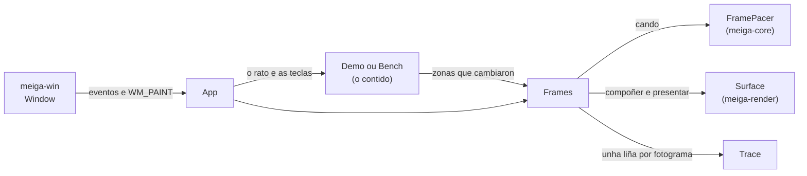

# Código › `meiga` (o programa)

> Estado: subfase 1.3. O programa abre unha xanela cunha demo que mostra o mesmo texto a tres escalas e debuxa rectángulos co rato, e presenta só as zonas que cambian. Tamén ten tres modos de medición (`--bench`) e un rexistro dos fotogramas (`--trace-frames`).

**Responsabilidade:** unir as pezas. Crea a xanela e o fluxo de fotogramas, usando os outros tres crates. Ver [Arquitectura](../arquitectura.md#2-estrutura-do-código-un-workspace-con-catro-crates).

| Arquivo | Contido |
|---|---|
| [`Cargo.toml`](#cratesmeigacargotoml) | O crate e as súas dependencias. |
| [`build.rs`](#cratesmeigabuildrs) | Incrusta o manifesto en `meiga.exe` ao compilar. |
| [`meiga.exe.manifest`](#cratesmeigameigaexemanifest) | O manifesto da aplicación: como debe executala Windows. |
| [`src/main.rs`](#cratesmeigasrcmainrs) | O punto de entrada: as opcións, a xanela e a mensaxe de erro. |
| [`src/options.rs`](#cratesmeigasrcoptionsrs) | As opcións da liña de comandos. |
| [`src/app.rs`](#cratesmeigasrcapprs) | `App`, o *handler* da xanela: leva os eventos ao contido e aos fotogramas. |
| [`src/frames.rs`](#cratesmeigasrcframesrs) | `Frames`, o fluxo de fotogramas: que cambiou, cando debuxalo e como chega á xanela. |
| [`src/trace.rs`](#cratesmeigasrctracers) | O rexistro dos fotogramas, en CSV. |
| [`src/demo.rs`](#cratesmeigasrcdemors) | A demo: o mesmo texto a tres escalas e os rectángulos do rato, ata que meiga mostre un terminal (subfase 1.6). |
| [`src/bench.rs`](#cratesmeigasrcbenchrs) | Os tres modos de medición: fotogramas parciais, completos e completos de texto, sen parar. |

Así se reparten o traballo:



## `crates/meiga/Cargo.toml`

```toml
[package]
name = "meiga"
description = "A lightweight terminal for Windows, with performance as the top priority."
version.workspace = true
edition.workspace = true
rust-version.workspace = true
license.workspace = true
repository.workspace = true
publish.workspace = true

[dependencies]
meiga-core.workspace = true
meiga-render.workspace = true
meiga-win.workspace = true

[lints]
workspace = true
```

- Como o crate ten un `src/main.rs`, Cargo sabe que é un **binario**: o resultado da compilación é `meiga.exe`.
- Depende dos tres crates de biblioteca. É o único que pode velos todos. Desde a subfase 1.2 úsaos os tres: `meiga-render` debuxa e presenta.
- Non depende de `windows-sys`: os tipos de Windows que necesita, `HWND` e `HDC`, publícaos `meiga-win` (ver [Código › meiga-win](meiga-win.md#cratesmeiga-winsrclibrs)).
- Cargo atopa `build.rs` só, porque está na raíz do crate; non fai falta declaralo.

## `crates/meiga/build.rs`

```rust
//! Embeds the application manifest (`meiga.exe.manifest`) in `meiga.exe`.

use std::env;

const MANIFEST: &str = concat!(env!("CARGO_MANIFEST_DIR"), "\\meiga.exe.manifest");

fn main() {
    println!("cargo::rerun-if-changed=meiga.exe.manifest");

    // The options below belong to the MSVC linker (link.exe).
    let target_os = env::var("CARGO_CFG_TARGET_OS").unwrap_or_default();
    let target_env = env::var("CARGO_CFG_TARGET_ENV").unwrap_or_default();
    if target_os != "windows" || target_env != "msvc" {
        return;
    }

    println!("cargo::rustc-link-arg-bins=/MANIFEST:EMBED");
    println!("cargo::rustc-link-arg-bins=/MANIFESTINPUT:{MANIFEST}");
    // The manifest already says how to run (trustInfo); the linker must not
    // add its own copy.
    println!("cargo::rustc-link-arg-bins=/MANIFESTUAC:NO");
}
```

Un ***build script***: Cargo compila e executa `build.rs` antes de compilar o crate. O script fala con Cargo escribindo liñas `cargo::instrución=valor` na súa saída.

- `env!("CARGO_MANIFEST_DIR")` lese ao compilar `build.rs`: é a ruta absoluta do cartafol do crate. `concat!` xunta os textos, tamén ao compilar. A ruta ten que ser absoluta porque o ligador non traballa no cartafol do crate.
- `cargo::rerun-if-changed=meiga.exe.manifest`: Cargo só volta executar o script se cambia o manifesto (ou o propio `build.rs`). Sen esta liña, executaríao con calquera cambio no crate. Cando o script se volta executar, Cargo volta ligar `meiga.exe` co manifesto novo; comprobouse cambiando a data do arquivo.
- `CARGO_CFG_TARGET_OS` e `CARGO_CFG_TARGET_ENV`: variábeis que Cargo lle pasa ao script coa plataforma **para a que** se compila (que non ten por que ser na que se compila). As opcións son do ligador de Microsoft (`link.exe`, ver [Tecnoloxías › MSVC](../tecnoloxias.md#13-msvc-e-o-windows-sdk)), e outro ligador non as entendería.
- `unwrap_or_default()`: se a variábel non existe, un texto baleiro. Nunca provoca un pánico, como esixen as regras do proxecto contra `unwrap()`.
- `cargo::rustc-link-arg-bins=…`: pasa unha opción ao ligador, só ao ligar os binarios (`meiga.exe`) e non as bibliotecas.
- `/MANIFEST:EMBED`: o ligador xera un manifesto e métello ao `.exe` como un recurso, en vez de deixalo nun arquivo á parte que se podería perder ao copiar o programa.
- `/MANIFESTINPUT:…`: o contido do manifesto sae deste arquivo.
- `/MANIFESTUAC:NO`: o ligador engade pola súa conta un `trustInfo` (como se executa o programa respecto ao UAC). O manifesto de meiga xa o leva, así que o do ligador desactívase: o que vai dentro do `.exe` é exactamente o que hai no arquivo.

**Comprobado:** sen `build.rs`, `meiga.exe` non leva ningún manifesto. Rust non lle pide ningún ao ligador, e Windows trataría meiga como un programa que non sabe escalar: en pantallas ao 150 %, estiraría a súa imaxe e o texto veríase borroso.

## `crates/meiga/meiga.exe.manifest`

```xml
<?xml version="1.0" encoding="UTF-8" standalone="yes"?>
<!-- Application manifest of meiga.exe. build.rs embeds it with the linker. -->
<assembly xmlns="urn:schemas-microsoft-com:asm.v1" manifestVersion="1.0">
  <!-- Run without elevation, with the rights of the user who starts it. -->
  <trustInfo xmlns="urn:schemas-microsoft-com:asm.v3">
    <security>
      <requestedPrivileges>
        <requestedExecutionLevel level="asInvoker" uiAccess="false"/>
      </requestedPrivileges>
    </security>
  </trustInfo>
  <!-- Tested on Windows 10 and 11: no compatibility shims. -->
  <compatibility xmlns="urn:schemas-microsoft-com:compatibility.v1">
    <application>
      <supportedOS Id="{8e0f7a12-bfb3-4fe8-b9a5-48fd50a15a9a}"/>
    </application>
  </compatibility>
  <!-- meiga scales itself on every monitor, so Windows must not stretch its
       pixels. -->
  <application xmlns="urn:schemas-microsoft-com:asm.v3">
    <windowsSettings>
      <dpiAwareness xmlns="http://schemas.microsoft.com/SMI/2016/WindowsSettings">PerMonitorV2</dpiAwareness>
    </windowsSettings>
  </application>
</assembly>
```

O **manifesto da aplicación** é un XML que Windows le antes de arrancar o programa. Que é e como funciona explícase en [Tecnoloxías › Manifesto](../tecnoloxias.md#23-manifesto-da-aplicación-e-dpi). Leva tres declaracións:

| Elemento | Que declara | Sen el |
|---|---|---|
| `requestedExecutionLevel level="asInvoker"` | meiga corre cos permisos de quen o abre e nunca pide ser administrador. `uiAccess="false"`: non necesita controlar as xanelas doutros programas. | Windows aplicaría a algúns programas regras de compatibilidade pensadas para os anteriores ao UAC. |
| `supportedOS Id="{8e0f7a12-…}"` | meiga está feito para Windows 10 e 11 (os dous comparten este identificador). | Windows activaría comportamentos de compatibilidade para programas antigos; por exemplo, as funcións que dan a versión de Windows mentirían. |
| `dpiAwareness` = `PerMonitorV2` | meiga escala el mesmo o seu contido en cada monitor, e Windows non debe estirar os seus píxeles. | En pantallas con escala, Windows debuxaría meiga ao 100 % e estiraría a imaxe: texto borroso. |

- O elemento antigo `dpiAware` non fai falta: `dpiAwareness` funciona desde Windows 10 versión 1607, e meiga necesita a 1809 (pola ConPTY).
- Os comentarios van en inglés, como no resto do código.
- O ligador reescribe o XML ao incrustalo (sen comentarios nin espazos), pero o contido é o mesmo.

## `crates/meiga/src/main.rs`

```rust
//! meiga: a lightweight terminal for Windows.

// Release builds are GUI applications without a console window. Debug builds
// keep the console so that diagnostics are visible during development.
#![cfg_attr(not(debug_assertions), windows_subsystem = "windows")]
#![forbid(unsafe_code)]

mod app;
mod bench;
mod demo;
mod frames;
mod options;
mod trace;

use std::env;
use std::error::Error;
use std::process::ExitCode;

use meiga_win::window::{self, Window, WindowOptions};

use crate::app::App;
use crate::options::{Options, USAGE};
use crate::trace::Trace;

/// The exit code when the command line is wrong.
const USAGE_ERROR: u8 = 2;

fn main() -> ExitCode {
    let options = match Options::parse(env::args_os().skip(1)) {
        Ok(options) => options,
        Err(error) => {
            report(&format!("{error}\n\n{USAGE}"));
            return ExitCode::from(USAGE_ERROR);
        }
    };
    match run(&options) {
        Ok(()) => ExitCode::SUCCESS,
        Err(error) => {
            report(&format!(
                "meiga stopped because of an unexpected error.\n\n{error}"
            ));
            ExitCode::FAILURE
        }
    }
}

fn run(options: &Options) -> Result<(), Box<dyn Error>> {
    let trace =
        match &options.trace_frames {
            Some(path) => Some(Trace::create(path).map_err(|error| {
                format!("Cannot create the frame log {}: {error}", path.display())
            })?),
            None => None,
        };
    let window = Window::create(&WindowOptions { title: "meiga" })?;
    let mut app = App::new(&window, options.bench, trace)?;
    window.run(&mut app)
}

/// Tells the user about an error. Release builds have no console, so the
/// message box is the only way.
fn report(text: &str) {
    eprintln!("{text}");
    window::show_error("meiga", text);
}
```

- `#![cfg_attr(condición, atributo)]` aplica o atributo só se se cumpre a condición. `debug_assertions` está activado nas compilacións de depuración e desactivado en *release*, así que en *release* meiga é unha aplicación gráfica, sen xanela de consola. Ver [Tecnoloxías › Subsistema](../tecnoloxias.md#6-subsistema-de-windows).
- `#![forbid(unsafe_code)]`: o programa non ten nin un bloque `unsafe`. Todas as chamadas a Windows pasan por `meiga-win` e `meiga-render`, que as envolven en funcións seguras.
- `mod …;` declara os seis módulos do programa, que están nos arquivos do mesmo nome.
- `use meiga_win::window::{self, Window, WindowOptions};` importa o módulo (`self`, para escribir `window::show_error`) e os dous tipos.
- `fn main() -> ExitCode`: `main` pode devolver o código de saída do proceso: `ExitCode::SUCCESS` (0), `ExitCode::FAILURE` (1) ou outro número, con `ExitCode::from`.
- **As opcións.** `env::args_os()` dá os argumentos da liña de comandos, como `OsString`, os textos do sistema operativo, que en Windows poden non ser UTF-8 válido. `.skip(1)` salta o primeiro, que é o nome do programa. Se as opcións están mal, meiga mostra o erro e como se usa ([`USAGE`](#cratesmeigasrcoptionsrs)) e sae co código 2, o habitual para os erros de uso.
- **`run`** fai os pasos en orde:
  1. Se se pediu o rexistro dos fotogramas, crea o arquivo. Se non pode, o erro di que arquivo era: `map_err` cambia o erro por un texto, e `?` convérteo en `Box<dyn Error>`, que acepta textos.
  2. Crea a xanela, aínda oculta.
  3. Crea `App`, o *handler*, que compón xa o primeiro fotograma no *framebuffer* (ver [`app.rs`](#cratesmeigasrcapprs)).
  4. `window.run` mostra a xanela e entrega os seus eventos a `App` ata que se pecha.
- `match &options.trace_frames`: o `&` mira o valor sen quitarllo a `options`. As sangrías raras de `let trace =` son as de rustfmt.
- `Box<dyn Error>`: calquera erro nunha caixa (ver [`HandlerError`](meiga-win.md#handler)). Os erros de `meiga-win`, de `meiga-render` e os textos convértense solos con `?`.
- Se algo falla, `report` avisa:
  - `eprintln!` escribe o texto na saída de erros. Vese nas compilacións de depuración, que teñen consola; en *release* non hai consola, e Rust descarta o texto sen fallar;
  - `window::show_error` móstrao nunha caixa de mensaxe, que en *release* é a única forma de avisar;
  - o proceso remata co código 1, ou co 2 se as opcións estaban mal.

## `crates/meiga/src/options.rs`

```rust
pub const USAGE: &str = "Usage: meiga [--trace-frames <file>] [--bench partial|full|text]

  --trace-frames <file>  Write a line per frame to <file> (CSV).
  --bench partial        Instead of the demo, move a small square without stopping.
  --bench full           Instead of the demo, change the whole window without stopping.
  --bench text           Instead of the demo, fill the whole window with text that
                         changes at every frame.";

pub enum BenchMode {
    Partial,
    Full,
    Text,
}

pub struct Options {
    pub trace_frames: Option<PathBuf>,
    pub bench: Option<BenchMode>,
}
```

As opcións da liña de comandos. Sen ningunha, meiga abre a demo.

| Opción | Que fai |
|---|---|
| `--trace-frames <arquivo>` | Escribe unha liña por fotograma nese arquivo CSV (ver [`trace.rs`](#cratesmeigasrctracers)). É o que usan `check-present.ps1` e `measure-frames.ps1`. |
| `--bench partial` | En vez da demo, un cadrado de 64 píxeles que cruza a xanela sen parar: fotogramas parciais. |
| `--bench full` | En vez da demo, a xanela enteira cambia de cor en cada fotograma: fotogramas completos. |
| `--bench text` | En vez da demo, a xanela enteira chea de texto que cambia en cada fotograma: fotogramas completos de texto. |

```rust
pub fn parse(args: impl IntoIterator<Item = OsString>) -> Result<Self, String> {
    let mut options = Options::default();
    let mut args = args.into_iter();
    while let Some(arg) = args.next() {
        match arg.to_str() {
            Some("--trace-frames") => {
                let path = args.next().ok_or("--trace-frames needs the path of a file.")?;
                options.trace_frames = Some(PathBuf::from(path));
            }
            Some("--bench") => {
                options.bench = Some(match args.next().as_deref().and_then(OsStr::to_str) {
                    Some("partial") => BenchMode::Partial,
                    Some("full") => BenchMode::Full,
                    Some("text") => BenchMode::Text,
                    _ => return Err("--bench needs 'partial', 'full' or 'text'.".into()),
                });
            }
            _ => return Err(format!("Unknown option: {}", arg.to_string_lossy())),
        }
    }
    Ok(options)
}
```

- **Sen dependencias.** Hai crates para ler opcións (`clap`, por exemplo), pero para dúas opcións abonda un bucle, e meiga mantén as dependencias ao mínimo ([ADR 0006](../adr/0006-licenzas-e-dependencias.md)).
- `impl IntoIterator<Item = OsString>`: calquera colección de argumentos. O programa pásalle os da liña de comandos, e as probas, unha lista feita a man.
- `arg.to_str()` dá o texto se é UTF-8 válido. A ruta do rexistro non se converte: `PathBuf::from` acepta calquera nome de arquivo de Windows.
- `ok_or` converte un `Option` nun `Result`: se non hai seguinte argumento, o erro. `as_deref` mira o `OsString` como `&OsStr` sen copialo.
- `to_string_lossy` mostra o argumento descoñecido, cambiando os caracteres que non sexan UTF-8 válido por �.
- `Options` deriva `Default` (as dúas opcións a `None`) e `PartialEq`, para comparalas nas probas.

**Probas:** sen opcións, a demo; as dúas opcións cos seus valores, en calquera orde, e o modo `text`; e catro erros: unha opción descoñecida, `--trace-frames` sen arquivo, `--bench` sen modo e cun modo que non existe.

## `crates/meiga/src/app.rs`

```rust
enum Content {
    Demo(Demo),
    Bench(Box<Bench>),
}

impl Scene for Content {
    fn draw(&mut self, canvas: &mut Canvas<'_>) {
        match self {
            Content::Demo(demo) => demo.draw(canvas),
            Content::Bench(bench) => bench.draw(canvas),
        }
    }
}

pub struct App {
    frames: Frames,
    content: Content,
}
```

`App` é o *handler* da xanela ([`Handler`](meiga-win.md#handler)): recibe os eventos, pásallos ao contido e decide os fotogramas con `Frames`.

- `Content` é o que mostra a xanela: a demo ou un dos modos de medición. Implementa [`Scene`](#scene), así que `Frames` pode debuxalo sen saber cal é.
- **`Box<Bench>`.** Un `enum` ocupa en memoria o que a súa variante máis grande. Desde a subfase 1.3, un `Bench` leva dentro unha fonte enteira, e sería moito maior ca a demo, que garda as súas fontes nun `Vec`. Na `Box` vai na memoria dinámica, e o `enum` só garda un punteiro. É o que pide o aviso `large_enum_variant` de Clippy.

```rust
pub fn new(window: &Window, bench: Option<BenchMode>, trace: Option<Trace>) -> Result<Self, HandlerError> {
    let mut content = match bench {
        Some(BenchMode::Text) => {
            let system = FontSystem::new()?;
            let font = Font::new(&system, &FONT_FAMILIES, FONT_POINTS, window.dpi())?;
            Content::Bench(Box::new(Bench::new(BenchMode::Text, Some(font))))
        }
        Some(mode) => Content::Bench(Box::new(Bench::new(mode, None))),
        None => Content::Demo(Demo::new(&FontSystem::new()?)?),
    };
    let marks = bench.is_none();
    let mut frames = Frames::new(window.client_size()?, &mut content, marks, trace)?;
    if bench.is_some() {
        frames.schedule(window)?;
    }
    Ok(Self { frames, content })
}
```

- **As fontes.** Só o contido con texto le as fontes do sistema ([`FontSystem`](meiga-render.md#fontsystem)): a demo, coas súas tres escalas, e o modo `text`, cunha fonte ao DPI da xanela ([`Window::dpi`](meiga-win.md#windowdpi)). Os modos `partial` e `full` non cargan nada de DirectWrite, e miden o mesmo ca na subfase 1.2.
- Os erros de `meiga-render` convértense en `HandlerError` con `?`, como os de `meiga-win`: se non hai ningunha das fontes, meiga para cunha caixa de mensaxe que o di.
- `Frames::new` crea o *framebuffer* co tamaño da xanela e compón nel o contido enteiro. Así, cando Windows pide o primeiro `WM_PAINT`, só hai que copialo. Na demo, ese primeiro fotograma rasteriza todos os glifos das tres escalas.
- As **marcas** (o bordo magenta das zonas presentadas) están activadas na demo e desactivadas nos modos de medición, porque engadirían traballo aos fotogramas que se miden.
- Un modo de medición pide xa o seu primeiro fotograma (`schedule`), que chegará en canto a xanela empece o seu bucle de mensaxes.

```rust
fn event(&mut self, window: &Window, event: Event) -> Result<(), HandlerError> {
    match event {
        Event::Resized { size, minimized } => {
            self.frames.resized(window, size, minimized, &mut self.content)?;
            if self.is_bench() {
                self.frames.schedule(window)?;
            }
        }
        Event::SizeMoveStarted => self.frames.size_move_started(),
        Event::SizeMoveEnded => self.frames.size_move_ended(&mut self.content)?,
        Event::FrameTimer => {
            if let Content::Bench(bench) = &mut self.content {
                for area in bench.step(self.frames.size()) {
                    self.frames.damage(area);
                }
            }
            self.frames.timer(window, &mut self.content)?;
            if self.is_bench() {
                self.frames.schedule(window)?;
            }
        }
        Event::KeyDown { key: Key::P, repeat: false } => self.frames.toggle_marks(window),
        event => {
            if let Content::Demo(demo) = &mut self.content {
                let frames = &mut self.frames;
                let size = frames.size();
                match demo.event(event, size, |area| frames.damage(area)) {
                    Some(Mouse::Capture) => window.capture_mouse(),
                    Some(Mouse::Release) => window.release_mouse(),
                    None => {}
                }
                self.frames.request(window, &mut self.content)?;
            }
        }
    }
    Ok(())
}

fn paint(&mut self, _window: &Window, dc: HDC, area: Rect) -> Result<(), HandlerError> {
    self.frames.paint(dc, area)
}
```

| Evento | Que fai |
|---|---|
| `Resized` | `Frames` adapta o *framebuffer* ao tamaño novo, ou deixa de debuxar se a xanela se minimizou. Nun modo de medición, ao restaurala, os fotogramas continúan. |
| `SizeMoveStarted` e `SizeMoveEnded` | O usuario empeza e remata de mover ou redimensionar a xanela: mentres tanto, o *framebuffer* reserva memoria con marxe ([`Fit::Room`](meiga-render.md#fit-e-surface)). |
| `FrameTimer` | Toca debuxar. Nun modo de medición, primeiro avanza un paso e marca as zonas que cambian; despois, `Frames` debuxa e, nun modo de medición, pide o seguinte fotograma. |
| Tecla P | Activa ou desactiva as marcas. `repeat: false`: manter a tecla premida non as acende e apaga sen parar. |
| Calquera outro | Vai á demo, que di que zonas cambian e se hai que capturar ou soltar o rato. Despois, `Frames` decide cando debuxalas (`request`). |

- `WM_PAINT` (`paint`) copia a zona que pide Windows desde o *framebuffer*. `_window`: o guión baixo indica que o parámetro non se usa.
- `is_bench` di se o contido é un modo de medición: `matches!` compara un valor cun patrón e dá `true` ou `false`.
- **Os préstamos.** `demo` é unha referencia `&mut` a unha parte de `self` (`self.content`), e a *closure* `|area| frames.damage(area)` necesita outra a outra parte (`self.frames`). Rust permíteo porque son campos distintos. Despois, `self.frames.request(window, &mut self.content)` volta usar `self.content`, cando `demo` xa non se usa máis.
- `if let Content::Bench(bench) = &mut self.content`: entra só se o contido é un modo de medición, e dá unha referencia a el.

## `crates/meiga/src/frames.rs`

O **fluxo de fotogramas**: que cambiou, cando debuxalo e como chega á xanela. Aplica tres principios do proxecto: debuxar só o que cambia, como moito un fotograma por intervalo, e non debuxar o que non se ve ([ADR 0005](../adr/0005-fios-e-fotogramas.md), [ADR 0009](../adr/0009-xanela-que-non-se-ve.md)).

### `Scene`

```rust
pub trait Scene {
    /// Draws everything that is inside the clip rectangle of `canvas`. It
    /// takes `&mut self` because drawing can fill caches, such as the one of
    /// the glyphs.
    fn draw(&mut self, canvas: &mut Canvas<'_>);
}
```

O que mostra a xanela. Unha escena debuxa todo o que cae dentro do recorte do lenzo, sen preocuparse de que cambiou: `Frames` pásalle un lenzo recortado a cada zona que cambiou ([`Canvas::clipped`](meiga-render.md#canvas)), e así só se tocan eses píxeles.

- **`&mut self`.** Desde a subfase 1.3, debuxar pode cambiar a escena: o texto garda na caché os glifos que rasteriza a primeira vez ([`Font`](meiga-render.md#font-e-blending)). Por iso `Frames` recibe a escena como `&mut dyn Scene` en todos os seus métodos.

### `Frames`

```rust
pub struct Frames {
    surface: Surface,
    damage: Damage,
    pacer: FramePacer,
    minimized: bool,
    live_resize: bool,
    marks: Option<Vec<Rect>>,
    trace: Option<Trace>,
}
```

| Campo | Que garda |
|---|---|
| `surface` | O *framebuffer* ([`Surface`](meiga-render.md#fit-e-surface)). |
| `damage` | As zonas que cambiaron e aínda non se presentaron ([`Damage`](meiga-core.md#cratesmeiga-coresrcdamagers)). |
| `pacer` | Cando foi o último fotograma e se hai outro programado ([`FramePacer`](meiga-core.md#cratesmeiga-coresrcpacingrs)). |
| `minimized` | Se a xanela está minimizada: entón non se debuxa nada. |
| `live_resize` | Se o usuario está movendo ou redimensionando a xanela. |
| `marks` | Coas marcas activadas, as zonas que presentou o último fotograma, que levan un bordo na xanela. `None` coas marcas desactivadas. |
| `trace` | O rexistro dos fotogramas, se se pediu. |

**A regra que mantén:** a xanela mostra o *framebuffer*, agás nas zonas de `damage`, que cambiaron e que o seguinte fotograma compón e presenta.

### Pedir un fotograma

```rust
pub fn damage(&mut self, area: Rect) {
    let area = area.intersection(Rect::from_size(self.surface.size()));
    if !area.is_empty() {
        self.damage.add(area);
    }
}

pub fn request(&mut self, window: &Window, scene: &mut dyn Scene) -> Result<(), HandlerError> {
    if self.damage.is_empty() || self.minimized {
        return Ok(());
    }
    match self.pacer.request(Instant::now(), interval()) {
        Pace::Now => self.draw(window, scene, Cause::Now),
        Pace::After(delay) => Ok(window.start_frame_timer(delay)?),
        Pace::Scheduled => Ok(()),
    }
}

pub fn timer(&mut self, window: &Window, scene: &mut dyn Scene) -> Result<(), HandlerError> {
    self.draw(window, scene, Cause::Timer)
}
```

- `damage` anota unha zona que cambiou, recortada á xanela: arrastrando co rato capturado, o rectángulo pode saír dela.
- **`request`** decide cando se debuxa o que cambiou: se non cambiou nada ou a xanela está minimizada, nada; se non, o que diga o *pacer*: agora, cun temporizador ou xa está programado.
- `timer`: venceu o temporizador, e debúxase.
- `interval()` dá o intervalo de `max_fps = "auto"`: 30 fps se a sesión é remota e 60 en local. Pregúntase en cada fotograma, porque a sesión pode pasar de local a remota mentres meiga está aberto.

```rust
pub fn schedule(&mut self, window: &Window) -> Result<(), HandlerError> {
    if self.minimized {
        return Ok(());
    }
    let delay = match self.pacer.request(Instant::now(), interval()) {
        Pace::Now => Duration::ZERO,
        Pace::After(delay) => delay,
        Pace::Scheduled => return Ok(()),
    };
    Ok(window.start_frame_timer(delay)?)
}
```

Para os modos de medición: pide un fotograma para o primeiro momento que permita o *pacer*, aínda que non cambiase nada. A diferenza con `request` é que nunca debuxa no momento, sempre co temporizador, para que o bucle de mensaxes trate as mensaxes entre un fotograma e o seguinte.

### `draw`

```rust
fn draw(&mut self, window: &Window, scene: &mut dyn Scene, cause: Cause) -> Result<(), HandlerError> {
    window.stop_frame_timer();
    if self.damage.is_empty() || self.minimized {
        self.pacer.cancel();
        return Ok(());
    }

    let start = Instant::now();
    let mut canvas = self.surface.canvas();
    for &area in self.damage.rects() {
        scene.draw(&mut canvas.clipped(area));
    }
    let composed = Instant::now();

    let handle = window.handle();
    let erased = match &self.marks {
        Some(marks) => erase(&self.surface, handle, marks),
        None => Ok(()),
    };
    let presented = self.surface.present(handle, self.damage.rects());
    let present = composed.elapsed();
    match erased.and(presented) {
        Ok(()) => {
            if let Some(marks) = &mut self.marks {
                marks.clear();
                marks.extend_from_slice(self.damage.rects());
                let _ = self.surface.mark(handle, marks, MARK_COLOR, MARK_THICKNESS);
            }
        }
        Err(_) => window.invalidate(None),
    }

    log(&mut self.trace, &Record { kind: Kind::Frame, cause: Some(cause), … })?;
    self.damage.clear();
    self.pacer.drawn(start);
    Ok(())
}
```

Un fotograma, paso a paso:

1. **O temporizador** detense. Se había un fotograma programado, é este: normalmente chega co temporizador, pero tamén pode chegar antes, cando o temporizador vai con atraso e chega outro cambio (ver [`FramePacer`](meiga-core.md#cratesmeiga-coresrcpacingrs)).
2. **Compoñer.** Para cada zona que cambiou, a escena debúxase nun lenzo recortado a ela.
3. **Presentar.** Coas marcas activadas, primeiro bórranse as do fotograma anterior: preséntanse de novo, desde o *framebuffer*, os seus bordos. Despois preséntanse as zonas que cambiaron.
4. **As marcas novas**, se están activadas: o bordo das zonas que se acaban de presentar, en magenta, debuxado só na xanela.
5. **Se a presentación falla**, por exemplo porque a sesión está bloqueada ou desconectada, pídeselle a Windows que pinte a xanela enteira cando poida (`invalidate`): ese `WM_PAINT` copiará o *framebuffer*, que xa está ao día. Non é motivo para parar meiga.
6. **O rexistro**, se se pediu: unha liña co tempo de compoñer e o de presentar.
7. Esquécense as zonas e anótase o fotograma no *pacer*, co instante en que empezou.

- `Result::and` devolve o primeiro erro dos dous, pero as dúas presentacións fanse sempre: os argumentos avalíanse antes.
- `let _ = …` descarta o resultado a propósito: unha marca que non se debuxa non estraga o fotograma.
- `marks.clear()` e `extend_from_slice` reutilizan o mesmo `Vec`, sen reservar memoria nova en cada fotograma.

### O tamaño da xanela

```rust
pub fn resized(&mut self, window: &Window, size: Size, minimized: bool, scene: &mut dyn Scene) -> Result<(), HandlerError> {
    if minimized {
        window.stop_frame_timer();
        self.pacer.cancel();
        self.minimized = true;
        return Ok(());
    }
    let restored = mem::take(&mut self.minimized);
    if size == self.surface.size() && !restored {
        return Ok(());
    }
    let fit = if self.live_resize { Fit::Room } else { Fit::Exact };
    self.surface.resize(size, fit)?;
    self.compose_all(scene)?;
    if restored {
        self.damage.clear();
        if let Some(marks) = &mut self.marks {
            marks.clear();
        }
        window.invalidate(None);
        Ok(())
    } else {
        self.request(window, scene)
    }
}
```

- **Minimizada:** cancélase o fotograma programado e non se debuxa nada máis ([ADR 0009](../adr/0009-xanela-que-non-se-ve.md)). Os cambios seguen acumulándose en `damage`.
- `mem::take` devolve o valor e deixa o valor por defecto (`false`): `restored` é se estaba minimizada.
- **Cun tamaño novo**, o *framebuffer* adáptase: con marxe (`Room`) mentres o usuario redimensiona co rato, e exacto (`Exact`) noutro caso, como ao maximizar. Despois compónse enteiro, sen presentalo:
  - **ao restaurala**, píntase a xanela enteira desde o *framebuffer* (`invalidate`), que xa inclúe todos os cambios: non queda nada que presentar, nin marcas;
  - **noutro caso**, Windows pide `WM_PAINT` para a parte nova da xanela, e o resto segue igual; as zonas que cambiaran e aínda non se presentaran preséntanse co seguinte fotograma (`request`).
- **Compóñese enteiro**, porque despois dun cambio de tamaño o *framebuffer* pode ter memoria nova, sen píxeles, ou zonas que antes quedaban fóra da xanela. É máis sinxelo ca levar a conta das partes que seguen ben, e o contido pode depender do tamaño: o do terminal dependerá, desde a 1.6. Mentres se redimensiona co rato, cada paso compón a xanela enteira, pero só presenta a parte nova.

```rust
pub fn size_move_ended(&mut self, scene: &mut dyn Scene) -> Result<(), HandlerError> {
    self.live_resize = false;
    if self.surface.resize(self.surface.size(), Fit::Exact)? {
        self.compose_all(scene)?;
    }
    Ok(())
}
```

Ao rematar de redimensionar co rato, o *framebuffer* devolve a memoria de máis (`Exact`). Se a memoria é nova, compónse de novo; a xanela xa mostra o mesmo, así que non hai que presentar nada.

### `WM_PAINT` e as marcas

```rust
pub fn paint(&mut self, dc: HDC, area: Rect) -> Result<(), HandlerError> {
    let start = Instant::now();
    let _ = self.surface.paint(dc, area);
    …
}

pub fn toggle_marks(&mut self, window: &Window) {
    match self.marks.take() {
        Some(marks) => {
            let _ = erase(&self.surface, window.handle(), &marks);
        }
        None => self.marks = Some(Vec::new()),
    }
}
```

- **`paint`** copia a zona que pide Windows e anótao no rexistro. Se a copia falla, esa zona queda mal ata o seguinte repintado, que non é motivo para parar meiga. Como `BeginPaint` xa validou a zona, Windows non a volta pedir, e non hai bucle.
- **`toggle_marks`**: ao desactivalas, bórranse as que hai na xanela; ao activalas, o seguinte fotograma xa as debuxa.

### Funcións auxiliares

```rust
fn interval() -> Duration {
    auto_interval(window::is_remote_session())
}

fn erase(surface: &Surface, window: HWND, marks: &[Rect]) -> Result<(), meiga_render::Error> {
    for mark in marks {
        surface.present(window, &mark.border(MARK_THICKNESS))?;
    }
    Ok(())
}

fn log(trace: &mut Option<Trace>, record: &Record<'_>) -> Result<(), HandlerError> {
    if let Some(trace) = trace {
        trace.write(record).map_err(|error| format!("Cannot write the frame log: {error}"))?;
    }
    Ok(())
}
```

- `erase` borra as marcas presentando de novo os catro lados do bordo de cada unha.
- `log` escribe no rexistro, se o hai. Se falla, por exemplo porque o disco está cheo, meiga para cunha mensaxe: o rexistro só se usa para comprobar e medir, e un rexistro incompleto daría resultados falsos.
- `compose_all`, que non se mostra, compón a escena enteira e anótao no rexistro como `compose`.
- As marcas son magenta (`#FF00FF`), unha cor que a demo non usa, e dun píxel de ancho.

## `crates/meiga/src/trace.rs`

O **rexistro dos fotogramas** (`--trace-frames`): unha liña CSV por cada vez que meiga debuxa algo. Serve para comprobar que se presenta e para medir canto custa ([`check-present.ps1`](ferramentas.md#toolscheck-presentps1) e [`measure-frames.ps1`](perf.md#toolsperfmeasure-framesps1)). Un exemplo, coas primeiras liñas da demo ao premer e arrastrar co rato (os tempos dependen da máquina):

```text
frame,time_ms,kind,cause,interval_ms,width,height,rects,pixels,compose_us,present_us,areas
1,6.355,compose,,33.333,1418,769,1,1090442,917,0,0 0 1418 769
2,24.614,paint,,33.333,1418,769,1,1090442,0,902,0 0 1418 769
3,362.585,frame,now,33.333,1418,769,1,1,0,111,150 150 1 1
4,396.140,frame,timer,33.333,1418,769,1,2806,4,90,150 150 61 46
```

| Columna | Que é |
|---|---|
| `frame` | O número da liña: 1, 2, 3… |
| `time_ms` | Cando empezou, en milisegundos desde que se abriu o rexistro. |
| `kind` | `compose`: compúxose o *framebuffer* enteiro, sen presentalo (ao arrancar e ao cambiar o tamaño); `paint`: Windows pediu pintar unha zona (`WM_PAINT`); `frame`: meiga presentou o que cambiou. |
| `cause` | Nos `frame`: `now` se se debuxou no momento, porque xa pasara o intervalo, ou `timer` se o debuxou o temporizador. |
| `interval_ms` | O intervalo entre fotogramas nese momento: 33,333 en remoto e 16,667 en local. |
| `width` e `height` | O tamaño do *framebuffer*. |
| `rects` e `pixels` | Cantas zonas, e cantos píxeles en total: as presentadas (`frame`), a pintada (`paint`) ou a composta (`compose`). |
| `compose_us` e `present_us` | O tempo de compoñer e o de presentar, en microsegundos. |
| `areas` | As zonas, como `x y ancho alto`, separadas por `;`. |

- As marcas da demo non contan nas zonas: son unha axuda visual, e os modos de medición non as usan.
- Os decimais van sempre cun punto, aínda que Windows estea en galego.

```rust
pub fn write(&mut self, record: &Record<'_>) -> io::Result<()> {
    self.lines += 1;
    self.line.clear();
    format_line(&mut self.line, self.lines, self.start, record);
    self.file.write_all(self.line.as_bytes())
}
```

- Cada liña escríbese no arquivo **no momento**, cunha soa chamada: se meiga remata de calquera maneira, o rexistro está completo ata a última liña, e outro programa pódeo ler mentres meiga corre.
- `line` é un `String` que se reutiliza: `clear()` baléirao sen liberar a memoria, así que escribir unha liña non reserva memoria nova.
- `Record` leva os datos dunha liña. `rects: &'a [Rect]` é unha referencia ás zonas, sen copialas.

```rust
fn write_millis(line: &mut String, duration: Duration) {
    let micros = duration.as_nanos().saturating_add(500) / 1000;
    let _ = write!(line, "{}.{:03}", micros / 1000, micros % 1000);
}
```

- Os milisegundos con tres decimais escríbense con números enteiros: os microsegundos, redondeados (`+ 500`), divididos entre 1000, un punto e o resto con tres cifras (`{:03}`). Formatar números decimais (`f64`) engadiría uns 20 KB a `meiga.exe`; comprobouse compilando as dúas versións.
- `write!` sobre un `String` non pode fallar, pero devolve un `Result`: `let _ =` descártao.

**Probas:** dúas liñas completas, un `frame` co temporizador e dúas zonas e un `paint` sen causa, comparadas co texto esperado. A primeira comproba tamén que a liña ten tantas columnas coma a cabeceira.

## `crates/meiga/src/demo.rs`

Unha demo para ver o texto e que zonas presenta cada fotograma: o mesmo texto a tres escalas e, por riba, os rectángulos que se debuxan co rato. Desaparecerá cando meiga mostre un terminal, na subfase 1.6.

```rust
pub const BACKGROUND: Rgb = Rgb::new(0x16, 0x18, 0x1d);
pub const TEXT: Rgb = Rgb::new(0xd4, 0xd7, 0xdd);
const DIM: Rgb = Rgb::new(0x80, 0x87, 0x94);

pub const FONT_FAMILIES: [&str; 2] = ["Cascadia Mono", "Consolas"];
pub const FONT_POINTS: f32 = 12.0;

const SCALES: [(u32, u32); 3] = [(100, 96), (125, 120), (150, 144)];
const MARGIN: i32 = 12;
```

- **As cores:** o fondo de sempre, `#16181D`; o texto, un gris moi claro; e un gris medio (`DIM`) para os textos que explican o resto.
- **A fonte:** Cascadia Mono ou, se non está, Consolas, a 12 puntos, como no Windows Terminal. O modo `--bench text` usa as mesmas.
- **As tres escalas** van fixas, co seu DPI, en vez de usar o da xanela: así vese nun mesmo monitor como queda o texto ao 100 %, ao 125 % e ao 150 %, e o tamaño de cela de cada un.
- `MARGIN`: o espazo arredor dos bloques de texto e entre eles, en píxeles.

```rust
const SAMPLE: &[&[(&str, Style)]] = &[
    &[("ASCII    ", Style::Dim), ("The quick brown fox jumps over the lazy dog. 0123456789", Style::Plain)],
    &[("Latin    ", Style::Dim), ("á é í ó ú à ü ñ ç Á É Ñ Ç · «Ola, mundo!» ¿Que tal? € £ ¥ ° ± × ÷", Style::Plain)],
    &[("Symbols  ", Style::Dim), ("✓ ✗ ★ ☆ ♥ ♦ → ← ↑ ↓ ⇒ ∞ ≠ ≤ ≥ λ π Σ Ω √ ∑", Style::Plain)],
    &[("Boxes    ", Style::Dim), ("┌──┬──┐ ╔══╗ ░░▒▒▓▓██ ▀▄▌▐", Style::Plain)],
    &[("         └──┴──┘ ╚══╝ ░░▒▒▓▓██ ▀▄▌▐", Style::Plain)],
    &[("CJK      ", Style::Dim), ("中文 日本語 한국어 😀", Style::Plain)],
    &[("         [][] [][][] [][][] []", Style::Dim)],
    &[("Colours  ", Style::Dim), ("blue", Style::Color(PALETTE[0])), …, (" dark text on a light background ", Style::Inverse)],
];
```

O texto de cada escala, que proba os casos que importan nun terminal:

| Liña | Que proba |
|---|---|
| ASCII | As letras, os díxitos e a puntuación. |
| Latin | Os acentos, a `ñ` e a `ç`, as comiñas angulares e outros símbolos, como o euro. |
| Symbols | Símbolos, algúns dos cales non están en Cascadia Mono: o *fallback*. |
| Boxes | As liñas de caixa e os bloques, en dúas liñas seguidas, para ver se se unen. |
| CJK | Ideogramas chineses e xaponeses, hangul e un emoji: caracteres de dúas celas, doutras fontes. Na liña seguinte, un par de corchetes debaixo de cada un, para ver que ocupan exactamente dúas celas. |
| Colours | O texto nas oito cores da paleta e, ao final, texto escuro sobre fondo claro, co contraste para o texto escuro. |

- Cada liña é unha lista de anacos, cada un co seu estilo (`Style`): o texto normal (`Plain`), o que explica (`Dim`), unha cor da paleta (`Color`) ou as cores ao revés (`Inverse`).
- Antes do texto da primeira escala vai a liña que explica como usar a demo (`HINT`) e unha liña baleira. Antes de cada escala, a súa cabeceira: a escala, o DPI, a fonte atopada e o tamaño da cela, como `150 % · 144 DPI · Cascadia Mono 12 pt · cell 14 × 28 pixels`.

```rust
pub struct Demo {
    blocks: Vec<Block>,
    rectangles: Rectangles,
}

struct Block {
    font: Font,
    origin: Point,
    lines: Vec<Vec<Run>>,
}

struct Run {
    column: i32,
    cells: Vec<CellChar>,
    text: Rgb,
    background: Rgb,
}
```

- **`Demo`**: un bloque de texto por escala, e os rectángulos do rato.
- **`Block`**: o texto a unha escala, coa súa fonte ([`Font`](meiga-render.md#font-e-blending)) e, con ela, a súa caché de glifos. `origin` é a esquina superior esquerda da primeira liña.
- **`Run`**: celas seguidas dunha liña coas mesmas cores, desde a columna `column`. As celas calcúlanse unha vez, ao crear a demo, con [`cells`](meiga-core.md#cratesmeiga-coresrctextrs), e `line` coloca cada anaco onde remata o anterior.

```rust
pub fn new(system: &FontSystem) -> Result<Self, Error> {
    let mut blocks = Vec::new();
    let mut top = MARGIN;
    for (percent, dpi) in SCALES {
        let font = Font::new(system, &FONT_FAMILIES, FONT_POINTS, dpi)?;
        …
        let block = Block { font, origin: Point::new(MARGIN, top), lines };
        top = block.bounds().bottom + MARGIN;
        blocks.push(block);
    }
    Ok(Self { blocks, rectangles: Rectangles::new() })
}
```

Crea unha fonte por escala e coloca os bloques un debaixo do outro, do máis pequeno ao máis grande, separados por `MARGIN`. `bounds` dá o rectángulo que ocupa un bloque: tantas liñas coma ten, e tan ancho coma a liña máis longa.

```rust
pub fn draw(&mut self, canvas: &mut Canvas<'_>) {
    canvas.fill(canvas.clip(), BACKGROUND);
    for block in &mut self.blocks {
        block.draw(canvas);
    }
    self.rectangles.draw(canvas);
}
```

- Primeiro o fondo do recorte, despois o texto e, por último, os rectángulos, por riba.
- Un bloque que non toca o recorte non fai nada. Un que o toca debuxa as súas liñas, e [`Font::draw`](meiga-render.md#font-e-blending) só as celas que están dentro. Así, arrastrar un rectángulo só redebuxa o texto que ten debaixo.
- `canvas.fill(canvas.clip(), …)`: Rust permite ler `canvas.clip()` como argumento dunha función que toma `canvas` como `&mut`, porque o argumento se avalía antes (*two-phase borrows*).

### Os rectángulos

`Rectangles` é a demo da subfase 1.2, sen cambios: rectángulos que se debuxan co rato, por riba do texto.

| Acción | Que pasa |
|---|---|
| Arrastrar co botón esquerdo | Debúxase un rectángulo da seguinte cor da paleta. Ao soltar, queda. |
| Botón dereito | Bórranse todos, e preséntase a xanela enteira: así se ve un fotograma completo. |
| Esc, mentres se arrastra | Cancélase o rectángulo. |
| P | Activa ou desactiva as marcas (en `app.rs`). |

```rust
fn event(&mut self, event: Event, size: Size, mut damage: impl FnMut(Rect)) -> Option<Mouse> {
    match event {
        Event::MouseDown { button: MouseButton::Left, at } => {
            …
            let rect = Rect::spanning(at, at);
            self.drag = Some(Drag { from: at, rect, color: PALETTE[self.next_color % PALETTE.len()] });
            self.next_color += 1;
            damage(rect);
            Some(Mouse::Capture)
        }
        Event::MouseMoved { at, left_down: true } => {
            let drag = self.drag.as_mut()?;
            move_to(drag, at, &mut damage);
            None
        }
        …
    }
}
```

- A demo é **lóxica pura**: non chama a Windows. Di que zonas cambian, a través da *closure* `damage`, e se a xanela ten que capturar o rato ou soltalo (`Mouse`), e `App` faino. Por iso ten probas.
- Ao premer, o rectángulo é dun só píxel (`spanning(at, at)`), e a xanela captura o rato para seguir o arrastre tamén fóra dela.
- Ao mover co botón esquerdo, `move_to` calcula o rectángulo novo e marca o vello e o novo como cambiados, se cambiou. `Damage` decide se os xunta: ao medrar, o novo contén o vello, e queda un só.
- Os movementos sen o botón esquerdo, ou sen arrastre, ignóranse.
- Ao soltar, o rectángulo queda na lista, e sóltase o rato.
- `self.drag.as_mut()?`: o `?` dun `Option` dentro dunha función que devolve `Option` remata con `None` se non hai arrastre.
- `CaptureLost`: outra xanela colleu o rato, e o arrastre cancélase sen rectángulo.
- `draw` enche cada rectángulo coa súa cor, recortado ao lenzo. A paleta ten oito cores, e ningunha é magenta, a cor das marcas.

**Probas.** Sete. As cinco dos rectángulos, da subfase 1.2: arrastrar debuxa un rectángulo e só cambian as súas zonas (e mover ao mesmo sitio non cambia nada); os movementos sen arrastre ou sen o botón esquerdo non cambian nada; Esc e a perda do rato cancelan o arrastre; o botón dereito borra a xanela enteira; e cada rectángulo colle a seguinte cor. E dúas do texto: as tres escalas van unha debaixo da outra, da máis pequena á máis grande, separadas por `MARGIN`, coa axuda e unha liña baleira ao principio; e cada anaco dunha liña empeza onde remata o anterior, contando as dúas celas dos caracteres anchos.

## `crates/meiga/src/bench.rs`

Os **modos de medición** (`--bench`): fotogramas sen parar, ao máximo que permite o intervalo, para medir que custa un fotograma parcial, un completo e un completo de texto a meiga e ao resto do sistema. Úsaos [`measure-frames.ps1`](perf.md#toolsperfmeasure-framesps1).

```rust
pub fn step(&mut self, size: Size) -> [Rect; 2] {
    self.frame += 1;
    match self.mode {
        BenchMode::Partial => {
            let old = self.square;
            self.square = square_at(self.frame, size);
            [old, self.square]
        }
        BenchMode::Full | BenchMode::Text => [Rect::from_size(size), Rect::EMPTY],
    }
}

fn square_at(frame: u64, size: Size) -> Rect {
    let positions = u64::from(size.width.saturating_sub(SQUARE)) + 1;
    let x = i32::try_from(frame.wrapping_mul(STEP) % positions).unwrap_or(0);
    let y = i32::try_from(size.height / 2).unwrap_or(0) - SQUARE as i32 / 2;
    Rect::new(x, y, x + SQUARE as i32, y + SQUARE as i32)
}
```

- **`partial`**: un cadrado azul de 64 × 64 píxeles cruza o medio da xanela, 16 píxeles por fotograma, e ao chegar á dereita empeza de novo. Cambian o sitio onde estaba e o sitio onde está: dous rectángulos que `Damage` xunta nun de 80 × 64, ou deixa separados cando o cadrado volta á esquerda.
- **`full`**: a xanela enteira cambia entre dúas cores moi parecidas (`#16181D` e `#1C1F26`) en cada fotograma. Preséntase toda: o peor caso, como desprazar unha saída masiva. As cores son parecidas para que a xanela non pestanexe.
- **`text`**: a xanela enteira chea de texto, que cambia en cada fotograma. Tamén se presenta toda, pero agora cada cela busca o seu glifo na caché e debuxa a súa tinta: o peor caso do texto.
- `step` devolve as zonas que cambian nun *array* de dous, sen reservar memoria. `Rect::EMPTY` non engade nada a `Damage`.
- `wrapping_mul` multiplica sen comprobar o desbordamento: a 30 fotogramas por segundo, tardaría máis de mil millóns de anos en chegar. `%` dá a posición dentro das que caben.

```rust
BenchMode::Text => {
    let Some((font, row)) = &mut self.text else {
        canvas.fill(canvas.clip(), BACKGROUND);
        return;
    };
    let cell = font.cell();
    let size = canvas.size();
    let columns = size.width.div_ceil(cell.width);
    for y in 0..size.height.div_ceil(cell.height) {
        row.clear();
        row.extend((0..columns).map(|x| text_at(self.frame, y, x)));
        let top = i32::try_from(y * cell.height).unwrap_or(i32::MAX);
        font.draw(canvas, Point::new(0, top), row, TEXT, BACKGROUND);
    }
}

fn text_at(frame: u64, row: u32, column: u32) -> CellChar {
    let index = (u64::from(row) * 7 + u64::from(column) + frame) % CHARS;
    CellChar::Narrow(char::from(FIRST_CHAR + index as u8))
}
```

O debuxo dun fotograma de texto:

- **Os caracteres** son os 94 visíbeis de ASCII, de `!` a `~`, que nunca deixan unha cela en branco. En cada fotograma, o texto móvese unha cela á esquerda (`+ frame`), así que cambian todas as celas. Cada fila vai 7 caracteres por diante da anterior, para que as columnas non repitan o mesmo carácter.
- **As filas cobren a xanela enteira**, as últimas cortadas polos bordos (`div_ceil` divide redondeando cara arriba), así que non fai falta pintar ningún outro fondo: cada fila pinta o seu.
- `row` gárdase entre fotogramas para encher a seguinte fila sen reservar memoria.
- **A fonte** chega en `Bench::new(mode, font)`: créaa [`App`](#cratesmeigasrcapprs) co DPI da xanela, e só a usa este modo. Sen fonte, os fotogramas de texto só pintan o fondo: o programa sempre lla dá, pero o tipo non o pode garantir. Como a fonte se crea antes do primeiro fotograma, os glifos rasterízanse nel, e os fotogramas que se miden só os buscan na caché.

**Probas.** Catro: o cadrado avanza e marca o sitio vello e o novo; volta á esquerda ao chegar á dereita (tamén nunha xanela máis estreita ca el); os fotogramas completos marcan a xanela enteira e alternan as dúas cores; e os de texto cobren a xanela enteira, con píxeles da cor do texto, e cada cela cambia dun fotograma ao seguinte, sen quedar nunca en branco (`!` e `~` son o primeiro e o último carácter).

## Comprobacións feitas

- `cargo build --release` xera `target\release\meiga.exe`, duns 330 KB.
- Ao abrilo, aparece a xanela, co fondo escuro e o título «meiga», sen ningunha consola, e o texto da demo ás tres escalas. Arrastrar co rato debuxa rectángulos por riba do texto, cun bordo magenta arredor das zonas que presentou o último fotograma. Ao pechala, o proceso remata co código 0.
- O texto compárase co do Windows Terminal coa mesma fonte, o mesmo tamaño e as mesmas cores: os glifos teñen exactamente os mesmos píxeles cubertos, enteiros e parciais, e a tinta dunha liña é a mesma, cunha diferenza menor do 0,5 % ([Tecnoloxías › Mesturar o texto co fondo](../tecnoloxias.md#30-mesturar-o-texto-co-fondo-gamma-e-contraste)).
- `tools/check-window.ps1` comproba o subsistema, a xanela, a escala por monitor e o código de saída, e `tools/check-present.ps1`, os fotogramas (ver [Código › ferramentas](ferramentas.md#toolscheck-presentps1)). Coa demo de texto pasan igual.
- `check-present.ps1` detecta os erros: comprobouse na subfase 1.2 con copias de `frames.rs` con erros feitos a propósito. Debuxando cada cambio no momento, sen agrupalos, o clic e os 40 movementos enviados de golpe dan 41 fotogramas; e debuxando coa xanela minimizada, aparecen fotogramas. Nos dous casos, a comprobación falla. Sen pedir o repintado ao restaurar a xanela, pasa igual, porque Windows xa o pide.
- Os modos de medición funcionan: o temporizador dá os fotogramas ao ritmo pedido, tamén mentres se move a xanela, aínda que entón máis lentos (ver [ADR 0008](../adr/0008-temporizador-dos-fotogramas.md)).
- O manifesto que leva dentro, extraído con `mt.exe`, ten as tres declaracións, e un só `trustInfo`.
- `dumpbin /dependents` mostra que só depende de DLL do sistema: `gdi32.dll`, `kernel32.dll`, `user32.dll`, `api-ms-win-core-synch-l1-2-0.dll`, `ntdll.dll`, `oleaut32.dll`, `dwrite.dll`, `combase.dll` e `KERNEL32.dll`. As tres novas da subfase 1.3 son DirectWrite e as dúas que usa o crate `windows` (ver [Tecnoloxías › COM e o crate `windows`](../tecnoloxias.md#28-com-e-o-crate-windows)). `kernel32.dll` aparece dúas veces porque a biblioteca estándar de Rust e `windows-sys` declaran as súas funcións de forma distinta (ver [Tecnoloxías › windows-sys](../tecnoloxias.md#21-windows-sys-as-apis-de-windows-desde-rust)); Windows cárgaa unha soa vez.
