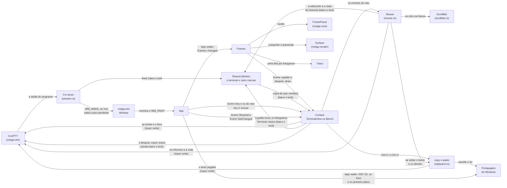

# Código › `meiga` (o programa)

> Estado: subfase 1.10. O programa é un terminal: lanza nunha pseudoconsola o programa da súa liña de comandos ou, sen el, PowerShell, mostra a súa saída na xanela, coas cores, os estilos, o cursor e o título que pon o programa, e envíalle as teclas e o foco. O rato selecciona texto, que vai ao portapapeis, ou chega ao programa, se o pediu; as teclas e o botón dereito copian e pegan. A grella enche a xanela e segue o seu tamaño e a súa escala; o historial vese coa roda, coas teclas e cunha barra de desprazamento; e o texto ten zoom. Presenta só as zonas que cambian. Tamén ten tres modos de medición (`--bench`), un rexistro dos fotogramas (`--trace-frames`) e as marcas das zonas presentadas (`--marks`). Na 1.6 desapareceu a demo, e chegaron `session.rs` e `view.rs`; na 1.7, o teclado, e as marcas pasaron da tecla P á opción `--marks`; na 1.8, o rato, a selección e o portapapeis, con `mouse.rs` e `clipboard.rs`; e na 1.9, o historial, o tamaño e o zoom, con `scrollbar.rs`. Na 1.10 non cambiou o código: só chegou a ligazón ao ADR 0017.

**Responsabilidade:** unir as pezas. Crea a xanela, lanza o programa nunha sesión de ConPTY, leva a súa saída á pantalla co fluxo de fotogramas, e as teclas e o rato ao programa, dálles ao terminal e ao programa a grella que enche a xanela, e copia e pega co portapapeis de Windows, usando os outros tres crates. Ver [Arquitectura](../arquitectura.md#2-estrutura-do-código-un-workspace-con-catro-crates) e, para o camiño da saída, [Arquitectura › Da saída á pantalla](../arquitectura.md#da-saída-á-pantalla-o-aviso-a-copia-e-o-fotograma); para o das teclas, [Arquitectura › O teclado](../arquitectura.md#o-teclado-da-tecla-ao-programa); para o do rato e o do texto, [Arquitectura › O rato, a selección e o portapapeis](../arquitectura.md#o-rato-a-selección-e-o-portapapeis); e para o dun cambio de tamaño e o da vista do historial, [Arquitectura › O historial, o tamaño e o zoom](../arquitectura.md#o-historial-o-tamaño-e-o-zoom).

| Arquivo | Contido |
|---|---|
| [`Cargo.toml`](#cratesmeigacargotoml) | O crate e as súas dependencias. |
| [`build.rs`](#cratesmeigabuildrs) | Incrusta o manifesto en `meiga.exe` ao compilar. |
| [`meiga.exe.manifest`](#cratesmeigameigaexemanifest) | O manifesto da aplicación: como debe executala Windows. |
| [`src/main.rs`](#cratesmeigasrcmainrs) | O punto de entrada: as opcións, a xanela e a mensaxe de erro. |
| [`src/options.rs`](#cratesmeigasrcoptionsrs) | As opcións da liña de comandos, co programa que se lanza. |
| [`src/app.rs`](#cratesmeigasrcapprs) | `App`, o *handler* da xanela: crea o contido, o terminal ou un modo de medición, leva os eventos a el e aos fotogramas, e pon no portapapeis o texto que copia o programa. |
| [`src/session.rs`](#cratesmeigasrcsessionrs) | A sesión do terminal: o programa, e o fío lector que lle dá a súa saída ao terminal, responde ao programa e esperta a xanela. |
| [`src/view.rs`](#cratesmeigasrcviewrs) | `TerminalView`, o terminal na xanela: a súa copia da pantalla, posta ao día antes de cada fotograma, o debuxo das celas, as súas liñas, a selección e o cursor, e as teclas e o foco, que lle envía ao programa, salvo as que colle para copiar e pegar, para mover a vista do historial e para o zoom; a grella que enche a xanela, que lles dá ao terminal e ao programa ao ritmo dos fotogramas; e a fonte, que crea de novo co zoom e coa escala. |
| [`src/mouse.rs`](#cratesmeigasrcmousers) | `Mouse`, o rato da vista: selecciona texto, cópiao ao soltar o botón e pega co dereito, ou envíalle ao programa os clics, os movementos e a roda. A roda tamén despraza o historial, ou fai o zoom con Ctrl; a barra de desprazamento é súa; e unha selección arrastrada fóra da grella despraza a vista soa. |
| [`src/scrollbar.rs`](#cratesmeigasrcscrollbarrs) | `ScrollBar`, a barra de desprazamento: a franxa á dereita da xanela, co polgar que mostra que parte do historial se ve, que se arrastra, e as páxinas cun clic na franxa. |
| [`src/clipboard.rs`](#cratesmeigasrcclipboardrs) | Copiar a selección ao portapapeis e pegar o portapapeis no programa, coa pregunta antes de pegar varias liñas. Pegar leva a vista do historial á pantalla. |
| [`src/frames.rs`](#cratesmeigasrcframesrs) | `Frames`, o fluxo de fotogramas: que cambiou, cando debuxalo e como chega á xanela. |
| [`src/trace.rs`](#cratesmeigasrctracers) | O rexistro dos fotogramas, en CSV. |
| [`src/bench.rs`](#cratesmeigasrcbenchrs) | Os tres modos de medición: fotogramas parciais, completos e completos de texto, sen parar. |

Así se reparten o traballo:



1. O fío lector da sesión ([`session.rs`](#cratesmeigasrcsessionrs)) dálle cada bloque de saída ao terminal, baixo o *lock* de `Shared`, envía as respostas ao programa e esperta a xanela con `WM_WAKE`, só se non había outro aviso pendente.
2. `App::wake` ([`app.rs`](#cratesmeigasrcapprs)) pon o título; desde a subfase 1.8, leva ao portapapeis o texto que copiou o programa (OSC 52), só se a xanela ten o foco e está en primeiro plano; e, se cambiou a pantalla, pídelle un fotograma a `Frames` (`changed`), que o fai no momento ou ao final do intervalo ([`frames.rs`](#cratesmeigasrcframesrs)).
3. O fotograma pon primeiro ao día o contido (`Scene::update`): a vista do terminal ([`view.rs`](#cratesmeigasrcviewrs)) copia baixo o *lock* só o que cambiou, e di que zonas son. Despois, fóra do *lock*, compón esas zonas (`draw`) e preséntaas.
4. Coa xanela minimizada non hai fotogramas, e a vista non copia nada: só fai o que non pode esperar (`Scene::update_hidden`): rematar á súa hora unha actualización sincronizada que o programa deixou aberta, para que as súas preguntas teñan resposta ([`frames.rs`](#coa-xanela-minimizada-hidden)).
5. Desde a subfase 1.7, as teclas chegan á xanela coma `Event::Key`, e `App` pásallas á vista, que as converte no que le o programa, segundo os modos que activou, e as escribe na entrada da sesión, sen esperar: o fío escritor da sesión lévaas ao ConPTY ([`key` e `focus`](#as-teclas-e-o-foco-key-e-focus)). Os cambios do foco tamén lle chegan ao programa, se os pediu.
6. Desde a subfase 1.8, `App` pásalle á vista tamén os eventos do rato, e a vista ao seu rato ([`mouse.rs`](#cratesmeigasrcmousers)): os clics seleccionan texto na grella do terminal, baixo o *lock*, ou, se o programa pediu o rato e Maiús non está premido, van a el coma informes, pola entrada da sesión. A selección vai ao portapapeis ao soltar o botón; Ctrl+C e Ctrl+Maiús+C cópiana, e Ctrl+V, Ctrl+Maiús+V e o botón dereito pegan ([`clipboard.rs`](#cratesmeigasrcclipboardrs)). Despois, `App` fai o que lle pide a vista ([`respond`](#respond-o-que-pide-a-vista)): un fotograma, se cambiou a selección, e poñerse ao día, se se mostrou a caixa de mensaxe que pregunta antes de pegar.
7. Desde a subfase 1.9, `App` pásalle á vista os cambios de tamaño da xanela (`Event::Resized`), salvo se está minimizada, e os de escala (`Event::DpiChanged`), e, ao pecharse a caixa de mensaxe que pregunta antes de pegar, o tamaño e a escala que a xanela ten entón ([`catch_up`](#respond-o-que-pide-a-vista)). A vista calcula a grella que enche a xanela, sen a franxa da barra de desprazamento, e dálla ao terminal e ao ConPTY no seguinte fotograma, como moito unha vez por intervalo, baixo o *lock* ([`resized` e `resize_grid`](#o-tamaño-resized-resize_grid-e-grid_size)). A roda, as teclas do historial e a barra de desprazamento ([`scrollbar.rs`](#cratesmeigasrcscrollbarrs)) moven a vista do historial; e Ctrl e `+`, `-` ou `0`, e Ctrl e a roda, fan o zoom: a vista crea a fonte nova, e con ela cambia a grella ([`zoom`](#o-zoom-e-a-escala-zoom-set_points-dpi_changed-e-new_font)).

## `crates/meiga/Cargo.toml`

```toml
[package]
name = "meiga"
description = "A lightweight terminal for Windows, with performance as the top priority."
version.workspace = true
edition.workspace = true
rust-version.workspace = true
license.workspace = true
repository.workspace = true
publish.workspace = true

[dependencies]
meiga-core.workspace = true
meiga-render.workspace = true
meiga-win.workspace = true

[lints]
workspace = true
```

- Como o crate ten un `src/main.rs`, Cargo sabe que é un **binario**: o resultado da compilación é `meiga.exe`.
- Depende dos tres crates de biblioteca. É o único que pode velos todos. Desde a subfase 1.2 úsaos os tres: `meiga-render` debuxa e presenta. Desde a 1.6, `meiga-win` lanza tamén o programa nunha pseudoconsola, e o terminal de `meiga-core` le a súa saída.
- Non depende de `windows-sys`: os tipos de Windows que necesita, `HWND` e `HDC`, publícaos `meiga-win` (ver [Código › meiga-win](meiga-win.md#cratesmeiga-winsrclibrs)).
- Cargo atopa `build.rs` só, porque está na raíz do crate; non fai falta declaralo.

## `crates/meiga/build.rs`

```rust
//! Embeds the application manifest (`meiga.exe.manifest`) in `meiga.exe`.

use std::env;

const MANIFEST: &str = concat!(env!("CARGO_MANIFEST_DIR"), "\\meiga.exe.manifest");

fn main() {
    println!("cargo::rerun-if-changed=meiga.exe.manifest");

    // The options below belong to the MSVC linker (link.exe).
    let target_os = env::var("CARGO_CFG_TARGET_OS").unwrap_or_default();
    let target_env = env::var("CARGO_CFG_TARGET_ENV").unwrap_or_default();
    if target_os != "windows" || target_env != "msvc" {
        return;
    }

    println!("cargo::rustc-link-arg-bins=/MANIFEST:EMBED");
    println!("cargo::rustc-link-arg-bins=/MANIFESTINPUT:{MANIFEST}");
    // The manifest already says how to run (trustInfo); the linker must not
    // add its own copy.
    println!("cargo::rustc-link-arg-bins=/MANIFESTUAC:NO");
}
```

Un ***build script***: Cargo compila e executa `build.rs` antes de compilar o crate. O script fala con Cargo escribindo liñas `cargo::instrución=valor` na súa saída.

- `env!("CARGO_MANIFEST_DIR")` lese ao compilar `build.rs`: é a ruta absoluta do cartafol do crate. `concat!` xunta os textos, tamén ao compilar. A ruta ten que ser absoluta porque o ligador non traballa no cartafol do crate.
- `cargo::rerun-if-changed=meiga.exe.manifest`: Cargo só volta executar o script se cambia o manifesto (ou o propio `build.rs`). Sen esta liña, executaríao con calquera cambio no crate. Cando o script se volta executar, Cargo volta ligar `meiga.exe` co manifesto novo; comprobouse cambiando a data do arquivo.
- `CARGO_CFG_TARGET_OS` e `CARGO_CFG_TARGET_ENV`: variábeis que Cargo lle pasa ao script coa plataforma **para a que** se compila (que non ten por que ser na que se compila). As opcións son do ligador de Microsoft (`link.exe`, ver [Tecnoloxías › MSVC](../tecnoloxias.md#13-msvc-e-o-windows-sdk)), e outro ligador non as entendería.
- `unwrap_or_default()`: se a variábel non existe, un texto baleiro. Nunca provoca un pánico, como esixen as regras do proxecto contra `unwrap()`.
- `cargo::rustc-link-arg-bins=…`: pasa unha opción ao ligador, só ao ligar os binarios (`meiga.exe`) e non as bibliotecas.
- `/MANIFEST:EMBED`: o ligador xera un manifesto e métello ao `.exe` como un recurso, en vez de deixalo nun arquivo á parte que se podería perder ao copiar o programa.
- `/MANIFESTINPUT:…`: o contido do manifesto sae deste arquivo.
- `/MANIFESTUAC:NO`: o ligador engade pola súa conta un `trustInfo` (como se executa o programa respecto ao UAC). O manifesto de meiga xa o leva, así que o do ligador desactívase: o que vai dentro do `.exe` é exactamente o que hai no arquivo.

**Comprobado:** sen `build.rs`, `meiga.exe` non leva ningún manifesto. Rust non lle pide ningún ao ligador, e Windows trataría meiga como un programa que non sabe escalar: en pantallas ao 150 %, estiraría a súa imaxe e o texto veríase borroso.

## `crates/meiga/meiga.exe.manifest`

```xml
<?xml version="1.0" encoding="UTF-8" standalone="yes"?>
<!-- Application manifest of meiga.exe. build.rs embeds it with the linker. -->
<assembly xmlns="urn:schemas-microsoft-com:asm.v1" manifestVersion="1.0">
  <!-- Run without elevation, with the rights of the user who starts it. -->
  <trustInfo xmlns="urn:schemas-microsoft-com:asm.v3">
    <security>
      <requestedPrivileges>
        <requestedExecutionLevel level="asInvoker" uiAccess="false"/>
      </requestedPrivileges>
    </security>
  </trustInfo>
  <!-- Tested on Windows 10 and 11: no compatibility shims. -->
  <compatibility xmlns="urn:schemas-microsoft-com:compatibility.v1">
    <application>
      <supportedOS Id="{8e0f7a12-bfb3-4fe8-b9a5-48fd50a15a9a}"/>
    </application>
  </compatibility>
  <!-- meiga scales itself on every monitor, so Windows must not stretch its
       pixels. -->
  <application xmlns="urn:schemas-microsoft-com:asm.v3">
    <windowsSettings>
      <dpiAwareness xmlns="http://schemas.microsoft.com/SMI/2016/WindowsSettings">PerMonitorV2</dpiAwareness>
    </windowsSettings>
  </application>
</assembly>
```

O **manifesto da aplicación** é un XML que Windows le antes de arrancar o programa. Que é e como funciona explícase en [Tecnoloxías › Manifesto](../tecnoloxias.md#23-manifesto-da-aplicación-e-dpi). Leva tres declaracións:

| Elemento | Que declara | Sen el |
|---|---|---|
| `requestedExecutionLevel level="asInvoker"` | meiga corre cos permisos de quen o abre e nunca pide ser administrador. `uiAccess="false"`: non necesita controlar as xanelas doutros programas. | Windows aplicaría a algúns programas regras de compatibilidade pensadas para os anteriores ao UAC. |
| `supportedOS Id="{8e0f7a12-…}"` | meiga está feito para Windows 10 e 11 (os dous comparten este identificador). | Windows activaría comportamentos de compatibilidade para programas antigos; por exemplo, as funcións que dan a versión de Windows mentirían. |
| `dpiAwareness` = `PerMonitorV2` | meiga escala el mesmo o seu contido en cada monitor, e Windows non debe estirar os seus píxeles. | En pantallas con escala, Windows debuxaría meiga ao 100 % e estiraría a imaxe: texto borroso. |

- O elemento antigo `dpiAware` non fai falta: `dpiAwareness` funciona desde Windows 10 versión 1607, e meiga necesita a 1809 (pola ConPTY).
- Os comentarios van en inglés, como no resto do código.
- O ligador reescribe o XML ao incrustalo (sen comentarios nin espazos), pero o contido é o mesmo.

## `crates/meiga/src/main.rs`

```rust
//! meiga: a lightweight terminal for Windows.

// Release builds are GUI applications without a console window. Debug builds
// keep the console so that diagnostics are visible during development.
#![cfg_attr(not(debug_assertions), windows_subsystem = "windows")]
#![forbid(unsafe_code)]

mod app;
mod bench;
mod clipboard;
mod frames;
mod mouse;
mod options;
mod scrollbar;
mod session;
mod trace;
mod view;

use std::env;
use std::error::Error;
use std::process::ExitCode;

use meiga_win::window::{self, Window, WindowOptions};

use crate::app::{App, TITLE};
use crate::options::{Options, USAGE};
use crate::trace::Trace;

/// The exit code when the command line is wrong.
const USAGE_ERROR: u8 = 2;

fn main() -> ExitCode {
    let options = match Options::parse(env::args_os().skip(1)) {
        Ok(options) => options,
        Err(error) => {
            report(&format!("{error}\n\n{USAGE}"));
            return ExitCode::from(USAGE_ERROR);
        }
    };
    match run(&options) {
        Ok(()) => ExitCode::SUCCESS,
        Err(error) => {
            report(&format!(
                "meiga stopped because of an unexpected error.\n\n{error}"
            ));
            ExitCode::FAILURE
        }
    }
}

fn run(options: &Options) -> Result<(), Box<dyn Error>> {
    let trace =
        match &options.trace_frames {
            Some(path) => Some(Trace::create(path).map_err(|error| {
                format!("Cannot create the frame log {}: {error}", path.display())
            })?),
            None => None,
        };
    let window = Window::create(&WindowOptions { title: TITLE })?;
    let mut app = App::new(&window, options, trace)?;
    window.run(&mut app)
}

/// Tells the user about an error. Release builds have no console, so the
/// message box is the only way.
fn report(text: &str) {
    eprintln!("{text}");
    window::show_error("meiga", text);
}
```

- `#![cfg_attr(condición, atributo)]` aplica o atributo só se se cumpre a condición. `debug_assertions` está activado nas compilacións de depuración e desactivado en *release*, así que en *release* meiga é unha aplicación gráfica, sen xanela de consola. Ver [Tecnoloxías › Subsistema](../tecnoloxias.md#6-subsistema-de-windows).
- `#![forbid(unsafe_code)]`: o programa non ten nin un bloque `unsafe`. Todas as chamadas a Windows pasan por `meiga-win` e `meiga-render`, que as envolven en funcións seguras.
- `mod …;` declara os dez módulos do programa, que están nos arquivos do mesmo nome. Desde a subfase 1.8 hai dous máis: `mouse`, o rato da vista ([`mouse.rs`](#cratesmeigasrcmousers)), e `clipboard`, copiar e pegar ([`clipboard.rs`](#cratesmeigasrcclipboardrs)); e desde a 1.9, `scrollbar`, a barra de desprazamento ([`scrollbar.rs`](#cratesmeigasrcscrollbarrs)).
- `use meiga_win::window::{self, Window, WindowOptions};` importa o módulo (`self`, para escribir `window::show_error`) e os dous tipos.
- `TITLE` é o título da xanela, «meiga»: o que ten ao abrila e sempre que o programa do terminal non pon outro (ver [`app.rs`](#cratesmeigasrcapprs)).
- `fn main() -> ExitCode`: `main` pode devolver o código de saída do proceso: `ExitCode::SUCCESS` (0), `ExitCode::FAILURE` (1) ou outro número, con `ExitCode::from`.
- **As opcións.** `env::args_os()` dá os argumentos da liña de comandos, como `OsString`, os textos do sistema operativo, que en Windows poden non ser UTF-8 válido. `.skip(1)` salta o primeiro, que é o nome do programa. Se as opcións están mal, meiga mostra o erro e como se usa ([`USAGE`](#cratesmeigasrcoptionsrs)) e sae co código 2, o habitual para os erros de uso.
- **`run`** fai os pasos en orde:
  1. Se se pediu o rexistro dos fotogramas, crea o arquivo. Se non pode, o erro di que arquivo era: `map_err` cambia o erro por un texto, e `?` convérteo en `Box<dyn Error>`, que acepta textos.
  2. Crea a xanela, aínda oculta.
  3. Crea `App`, o *handler*, con todas as opcións: lanza o programa no terminal, ou prepara un modo de medición, e compón xa o primeiro fotograma no *framebuffer* (ver [`app.rs`](#cratesmeigasrcapprs)).
  4. `window.run` mostra a xanela e entrega os seus eventos a `App` ata que se pecha. Ao rematar `run`, `app` destrúese e, con el, a sesión do terminal.
- `match &options.trace_frames`: o `&` mira o valor sen quitarllo a `options`. As sangrías raras de `let trace =` son as de rustfmt.
- `Box<dyn Error>`: calquera erro nunha caixa (ver [`HandlerError`](meiga-win.md#handler)). Os erros de `meiga-win`, de `meiga-render` e os textos convértense solos con `?`.
- Se algo falla, `report` avisa:
  - `eprintln!` escribe o texto na saída de erros. Vese nas compilacións de depuración, que teñen consola; en *release* non hai consola, e Rust descarta o texto sen fallar;
  - `window::show_error` móstrao nunha caixa de mensaxe, que en *release* é a única forma de avisar;
  - o proceso remata co código 1, ou co 2 se as opcións estaban mal.
- **O programa do terminal non é meiga.** Se non se pode lanzar, non é un erro de meiga: o terminal mostra por que, e a xanela queda aberta (ver [`session.rs`](#cratesmeigasrcsessionrs)). E remate como remate o programa, meiga sae co código 0 cando se pecha a xanela: o código do programa vese na última liña do terminal ([ADR 0013](../adr/0013-da-saida-a-pantalla.md)).

## `crates/meiga/src/options.rs`

```rust
pub const USAGE: &str =
    "Usage: meiga [--trace-frames <file>] [--marks] [--] [<program> [<arguments>]]
       meiga [--trace-frames <file>] [--marks] --bench partial|full|text

  <program>              The program to run in the terminal, and its arguments.
                         Without it, PowerShell 7 (pwsh) or, if it is not
                         installed, Windows PowerShell.
  --                     The end of the options: what follows is the program.
  --trace-frames <file>  Write a line per frame to <file> (CSV).
  --marks                Draw a magenta border around the areas that each frame
                         presents.
  --bench partial        Instead of a terminal, move a small square without stopping.
  --bench full           Instead of a terminal, change the whole window without stopping.
  --bench text           Instead of a terminal, fill the whole window with text that
                         changes at every frame.";

pub enum BenchMode {
    Partial,
    Full,
    Text,
}

pub struct Options {
    pub trace_frames: Option<PathBuf>,
    /// Whether the window shows the areas that each frame presents.
    pub marks: bool,
    pub bench: Option<BenchMode>,
    /// The command line of the program, quoted for Windows, or `None` for
    /// the default shell.
    pub command: Option<String>,
}
```

As opcións da liña de comandos. Hai dúas formas de usar meiga: cun terminal, que executa un programa, ou cun modo de medición, que non executa ningún. Sen nada, meiga abre un terminal coa shell por defecto.

| Argumento | Que fai |
|---|---|
| `<programa> [<argumentos>]` | O programa que se executa no terminal, cos seus argumentos. Sen el, PowerShell 7 (`pwsh`) ou, se non está instalado, Windows PowerShell (ver [`session.rs`](#cratesmeigasrcsessionrs)). Úsano `check-window.ps1`, `check-present.ps1` e `run-scenario.ps1 -Start`, que lanzan meiga cun programa propio. |
| `--` | O fin das opcións: o seguinte argumento é o programa, aínda que empece por `-`. |
| `--trace-frames <arquivo>` | Escribe unha liña por fotograma nese arquivo CSV (ver [`trace.rs`](#cratesmeigasrctracers)). É o que usan `check-present.ps1` e `measure-frames.ps1`. |
| `--marks` | Desde a subfase 1.7. Debuxa un bordo magenta arredor das zonas que presenta cada fotograma ([`frames.rs`](#crear-framesnew)), para ver que se debuxa. Ata a 1.6 activábanse coa tecla P, que agora vai ao programa coma todas ([ADR 0014](../adr/0014-o-teclado.md)). Vale co terminal e cos modos de medición. |
| `--bench partial` | En vez dun terminal, un cadrado de 64 píxeles que cruza a xanela sen parar: fotogramas parciais. |
| `--bench full` | En vez dun terminal, a xanela enteira cambia de cor en cada fotograma: fotogramas completos. |
| `--bench text` | En vez dun terminal, a xanela enteira chea de texto que cambia en cada fotograma: fotogramas completos de texto. |

Por exemplo:

```text
meiga
meiga cmd
meiga --marks
meiga --trace-frames frames.csv pwsh -NoProfile -File "C:\my scripts\spinner.ps1"
meiga --bench full
```

```rust
pub fn parse(args: impl IntoIterator<Item = OsString>) -> Result<Self, String> {
    let mut options = Options::default();
    let mut args = args.into_iter();
    let mut program = None;
    while let Some(arg) = args.next() {
        match arg.to_str() {
            Some("--trace-frames") => {
                let path = args.next().ok_or("--trace-frames needs the path of a file.")?;
                options.trace_frames = Some(PathBuf::from(path));
            }
            Some("--marks") => options.marks = true,
            Some("--bench") => {
                options.bench = Some(match args.next().as_deref().and_then(OsStr::to_str) {
                    Some("partial") => BenchMode::Partial,
                    Some("full") => BenchMode::Full,
                    Some("text") => BenchMode::Text,
                    _ => return Err("--bench needs 'partial', 'full' or 'text'.".into()),
                });
            }
            Some("--") => {
                program = args.next();
                break;
            }
            Some(option) if option.starts_with('-') => {
                return Err(format!("Unknown option: {option}"));
            }
            _ => {
                program = Some(arg);
                break;
            }
        }
    }
    let Some(program) = program else {
        return Ok(options);
    };
    if options.bench.is_some() {
        return Err("--bench does not run a program.".into());
    }
    let text = |arg: OsString| {
        arg.into_string().map_err(|arg| {
            format!("The command line can only have valid Unicode: {}", arg.to_string_lossy())
        })
    };
    let program = text(program)?;
    let arguments = args.map(text).collect::<Result<Vec<_>, _>>()?;
    let command = shell::command_line(&program, &arguments)
        .ok_or_else(|| format!("The name of a program cannot have quotes: {program}"))?;
    options.command = Some(command);
    Ok(options)
}
```

- **Sen dependencias.** Hai crates para ler opcións (`clap`, por exemplo), pero para tan poucas abonda un bucle, e meiga mantén as dependencias ao mínimo ([ADR 0006](../adr/0006-licenzas-e-dependencias.md)).
- `impl IntoIterator<Item = OsString>`: calquera colección de argumentos. O programa pásalle os da liña de comandos, e as probas, unha lista feita a man.
- `arg.to_str()` dá o texto se é UTF-8 válido. A ruta do rexistro non se converte: `PathBuf::from` acepta calquera nome de arquivo de Windows. `ok_or` converte un `Option` nun `Result`: se non hai seguinte argumento, o erro. `as_deref` mira o `OsString` como `&OsStr` sen copialo.
- **O programa.** O primeiro argumento que non é unha opción, ou o que vén despois de `--`, é o programa, e todos os que veñen despois, os seus argumentos, aínda que parezan opcións de meiga: en `meiga cmd --bench full`, `--bench full` é de `cmd`. Así, os argumentos do programa nunca necesitan `--` ([Tecnoloxías › A liña de comandos](../tecnoloxias.md#40-a-liña-de-comandos-en-windows)). `break` sae do bucle, e `args` queda co resto.
- **Unha opción descoñecida** é un erro, e non o programa: un argumento que empeza por `-` antes do programa é para meiga. Así, `meiga -NoProfile pwsh` avisa, en vez de intentar lanzar un programa chamado `-NoProfile`. Un programa cun nome así lánzase con `--` diante.
- `let … else`: se non hai programa, as opcións xa están, co `command` a `None`, que é a shell por defecto.
- **`--bench` cun programa** é un erro: os modos de medición non executan ningún programa, e ignoralo en silencio faría crer que se mediu con el.
- **Só Unicode válido.** `into_string` converte o `OsString` nun `String` sen copialo, se é Unicode válido; se non, devolve o orixinal, que a mensaxe mostra con `to_string_lossy`, cambiando o que non é válido por �. En Windows, un argumento pode ter UTF-16 que non é Unicode válido (a metade dun par de *surrogates*); cambialo por � daría ao programa un argumento distinto sen avisar. Un argumento así nunca é unha opción: chega ao programa, e dá este erro.
- `args.map(text).collect::<Result<Vec<_>, _>>()?` converte cada argumento e xúntaos nun `Vec`, ou para no primeiro erro: un iterador de `Result` pódese recoller nun `Result` dunha colección.
- **A liña de comandos.** En Windows, un programa recibe os seus argumentos nun só texto ([Tecnoloxías › A liña de comandos](../tecnoloxias.md#40-a-liña-de-comandos-en-windows)). [`shell::command_line`](meiga-core.md#cratesmeiga-coresrcshellrs) xunta o programa e os argumentos, coas comiñas e as barras invertidas que fagan falta para que o programa os divida igual ca os recibiu meiga: `C:\my scripts\spinner.ps1`, por exemplo, vai como `"C:\my scripts\spinner.ps1"`. Por iso `Options` garda un `String`, e non unha lista: é o que recibe a pseudoconsola.
- **Un programa con comiñas** é un erro: ningún nome de arquivo as pode ter, e Windows le o nome do programa sen ningunha forma de escapalas. `command_line` devolve `None`, e `ok_or_else` convérteo no erro, creando o texto só se fai falta.
- `Options` deriva `Default` (sen ningunha opción: `None` e `false`) e `PartialEq`, para comparalas nas probas.

**Probas.** Catro: sen argumentos, e con `--` só, a shell por defecto; as opcións cos seus valores, en calquera orde, os tres modos e, desde a 1.7, `--marks`; o programa e os seus argumentos forman a liña de comandos, coas comiñas de Windows, as opcións despois do programa son súas, e despois de `--` o programa pode empezar por `-`; e os erros: unha opción descoñecida, tamén antes do programa (`-NoProfile pwsh`), `--trace-frames` sen arquivo, `--bench` sen modo ou cun que non existe, `--bench` cun programa e un programa con comiñas.

## `crates/meiga/src/app.rs`

`App` é o *handler* da xanela ([`Handler`](meiga-win.md#handler)): crea o contido, recibe os eventos, pásallos ao contido e decide os fotogramas con `Frames`.

### `Content` e `App`

```rust
/// The title of the window while the program does not give one.
pub const TITLE: &str = "meiga";

/// What the window shows. Both hold a whole font, so they go in boxes.
enum Content {
    Terminal(Box<TerminalView>),
    Bench(Box<Bench>),
}

impl Scene for Content {
    fn update(&mut self, now: Instant, damage: &mut dyn FnMut(Rect)) -> Option<Instant> {
        match self {
            Content::Terminal(view) => view.update(now, damage),
            Content::Bench(_) => None,
        }
    }

    fn update_hidden(&mut self, now: Instant) -> Option<Instant> {
        match self {
            Content::Terminal(view) => view.update_hidden(now),
            Content::Bench(_) => None,
        }
    }

    fn draw(&mut self, canvas: &mut Canvas<'_>) {
        match self {
            Content::Terminal(view) => view.draw(canvas),
            Content::Bench(bench) => bench.draw(canvas),
        }
    }
}

pub struct App {
    frames: Frames,
    content: Content,
    /// The session of the terminal, which closes when it is dropped. `None`
    /// for the benchmarks, and if the program could not start.
    _session: Option<Pty>,
}
```

- `TITLE`: o título da xanela ao abrila, e sempre que o programa non pon ningún. `main.rs` crea a xanela con el.
- `Content` é o que mostra a xanela: o terminal ([`TerminalView`](#cratesmeigasrcviewrs)) ou un dos modos de medición ([`Bench`](#cratesmeigasrcbenchrs)). Implementa [`Scene`](#scene), así que `Frames` pode poñelo ao día, debuxalo e, coa xanela minimizada, deixarlle facer o que non pode esperar (`update_hidden`), sen saber cal é. Os modos de medición non teñen nada que poñer ao día nin que facer coa xanela minimizada (`None`): as súas zonas chegan con `step`, antes de cada fotograma.
- **As dúas variantes en `Box`.** Un `enum` ocupa en memoria o que a súa variante máis grande, e as dúas levan dentro unha fonte enteira ([`Font`](meiga-render.md#cratesmeiga-rendersrctextrs)); a vista, ademais, a súa copia da pantalla, coa paleta de 256 cores. Na `Box` van na memoria dinámica, e o `enum` só garda un punteiro: mover o contido, de `terminal` a `App::new` e de aí a `App`, só copia ese punteiro.
- **`_session`**: a sesión do terminal ([`Pty`](meiga-win.md#cratesmeiga-winsrcconptyrs)). Ninguén a le: vai en `App` para vivir tanto coma ela, porque destruíla pecha a sesión ([ADR 0011](../adr/0011-fin-e-peche-das-sesions.md)). Ao pecharse a xanela, `run` remata, `App` destrúese e o programa e a súa consola rematan tamén, como comproba `check-window.ps1`. O guión baixo do nome di que non se usa, pero, ao contrario que `_` só, non a destrúe no momento. É `None` nos modos de medición, e se o programa non se puido lanzar.

### `App::new` e `terminal`

```rust
pub fn new(
    window: &Window,
    options: &Options,
    trace: Option<Trace>,
) -> Result<Self, HandlerError> {
    // Only the content with text reads the fonts of the system.
    let (mut content, session) = match options.bench {
        Some(BenchMode::Text) => {
            let system = FontSystem::new()?;
            let font = Font::new(
                &system,
                &FONT_FAMILIES,
                f32::from(FONT_POINTS),
                window.dpi(),
            )?;
            let bench = Bench::new(BenchMode::Text, Some(font));
            (Content::Bench(Box::new(bench)), None)
        }
        Some(mode) => (Content::Bench(Box::new(Bench::new(mode, None))), None),
        None => terminal(window, options.command.as_deref())?,
    };
    let mut frames = Frames::new(window, &mut content, trace, options.marks)?;
    if options.bench.is_some() {
        frames.schedule(window)?;
    }
    Ok(Self {
        frames,
        content,
        _session: session,
    })
}
```

- **O contido:** un modo de medición, como antes, ou o terminal, que crea `terminal` co programa das opcións. `as_deref` dá un `Option<&str>` sen copiar o texto.
- **As fontes.** Só o contido con texto le as fontes do sistema ([`FontSystem`](meiga-render.md#fontsystem)): o terminal e o modo `text`, cunha fonte ao DPI da xanela ([`Window::dpi`](meiga-win.md#windowdpi)). Os modos `partial` e `full` non cargan nada de DirectWrite, e miden o mesmo ca na subfase 1.2.
- **Os puntos.** Desde a subfase 1.9, `FONT_POINTS` é un número enteiro, porque o zoom cambia o tamaño da fonte dun punto en punto ([`view.rs`](#constantes)), e `Font::new` recibe os puntos coma un `f32`: `f32::from` convérteos sen perder nada.
- Os erros de `meiga-render` convértense en `HandlerError` con `?`, como os de `meiga-win`: se non hai ningunha das fontes, meiga para cunha caixa de mensaxe que o di.
- `Frames::new` crea o *framebuffer* co tamaño da xanela, pon ao día o contido e compóno enteiro nel. Así, cando Windows pide o primeiro `WM_PAINT`, só hai que copialo.
- **As marcas** (o bordo magenta das zonas presentadas) só se debuxan coa opción `--marks`: no terminal son unha axuda para ver que presenta cada fotograma, e nos modos de medición engadirían traballo aos fotogramas que se miden. Ata a subfase 1.6 activábaas a tecla P; desde a 1.7, todas as teclas van ao programa.
- Un modo de medición pide xa o seu primeiro fotograma (`schedule`), que chegará en canto a xanela empece o seu bucle de mensaxes.

```rust
fn terminal(
    window: &Window,
    command: Option<&str>,
) -> Result<(Content, Option<Pty>), HandlerError> {
    let fonts = FontSystem::new()?;
    let dpi = window.dpi();
    let font = Font::new(&fonts, &FONT_FAMILIES, f32::from(FONT_POINTS), dpi)?;
    let cell = font.cell();
    let client = window.client_size()?;
    let mut terminal = Terminal::new(view::grid_size(client, cell, ScrollBar::width_at(dpi)));
    terminal.set_cell_size(cell);
    let size = terminal.size();
    let shared = Arc::new(Mutex::new(Shared::new(terminal)));
    let waker = window.waker();
    let session = match session::start(command, size, &shared, &waker) {
        Ok(pty) => Some(pty),
        Err(message) => {
            lock(&shared).terminal.feed(message.as_bytes());
            None
        }
    };
    let input = session.as_ref().map(Pty::input);
    let view = TerminalView::new(shared, input, waker, fonts, font, dpi, client);
    // The clicks select text until the program asks for the mouse.
    window.set_pointer(Pointer::Text);
    Ok((Content::Terminal(Box::new(view)), session))
}
```

O terminal, paso a paso:

1. **A fonte**, ao DPI da xanela: dela sae o tamaño da cela. Desde a subfase 1.9, as fontes do sistema (`fonts`) quedan na vista, que crea con elas a fonte nova cando cambian o zoom ou a escala ([`new_font`](#o-zoom-e-a-escala-zoom-set_points-dpi_changed-e-new_font)).
2. **A grella:** a que enche a xanela, sen a franxa da barra de desprazamento ([`grid_size`](#o-tamaño-resized-resize_grid-e-grid_size)): tantas celas enteiras como caben, polo menos 2 × 1. O que sobra son as marxes, que a vista pinta coa cor do fondo. Desde a subfase 1.9, é a mesma conta que fai a vista cada vez que cambia o tamaño da xanela, e a franxa mídese co DPI da xanela ([`ScrollBar::width_at`](#scrollbar)), porque aínda non hai vista, nin rato, nin barra. Ata a 1.8, a conta estaba eiquí, sen a franxa, e a grella quedaba así toda a vida da xanela ([ADR 0013](../adr/0013-da-saida-a-pantalla.md)).
3. **`set_cell_size`**: co tamaño da cela, o terminal responde aos programas que preguntan polo tamaño da grella en píxeles (`CSI 14 t`, [Tecnoloxías › As secuencias de control](../tecnoloxias.md#35-as-secuencias-de-control)).
4. **`size`**: o tamaño que ten de verdade o terminal, co mínimo xa aplicado. A pseudoconsola ten que ter o mesmo.
5. **`Shared`** ([`session.rs`](#cratesmeigasrcsessionrs)), o terminal e as súas marcas, vai nun `Arc<Mutex<…>>`: o `Mutex` deixa usalo desde dous fíos, un cada vez, e o `Arc`, un contador de referencias que se pode compartir entre fíos, mantén vivo o que comparten mentres o use calquera deles.
6. **O `Waker`** da xanela é o que usa o fío lector para espertala ([Código › meiga-win](meiga-win.md#cratesmeiga-winsrcwindowrs)): garda o *handle* da xanela, e pódese copiar e levar a outro fío.
7. **A sesión** lánzase xa, antes do primeiro fotograma: así o programa empeza canto antes, e o que escriba mentres meiga compón ese fotograma xa está no terminal, ou chega en seguida ([ADR 0013](../adr/0013-da-saida-a-pantalla.md)). Se non se pode lanzar, a mensaxe vai ao terminal coma se a escribise o programa, e o primeiro fotograma móstraa.
8. **`Pty::input`** dá unha copia da entrada da sesión para a vista, que a usa para as teclas e os eventos de foco, desde a subfase 1.7 ([`key` e `focus`](#as-teclas-e-o-foco-key-e-focus)), para os informes do rato e o texto que se pega, desde a 1.8 ([`mouse.rs`](#cratesmeigasrcmousers) e [`clipboard.rs`](#cratesmeigasrcclipboardrs)), para cambiar o tamaño da pseudoconsola, desde a 1.9 ([`resize_grid`](#o-tamaño-resized-resize_grid-e-grid_size)), e para as poucas respostas que aparecen cando ela remata unha actualización sincronizada (ver [`update`](#poñer-ao-día-update)).
9. **A vista** recibe tamén, desde a subfase 1.9, as fontes do sistema, o DPI e o tamaño da área cliente ([`TerminalView`](#terminalview)): para a fonte nova, para a barra de desprazamento e para a grella cando cambie o tamaño da xanela.
10. **O punteiro**, desde a subfase 1.8, é a barra de texto ([`Pointer::Text`](meiga-win.md#cratesmeiga-winsrcwindowrs)): os clics seleccionan texto mentres o programa non pide o rato. A xanela empeza coa frecha, a da súa clase, que queda nos modos de medición. Despois, o rato da vista escolle o punteiro en cada movemento ([`moved`](#mover-o-rato-moved)).

### `wake`: o aviso do fío lector

```rust
fn wake(&mut self, window: &Window) -> Result<(), HandlerError> {
    let Content::Terminal(view) = &self.content else {
        return Ok(());
    };
    let (title, clipboard, screen) = {
        let mut shared = lock(view.shared());
        let title = mem::take(&mut shared.title_changed)
            .then(|| shared.terminal.title().map(str::to_owned));
        let clipboard = mem::take(&mut shared.clipboard_changed)
            .then(|| shared.terminal.take_clipboard())
            .flatten();
        (title, clipboard, shared.screen_changed)
    };
    if let Some(title) = title {
        window.set_title(title.as_deref().unwrap_or(TITLE));
    }
    // A program cannot change the clipboard from a window that the user
    // is not using: the window needs the focus, and to be the foreground
    // window. If another program keeps the clipboard open, the text is
    // lost, as in Windows Terminal.
    if let Some(text) = clipboard
        && view.is_focused()
        && window.is_foreground()
    {
        let _ = clipboard::write_text(window, &text);
    }
    if screen {
        self.frames.changed(window, &mut self.content)?;
    }
    Ok(())
}
```

O fío lector espertou a xanela con `WM_WAKE`: cambiou o título, a pantalla ou, desde a subfase 1.8, o portapapeis, ou máis dunha cousa, ou o programa abriu unha actualización sincronizada ([Tecnoloxías › Avisar á xanela](../tecnoloxias.md#36-avisar-á-xanela-desde-outro-fío-postmessage)).

- `let … else`: se o contido non é o terminal, non hai nada que facer.
- **Baixo o *lock*, o mínimo.** O `MutexGuard` que devolve `lock` solta o `Mutex` ao destruírse, ao final do bloque `{ … }`. Dentro só se len as marcas, cópiase o título, se cambiou, e cóllese o texto para o portapapeis, se o hai. `lock` recibe un `&Mutex`, e o `&Arc<Mutex<…>>` de `shared()` convértese só (*deref coercion*).
- **O título.** `mem::take` devolve a marca e déixaa a `false`: a xanela colleu o título, e o seguinte cambio voltará espertala. `bool::then` executa a *closure* só se a marca estaba posta, e dá o seu resultado en `Some`. Queda un `Option<Option<String>>`: o de fóra di se cambiou; o de dentro, o título, ou `None` se o programa o quitou, e entón a xanela volta a «meiga». Copialo (`to_owned`) permite usalo despois de soltar o *lock*, e os títulos cambian pouco.
- `set_title` ([`SetWindowTextW`](../tecnoloxias.md#39-o-foco-e-o-título-da-xanela)) chámase fóra do *lock*, como todo o que non é copiar ([ADR 0013](../adr/0013-da-saida-a-pantalla.md)).
- **O portapapeis**, desde a subfase 1.8. Se o programa copiou texto (OSC 52, [Tecnoloxías › Pegar no terminal](../tecnoloxias.md#47-pegar-no-terminal-o-filtro-e-o-bracketed-paste)), a súa marca quítase coma a do título, e [`take_clipboard`](meiga-core.md#cratesmeiga-coresrctermmodrs) dá o texto, que deixa de estar no terminal. Se o programa copiou varias veces antes de que a xanela atendese o aviso, só queda a última. Eiquí `then` dá un `Option<Option<String>>`, e `flatten` xúntao nun: sen marca, ou sen texto, `None`.
- **Só desde a xanela que se está a usar.** O texto vai ao portapapeis ([`write_text`](meiga-win.md#cratesmeiga-winsrcclipboardrs)), fóra do *lock*, só se a vista ten o foco (`is_focused`) e a xanela está en primeiro plano (`is_foreground`): un programa non pode cambiar o portapapeis desde unha xanela que non se está a usar. O foco só non abonda: [`check-mouse.ps1`](ferramentas.md#toolscheck-mouseps1) atopou que unha xanela aberta en segundo plano pode ter o foco do seu fío sen estar en primeiro plano ([Tecnoloxías › O foco](../tecnoloxias.md#39-o-foco-e-o-título-da-xanela), [ADR 0015](../adr/0015-o-rato-a-seleccion-e-o-portapapeis.md), decisión 11). Se non, o texto pérdese, e tamén se outro programa ten o portapapeis aberto máis de 150 ms, coma no Windows Terminal: `let _ =` descarta o erro. `if let … && … && …` encadea o patrón e as dúas condicións (*let chains*, da edición 2024): o corpo só se executa se se cumpren todas.
- **A pantalla.** A súa marca só se le: quítaa o fotograma, cando copia o que cambiou ([`TerminalView::update`](#poñer-ao-día-update)). Mentres tanto, o fío lector non volta espertar a xanela pola pantalla: coa xanela minimizada, que non copia nada, a saída só a esperta unha vez, agás para rematar á súa hora unha actualización sincronizada. `Frames::changed` pide un fotograma, que o *pacer* fai no momento ou ao final do intervalo; coa xanela minimizada, en vez del, a vista fai só o que non pode esperar ([`hidden`](#coa-xanela-minimizada-hidden)).
- **Unha actualización sincronizada** tamén esperta a xanela por eiquí, e `wake` non mira a súa marca: para abrila, o programa escribiu, así que a marca da pantalla xa está posta. `Frames::changed` leva entón á vista, no fotograma ou, coa xanela minimizada, en `update_hidden`, e a vista le a hora límite e dilla a `Frames` ([`end_late_sync`](#as-actualizacións-sincronizadas-end_late_sync)).
- **Os préstamos.** `view` é unha referencia compartida a `self.content`, que se usa por última vez en `is_focused`: despois, Rust permite pasarlle `&mut self.content` a `Frames::changed`.

### Os eventos

```rust
fn event(&mut self, window: &Window, event: Event) -> Result<(), HandlerError> {
    match event {
        Event::Resized { size, minimized } => {
            // A minimized window keeps its grid.
            if let Content::Terminal(view) = &mut self.content
                && !minimized
            {
                view.resized(size);
            }
            self.frames
                .resized(window, size, minimized, &mut self.content)?;
            if self.is_bench() {
                self.frames.schedule(window)?;
            }
        }
        Event::DpiChanged { dpi } => {
            if let Content::Terminal(view) = &mut self.content {
                view.dpi_changed(dpi);
                // The new size of the window, if it changes, comes right
                // after this event. A frame now would give the terminal
                // and the program the grid of the new cells in the old
                // window, which does not last: the frame comes after it.
                self.frames.schedule(window)?;
            }
        }
        Event::SizeMoveStarted => self.frames.size_move_started(),
        Event::SizeMoveEnded => self.frames.size_move_ended(window, &mut self.content)?,
        Event::FrameTimer => {
            if let Content::Bench(bench) = &mut self.content {
                for area in bench.step(self.frames.size()) {
                    self.frames.damage(area);
                }
            }
            self.frames.timer(window, &mut self.content)?;
            if self.is_bench() {
                self.frames.schedule(window)?;
            }
        }
        Event::Wake => self.wake(window)?,
        Event::Focus { focused } => {
            if let Content::Terminal(view) = &mut self.content {
                view.focus(focused, Instant::now());
                self.frames.changed(window, &mut self.content)?;
            }
        }
        Event::Key(key) => {
            if let Content::Terminal(view) = &mut self.content {
                let response = view.key(window, &key);
                self.respond(window, response)?;
            }
        }
        Event::MouseDown { .. }
        | Event::MouseUp { .. }
        | Event::MouseMoved { .. }
        | Event::Wheel { .. }
        | Event::CaptureLost
        | Event::MouseLeft => {
            if let Content::Terminal(view) = &mut self.content {
                let response = view.mouse(window, &event);
                self.respond(window, response)?;
            }
        }
    }
    Ok(())
}

fn paint(&mut self, _window: &Window, dc: HDC, area: Rect) -> Result<(), HandlerError> {
    self.frames.paint(dc, area)
}
```

| Evento | Que fai |
|---|---|
| `Wake` | O fío lector avisou: `wake` pon o título e o texto que copiou o programa e, se cambiou a pantalla, pide un fotograma; coa xanela minimizada, a vista só fai o que non pode esperar. |
| `Focus` | A xanela gañou ou perdeu o foco ([`Event::Focus`](meiga-win.md#cratesmeiga-winsrceventrs)): o cursor do terminal cambia, o programa sabe do foco se o pediu ([`focus`](#as-teclas-e-o-foco-key-e-focus)), e pídese un fotograma para debuxar o cursor. Nos modos de medición, nada. |
| `FrameTimer` | Toca debuxar. Nun modo de medición, primeiro avanza un paso e marca as zonas que cambian. Despois, `Frames` debuxa o fotograma pendente; se non había ningún, é o momento que pediu o terminal, como o seguinte cambio do pestanexo do cursor, e pide un fotograma para el ([`timer`](#pedir-un-fotograma)). Coa xanela minimizada, o temporizador só se programa para a hora límite dunha actualización sincronizada, e a vista remátaa sen debuxar nada. Nun modo de medición, despois pide o seguinte fotograma. |
| `Resized` | `Frames` adapta o *framebuffer* ao tamaño novo, ou, se a xanela se minimizou, deixa de debuxar, e o temporizador queda só para a hora límite dunha actualización sincronizada aberta, se a hai. Nun modo de medición, ao restaurala, os fotogramas continúan. Desde a subfase 1.9, antes diso, a vista calcula a grella que enche a xanela ([`resized`](#o-tamaño-resized-resize_grid-e-grid_size)), e dálla ao terminal e ao programa no seguinte fotograma, como moito unha vez por intervalo. Coa xanela minimizada, que ten tamaño 0 × 0, a grella non cambia: o terminal e o programa repartirían o texto para nada, e ao restaurala a xanela volta ao tamaño de antes. Ata a 1.8, a grella non cambiaba nunca: se a xanela medraba, as marxes medraban, e se se facía pequena, a grella cortábase. |
| `DpiChanged` | Desde a subfase 1.9. A xanela pasou a un monitor con outra escala, ou cambiou a escala do seu ([`Event::DpiChanged`](meiga-win.md#cratesmeiga-winsrceventrs)): a vista crea a fonte, a barra de desprazamento e o cursor para o DPI novo ([`dpi_changed`](#o-zoom-e-a-escala-zoom-set_points-dpi_changed-e-new_font)). Chega antes ca o tamaño que suxire Windows, que chega de inmediato coma `Resized` e calcula a grella coas celas novas ([Tecnoloxías › A escala cambia](../tecnoloxias.md#50-a-escala-cambia-wm_dpichanged)). Por iso, desde a revisión do código, non se debuxa no momento: [`schedule`](#pedir-un-fotograma) pide un fotograma ao temporizador, e o tamaño novo chega antes. O seu fotograma dálles ao terminal e ao programa a grella nova, unha vez, e debuxa a xanela enteira; o do temporizador xa non atopa nada que facer. Se o tamaño da xanela non cambia, é o do temporizador o que lles dá a grella das celas novas na mesma xanela. Nos modos de medición, nada. |
| `SizeMoveStarted` e `SizeMoveEnded` | O usuario empeza e remata de mover ou redimensionar a xanela: mentres tanto, o *framebuffer* reserva memoria con marxe ([`Fit::Room`](meiga-render.md#fit-e-surface)). Ao rematar, preséntase o que cambiase mentres tanto. |
| `Key` | Desde a subfase 1.7. Unha tecla baixou ou subiu ([`Event::Key`](meiga-win.md#cratesmeiga-winsrckeyboardrs)): a vista envíalla ao programa ([`key`](#as-teclas-e-o-foco-key-e-focus)) ou, desde a 1.8, cóllea para copiar, pegar ou quitar a selección e, desde a 1.9, para mover a vista do historial e para o zoom. Despois, `respond` fai o que pide a vista. A tecla en si non pide ningún fotograma: o que escriba o programa en resposta chega coma calquera saída; só se pide un se cambiou a selección, a vista do historial ou a fonte. Nos modos de medición, nada. |
| `MouseDown`, `MouseUp`, `MouseMoved`, `Wheel`, `CaptureLost` e `MouseLeft` | Desde a subfase 1.8. Un botón do rato baixou ou subiu, o rato moveuse, xirou a roda, ou outra xanela colleu o rato; e, desde a 1.9, o punteiro saíu da xanela, despois de pasar pola franxa da barra de desprazamento (`MouseLeft`) ([`Event`](meiga-win.md#cratesmeiga-winsrceventrs)): a vista pásallo ao seu rato, que selecciona, copia e pega, move a vista do historial, ou envíalle ao programa os clics, os movementos e a roda; e coa roda e Ctrl, a vista fai o zoom ([`mouse`](#o-rato-mouse-e-dialog_closed)). Despois, `respond` fai o que pide a vista. Nos modos de medición, nada. |

- `WM_PAINT` (`paint`) copia a zona que pide Windows desde o *framebuffer*. `_window`: o guión baixo indica que o parámetro non se usa.
- `is_bench` di se o contido é un modo de medición: `matches!` compara un valor cun patrón e dá `true` ou `false`.
- **Todos os eventos.** Ata a subfase 1.7, o último brazo era `_ => {}`, e o rato non facía nada. Desde a 1.8, o `match` nomea todas as variantes de `Event`, sen `_`: se `meiga-win` engade outra, o programa non compila ata que `App` decida que facer con ela. Así chegaron na 1.9 `DpiChanged` e `MouseLeft`.
- **A orde en `Resized`.** Desde a subfase 1.9, a vista recibe o tamaño antes ca `Frames`: o fotograma que compón `Frames::resized` pon ao día a vista, e con ela xa vai a grella nova, se pasou un intervalo desde o cambio anterior ([`resize_grid`](#o-tamaño-resized-resize_grid-e-grid_size)). `if let … && !minimized` encadea o patrón e a condición (*let chains*).
- `Event::MouseDown { .. } | …`: un brazo para varios patróns, separados por `|`. `{ .. }` encaixa coa variante sen mirar os seus campos, e a vista recibe o evento enteiro (`&event`), que o seu rato volta mirar ([`Mouse::event`](#mouse)).
- **Os préstamos.** En `Focus`, `view` é unha referencia `&mut` a `self.content`. Despois de `view.focus(…)` xa non se usa, e Rust permite pasar outra vez `&mut self.content` a `Frames::changed`. O mesmo en `Resized`, desde a 1.9, e en `Key` e no rato: `respond` colle `&mut self` enteiro, e chámase cando `view` xa non se usa. Por iso a vista devolve o que hai que facer, en vez de pedir ela o fotograma: non ten `Frames`, e `Frames::changed` necesita o contido enteiro, onde está ela.
- `if let Content::Bench(bench) = &mut self.content`: entra só se o contido é un modo de medición, e dá unha referencia a el.

### `respond`: o que pide a vista

```rust
fn respond(&mut self, window: &Window, response: Response) -> Result<(), HandlerError> {
    if response.dialog {
        if let Content::Terminal(view) = &mut self.content {
            view.dialog_closed(window);
        }
        self.catch_up(window)?;
        // While the message box was open, the window lost its wakes, and
        // maybe some paint: what changed meanwhile is shown now.
        window.invalidate(None);
        self.wake(window)?;
    }
    if response.redraw {
        self.frames.changed(window, &mut self.content)?;
    }
    Ok(())
}

fn catch_up(&mut self, window: &Window) -> Result<(), HandlerError> {
    let Content::Terminal(view) = &self.content else {
        return Ok(());
    };
    let dpi = window.dpi();
    if dpi != view.dpi() {
        self.event(window, Event::DpiChanged { dpi })?;
    }
    let size = window.client_size()?;
    let minimized = window.is_minimized();
    self.event(window, Event::Resized { size, minimized })
}
```

Desde a subfase 1.8. Despois dunha tecla ou dun evento do rato, fai o que lle pide a vista nun [`Response`](#context-e-response):

- **Pechouse a caixa de mensaxe** que pregunta antes de pegar ([`paste`](#pegar-paste)). A caixa ten o seu propio bucle de mensaxes, que lle pasa tamén as da xanela ao *window procedure*, pero, mentres estaba aberta, o *handler* seguía ocupado na tecla ou no clic que a abriu, esperando por ela: `meiga-win` non o pode chamar outra vez, e descarta os eventos que chegan entón ([Código › meiga-win › `Handler`](meiga-win.md#handler), [Tecnoloxías › Pegar no terminal](../tecnoloxias.md#47-pegar-no-terminal-o-filtro-e-o-bracketed-paste)). Ao pecharse:
  1. **A vista esquece as teclas que colleu e os botóns do rato** ([`dialog_closed`](#o-rato-mouse-e-dialog_closed)): a súa soltura puido chegar mentres tanto, e perderse. O programa recibe agora a soltura dos botóns cuxa baixada recibiu.
  2. **A vista ponse ao día coa escala e co tamaño da xanela** (`catch_up`), desde a revisión do código da subfase 1.9: mentres a caixa estaba aberta, a xanela puido cambiar de tamaño ou de escala, por exemplo se cambia a escala do monitor, ou se outro programa lle cambia o tamaño, e eses eventos tamén se perderon. Windows aplica igual o tamaño que suxire o cambio de escala ([`WM_DPICHANGED`](meiga-win.md#cratesmeiga-winsrcwindowrs)), pero a vista, o terminal e o programa seguirían coa grella de antes ata o seguinte cambio. `catch_up` trata a escala e o tamaño de agora coma se acabasen de chegar, na mesma orde ca Windows: primeiro a escala da xanela, se non é a da vista ([`dpi`](#terminalview)), e despois o tamaño, sempre. Co mesmo tamaño, `Resized` non fai nada: a vista non cambia a grella, e `Frames` non toca o *framebuffer*. Minimizada, a xanela deixa de debuxar, coma con calquera `Resized`. `catch_up` chama a `event` desde `respond`, que xa vén de `event`: non hai ningún problema, porque `App` é un valor normal, sen *lock* nin `RefCell`, e cada chamada colle `&mut self` cando a anterior xa non o usa. `check-resize.ps1` compróbao: cambia o tamaño da xanela coa caixa aberta, e o programa recibe a grella nova ao pechala ([Código › ferramentas](ferramentas.md#toolscheck-resizeps1)).
  3. **A xanela píntase enteira** desde o *framebuffer* (`invalidate`): quizais se perdeu algún `WM_PAINT`.
  4. **`wake` le o que cambiou mentres tanto.** Os avisos do fío lector tamén se perderon e, coas súas marcas postas, o fío lector non envía outros ([`Shared`](#shared-e-lock)): o título, o texto que copiou o programa e a pantalla agardan a que alguén mire.
- **Cambiou a selección** ou, desde a subfase 1.9, a vista do historial ou a fonte: pídese un fotograma (`changed`), que copia e debuxa só as celas onde cambiou ([`update`](#poñer-ao-día-update)) ou, cunha fonte nova, a xanela enteira. O zoom da roda xa o fixo a vista ([`mouse`](#o-rato-mouse-e-dialog_closed)), e `respond` non o ve.
- **Desde a revisión do código.** Antes, ao pecharse a caixa, `respond` só pintaba a xanela e chamaba a `wake`, e a vista non sabía o que pasara mentres tanto: unha tecla collida que subira na caixa, coma o C de Ctrl+C se Ctrl+V abriu a caixa co C aínda abaixo, comía a súa seguinte pulsación; e o programa nunca recibía a soltura dun botón que se premeu para el antes de abrila. `check-mouse.ps1` comproba os dous casos ([Código › ferramentas](ferramentas.md#toolscheck-mouseps1)).

## `crates/meiga/src/session.rs`

A **sesión do terminal**: o programa que corre nunha pseudoconsola, o fío lector que lle dá a súa saída ao terminal, e o que ese fío comparte coa xanela ([ADR 0013](../adr/0013-da-saida-a-pantalla.md)). A sesión en si, coas súas tubaxes e os seus dous fíos, é de `meiga-win` ([`Conpty` e `Pty`](meiga-win.md#cratesmeiga-winsrcconptyrs)); este módulo decide que programa se lanza e que fai o fío lector con cada bloque de saída.

### `Shared` e `lock`

```rust
pub struct Shared {
    pub terminal: Terminal,
    /// The screen may have changed since the window last copied it.
    pub screen_changed: bool,
    /// The title changed since the window last took it.
    pub title_changed: bool,
    /// The program copied text to the clipboard (OSC 52) since the window
    /// last took it.
    pub clipboard_changed: bool,
    /// The window knows when the synchronized update that the program has
    /// open ends, and ends it then, even while it is minimized.
    sync_noted: bool,
}

impl Shared {
    /// Notes that the terminal read output, with `changes`, and says whether
    /// the window has to be woken up for it.
    pub fn note(&mut self, changes: Changes) -> bool {
        let screen = !mem::replace(&mut self.screen_changed, true);
        let others = self.note_others(changes);
        // Until the update ends, the terminal keeps what the program writes,
        // its questions too: the window has to end it in time, even if it
        // does not copy the screen.
        let sync =
            self.terminal.sync_deadline().is_some() && !mem::replace(&mut self.sync_noted, true);
        screen || others || sync
    }

    /// Notes the changes of the title and of the clipboard, and says
    /// whether the window has to be woken up for them.
    fn note_others(&mut self, changes: Changes) -> bool {
        let title = changes.title && !mem::replace(&mut self.title_changed, true);
        let clipboard = changes.clipboard && !mem::replace(&mut self.clipboard_changed, true);
        title || clipboard
    }
}

pub fn lock(shared: &Mutex<Shared>) -> MutexGuard<'_, Shared> {
    shared.lock().unwrap_or_else(PoisonError::into_inner)
}
```

O que comparten o fío lector e a xanela: o terminal ([`Terminal`](meiga-core.md#cratesmeiga-coresrctermmodrs)) e catro marcas, detrás dun `Mutex`. O fío lector dálle a saída ao terminal, e a xanela copia del o que cambiou: os dous collendo o mesmo `Mutex`, un cada vez ([ADR 0005](../adr/0005-fios-e-fotogramas.md)).

- **As marcas** din para que se espertou a xanela e aínda non o atendeu: `screen_changed`, a pantalla, ata que a xanela a copia; `title_changed`, o título, ata que a xanela o colle; desde a subfase 1.8, `clipboard_changed`, o texto que o programa copiou ao portapapeis (OSC 52), ata que a xanela o colle; e `sync_noted`, unha actualización sincronizada aberta, ata que a xanela sabe cando remata ([máis abaixo](#as-actualizacións-sincronizadas-end_late_sync)). Cada unha quítase cando a xanela atende o seu, en momentos distintos: o título e o texto do portapapeis, en canto chega o aviso ([`App::wake`](#wake-o-aviso-do-fío-lector)); a pantalla, no seguinte fotograma, que pode chegar despois ou, coa xanela minimizada, non chegar; e a actualización sincronizada, cando a vista le a súa hora límite, tamén coa xanela minimizada.
- `sync_noted` é privada: só a cambian `note` e `end_late_sync`, os dous en `Shared`. As outras tres son públicas, porque a xanela as le e as quita.
- **`note`** anota que o terminal leu saída, cos seus `Changes`, e di se hai que espertar a xanela: só se unha das marcas que toca non estaba posta. `mem::replace` pon o valor novo e devolve o vello. A da pantalla ponse con calquera saída; se ao final non cambiou ningunha cela, o fotograma non ten zonas e non debuxa nada ([`draw`](#draw)). A do título e a do portapapeis, só se cambiou o título ou se o programa copiou texto (`note_others`). A da actualización sincronizada, se despois do bloque o programa ten unha aberta (`sync_deadline`).
- **`note_others`**, desde a subfase 1.8, anota o título e o texto do portapapeis, e di se hai que espertar a xanela por eles. Úsana `note` e [`end_late_sync`](#as-actualizacións-sincronizadas-end_late_sync): os dous poden chegar tamén cando remata unha actualización sincronizada, que gardaba o que escribiu o programa. Ata a 1.7, as dúas funcións miraban o título cada unha por si.
- **Por que avisar dunha actualización sincronizada.** Mentres está aberta (`ESC [ ? 2026 h`), `vte` garda todo o que escribe o programa, tamén as súas preguntas, ata que o programa a remata ou ata que alguén a remata á súa hora límite: o terminal non ten temporizador ([Tecnoloxías › As secuencias de control](../tecnoloxias.md#35-as-secuencias-de-control)). Se o programa non a remata, remátaa a xanela, co temporizador dos fotogramas, e para iso ten que saber que hai unha. Antes de cada fotograma xa o mira, pero coa xanela minimizada non hai fotogramas, e a marca da pantalla, que xa está posta, non a esperta: sen esta marca, un programa que preguntase algo dentro dunha actualización que non remata agardaría a resposta ata que se restaurase a xanela ([ADR 0013](../adr/0013-da-saida-a-pantalla.md)).
- Así, por moita saída que chegue, o fío lector non envía outro aviso pola pantalla ata que a xanela a copie, nin outro polo título ou polo portapapeis ata que os colla, nin outro pola actualización sincronizada ata que a xanela saiba cando remata: os avisos non se acumulan na cola da xanela ([Tecnoloxías › Avisar á xanela](../tecnoloxias.md#36-avisar-á-xanela-desde-outro-fío-postmessage)).
- **`lock`** colle o `Mutex`. Se un fío tivese un pánico mentres o ten, o `Mutex` quedaría envelenado (*poisoned*), e `lock()` devolvería un erro que leva igualmente o acceso, que `PoisonError::into_inner` colle. Ningún dos dous fíos deixa o terminal a medio cambiar, así que a xanela pode seguir mostrándoo. En *release* non pasa nunca, porque un pánico remata o proceso (`panic = "abort"`); e así o código non necesita `unwrap()`, que as regras do proxecto prohiben.

### As actualizacións sincronizadas: `end_late_sync`

```rust
pub fn end_late_sync(&mut self, now: Instant, answers: &mut Vec<u8>) -> (Option<Instant>, bool) {
    let mut wake = false;
    if self.terminal.sync_deadline().is_some_and(|deadline| deadline <= now) {
        let changes = self.terminal.end_sync();
        if changes.responses {
            self.terminal.take_responses(answers);
        }
        wake = self.note_others(changes);
    }
    let deadline = self.terminal.sync_deadline();
    self.sync_noted = deadline.is_some();
    (deadline, wake)
}
```

Remata á súa hora a actualización sincronizada que o programa deixou aberta. Chámaa a vista do terminal, baixo o *lock*: antes de cada fotograma ([`update`](#poñer-ao-día-update)) e, coa xanela minimizada, cando o fío lector a esperta ou vence o temporizador ([`update_hidden`](#coa-xanela-minimizada-update_hidden)).

1. Se hai unha aberta e a súa hora límite xa chegou (`deadline <= now`), o terminal móstraa tal como está (`end_sync`): le o que gardaba ([Código › meiga-core](meiga-core.md#cratesmeiga-coresrctermmodrs)). Iso pode traer respostas ás preguntas que o programa fixo mentres tanto, que se engaden a `answers`, e un título novo ou, desde a subfase 1.8, un texto para o portapapeis, que poñen as súas marcas coma en `note` (`note_others`).
2. Lese a hora límite da que quede aberta: a mesma, se aínda non chegou, ou ningunha, se se acaba de rematar: `end_sync` le todo o que gardaba e non deixa ningunha aberta.
3. `sync_noted` queda posta se hai unha aberta: desde agora a xanela sabe cando remata, e o fío lector non a esperta máis por ela. Se non hai ningunha, quítase, e a seguinte que abra o programa voltará espertala.
4. Devolve esa hora, para que `Frames` programe para ela o temporizador dos fotogramas, e se hai que espertar a xanela polo título ou polo portapapeis (`wake`, que ata a 1.7 se chamaba `title`): `false` se as súas marcas xa estaban postas, porque entón a xanela xa ten un aviso pendente por eles.

- **Por que en `Shared`.** Rematar a actualización e cambiar as marcas tocan o que está detrás do *lock*, e `sync_noted` cámbiaa tamén `note`, desde o fío lector: así, as dúas funcións que a cambian están xuntas, e a vista usa o mesmo código con fotogramas e sen eles.
- **As respostas** non se envían eiquí: `end_late_sync` só as recolle, baixo o *lock*, e a vista envíaas despois, fóra del ([`send`](#poñer-ao-día-update)). O búfer `answers` é o da vista, que se reutiliza.
- **Unha marca, e non a hora.** Se o programa remata a actualización e abre outra antes de que a xanela mire, a marca segue posta e o fío lector non avisa: o temporizador vence á hora da primeira, que é antes, e a vista le entón a da segunda. Como moito, a xanela esperta unha vez de máis.
- `now` e `answers` son parámetros, e non o reloxo e a sesión: así, a proba decide a hora e le as respostas.

### `start`: lanzar o programa

```rust
const DEFAULT_SHELLS: [&str; 2] = ["pwsh", "powershell"];

pub fn start(
    command: Option<&str>,
    size: GridSize,
    shared: &Arc<Mutex<Shared>>,
    waker: &Waker,
) -> Result<Pty, String> {
    let conpty = Conpty::load();
    let reader = || Reader {
        shared: Arc::clone(shared),
        waker: waker.clone(),
        answers: Vec::new(),
    };
    let (program, started) = match command {
        Some(command) => (command, conpty.spawn(command, size, reader())),
        None => {
            let [first, second] = DEFAULT_SHELLS;
            match conpty.spawn(first, size, reader()) {
                Err(error) if is_not_found(&error) => {
                    (second, conpty.spawn(second, size, reader()))
                }
                started => (first, started),
            }
        }
    };
    started.map_err(|error| start_error(program, &error))
}

fn is_not_found(error: &Error) -> bool {
    error
        .os_error()
        .is_some_and(|error| error.kind() == io::ErrorKind::NotFound)
}

fn start_error(command: &str, error: &Error) -> String {
    format!("[could not start `{command}`: {error}]\x1b[?25l")
}
```

Lanza o programa nunha sesión do tamaño da grella. A súa saída vai ao terminal de `shared`, e o fío lector esperta a xanela con `waker`.

- **Que ConPTY.** [`Conpty::load`](meiga-win.md#cratesmeiga-winsrcconptyrs) usa a que vai ao lado de `meiga.exe` (`conpty.dll` e `OpenConsole.exe`) ou, se non está, a de Windows ([ADR 0004](../adr/0004-conpty-empaquetado.md)).
- **Que programa.** O da liña de comandos, se o hai, xa coas súas comiñas ([`options.rs`](#cratesmeigasrcoptionsrs)). Se non, `pwsh`, PowerShell 7, e, se non está instalado, `powershell`, Windows PowerShell, que vén con Windows. `let [first, second] = DEFAULT_SHELLS;` dálle un nome a cada elemento do *array*.
- **Só se non se atopa.** O segundo só se proba se o primeiro non existe: `CreateProcessW` busca o programa como explica [Tecnoloxías › A liña de comandos](../tecnoloxias.md#40-a-liña-de-comandos-en-windows) e, se non o atopa, falla co erro 2, que Rust clasifica como `io::ErrorKind::NotFound`. Con calquera outro erro, como a falta de permisos ou un fallo da ConPTY, o segundo fallaría igual, e probalo só agocharía o primeiro erro. `is_not_found` mira o erro de Windows que leva dentro o de `meiga-win` ([`Error::os_error`](meiga-win.md#cratesmeiga-winsrcerrorrs)). O patrón `Err(error) if …` só encaixa se se cumpre a condición; os demais resultados, de éxito ou de erro, quedan como están (`started`).
- **Un `Reader` por intento.** `spawn` quédase co `Output` que recibe, así que, para poder probar dous programas, `reader` é unha *closure* que crea un novo cada vez. `Arc::clone` só suma un ao contador de referencias: os dous apuntan ao mesmo `Shared`. Copiar o `Waker` tampouco custa nada.
- **O erro** é un texto para o terminal, non un erro de meiga: [`terminal`](#appnew-e-terminal) dállo ao terminal coma se o escribise o programa, e a xanela queda aberta ([ADR 0013](../adr/0013-da-saida-a-pantalla.md)). Di que programa, coa súa liña de comandos, e por que, entre corchetes coma a liña do final: ``[could not start `no-such-program`: CreateProcessW failed: …]``. `ESC [ ? 25 l` oculta o cursor, porque non hai nada no que escribir. Como todos os textos do programa, vai en inglés.

### O fío lector: `Reader`

```rust
struct Reader {
    shared: Arc<Mutex<Shared>>,
    waker: Waker,
    /// The answers for the program, kept to avoid an allocation each time.
    answers: Vec<u8>,
}

impl Output for Reader {
    fn received(&mut self, bytes: &[u8], input: &Input) {
        let wake = {
            let mut shared = lock(&self.shared);
            let changes = shared.terminal.feed(bytes);
            if changes.responses {
                shared.terminal.take_responses(&mut self.answers);
            }
            shared.note(changes)
        };
        // Outside the lock: the window never waits for the input pipe.
        if !self.answers.is_empty() {
            input.write(&self.answers);
            self.answers.clear();
        }
        if wake {
            self.waker.wake();
        }
    }

    fn ended(&mut self, exit_code: Option<u32>) {
        let wake = {
            let mut shared = lock(&self.shared);
            let new_line = shared.terminal.cursor().column > 0;
            let changes = shared.terminal.feed(end(exit_code, new_line).as_bytes());
            shared.note(changes)
        };
        if wake {
            self.waker.wake();
        }
    }
}
```

`Reader` é o [`Output`](meiga-win.md#cratesmeiga-winsrcconptyrs) da sesión: `meiga-win` chama a `received` desde o fío lector, con cada bloque que le da pseudoconsola, e a `ended` despois do último.

- **`Send + 'static`.** `Output` esíxeo, porque o `Reader` vai ao fío lector e vive tanto coma el. Por iso leva un `Arc`, e non unha referencia, e un `Waker`, que garda o *handle* da xanela coma un número, que pode ir a outro fío ([Código › meiga-win](meiga-win.md#cratesmeiga-winsrcwindowrs)). O terminal tamén pode: `meiga-core` compróbao ao compilar.

**`received`, paso a paso:**

1. Baixo o *lock*, o terminal le o bloque (`feed`) e di que pasou (`Changes`).
2. Se hai respostas para o programa, `take_responses` móveas ao búfer, aínda baixo o *lock*.
3. `note` di se hai que espertar a xanela. Eiquí remata o bloque, e con el o *lock*: só dura o que o terminal tarda en ler o bloque ([ADR 0013](../adr/0013-da-saida-a-pantalla.md)).
4. Fóra do *lock*, as respostas van ao programa con `input`, a entrada da sesión, que `meiga-win` lle pasa ao `Output` con cada bloque. `Input::write` non agarda: deixa os bytes para o fío escritor. Así, a xanela, que necesita o *lock* para copiar, nunca agarda polo envío das respostas. O búfer baléirase sen liberar a memoria.
5. Se fai falta, `wake` envía `WM_WAKE` á xanela con `PostMessageW`, que volta de inmediato.

- **Por que responde o fío lector.** As respostas saen xusto despois do bloque que as pide, e na mesma orde ca as preguntas, aínda que a xanela estea ocupada ou minimizada. Desde a xanela, agardarían a que atendese o aviso, e a súa orde coas outras respostas perderíase ([ADR 0013](../adr/0013-da-saida-a-pantalla.md)). O ConPTY xa pregunta ao arrancar polos atributos do terminal (`ESC [ c`), e moitos programas preguntan pola cor do fondo antes de escoller as súas cores ([Tecnoloxías › As secuencias de control](../tecnoloxias.md#35-as-secuencias-de-control)). Dentro dunha actualización sincronizada, as preguntas agardan co resto da saída: se o programa a remata, respóndeas o fío lector; se pasa a súa hora límite, a vista ([`end_late_sync`](#as-actualizacións-sincronizadas-end_late_sync)).
- **`ended`**: o programa rematou, e a pseudoconsola pechou a súa saída despois do último bloque. O terminal mostra unha liña co código de saída (`end`), nunha fila propia se o cursor non está ao principio dunha (`column > 0`), e o fío lector esperta a xanela para que a mostre. Desde a subfase 1.8, a mesma secuencia desactiva o rato e o *bracketed paste* do programa. A xanela queda aberta, coa última pantalla do programa.

### O fin do programa: `end`

```rust
fn end(exit_code: Option<u32>, new_line: bool) -> String {
    const RESET: &str = "\x1b[?1000;1002;1003;1005;1006;2004l\x1b[?25l";
    let new_line = if new_line { "\r\n" } else { "" };
    match exit_code {
        Some(code) => {
            format!("\x1b[0m{new_line}[process exited with code {code} (0x{code:08x})]{RESET}")
        }
        None => format!("\x1b[0m{new_line}[process exited]{RESET}"),
    }
}
```

O que mostra o terminal cando remata o programa, coma no Windows Terminal: por exemplo, `[process exited with code 0 (0x00000000)]`.

- `ESC [ 0 m` volta ás cores e aos estilos por defecto, por se o programa deixou outros.
- `\r\n` leva o cursor ao principio da fila seguinte, se fai falta.
- O código vai en decimal e en hexadecimal, con oito cifras (`{code:08x}`): moitos códigos de Windows recoñécense mellor así, como `0xc000013a`, o dun programa que rematou con Ctrl+C.
- `None`: o programa seguía vivo uns segundos despois de que a pseudoconsola pechase, o que só pasa se falla a propia ConPTY ([`Output::ended`](meiga-win.md#cratesmeiga-winsrcconptyrs)). Entón, a liña vai sen código.
- `ESC [ ? 25 l` oculta o cursor: xa non se pode escribir nada.
- **`RESET`**, desde a subfase 1.8, leva tamén `ESC [ ? 1000 ; 1002 ; 1003 ; 1005 ; 1006 ; 2004 l`: desactiva os tres modos do rato do programa, os seus dous formatos e o *bracketed paste*, todos nunha secuencia, separados por `;` ([Tecnoloxías › O rato nos programas](../tecnoloxias.md#45-o-rato-nos-programas-modos-e-formatos)). O ConPTY non os desactiva cando o programa remata: se o programa non o fixo, porque fallou ou o mataron, seguirían activos no terminal, e os clics irían a un programa que xa non existe, en vez de seleccionar texto ([ADR 0015](../adr/0015-o-rato-a-seleccion-e-o-portapapeis.md), decisión 15). É unha `const` dentro da función: só a usa ela.
- Vai ao terminal coma se fose saída do programa, e o terminal colócaa coma calquera outro texto: tamén se a pantalla está chea e hai que desprazala.

**Probas.** Catro: a xanela só se esperta unha vez ata que colle o que cambiou (a segunda saída xa non a esperta; un título novo si, porque é outra cousa; e despois de copiar a pantalla, ou de coller o título, voltan espertala); unha actualización sincronizada esperta a xanela unha vez, aínda coa marca da pantalla posta, coma coa xanela minimizada, e remata á súa hora (o título e a pregunta `ESC [ c` que leva dentro agardan; antes da hora, `end_late_sync` só devolve a hora; na hora, saen o título e a resposta, `ESC [ ? 6 c`, e xa non queda nada que esperar; e a seguinte actualización volta espertar a xanela); a liña do final vai nunha fila propia, coas cores por defecto aínda que o programa deixase o vermello, oculta o cursor e, desde a 1.8, desactiva o rato e o *bracketed paste* que o programa deixou activos (`ESC [ ? 1002 ; 1006 ; 2004 h`); e, desde a 1.8, `the_clipboard_of_the_program_wakes_the_window_once`: o texto que copia o programa (OSC 52, `ola` en base64, `b2xh`) esperta a xanela unha vez, aínda coa marca da pantalla posta, a segunda xa non, e queda no terminal ata que a xanela o colle (`take_clipboard` dá `ola`). Comproba tamén o texto exacto co código 0 sen fila nova, e sen código.

## `crates/meiga/src/view.rs`

A **vista do terminal**: o terminal na xanela. Garda a súa propia copia da pantalla, un [`Screen`](meiga-core.md#cratesmeiga-coresrctermscreenrs), que pon ao día desde o terminal da sesión antes de cada fotograma, e debuxa desde ela as celas, as súas liñas e o cursor. É a [`Scene`](#scene) do terminal. Desde a subfase 1.7 envía as teclas ao programa e, desde a 1.8, colle as que copian, pegan ou quitan a selección, debuxa as celas seleccionadas e lévalle os eventos do rato ao seu [`Mouse`](#cratesmeigasrcmousers). Desde a 1.9, calcula a grella que enche a xanela e dálla ao terminal e ao programa, ao ritmo dos fotogramas; colle tamén as teclas do historial e do zoom; crea a fonte de novo co zoom e coa escala; e debuxa a barra de desprazamento do seu rato ([`scrollbar.rs`](#cratesmeigasrcscrollbarrs)), despois da grella ([ADR 0016](../adr/0016-o-historial-o-tamano-e-o-zoom.md)).

**Por que unha copia.** Compoñer leva tempo, e o fío lector, que está lendo a saída do programa, non debe agardar por iso. Baixo o *lock* só se copian as celas que cambiaron; compoñer e presentar fanse despois, fóra del ([ADR 0013](../adr/0013-da-saida-a-pantalla.md)).

### Constantes

```rust
/// The font: the first of these families that is installed, at 12 points,
/// as in Windows Terminal. The zoom changes its size a point at a time,
/// from 6 to 72 points.
pub const FONT_FAMILIES: [&str; 2] = ["Cascadia Mono", "Consolas"];
pub const FONT_POINTS: u16 = 12;
const MIN_POINTS: u16 = 6;
const MAX_POINTS: u16 = 72;

/// How far dim text (SGR 2) goes from its colour towards the one of its
/// background: a third of the way, out of 255.
const DIM: u8 = 85;

/// The dots per inch at a scale of 100 %.
const BASE_DPI: u32 = 96;

/// The virtual-key codes of the keys that meiga takes for itself.
const VK_C: u16 = 0x43;
const VK_V: u16 = 0x56;
const VK_ESCAPE: u16 = 0x1b;
/// Page Up, Page Down, End, Home, and the up and down arrows.
const VK_PRIOR: u16 = 0x21;
const VK_NEXT: u16 = 0x22;
const VK_END: u16 = 0x23;
const VK_HOME: u16 = 0x24;
const VK_UP: u16 = 0x26;
const VK_DOWN: u16 = 0x28;
/// The 0, the + and the - keys of the main keyboard and of the numeric
/// keypad. On the main keyboard, the + and the - are the keys with + and -
/// of the Spanish layout, and with = and - of the US one.
const VK_0: u16 = 0x30;
const VK_NUMPAD0: u16 = 0x60;
const VK_ADD: u16 = 0x6b;
const VK_SUBTRACT: u16 = 0x6d;
const VK_OEM_PLUS: u16 = 0xbb;
const VK_OEM_MINUS: u16 = 0xbd;
```

- **A fonte:** Cascadia Mono ou, se non está, Consolas, a 12 puntos, como no Windows Terminal. Antes estaban na demo; agora úsanas o terminal e o modo `--bench text`, que así debuxa coa mesma fonte.
- **Os puntos**, desde a subfase 1.9, son un número enteiro, un `u16`, e non un `f32`: o zoom cambia o tamaño dun punto en punto, de `MIN_POINTS`, 6, a `MAX_POINTS`, 72, e Ctrl+0 volta a `FONT_POINTS` ([`zoom` e `set_points`](#o-zoom-e-a-escala-zoom-set_points-dpi_changed-e-new_font)). Quen crea unha fonte convérteos con `f32::from`, sen perder nada ([ADR 0016](../adr/0016-o-historial-o-tamano-e-o-zoom.md), decisión 12).
- `DIM`: o texto tenue (`SGR 2`) vai un terzo do camiño, 85 de 255, desde a súa cor cara á do seu fondo ([`Rgb::mix`](meiga-core.md#cratesmeiga-coresrccolorrs)).
- `BASE_DPI`: os puntos por polgada ao 100 %, para escalar o grosor do cursor ([`thickness`](#o-pestanexo-caret)).
- `VK_C`, `VK_V` e `VK_ESCAPE`, desde a subfase 1.8: os códigos de tecla virtual de Windows da C, da V e de Esc, as teclas que colle meiga ([`shortcut`](#as-teclas-e-o-foco-key-e-focus)). O evento da tecla trae o código coma un número ([`KeyEvent`](meiga-core.md#cratesmeiga-coresrcinputrs)), e o crate non depende de `windows-sys` ([`Cargo.toml`](#cratesmeigacargotoml)), así que as define el.
- **As teclas do historial e do zoom**, desde a subfase 1.9: RePáx (`VK_PRIOR`), AvPáx (`VK_NEXT`), Fin, Inicio e as frechas arriba e abaixo; e o 0, o `+` e o `-`, do teclado principal e do numérico (`VK_NUMPAD0`, `VK_ADD` e `VK_SUBTRACT`). No principal, `VK_OEM_PLUS` é a tecla de `+` no teclado español e a de `=` no estadounidense, e `VK_OEM_MINUS`, a de `-` nos dous: os atallos usan os códigos de tecla virtual, e non os caracteres, así que o zoom usa as mesmas teclas en calquera distribución, teñan o carácter que teñan ([Tecnoloxías › A barra de desprazamento e o zoom](../tecnoloxias.md#52-a-barra-de-desprazamento-e-o-zoom)).

### `TerminalView`

```rust
pub struct TerminalView {
    shared: Arc<Mutex<Shared>>,
    input: Option<Input>,
    waker: Waker,
    fonts: FontSystem,
    font: Font,
    points: u16,
    dpi: u32,
    cell: Size,
    client: Size,
    grid: GridSize,
    wanted: Option<GridSize>,
    resized_at: Option<Instant>,
    redraw: bool,
    screen: Screen,
    caret: Caret,
    mouse: Mouse,
    taken: Vec<u16>,
    run: Vec<CellChar>,
    answers: Vec<u8>,
    encoder: KeyEncoder,
    keys: Vec<u8>,
}
```

| Campo | Que garda |
|---|---|
| `shared` | O que comparte co fío lector: o terminal e as súas marcas ([`Shared`](#shared-e-lock)). |
| `input` | A entrada da sesión, para as teclas, os eventos de foco e as respostas que aparecen cando a vista remata unha actualización sincronizada; desde a subfase 1.8, tamén para os informes do rato e o texto que se pega; e desde a 1.9, para darlle ao programa o tamaño da grella ([`Input::resize`](meiga-win.md#input)). `None` se o programa non se lanzou. |
| `waker` | Para espertar a xanela cando esa actualización cambia o título ou trae un texto para o portapapeis. |
| `fonts` | Desde a subfase 1.9. As fontes do sistema ([`FontSystem`](meiga-render.md#fontsystem)), para crear a fonte nova cando cambian o zoom ou a escala. |
| `font` e `cell` | A fonte, coa súa caché de glifos, e o tamaño da súa cela. |
| `points` e `dpi` | Desde a subfase 1.9. O tamaño da fonte, en puntos, que cambia co zoom, e os puntos por polgada da xanela, que cambian coa escala. |
| `client` | Desde a subfase 1.9. O tamaño da área cliente da xanela, en píxeles. |
| `grid` | Desde a subfase 1.9. A grella que teñen o terminal e o programa. |
| `wanted` e `resized_at` | Desde a subfase 1.9. A grella que enche a xanela, mentres o terminal e o programa aínda non a teñen, e cando lla deu a vista por última vez: cambia como moito unha vez por intervalo dos fotogramas, porque os dous reparten o seu texto cada vez ([`resize_grid`](#o-tamaño-resized-resize_grid-e-grid_size)). |
| `redraw` | Desde a subfase 1.9. Hai que debuxar a xanela enteira outra vez, porque cambiou a fonte. |
| `screen` | A copia da pantalla: as celas, o cursor, a paleta e o que cambiou desde o último fotograma. |
| `caret` | Como se ve e como pestanexa o cursor ([`Caret`](#o-pestanexo-caret)). |
| `mouse` | Desde a subfase 1.8. O rato: os clics, a selección que medra, os botóns que se premeron para o programa e a roda ([`Mouse`](#mouse)); desde a 1.9, tamén a barra de desprazamento e a vista que se move soa. |
| `taken` | Desde a subfase 1.8. As teclas que colleu meiga ao baixar, polo seu código de tecla virtual: ata que soben, o programa non as recibe ([`key`](#as-teclas-e-o-foco-key-e-focus)). |
| `run` e `answers` | Os caracteres dun tramo de celas e as respostas, que se gardan para non reservar memoria cada vez. |
| `encoder` e `keys` | Desde a subfase 1.7. O que converte as teclas no que le o programa ([`KeyEncoder`](meiga-core.md#keyencoder)), e o que le para unha tecla, que se garda polo mesmo motivo. |

```rust
pub fn new(
    shared: Arc<Mutex<Shared>>,
    input: Option<Input>,
    waker: Waker,
    fonts: FontSystem,
    font: Font,
    dpi: u32,
    client: Size,
) -> Self {
    let grid = lock(&shared).terminal.size();
    Self {
        shared,
        input,
        waker,
        fonts,
        cell: font.cell(),
        font,
        points: FONT_POINTS,
        dpi,
        client,
        grid,
        wanted: None,
        resized_at: None,
        redraw: false,
        screen: Screen::new(),
        caret: Caret::new(dpi, Instant::now()),
        mouse: Mouse::new(dpi, client),
        taken: Vec::new(),
        run: Vec::new(),
        answers: Vec::new(),
        encoder: KeyEncoder::new(),
        keys: Vec::new(),
    }
}
```

- **`new`**: `cell: font.cell()` vai antes ca `font` porque os campos se avalían na orde na que se escriben, e despois de mover a fonte ao seu campo xa non se podería usar. A copia da pantalla empeza baleira, sen celas: a primeira copia dálle o tamaño do terminal e marca todas as celas como cambiadas. O rato le xa as preferencias do rato de Windows.
- Desde a subfase 1.9, recibe tamén as fontes do sistema, o DPI e o tamaño da área cliente, e le a grella que xa ten o terminal: a que calculou [`terminal`](#appnew-e-terminal), coa mesma conta ca `resized`. O programa xa a ten, así que non hai nada pendente (`wanted` a `None`). A fonte empeza en `FONT_POINTS`, e o rato recibe o DPI e o tamaño da área cliente, para a barra de desprazamento.
- `area` dá os píxeles dunhas columnas dunha fila, e `shared` dálle a [`App::wake`](#wake-o-aviso-do-fío-lector) o que comparte co fío lector. Desde a subfase 1.8, `is_focused` dille se a xanela ten o foco, para o texto que copia un programa. E, desde a revisión do código da 1.9, `dpi` dálle a [`App::catch_up`](#respond-o-que-pide-a-vista) a escala para a que debuxa a vista, para saber se cambiou mentres estaba aberta a caixa de mensaxe.

### As teclas e o foco: `key` e `focus`

```rust
pub fn key(&mut self, window: &Window, event: &KeyEvent) -> Response {
    // A key that meiga took does not reach the program while it repeats,
    // nor when it goes up. The ones that move the view or zoom do it
    // again while they repeat.
    if let Some(taken) = self.taken.iter().position(|&key| key == event.key) {
        if !event.down {
            self.taken.swap_remove(taken);
        } else if repeats(event.key) {
            return self.shortcut(window, event).unwrap_or_default();
        }
        return Response::default();
    }
    if event.down
        && let Some(response) = self.shortcut(window, event)
    {
        // With a message box, the key goes up in it.
        if !response.dialog {
            self.taken.push(event.key);
        }
        return response;
    }
    let mut response = Response::default();
    if event.down && !is_modifier(event.key) {
        let mut shared = lock(&self.shared);
        let cleared = shared.terminal.clear_selection();
        let back = shared.terminal.scroll(Scroll::Bottom);
        response.redraw = cleared || back;
    }
    let Some(input) = &self.input else {
        return response;
    };
    let modes = lock(&self.shared).terminal.modes();
    self.keys.clear();
    self.encoder.encode(event, &modes, &mut self.keys);
    input.write(&self.keys);
    response
}

fn shortcut(&mut self, window: &Window, event: &KeyEvent) -> Option<Response> {
    let controls = event.controls;
    let (ctrl, alt, shift) = (controls.ctrl(), controls.alt(), controls.shift());
    match event.key {
        // Ctrl, and Shift or not, but not Alt, nor AltGr.
        VK_C if ctrl && !alt => {
            clipboard::copy(window, &self.shared, true).then_some(Response::REDRAW)
        }
        VK_V if ctrl && !alt => {
            let cleared = lock(&self.shared).terminal.clear_selection();
            let pasted = self.input.as_ref().map_or_else(Response::default, |input| {
                clipboard::paste(window, &self.shared, input)
            });
            Some(Response {
                redraw: cleared || pasted.redraw,
                ..pasted
            })
        }
        VK_ESCAPE if !ctrl && !alt && !shift => lock(&self.shared)
            .terminal
            .clear_selection()
            .then_some(Response::REDRAW),
        // The history, as in Windows Terminal: Shift and Page Up or Page
        // Down, with Ctrl or without it, by pages; and Ctrl+Shift with
        // the arrows, by rows, or with Home and End, to its ends.
        VK_PRIOR if shift && !alt => self.scroll_history(Scroll::PageUp),
        VK_NEXT if shift && !alt => self.scroll_history(Scroll::PageDown),
        VK_UP if ctrl && shift && !alt => self.scroll_history(Scroll::Rows(1)),
        VK_DOWN if ctrl && shift && !alt => self.scroll_history(Scroll::Rows(-1)),
        VK_HOME if ctrl && shift && !alt => self.scroll_history(Scroll::Top),
        VK_END if ctrl && shift && !alt => self.scroll_history(Scroll::Bottom),
        // The zoom: Ctrl alone.
        VK_OEM_PLUS | VK_ADD if ctrl && !alt && !shift => Some(self.zoom(1)),
        VK_OEM_MINUS | VK_SUBTRACT if ctrl && !alt && !shift => Some(self.zoom(-1)),
        VK_0 | VK_NUMPAD0 if ctrl && !alt && !shift => Some(self.set_points(FONT_POINTS)),
        _ => None,
    }
}

pub fn focus(&mut self, focused: bool, now: Instant) {
    if focused == self.caret.focused {
        return;
    }
    // The keys that meiga took go up in another window.
    self.taken.clear();
    if focused {
        // The settings can change while meiga runs: for example, when
        // the user connects to the session through Remote Desktop.
        self.caret.read_settings();
        self.mouse.read_settings();
        self.caret.since = now;
    }
    self.caret.focused = focused;
    self.screen.mark_cursor_changed();
    if let Some(input) = &self.input {
        let modes = lock(&self.shared).terminal.modes();
        input.write(focus_sequence(focused, &modes));
    }
}
```

- **`key`**, desde a subfase 1.7: envía unha tecla ao programa ([ADR 0014](../adr/0014-o-teclado.md)). Desde a 1.8, antes mira se é unha das que colle meiga ([ADR 0015](../adr/0015-o-rato-a-seleccion-e-o-portapapeis.md), decisión 4); recibe tamén a xanela, para o portapapeis e a caixa de mensaxe, e devolve o que ten que facer a xanela despois ([`Response`](#context-e-response)), que fai [`App::respond`](#respond-o-que-pide-a-vista). Paso a paso:
  1. **Unha tecla collida** (`taken`) non chega ao programa mentres se repite nin cando sobe: o programa non recibiu a súa baixada, así que tampouco recibe o resto. Cando sobe, sae da lista: `swap_remove` pon a última no seu sitio, en vez de mover todas as que van despois, porque a orde non importa. Desde a subfase 1.9, as que moven a vista do historial ou fan o zoom (`repeats`) fan o seu outra vez mentres se repiten, coma no Windows Terminal: Maiús+RePáx pasa páxinas mentres se mantén premida ([ADR 0016](../adr/0016-o-historial-o-tamano-e-o-zoom.md), decisións 8 e 12). Se mentres tanto o atallo deixa de collela, por exemplo porque subiu Maiús, `unwrap_or_default` dá a resposta por defecto: nada, e a repetición tampouco vai ao programa.
  2. **Un atallo.** Se a tecla baixa e `shortcut` a colle, meiga fai o que toca, e a tecla entra en `taken`. Se se mostrou a caixa de mensaxe, non: a tecla sobe na caixa, e a vista non a vería subir. `if event.down && let Some(response) = …` encadea unha condición e un `if let` (*let chains*, da edición 2024), e `shortcut` só se chama se a tecla baixa.
  3. **Calquera outra** vai ao programa, coma na 1.7. Se baixa e non é unha modificadora (`is_modifier`), quita antes a selección, coma no Windows Terminal, e, desde a subfase 1.9, leva a vista á pantalla, onde escribe o programa ([`Terminal::scroll`](meiga-core.md#cratesmeiga-coresrctermmodrs) con `Scroll::Bottom`): o que se teclea vese ([ADR 0016](../adr/0016-o-historial-o-tamano-e-o-zoom.md), decisión 7). Se había selección, ou a vista estaba no historial, pide un fotograma (`redraw`). Se o programa non se lanzou, non hai a quen enviala.
  - **Os modos** saen do terminal da sesión, baixo o *lock*: se o ConPTY activou o win32-input-mode, e os modos das frechas e do Intro. `modes()` dá unha copia, e o *lock* sóltase ao final da mesma liña, porque o `MutexGuard` é temporal: o resto faise fóra del. Quitar a selección e levar a vista á pantalla collen o *lock* dentro do bloque do `if`, e sóltano ao rematar el.
  - **O que le o programa** escríbeo [`KeyEncoder`](meiga-core.md#keyencoder) en `keys`, que se baleira e se reutiliza: enviar unha tecla non reserva memoria.
  - **`input.write`** non espera: deixa os bytes nun búfer da sesión e avisa ao seu fío escritor, que os escribe na tubaxe do ConPTY ([Código › meiga-win › `Input`](meiga-win.md#input)). Así, a xanela nunca queda bloqueada porque o programa non le.

**`shortcut`**, desde a subfase 1.8: o que fai unha tecla que baixa se a colle meiga, ou `None` se vai ao programa. Desde a 1.9, chámase tamén cando se repite unha das que repiten.

| Tecla | Que fai |
|---|---|
| Ctrl+C e Ctrl+Maiús+C | Se hai selección, cópiaa e quítaa ([`copy`](#copiar-copy)). Se non, `copy` devolve `false`, `then_some` dá `None`, e a tecla vai ao programa, que a le coma sempre: Ctrl+C segue parando os programas cando non hai nada seleccionado. |
| Ctrl+V e Ctrl+Maiús+V | Quita a selección e pega o portapapeis no programa ([`paste`](#pegar-paste)), que desde a subfase 1.9 leva a vista á pantalla. Cóllea sempre, aínda que o programa non se lanzase: Maiús+Insert segue indo ao programa, para os que pegan eles mesmos. |
| Esc, sen Ctrl, Alt nin Maiús | Se hai selección, quítaa. Se non, vai ao programa. |
| Maiús+RePáx e Maiús+AvPáx, con Ctrl ou sen el | Desde a subfase 1.9, na pantalla principal, move a vista do historial unha pantalla arriba ou abaixo (`scroll_history`). Na alternativa, vai ao programa. |
| Ctrl+Maiús+↑ e Ctrl+Maiús+↓ | Desde a 1.9, igual, unha fila. |
| Ctrl+Maiús+Inicio e Ctrl+Maiús+Fin | Desde a 1.9, igual, ao principio do historial e á pantalla. |
| Ctrl e `+` ou `-`, tamén os do teclado numérico | Desde a 1.9, o zoom: a fonte, un punto máis grande ou máis pequena, de 6 a 72 ([`zoom`](#o-zoom-e-a-escala-zoom-set_points-dpi_changed-e-new_font)). |
| Ctrl+0, tamén o do teclado numérico | Desde a 1.9, volta aos 12 puntos (`set_points`). |

- **As teclas modificadoras.** Desde a subfase 1.9, `ctrl`, `alt` e `shift` din se está premida cada unha, e cada atallo pide as súas. Ctrl+C e Ctrl+V queren Ctrl, con Maiús ou sen el, pero sen Alt, coma na 1.8. AltGr chega coma o Ctrl esquerdo e o Alt dereito ([Código › meiga-core › `input.rs`](meiga-core.md#cratesmeiga-coresrcinputrs)), así que non conta: os caracteres de AltGr+C e AltGr+V, nas distribucións que os teñen, chegan ao programa.
- **As do historial**, coma no Windows Terminal, sempre sen Alt ([ADR 0016](../adr/0016-o-historial-o-tamano-e-o-zoom.md), decisión 8). Sen Maiús, RePáx, AvPáx, as frechas, Inicio e Fin van ao programa, coma sempre; e o PSReadLine non usa ningunha das do historial.
- **As do zoom**, con Ctrl só: sen Alt, nin AltGr, nin Maiús (decisión 12). `VK_OEM_PLUS | VK_ADD`: un brazo para dúas teclas, a do teclado principal e a do numérico.
- `bool::then_some` dá `Some` co valor se o `bool` é `true`, e `None` se non: `copy` e `clear_selection` din se había selección. `Response::REDRAW`, desde a 1.9, é a resposta que só pide un fotograma ([`Response`](#context-e-response)).
- **Pegar**, desde a 1.9, devolve un `Response` ([`paste`](#pegar-paste)): `redraw`, se levou a vista á pantalla, e `dialog`, se mostrou a caixa. `map_or_else`: sen programa non hai onde pegar, e a resposta é a por defecto. `..pasted` copia de `pasted` os campos que non se nomean, `dialog` e `zoom`, e o fotograma pídese se se quitou unha selección ou se pegar moveu a vista. Ata a 1.8, `paste` só dicía se mostrara a caixa.

**`scroll_history`**, desde a subfase 1.9: move a vista do historial do terminal, baixo o *lock* ([`Terminal::scroll`](meiga-core.md#cratesmeiga-coresrctermmodrs)).

```rust
fn scroll_history(&self, scroll: Scroll) -> Option<Response> {
    let mut shared = lock(&self.shared);
    if shared.terminal.modes().alt_screen {
        return None;
    }
    Some(Response {
        redraw: shared.terminal.scroll(scroll),
        ..Response::default()
    })
}
```

- **Só na pantalla principal**, coma no Windows Terminal: a alternativa non ten historial, e alí a tecla vai ao programa (`None`).
- **Na principal cóllea sempre**, aínda que a vista non se mova: no principio do historial, Maiús+RePáx non chega ao programa. Pide un fotograma (`redraw`) se a vista se moveu: `scroll` dío, e nos extremos do historial non se move.
- **Cada tecla, o seu `Scroll`**: `PageUp` e `PageDown`, unha pantalla; `Rows(1)` e `Rows(-1)`, unha fila, cara arriba se é positiva; e `Top` e `Bottom`, o principio do historial e a pantalla.
- `..Response::default()` pon o resto dos campos aos seus valores por defecto.

**`repeats`**, desde a subfase 1.9: as teclas collidas que fan o seu outra vez mentres se repiten, as do historial e as do zoom. Ctrl+0 non: volta aos 12 puntos unha vez. Nin Ctrl+C, Ctrl+V e Esc: copian, pegan ou quitan a selección unha vez por pulsación.

```rust
const fn repeats(key: u16) -> bool {
    matches!(
        key,
        VK_PRIOR
            | VK_NEXT
            | VK_END
            | VK_HOME
            | VK_UP
            | VK_DOWN
            | VK_OEM_PLUS
            | VK_OEM_MINUS
            | VK_ADD
            | VK_SUBTRACT
    )
}
```

**`is_modifier`**, desde a subfase 1.8: as teclas que non quitan a selección cando baixan, coma no Windows Terminal: Maiús, Ctrl e Alt, tamén os esquerdos e os dereitos, Bloq Maiús, Imprimir pantalla, as teclas Windows, Bloq Num e Bloq Despr. Así, Ctrl+C copia: Ctrl baixa antes ca o C, e non quita a selección que o C vai copiar. Desde a 1.9, tampouco levan a vista á pantalla: Maiús, ao baixar para Maiús+RePáx, non a leva abaixo.

```rust
const fn is_modifier(key: u16) -> bool {
    matches!(
        key,
        // Shift, Ctrl, Alt, Caps Lock, Print Screen, the Windows keys, Num
        // Lock, Scroll Lock, and the left and right Shift, Ctrl and Alt.
        0x10..=0x12 | 0x14 | 0x2c | 0x5b | 0x5c | 0x90 | 0x91 | 0xa0..=0xa5
    )
}
```

- **`focus`**: a xanela gañou ou perdeu o foco ([Tecnoloxías › O foco](../tecnoloxias.md#39-o-foco-e-o-título-da-xanela)).
  - Desde a subfase 1.8, **as teclas collidas esquécense**, ao gañalo e ao perdelo: soben noutra xanela, e a vista non as vería subir.
  - Ao gañalo, volta ler os axustes do cursor de Windows e, desde a 1.8, as preferencias do rato ([`Mouse`](#mouse)), que poden cambiar mentres meiga corre, e o pestanexo empeza de novo: recuperar o foco é actividade.
  - `mark_cursor_changed` marca as celas do cursor como cambiadas, e o seguinte fotograma debúxao coa forma nova: a súa ou, sen o foco, un rectángulo baleiro. Ese fotograma pídeo [`App`](#os-eventos).
  - O cursor empeza sen o foco (`focused: false`): Windows envía `WM_SETFOCUS` ao mostrar e activar a xanela.
  - Desde a subfase 1.7, o programa tamén o sabe, se o pediu: [`focus_sequence`](meiga-core.md#os-eventos-de-foco) dá `ESC [ I` ou `ESC [ O`, ou nada. O ConPTY pídeo ao arrancar ([Tecnoloxías › As teclas no terminal](../tecnoloxias.md#42-as-teclas-no-terminal-win32-input-mode-e-vt)).

### O zoom e a escala: `zoom`, `set_points`, `dpi_changed` e `new_font`

```rust
fn zoom(&mut self, steps: i32) -> Response {
    let points = i32::from(self.points)
        .saturating_add(steps)
        .clamp(i32::from(MIN_POINTS), i32::from(MAX_POINTS));
    // Between 6 and 72.
    self.set_points(points as u16)
}

fn set_points(&mut self, points: u16) -> Response {
    if points == self.points {
        return Response::default();
    }
    self.points = points;
    self.new_font();
    Response::REDRAW
}

pub fn dpi_changed(&mut self, dpi: u32) {
    if dpi == self.dpi {
        return;
    }
    self.dpi = dpi;
    self.caret.set_dpi(dpi);
    self.mouse.set_dpi(dpi);
    self.new_font();
}

fn new_font(&mut self) {
    if let Ok(font) = Font::new(
        &self.fonts,
        &FONT_FAMILIES,
        f32::from(self.points),
        self.dpi,
    ) {
        self.font = font;
        self.cell = self.font.cell();
        lock(&self.shared).terminal.set_cell_size(self.cell);
    }
    self.redraw = true;
    self.resized(self.client);
}
```

Desde a subfase 1.9. O tamaño da fonte cambia co zoom e coa escala, e a xanela non: cambian as celas e, con elas, a grella que enche a xanela, coma no Windows Terminal ([ADR 0016](../adr/0016-o-historial-o-tamano-e-o-zoom.md), decisións 12 e 13).

- **`zoom`**: a fonte `steps` puntos máis grande, ou máis pequena se son negativos, de 6 a 72. Chámano Ctrl e `+` ou `-`, cun punto ([`shortcut`](#as-teclas-e-o-foco-key-e-focus)), e Ctrl e a roda, cun punto por parte ([`mouse`](#o-rato-mouse-e-dialog_closed)). A conta vai nun `i32`: `saturating_add` non pasa dos seus límites, aínda que a roda dea moitas partes de golpe, e `clamp` déixaa entre `MIN_POINTS` e `MAX_POINTS`, así que `as u16` non perde nada.
- **`set_points`** cambia o tamaño e crea a fonte nova. Co mesmo tamaño, nada: Ctrl e `+` nos 72 puntos, ou Ctrl+0 nos 12, non debuxan nada. Se non, `Response::REDRAW`, un fotograma.
- **`dpi_changed`**: a xanela pasou a un monitor con outra escala, ou cambiou a escala do seu ([Tecnoloxías › A escala cambia](../tecnoloxias.md#50-a-escala-cambia-wm_dpichanged)). Chámaa [`App`](#os-eventos) con `Event::DpiChanged`, que chega antes ca o tamaño novo da xanela: o cursor ([`Caret::set_dpi`](#o-pestanexo-caret)), a barra de desprazamento ([`Mouse::set_dpi`](#mouse)) e a fonte colleno xa, e o cambio de tamaño que vén despois calcula a grella coas celas novas. Ao revés, a grella cambiaría dúas veces, a primeira coas celas vellas. Desde a revisión do código, `App` tampouco debuxa entre os dous, para que o terminal e o programa non reciban a grella das celas novas na xanela vella; se o tamaño non cambia, a grella é a das celas novas na mesma xanela. Co mesmo DPI, nada.
- **`new_font`** crea a fonte co tamaño e coa escala que ten agora a vista, coas fontes do sistema que garda: o em mide `puntos × DPI / 72` píxeles ([Tecnoloxías › DirectWrite](../tecnoloxias.md#27-directwrite-fontes-e-glifos)). Con ela cambian a cela, que o terminal usa para responder aos programas que preguntan polo tamaño en píxeles (`set_cell_size`, coma en [`terminal`](#appnew-e-terminal)), e a grella que enche a xanela, que se calcula co tamaño que xa tiña a xanela (`resized`). A fonte nova ten a súa caché de glifos, baleira: os glifos rasterízanse de novo a medida que se debuxan.
- **Se DirectWrite non pode crear a fonte**, queda a de antes, coa súa cela (`if let Ok`). O tamaño en puntos, ou o DPI, xa cambiou, e a seguinte vez parte del.
- **A xanela enteira** debúxase outra vez (`redraw`, que mira [`update`](#poñer-ao-día-update)): cambian todas as celas e as marxes.

### O tamaño: `resized`, `resize_grid` e `grid_size`

```rust
pub fn resized(&mut self, client: Size) {
    self.client = client;
    self.mouse.bar_mut().set_client(client);
    let grid = grid_size(client, self.cell, self.mouse.bar().width());
    self.wanted = (grid != self.grid).then_some(grid);
}

fn resize_grid(&mut self, now: Instant) -> Option<Instant> {
    let grid = self.wanted?;
    if let Some(due) = self
        .resized_at
        .and_then(|at| at.checked_add(frames::interval()))
        && now < due
    {
        return Some(due);
    }
    self.wanted = None;
    self.resized_at = Some(now);
    self.grid = grid;
    let mut shared = lock(&self.shared);
    shared.terminal.resize(grid);
    // The program learns it with the lock held, so that no output of
    // it reaches the terminal in between. ConPTY does not wait for it.
    // If it fails, the program keeps the old size, and its text may
    // look wrong until the next one.
    if let Some(input) = &self.input {
        let _ = input.resize(grid);
    }
    None
}

pub fn grid_size(client: Size, cell: Size, bar: u32) -> GridSize {
    let cells = |pixels: u32, cell: u32| u16::try_from(pixels / cell.max(1)).unwrap_or(u16::MAX);
    GridSize::new(
        cells(client.width.saturating_sub(bar), cell.width).max(MIN_SIZE.columns),
        cells(client.height, cell.height).max(MIN_SIZE.rows),
    )
}
```

Desde a subfase 1.9, a grella segue o tamaño da xanela ([ADR 0016](../adr/0016-o-historial-o-tamano-e-o-zoom.md), decisións 2 e 3; [Arquitectura › O historial, o tamaño e o zoom](../arquitectura.md#o-historial-o-tamaño-e-o-zoom)).

- **`resized`**: a área cliente da xanela ten agora `client` píxeles. Chámana [`App`](#os-eventos), cando a xanela cambia de tamaño e non está minimizada, e `new_font`. A franxa da barra vai co bordo dereito (`set_client`), e a grella que enche a xanela calcúlase xa, sen a franxa, pero non se lle dá a ninguén: queda en `wanted`, se é distinta da que teñen o terminal e o programa. Se a xanela volta ao tamaño de antes, `wanted` volta a `None`, e non cambia nada.
- **`resize_grid`**, ao principio de cada fotograma ([`update`](#poñer-ao-día-update)), dálle a grella ao terminal e ao programa, como moito unha vez por intervalo dos fotogramas, 33,3 ms por Escritorio remoto e 16,7 ms en local ([`frames::interval`](#funcións-auxiliares)):
  1. Sen grella pendente, nada: `?` sobre un `Option` volta con `None` se é `None`.
  2. Se a última cambiou hai menos dun intervalo, aínda non: devolve cando poderá, e `update` dillo a `Frames`, que programa para entón o temporizador dos fotogramas. Así, mentres se arrastra o bordo da xanela, cada `WM_SIZE` só cambia `wanted`, cada fotograma leva o último tamaño, e o temporizador leva o último de todos.
  3. Se non, cambia o terminal ([`Terminal::resize`](meiga-core.md#cratesmeiga-coresrctermmodrs)), que reparte o texto e coloca a pantalla onde a pon o ConPTY ([`term/resize.rs`](meiga-core.md#cratesmeiga-coresrctermresizers)), e despois a pseudoconsola ([`Input::resize`](meiga-win.md#input)), que reparte o seu búfer e avisa ao programa ([Tecnoloxías › Cambiar o tamaño do ConPTY](../tecnoloxias.md#48-cambiar-o-tamaño-do-conpty-o-seu-reflow-e-a-pregunta-polo-cursor)).
- **Os dous baixo o *lock*.** Primeiro o terminal e despois o ConPTY, coma no Windows Terminal: a saída que o programa escribe para o tamaño novo non pode chegar a un terminal co tamaño vello, e o fío lector, que necesita o *lock* para darlla ao terminal, espera ata que os dous teñen o tamaño novo. O ConPTY non espera: `ResizePseudoConsole` escribe o tamaño na tubaxe de sinais e volta, así que o *lock* dura pouco máis ca o *reflow* do terminal.
- **Se `ResizePseudoConsole` falla**, o programa queda co tamaño de antes, e o seu texto pode verse mal ata o seguinte cambio: `let _ =` descarta o erro, que non é motivo para parar meiga. Sen programa, só cambia o terminal.
- **Por que non en cada `WM_SIZE`.** Cada cambio reparte o historial enteiro, ata 10 000 liñas, e fai que o ConPTY reparta o seu búfer e que os programas a pantalla completa redebuxen todo: moitos máis cambios dos que se poden ver.
- `if let Some(due) = … && now < due` (*let chains*): só se houbo un cambio antes, a súa hora máis un intervalo cabe nun `Instant` (`checked_add`), e esa hora aínda non chegou.
- **`grid_size`**: a grella de celas de `cell` píxeles que enche unha área cliente de `client` píxeles, sen a franxa da barra, de `bar` píxeles: tantas columnas e filas enteiras como caben, e polo menos a máis pequena do terminal, 2 × 1 ([`MIN_SIZE`](meiga-core.md#cratesmeiga-coresrctermmodrs)), aínda que a xanela sexa máis pequena. O que sobra, menos dunha cela, son as marxes, que `draw` pinta coa cor do fondo. É pública: [`terminal`](#appnew-e-terminal) usa a mesma conta para a primeira grella.
  - `cell.max(1)` evita dividir entre 0, e `try_from` dá `u16::MAX` se o número non cabe: unha cela sempre ten píxeles, e ningunha xanela ten tantas celas, pero o tipo non o garante. `saturating_sub` dá 0 nunha xanela máis estreita ca a franxa. Ata a 1.8, esta conta estaba en `terminal`, sen a franxa nin o mínimo, que lle daba `Terminal::new`.

### O rato: `mouse` e `dialog_closed`

```rust
pub fn mouse(&mut self, window: &Window, event: &Event) -> Response {
    let context = Context {
        window,
        shared: &self.shared,
        input: self.input.as_ref(),
        cell: self.cell,
    };
    let mut response = self.mouse.event(&context, event);
    if response.zoom != 0 {
        response.redraw |= self.zoom(response.zoom).redraw;
        response.zoom = 0;
    }
    response
}

pub fn dialog_closed(&mut self, window: &Window) {
    self.taken.clear();
    let context = Context {
        window,
        shared: &self.shared,
        input: self.input.as_ref(),
        cell: self.cell,
    };
    self.mouse.forget_buttons(&context);
}
```

- **`mouse`**, desde a subfase 1.8: un evento do rato da xanela. A vista dálle ao seu rato o que necesita ([`Context`](#context-e-response)): a xanela, o que comparte co fío lector, a entrada do programa e o tamaño da cela. O rato decide que facer ([`mouse.rs`](#cratesmeigasrcmousers)), e a súa resposta volta a `App`.
  - **Os préstamos.** `Context` leva referencias a dous campos da vista, `shared` e `input`, e `self.mouse.event` colle `&mut self.mouse`: Rust permíteo, porque son campos distintos, prestados por separado. `&self.shared`, un `&Arc<Mutex<Shared>>`, convértese só no `&Mutex<Shared>` do campo (*deref coercion*), e `as_ref` converte o `&Option<Input>` nun `Option<&Input>`. `cell` cópiase.
  - **O zoom da roda**, desde a subfase 1.9. Se a roda xirou con Ctrl, o rato devolve as partes en `zoom`, e a vista fai o zoom ([`zoom`](#o-zoom-e-a-escala-zoom-set_points-dpi_changed-e-new_font)): a fonte é dela, e non do rato. Despois, `zoom` volta a 0, así que a `App` só lle chegan `redraw` e `dialog`. `context` xa non se usa, e Rust deixa chamar a `self.zoom`, que colle a vista enteira.
- **`dialog_closed`**, desde a revisión do código da subfase 1.8: pechouse a caixa de mensaxe que pregunta antes de pegar. Mentres estaba aberta, os eventos da xanela non chegaron á vista ([`respond`](#respond-o-que-pide-a-vista)), e a vista non sabe que pasou con eles:
  - **As teclas collidas** esquécense: subiron na caixa. Sen isto, unha tecla que quedase en `taken` comería a súa seguinte pulsación: por exemplo, o C de Ctrl+C, se Ctrl+V abriu a caixa co C aínda abaixo; despois, un C só non chegaba ao programa.
  - **Os botóns do rato** tamén ([`forget_buttons`](#cando-a-xanela-perde-o-rato-forget_buttons)): ao abrirse a caixa, Windows envíalle á xanela `WM_CANCELMODE`, e `DefWindowProcW` solta a captura do rato. O `WM_CAPTURECHANGED` e a soltura do botón chegaron mentres tanto, e perdéronse: sen isto, o programa nunca recibía a soltura dun botón que se premeu para el.
  - **O foco** tamén se perde mentres tanto, pero os dous avisos xuntos: a caixa cólleo ao abrirse e devólvello á xanela ao pecharse, e a vista, que non viu ningún dos dous, segue sabendo que o ten.
  - `check-mouse.ps1` comproba as dúas cousas: un C que sobe mentres a caixa está aberta chega ao programa a seguinte vez, e un botón que se premeu para o programa antes de abrila sóltase para el unha vez ([Código › ferramentas](ferramentas.md#toolscheck-mouseps1)).

### Poñer ao día: `update`

```rust
fn update(&mut self, now: Instant, damage: &mut dyn FnMut(Rect)) -> Option<Instant> {
    let resize = self.resize_grid(now);
    let (sync, title, tick, history) = {
        let mut shared = lock(&self.shared);
        // The view moves on its own while the left button holds the
        // scroll bar, or a selection outside the grid.
        let tick = self.mouse.tick(&mut shared.terminal, now, self.cell);
        // If the program did not end its synchronized update in time, it
        // is shown as it is.
        let (sync, title) = shared.end_late_sync(now, &mut self.answers);
        shared.terminal.copy_damage(&mut self.screen);
        shared.screen_changed = false;
        (sync, title, tick, shared.terminal.history())
    };
    self.send(title);

    // What the program shows is activity: the cursor blinks again from
    // the start, shown.
    if self.screen.all_changed() || self.screen.changes().next().is_some() {
        self.caret.since = now;
    }
    let (shown, blink) = self.caret.phase(self.screen.cursor(), now);
    if mem::replace(&mut self.caret.shown, shown) != shown {
        self.screen.mark_cursor_changed();
    }

    let rows = self.screen.size().rows;
    if let Some(area) = self.mouse.bar_mut().update(history, rows) {
        damage(area);
    }
    if mem::take(&mut self.redraw) || self.screen.all_changed() {
        // Also the margins, which have the colour of the background.
        damage(Rect::new(0, 0, i32::MAX, i32::MAX));
    } else {
        for (row, columns) in self.screen.changes() {
            damage(self.area(row, columns));
        }
    }
    self.screen.clear_changes();
    [sync, blink, resize, tick].into_iter().flatten().min()
}

fn send(&mut self, title: bool) {
    if !self.answers.is_empty() {
        if let Some(input) = &self.input {
            input.write(&self.answers);
        }
        self.answers.clear();
    }
    if title {
        // The window takes the title when it wakes up.
        self.waker.wake();
    }
}
```

Antes de cada fotograma, `Frames` chama a `update` ([`Scene`](#scene)). Paso a paso:

1. **A grella**, desde a subfase 1.9: se cambiou o tamaño da xanela ou o da cela, `resize_grid` dálles a grella nova ao terminal e ao programa, ou di cando poderá ([`resize_grid`](#o-tamaño-resized-resize_grid-e-grid_size)). Vai antes da copia, para que este fotograma xa mostre o texto repartido. Colle o *lock* ela mesma, e sóltao antes do paso seguinte.
2. **Baixo o *lock*:**
   - **A vista que se move soa**, desde a 1.9: mentres o botón esquerdo segue premido na franxa da barra fóra do polgar, ou mentres unha selección se arrastra por riba ou por debaixo da grella, o rato move a vista do historial ([`tick`](#a-vista-que-se-move-soa-tick-follow-e-autoscroll)), e di cando ten que movela outra vez. Vai antes da copia, por iso mesmo.
   - **O fin dunha actualización sincronizada.** Se o programa deixou unha aberta (`ESC [ ? 2026 h`) e pasou a súa hora límite, móstrase tal como está ([`end_late_sync`](#as-actualizacións-sincronizadas-end_late_sync)): `vte` garda a saída e coñece a hora, pero non ten temporizador ([Tecnoloxías › As secuencias de control](../tecnoloxias.md#35-as-secuencias-de-control)). O que gardaba pode traer respostas e un título novo. Vai antes da copia, para que este fotograma xa o mostre. Devolve a hora límite da que siga aberta, se a hai.
   - **A copia.** [`copy_damage`](meiga-core.md#cratesmeiga-coresrctermmodrs) copia á vista as filas que cambiaron, o cursor e a paleta, e marca as celas que agora son distintas. Desde a subfase 1.8, as celas da selección levan a marca `SELECTED`, e copia tamén as filas onde cambiou a selección, que `alacritty_terminal` non dá como cambiadas: arrastrar só debuxa as celas onde cambia ([Código › meiga-core › `term/selection.rs`](meiga-core.md#cratesmeiga-coresrctermselectionrs)). Desde a 1.9, copia as filas que mostra a vista do historial.
   - **A marca da pantalla** quítase: a xanela xa copiou, e a seguinte saída voltará espertala.
   - **O historial**, desde a 1.9: cantas filas ten e onde está a vista ([`history`](meiga-core.md#cratesmeiga-coresrctermmodrs)), para a barra de desprazamento.
3. **Fóra do *lock*,** `send` envía as respostas ao programa coa copia de `Input` e, se cambiou o título, esperta a xanela: o título cólleo [`App::wake`](#wake-o-aviso-do-fío-lector), coma cando o cambia o fío lector, porque a vista non ten a xanela. Desde a subfase 1.8, o mesmo `bool`, que na vista segue chamándose `title`, di tamén se o programa copiou texto ao portapapeis (OSC 52) dentro da actualización: tamén o colle `App::wake`. As marcas xa quedaron postas, así que o fío lector non envía outro aviso por eles. Se o programa non se lanzou, non hai `Input`, e o búfer baléirase igual.
4. **A actividade.** Se cambiou algo na pantalla, o pestanexo empeza de novo, visíbel: mentres o programa escribe, o cursor non pestanexa, e deixa de facelo cando pasa o tempo de espera sen cambios ([`Caret`](#o-pestanexo-caret)).
5. **O pestanexo.** `phase` di se o cursor se ve agora e cando cambia iso. Se cambiou desde o último fotograma, as súas celas márcanse como cambiadas. Vai despois da actividade: se non, cada cambio do pestanexo contaría como actividade, e o cursor non deixaría nunca de pestanexar.
6. **A barra**, desde a subfase 1.9, ponse ao día co historial e coas filas da pantalla ([`ScrollBar::update`](#poñer-ao-día-e-debuxar-update-e-draw)): se o polgar se moveu, cambiou de tamaño ou de aspecto, a súa zona tamén cambiou.
7. **As zonas.** Se cambiaron todas as celas, por exemplo porque o programa cambiou a paleta, ou, desde a 1.9, se cambiou a fonte (`redraw`, que `mem::take` quita), cambia a xanela enteira, coas marxes, que teñen a cor do fondo: un rectángulo enorme, que `Frames` recorta ao *framebuffer*. Se non, as columnas cambiadas de cada fila, en píxeles (`area`).
8. Os cambios da copia esquécense (`clear_changes`): xa están nas zonas.
9. **Cando outra vez:** o momento máis próximo entre a hora límite da actualización sincronizada, o seguinte cambio do pestanexo e, desde a 1.9, o seguinte cambio da grella e o seguinte paso da vista que se move soa, se hai algún. Os catro van nun *array* de `Option`: `flatten` deixa só os que teñen un momento, e `min` dá o máis próximo, ou `None` se non hai ningún. Ata a 1.8, un `match` escollía entre os dous primeiros. `Frames` programa para el o temporizador dos fotogramas ([`wait_for_scene`](#a-escena-e-o-temporizador-update-e-wait_for_scene)). En repouso, sen saída, co cursor quieto e sen nada que mover, non hai ningún, e a xanela non esperta.

### Coa xanela minimizada: `update_hidden`

```rust
fn update_hidden(&mut self, now: Instant) -> Option<Instant> {
    // Only the synchronized update: the screen is copied when the
    // window is restored, and the cursor does not blink in a window
    // that is not shown.
    let (sync, title) = lock(&self.shared).end_late_sync(now, &mut self.answers);
    self.send(title);
    sync
}
```

Coa xanela minimizada, `Frames` non pon ao día a vista nin debuxa nada, pero chama a `update_hidden` cando a vista pode ter algo que non pode esperar: ao minimizar a xanela, cando o fío lector a esperta e cando vence o temporizador ([`hidden`](#coa-xanela-minimizada-hidden)).

- **Só a actualización sincronizada.** Remátaa se chegou a súa hora, envía as respostas e esperta a xanela polo título ou, desde a subfase 1.8, polo portapapeis, coma `update`, co mesmo código (`end_late_sync` e `send`); e devolve a hora límite da que siga aberta, para que `Frames` programe para ela o temporizador. Así, o programa recibe a resposta ás preguntas que fixo dentro dela, aínda que a xanela non se vexa ([ADR 0013](../adr/0013-da-saida-a-pantalla.md)).
- **Non copia a pantalla:** cópiase unha vez ao restaurar a xanela, con todo o que cambiou mentres tanto. Copiala agora sería traballo para nada, e quitaría a marca da pantalla, así que a seguinte saída voltaría espertar a xanela.
- **Nin calcula o pestanexo:** un cursor non pestanexa nunha xanela que non se ve. Así, o temporizador só serve para a hora límite, e sen ningunha actualización aberta, `update_hidden` devolve `None`, e a xanela minimizada non esperta.
- `lock(&self.shared).end_late_sync(…)`: o `MutexGuard` é temporal, e destrúese ao final da sentenza, así que o *lock* xa está solto en `send`.

### Debuxar: `draw` e `draw_row`

```rust
fn draw(&mut self, canvas: &mut Canvas<'_>) {
    let Self {
        font,
        cell,
        screen,
        caret,
        run,
        mouse,
        ..
    } = self;
    let palette = screen.palette();
    let size = screen.size();
    let (width, height) = cell_size(*cell);
    let grid = Rect::new(
        0,
        0,
        i32::from(size.columns) * width,
        i32::from(size.rows) * height,
    );
    // The margins: the window can be larger than the grid.
    let clip = canvas.clip();
    canvas.fill(
        Rect::new(grid.right, clip.top, clip.right, clip.bottom),
        palette.background,
    );
    canvas.fill(
        Rect::new(clip.left, grid.bottom, grid.right, clip.bottom),
        palette.background,
    );

    let visible = clip.intersection(grid);
    if !visible.is_empty() {
        // `visible` is inside the grid, so the divisions are not
        // negative.
        let columns =
            (visible.left / width) as usize..((visible.right - 1) / width + 1) as usize;
        for row in visible.top / height..=(visible.bottom - 1) / height {
            let cells = screen.row(row as u16);
            draw_row(
                canvas,
                font,
                run,
                cells,
                columns.clone(),
                row * height,
                palette,
            );
        }
        draw_cursor(canvas, font, screen, caret, *cell);
    }
    mouse.bar().draw(canvas, palette.background);
}
```

- **Os préstamos.** `let Self { font, cell, screen, caret, run, mouse, .. } = self;` separa os campos en referencias distintas: así `draw_row` pode cambiar a fonte (a súa caché de glifos) e o búfer `run` mentres le a pantalla e a súa paleta. Con métodos de `self`, Rust non o permitiría, porque cada chamada colle `self` enteiro.
- **As marxes.** A xanela pode ser maior ca a grella: á dereita e debaixo dela, píntase a cor do fondo da paleta. Son dous rectángulos sen parte común; `fill` recórtaos ao lenzo, e un rectángulo baleiro non pinta nada. Desde a subfase 1.9, a marxe da dereita inclúe a franxa da barra, que se pinta despois.
- **As filas e as columnas** son só as que toca o recorte: desde a do seu primeiro píxel ata a do último, `right - 1` e `bottom - 1`, porque o recorte non inclúe os seus bordos dereito e inferior. Como `visible` está dentro da grella, as divisións non son negativas, e os `as` non perden nada. `Range` non é `Copy`, e cada fila recibe unha copia (`clone`).
- **O cursor** debúxase despois das celas, por riba das súas, que se acaban de debuxar: cando o cursor cambia, as súas celas están sempre entre as cambiadas (ver [`update`](#poñer-ao-día-update)).
- **A barra de desprazamento**, desde a subfase 1.9, debúxase ao final, se a franxa toca o recorte ([`ScrollBar::draw`](#poñer-ao-día-e-debuxar-update-e-draw)), coa cor do fondo da paleta e o polgar. É do rato (`mouse`, que tamén se separa). Ata a 1.8, un recorte sen nada da grella saía da función antes do cursor; agora o `if` deixa chegar á barra un fotograma que só cambia o polgar.
- `cell_size` dá o tamaño da cela en coordenadas (`i32`): unha cela son unhas decenas de píxeles.

```rust
fn draw_row(
    canvas: &mut Canvas<'_>,
    font: &mut Font,
    run: &mut Vec<CellChar>,
    cells: &[Cell],
    columns: Range<usize>,
    top: i32,
    palette: &Palette,
) {
    let (width, height) = cell_size(font.cell());
    let end = columns.end.min(cells.len());
    let mut start = columns.start;
    while start < end {
        let first = &cells[start];
        let same = |cell: &Cell| cell.fg == first.fg && cell.bg == first.bg && cell.flags == first.flags;
        let stop = cells[start + 1..end]
            .iter()
            .position(|cell| !same(cell))
            .map_or(end, |count| start + 1 + count);
        let style = Style::of(first, palette);
        run.clear();
        if style.hidden {
            run.resize(stop - start, CellChar::Blank);
        } else {
            run.extend(cells[start..stop].iter().map(|cell| cell.char));
        }
        let left = start as i32 * width;
        font.draw(canvas, Point::new(left, top), run, style.font, style.text, style.background);
        if !style.hidden {
            let area = Rect::new(left, top, stop as i32 * width, top + height);
            draw_lines(canvas, first.flags, area, font.decorations(), style.text, font.cell());
        }
        start = stop;
    }
}
```

- **Por tramos.** As celas seguidas coas mesmas cores e os mesmos estilos (`same`) debúxanse cunha soa chamada a [`Font::draw`](meiga-render.md#cratesmeiga-rendersrctextrs), que pinta primeiro o fondo de todas e despois a tinta dos seus glifos, só das que están dentro do recorte: unha chamada por tramo, e non por cela.
- `position` dá cantas celas despois da primeira son iguais ca ela; se ningunha é distinta, o tramo chega ao final (`map_or(end, …)`).
- **O oculto** debuxa celas en branco: só o fondo, e sen liñas.
- `run` reutilízase de tramo en tramo e de fotograma en fotograma: `clear` baléirao sen liberar a memoria.
- `end` recorta as columnas ás da fila: unha fila fóra da pantalla non ten celas, e non debuxa nada. As columnas dunha fila caben nun `u16`, así que os seus píxeles caben nun `i32`.

### `Style`

```rust
struct Style {
    font: FontStyle,
    text: Rgb,
    background: Rgb,
    /// The text is not drawn (SGR 8), only the background.
    hidden: bool,
}

impl Style {
    fn of(cell: &Cell, palette: &Palette) -> Self {
        let flags = cell.flags;
        let mut text = cell.fg.rgb(palette, palette.foreground);
        let mut background = cell.bg.rgb(palette, palette.background);
        if flags.contains(CellFlags::INVERSE) {
            mem::swap(&mut text, &mut background);
        }
        if flags.contains(CellFlags::DIM) {
            text = text.mix(background, DIM);
        }
        // The selected text keeps its colour.
        if flags.contains(CellFlags::SELECTED) {
            background = palette.selection;
        }
        Self {
            font: FontStyle {
                bold: flags.contains(CellFlags::BOLD),
                italic: flags.contains(CellFlags::ITALIC),
            },
            text,
            background,
            hidden: flags.contains(CellFlags::HIDDEN),
        }
    }
}
```

Como se debuxa unha cela ([Tecnoloxías › A paleta e os estilos](../tecnoloxias.md#37-a-paleta-e-os-estilos-das-celas)):

- **As cores.** [`Color::rgb`](meiga-core.md#cratesmeiga-coresrctermscreenrs) converte a cor da cela coa paleta da copia da pantalla: un número, a súa cor na paleta; unha cor *truecolor*, tal cal; e a cor por defecto, a do texto ou a do fondo. As celas gardan o número da cor, e non a cor, así que, se o programa cambia a paleta, o texto que xa está na pantalla cambia tamén, coma no xterm.
- **O inverso** troca as dúas cores, e **o tenue** achega o texto á cor do fondo, despois do inverso.
- **A negra e a cursiva** só escollen a fonte ([`FontStyle`](meiga-render.md#cratesmeiga-rendersrctextrs)): a cor non cambia, coma no Alacritty e no Warp, en vez de usar a cor brillante, coma o xterm ([ADR 0013](../adr/0013-da-saida-a-pantalla.md)).
- **O oculto** (`hidden`) só debuxa o fondo.
- **A selección**, desde a subfase 1.8: as celas seleccionadas, que a copia da pantalla marca con `SELECTED` ([Código › meiga-core › `term/screen.rs`](meiga-core.md#cratesmeiga-coresrctermscreenrs)), levan de fondo a cor da selección da paleta, `#264F78`, a do tema escuro do Visual Studio Code, e o texto mantén a súa cor ([ADR 0015](../adr/0015-o-rato-a-seleccion-e-o-portapapeis.md), decisión 12). Os programas non a poden cambiar. Vai despois do inverso e do tenue: o texto tenue achégase á cor do seu fondo de verdade, e nunha cela en inverso o texto segue tendo a cor que lle deu o inverso. Como `SELECTED` é un estilo máis, `draw_row` corta os tramos onde empeza e onde remata a selección; e o cursor de bloque, que usa `Style::of`, debuxa o seu carácter coa cor da selección sobre unha cela seleccionada.

### As liñas: `draw_lines`

```rust
fn draw_lines(canvas: &mut Canvas<'_>, flags: CellFlags, area: Rect, decorations: Decorations, color: Rgb, cell: Size) {
    let Decorations { underline, strikeout } = decorations;
    // A cell is a few dozen pixels.
    let thickness = underline.thickness as i32;
    let line = |canvas: &mut Canvas<'_>, top: u32, height: u32| {
        let top = area.top + top as i32;
        canvas.fill(Rect::new(area.left, top, area.right, top + height as i32), color);
    };
    if flags.contains(CellFlags::UNDERLINE) {
        line(canvas, underline.top, underline.thickness);
    }
    if flags.contains(CellFlags::DOUBLE_UNDERLINE) {
        // Two lines with a gap as thick as them, higher if they do not fit.
        let top = underline.top.min(cell.height.saturating_sub(3 * underline.thickness));
        line(canvas, top, underline.thickness);
        line(canvas, top + 2 * underline.thickness, underline.thickness);
    }
    let top = area.top + underline.top as i32;
    if flags.contains(CellFlags::DOTTED_UNDERLINE) {
        // Dots as long as the line is thick, with gaps as long, at the same
        // places of the row however much of it a frame draws: from the left
        // of the window, not of the area.
        let period = 2 * thickness;
        let first = area.left - area.left.rem_euclid(period);
        for left in (first..area.right).step_by(period as usize) {
            let dot = Rect::new(left.max(area.left), top, (left + thickness).min(area.right), top + thickness);
            canvas.fill(dot, color);
        }
    }
    if flags.contains(CellFlags::DASHED_UNDERLINE) {
        // A dash in the middle of each cell, two thirds of its width.
        let width = cell.width as i32;
        let dash = (width * 2 / 3).max(1);
        for left in (area.left..area.right).step_by(width.max(1) as usize) {
            let left = left + (width - dash) / 2;
            canvas.fill(Rect::new(left, top, left + dash, top + thickness), color);
        }
    }
    if flags.contains(CellFlags::UNDERCURL) {
        // A zigzag with a period of a cell, as high as the space below the
        // underline allows.
        let period = (cell.width as i32).max(4);
        let height = (cell.height as i32 / 8).max(thickness);
        let top = top.min(area.top + cell.height as i32 - height - thickness);
        let half = period / 2;
        for x in area.left..area.right {
            let phase = x.rem_euclid(period);
            let rise = if phase < half { phase } else { period - phase };
            let y = top + rise * height / half;
            canvas.fill(Rect::new(x, y, x + 1, y + thickness), color);
        }
    }
    if flags.contains(CellFlags::STRIKEOUT) {
        line(canvas, strikeout.top, strikeout.thickness);
    }
}
```

As liñas das celas dun tramo, por riba do texto ([Tecnoloxías › As secuencias de control](../tecnoloxias.md#35-as-secuencias-de-control)):

| Estilo | Como se debuxa |
|---|---|
| Subliñado (`4`) | Unha liña onde di a fonte, co seu grosor. |
| Dobre (`4:2`) | Dúas liñas co grosor do subliñado, cun oco igual entre elas. Se non caben debaixo, soben, para quedar dentro da cela. |
| Ondulado (`4:3`) | Un zigzag dun píxel de ancho en cada columna, cun período dunha cela e unha altura dun oitavo dela, polo menos o grosor. Sobe se non cabe debaixo do subliñado. |
| De puntos (`4:4`) | Cadrados do grosor do subliñado, separados por outro tanto, contados desde o bordo esquerdo da xanela. |
| De trazos (`4:5`) | Un trazo no medio de cada cela, de dous terzos do seu ancho, así que entre dúas celas queda un oco. |
| Riscado (`9`) | Unha liña onde di a fonte, co grosor do riscado. |

- **Onde e de que grosor** dío a fonte ([`Decorations`](meiga-render.md#cratesmeiga-rendersrcdwriters)): a distancia en píxeles desde o alto da cela ata o bordo superior de cada liña, e o seu grosor ([Tecnoloxías › DirectWrite](../tecnoloxias.md#27-directwrite-fontes-e-glifos)).
- **A cor** é a do texto, despois do inverso e do tenue. Aínda non hai cor propia para o subliñado (`SGR 58`, [ADR 0013](../adr/0013-da-saida-a-pantalla.md)).
- **Os puntos e o zigzag** cóntanse desde o bordo esquerdo da xanela, e non desde o da zona que se debuxa: así seguen no mesmo sitio dun tramo ao seguinte, e cando un fotograma debuxa de novo só unha parte da liña. Os puntos empezaban antes no bordo da zona, e ao 100 %, con celas de 9 píxeles e unha liña de 1, hai un punto cada 2 píxeles: un fotograma que empezaba nunha columna impar, como o das celas do cursor en cada pestanexo, debuxaba os seus puntos desprazados un píxel respecto dos das celas do lado.
- `first` é o múltiplo do período máis próximo ao bordo esquerdo da zona sen pasalo: alí empeza un punto, no bordo ou xusto antes. Cada punto recórtase á zona (`max` e `min`): o primeiro pode empezar antes dela e o último acabar despois, e fóra dela os píxeles son doutras celas, que poden ter outro estilo. Un punto que queda enteiro fóra é, recortado, un rectángulo baleiro, que non pinta nada. `rem_euclid` dá un resto que nunca é negativo.
- `line` é unha *closure* que recibe o lenzo como parámetro, en vez de collelo de fóra: así non o garda prestado, e o resto da función pode usalo entre unha chamada e outra.

### O cursor: `draw_cursor`

```rust
fn draw_cursor(canvas: &mut Canvas<'_>, font: &mut Font, screen: &Screen, caret: &Caret, cell: Size) {
    let cursor = screen.cursor();
    if cursor.shape == CursorShape::Hidden || !caret.shown {
        return;
    }
    let cells = screen.row(cursor.row);
    let column = usize::from(cursor.column);
    let Some(under) = cells.get(column) else {
        return;
    };
    // Over a wide character, it takes its two cells.
    let wide = matches!(under.char, CellChar::WideLeft(_));
    let (width, height) = cell_size(cell);
    let (x, y) = (i32::from(cursor.column) * width, i32::from(cursor.row) * height);
    let area = Rect::new(x, y, x + if wide { 2 * width } else { width }, y + height);
    if !area.intersects(canvas.clip()) {
        return;
    }
    let palette = screen.palette();
    let color = palette.cursor;
    let thickness = caret.thickness as i32;
    let shape = if caret.focused { cursor.shape } else { CursorShape::HollowBlock };
    match shape {
        CursorShape::Beam => canvas.fill(Rect::new(x, y, x + thickness, y + height), color),
        CursorShape::Underline => canvas.fill(
            Rect::new(x, area.bottom - thickness, area.right, area.bottom),
            color,
        ),
        CursorShape::HollowBlock => canvas.outline(area, caret.thickness, color),
        CursorShape::Block => {
            // The cells under it, with the colour of their background on the
            // one of the cursor.
            let style = Style::of(under, palette);
            let count = if wide { 2 } else { 1 };
            let mut chars = [CellChar::Blank; 2];
            if !style.hidden {
                for (char, cell) in chars.iter_mut().zip(&cells[column..]) {
                    *char = cell.char;
                }
            }
            font.draw(canvas, Point::new(x, y), &chars[..count], style.font, style.background, color);
        }
        CursorShape::Hidden => {}
    }
}
```

O cursor, por riba das celas ([Tecnoloxías › O cursor de Windows](../tecnoloxias.md#38-o-cursor-de-windows-pestanexo-tempo-e-grosor)):

| Forma | Como se debuxa |
|---|---|
| Barra (`Beam`) | Unha barra vertical á esquerda da cela, co grosor do cursor. É a forma por defecto, coma no Windows Terminal. |
| Subliñado (`Underline`) | Unha liña no fondo da cela, co grosor do cursor. |
| Bloque (`Block`) | A cela enteira da cor do cursor, co seu carácter da cor do fondo da cela: as cores ao revés. |
| Baleiro (`HollowBlock`) | O bordo da cela, por dentro ([`Canvas::outline`](meiga-render.md#cratesmeiga-rendersrccanvasrs)), co grosor do cursor. É a forma de calquera cursor sen o foco, e non pestanexa. |
| Oculto | Nada. |

- Non se debuxa se o programa o ocultou (`ESC [ ? 25 l`), nin na metade oculta do pestanexo (`shown`).
- **Sobre un carácter ancho**, na súa metade esquerda (`WideLeft`), ocupa as súas dúas celas ([Tecnoloxías › O ancho dos caracteres](../tecnoloxias.md#29-o-ancho-dos-caracteres-unicode-width)).
- Se o cursor non toca o recorte, este fotograma debuxa outra zona, e non hai nada que facer.
- **O bloque** debuxa outra vez o carácter de debaixo, ou os dous dun carácter ancho, co seu estilo e coa cor do fondo da cela sobre a do cursor. Se a cela está oculta, só a cor do cursor. `chars` é un *array* de dous, sen reservar memoria.
- **A cor** é a do cursor na paleta: a do texto, salvo que o programa a cambie (`OSC 12`).
- **O grosor** é o do cursor de Windows, á escala da xanela ([`thickness`](#o-pestanexo-caret)).

### O pestanexo: `Caret`

```rust
fn thickness(settings: CaretSettings, dpi: u32) -> u32 {
    let scaled = (settings.width.saturating_mul(dpi) + BASE_DPI / 2) / BASE_DPI;
    scaled.max(1)
}

struct Caret {
    settings: CaretSettings,
    dpi: u32,
    thickness: u32,
    focused: bool,
    since: Instant,
    shown: bool,
}

impl Caret {
    fn set_dpi(&mut self, dpi: u32) {
        self.dpi = dpi;
        self.thickness = thickness(self.settings, dpi);
    }

    fn phase(&self, cursor: Cursor, now: Instant) -> (bool, Option<Instant>) {
        let blinks = self.focused && cursor.blinking && cursor.shape != CursorShape::Hidden;
        let Some(period) = self.settings.blink.filter(|_| blinks) else {
            return (true, None);
        };
        let Some(end) = self.since.checked_add(self.settings.timeout) else {
            return (true, None);
        };
        if now >= end || period.is_zero() {
            return (true, None);
        }
        let elapsed = now.saturating_duration_since(self.since);
        let halves = u32::try_from(elapsed.as_nanos() / period.as_nanos()).unwrap_or(u32::MAX);
        let next = period
            .checked_mul(halves.saturating_add(1))
            .and_then(|offset| self.since.checked_add(offset))
            .map_or(end, |next| next.min(end));
        (halves.is_multiple_of(2), Some(next))
    }
}
```

Como se ve e como pestanexa o cursor ([Tecnoloxías › O cursor de Windows](../tecnoloxias.md#38-o-cursor-de-windows-pestanexo-tempo-e-grosor)).

| Campo | Que garda |
|---|---|
| `settings` | Os axustes do cursor de Windows ([`CaretSettings`](meiga-win.md#cratesmeiga-winsrcwindowrs)): o tempo de cada metade do pestanexo, ou `None` se Windows non o permite; o tempo de espera, despois do que deixa de pestanexar; e o grosor. Lense ao crear a vista e cada vez que a xanela recupera o foco (`read_settings`). |
| `dpi` e `thickness` | O DPI da xanela, e o grosor do cursor a ese DPI. Desde a subfase 1.9, cambian coa escala (`set_dpi`). |
| `focused` | Se a xanela ten o foco. |
| `since` | Cando empezou a pestanexar: na última actividade, un cambio na pantalla ou recuperar o foco. |
| `shown` | Se o cursor se ve agora. O fotograma no que cambia marca as súas celas como cambiadas ([`update`](#poñer-ao-día-update)). |

- **`thickness`**: o grosor de Windows, en píxeles ao 100 %, á escala da xanela: `ancho × DPI / 96`, redondeado (sumar a metade de 96 antes de dividir), e polo menos un píxel. Co grosor por defecto, 1, ao 150 % (144 DPI) son 2 píxeles.
- **`set_dpi`**, desde a subfase 1.9: cando cambia a escala, o grosor calcúlase para o DPI novo, cos mesmos axustes de Windows ([`dpi_changed`](#o-zoom-e-a-escala-zoom-set_points-dpi_changed-e-new_font)). Ata a 1.8, o DPI quedaba o do arranque.

**`phase`** di se o cursor se ve no instante `now`, e cando cambia iso, mentres pestanexa:

1. Só pestanexa se a xanela ten o foco, se o programa non pediu un cursor fixo (`blinking`), se non está oculto e se Windows o permite (`blink`). Se non, vese sempre, e non hai ningún cambio que esperar: `(true, None)`. `Option::filter` só deixa o tempo do pestanexo se pestanexa.
2. Deixa de pestanexar, visíbel, en `since + timeout`. `checked_add` dá `None` se a suma non cabe nun `Instant`, e entón tampouco pestanexa. Un período de cero, que Windows non dá pero o tipo permite, tampouco.
3. As metades que pasaron desde `since`: nas pares vese, e nas impares non. O seguinte cambio é ao final da metade actual, pero nunca despois do fin: se o tempo de espera remata no medio dunha metade oculta, o cursor aparece nese momento, e queda.
4. As metades cóntanse dividindo os nanosegundos. Cos tempos por defecto de Windows, 530 ms por metade e 5 000 de espera, son menos de dez; e, como os tempos de Windows son milisegundos enteiros, as metades antes do fin caben sempre nun `u32`: `unwrap_or(u32::MAX)` só cobre un caso que non se dá.

Así, **en repouso a xanela non esperta**: despois do tempo de espera, `phase` non pide ningún momento, e o temporizador dos fotogramas queda parado. E se Windows desactiva o pestanexo, como pode facer o Escritorio remoto, non pestanexa nunca ([ADR 0013](../adr/0013-da-saida-a-pantalla.md)).

**Probas.** Catro: o cursor pestanexa ata o tempo de espera e queda visíbel (con metades de 500 ms e 5 000 ms de espera, visíbel ata os 500, oculto ata os 1 000…, e o último cambio, aos 5 000, déixao visíbel para sempre); non pestanexa se algo non o permite: un cursor fixo, un oculto, Windows, como por Escritorio remoto, ou a falta do foco; os puntos dun subliñado de puntos quedan no mesmo sitio cando un fotograma debuxa só parte da liña (en catro celas de 9 × 19 píxeles, coma ao 100 %, cun grosor de 1 e de 2: a fila enteira ten un punto ao principio de cada período, contado desde o bordo esquerdo, e un fotograma que só debuxa a segunda e a terceira cela, que empezan nun píxel impar, debuxa nelas os mesmos puntos, e nada fóra delas); e os estilos dan as cores do texto e do fondo: as por defecto, as dunha cor da paleta en inverso e negra, e as dunha cor *truecolor* tenue e oculta sobre outra da paleta.

## `crates/meiga/src/mouse.rs`

Desde a subfase 1.8. O **rato da vista**: os clics que seleccionan texto, e os que van ao programa, se pediu o rato ([ADR 0015](../adr/0015-o-rato-a-seleccion-e-o-portapapeis.md)). As pezas que non dependen de Windows están en `meiga-core`: a cela debaixo do punteiro, os clics seguidos, as partes da roda e os informes para os programas ([Código › meiga-core › `mouse.rs`](meiga-core.md#cratesmeiga-coresrcmousers)), e a selección, que vive na grella do terminal ([› `term/selection.rs`](meiga-core.md#cratesmeiga-coresrctermselectionrs)). Os eventos, a captura e o punteiro son de `meiga-win` ([Código › meiga-win › `event.rs`](meiga-win.md#cratesmeiga-winsrceventrs) e [› `window.rs`](meiga-win.md#cratesmeiga-winsrcwindowrs)). Este módulo xúntaos: con cada evento, decide que fai o rato ([Arquitectura › O rato, a selección e o portapapeis](../arquitectura.md#o-rato-a-selección-e-o-portapapeis)). Desde a 1.9, tamén a barra de desprazamento, que é súa ([`scrollbar.rs`](#cratesmeigasrcscrollbarrs)); a roda, que despraza o historial ou fai o zoom con Ctrl; e a selección que despraza a vista soa, fóra da grella ([ADR 0016](../adr/0016-o-historial-o-tamano-e-o-zoom.md), [Arquitectura › O historial, o tamaño e o zoom](../arquitectura.md#o-historial-o-tamaño-e-o-zoom)).

| O rato | Se os clics seleccionan | Se o programa pediu o rato (`?1000`, `?1002` ou `?1003`) e Maiús non está premido |
|---|---|---|
| Baixa o botón esquerdo | Empeza unha selección: de celas, de palabras ou de liñas, cun clic, con dous ou con tres. | Un informe para o programa. |
| Móvese | Mentres o botón esquerdo está abaixo, a selección medra ata o punteiro; desde a subfase 1.9, por riba ou por debaixo da grella, a vista desprázase soa. | Os movementos dun botón do programa, con `?1002` ou `?1003`, e os sen botóns, con `?1003`, só cando cambian de cela. |
| Sobe o botón esquerdo | A selección vai ao portapapeis, e queda seleccionada. | Un informe. |
| Baixa o botón dereito | Se a selección aínda medra, cópiaa. Quita a selección e pega o portapapeis. | Un informe. |
| Baixa o botón do medio | Nada. | Un informe. |
| Xira a roda | Con Ctrl, o zoom, desde a subfase 1.9. Sen el, na pantalla alternativa, frechas (`?1007`); e na principal, nada ata a 1.8, e desde a 1.9, despraza o historial. | Un informe por cada parte, tamén con Ctrl. |
| Preme, arrastra ou xira a roda sobre a franxa da barra | Desde a subfase 1.9, a barra: o polgar móvese coa vista, e un clic fóra del pasa páxinas. A roda despraza o historial, ou fai o zoom con Ctrl. | O mesmo: a franxa é de meiga. |

Coma no Windows Terminal, **Maiús garda o rato para meiga**: con el, os clics seleccionan texto tamén nun programa que pediu o rato, e a roda, que ata a 1.8 non facía nada, despraza o historial ou, con Ctrl, fai o zoom ([Tecnoloxías › O rato nos programas](../tecnoloxias.md#45-o-rato-nos-programas-modos-e-formatos)). Desde a 1.9, a franxa da barra tamén é sempre de meiga. Os movementos e a soltura dun botón que se premeu para o programa son del, con Maiús ou sen el; e, se a xanela perde o rato antes de que o botón suba, o programa recibe a soltura entón ([`forget_buttons`](#cando-a-xanela-perde-o-rato-forget_buttons)).

### `Context` e `Response`

```rust
pub struct Context<'a> {
    pub window: &'a Window,
    pub shared: &'a Mutex<Shared>,
    /// The input of the program, or `None` if it did not start.
    pub input: Option<&'a Input>,
    /// The size of a cell, in pixels.
    pub cell: Size,
}

#[derive(Clone, Copy, Debug, Default, PartialEq, Eq)]
pub struct Response {
    /// The selection or the view changed: a frame has to show it.
    pub redraw: bool,
    /// A message box was shown, and meanwhile the events of the window did
    /// not reach it.
    pub dialog: bool,
    /// The wheel turned with Ctrl these notches, which zoom: in when they
    /// are positive.
    pub zoom: i32,
}

impl Response {
    /// Only a frame.
    pub const REDRAW: Self = Self {
        redraw: true,
        dialog: false,
        zoom: 0,
    };
}
```

- **`Context`** é o que necesita o rato para atender un evento: a xanela, para capturar o rato, escoller o punteiro, o portapapeis e a caixa de mensaxe; o que comparte a vista co fío lector, o terminal, coa selección e os modos do programa; a entrada do programa, `None` se non se lanzou; e o tamaño da cela, para saber que cela está debaixo do punteiro. A vista créao con cada evento ([`mouse`](#o-rato-mouse-e-dialog_closed)), coa xanela que lle pasa `App` e referencias aos seus campos: `'a` é a vida desas referencias, e un `Context` non pode durar máis ca elas, así que o rato non o garda.
- **`Response`** é o que ten que facer a xanela despois: `redraw`, un fotograma, porque cambiou a selección ou, desde a subfase 1.9, a vista do historial ou a barra; `dialog`, poñerse ao día, porque se mostrou a caixa de mensaxe que pregunta antes de pegar, e mentres tanto os eventos da xanela non chegaron; e, desde a 1.9, `zoom`, as partes que xirou a roda con Ctrl, adiante positivas, que fan o zoom. Faino [`App::respond`](#respond-o-que-pide-a-vista), salvo o zoom, que fai antes a vista, porque ten a fonte ([`mouse`](#o-rato-mouse-e-dialog_closed)). As teclas devolven o mesmo ([`key`](#as-teclas-e-o-foco-key-e-focus)). `Default` dá `false`, `false` e 0: nada que facer.
- **`Response::REDRAW`**, desde a 1.9: só un fotograma, a resposta máis común, nunha constante. Dentro de `impl Response`, `Self` é `Response`, e unha `const` pódese usar en calquera expresión, coma `then_some(Response::REDRAW)`. Ata a 1.8, cada sitio escribía `Response { redraw: true, dialog: false }`.
- **Por que unha resposta.** O rato e a vista non teñen `Frames`, e un fotograma necesita o contido enteiro, onde está a vista, que segue prestada mentres atende o evento: a vista di o que fai falta, e `App` faino cando ela remata.

### `Mouse`

```rust
pub struct Mouse {
    settings: MouseSettings,
    clicks: Clicks,
    selecting: Option<(GridPoint, Side)>,
    reported: [bool; 3],
    reported_at: Option<GridPoint>,
    wheel: WheelTurns,
    wheel_rows: WheelRows,
    encoder: KeyEncoder,
    bytes: Vec<u8>,
    bar: ScrollBar,
    autoscroll: Option<AutoScroll>,
    dpi: u32,
}

#[derive(Clone, Copy, Debug)]
struct AutoScroll {
    /// Rows per second, towards older rows when it is positive.
    speed: f32,
    /// Where the pointer is.
    at: Point,
    /// When the view last moved, and the part of a row that it did not
    /// move then.
    last: Instant,
    carry: f32,
    /// Whether it can still move: not once it reached the end.
    running: bool,
}
```

| Campo | Que garda |
|---|---|
| `settings` | As preferencias do rato de Windows ([`MouseSettings`](meiga-win.md#cratesmeiga-winsrcwindowrs)): cando dous clics son un dobre clic, e as liñas e os caracteres que despraza cada parte da roda. Lense ao crear a vista, e de novo cada vez que a xanela recupera o foco (`read_settings`, desde [`focus`](#as-teclas-e-o-foco-key-e-focus)), porque poden cambiar mentres meiga corre ([Tecnoloxías › O rato en Windows](../tecnoloxias.md#44-o-rato-en-windows)). |
| `clicks` | O último clic, para contar os seguidos ([`Clicks`](meiga-core.md#cratesmeiga-coresrcmousers)). |
| `selecting` | Mentres o botón esquerdo selecciona, a cela e o lado da cela onde remata a selección; `None` se non. |
| `reported` | Os botóns, esquerdo, do medio e dereito, que se premeron para o programa: os seus movementos e a súa soltura tamén son para el. |
| `reported_at` | A cela do último clic ou movemento para o programa: só recibe os movementos a outra cela, e nela recibe a soltura dun botón que a xanela xa non pode seguir. |
| `wheel` | As partes da roda que aínda non están enteiras ([`WheelTurns`](meiga-core.md#cratesmeiga-coresrcmousers)): as dos informes e as das frechas e, desde a subfase 1.9, as do zoom e as que pasan páxinas do historial. |
| `wheel_rows` | Desde a subfase 1.9. Os xiros da roda que moven a vista do historial, en filas ([`WheelRows`](meiga-core.md#cratesmeiga-coresrcmousers)). |
| `encoder` | O que converte as frechas da roda no que le o programa ([`KeyEncoder`](meiga-core.md#keyencoder)). |
| `bytes` | O que vai ao programa, que se garda para non reservar memoria cada vez. |
| `bar` | Desde a subfase 1.9. A barra de desprazamento ([`ScrollBar`](#scrollbar)): o rato atende os seus clics, e a vista ponna ao día e debúxaa. |
| `autoscroll` | Desde a subfase 1.9. A vista que se move soa, mentres unha selección medra co punteiro por riba ou por debaixo da grella; `None` se non. |
| `dpi` | Desde a subfase 1.9. Os puntos por polgada da xanela, para a velocidade da vista que se move soa, que se dá en píxeles ao 100 %. |

- **`AutoScroll`**, desde a subfase 1.9: a vista que se move soa mentres unha selección medra fóra da grella ([`follow` e `autoscroll`](#a-vista-que-se-move-soa-tick-follow-e-autoscroll)). Garda a velocidade, en filas por segundo, cara ás filas máis antigas se é positiva; onde está o punteiro, onde remata a selección cada vez que a vista se move; cando se moveu por última vez, e a parte dunha fila que non se moveu entón (`carry`); e se aínda se pode mover (`running`): non despois de chegar a un extremo do historial. É `Copy`: só leva números e un `Instant`.

```rust
pub fn new(dpi: u32, client: Size) -> Self {
    Self {
        settings: window::mouse_settings(),
        clicks: Clicks::new(),
        selecting: None,
        reported: [false; 3],
        reported_at: None,
        wheel: WheelTurns::new(),
        wheel_rows: WheelRows::new(),
        encoder: KeyEncoder::new(),
        bytes: Vec::new(),
        bar: ScrollBar::new(dpi, client),
        autoscroll: None,
        dpi,
    }
}

pub const fn bar(&self) -> &ScrollBar {
    &self.bar
}

pub const fn bar_mut(&mut self) -> &mut ScrollBar {
    &mut self.bar
}

pub fn set_dpi(&mut self, dpi: u32) {
    self.dpi = dpi;
    self.bar.set_dpi(dpi);
}
```

- **`new`**, desde a subfase 1.9, recibe o DPI e o tamaño da área cliente da xanela, para a barra, que nace coas súas medidas e no seu sitio ([`ScrollBar::new`](#scrollbar)). As preferencias do rato lense xa, coma antes.
- **`bar` e `bar_mut`** danlle a barra á vista: para calcular a grella sen a franxa e movela co bordo da xanela ([`resized`](#o-tamaño-resized-resize_grid-e-grid_size)), para poñela ao día e para debuxala ([`update`](#poñer-ao-día-update) e [`draw`](#debuxar-draw-e-draw_row)). Son `const fn`: só dan unha referencia a un campo.
- **`set_dpi`**: a xanela pasou a un monitor con outra escala ([`dpi_changed`](#o-zoom-e-a-escala-zoom-set_points-dpi_changed-e-new_font)). O rato garda o DPI novo, para a velocidade da vista que se move soa, e a barra calcula as súas medidas para el.

```rust
pub fn event(&mut self, context: &Context<'_>, event: &Event) -> Response {
    match *event {
        Event::MouseDown {
            button,
            at,
            modifiers,
        } => self.down(context, button, at, modifiers),
        Event::MouseUp {
            button,
            at,
            modifiers,
        } => self.up(context, button, at, modifiers),
        Event::MouseMoved {
            at,
            button,
            modifiers,
        } => self.moved(context, at, button, modifiers),
        Event::Wheel {
            at,
            delta,
            horizontal,
            modifiers,
        } => self.turned(context, at, delta, horizontal, modifiers),
        Event::CaptureLost => {
            self.forget_buttons(context);
            Response::default()
        }
        Event::MouseLeft => {
            if self.bar.hover(false) {
                Response::REDRAW
            } else {
                Response::default()
            }
        }
        _ => Response::default(),
    }
}
```

- **`event`** reparte cada evento do rato da xanela ([`Event`](meiga-win.md#cratesmeiga-winsrceventrs)) entre as funcións de abaixo. Os eventos levan o punto, en píxeles desde a esquina da área cliente, e as teclas modificadoras, tamén Alt. `CaptureLost` di que outra xanela colleu o rato. Os outros eventos non son do rato, e non fan nada.
- **`MouseLeft`**, desde a subfase 1.9: o punteiro saíu da área cliente, despois de que o rato pedise o aviso ao entrar na franxa da barra ([`moved`](#mover-o-rato-moved)). O polgar, se estaba ancho, estréitase (`hover`), e un fotograma debúxao: o punteiro pode saír da xanela directamente desde a franxa, sen ningún `WM_MOUSEMOVE` fóra dela ([Tecnoloxías › O punteiro sae da xanela](../tecnoloxias.md#51-o-punteiro-sae-da-xanela-trackmouseevent)).
- `match *event`: o evento chega prestado, e `*event` mira o valor sen movelo; os campos que colle o patrón cópianse.

### Premer un botón: `down`

```rust
fn down(
    &mut self,
    context: &Context<'_>,
    button: Button,
    at: Point,
    modifiers: Modifiers,
) -> Response {
    // The scroll bar is for meiga, unless another button is already
    // selecting or reporting.
    if self.bar.contains(at) && self.selecting.is_none() && !self.reported.contains(&true) {
        if button == Button::Left && !self.bar.is_pressed() {
            let mut shared = lock(context.shared);
            self.bar.press(at, &mut shared.terminal, Instant::now());
            drop(shared);
            if self.bar.is_pressed() {
                context.window.capture_mouse();
            }
        }
        return Response::REDRAW;
    }
    let mut shared = lock(context.shared);
    let modes = shared.terminal.modes();
    let (cell, side) = cell_at(at, context.cell, shared.terminal.size());
    if mouse::is_tracked(&modes) && !modifiers.shift {
        drop(shared);
        self.report(context, MouseAction::Press(button), cell, modifiers, &modes);
        self.reported[index(button)] = true;
        self.reported_at = Some(cell);
        context.window.capture_mouse();
        return Response::default();
    }
    match button {
        Button::Left => {
            let kind =
                match self
                    .clicks
                    .press(button, at, Instant::now(), &self.settings.clicks)
                {
                    1 => SelectionKind::Cells,
                    2 => SelectionKind::Words,
                    _ => SelectionKind::Lines,
                };
            shared.terminal.select(kind, cell, side);
            self.selecting = Some((cell, side));
            context.window.capture_mouse();
            Response::REDRAW
        }
        // As in Windows Terminal with `copyOnSelect`: the selection
        // went to the clipboard when the left button went up, or goes
        // now if it is still growing. It goes away, and the clipboard
        // is pasted: what the user copied last, maybe in another
        // program.
        Button::Right => {
            drop(shared);
            let redraw = if self.selecting.take().is_some() {
                self.autoscroll = None;
                self.release(context);
                clipboard::copy(context.window, context.shared, true)
            } else {
                lock(context.shared).terminal.clear_selection()
            };
            let pasted = context.input.map_or_else(Response::default, |input| {
                clipboard::paste(context.window, context.shared, input)
            });
            Response {
                redraw: redraw || pasted.redraw,
                ..pasted
            }
        }
        Button::Middle => Response::default(),
    }
}
```

Un botón baixou, paso a paso:

1. **A barra de desprazamento**, desde a subfase 1.9. Un clic na súa franxa é de meiga, aínda que o programa pedise o rato e Maiús non estea premido, salvo que outro botón xa estea seleccionando ou premido para o programa: entón segue o camiño de sempre, coma nunha cela da última columna, e o que xa estaba en marcha non se corta á metade. Na franxa:
   - **O botón esquerdo** preme a barra, co terminal baixo o *lock* ([`press`](#premer-arrastrar-e-soltar-press-drag-e-release)): sobre o polgar, cólleo; fóra del, move a vista unha páxina cara ao punteiro. Se a barra queda premida, captura o rato, para seguir o arrastre fóra da xanela. Sen historial, a barra non fai nada, e o rato non se captura. Se xa estaba premida, nada.
   - **Os outros botóns** non fan nada nela.
   - Sempre un fotograma (`Response::REDRAW`): o polgar cambia de aspecto ou de sitio.
2. **A cela.** Baixo o *lock*, os modos do programa e a cela debaixo do punteiro, co lado da cela onde está ([`cell_at`](meiga-core.md#cratesmeiga-coresrcmousers)): un punto nas marxes, fóra da grella, dá a cela máis próxima.
3. **Para o programa**, se pediu o rato (`is_tracked`) e Maiús non está premido, sexa cal sexa o botón: solta o *lock*, envíalle o informe de premer, anota o botón e a cela, e captura o rato, para seguir o botón aínda que o punteiro saia da xanela. Non hai nada que debuxar.
4. **O botón esquerdo selecciona.** `Clicks` conta os clics coas medidas de Windows: un, celas; dous, palabras; tres, liñas; e despois do terceiro, outra vez un. [`select`](meiga-core.md#cratesmeiga-coresrctermselectionrs) empeza a selección na grella do terminal, en vez da que houbese: unha de celas está baleira ata que o punteiro pasa a outro lado dunha cela; unha de palabras ou de liñas xa ten a palabra ou a liña. Anota onde remata, captura o rato e pide un fotograma (`Response::REDRAW`).
5. **O botón dereito pega,** coma o Windows Terminal con `copyOnSelect` ([ADR 0015](../adr/0015-o-rato-a-seleccion-e-o-portapapeis.md), decisión 7). Se a selección aínda está a medrar, porque o botón esquerdo segue abaixo, cópiaa e quítaa, para a vista que se movía soa (`autoscroll`, desde a 1.9), e solta o rato, se ningún outro botón o necesita. Se non, só a quita: xa está no portapapeis desde que se soltou o botón esquerdo, e copiala outra vez substituiría o que se copiou despois, quizais noutro programa. Despois pega o portapapeis ([`paste`](#pegar-paste)), que desde a 1.9 leva a vista á pantalla e devolve un `Response`: `redraw` se había selección ou se pegar moveu a vista, e `dialog` se se mostrou a caixa de mensaxe, que `..pasted` copia, co `zoom`. Sen programa, a resposta por defecto (`map_or_else`).
6. **O botón do medio** só é para o programa: se non o pediu, nada.

- **`drop(shared)`** destrúe o `MutexGuard` antes do final do bloque, e con el solta o *lock*: o informe, o portapapeis e a caixa de mensaxe van fóra del, e desde a 1.9, a captura do rato na franxa. `clipboard::copy` e `paste` collen o *lock* eles mesmos, e un `Mutex` de Rust non se pode coller dúas veces no mesmo fío: a segunda chamada a `lock` non volta, porque o fío queda bloqueado para sempre ou ten un pánico.
- **Por que capturar o rato.** Sen captura, cando o punteiro sae da xanela, as mensaxes do rato van á xanela que está debaixo: a selección deixaría de medrar, o polgar deixaría de seguir o punteiro, e o botón subiría sen que meiga o soubese ([Tecnoloxías › O rato en Windows](../tecnoloxias.md#44-o-rato-en-windows)). [`release`](#report-e-release) sóltao cando ningún botón o necesita.
- **Unha primeira versión** copiaba sempre a selección co botón dereito antes de pegar, e pegaba o que acababa de copiar. `check-mouse.ps1` compróbao: unha copia de meiga que o fai pega a palabra seleccionada en vez do portapapeis, e falla.
- `match self.clicks.press(…) { 1 => …, 2 => …, _ => … }`: `press` dá 1, 2 ou 3, e `_` colle o 3. As sangrías raras son as de rustfmt.

### Soltar un botón: `up`

```rust
fn up(
    &mut self,
    context: &Context<'_>,
    button: Button,
    at: Point,
    modifiers: Modifiers,
) -> Response {
    if button == Button::Left && self.bar.is_pressed() {
        self.bar.release();
        self.release(context);
        // Holding the mouse may have ended the tracking of its leave.
        if self.bar.contains(at) {
            context.window.track_mouse_leave();
        }
        self.bar.hover(self.bar.contains(at));
        return Response::REDRAW;
    }
    if self.reported[index(button)] {
        self.reported[index(button)] = false;
        let (modes, cell) = {
            let shared = lock(context.shared);
            let (cell, _) = cell_at(at, context.cell, shared.terminal.size());
            (shared.terminal.modes(), cell)
        };
        self.report(
            context,
            MouseAction::Release(button),
            cell,
            modifiers,
            &modes,
        );
        self.release(context);
    } else if button == Button::Left && self.selecting.take().is_some() {
        self.autoscroll = None;
        self.release(context);
        // What is selected goes to the clipboard, and stays selected.
        clipboard::copy(context.window, context.shared, false);
    }
    Response::default()
}
```

- **A barra**, desde a subfase 1.9: se sobe o botón esquerdo que premeu a barra, a barra sóltase ([`release`](#premer-arrastrar-e-soltar-press-drag-e-release)): o polgar deixa de seguir o punteiro, ou as páxinas paran. O rato sóltase, se ningún outro botón o necesita.
  - **O aviso da saída do punteiro.** Se o punteiro segue sobre a franxa, o rato pide outra vez o aviso de cando saia da xanela (`track_mouse_leave`): mentres o botón estaba premido, a captura do rato puido rematar o seguimento, e sen el o polgar quedaría ancho ao saír o punteiro ([Tecnoloxías › O punteiro sae da xanela](../tecnoloxias.md#51-o-punteiro-sae-da-xanela-trackmouseevent)).
  - `hover` di se o punteiro segue sobre a franxa: o polgar queda ancho ou estréitase, e un fotograma (`Response::REDRAW`) debúxao co aspecto novo, que deixa de ser o do arrastre.
- **Un botón do programa:** se se premeu para el, a súa soltura tamén é del, con Maiús ou sen el. O informe vai na cela onde sobe, coas teclas modificadoras dese momento, e `release` solta o rato se ningún outro botón o necesita. O botón sae de `reported`: se xa saíra, porque a xanela o esqueceu ao perder o rato ([`forget_buttons`](#cando-a-xanela-perde-o-rato-forget_buttons)), esta soltura xa non vai ao programa, que a recibiu entón.
- **O botón esquerdo que selecciona** remata a selección: para a vista que se movía soa, desde a 1.9 (`autoscroll`), solta o rato e **copia ao seleccionar**: o texto vai ao portapapeis e queda seleccionado (`copy` con `clear` a `false`, [ADR 0015](../adr/0015-o-rato-a-seleccion-e-o-portapapeis.md), decisión 3). O final da selección non cambia, porque o puxo o último movemento: non hai nada que debuxar.
- **Calquera outro,** nada: por exemplo, o botón dereito, que pegou ao baixar.

### Mover o rato: `moved`

```rust
fn moved(
    &mut self,
    context: &Context<'_>,
    at: Point,
    button: Option<Button>,
    modifiers: Modifiers,
) -> Response {
    let mut shared = lock(context.shared);
    if self.bar.is_pressed() {
        context.window.set_pointer(Pointer::Arrow);
        self.bar.drag(at, &mut shared.terminal, Instant::now());
        return Response::REDRAW;
    }
    let modes = shared.terminal.modes();
    let tracked = mouse::is_tracked(&modes);
    let free = self.selecting.is_none() && !self.reported.contains(&true);
    let on_bar = free && self.bar.contains(at);
    // The shape is the one of the next move: Windows asks for it first.
    context
        .window
        .set_pointer(if on_bar || (tracked && !modifiers.shift) {
            Pointer::Arrow
        } else {
            Pointer::Text
        });
    let size = shared.terminal.size();
    let (cell, side) = cell_at(at, context.cell, size);
    if let Some(end) = self.selecting {
        let started = self.follow(at, size, context.cell, Instant::now());
        if end == (cell, side) {
            return Response {
                redraw: started,
                ..Response::default()
            };
        }
        self.selecting = Some((cell, side));
        shared.terminal.select_to(cell, side);
        return Response::REDRAW;
    }
    drop(shared);
    let mut response = Response::default();
    if free && self.bar.hover(on_bar) {
        if on_bar {
            context.window.track_mouse_leave();
        }
        response.redraw = true;
    }
    if on_bar {
        return response;
    }
    // The moves of a button whose press went to the program, or, if it
    // asked for all of them (`?1003`), the moves without buttons.
    let held = button.filter(|&button| self.reported[index(button)]);
    let action = match (held, button) {
        (Some(held), _) => MouseAction::Move(Some(held)),
        (None, None) if tracked && !modifiers.shift => MouseAction::Move(None),
        _ => return response,
    };
    if self.reported_at != Some(cell) {
        self.reported_at = Some(cell);
        self.report(context, action, cell, modifiers, &modes);
    }
    response
}
```

O rato moveuse, paso a paso:

1. **A barra premida**, desde a subfase 1.9: mentres o botón esquerdo segue abaixo despois dun clic na franxa, o punteiro é a frecha, e a barra segue o punteiro ([`drag`](#premer-arrastrar-e-soltar-press-drag-e-release)), co terminal baixo o *lock*: o polgar collido move a vista, ou as páxinas seguen cara ao punteiro. Sempre un fotograma.
2. **O punteiro.** Windows pregúntalle á xanela polo punteiro (`WM_SETCURSOR`) antes de cada `WM_MOUSEMOVE`, así que o que se escolle agora vese no seguinte movemento ([Tecnoloxías › O rato en Windows](../tecnoloxias.md#44-o-rato-en-windows)): a frecha se os clics van ao programa e, desde a 1.9, sobre a franxa da barra; e a barra de texto se seleccionan. Así, ao premer ou soltar Maiús, o punteiro cambia en canto se move o rato. A franxa só conta se ningún botón está seleccionando nin premido para o programa (`free`): entón, o clic seguinte na franxa sería da barra ([`down`](#premer-un-botón-down)).
3. **A selección** segue o punteiro mentres o botón esquerdo selecciona, pero só cando cambian a cela ou o lado, que é cando pode cambiar o que se selecciona. [`select_to`](meiga-core.md#cratesmeiga-coresrctermselectionrs) move o seu final, e `Response::REDRAW` pide un fotograma, que só debuxa as celas onde cambiou. Fóra da xanela, coa captura, `cell_at` dá a cela máis próxima: arrastrar fóra dela selecciona ata o bordo da grella.
   - **A vista que se move soa**, desde a 1.9: se o punteiro está por riba ou por debaixo da grella, a vista empeza a desprazarse soa, e a selección medra con ela ([`follow`](#a-vista-que-se-move-soa-tick-follow-e-autoscroll)); dentro da grella, para. `follow` di se empeza agora: entón pídese un fotograma aínda que a cela non cambie, porque é o fotograma o que move a vista, e di cando o seguinte ([`update`](#poñer-ao-día-update)).
4. **A franxa da barra**, desde a 1.9: se o punteiro entra nela ou sae dela (`hover` di se cambiou), o polgar ensánchase ou estréitase, e pídese un fotograma. Ao entrar, o rato pídelle a Windows un aviso para cando o punteiro saia da xanela (`track_mouse_leave`, que trae `Event::MouseLeft`), por se sae directamente desde a franxa ([Tecnoloxías › O punteiro sae da xanela](../tecnoloxias.md#51-o-punteiro-sae-da-xanela-trackmouseevent)): fóra dela, nin avisos nin temporizadores. Sobre a franxa, os movementos non van ao programa.
5. **Para o programa,** os movementos dun botón que se premeu para el (`Move(Some(…))`), con Maiús ou sen el, ou, se non hai ningún botón abaixo e Maiús non está premido, os movementos sen botóns (`Move(None)`). [`report`](#report-e-release) só os envía se o programa os pediu: os dun botón, con `?1002` ou `?1003`, e os outros, só con `?1003`. E só cando o rato cambia de cela (`reported_at`): Windows envía moitos `WM_MOUSEMOVE` mentres o rato cruza unha cela, e tamén algúns sen que o rato se mova.

- `button.filter(…)`: o botón do evento só conta se se premeu para o programa. `MouseMoved` só di o primeiro dos botóns que están abaixo, na orde esquerdo, do medio e dereito ([`Event`](meiga-win.md#cratesmeiga-winsrceventrs)).
- O patrón `(None, None) if …`: ningún botón do programa, e ningún botón abaixo. Cun botón abaixo que non é do programa, coma o dereito despois de pegar, nada. Desde a 1.9, os `return` de despois do `drop` devolven `response`, que pode levar o fotograma da franxa.
- `drop(shared)` solta o *lock* antes dos informes, coma en `down`. Os `return` de antes sóltano ao saír da función.

### A roda: `turned`

```rust
fn turned(
    &mut self,
    context: &Context<'_>,
    at: Point,
    delta: i16,
    horizontal: bool,
    modifiers: Modifiers,
) -> Response {
    let (modes, size) = {
        let shared = lock(context.shared);
        (shared.terminal.modes(), shared.terminal.size())
    };
    let for_meiga = modifiers.shift || self.bar.contains(at);
    self.bytes.clear();
    if mouse::is_tracked(&modes) && !for_meiga {
        let notches = self.wheel.add(delta, horizontal);
        let (cell, _) = cell_at(at, context.cell, size);
        for _ in 0..notches.unsigned_abs() {
            mouse::report(
                MouseAction::Wheel(direction(horizontal, notches)),
                cell,
                modifiers,
                &modes,
                &mut self.bytes,
            );
        }
    } else if modifiers.ctrl {
        let notches = if horizontal {
            0
        } else {
            self.wheel.add(delta, false)
        };
        return Response {
            zoom: notches,
            ..Response::default()
        };
    } else if modes.alt_screen && modes.alternate_scroll && !for_meiga {
        let notches = self.wheel.add(delta, horizontal);
        let per_notch = if horizontal {
            self.settings.wheel_chars
        } else {
            // A notch that scrolls a page: the rows of the screen.
            self.settings.wheel_lines.unwrap_or(u32::from(size.rows))
        };
        for _ in 0..notches.unsigned_abs().saturating_mul(per_notch) {
            for key in &arrow_keys(direction(horizontal, notches)) {
                self.encoder.encode(key, &modes, &mut self.bytes);
            }
        }
    } else if !horizontal {
        return self.scroll_history(context, delta);
    }
    if let Some(input) = context.input
        && !self.bytes.is_empty()
    {
        input.write(&self.bytes);
    }
    Response::default()
}
```

A roda xirou, paso a paso ([ADR 0015](../adr/0015-o-rato-a-seleccion-e-o-portapapeis.md), decisión 10; desde a subfase 1.9, [ADR 0016](../adr/0016-o-historial-o-tamano-e-o-zoom.md), decisións 9 e 12):

1. **Para meiga** (`for_meiga`): con Maiús, coma na 1.8, e, desde a 1.9, co punteiro sobre a franxa da barra, que nunca vai ao programa.
2. **Ao programa,** se pediu o rato e a roda non é para meiga: un informe por cada parte enteira, na cela do punteiro, tamén con Ctrl. Abonda `?1000`: os clics e a roda van xuntos. `WheelTurns` suma os xiros ata facer partes enteiras, de 120, porque algúns ratos e *touchpads* xiran a anacos.
3. **O zoom,** desde a 1.9: se non foi ao programa, Ctrl e a roda devolven as súas partes enteiras en `zoom`, adiante positivas, e a vista fai o zoom, un punto por parte ([`mouse`](#o-rato-mouse-e-dialog_closed)). A roda inclinada, con Ctrl, nada: cero partes.
4. **Frechas,** na pantalla alternativa, a un programa que non pediu o rato, coma `less`, mentres non desactive `?1007` (`alternate_scroll`), que está activo ao principio, e se a roda non é para meiga ([Tecnoloxías › O rato nos programas](../tecnoloxias.md#45-o-rato-nos-programas-modos-e-formatos)): por cada parte, tantas frechas coma liñas din as preferencias de Windows, 3 por defecto, ou, se a roda despraza unha pantalla, as filas da pantalla; cara aos lados, os caracteres das preferencias. Cada frecha baixa e sobe ([`arrow_keys`](meiga-core.md#cratesmeiga-coresrcmousers)), e o `KeyEncoder` do rato convértea coma unha tecla de verdade: en win32-input-mode, se o ConPTY o pediu, ou co que envía un terminal VT.
5. **O historial,** desde a 1.9, en todos os demais casos, coa roda vertical ([`scroll_history`](#a-vista-do-historial-coa-roda-scroll_history)): na pantalla principal, cun programa sen o rato e, con Maiús ou sobre a franxa, tamén cun que o pediu. Na alternativa non hai historial, e non se move nada. A roda inclinada, nada.
6. **Nunha escritura:** os informes ou as frechas de todas as partes xúntanse en `bytes`, e van ao programa cun só `write`, se hai programa e algo que enviar.

- **Ata a 1.8,** `WheelTurns` sumaba os xiros antes de nada, e a roda non facía nada con Maiús, sen programa, nin na pantalla principal cun programa sen o rato. Desde a 1.9, cada camiño suma os xiros cando os usa: o historial cóntaos en filas, con `WheelRows`, e non en partes.
- `direction` dá a dirección das partes ([máis abaixo](#report-e-release)): ata a 1.8 ía eiquí, nun `match`, e agora úsana os informes e as frechas.
- `unsigned_abs` dá as partes sen signo, e `saturating_mul` evita que as frechas pasen de `u32::MAX`, digan o que digan as preferencias.
- `if let Some(input) = context.input && !self.bytes.is_empty()` (*let chains*): sen programa, ou sen nada que enviar, non se escribe nada. Ata a 1.8, sen programa, a roda non facía nada; agora o zoom e o historial non o necesitan.

### A vista do historial coa roda: `scroll_history`

```rust
fn scroll_history(&mut self, context: &Context<'_>, delta: i16) -> Response {
    let mut shared = lock(context.shared);
    let moved = match self.settings.wheel_lines {
        Some(lines) => {
            let rows = self.wheel_rows.add(delta, lines);
            rows != 0 && shared.terminal.scroll(Scroll::Rows(rows))
        }
        None => {
            let notches = self.wheel.add(delta, false);
            let page = if notches > 0 {
                Scroll::PageUp
            } else {
                Scroll::PageDown
            };
            (0..notches.unsigned_abs())
                .fold(false, |moved, _| shared.terminal.scroll(page) || moved)
        }
    };
    // A selection that is growing ends under the pointer, in the rows
    // that the view shows now.
    if moved && let Some((cell, side)) = self.selecting {
        shared.terminal.select_to(cell, side);
    }
    Response {
        redraw: moved,
        ..Response::default()
    }
}
```

Desde a subfase 1.9. Move a vista do historial do terminal por un xiro da roda, baixo o *lock* ([ADR 0016](../adr/0016-o-historial-o-tamano-e-o-zoom.md), decisión 9):

- **As liñas das preferencias de Windows** por parte, 3 por defecto ([Tecnoloxías › O rato en Windows](../tecnoloxias.md#44-o-rato-en-windows)): [`WheelRows`](meiga-core.md#cratesmeiga-coresrcmousers) suma os xiros en 120 avos dunha fila, así que un *touchpad* que xira a anacos move a vista unha fila en canto fai unha, sen esperar a unha parte enteira; e un cambio de sentido empeza de novo. Adiante, as filas son positivas: cara arriba, ás máis antigas ([`Terminal::scroll`](meiga-core.md#cratesmeiga-coresrctermmodrs)).
- **Unha pantalla** por parte, se Windows di que a roda despraza unha pantalla (`wheel_lines` a `None`): as partes enteiras de `WheelTurns`, unha páxina cada unha. `fold` move a vista unha páxina por parte e di se se moveu algunha vez: `scroll(page) || moved` chama sempre a `scroll`, porque vai primeiro.
- **Unha selección que medra** remata debaixo do punteiro, nas filas que mostra agora a vista: a cela anotada en `selecting` é a mesma, pero agora mostra outro texto ([`select_to`](meiga-core.md#cratesmeiga-coresrctermselectionrs)). `if moved && let Some(…) = …` (*let chains*): só se a vista se moveu.
- **Un fotograma**, se a vista se moveu. Nos extremos do historial, ou sen historial, coma na pantalla alternativa, nada.

### A vista que se move soa: `tick`, `follow` e `autoscroll`

```rust
/// The dots per inch at a scale of 100 %.
const BASE_DPI: u32 = 96;

pub fn tick(&mut self, terminal: &mut Terminal, now: Instant, cell: Size) -> Option<Instant> {
    let paging = self.bar.tick(terminal, now);
    let selecting = self.autoscroll(terminal, now, cell);
    paging.into_iter().chain(selecting).min()
}

fn follow(&mut self, at: Point, size: GridSize, cell: Size, now: Instant) -> bool {
    // A grid is far smaller than an i32.
    let bottom = i32::from(size.rows) * cell.height as i32;
    let distance = if at.y < 0 {
        at.y
    } else if at.y >= bottom {
        at.y - bottom + 1
    } else {
        self.autoscroll = None;
        return false;
    };
    let pixels = distance.unsigned_abs() as f32 * BASE_DPI as f32 / self.dpi.max(1) as f32;
    let speed = pixels * pixels / 25.0 + 2.0;
    let speed = if distance < 0 { speed } else { -speed };
    match &mut self.autoscroll {
        Some(scroll) => {
            scroll.speed = speed;
            scroll.at = at;
            let restarts = !scroll.running;
            if restarts {
                scroll.running = true;
                scroll.last = now;
            }
            restarts
        }
        None => {
            self.autoscroll = Some(AutoScroll {
                speed,
                at,
                last: now,
                carry: 0.0,
                running: true,
            });
            true
        }
    }
}

fn autoscroll(&mut self, terminal: &mut Terminal, now: Instant, cell: Size) -> Option<Instant> {
    let scroll = self.autoscroll.as_mut().filter(|scroll| scroll.running)?;
    let elapsed = now.saturating_duration_since(scroll.last).as_secs_f32();
    scroll.last = now;
    let rows = scroll.speed * elapsed + scroll.carry;
    scroll.carry = rows.fract();
    // At most some thousands of rows per frame.
    let rows = rows.trunc() as i32;
    if rows != 0 {
        if !terminal.scroll(Scroll::Rows(rows)) {
            scroll.running = false;
            return None;
        }
        let end = cell_at(scroll.at, cell, terminal.size());
        terminal.select_to(end.0, end.1);
        self.selecting = Some(end);
    }
    now.checked_add(frames::interval())
}
```

Desde a subfase 1.9. A vista do historial móvese soa en dous casos: mentres o botón esquerdo segue premido na franxa da barra, fóra do polgar, que pasa páxinas; e mentres unha selección se arrastra por riba ou por debaixo da grella, que medra coa vista ([ADR 0016](../adr/0016-o-historial-o-tamano-e-o-zoom.md), decisións 10 e 11).

- **`tick`**, en cada fotograma, baixo o *lock* ([`update`](#poñer-ao-día-update)): as páxinas da barra ([`ScrollBar::tick`](#as-páxinas-tick)) e a selección que se despraza soa (`autoscroll`). Devolve o momento máis próximo no que ten que mover a vista outra vez, ou `None`: `into_iter` converte o primeiro `Option` nun iterador de cero ou un elementos, `chain` engade o segundo, e `min` dá o menor.
- **Co temporizador dos fotogramas**, sen fíos nin temporizadores novos: a vista dálle o momento a `Frames`, que programa para el o temporizador, e o fotograma seguinte volta chamar a `tick`. Só mentres dura: despois, `None`, e en repouso a xanela non esperta.
- **`follow`**, desde [`moved`](#mover-o-rato-moved), mentres medra unha selección, co punteiro en `at`, nunha grella de `size` celas de `cell` píxeles:
  - **Dentro da grella**, a vista non se move soa (`autoscroll` a `None`).
  - **Por riba ou por debaixo**, a distancia en píxeles ata o seu bordo: negativa por riba, desde −1, e positiva por debaixo, desde 1. Por debaixo da grella pode ser aínda na xanela, nas marxes de abaixo.
  - **A velocidade,** coma no Windows Terminal: 2 filas por segundo, máis o cadrado da distancia en píxeles ao 100 % entre 25. A distancia pásase a píxeles ao 100 % co DPI da xanela (`BASE_DPI`, e `max(1)` evita dividir entre 0): o mesmo xesto dá a mesma velocidade a calquera escala. Por exemplo, a 10 píxeles ao 100 %, 6 filas por segundo; a 50, 102. Por riba, positiva: cara ás filas máis antigas.
  - **Se xa se movía,** cambian a velocidade e o punto; se parara nun extremo do historial (`running` a `false`), volta probar desde agora. Se non, empeza un novo, sen fracción pendente.
  - Devolve se empeza agora: entón `moved` pide un fotograma, que é o que pon a andar `tick`.
- **`autoscroll`**, en cada fotograma, mentres se move:
  - **As filas** que lle tocan pola súa velocidade desde a última vez, máis a fracción que non se moveu entón (`carry`): así, a velocidade non depende do ritmo dos fotogramas. `fract` garda a parte decimal, e `trunc` dá as filas enteiras, cara a cero, coas dúas co signo da velocidade. `as i32` non perde nada: como moito, uns miles de filas por fotograma.
  - **Se a vista non se pode mover,** porque chegou ao principio do historial ou á pantalla, para (`running` a `false`), e xa non pide máis fotogramas. Se se moveu, a selección medra con ela ata a cela debaixo do punteiro, a máis próxima dentro da grella (`cell_at`), e esa cela é agora o final da selección (`selecting`), para o seguinte movemento.
  - **O seguinte paso**, un intervalo dos fotogramas despois ([`frames::interval`](#funcións-auxiliares)). `checked_add` dá `None` se a suma non cabe nun `Instant`.
  - `as_mut().filter(…)?`: unha referencia ao `AutoScroll` só se aínda se move; se non, `?` volta con `None`.

### Cando a xanela perde o rato: `forget_buttons`

```rust
pub fn forget_buttons(&mut self, context: &Context<'_>) {
    let pressed = mem::take(&mut self.reported);
    if let Some(cell) = self.reported_at
        && pressed.contains(&true)
    {
        let modes = lock(context.shared).terminal.modes();
        for button in [Button::Left, Button::Middle, Button::Right] {
            if pressed[index(button)] {
                self.report(
                    context,
                    MouseAction::Release(button),
                    cell,
                    Modifiers::default(),
                    &modes,
                );
            }
        }
    }
    self.autoscroll = None;
    if self.selecting.take().is_some() {
        clipboard::copy(context.window, context.shared, false);
    }
    self.bar.release();
    self.release(context);
}
```

A xanela xa non pode seguir os botóns: outra xanela colleu o rato (`Event::CaptureLost`, que vén de `WM_CAPTURECHANGED`), por exemplo con Alt+Tab ou Win+L mentres un botón está abaixo; ou unha caixa de mensaxe o tivo mentres estaba aberta ([`dialog_closed`](#o-rato-mouse-e-dialog_closed)).

1. **Os botóns do programa** esquécense: `mem::take` devolve `reported` e déixao todo a `false`. O programa recibe a soltura de cada un deles, na última cela que recibiu (`reported_at`) e sen teclas modificadoras, que non se coñecen: a soltura de verdade xa non chegará a meiga, e o programa, coma vim ou tmux con `?1002`, seguiría crendo que o botón está abaixo. `report` mira o que pediu o programa, así que, se xa non quere o rato, non lle envía nada.
2. **Unha selección que medraba** remata onde estaba, e cópiase sen quitala, coma ao soltar o botón. Desde a subfase 1.9, a vista deixa de moverse soa (`autoscroll`).
3. **A barra**, desde a 1.9, solta o polgar, ou as páxinas paran ([`release`](#premer-arrastrar-e-soltar-press-drag-e-release)): o botón que a premía xa non se pode seguir.
4. **O rato sóltase** (`release`), se aínda o ten: `release_mouse` só chama a `ReleaseCapture` se a captura é da xanela. A barra sóltase antes, porque `release` tamén garda o rato mentres ela está premida.

- **Desde a revisión do código.** Antes, ao perder o rato, meiga esquecía os botóns do programa sen dicirllo: en vim ou en tmux con `?1002;1006`, premer e facer Alt+Tab ou Win+L deixaba o botón premido para o programa, que nunca recibía a soltura; e a que chegase despois sobre a xanela xa non ía a el. `check-mouse.ps1` compróbao: preme o botón esquerdo e publica `WM_CAPTURECHANGED` antes de soltalo, e o programa ten que recibir a soltura, unha vez ([Código › ferramentas](ferramentas.md#toolscheck-mouseps1)).
- `if let Some(cell) = self.reported_at && pressed.contains(&true)` encadea un `if let` cunha condición (*let chains*, da edición 2024): sen ningún botón do programa, nin sequera se colle o *lock*.
- `Modifiers::default()`: Maiús, Alt e Ctrl, a `false`.

### `report` e `release`

```rust
fn report(
    &mut self,
    context: &Context<'_>,
    action: MouseAction,
    cell: GridPoint,
    modifiers: Modifiers,
    modes: &Modes,
) {
    let Some(input) = context.input else {
        return;
    };
    self.bytes.clear();
    // Each report goes in one write: the ConPTY reads it whole.
    if mouse::report(action, cell, modifiers, modes, &mut self.bytes) {
        input.write(&self.bytes);
    }
}

fn release(&self, context: &Context<'_>) {
    if self.selecting.is_none() && !self.reported.contains(&true) && !self.bar.is_pressed() {
        context.window.release_mouse();
    }
}

const fn direction(horizontal: bool, notches: i32) -> Wheel {
    match (horizontal, notches > 0) {
        (false, true) => Wheel::Up,
        (false, false) => Wheel::Down,
        (true, true) => Wheel::Right,
        (true, false) => Wheel::Left,
    }
}

const fn index(button: Button) -> usize {
    match button {
        Button::Left => 0,
        Button::Middle => 1,
        Button::Right => 2,
    }
}
```

- **`report`** envíalle ao programa o informe dunha acción nunha cela, se a pediu. Sen programa, nada. [`mouse::report`](meiga-core.md#cratesmeiga-coresrcmousers) escríbeo en `bytes`, que se reutiliza, no formato que pediu o programa: SGR (`?1006`), UTF-8 (`?1005`) ou o do primeiro xterm. Devolve `false` se o programa non pediu esa acción, ou se a cela non cabe no formato: no do primeiro xterm, alén da columna ou da fila 95, porque o ConPTY le a entrada coma UTF-8 ([Tecnoloxías › O rato nos programas](../tecnoloxias.md#45-o-rato-nos-programas-modos-e-formatos)). Cada informe vai nunha escritura, porque o ConPTY le cada escritura enteira ([ADR 0015](../adr/0015-o-rato-a-seleccion-e-o-portapapeis.md), decisión 9).
- **`release`** solta o rato (`release_mouse`) só se ningún botón o necesita: nin unha selección que medra, nin un botón do programa, nin, desde a subfase 1.9, a barra premida, que segue o arrastre do polgar fóra da xanela. Con dous botóns premidos para o programa, o rato segue capturado ata que sobe o último.
- **`direction`**, desde a 1.9: a dirección das partes da roda, adiante arriba e atrás abaixo, ou, coa roda inclinada, á dereita e á esquerda. Ata a 1.8 ía dentro de `turned`; agora úsana os informes e as frechas, cada un coas súas partes.
- `index` dá o sitio de cada botón en `reported`.

**Sen probas unitarias.** O que se pode probar sen xanela, a cela debaixo do punteiro, os clics seguidos, as partes da roda e, desde a subfase 1.9, as súas filas, os informes e as frechas, próbano as de `meiga-core` ([Código › meiga-core › `mouse.rs`](meiga-core.md#cratesmeiga-coresrcmousers)); e a barra de desprazamento, as de [`scrollbar.rs`](#cratesmeigasrcscrollbarrs). Este módulo, que necesita a xanela, o portapapeis e un programa, compróbano `check-mouse.ps1` e, desde a 1.9, `check-resize.ps1` (ver [Comprobacións feitas](#comprobacións-feitas)).

## `crates/meiga/src/scrollbar.rs`

Desde a subfase 1.9. A **barra de desprazamento**: unha franxa á dereita da xanela, cun polgar (*thumb*) que mostra que parte do historial se ve, coma no Windows Terminal ([ADR 0016](../adr/0016-o-historial-o-tamano-e-o-zoom.md), decisión 10; [Tecnoloxías › A barra de desprazamento e o zoom](../tecnoloxias.md#52-a-barra-de-desprazamento-e-o-zoom)). A franxa está sempre, para que a grella non perda columnas cando aparece o historial. O polgar é fino, e ancho mentres o punteiro está sobre a franxa ou o botón esquerdo está premido nela. Arrastralo move a vista; un clic na franxa fóra del móvea unha páxina cara ao punteiro, e outra vez mentres o botón segue premido, ata que o polgar chega ao punteiro, coma nas barras de Windows. Sen historial, coma na pantalla alternativa, a franxa está baleira.

É do rato da vista ([`Mouse`](#mouse)), que lle leva os clics, os movementos e a saída do punteiro; a vista ponna ao día antes de cada fotograma e debúxaa despois da grella ([`update`](#poñer-ao-día-update) e [`draw`](#debuxar-draw-e-draw_row)). Non depende de Windows, só do terminal, que move a vista ([`Terminal::scroll`](meiga-core.md#cratesmeiga-coresrctermmodrs)), e do lenzo, onde se debuxa ([`Canvas`](meiga-render.md#canvas)): ten probas unitarias, sen xanela. meiga debúxaa no seu *framebuffer*, coma o resto, e non usa a barra de Windows (`WS_VSCROLL`), que Windows debuxa co seu tema, clara e con frechas, fóra da área cliente.

### As medidas e as cores

```rust
/// The dots per inch at a scale of 100 %, where the sizes below are in
/// pixels.
const BASE_DPI: u32 = 96;
/// The width of the strip.
const STRIP: u32 = 12;
/// The width of the thumb: thin, and wide.
const THIN: u32 = 3;
const WIDE: u32 = 8;
/// The space above and below the thumb.
const MARGIN: u32 = 2;
/// The shortest thumb: it can still be grabbed with a long history.
const MIN_LENGTH: u32 = 24;

/// The colour of the thumb: thin, wide, and dragged.
const THIN_COLOR: Rgb = Rgb::new(0x4e, 0x53, 0x5c);
const WIDE_COLOR: Rgb = Rgb::new(0x6e, 0x74, 0x7f);
const DRAGGED_COLOR: Rgb = Rgb::new(0x8e, 0x94, 0x9f);

/// While the button stays down outside the thumb, the view moves another
/// page after `FIRST_REPEAT`, and then after each `REPEAT`.
const FIRST_REPEAT: Duration = Duration::from_millis(250);
const REPEAT: Duration = Duration::from_millis(50);
```

As medidas danse en píxeles ao 100 % (`BASE_DPI`), e escálanse co DPI da xanela, redondeando, polo menos a un píxel ([`scale`](#scale-e-page)):

| Medida | Ao 100 % | Ao 150 % |
|---|---|---|
| A franxa (`STRIP`) | 12 | 18 |
| O polgar, fino e ancho (`THIN` e `WIDE`) | 3 e 8 | 5 e 12 |
| A marxe por riba e por debaixo do polgar (`MARGIN`) | 2 | 3 |
| O polgar máis curto (`MIN_LENGTH`) | 24 | 36 |

- **O polgar máis curto**: cun historial longo, o polgar que mide o que se ve sería de moi poucos píxeles, e non se podería coller.
- **As cores** do polgar: fino, `#4E535C`; ancho, mentres o punteiro está sobre a franxa ou pasa páxinas, `#6E747F`; e máis claro mentres se arrastra, `#8E949F`. A franxa ten a cor do fondo da paleta, coma as marxes ([`draw`](#poñer-ao-día-e-debuxar-update-e-draw)). `Rgb::new` é unha `const fn`: as cores calcúlanse ao compilar.
- **As páxinas** repítense aos 250 ms (`FIRST_REPEAT`) e despois cada 50 ms (`REPEAT`), mentres o botón segue premido ([`tick`](#as-páxinas-tick)).

### `Look`, `Thumb` e `Paging`

```rust
#[derive(Clone, Copy, Debug, PartialEq, Eq)]
enum Look {
    Thin,
    Wide,
    Dragged,
}

#[derive(Clone, Copy, Debug)]
struct Thumb {
    top: i32,
    bottom: i32,
    /// How far its top can move.
    travel: u64,
}

#[derive(Clone, Copy, Debug)]
struct Paging {
    /// Towards older rows.
    up: bool,
    /// Where the pointer is: the view stops when the thumb reaches it.
    y: i32,
    /// When the view moves again, or `None` once the thumb reached the
    /// pointer.
    next: Option<Instant>,
}
```

- **`Look`**: como se ve o polgar: fino, ancho ou arrastrado. `PartialEq` permite comparalo co que mostra a xanela ([`update`](#poñer-ao-día-e-debuxar-update-e-draw)).
- **`Thumb`**: onde está o polgar, en píxeles desde o alto da xanela: o seu bordo superior e o inferior, que non inclúe, coma os rectángulos de meiga ([`Rect`](meiga-core.md#cratesmeiga-coresrcgeometryrs)); e `travel`, canto pode baixar o seu bordo superior desde a marxe de arriba: o carril, a franxa sen as dúas marxes, menos o polgar. Del saen a posición do polgar para cada vista, e a vista para cada posición ([`thumb` e `offset_at`](#o-polgar-look-strip_rect-thumb-rect-e-offset_at)).
- **`Paging`**: as páxinas, mentres o botón esquerdo segue premido na franxa fóra do polgar. O sentido do primeiro clic, cara arriba, ás filas máis antigas, ou abaixo, que non cambia; onde está o punteiro, que se move co arrastre; e cando se move outra vez a vista, ou `None` cando o polgar chegou ao punteiro.
- Os tres son `Copy`: tipos pequenos, que se copian en vez de prestarse.

### `ScrollBar`

```rust
pub struct ScrollBar {
    strip: u32,
    thin: u32,
    wide: u32,
    margin: u32,
    min_length: u32,
    client: Size,
    hover: bool,
    grab: Option<i32>,
    paging: Option<Paging>,
    shown: Option<(Rect, Look)>,
}
```

| Campo | Que garda |
|---|---|
| `strip`, `thin`, `wide`, `margin` e `min_length` | As medidas, en píxeles á escala da xanela. |
| `client` | O tamaño da área cliente da xanela: a franxa vai no seu bordo dereito, de arriba abaixo. |
| `hover` | Se o punteiro está sobre a franxa. |
| `grab` | Mentres se arrastra o polgar, a que distancia por debaixo do seu bordo superior o colleu o punteiro: así o polgar móvese co punteiro sen saltar. |
| `paging` | As páxinas, mentres o botón segue premido fóra do polgar. |
| `shown` | O polgar que mostra a xanela, e o seu aspecto: `None` sen historial. É o que debuxa `draw`, e con el sabe `update` se cambiou. |

```rust
pub fn new(dpi: u32, client: Size) -> Self {
    let mut bar = Self {
        strip: 0,
        thin: 0,
        wide: 0,
        margin: 0,
        min_length: 0,
        client,
        hover: false,
        grab: None,
        paging: None,
        shown: None,
    };
    bar.set_dpi(dpi);
    bar
}

pub fn width_at(dpi: u32) -> u32 {
    scale(STRIP, dpi)
}

pub const fn width(&self) -> u32 {
    self.strip
}

pub fn set_dpi(&mut self, dpi: u32) {
    self.strip = scale(STRIP, dpi);
    self.thin = scale(THIN, dpi);
    self.wide = scale(WIDE, dpi);
    self.margin = scale(MARGIN, dpi);
    self.min_length = scale(MIN_LENGTH, dpi);
}

pub fn set_client(&mut self, client: Size) {
    self.client = client;
}
```

- **`new`**: a barra dunha xanela de `client` píxeles a `dpi`. As medidas calcúlaas `set_dpi`, o mesmo código ca cando cambia a escala. Non mostra ningún polgar: o primeiro fotograma debúxao, se hai historial.
- **`width_at`**: o ancho da franxa a un DPI, sen barra. Úsao [`terminal`](#appnew-e-terminal) para a primeira grella, antes de que existan a vista, o seu rato e a súa barra. **`width`**: o da barra, para a grella cada vez que cambia o tamaño da xanela ([`resized`](#o-tamaño-resized-resize_grid-e-grid_size)).
- **`set_dpi`**: a xanela pasou a un monitor con outra escala ([`Mouse::set_dpi`](#mouse)). O polgar calcúlase coas medidas novas no seguinte fotograma.
- **`set_client`**: a xanela cambiou de tamaño ([`resized`](#o-tamaño-resized-resize_grid-e-grid_size)): a franxa vai ao bordo dereito novo, e o polgar mide o alto novo.

### O punteiro e a franxa: `contains`, `is_pressed` e `hover`

```rust
pub fn contains(&self, at: Point) -> bool {
    let strip = self.strip_rect();
    (strip.left..strip.right).contains(&at.x) && (strip.top..strip.bottom).contains(&at.y)
}

pub const fn is_pressed(&self) -> bool {
    self.grab.is_some() || self.paging.is_some()
}

pub fn hover(&mut self, over: bool) -> bool {
    mem::replace(&mut self.hover, over) != over
}
```

- **`contains`**: se un punto, en píxeles da área cliente, está na franxa. Un rango `a..b` inclúe `a` e non `b`, coma os bordos dos rectángulos. Fóra da xanela, coa captura do rato, os puntos poden ser negativos ou pasar do bordo, e non están na franxa.
- **`is_pressed`**: se o botón esquerdo baixou na franxa e segue abaixo, arrastrando o polgar ou pasando páxinas.
- **`hover`**: o punteiro está sobre a franxa, ou non. Devolve se cambiou, para pedir un fotograma só entón: `mem::replace` pon o valor novo e devolve o vello.

### Poñer ao día e debuxar: `update` e `draw`

```rust
pub fn update(&mut self, history: History, rows: u16) -> Option<Rect> {
    let look = self.look();
    let shown = self
        .thumb(history, rows)
        .map(|thumb| (self.rect(thumb, look), look));
    if shown == self.shown {
        return None;
    }
    let old = mem::replace(&mut self.shown, shown).map(|(rect, _)| rect);
    match (old, shown.map(|(rect, _)| rect)) {
        (Some(old), Some(new)) => Some(old.union(new)),
        (old, new) => old.or(new),
    }
}

pub fn draw(&self, canvas: &mut Canvas<'_>, background: Rgb) {
    let strip = self.strip_rect();
    if !strip.intersects(canvas.clip()) {
        return;
    }
    canvas.fill(strip, background);
    if let Some((rect, look)) = self.shown {
        let color = match look {
            Look::Thin => THIN_COLOR,
            Look::Wide => WIDE_COLOR,
            Look::Dragged => DRAGGED_COLOR,
        };
        canvas.fill(rect, color);
    }
}
```

- **`update`**, antes de cada fotograma ([`TerminalView::update`](#poñer-ao-día-update)), co historial do terminal, cantas filas ten e onde está a vista ([`History`](meiga-core.md#cratesmeiga-coresrctermmodrs)), e coas filas da pantalla: calcula o polgar e o seu aspecto, e compárao co que mostra a xanela. Se é o mesmo, devolve `None`, e a barra non se debuxa. Se non, devolve a zona que cambiou, para o *damage*: o rectángulo que xunta o polgar de antes e o novo (`union`), ou só un deles, cando o historial aparece ou desaparece.
- **Cando cambia:** cando a vista se move, cando o historial medra e o polgar encolle ou sobe, cando o punteiro entra ou sae da franxa, cando se colle ou se solta o polgar, e cando cambian o tamaño da xanela ou a escala. Mentres o programa escribe coa vista na pantalla, o polgar só cambia cando a súa lonxitude, en píxeles enteiros, é outra; e cando xa mide o mínimo, non cambia: queda abaixo de todo.
- **`draw`** debuxa a franxa, coa cor do fondo que recibe, e o polgar da última posta ao día, coa cor do seu aspecto, só se a franxa toca o recorte do lenzo: os fotogramas que só cambian celas da grella non a tocan. `fill` recorta todo ao recorte, así que, nun fotograma que só debuxa a zona de `update`, a franxa pinta o fondo onde estaba o polgar de antes, e o polgar novo enriba. O fondo é o da paleta da copia da pantalla: se o programa cambia o fondo, a xanela enteira debúxase de novo, e a franxa con ela.

### Premer, arrastrar e soltar: `press`, `drag` e `release`

```rust
pub fn press(&mut self, at: Point, terminal: &mut Terminal, now: Instant) {
    self.hover = true;
    let Some(thumb) = self.thumb(terminal.history(), terminal.size().rows) else {
        return;
    };
    if (thumb.top..thumb.bottom).contains(&at.y) {
        self.grab = Some(at.y - thumb.top);
        return;
    }
    let up = at.y < thumb.top;
    terminal.scroll(page(up));
    self.paging = Some(Paging {
        up,
        y: at.y,
        next: now.checked_add(FIRST_REPEAT),
    });
}

pub fn drag(&mut self, at: Point, terminal: &mut Terminal, now: Instant) {
    if let Some(grab) = self.grab {
        let offset = self.offset_at(
            at.y.saturating_sub(grab),
            terminal.history(),
            terminal.size().rows,
        );
        terminal.scroll_to(offset);
    } else if let Some(paging) = &mut self.paging {
        paging.y = at.y;
        if paging.next.is_none() {
            paging.next = now.checked_add(REPEAT);
        }
    }
}

pub fn release(&mut self) {
    self.grab = None;
    self.paging = None;
}
```

- **`press`**: o botón esquerdo baixou na franxa ([`Mouse::down`](#premer-un-botón-down)), co terminal baixo o *lock*. O punteiro está sobre ela (`hover`). Sen historial, nada máis: nin se colle o polgar nin se pasan páxinas, e a barra non queda premida.
  - **Sobre o polgar,** cólleo: `grab` garda a que distancia do seu bordo superior, para que o polgar non salte ao punteiro.
  - **Fóra del,** a vista móvese xa unha páxina cara ao punteiro ([`page`](#scale-e-page)), e as seguintes, se o botón segue premido, desde os 250 ms (`FIRST_REPEAT`). `checked_add` dá `None` se a suma non cabe nun `Instant`.
- **`drag`**: o punteiro moveuse co botón aínda premido ([`Mouse::moved`](#mover-o-rato-moved)).
  - **Co polgar collido,** a vista vai á fila que pon o bordo superior do polgar onde o leva o punteiro, á máis próxima ([`offset_at`](#o-polgar-look-strip_rect-thumb-rect-e-offset_at)), con [`Terminal::scroll_to`](meiga-core.md#cratesmeiga-coresrctermmodrs). Por riba ou por debaixo da franxa, o polgar queda no seu extremo. `saturating_sub` non pasa dos límites dun `i32`.
  - **Pasando páxinas,** só se move o punto onde paran: o sentido segue sendo o do primeiro clic. Se xa pararan, porque o polgar chegara ao punteiro, seguen 50 ms despois (`REPEAT`), pero só se o punteiro quedou máis alá do polgar, no sentido do primeiro clic: nunca voltan atrás ([`tick`](#as-páxinas-tick)).
- **`release`**: o botón subiu ([`Mouse::up`](#soltar-un-botón-up)), ou a xanela perdeu o rato ([`forget_buttons`](#cando-a-xanela-perde-o-rato-forget_buttons)): o polgar sóltase, e as páxinas paran.

### As páxinas: `tick`

```rust
pub fn tick(&mut self, terminal: &mut Terminal, now: Instant) -> Option<Instant> {
    let Paging { up, y, next } = self.paging?;
    let next = next?;
    if now < next {
        return Some(next);
    }
    let reached = self
        .thumb(terminal.history(), terminal.size().rows)
        .is_none_or(|thumb| if up { thumb.top <= y } else { thumb.bottom > y });
    let next = if !reached && terminal.scroll(page(up)) {
        now.checked_add(REPEAT)
    } else {
        None
    };
    if let Some(paging) = &mut self.paging {
        paging.next = next;
    }
    next
}
```

En cada fotograma, baixo o *lock* ([`Mouse::tick`](#a-vista-que-se-move-soa-tick-follow-e-autoscroll)), mentres o botón segue premido fóra do polgar: se é a hora, move a vista outra páxina cara ao punteiro, e devolve cando outra vez, para o temporizador dos fotogramas.

1. Sen páxinas, ou xa paradas (`next` a `None`), nada: os dous `?` voltan con `None`. `Paging` é `Copy`, e o patrón copia os seus campos.
2. Antes da hora, devolve a hora: o temporizador dos fotogramas vence entón.
3. **Chegou o polgar ao punteiro?** Subindo, cando o seu bordo superior está á altura do punteiro ou por riba; baixando, cando o seu bordo inferior está por debaixo del: en ambos casos, o punteiro está sobre o polgar ou xa detrás del. Sen historial, tamén (`is_none_or`).
4. Se non chegou e a vista se move, a seguinte páxina, 50 ms despois (`REPEAT`). Se chegou, ou nun extremo do historial, paran (`None`), pero `paging` queda ata que o botón sobe: se o punteiro vai máis alá, seguen ([`drag`](#premer-arrastrar-e-soltar-press-drag-e-release)).

- **Unha páxina** é unha pantalla, coma con Maiús+RePáx ([`page`](#scale-e-page)).
- **Sempre no sentido do primeiro clic, ata que o polgar chega ao punteiro,** coma nas barras de Windows ([ADR 0016](../adr/0016-o-historial-o-tamano-e-o-zoom.md), decisión 10).

### O polgar: `look`, `strip_rect`, `thumb`, `rect` e `offset_at`

```rust
fn look(&self) -> Look {
    if self.grab.is_some() {
        Look::Dragged
    } else if self.hover || self.paging.is_some() {
        Look::Wide
    } else {
        Look::Thin
    }
}

fn strip_rect(&self) -> Rect {
    let right = i32::try_from(self.client.width).unwrap_or(i32::MAX);
    let bottom = i32::try_from(self.client.height).unwrap_or(i32::MAX);
    // The strip is a few dozen pixels.
    Rect::new(right.saturating_sub(self.strip as i32), 0, right, bottom)
}

fn thumb(&self, history: History, rows: u16) -> Option<Thumb> {
    if history.rows == 0 {
        return None;
    }
    let track = u64::from(self.client.height.saturating_sub(2 * self.margin));
    let above = history.rows as u64;
    let length = (track * u64::from(rows) / (above + u64::from(rows)))
        .max(u64::from(self.min_length))
        .min(track);
    let travel = track - length;
    let offset = history.offset.min(history.rows) as u64;
    // The client area is far smaller than an i32.
    let top = u64::from(self.margin) + travel * (above - offset) / above;
    Some(Thumb {
        top: top as i32,
        bottom: (top + length) as i32,
        travel,
    })
}

fn rect(&self, thumb: Thumb, look: Look) -> Rect {
    let width = match look {
        Look::Thin => self.thin,
        Look::Wide | Look::Dragged => self.wide,
    };
    let left = self.strip_rect().left + (self.strip.saturating_sub(width) / 2) as i32;
    Rect::new(left, thumb.top, left + width as i32, thumb.bottom)
}

fn offset_at(&self, top: i32, history: History, rows: u16) -> usize {
    let Some(thumb) = self.thumb(history, rows) else {
        return 0;
    };
    if thumb.travel == 0 {
        return history.offset;
    }
    let from_top = u64::try_from(i64::from(top) - i64::from(self.margin))
        .unwrap_or(0)
        .min(thumb.travel);
    // At most the rows of the history, which is a usize.
    let below = (from_top * history.rows as u64 + thumb.travel / 2) / thumb.travel;
    history.rows - below as usize
}
```

- **`look`**: arrastrado mentres se colleu o polgar; ancho mentres o punteiro está sobre a franxa ou se pasan páxinas; e fino se non.
- **`strip_rect`**: a franxa, no bordo dereito da área cliente, de arriba abaixo. As conversións non poden fallar cunha xanela de verdade, pero o tipo non o garante.
- **`thumb`**: o polgar ([Tecnoloxías › A barra de desprazamento](../tecnoloxias.md#52-a-barra-de-desprazamento-e-o-zoom)):
  - **O carril** (`track`): o alto da franxa sen as dúas marxes.
  - **A lonxitude:** a parte do carril que son as filas da pantalla entre todas, as do historial e as da pantalla; polo menos `min_length`, e como moito o carril enteiro, nunha xanela moi baixa.
  - **A posición:** o percorrido (`travel`), o carril menos o polgar, repártese entre as filas do historial. Coa vista na pantalla (`offset` 0), o polgar está abaixo de todo; no principio do historial (`offset` igual ás súas filas), arriba de todo. `min` protexe a resta dunha vista alén do historial.
  - **Sen historial,** ningún polgar: a franxa está baleira.
  - As contas van en `u64`, sen desbordar: o historial ten como moito 10 000 filas. Ao 100 %, nunha xanela de 100 píxeles de alto, con 5 filas na pantalla e 15 no historial, o carril mide 96 píxeles, o polgar 24 (96 × 5 / 20, que é tamén o mínimo) e o percorrido 72: coa vista na pantalla, o polgar vai do 74 ao 98, e no principio do historial, do 2 ao 26.
- **`rect`**: o polgar na xanela, no medio da franxa, co ancho do seu aspecto. Ao 100 %, o fino deixa 4 píxeles á súa esquerda e 5 á súa dereita, e o ancho, 2 e 2.
- **`offset_at`**: a vista que pon o bordo superior do polgar en `top`, á fila máis próxima. A distancia desde a marxe de arriba, entre 0 e o percorrido, repártese entre as filas do historial ao revés ca en `thumb`, e sumar a metade do percorrido antes de dividir redondea á máis próxima, e non cara abaixo. Por riba da marxe, `try_from` dá un erro, e `unwrap_or(0)`, o principio do historial; e alén do final do percorrido, `min`, a pantalla. Sen percorrido, porque o polgar enche o carril, a vista non se move.

### `scale` e `page`

```rust
fn scale(pixels: u32, dpi: u32) -> u32 {
    (pixels.saturating_mul(dpi).saturating_add(BASE_DPI / 2) / BASE_DPI).max(1)
}

const fn page(up: bool) -> Scroll {
    if up { Scroll::PageUp } else { Scroll::PageDown }
}
```

- **`scale`**: `round(píxeles × DPI / 96)`, polo menos 1, coma o grosor do cursor ([`thickness`](#o-pestanexo-caret)): sumar a metade de 96 antes de dividir redondea. Ao 150 % (144 DPI): 18, 5, 12, 3 e 36. `saturating_mul` e `saturating_add` non pasan de `u32::MAX`, digan o que digan os números.
- **`page`**: unha pantalla cara arriba, ás filas máis antigas, ou cara abaixo ([`Scroll`](meiga-core.md#cratesmeiga-coresrctermmodrs)). Un `if` é unha expresión, e unha `const fn` pode usalo.

**Probas.** Catro, cun terminal de 10 × 5 celas con 15 filas de historial (`setup` escribe 20 liñas, do 1 ao 20) e a barra dunha xanela de 100 × 100 píxeles ao 100 %: a franxa vai do píxel 88 ao 100, e o polgar, de 24 píxeles, móvese entre o 2 e o 98.

- `the_thumb_follows_the_view_and_widens_under_the_pointer`: a primeira posta ao día dá o polgar fino, abaixo de todo, no medio da franxa (do 92 ao 95, e do 74 ao 98), e a segunda, sen cambios, nada. Coa vista no principio do historial, dá a zona que xunta as dúas posicións (do 2 ao 98). Co punteiro sobre a franxa, `hover` di que cambiou, e a segunda vez xa non, e o polgar é ancho (do 90 ao 98, e do 2 ao 26). `draw` pinta o polgar coa cor do ancho, o resto da franxa coa cor do fondo que recibe, e nada fóra dela.
- `dragging_the_thumb_moves_the_view_to_the_nearest_row`: un clic 6 píxeles por debaixo do bordo superior do polgar cólleo, sen mover a vista. Levado arriba de todo, a vista vai ao principio do historial (15 filas); co seu bordo superior no 38, a metade do percorrido, 7,5 filas por riba da pantalla, que dan 7; e por debaixo da xanela, á pantalla (0). Soltalo deixa a barra sen premer.
- `a_press_outside_the_thumb_moves_by_pages_until_the_thumb_reaches_the_pointer`: un clic por riba do polgar, no 40, move xa a vista unha pantalla (5 filas); antes dos 250 ms non pasa nada, e `tick` devolve esa hora; aos 250, outra (10), e a seguinte, aos 300; aos 300, o polgar, do 26 ao 50, xa está debaixo do punteiro, e paran. Co punteiro máis abaixo, no 90, non voltan atrás, coma en Windows; máis arriba, no 10, seguen 50 ms despois, ata o principio do historial (15), e paran.
- `without_history_the_strip_is_empty`: sen historial, a posta ao día non dá ningunha zona, e un clic na franxa non a deixa premida; e ao 150 %, a franxa mide 18 píxeles.

## `crates/meiga/src/clipboard.rs`

Desde a subfase 1.8. **Copiar e pegar**: a selección do terminal ao portapapeis de Windows, e o portapapeis ao programa ([ADR 0015](../adr/0015-o-rato-a-seleccion-e-o-portapapeis.md)). O portapapeis en si é de `meiga-win` ([Código › meiga-win › `clipboard.rs`](meiga-win.md#cratesmeiga-winsrcclipboardrs), [Tecnoloxías › O portapapeis de Windows](../tecnoloxias.md#46-o-portapapeis-de-windows)), e o texto que le o programa ao pegar, de `meiga-core` ([Código › meiga-core › `paste.rs`](meiga-core.md#cratesmeiga-coresrcpasters)). Úsano as teclas da vista ([`shortcut`](#as-teclas-e-o-foco-key-e-focus)) e o rato ([`down`](#premer-un-botón-down), [`up`](#soltar-un-botón-up) e [`forget_buttons`](#cando-a-xanela-perde-o-rato-forget_buttons)). Desde a 1.9, pegar leva a vista do historial á pantalla.

### Copiar: `copy`

```rust
pub fn copy(window: &Window, shared: &Mutex<Shared>, clear: bool) -> bool {
    let text = {
        let mut shared = lock(shared);
        if !shared.terminal.has_selection() {
            return false;
        }
        let text = shared.terminal.selection_text();
        if clear {
            shared.terminal.clear_selection();
        }
        text
    };
    if let Some(text) = text {
        // If another program keeps the clipboard open, the text is not
        // copied: as in Windows Terminal, nobody is told.
        let _ = clipboard::write_text(window, &text);
    }
    true
}
```

1. **Baixo o *lock*,** se hai unha selección con celas ([`has_selection`](meiga-core.md#cratesmeiga-coresrctermselectionrs)), cóllese o seu texto e, se `clear`, quítase. Un clic que non se moveu non ten celas: non hai nada que copiar, e `copy` devolve `false` sen tocar o portapapeis. O `return` de dentro do bloque sae da función, e o *lock* sóltase igual.
2. **Fóra do *lock*,** o texto vai ao portapapeis ([`write_text`](meiga-win.md#cratesmeiga-winsrcclipboardrs)), que pon CR LF ao final de cada liña, coma espera Windows. Abrir o portapapeis pode esperar ata 150 ms se outro programa o ten aberto, e o fío lector non debe esperar por iso.
3. Devolve se había selección.

| Quen copia | `clear` | Por que |
|---|---|---|
| Soltar o botón esquerdo, e perder o rato mentres selecciona | `false` | Copiar ao seleccionar: o texto queda seleccionado ([ADR 0015](../adr/0015-o-rato-a-seleccion-e-o-portapapeis.md), decisión 3). |
| Ctrl+C e Ctrl+Maiús+C | `true` | Coma no Windows Terminal, copian e quitan a selección. Sen selección, `copy` devolve `false`, e a tecla vai ao programa. |
| O botón dereito, cunha selección que aínda medra | `true` | Cópiaa antes de pegar, e quítaa. |

- **O texto** ([`selection_text`](meiga-core.md#cratesmeiga-coresrctermselectionrs)): as filas rematan en LF, salvo a última e as dunha liña que non colleu nunha, sen os brancos do final; un carácter ancho vai unha vez. Se a selección non ten texto (`None`), por exemplo porque só colle as celas baleiras do final dunha fila, non se copia nada, pero conta igual: Ctrl+C quítaa, e non chega ao programa.
- **Se outro programa ten o portapapeis aberto** máis de 150 ms, o texto non se copia, e ninguén se entera, coma no Windows Terminal (decisión 14): `let _ =` descarta o erro. Copiar outra vez abonda.

### Pegar: `paste`

```rust
pub fn paste(window: &Window, shared: &Mutex<Shared>, input: &Input) -> Response {
    // A clipboard that another program keeps open, or without text.
    let text = clipboard::read_text(window)
        .ok()
        .flatten()
        .unwrap_or_default();
    let modes = lock(shared).terminal.modes();
    let paste = Paste::new(&text, &modes);
    if paste.is_empty() {
        return Response::default();
    }
    let dialog = !paste.bracketed && paste.is_multiline();
    if dialog && !window.confirm(TITLE, &question(&paste.text)) {
        return Response {
            dialog,
            ..Response::default()
        };
    }
    let redraw = lock(shared).terminal.scroll(Scroll::Bottom);
    let mut bytes = Vec::with_capacity(paste.text.len() + 12);
    paste.write_to(&mut bytes);
    input.write(&bytes);
    Response {
        redraw,
        dialog,
        zoom: 0,
    }
}
```

Pega o portapapeis no programa, paso a paso ([Tecnoloxías › Pegar no terminal](../tecnoloxias.md#47-pegar-no-terminal-o-filtro-e-o-bracketed-paste)):

1. **O texto do portapapeis** ([`read_text`](meiga-win.md#cratesmeiga-winsrcclipboardrs)). Se outro programa ten o portapapeis aberto, ou non ten texto, coma cunha imaxe, un texto baleiro: `ok` converte o erro en `None`, `flatten` xunta os dous `Option`, e `unwrap_or_default` dá `""` se non hai nada.
2. **O filtro.** [`Paste::new`](meiga-core.md#cratesmeiga-coresrcpasters) quita os caracteres de control, salvo o tabulador e os fins de liña, que pasan a ser CR, e, se o programa non pediu o *bracketed paste*, os brancos do final dun texto dunha liña: así, o texto non pode enviar Esc nin rematar o pegado antes de tempo, e un comando copiado co seu fin de liña non se executa só ([ADR 0015](../adr/0015-o-rato-a-seleccion-e-o-portapapeis.md), decisión 5). Os modos léense baixo o *lock*, nunha liña.
3. **Nada que pegar:** un texto baleiro sen *bracketed paste*. Co *bracketed paste* vai igual, só coas marcas: hai programas que, ao recibilas, len unha imaxe do portapapeis.
4. **A pregunta.** Se o texto ten máis dunha liña e o programa non pediu o *bracketed paste*, cada liña podería executarse ao chegar o seu Intro, coma no PSReadLine: meiga pregunta antes, nunha caixa de mensaxe co título «meiga» (`TITLE`, de [`app.rs`](#content-e-app)) e o texto de [`question`](#a-pregunta-question) (decisión 6). Con *Cancel*, non pega nada.
5. **A vista volta á pantalla**, onde escribe o programa, desde a subfase 1.9: antes de escribir o texto, coma no Windows Terminal, para que se vexa chegar ([`Terminal::scroll`](meiga-core.md#cratesmeiga-coresrctermmodrs) con `Scroll::Bottom`, [ADR 0016](../adr/0016-o-historial-o-tamano-e-o-zoom.md), decisión 7). Se non se pega nada, a vista non se move.
6. **O envío.** As marcas, se van, e o texto, nun búfer co sitio xusto: o texto e as dúas marcas, `ESC [ 200 ~` e `ESC [ 201 ~`, de 6 bytes cada unha. Van á entrada da sesión, coma as teclas, sen esperar ([`Input::write`](meiga-win.md#input)).
7. **Devolve un [`Response`](#context-e-response)**, desde a subfase 1.9, en vez dun `bool`: `redraw`, se a vista estaba no historial e hai que debuxar a pantalla; e `dialog`, se mostrou a caixa, pegase ou non: mentres estaba aberta, os eventos da xanela non chegaron á vista, e [`App::respond`](#respond-o-que-pide-a-vista) ten que sabelo. `zoom` sempre é 0. A variábel que se chamaba `asked` chámase agora `dialog`, coma o campo, e `..Response::default()` pon o resto dos campos aos seus valores por defecto.

- **A caixa** ([`Window::confirm`](meiga-win.md#cratesmeiga-winsrcwindowrs)) ten *OK* e *Cancel*, a icona de aviso e *Cancel* escollido (`MB_OKCANCEL | MB_ICONWARNING | MB_DEFBUTTON2`): un Intro de máis non pega nada. É a de Windows, que xa ten o teclado, a escala e a accesibilidade. Mentres está aberta, o seu bucle de mensaxes reparte tamén as da xanela, pero `confirm` non volta ata que se pecha ([Tecnoloxías › Pegar no terminal](../tecnoloxias.md#47-pegar-no-terminal-o-filtro-e-o-bracketed-paste)).
- **Por que só sen *bracketed paste*.** Un programa que o pediu recibe o texto marcado, e non executa nada ata Intro, coma bash; preguntar sempre molestaría onde nada se executa. Os programas da consola de Windows nunca reciben as marcas: o ConPTY quítallas.

### A pregunta: `question`

```rust
const PREVIEW_CHARS: usize = 512;
const PREVIEW_LINES: usize = 10;

fn question(text: &str) -> String {
    let lines = text.split_terminator('\r').count();
    let mut preview = String::new();
    for (index, line) in text.split_terminator('\r').enumerate() {
        if index == PREVIEW_LINES || preview.chars().count() + line.chars().count() > PREVIEW_CHARS
        {
            preview.push('…');
            break;
        }
        preview.push_str(line);
        preview.push('\n');
    }
    format!(
        "You are about to paste {lines} lines, and the program may run each one as a command as \
         soon as it gets it.\n\n{}\n\nPaste them?",
        preview.trim_end_matches('\n')
    )
}
```

O texto da caixa, coas liñas que se van pegar. Por exemplo, para `ls` e `pwd`:

```text
You are about to paste 2 lines, and the program may run each one as a command as soon as it gets it.

ls
pwd

Paste them?
```

- **As liñas.** O texto xa pasou polo filtro: cada liña remata en CR, salvo quizais a última. `split_terminator('\r')` divídeo nos CR, sen contar o anaco baleiro despois do último: `ls\rpwd\r` e `ls\rpwd` son dúas liñas.
- **A vista previa:** as liñas, cada unha nunha liña da caixa, ata 10 (`PREVIEW_LINES`) ou ata que a seguinte faría pasar de 512 caracteres (`PREVIEW_CHARS`); no sitio das que non caben, `…`. Se xa a primeira non cabe, só `…`. Cóntanse os caracteres, e non os bytes (`chars().count()`): un texto con acentos ou ideogramas mostra os mesmos. Así, a caixa segue sendo pequena aínda que se peguen miles de liñas.
- `trim_end_matches('\n')` quita o salto da última liña da vista previa. Unha `\` ao final dunha liña dun texto de Rust continúao na seguinte, sen o salto nin os espazos do principio.
- Coma todos os textos do programa, vai en inglés.

**Proba.** `the_question_counts_the_lines_and_shows_the_first_ones`: con dúas liñas, o texto exacto da pregunta; con 12, as 10 primeiras e `…`; e cunha primeira liña de 600 caracteres, só `…`.

## `crates/meiga/src/frames.rs`

O **fluxo de fotogramas**: que cambiou, cando debuxalo e como chega á xanela. Aplica tres principios do proxecto: debuxar só o que cambia, como moito un fotograma por intervalo, e non debuxar o que non se ve ([ADR 0005](../adr/0005-fios-e-fotogramas.md), [ADR 0009](../adr/0009-xanela-que-non-se-ve.md)). Desde a subfase 1.6, cada fotograma pon primeiro ao día a escena, e a escena pode pedir un fotograma para un momento concreto, como o seguinte cambio do pestanexo do cursor ([ADR 0013](../adr/0013-da-saida-a-pantalla.md)). Coa xanela minimizada, sen fotogramas, a escena só fai o que non pode esperar, e o temporizador dos fotogramas queda só para iso.

### `Scene`

```rust
pub trait Scene {
    /// Brings the scene up to date before a frame, at `now`: gives `damage`
    /// the areas that changed. Returns when it has to be brought up to date
    /// again, even if nothing else changes, if it has to: for example, when
    /// the cursor blinks.
    fn update(&mut self, now: Instant, damage: &mut dyn FnMut(Rect)) -> Option<Instant> {
        let _ = (now, damage);
        None
    }

    /// While the window is minimized nothing is drawn, and the scene is not
    /// brought up to date: does at `now` only what cannot wait until the
    /// window is restored, such as answering the program. Returns when it has
    /// to do it again, if it has to.
    fn update_hidden(&mut self, now: Instant) -> Option<Instant> {
        let _ = now;
        None
    }

    /// Draws everything that is inside the clip rectangle of `canvas`. It
    /// takes `&mut self` because drawing can fill caches, such as the one of
    /// the glyphs.
    fn draw(&mut self, canvas: &mut Canvas<'_>);
}
```

O que mostra a xanela. En cada fotograma, `Frames` chama a `update` e a `draw`; coa xanela minimizada, só a `update_hidden`.

**`update`**, desde a subfase 1.6, pon ao día a escena no instante `now`, e dálle a `damage` as zonas que cambiaron nela. O terminal copia eiquí o que cambiou no terminal da sesión ([`TerminalView::update`](#poñer-ao-día-update)). Devolve cando hai que poñela ao día outra vez, aínda que non cambie nada máis: a hora límite dunha actualización sincronizada, ou o seguinte cambio do pestanexo; e, desde a 1.9, cando pode darlles a grella nova ao terminal e ao programa, ou cando ten que mover outra vez a vista do historial, que se move soa mentres pasan as páxinas da barra ou mentres unha selección se arrastra fóra da grella. Por defecto non fai nada nin pide ningún momento: é o caso dos modos de medición, que marcan as súas zonas antes de cada fotograma.

**`update_hidden`**, coa xanela minimizada, fai só o que non pode esperar a que se restaure, sen poñer ao día a escena, e devolve cando hai que facelo outra vez. O terminal remata eiquí á súa hora a actualización sincronizada que o programa deixou aberta, para que reciba as respostas ás súas preguntas ([`TerminalView::update_hidden`](#coa-xanela-minimizada-update_hidden)). Por defecto, nada.

**`draw`** debuxa todo o que cae dentro do recorte do lenzo, sen preocuparse de que cambiou: `Frames` pásalle un lenzo recortado a cada zona que cambiou ([`Canvas::clipped`](meiga-render.md#canvas)), e así só se tocan eses píxeles.

- **Por que no fotograma.** A escena ponse ao día cando se vai debuxar, e non cada vez que chega saída: moitos bloques de saída nun intervalo fan unha soa copia, e coa xanela minimizada, que non debuxa, non se copia nada.
- **Por que outro método para a xanela minimizada.** `update` pon ao día a escena enteira, e coa xanela minimizada iso sería traballo para nada: o terminal copiaría a pantalla en cada aviso, e, coa marca da pantalla quitada, a saída espertaría a xanela outra vez ([ADR 0013](../adr/0013-da-saida-a-pantalla.md)). `update_hidden` deixa á vista separar o que pode esperar do que non.
- `&mut dyn FnMut(Rect)`: unha *closure* que se pode chamar moitas veces e que cambia o que captura: a de `Frames` engade cada zona ao seu `damage`. Vai como `dyn`, e non como un tipo xenérico, porque `Frames` recibe a escena como `&mut dyn Scene`, e un *trait* con métodos xenéricos non se pode usar así.
- `let _ = (now, damage);` e `let _ = now;` usan os parámetros sen facer nada con eles: o compilador non avisa de que sobran, e os seus nomes seguen explicando o *trait*.
- **`&mut self`.** Desde a subfase 1.3, debuxar pode cambiar a escena: o texto garda na caché os glifos que rasteriza a primeira vez ([`Font`](meiga-render.md#font-e-blending)). Por iso `Frames` recibe a escena como `&mut dyn Scene` en todos os seus métodos.

### `Frames`

```rust
pub struct Frames {
    surface: Surface,
    damage: Damage,
    pacer: FramePacer,
    changed: bool,
    due: Option<Instant>,
    minimized: bool,
    live_resize: bool,
    marks: Option<Vec<Rect>>,
    trace: Option<Trace>,
}
```

| Campo | Que garda |
|---|---|
| `surface` | O *framebuffer* ([`Surface`](meiga-render.md#fit-e-surface)). |
| `damage` | As zonas que cambiaron e aínda non se presentaron ([`Damage`](meiga-core.md#cratesmeiga-coresrcdamagers)). |
| `pacer` | Cando foi o último fotograma e se hai outro programado ([`FramePacer`](meiga-core.md#cratesmeiga-coresrcpacingrs)). |
| `changed` | Se a escena cambiou desde a última vez que se puxo ao día. As súas zonas só se saben ao poñela ao día, así que, mentres tanto, fai falta un fotograma aínda que `damage` estea baleiro. |
| `due` | Cando hai que poñer ao día a escena outra vez, como ela pediu, ou `None`. |
| `minimized` | Se a xanela está minimizada: entón non se debuxa nada, e a escena só fai o que non pode esperar ([`hidden`](#coa-xanela-minimizada-hidden)). |
| `live_resize` | Se o usuario está movendo ou redimensionando a xanela. |
| `marks` | Con `--marks`, as zonas que presentou o último fotograma, que levan un bordo na xanela. `None` sen a opción. |
| `trace` | O rexistro dos fotogramas, se se pediu. |

**A regra que mantén:** a xanela mostra o *framebuffer*, agás nas zonas de `damage`, que cambiaron e que o seguinte fotograma compón e presenta. O que cambiou na escena e aínda non se copiou (`changed`) chega a `damage` ao principio dese fotograma.

### Crear: `Frames::new`

```rust
pub fn new(
    window: &Window,
    scene: &mut dyn Scene,
    trace: Option<Trace>,
    marks: bool,
) -> Result<Self, HandlerError> {
    let mut frames = Self {
        surface: Surface::new(window.client_size()?)?,
        damage: Damage::new(),
        pacer: FramePacer::new(),
        changed: false,
        due: None,
        minimized: false,
        live_resize: false,
        marks: marks.then(Vec::new),
        trace,
    };
    frames.compose_all(scene)?;
    // The first paint of the window copies all of it.
    frames.damage.clear();
    frames.wait_for_scene(window)?;
    Ok(frames)
}
```

- Recibe a xanela: dela saen o tamaño do *framebuffer* (`client_size`) e o temporizador.
- `compose_all` pon ao día a escena e compón o *framebuffer* enteiro. No terminal, esa primeira copia leva todo o que haxa: a pantalla baleira, ou o que xa escribise o programa, que se lanzou antes ([`app.rs`](#appnew-e-terminal)).
- `damage.clear()`: a primeira copia deu a xanela enteira como cambiada, pero non hai nada que presentar: o primeiro `WM_PAINT` copia a xanela enteira desde o *framebuffer*.
- `wait_for_scene` programa o temporizador se a escena pediu un momento ([máis abaixo](#a-escena-e-o-temporizador-update-e-wait_for_scene)).
- As marcas só están coa opción `--marks` ([`options.rs`](#cratesmeigasrcoptionsrs)): `bool::then` dá `Some(Vec::new())` se é certo, e `None` se non. `Vec::new` vai sen chamar, coma función: `then` só a chama se fai falta. Ata a subfase 1.6 empezaban desactivadas, e a tecla P activábaas e desactivábaas (`toggle_marks`).

### Pedir un fotograma

```rust
pub fn damage(&mut self, area: Rect) {
    let area = area.intersection(Rect::from_size(self.surface.size()));
    if !area.is_empty() {
        self.damage.add(area);
    }
}

pub fn changed(&mut self, window: &Window, scene: &mut dyn Scene) -> Result<(), HandlerError> {
    self.changed = true;
    self.request(window, scene)
}

pub fn request(&mut self, window: &Window, scene: &mut dyn Scene) -> Result<(), HandlerError> {
    if self.minimized {
        return self.hidden(window, scene);
    }
    if self.damage.is_empty() && !self.changed {
        return self.wait_for_scene(window);
    }
    match self.pacer.request(Instant::now(), interval()) {
        Pace::Now => self.draw(window, scene, Cause::Now),
        Pace::After(delay) => Ok(window.start_frame_timer(delay)?),
        Pace::Scheduled => Ok(()),
    }
}

pub fn timer(&mut self, window: &Window, scene: &mut dyn Scene) -> Result<(), HandlerError> {
    if self.pacer.is_scheduled() {
        return self.draw(window, scene, Cause::Timer);
    }
    self.due = None;
    self.changed(window, scene)
}
```

- `damage` anota unha zona que cambiou, recortada ao *framebuffer*: o que queda fóra non se debuxa. Úsana os modos de medición; o terminal dá as súas zonas en `update`.
- **`changed`**: a escena cambiou, pero as súas zonas só se saben ao poñela ao día. Marca `changed`, para que haxa fotograma aínda sen zonas, e pídeo coma `request`. Chámano o aviso do fío lector e o cambio do foco ([`app.rs`](#os-eventos)), desde a subfase 1.8 a vista cando cambia a selección ([`respond`](#respond-o-que-pide-a-vista)), desde a 1.9 a vista cando cambian a vista do historial ou a fonte, e `timer`.
- **`request`** decide cando se debuxa o que cambiou:
  - coa xanela minimizada, nunca: os cambios esperan en `damage` e na escena, e `changed` segue marcado. A escena só fai o que non pode esperar ([`hidden`](#coa-xanela-minimizada-hidden));
  - se non cambiou nada, só queda programar o temporizador para o momento que pediu a escena (`wait_for_scene`), que pode ser novo: ao cambiar o tamaño da xanela, `compose_all` acaba de poñela ao día;
  - se non, o que diga o *pacer*: agora, cun temporizador ou xa está programado.
- **`timer`**: venceu o temporizador. Se o *pacer* tiña un fotograma programado, debúxase. Se non, o temporizador era o da escena: chegou o momento que pediu, e iso é un cambio coma calquera outro, que pasa polo *pacer*. Así, un cambio do pestanexo xusto despois dun fotograma agarda ao final do intervalo. No rexistro, se se debuxa no momento, ese fotograma aparece como `now`. Coa xanela minimizada non hai fotogramas programados, e o temporizador só pode ser o da escena: `changed` leva a `request`, e de aí a `hidden`, que lle deixa facer o que non pode esperar.
- `interval()` dá o intervalo de `max_fps = "auto"`: 30 fps se a sesión é remota e 60 en local ([ADR 0017](../adr/0017-os-fotogramas-por-escritorio-remoto.md)). Pregúntase en cada fotograma, porque a sesión pode pasar de local a remota mentres meiga está aberto.

```rust
pub fn schedule(&mut self, window: &Window) -> Result<(), HandlerError> {
    if self.minimized {
        return Ok(());
    }
    let delay = match self.pacer.request(Instant::now(), interval()) {
        Pace::Now => Duration::ZERO,
        Pace::After(delay) => delay,
        Pace::Scheduled => return Ok(()),
    };
    Ok(window.start_frame_timer(delay)?)
}
```

Para os modos de medición e, desde a revisión do código da subfase 1.9, para o cambio de escala: pide un fotograma para o primeiro momento que permita o *pacer*, aínda que non cambiase nada. A diferenza con `request` é que nunca debuxa no momento, sempre co temporizador. Nos modos de medición, para que o bucle de mensaxes trate as mensaxes entre un fotograma e o seguinte; co cambio de escala, para que antes chegue o tamaño novo da xanela, que Windows envía de inmediato ([Os eventos](#os-eventos)).

### `draw`

```rust
fn draw(&mut self, window: &Window, scene: &mut dyn Scene, cause: Cause) -> Result<(), HandlerError> {
    window.stop_frame_timer();
    if self.minimized {
        self.pacer.cancel();
        return Ok(());
    }
    let start = Instant::now();
    self.update(scene, start);
    if self.damage.is_empty() {
        self.pacer.cancel();
        return self.wait_for_scene(window);
    }

    let mut canvas = self.surface.canvas();
    for &area in self.damage.rects() {
        scene.draw(&mut canvas.clipped(area));
    }
    let composed = Instant::now();

    let handle = window.handle();
    let erased = match &self.marks {
        Some(marks) => erase(&self.surface, handle, marks),
        None => Ok(()),
    };
    let presented = self.surface.present(handle, self.damage.rects());
    let present = composed.elapsed();
    match erased.and(presented) {
        Ok(()) => {
            if let Some(marks) = &mut self.marks {
                marks.clear();
                marks.extend_from_slice(self.damage.rects());
                let _ = self.surface.mark(handle, marks, MARK_COLOR, MARK_THICKNESS);
            }
        }
        Err(_) => window.invalidate(None),
    }

    log(&mut self.trace, &Record { kind: Kind::Frame, cause: Some(cause), … })?;
    self.damage.clear();
    self.pacer.drawn(start);
    self.wait_for_scene(window)
}
```

Un fotograma, paso a paso:

1. **O temporizador** detense. Se había un fotograma programado, é este: normalmente chega co temporizador, pero tamén pode chegar antes, cando o temporizador vai con atraso e chega outro cambio (ver [`FramePacer`](meiga-core.md#cratesmeiga-coresrcpacingrs)). Coa xanela minimizada, non se debuxa nada, nin se pon ao día a escena.
2. **Poñer ao día a escena** (`update`): as zonas que cambiaron nela súmanse ás de `damage`. Se ao final non hai ningunha, por exemplo porque a saída non cambiou ningunha cela, non hai fotograma: cancélase o do *pacer*, e só queda esperar polo momento da escena.
3. **Compoñer.** Para cada zona que cambiou, a escena debúxase nun lenzo recortado a ela.
4. **Presentar.** Coas marcas activadas, primeiro bórranse as do fotograma anterior: preséntanse de novo, desde o *framebuffer*, os seus bordos. Despois preséntanse as zonas que cambiaron.
5. **As marcas novas**, se están activadas: o bordo das zonas que se acaban de presentar, en magenta, debuxado só na xanela.
6. **Se a presentación falla**, por exemplo porque a sesión está bloqueada ou desconectada, pídeselle a Windows que pinte a xanela enteira cando poida (`invalidate`): ese `WM_PAINT` copiará o *framebuffer*, que xa está ao día. Non é motivo para parar meiga.
7. **O rexistro**, se se pediu: unha liña co tempo de compoñer e o de presentar. O de compoñer inclúe o de poñer ao día a escena: no terminal, a copia baixo o *lock*.
8. Esquécense as zonas, anótase o fotograma no *pacer*, co instante en que empezou, e prográmase o temporizador para o seguinte momento da escena, se o pediu (`wait_for_scene`).

- `Result::and` devolve o primeiro erro dos dous, pero as dúas presentacións fanse sempre: os argumentos avalíanse antes.
- `let _ = …` descarta o resultado a propósito: unha marca que non se debuxa non estraga o fotograma.
- `marks.clear()` e `extend_from_slice` reutilizan o mesmo `Vec`, sen reservar memoria nova en cada fotograma.

### A escena e o temporizador: `update` e `wait_for_scene`

```rust
fn update(&mut self, scene: &mut dyn Scene, now: Instant) {
    self.changed = false;
    let bounds = Rect::from_size(self.surface.size());
    let damage = &mut self.damage;
    self.due = scene.update(now, &mut |area| {
        let area = area.intersection(bounds);
        if !area.is_empty() {
            damage.add(area);
        }
    });
}

fn wait_for_scene(&mut self, window: &Window) -> Result<(), HandlerError> {
    if self.minimized || self.pacer.is_scheduled() {
        return Ok(());
    }
    match self.due {
        Some(due) => Ok(window.start_frame_timer(due.saturating_duration_since(Instant::now()))?),
        None => Ok(()),
    }
}

fn compose_all(&mut self, scene: &mut dyn Scene) -> Result<(), HandlerError> {
    let start = Instant::now();
    self.update(scene, start);
    scene.draw(&mut self.surface.canvas());
    …
}
```

- **`update`** pon ao día a escena e garda o momento que pide (`due`). `changed` quítase, porque a escena xa está ao día. As zonas recórtanse ao *framebuffer*: o terminal dá un rectángulo enorme cando cambia todo, coas marxes ([`view.rs`](#poñer-ao-día-update)).
- **Un temporizador para todo.** O temporizador dos fotogramas serve tamén para os momentos da escena e, coa xanela minimizada, para o que non pode esperar ([ADR 0013](../adr/0013-da-saida-a-pantalla.md)). `wait_for_scene` só o programa se non hai ningún fotograma programado: se o hai, ese fotograma porá ao día a escena e calculará o seguinte momento. Programalo de novo substitúe o momento anterior ([Código › meiga-win](meiga-win.md#cratesmeiga-winsrcwindowrs)).
- `saturating_duration_since` dá cero se o momento xa pasou: o temporizador vence de inmediato.
- Coa xanela minimizada, `wait_for_scene` non fai nada: o temporizador é cousa de [`hidden`](#coa-xanela-minimizada-hidden), e só para o que non pode esperar, sen pestanexo.
- `wait_for_scene` chámase en todos os camiños que deixan o temporizador libre: despois dun fotograma, con ou sen zonas, ao crear `Frames`, en `request` cando non cambiou nada e ao restaurar a xanela.
- **`compose_all`** compón o *framebuffer* enteiro, sen presentalo, e anótao no rexistro como `compose`. Pon antes ao día a escena, para que o *framebuffer* teña o último que hai. As zonas desa posta ao día quedan en `damage`, e quen chama decide: ao crear `Frames` e ao restaurar a xanela, que se pinta enteira, esquécense; noutro caso, preséntaas o seguinte fotograma.

### Coa xanela minimizada: `hidden`

```rust
fn hidden(&mut self, window: &Window, scene: &mut dyn Scene) -> Result<(), HandlerError> {
    let now = Instant::now();
    match scene.update_hidden(now) {
        Some(due) => Ok(window.start_frame_timer(due.saturating_duration_since(now))?),
        None => {
            window.stop_frame_timer();
            Ok(())
        }
    }
}
```

Coa xanela minimizada, deixa que a escena faga o que non pode esperar ([`Scene::update_hidden`](#scene)), e garda o temporizador dos fotogramas só para a próxima vez que teña que facelo, sen debuxar nada.

- **Cando:** ao minimizar a xanela ([`resized`](#o-tamaño-da-xanela)) e, despois, cada vez que algo pediría un fotograma (`request`), por exemplo cando o fío lector esperta a xanela ou cando vence o temporizador (`timer` → `changed` → `request` → `hidden`). A escena fai o que toca, se toca, e di cando outra vez.
- **O temporizador** prográmase para ese momento ou, se non hai ningún, detense: coa xanela minimizada e sen ningunha actualización sincronizada aberta, nada esperta a xanela ([ADR 0009](../adr/0009-xanela-que-non-se-ve.md)). Nin se compón nin se presenta nada, e o rexistro dos fotogramas non ten ningunha liña nova.
- **Por que tamén ao minimizar.** `resized` detén o temporizador e cancela o fotograma programado, e `hidden` prográmao de novo se a escena ten algo pendente. Unha actualización sincronizada que xa estaba aberta, da que a xanela xa sabía a hora, quedaría aberta ata restaurar a xanela se o programa non escribe máis: o fío lector xa avisou dela, e non volta avisar ([`session.rs`](#as-actualizacións-sincronizadas-end_late_sync)).
- `due` e `wait_for_scene` quedan á parte: son para os fotogramas, que coa xanela minimizada non hai. Ao restaurala, `compose_all` pon ao día a escena, e o temporizador volta aos fotogramas ([máis abaixo](#o-tamaño-da-xanela)).

### O tamaño da xanela

```rust
pub fn resized(&mut self, window: &Window, size: Size, minimized: bool, scene: &mut dyn Scene) -> Result<(), HandlerError> {
    if minimized {
        window.stop_frame_timer();
        self.pacer.cancel();
        self.minimized = true;
        return self.hidden(window, scene);
    }
    let restored = mem::take(&mut self.minimized);
    if size == self.surface.size() && !restored {
        return Ok(());
    }
    let fit = if self.live_resize { Fit::Room } else { Fit::Exact };
    self.surface.resize(size, fit)?;
    self.compose_all(scene)?;
    if restored {
        self.damage.clear();
        if let Some(marks) = &mut self.marks {
            marks.clear();
        }
        window.invalidate(None);
        // The frame timer may still be set for what the scene had to do
        // while the window was minimized: now it is for the frames.
        window.stop_frame_timer();
        self.wait_for_scene(window)
    } else {
        self.request(window, scene)
    }
}
```

- **Minimizada:** cancélase o fotograma programado, ou o momento da escena, e non se debuxa nada máis ([ADR 0009](../adr/0009-xanela-que-non-se-ve.md)). Os cambios seguen acumulándose en `damage` e na escena, que non se pon ao día: o terminal non copia nada, e o fío lector non volta espertar a xanela pola pantalla ([`session.rs`](#shared-e-lock)). Só queda o que non pode esperar ([`hidden`](#coa-xanela-minimizada-hidden)): se o programa ten aberta unha actualización sincronizada, o temporizador prográmase de novo para a súa hora límite.
- `mem::take` devolve o valor e deixa o valor por defecto (`false`): `restored` é se estaba minimizada.
- **Cun tamaño novo**, o *framebuffer* adáptase: con marxe (`Room`) mentres o usuario redimensiona co rato, e exacto (`Exact`) noutro caso, como ao maximizar. Despois compónse enteiro, coa escena ao día, sen presentalo:
  - **ao restaurala**, píntase a xanela enteira desde o *framebuffer* (`invalidate`), que xa inclúe todos os cambios: non queda nada que presentar, nin marcas. O temporizador detense, porque aínda pode estar programado para o que a escena tiña que facer coa xanela minimizada: se a escena non pide ningún momento, `wait_for_scene` non o toca, e ese temporizador vencería despois e pediría un fotograma inútil. Despois, `wait_for_scene` prográmao para o momento da escena, se o pediu;
  - **noutro caso**, Windows pide `WM_PAINT` para a parte nova da xanela, e o resto segue igual; as zonas que cambiaran e aínda non se presentaran preséntanse co seguinte fotograma (`request`).
- **Compóñese enteiro**, porque despois dun cambio de tamaño o *framebuffer* pode ter memoria nova, sen píxeles, ou zonas que antes quedaban fóra da xanela. É máis sinxelo ca levar a conta das partes que seguen ben, e o contido pode depender do tamaño: as marxes do terminal dependen del e, desde a subfase 1.9, tamén a súa grella, que a vista calcula antes ([`resized`](#o-tamaño-resized-resize_grid-e-grid_size)) e cambia ao poñerse ao día, e a franxa da barra de desprazamento, que vai no bordo dereito. Mentres se redimensiona co rato, cada paso compón a xanela enteira, pero só presenta a parte nova.

```rust
pub fn size_move_ended(&mut self, window: &Window, scene: &mut dyn Scene) -> Result<(), HandlerError> {
    self.live_resize = false;
    if self.surface.resize(self.surface.size(), Fit::Exact)? {
        self.compose_all(scene)?;
        return self.request(window, scene);
    }
    Ok(())
}
```

Ao rematar de redimensionar co rato, o *framebuffer* devolve a memoria de máis (`Exact`). Se a memoria é nova, compónse de novo, coa escena ao día. A xanela xa mostra o mesmo, agás o que cambiase na escena mentres tanto, que presenta o seguinte fotograma (`request`).

### `WM_PAINT`: `paint`

```rust
pub fn paint(&mut self, dc: HDC, area: Rect) -> Result<(), HandlerError> {
    let start = Instant::now();
    let _ = self.surface.paint(dc, area);
    …
}
```

- **`paint`** copia a zona que pide Windows e anótao no rexistro. Se a copia falla, esa zona queda mal ata o seguinte repintado, que non é motivo para parar meiga. Como `BeginPaint` xa validou a zona, Windows non a volta pedir, e non hai bucle.
- Ata a subfase 1.6, eiquí estaba tamén `toggle_marks`, que activaba e desactivaba as marcas coa tecla P. Desde a 1.7, as marcas decídense ao arrancar, con `--marks`, e quedan toda a vida da xanela.

### Funcións auxiliares

```rust
pub fn interval() -> Duration {
    auto_interval(window::is_remote_session())
}

fn erase(surface: &Surface, window: HWND, marks: &[Rect]) -> Result<(), meiga_render::Error> {
    for mark in marks {
        surface.present(window, &mark.border(MARK_THICKNESS))?;
    }
    Ok(())
}

fn log(trace: &mut Option<Trace>, record: &Record<'_>) -> Result<(), HandlerError> {
    if let Some(trace) = trace {
        trace.write(record).map_err(|error| format!("Cannot write the frame log: {error}"))?;
    }
    Ok(())
}
```

- **`interval`** dá o intervalo entre fotogramas de agora ([`request`](#pedir-un-fotograma)). Desde a subfase 1.9 é pública: a vista úsaa para darlles a grella nova ao terminal e ao programa como moito unha vez por intervalo ([`resize_grid`](#o-tamaño-resized-resize_grid-e-grid_size)), e o rato, para o ritmo da selección que despraza a vista soa ([`autoscroll`](#a-vista-que-se-move-soa-tick-follow-e-autoscroll)).
- `erase` borra as marcas presentando de novo os catro lados do bordo de cada unha.
- `log` escribe no rexistro, se o hai. Se falla, por exemplo porque o disco está cheo, meiga para cunha mensaxe: o rexistro só se usa para comprobar e medir, e un rexistro incompleto daría resultados falsos.
- As marcas son magenta (`#FF00FF`), para que se distingan do contido, e dun píxel de ancho.

## `crates/meiga/src/trace.rs`

O **rexistro dos fotogramas** (`--trace-frames`): unha liña CSV por cada vez que meiga debuxa algo. Serve para comprobar que se presenta e para medir canto custa ([`check-present.ps1`](ferramentas.md#toolscheck-presentps1) e [`measure-frames.ps1`](perf.md#toolsperfmeasure-framesps1)). Un exemplo, coas primeiras liñas dun rexistro da subfase 1.3, cando a xanela mostraba unha demo na que se debuxaban rectángulos co rato, ao premer e arrastrar (os tempos dependen da máquina):

```text
frame,time_ms,kind,cause,interval_ms,width,height,rects,pixels,compose_us,present_us,areas
1,6.355,compose,,33.333,1418,769,1,1090442,917,0,0 0 1418 769
2,24.614,paint,,33.333,1418,769,1,1090442,0,902,0 0 1418 769
3,362.585,frame,now,33.333,1418,769,1,1,0,111,150 150 1 1
4,396.140,frame,timer,33.333,1418,769,1,2806,4,90,150 150 61 46
```

| Columna | Que é |
|---|---|
| `frame` | O número da liña: 1, 2, 3… |
| `time_ms` | Cando empezou, en milisegundos desde que se abriu o rexistro. |
| `kind` | `compose`: compúxose o *framebuffer* enteiro, sen presentalo (ao arrancar e ao cambiar o tamaño); `paint`: Windows pediu pintar unha zona (`WM_PAINT`); `frame`: meiga presentou o que cambiou. |
| `cause` | Nos `frame`: `now` se se debuxou no momento, porque xa pasara o intervalo, ou `timer` se o debuxou o temporizador. |
| `interval_ms` | O intervalo entre fotogramas nese momento: 33,333 en remoto e 16,667 en local. |
| `width` e `height` | O tamaño do *framebuffer*. |
| `rects` e `pixels` | Cantas zonas, e cantos píxeles en total: as presentadas (`frame`), a pintada (`paint`) ou a composta (`compose`). |
| `compose_us` e `present_us` | O tempo de compoñer e o de presentar, en microsegundos. |
| `areas` | As zonas, como `x y ancho alto`, separadas por `;`. |

- Co terminal, o rexistro empeza igual, cun `compose` e un `paint` da xanela enteira, e despois cada `frame` presenta as celas que cambiaron.
- As marcas (`--marks`) non contan nas zonas: son unha axuda visual, e as ferramentas de medición non as piden.
- Os decimais van sempre cun punto, aínda que Windows estea en galego.

```rust
pub fn write(&mut self, record: &Record<'_>) -> io::Result<()> {
    self.lines += 1;
    self.line.clear();
    format_line(&mut self.line, self.lines, self.start, record);
    self.file.write_all(self.line.as_bytes())
}
```

- Cada liña escríbese no arquivo **no momento**, cunha soa chamada: se meiga remata de calquera maneira, o rexistro está completo ata a última liña, e outro programa pódeo ler mentres meiga corre.
- `line` é un `String` que se reutiliza: `clear()` baléirao sen liberar a memoria, así que escribir unha liña non reserva memoria nova.
- `Record` leva os datos dunha liña. `rects: &'a [Rect]` é unha referencia ás zonas, sen copialas.

```rust
fn write_millis(line: &mut String, duration: Duration) {
    let micros = duration.as_nanos().saturating_add(500) / 1000;
    let _ = write!(line, "{}.{:03}", micros / 1000, micros % 1000);
}
```

- Os milisegundos con tres decimais escríbense con números enteiros: os microsegundos, redondeados (`+ 500`), divididos entre 1000, un punto e o resto con tres cifras (`{:03}`). Formatar números decimais (`f64`) engadiría uns 20 KB a `meiga.exe`; comprobouse compilando as dúas versións.
- `write!` sobre un `String` non pode fallar, pero devolve un `Result`: `let _ =` descártao.

**Probas:** dúas liñas completas, un `frame` co temporizador e dúas zonas e un `paint` sen causa, comparadas co texto esperado. A primeira comproba tamén que a liña ten tantas columnas coma a cabeceira.

## `crates/meiga/src/bench.rs`

Os **modos de medición** (`--bench`): fotogramas sen parar, ao máximo que permite o intervalo, para medir que custa un fotograma parcial, un completo e un completo de texto a meiga e ao resto do sistema. Úsaos [`measure-frames.ps1`](perf.md#toolsperfmeasure-framesps1).

```rust
pub fn step(&mut self, size: Size) -> [Rect; 2] {
    self.frame += 1;
    match self.mode {
        BenchMode::Partial => {
            let old = self.square;
            self.square = square_at(self.frame, size);
            [old, self.square]
        }
        BenchMode::Full | BenchMode::Text => [Rect::from_size(size), Rect::EMPTY],
    }
}

fn square_at(frame: u64, size: Size) -> Rect {
    let positions = u64::from(size.width.saturating_sub(SQUARE)) + 1;
    let x = i32::try_from(frame.wrapping_mul(STEP) % positions).unwrap_or(0);
    let y = i32::try_from(size.height / 2).unwrap_or(0) - SQUARE as i32 / 2;
    Rect::new(x, y, x + SQUARE as i32, y + SQUARE as i32)
}
```

- **`partial`**: un cadrado azul de 64 × 64 píxeles cruza o medio da xanela, 16 píxeles por fotograma, e ao chegar á dereita empeza de novo. Cambian o sitio onde estaba e o sitio onde está: dous rectángulos que `Damage` xunta nun de 80 × 64, ou deixa separados cando o cadrado volta á esquerda.
- **`full`**: a xanela enteira cambia entre dúas cores moi parecidas (`#16181D` e `#1C1F26`) en cada fotograma. Preséntase toda: o peor caso, como desprazar unha saída masiva. As cores son parecidas para que a xanela non pestanexe.
- **`text`**: a xanela enteira chea de texto, que cambia en cada fotograma. Tamén se presenta toda, pero agora cada cela busca o seu glifo na caché e debuxa a súa tinta: o peor caso do texto.
- `step` devolve as zonas que cambian nun *array* de dous, sen reservar memoria. `Rect::EMPTY` non engade nada a `Damage`.
- `wrapping_mul` multiplica sen comprobar o desbordamento: a 30 fotogramas por segundo, tardaría máis de mil millóns de anos en chegar. `%` dá a posición dentro das que caben.

```rust
BenchMode::Text => {
    let Some((font, row)) = &mut self.text else {
        canvas.fill(canvas.clip(), BACKGROUND);
        return;
    };
    let cell = font.cell();
    let size = canvas.size();
    let columns = size.width.div_ceil(cell.width);
    for y in 0..size.height.div_ceil(cell.height) {
        row.clear();
        row.extend((0..columns).map(|x| text_at(self.frame, y, x)));
        let top = i32::try_from(y * cell.height).unwrap_or(i32::MAX);
        font.draw(canvas, Point::new(0, top), row, FontStyle::REGULAR, FOREGROUND, BACKGROUND);
    }
}

fn text_at(frame: u64, row: u32, column: u32) -> CellChar {
    let index = (u64::from(row) * 7 + u64::from(column) + frame) % CHARS;
    CellChar::Narrow(char::from(FIRST_CHAR + index as u8))
}
```

O debuxo dun fotograma de texto:

- **Os caracteres** son os 94 visíbeis de ASCII, de `!` a `~`, que nunca deixan unha cela en branco. En cada fotograma, o texto móvese unha cela á esquerda (`+ frame`), así que cambian todas as celas. Cada fila vai 7 caracteres por diante da anterior, para que as columnas non repitan o mesmo carácter.
- **As filas cobren a xanela enteira**, as últimas cortadas polos bordos (`div_ceil` divide redondeando cara arriba), así que non fai falta pintar ningún outro fondo: cada fila pinta o seu.
- `row` gárdase entre fotogramas para encher a seguinte fila sen reservar memoria.
- **A fonte** chega en `Bench::new(mode, font)`: créaa [`App`](#cratesmeigasrcapprs) co DPI da xanela, e só a usa este modo. Sen fonte, os fotogramas de texto só pintan o fondo: o programa sempre lla dá, pero o tipo non o pode garantir. Como a fonte se crea antes do primeiro fotograma, os glifos rasterízanse nel, e os fotogramas que se miden só os buscan na caché.
- **As cores e a fonte son as do terminal.** Desde a 1.6, sen a demo, as cores veñen de `meiga-core`: o texto e o fondo de meiga ([`FOREGROUND` e `BACKGROUND`](meiga-core.md#cratesmeiga-coresrccolorrs)). O fondo é tamén o de `partial` e a primeira cor de `full`. A fonte é a da vista do terminal ([`FONT_FAMILIES` e `FONT_POINTS`](#constantes)), sempre co estilo normal (`FontStyle::REGULAR`). Así, os fotogramas de texto miden o mesmo texto que debuxa o terminal.

**Probas.** Catro: o cadrado avanza e marca o sitio vello e o novo; volta á esquerda ao chegar á dereita (tamén nunha xanela máis estreita ca el); os fotogramas completos marcan a xanela enteira e alternan as dúas cores; e os de texto cobren a xanela enteira, con píxeles da cor do texto, e cada cela cambia dun fotograma ao seguinte, sen quedar nunca en branco (`!` e `~` son o primeiro e o último carácter). Desde a subfase 1.9, a de texto crea a fonte con `f32::from(FONT_POINTS)`, coma `App`, porque os puntos son agora un número enteiro.

## Comprobacións feitas

- `cargo build --release` xera `target\release\meiga.exe`, duns 545 KB (557 568 bytes; na 1.8, 520 704).
- Ao abrilo sen argumentos, aparece a xanela, sen ningunha consola, con PowerShell 7 dentro: a súa cabeceira, o *prompt* e, despois del, o cursor, unha barra. Ao pechala, o proceso remata co código 0.
- Un script de PowerShell que escribe as 16 cores, as 256, un degradado *truecolor*, a negra, a cursiva, o texto tenue, inverso e oculto, os cinco subliñados, o riscado e caracteres anchos móstraos todos como describe [`view.rs`](#cratesmeigasrcviewrs): os ideogramas e o emoji, en dúas celas (o emoji, dunha soa cor, [ADR 0013](../adr/0013-da-saida-a-pantalla.md)). Outro, que cambia a cor do fondo, a do texto e a vermella da paleta (`OSC 11`, `10` e `4`), cambia tamén a cor do texto que xa estaba escrito.
- Cun programa que non existe, o terminal mostra o erro de `CreateProcessW` coa liña de comandos que fallou, sen cursor. Cun programa que remata, a súa saída queda na xanela, cunha liña como `[process exited with code 3 (0x00000003)]` debaixo, e a xanela segue aberta ata que se pecha.
- O texto compárase co do Windows Terminal coa mesma fonte, o mesmo tamaño e as mesmas cores: os glifos teñen exactamente os mesmos píxeles cubertos, enteiros e parciais, e a tinta dunha liña é a mesma, cunha diferenza menor do 0,5 % ([Tecnoloxías › Mesturar o texto co fondo](../tecnoloxias.md#30-mesturar-o-texto-co-fondo-gamma-e-contraste)).
- O crate ten 23 probas unitarias (`cargo test -p meiga`). As novas da 1.6 son `the_program_and_its_arguments_are_the_command_line`, en `options.rs`; `the_window_is_woken_up_once_until_it_takes_what_changed`, `a_synchronized_update_wakes_the_window_once_and_ends_at_its_deadline` e `the_end_of_the_program_is_on_a_row_of_its_own_without_the_cursor`, en `session.rs`; e `the_cursor_blinks_until_the_timeout_and_stays_shown`, `the_cursor_does_not_blink_unless_everything_allows_it`, `a_dotted_underline_keeps_its_dots_when_a_frame_draws_part_of_it` e `styles_give_the_colours_of_the_text_and_its_background`, en `view.rs`. A das opcións sen argumentos é agora `no_options_run_the_default_shell`, e as sete da demo desapareceron con ela. A da actualización sincronizada e a do subliñado de puntos chegaron co arranxo de dous erros que atopou unha revisión do código: coa xanela minimizada, unha actualización sincronizada que o programa deixaba aberta non remataba ata restaurala, e as preguntas de dentro quedaban sen resposta; e os puntos do subliñado desprazábanse un píxel cando un fotograma debuxaba só parte da liña. A 1.7 non engade probas ao programa: a das opcións comproba tamén `--marks`, e as do teclado están en [`meiga-core`](meiga-core.md#cratesmeiga-coresrcinputrs) e [`meiga-win`](meiga-win.md#probas-do-teclado). A 1.8 engade dúas: `the_question_counts_the_lines_and_shows_the_first_ones`, en `clipboard.rs`, e `the_clipboard_of_the_program_wakes_the_window_once`, en `session.rs`; e a do fin do programa comproba tamén que quedan desactivados o rato e o *bracketed paste*. As do rato, da selección e do texto que se pega están en `meiga-core` ([`mouse.rs`](meiga-core.md#cratesmeiga-coresrcmousers), [`paste.rs`](meiga-core.md#cratesmeiga-coresrcpasters) e [`term/selection.rs`](meiga-core.md#cratesmeiga-coresrctermselectionrs)), e as das mensaxes do rato e do portapapeis, en `meiga-win` ([`event.rs`](meiga-win.md#cratesmeiga-winsrceventrs) e [`clipboard.rs`](meiga-win.md#cratesmeiga-winsrcclipboardrs)). A 1.9 engade as catro da barra de desprazamento, en [`scrollbar.rs`](#cratesmeigasrcscrollbarrs): `the_thumb_follows_the_view_and_widens_under_the_pointer`, `dragging_the_thumb_moves_the_view_to_the_nearest_row`, `a_press_outside_the_thumb_moves_by_pages_until_the_thumb_reaches_the_pointer` e `without_history_the_strip_is_empty`. As do historial e do cambio de tamaño do terminal están en `meiga-core` ([`term/tests.rs`](meiga-core.md#cratesmeiga-coresrctermtestsrs)), e a das filas da roda, en [`mouse.rs`](meiga-core.md#cratesmeiga-coresrcmousers); e a do cambio de tamaño da pseudoconsola e a da orde dun cambio de escala, en `meiga-win` ([`tests/conpty.rs`](meiga-win.md#cratesmeiga-wintestsconptyrs) e [`window_proc`](meiga-win.md#window_proc)).
- Desde a 1.7, as teclas chegan ao programa: [`tools/check-keyboard.ps1`](ferramentas.md#toolscheck-keyboardps1) teclea na xanela, co teclado español ou co estadounidense, e comproba o carácter, a tecla e as modificadoras que le PowerShell para cada unha, tamén as teclas mortas e AltGr. Detecta os erros: unha copia de meiga que non usa o win32-input-mode falla 10 das 38 teclas do teclado español, e outra na que a tecla que espera polo seu carácter non o colle cando chega outra tecla, 18. O panel de emoji (Win + .) e o ditado (Win + H) escriben no terminal ([ADR 0014](../adr/0014-o-teclado.md)).
- Desde a 1.8, o rato selecciona, copia e pega, e chega aos programas: [`tools/check-mouse.ps1`](ferramentas.md#toolscheck-mouseps1) lanza meiga tres veces, cada unha cun script de PowerShell no seu terminal, e publica na xanela mensaxes do rato e das teclas. Comproba a selección cun clic, con dous e con tres, e arrastrando, e o que chega ao portapapeis; Ctrl+C, Ctrl+Maiús+C e Esc, con selección e sen ela; o botón dereito, que pega; Ctrl+V e Ctrl+Maiús+V, que preguntan nunha caixa de mensaxe antes de pegar varias liñas; unha tecla que colleu meiga e sobe mentres a caixa está aberta, que a seguinte vez chega ao programa; o texto que copia un programa (OSC 52), que só cambia o portapapeis coa xanela en primeiro plano; os eventos do rato dun programa para Windows; Maiús, que garda o rato para meiga; os informes en SGR e no formato do primeiro xterm; a soltura dun botón cando a xanela perde o rato, por outra xanela ou por unha caixa de mensaxe; as frechas da roda na pantalla alternativa; e o *bracketed paste*. Mostra 18 liñas `OK:`. Desde a 1.9, desconta a franxa da barra de desprazamento ao medir as celas.
- `check-mouse.ps1` detecta os erros: oito copias de meiga, cun erro cada unha, fállana. Nunha, Maiús non garda o rato para meiga, e arrastrar con Maiús chega ao programa coma eventos do rato; noutra, Ctrl+V pega varias liñas sen preguntar; noutra, Esc chega ao programa aínda que haxa selección; noutra, o botón dereito copia outra vez a selección antes de pegar, e pega a palabra seleccionada en vez do portapapeis; noutra, a roda non envía frechas na pantalla alternativa; noutra, ao perder o rato por outra xanela, meiga esquece o botón sen a súa soltura; noutra, ao pecharse a caixa, meiga segue os botóns, e o programa non recibe a soltura; e na última, ao pecharse a caixa, meiga garda as teclas que colleu, e o seguinte C non chega ao programa. As tres últimas desfán as correccións da revisión do código: a primeira, a de [`forget_buttons`](#cando-a-xanela-perde-o-rato-forget_buttons), e as dúas metades da segunda, a de [`dialog_closed`](#o-rato-mouse-e-dialog_closed).
- Desde a 1.9, a grella segue o tamaño da xanela, e o historial e o zoom funcionan: [`tools/check-resize.ps1`](ferramentas.md#toolscheck-resizeps1) lanza meiga cun script de PowerShell no seu terminal, cambia o tamaño da xanela e publica nela mensaxes do rato e das teclas. Despois de cada cambio de tamaño, selecciona a pantalla enteira de meiga, e compara o texto que chega ao portapapeis coas filas que o script le do búfer da consola, que o ConPTY tamén reparte. Mostra 9 liñas `OK:`: o programa recibe a grella que enche a xanela, e a pantalla ten as filas da consola, cando a xanela se fai máis estreita, máis baixa, máis ancha e máis alta (70 × 20, 45 × 14, 90 × 18 e 60 × 24 celas), tamén despois de que o script escriba onde está o cursor; na pantalla alternativa, a 50 × 16, a principal recibe o tamaño novo cando o programa volta a ela; se a xanela cambia de tamaño, a 66 × 15, mentres está aberta a caixa de mensaxe que pregunta antes de pegar, o programa recibe a grella que a enche ao pecharse a caixa; a roda, coas filas por parte das preferencias de Windows, 3 por defecto, e Maiús+RePáx, Ctrl+Maiús+↑, Ctrl+Maiús+Inicio e Ctrl+Maiús+Fin moven a vista do historial; arrastrar o polgar move a vista, ata o principio do historial, e un clic na franxa debaixo del baixa unha páxina; unha tecla para o programa, e pegar, levan a vista á pantalla; unha selección arrastrada por riba da xanela despraza a vista soa; Ctrl e `+`, e Ctrl e a roda, fan as celas máis grandes e a grella máis pequena, que recibe o programa, e Ctrl e `-`, e Ctrl+0, devolven a grella de antes; e meiga sae co código 0 ao pechar a xanela.
- `check-resize.ps1` detecta os erros: cinco copias de meiga, cun cambio cada unha, fállana. Nunha, sen a franxa da barra de desprazamento, a primeira grella ten menos de 70 columnas, 66 ao 150 %; noutra, unha tecla para o programa non leva a vista á pantalla; noutra, a selección arrastrada fóra da grella non despraza a vista soa; noutra, a pantalla principal repártese mentres se ve a alternativa, en vez de quedar á parte; e na última, sen `catch_up`, o programa non recibe a grella nova ao pecharse a caixa de mensaxe. O ritmo dos cambios de tamaño, como moito un por intervalo dos fotogramas, non o pode ver a comprobación, que cambia o tamaño unha vez en cada paso. A orde dun cambio de escala, primeiro o DPI e despois o tamaño, compróbaa unha proba de `meiga-win` ([`window_proc`](meiga-win.md#window_proc)), porque `WM_DPICHANGED` non se pode publicar desde outro programa; e o resto, a man ([Tecnoloxías › A escala cambia](../tecnoloxias.md#50-a-escala-cambia-wm_dpichanged)).
- `tools/check-window.ps1` comproba o subsistema, a xanela, a escala por monitor e o código de saída. Desde a 1.6, abre meiga con `cmd` no terminal, e comproba tamén que meiga lanza `cmd` e a súa consola, que o título da xanela pasa a ser o que pon `cmd` e que, ao pechar a xanela, `cmd` e a súa consola rematan tamén.
- `tools/check-present.ps1` comproba os fotogramas no rexistro (`--trace-frames`). Desde a 1.6, executa no terminal un script de PowerShell que escribe na pantalla un paso cada vez, cando a comprobación llo pide, e fai dez comprobacións: o primeiro `paint` cobre a xanela enteira; mentres cambia unha fila, cada fotograma presenta só esa fila; en repouso non se debuxa nada; moitos cambios escritos de golpe agrúpanse en poucos fotogramas; unha cor de fondo nova (`OSC 11`) dá un fotograma completo; coa xanela minimizada non se debuxa nada, aínda que a saída cambie; aínda minimizada, o programa abre unha actualización sincronizada cun título dentro e non a remata: remata igual á súa hora, o título chega á xanela, e non se debuxa nada; ao restaurala, píntase enteira; ao medrar a xanela, compón o tamaño novo e píntao; e, ao pechala, meiga sae co código 0. O script oculta antes o cursor, para que o pestanexo non debuxe nada en repouso (ver [Código › ferramentas](ferramentas.md#toolscheck-presentps1)).
- `check-present.ps1` detecta os erros: comprobouse na subfase 1.2, cando aínda enviaba eventos do rato á demo, con copias de `frames.rs` con erros feitos a propósito. Debuxando cada cambio no momento, sen agrupalos, o clic e os 40 movementos enviados de golpe dan 41 fotogramas; e debuxando coa xanela minimizada, aparecen fotogramas. Nos dous casos, a comprobación falla. Sen pedir o repintado ao restaurar a xanela, pasa igual, porque Windows xa o pide. Na 1.6, unha copia de meiga sen o arranxo das actualizacións sincronizadas coa xanela minimizada falla a sétima comprobación: o título non chega á xanela.
- Os modos de medición funcionan: o temporizador dá os fotogramas ao ritmo pedido, tamén mentres se move a xanela, aínda que entón máis lentos (ver [ADR 0008](../adr/0008-temporizador-dos-fotogramas.md)).
- O manifesto que leva dentro, extraído con `mt.exe`, ten as tres declaracións, e un só `trustInfo`.
- `dumpbin /dependents` mostra que só depende de DLL do sistema: `kernel32.dll`, `dwrite.dll`, `ntdll.dll`, `oleaut32.dll`, `combase.dll`, `gdi32.dll`, `user32.dll` e `api-ms-win-core-synch-l1-2-0.dll`. As tres novas da subfase 1.3 son DirectWrite e as dúas que usa o crate `windows` (ver [Tecnoloxías › COM e o crate `windows`](../tecnoloxias.md#28-com-e-o-crate-windows)). Ata a 1.4, `kernel32.dll` aparecía dúas veces, unha delas como `KERNEL32.dll`, porque a biblioteca estándar de Rust e `windows-sys` declaraban as súas funcións de forma distinta; desde a 1.5, as dúas van nunha soa entrada (ver [Tecnoloxías › windows-sys](../tecnoloxias.md#21-windows-sys-as-apis-de-windows-desde-rust)). Windows cárgaa sempre unha soa vez. A 1.6 non engade ningunha: a ConPTY de Windows, as tubaxes, os procesos e os *jobs* están en `kernel32.dll`, e a ConPTY que vai no paquete, `conpty.dll`, cárgase ao lanzar a sesión (`LoadLibraryExW`). A 1.7 tampouco: as funcións do teclado están en `user32.dll`. Nin a 1.8, como mostra [`check-imports.ps1`](ferramentas.md#toolscheck-importsps1), que dá a mesma lista ca na 1.7: o portapapeis, a captura e o punteiro do rato e a caixa de mensaxe están en `user32.dll`, e a memoria do portapapeis (`GlobalAlloc` e `GlobalLock`), en `kernel32.dll`. Nin a 1.9: `TrackMouseEvent` está en `user32.dll`; `ResizePseudoConsole`, en `kernel32.dll`; e `ConptyResizePseudoConsole`, a do paquete, en `conpty.dll`, que se carga ao lanzar a sesión.
