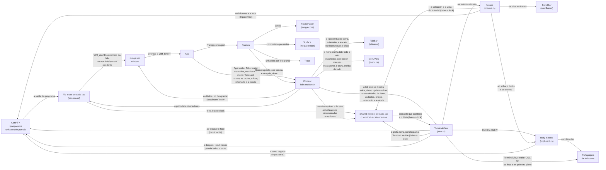

# Código › `meiga` (o programa)

> Estado: subfase 2.4. O programa é un terminal con tabs: lanza nunha pseudoconsola o programa da súa liña de comandos ou, sen el, PowerShell, mostra a súa saída na xanela, coas cores, os estilos, o cursor e o título que pon o programa, e envíalle as teclas e o foco. Cada tab ten a súa sesión, e as que se abren despois da primeira corren PowerShell, salvo as copias dunha tab, que corren o seu programa; unha tab oculta segue lendo a saída do seu programa, sen debuxala, e respondéndolle. Unha barra de tabs, enriba do terminal, mostra o título de cada tab, ou o nome do seu programa, e abre, mostra e pecha tabs co rato. O rato selecciona texto, que vai ao portapapeis, ou chega ao programa, se o pediu; as teclas e o botón dereito copian e pegan. A grella enche a xanela e segue o seu tamaño e a súa escala; o historial vese coa roda, coas teclas e cunha barra de desprazamento; e o texto ten zoom. Presenta só as zonas que cambian. Tamén ten tres modos de medición (`--bench`), un rexistro dos fotogramas (`--trace-frames`) e as marcas das zonas presentadas (`--marks`). Na 1.6 desapareceu a demo, e chegaron `session.rs` e `view.rs`; na 1.7, o teclado, e as marcas pasaron da tecla P á opción `--marks`; na 1.8, o rato, a selección e o portapapeis, con `mouse.rs` e `clipboard.rs`; e na 1.9, o historial, o tamaño e o zoom, con `scrollbar.rs`. Na 1.10 non cambiou o código: só chegou a ligazón ao ADR 0017; nin na 2.1, que trouxo o modelo das tabs a `meiga-core`. Na 2.2 chegaron as tabs: unha sesión por cada unha, que segue en segundo plano, e catro atallos provisionais para abrilas, pechalas e cambiar de tab, con `tabs.rs`. Na 2.3, a barra de tabs, con `tabbar.rs`: as tabs ábrense, móstranse e péchanse tamén co rato, o rato vai á barra ou ao terminal de debaixo dela, e a xanela colle os títulos dos programas no fotograma, como moito unha vez por intervalo, e non co aviso do fío lector. Na 2.4, os menús, con `menu.rs`: o menú dunha tab, que abren o botón dereito, a tecla de menú e Maiús+F10, duplica unha tab e pecha varias dunha vez.

**Responsabilidade:** unir as pezas. Crea a xanela, as súas tabs e a barra de tabs, lanza o programa de cada tab nunha sesión de ConPTY, leva á pantalla a saída do da tab que se mostra co fluxo de fotogramas, e as teclas e o rato a ese programa, dálles ao terminal e ao programa a grella que enche a xanela debaixo da barra, e copia e pega co portapapeis de Windows, usando os outros tres crates. Ver [Arquitectura](../arquitectura.md#2-estrutura-do-código-un-workspace-con-catro-crates) e, para o camiño da saída, [Arquitectura › Da saída á pantalla](../arquitectura.md#da-saída-á-pantalla-o-aviso-a-copia-e-o-fotograma); para o das teclas, [Arquitectura › O teclado](../arquitectura.md#o-teclado-da-tecla-ao-programa); para o do rato e o do texto, [Arquitectura › O rato, a selección e o portapapeis](../arquitectura.md#o-rato-a-selección-e-o-portapapeis); para o dun cambio de tamaño e o da vista do historial, [Arquitectura › O historial, o tamaño e o zoom](../arquitectura.md#o-historial-o-tamaño-e-o-zoom); para o das tabs, [Arquitectura › As tabs: unha sesión por tab e as tabs en segundo plano](../arquitectura.md#as-tabs-unha-sesión-por-tab-e-as-tabs-en-segundo-plano); para o da barra de tabs e o dos títulos, [Arquitectura › A barra de tabs](../arquitectura.md#a-barra-de-tabs); e para o dos menús, [Arquitectura › Os menús](../arquitectura.md#os-menús).

| Arquivo | Contido |
|---|---|
| [`Cargo.toml`](#cratesmeigacargotoml) | O crate e as súas dependencias. |
| [`build.rs`](#cratesmeigabuildrs) | Incrusta o manifesto en `meiga.exe` ao compilar. |
| [`meiga.exe.manifest`](#cratesmeigameigaexemanifest) | O manifesto da aplicación: como debe executala Windows. |
| [`src/main.rs`](#cratesmeigasrcmainrs) | O punto de entrada: as opcións, a xanela e a mensaxe de erro. |
| [`src/options.rs`](#cratesmeigasrcoptionsrs) | As opcións da liña de comandos, co programa que se lanza. |
| [`src/app.rs`](#cratesmeigasrcapprs) | `App`, o *handler* da xanela: crea o contido, as tabs do terminal ou un modo de medición, e leva os eventos aos fotogramas, e ás tabs os avisos dos fíos lectores, os atallos e os clics das tabs, o rato, o tamaño e a escala e, desde a 2.4, as teclas e o foco, que ata a 2.3 ían á vista. |
| [`src/tabs.rs`](#cratesmeigasrctabsrs) | Desde a subfase 2.2. `Tabs`, as tabs da xanela: cada unha co seu terminal e a súa sesión, que segue mentres a tab está oculta, a vista, que mostra a activa, e, desde a 2.3, a barra de tabs, enriba dela. Leva os avisos dos fíos lectores á tab de cada un, remata á súa hora as actualizacións sincronizadas das tabs ocultas, baixa a prioridade dos fíos lectores das tabs ocultas, salvo mentres a xanela ten o *lock* do seu terminal, e abre, pecha e cambia de tab cos atallos e cos clics na barra. Desde a 2.3, colle no fotograma os títulos dos programas, para a xanela e para a barra, reparte o rato entre a barra e o terminal, e pon o terminal debaixo da barra. Desde a 2.4, abre o menú dunha tab, enriba de todo, dálle o rato e as teclas mentres está aberto, e péchao; e duplica unha tab ou pecha varias dunha vez. |
| [`src/tabbar.rs`](#cratesmeigasrctabbarrs) | Desde a subfase 2.3. `TabBar`, a barra de tabs: unha tab por sesión, co título do seu programa ou o seu nome, e o seu ×, e o botón +. Resalta o que ten o punteiro debaixo, converte os clics en accións das tabs, di que zonas cambian, e debúxase, coa tab activa nas cores do terminal. Desde a 2.4, o botón dereito nunha tab pide o seu menú. |
| [`src/menu.rs`](#cratesmeigasrcmenurs) | Desde a subfase 2.4. `MenuView`, un menú da xanela, debuxado enriba da barra de tabs e do terminal: o seu marco e os seus elementos, o resalte, que segue o punteiro e as frechas, o elemento que escollen un clic, Intro ou Espazo, e as zonas que cambian. O primeiro é o menú dunha tab. |
| [`src/session.rs`](#cratesmeigasrcsessionrs) | A sesión dunha tab: o programa, e o fío lector que lle dá a súa saída ao terminal da tab, responde ao programa e esperta a xanela co identificador da tab. Desde a 2.3, tamén como colle a xanela o título dunha tab, unha vez por cada título novo. |
| [`src/view.rs`](#cratesmeigasrcviewrs) | `TerminalView`, o terminal da tab que mostra a xanela, a mesma vista para todas as tabs, debaixo da barra de tabs: a súa copia da pantalla, posta ao día antes de cada fotograma, o debuxo das celas, as súas liñas, a selección e o cursor, e as teclas e o foco, que lle envía ao programa, salvo as que colle para copiar e pegar, para mover a vista do historial, para o zoom e para as tabs e, desde a 2.4, as que baixan mentres o menú dunha tab está aberto; a grella que enche a súa área, que lles dá ao terminal e ao programa ao ritmo dos fotogramas; a fonte, que crea de novo co zoom e coa escala; o texto que copia o programa, e o título, que lles deixa ás tabs; e o cambio ao terminal doutra tab. |
| [`src/mouse.rs`](#cratesmeigasrcmousers) | `Mouse`, o rato da vista: selecciona texto, cópiao ao soltar o botón e pega co dereito, ou envíalle ao programa os clics, os movementos e a roda. A roda tamén despraza o historial, ou fai o zoom con Ctrl; a barra de desprazamento é súa; unha selección arrastrada fóra da grella despraza a vista soa; e, desde a 2.3, di se ten o rato, para que as tabs lle sigan dando os seus eventos. |
| [`src/scrollbar.rs`](#cratesmeigasrcscrollbarrs) | `ScrollBar`, a barra de desprazamento: a franxa á dereita da xanela, co polgar que mostra que parte do historial se ve, que se arrastra, e as páxinas cun clic na franxa. |
| [`src/clipboard.rs`](#cratesmeigasrcclipboardrs) | Copiar a selección ao portapapeis e pegar o portapapeis no programa, coa pregunta antes de pegar varias liñas. Pegar leva a vista do historial á pantalla. |
| [`src/frames.rs`](#cratesmeigasrcframesrs) | `Frames`, o fluxo de fotogramas: que cambiou, cando debuxalo e como chega á xanela. Desde a 2.3, a escena recibe a xanela, para darlle o título. |
| [`src/trace.rs`](#cratesmeigasrctracers) | O rexistro dos fotogramas, en CSV. |
| [`src/bench.rs`](#cratesmeigasrcbenchrs) | Os tres modos de medición: fotogramas parciais, completos e completos de texto, sen parar. |

Así se reparten o traballo:



1. O fío lector da sesión de cada tab ([`session.rs`](#cratesmeigasrcsessionrs)) dálle cada bloque de saída ao terminal da tab, baixo o *lock* de `Shared`, envía as respostas ao programa e esperta a xanela con `WM_WAKE`, só se non había outro aviso pendente. Desde a subfase 2.2, o aviso leva o identificador da tab.
2. `App::wake` ([`app.rs`](#cratesmeigasrcapprs)) lévalle o aviso ás tabs ([`tabs.rs`](#cratesmeigasrctabsrs)). Se é da tab que se mostra, a vista leva ao portapapeis, desde a subfase 1.8, o texto que copiou o programa (OSC 52), só se a xanela ten o foco e está en primeiro plano; e, se cambiou a pantalla ou, desde a 2.3, o título, `App` pídelle un fotograma a `Frames` (`changed`), que o fai no momento ou ao final do intervalo ([`frames.rs`](#cratesmeigasrcframesrs)). Ata a 2.1, todo isto facíao `App::wake`; ata a 2.2, a vista collía tamén o título, e dáballo á xanela co mesmo aviso.
3. O fotograma pon primeiro ao día o contido (`Scene::update`): a vista do terminal ([`view.rs`](#cratesmeigasrcviewrs)) copia baixo o *lock* só o que cambiou no terminal da tab que se mostra, e di que zonas son; desde a 2.3, as tabs collen os títulos novos, para a xanela e para a barra, e a barra di que zonas cambiaron nela; e, desde a 2.4, o menú, as súas. Despois, fóra do *lock*, compón esas zonas (`draw`), a barra arriba, a vista debaixo e, desde a 2.4, o menú, se está aberto, enriba das dúas, e preséntaas.
4. Coa xanela minimizada non hai fotogramas, e a vista non copia nada: só fai o que non pode esperar (`Scene::update_hidden`): rematar á súa hora unha actualización sincronizada que o programa deixou aberta, para que as súas preguntas teñan resposta, e, desde a 2.3, darlle á xanela o título da tab que se mostra, que Windows mostra na barra de tarefas, como moito unha vez por intervalo ([`frames.rs`](#coa-xanela-minimizada-hidden)).
5. Desde a subfase 1.7, as teclas chegan á xanela coma `Event::Key`, e `App` pásallas á vista, desde a 2.4 a través das tabs, que, mentres o menú dunha tab está aberto, lle dan a el as que baixan (punto 10). A vista convérteas no que le o programa, segundo os modos que activou, e escríbeas na entrada da sesión, sen esperar: o fío escritor da sesión lévaas ao ConPTY ([`key` e `focus`](#as-teclas-e-o-foco-key-e-focus)). Os cambios do foco tamén lle chegan ao programa, se os pediu.
6. Desde a subfase 1.8, os eventos do rato chegan á vista, que llos pasa ao seu rato ([`mouse.rs`](#cratesmeigasrcmousers)); desde a 2.3, a través das tabs, que lle dan só os do terminal (punto 9) e, desde a 2.4, ningún mentres o menú está aberto (punto 10). Os clics seleccionan texto na grella do terminal, baixo o *lock*, ou, se o programa pediu o rato e Maiús non está premido, van a el coma informes, pola entrada da sesión. A selección vai ao portapapeis ao soltar o botón; Ctrl+C e Ctrl+Maiús+C cópiana, e Ctrl+V, Ctrl+Maiús+V e o botón dereito pegan ([`clipboard.rs`](#cratesmeigasrcclipboardrs)). Despois, `App` fai o que lle pide a vista ([`respond`](#respond-o-que-pide-a-vista)): un fotograma, se cambiou a selección, e poñerse ao día, se se mostrou a caixa de mensaxe que pregunta antes de pegar.
7. Desde a subfase 1.9, a vista recibe os cambios de tamaño da xanela (`Event::Resized`), salvo se está minimizada, e os de escala (`Event::DpiChanged`), e, ao pecharse a caixa de mensaxe que pregunta antes de pegar, o tamaño e a escala que a xanela ten entón ([`catch_up`](#respond-o-que-pide-a-vista)); desde a 2.3, a través das tabs, que lle dan a área de debaixo da barra ([`resized` e `dpi_changed`](#o-tamaño-e-a-escala-resized-dpi_changed-e-below_bar)). A vista calcula a grella que enche a súa área, sen a franxa da barra de desprazamento, e dálla ao terminal e ao ConPTY no seguinte fotograma, como moito unha vez por intervalo, baixo o *lock* ([`resized` e `resize_grid`](#o-tamaño-resized-resize_grid-e-grid_size)). A roda, as teclas do historial e a barra de desprazamento ([`scrollbar.rs`](#cratesmeigasrcscrollbarrs)) moven a vista do historial; e Ctrl e `+`, `-` ou `0`, e Ctrl e a roda, fan o zoom: a vista crea a fonte nova, e con ela cambia a grella ([`zoom`](#o-zoom-e-a-escala-zoom-set_points-dpi_changed-e-new_font)).
8. Desde a subfase 2.2, a xanela ten tabs, cada unha co seu terminal e a súa sesión ([`tabs.rs`](#cratesmeigasrctabsrs), [ADR 0019](../adr/0019-varias-sesions-e-tabs-en-segundo-plano.md)), e unha soa vista, que mostra a activa. O fío lector dunha tab oculta segue dándolle a saída ao seu terminal, cunha prioridade por debaixo da normal, salvo mentres a xanela ten o *lock* dese terminal: así, a xanela nunca espera por un lector de menos prioridade ca ela. Pero a xanela non copia a súa pantalla nin colle o seu portapapeis: as marcas desas cousas quedan postas, e a saída do seu programa esperta a xanela como moito unha vez por cada unha. Ata a 2.2, tampouco collía o seu título; desde a 2.3, cólleo o fotograma, para a barra (punto 9). Só as súas actualizacións sincronizadas non poden esperar: se, despois de darlle ao terminal un bloque de saída, o programa deixou unha aberta, o fío lector avisa, e a xanela remátaa á súa hora, sen debuxar nada, coma coa xanela minimizada; unha que se abre e se pecha no mesmo bloque non avisa. Ctrl+Maiús+T abre unha tab, Ctrl+Maiús+W pecha a que se mostra, e Ctrl+Tab e Ctrl+Maiús+Tab mostran a seguinte e a anterior ([`shortcut`](#as-teclas-e-o-foco-key-e-focus)); ao cambiar de tab, a vista mostra o terminal da nova cun único fotograma completo ([`show`](#mostrar-outra-tab-show)).
9. Desde a subfase 2.3, a barra de tabs ([`tabbar.rs`](#cratesmeigasrctabbarrs), [ADR 0020](../adr/0020-a-barra-de-tabs.md)) vai enriba do terminal, que ocupa o resto da área cliente: as tabs danlle á vista a área de debaixo da barra, baixan o alto da barra as zonas da vista e soben os puntos do rato. O rato é da barra ou do terminal: do que tiña o punteiro cando baixou un botón, ata que sobe, e se non, do que o ten debaixo ([`mouse`](#o-rato-da-barra-ou-do-terminal-mouse-bar_mouse-e-dialog_closed)). Na barra, o botón esquerdo nunha tab móstraa en canto baixa; o × pecha a súa tab e o + abre unha cando o esquerdo sobe enriba deles; o do medio pecha a tab onde baixa e sobe; e, desde a 2.4, o dereito abre o menú da tab onde baixa e sobe (punto 10). Os clics piden o mesmo ca os atallos, e `App` dállo ás tabs ([`act`](#os-atallos-e-os-clics-act-open-e-close)). Os títulos cólleos o fotograma, e non o aviso do fío lector: o da tab que se mostra, para a xanela e para a barra, e os das ocultas, para a barra ([Os títulos](#os-títulos-retitle_active-e-retitle_hidden)). Mentres un título agarda polo fotograma, a súa marca segue posta, e o fío lector non volta espertar a xanela por el: un programa que cambia o título sen parar esperta a xanela como moito unha vez por intervalo. A barra só debuxa o que cambia: o resalte do punteiro, un botón premido, un título novo, ou toda ela cando se abre ou se pecha unha tab, ou cambian o ancho ou a escala.
10. Desde a subfase 2.4, o menú dunha tab ([`menu.rs`](#cratesmeigasrcmenurs), [ADR 0021](../adr/0021-os-menus-e-o-menu-da-tab.md)) vai enriba da barra e do terminal, no mesmo *framebuffer* e no mesmo fotograma. Ábreno o botón dereito, onde sobe, se baixou na mesma tab, e a tecla de menú e Maiús+F10, debaixo da tab que se mostra ([O menú da tab](#o-menú-da-tab-open_menu-key-focus-e-close_menu)). Mentres está aberto, recibe todo o rato e as teclas que baixan, e o programa non as recibe, nin ao subir; un clic fóra pécháo, e non fai nada máis ([`menu_mouse`](#o-rato-co-menú-aberto-menu_mouse)). O elemento que se escolle pide unha acción das tabs, coma un atallo ou un clic na barra: duplicar a tab, pechala, ou pechar as outras tabs ou as da súa dereita ([Duplicar e pechar varias](#duplicar-e-pechar-varias-duplicate-e-close_several)). Péchase tamén cando a xanela perde o foco, cambia de tamaño ou de escala, empeza a moverse ou se minimiza. O menú só debuxa o que cambia: enteiro ao abrirse; ao pecharse, o que tapaba; e ao moverse o resalte, os dous elementos. O que cambia na barra e no terminal debaixo del, se o tapa enteiro, non se debuxa ata que se pecha ([`Scene` e `earliest`](#scene-e-earliest)).

## `crates/meiga/Cargo.toml`

```toml
[package]
name = "meiga"
description = "A lightweight terminal for Windows, with performance as the top priority."
version.workspace = true
edition.workspace = true
rust-version.workspace = true
license.workspace = true
repository.workspace = true
publish.workspace = true

[dependencies]
meiga-core.workspace = true
meiga-render.workspace = true
meiga-win.workspace = true

[lints]
workspace = true
```

- Como o crate ten un `src/main.rs`, Cargo sabe que é un **binario**: o resultado da compilación é `meiga.exe`.
- Depende dos tres crates de biblioteca. É o único que pode velos todos. Desde a subfase 1.2 úsaos os tres: `meiga-render` debuxa e presenta. Desde a 1.6, `meiga-win` lanza tamén o programa nunha pseudoconsola, e o terminal de `meiga-core` le a súa saída.
- Non depende de `windows-sys`: os tipos de Windows que necesita, `HWND` e `HDC`, publícaos `meiga-win` (ver [Código › meiga-win](meiga-win.md#cratesmeiga-winsrclibrs)).
- Cargo atopa `build.rs` só, porque está na raíz do crate; non fai falta declaralo.

## `crates/meiga/build.rs`

```rust
//! Embeds the application manifest (`meiga.exe.manifest`) in `meiga.exe`.

use std::env;

const MANIFEST: &str = concat!(env!("CARGO_MANIFEST_DIR"), "\\meiga.exe.manifest");

fn main() {
    println!("cargo::rerun-if-changed=meiga.exe.manifest");

    // The options below belong to the MSVC linker (link.exe).
    let target_os = env::var("CARGO_CFG_TARGET_OS").unwrap_or_default();
    let target_env = env::var("CARGO_CFG_TARGET_ENV").unwrap_or_default();
    if target_os != "windows" || target_env != "msvc" {
        return;
    }

    println!("cargo::rustc-link-arg-bins=/MANIFEST:EMBED");
    println!("cargo::rustc-link-arg-bins=/MANIFESTINPUT:{MANIFEST}");
    // The manifest already says how to run (trustInfo); the linker must not
    // add its own copy.
    println!("cargo::rustc-link-arg-bins=/MANIFESTUAC:NO");
}
```

Un ***build script***: Cargo compila e executa `build.rs` antes de compilar o crate. O script fala con Cargo escribindo liñas `cargo::instrución=valor` na súa saída.

- `env!("CARGO_MANIFEST_DIR")` lese ao compilar `build.rs`: é a ruta absoluta do cartafol do crate. `concat!` xunta os textos, tamén ao compilar. A ruta ten que ser absoluta porque o ligador non traballa no cartafol do crate.
- `cargo::rerun-if-changed=meiga.exe.manifest`: Cargo só volta executar o script se cambia o manifesto (ou o propio `build.rs`). Sen esta liña, executaríao con calquera cambio no crate. Cando o script se volta executar, Cargo volta ligar `meiga.exe` co manifesto novo; comprobouse cambiando a data do arquivo.
- `CARGO_CFG_TARGET_OS` e `CARGO_CFG_TARGET_ENV`: variábeis que Cargo lle pasa ao script coa plataforma **para a que** se compila (que non ten por que ser na que se compila). As opcións son do ligador de Microsoft (`link.exe`, ver [Tecnoloxías › MSVC](../tecnoloxias.md#13-msvc-e-o-windows-sdk)), e outro ligador non as entendería.
- `unwrap_or_default()`: se a variábel non existe, un texto baleiro. Nunca provoca un pánico, como esixen as regras do proxecto contra `unwrap()`.
- `cargo::rustc-link-arg-bins=…`: pasa unha opción ao ligador, só ao ligar os binarios (`meiga.exe`) e non as bibliotecas.
- `/MANIFEST:EMBED`: o ligador xera un manifesto e métello ao `.exe` como un recurso, en vez de deixalo nun arquivo á parte que se podería perder ao copiar o programa.
- `/MANIFESTINPUT:…`: o contido do manifesto sae deste arquivo.
- `/MANIFESTUAC:NO`: o ligador engade pola súa conta un `trustInfo` (como se executa o programa respecto ao UAC). O manifesto de meiga xa o leva, así que o do ligador desactívase: o que vai dentro do `.exe` é exactamente o que hai no arquivo.

**Comprobado:** sen `build.rs`, `meiga.exe` non leva ningún manifesto. Rust non lle pide ningún ao ligador, e Windows trataría meiga como un programa que non sabe escalar: en pantallas ao 150 %, estiraría a súa imaxe e o texto veríase borroso.

## `crates/meiga/meiga.exe.manifest`

```xml
<?xml version="1.0" encoding="UTF-8" standalone="yes"?>
<!-- Application manifest of meiga.exe. build.rs embeds it with the linker. -->
<assembly xmlns="urn:schemas-microsoft-com:asm.v1" manifestVersion="1.0">
  <!-- Run without elevation, with the rights of the user who starts it. -->
  <trustInfo xmlns="urn:schemas-microsoft-com:asm.v3">
    <security>
      <requestedPrivileges>
        <requestedExecutionLevel level="asInvoker" uiAccess="false"/>
      </requestedPrivileges>
    </security>
  </trustInfo>
  <!-- Tested on Windows 10 and 11: no compatibility shims. -->
  <compatibility xmlns="urn:schemas-microsoft-com:compatibility.v1">
    <application>
      <supportedOS Id="{8e0f7a12-bfb3-4fe8-b9a5-48fd50a15a9a}"/>
    </application>
  </compatibility>
  <!-- meiga scales itself on every monitor, so Windows must not stretch its
       pixels. -->
  <application xmlns="urn:schemas-microsoft-com:asm.v3">
    <windowsSettings>
      <dpiAwareness xmlns="http://schemas.microsoft.com/SMI/2016/WindowsSettings">PerMonitorV2</dpiAwareness>
    </windowsSettings>
  </application>
</assembly>
```

O **manifesto da aplicación** é un XML que Windows le antes de arrancar o programa. Que é e como funciona explícase en [Tecnoloxías › Manifesto](../tecnoloxias.md#23-manifesto-da-aplicación-e-dpi). Leva tres declaracións:

| Elemento | Que declara | Sen el |
|---|---|---|
| `requestedExecutionLevel level="asInvoker"` | meiga corre cos permisos de quen o abre e nunca pide ser administrador. `uiAccess="false"`: non necesita controlar as xanelas doutros programas. | Windows aplicaría a algúns programas regras de compatibilidade pensadas para os anteriores ao UAC. |
| `supportedOS Id="{8e0f7a12-…}"` | meiga está feito para Windows 10 e 11 (os dous comparten este identificador). | Windows activaría comportamentos de compatibilidade para programas antigos; por exemplo, as funcións que dan a versión de Windows mentirían. |
| `dpiAwareness` = `PerMonitorV2` | meiga escala el mesmo o seu contido en cada monitor, e Windows non debe estirar os seus píxeles. | En pantallas con escala, Windows debuxaría meiga ao 100 % e estiraría a imaxe: texto borroso. |

- O elemento antigo `dpiAware` non fai falta: `dpiAwareness` funciona desde Windows 10 versión 1607, e meiga necesita a 1809 (pola ConPTY).
- Os comentarios van en inglés, como no resto do código.
- O ligador reescribe o XML ao incrustalo (sen comentarios nin espazos), pero o contido é o mesmo.

## `crates/meiga/src/main.rs`

```rust
//! meiga: a lightweight terminal for Windows.

// Release builds are GUI applications without a console window. Debug builds
// keep the console so that diagnostics are visible during development.
#![cfg_attr(not(debug_assertions), windows_subsystem = "windows")]
#![forbid(unsafe_code)]

mod app;
mod bench;
mod clipboard;
mod frames;
mod menu;
mod mouse;
mod options;
mod scrollbar;
mod session;
mod tabbar;
mod tabs;
mod trace;
mod view;

use std::env;
use std::error::Error;
use std::process::ExitCode;

use meiga_win::window::{self, Window, WindowOptions};

use crate::app::{App, TITLE};
use crate::options::{Options, USAGE};
use crate::trace::Trace;

/// The exit code when the command line is wrong.
const USAGE_ERROR: u8 = 2;

fn main() -> ExitCode {
    let options = match Options::parse(env::args_os().skip(1)) {
        Ok(options) => options,
        Err(error) => {
            report(&format!("{error}\n\n{USAGE}"));
            return ExitCode::from(USAGE_ERROR);
        }
    };
    match run(&options) {
        Ok(()) => ExitCode::SUCCESS,
        Err(error) => {
            report(&format!(
                "meiga stopped because of an unexpected error.\n\n{error}"
            ));
            ExitCode::FAILURE
        }
    }
}

fn run(options: &Options) -> Result<(), Box<dyn Error>> {
    let trace =
        match &options.trace_frames {
            Some(path) => Some(Trace::create(path).map_err(|error| {
                format!("Cannot create the frame log {}: {error}", path.display())
            })?),
            None => None,
        };
    let window = Window::create(&WindowOptions { title: TITLE })?;
    let mut app = App::new(&window, options, trace)?;
    window.run(&mut app)
}

/// Tells the user about an error. Release builds have no console, so the
/// message box is the only way.
fn report(text: &str) {
    eprintln!("{text}");
    window::show_error("meiga", text);
}
```

- `#![cfg_attr(condición, atributo)]` aplica o atributo só se se cumpre a condición. `debug_assertions` está activado nas compilacións de depuración e desactivado en *release*, así que en *release* meiga é unha aplicación gráfica, sen xanela de consola. Ver [Tecnoloxías › Subsistema](../tecnoloxias.md#6-subsistema-de-windows).
- `#![forbid(unsafe_code)]`: o programa non ten nin un bloque `unsafe`. Todas as chamadas a Windows pasan por `meiga-win` e `meiga-render`, que as envolven en funcións seguras.
- `mod …;` declara os trece módulos do programa, que están nos arquivos do mesmo nome. Desde a subfase 1.8 hai dous máis: `mouse`, o rato da vista ([`mouse.rs`](#cratesmeigasrcmousers)), e `clipboard`, copiar e pegar ([`clipboard.rs`](#cratesmeigasrcclipboardrs)); desde a 1.9, `scrollbar`, a barra de desprazamento ([`scrollbar.rs`](#cratesmeigasrcscrollbarrs)); desde a 2.2, `tabs`, as tabs da xanela ([`tabs.rs`](#cratesmeigasrctabsrs)); desde a 2.3, `tabbar`, a barra de tabs ([`tabbar.rs`](#cratesmeigasrctabbarrs)); e desde a 2.4, `menu`, os menús da xanela ([`menu.rs`](#cratesmeigasrcmenurs)).
- `use meiga_win::window::{self, Window, WindowOptions};` importa o módulo (`self`, para escribir `window::show_error`) e os dous tipos.
- `TITLE` é o título da xanela, «meiga»: o que ten ao abrila e sempre que o programa da tab que se mostra non pon outro (ver [`app.rs`](#cratesmeigasrcapprs)).
- `fn main() -> ExitCode`: `main` pode devolver o código de saída do proceso: `ExitCode::SUCCESS` (0), `ExitCode::FAILURE` (1) ou outro número, con `ExitCode::from`.
- **As opcións.** `env::args_os()` dá os argumentos da liña de comandos, como `OsString`, os textos do sistema operativo, que en Windows poden non ser UTF-8 válido. `.skip(1)` salta o primeiro, que é o nome do programa. Se as opcións están mal, meiga mostra o erro e como se usa ([`USAGE`](#cratesmeigasrcoptionsrs)) e sae co código 2, o habitual para os erros de uso.
- **`run`** fai os pasos en orde:
  1. Se se pediu o rexistro dos fotogramas, crea o arquivo. Se non pode, o erro di que arquivo era: `map_err` cambia o erro por un texto, e `?` convérteo en `Box<dyn Error>`, que acepta textos.
  2. Crea a xanela, aínda oculta.
  3. Crea `App`, o *handler*, con todas as opcións: lanza o programa na primeira tab do terminal, ou prepara un modo de medición, e compón xa o primeiro fotograma no *framebuffer* (ver [`app.rs`](#cratesmeigasrcapprs)).
  4. `window.run` mostra a xanela e entrega os seus eventos a `App` ata que se pecha: co botón de pechar, con Alt+F4 ou, desde a subfase 2.2, ao pechar a súa última tab, cun atallo ou, desde a 2.3, co seu × ou, desde a 2.4, co seu menú (*Close tab*) ([`close`](#os-atallos-e-os-clics-act-open-e-close)). Ao rematar `run`, `app` destrúese e, con el, as tabs e as súas sesións.
- `match &options.trace_frames`: o `&` mira o valor sen quitarllo a `options`. As sangrías raras de `let trace =` son as de rustfmt.
- `Box<dyn Error>`: calquera erro nunha caixa (ver [`HandlerError`](meiga-win.md#handler)). Os erros de `meiga-win`, de `meiga-render` e os textos convértense solos con `?`.
- Se algo falla, `report` avisa:
  - `eprintln!` escribe o texto na saída de erros. Vese nas compilacións de depuración, que teñen consola; en *release* non hai consola, e Rust descarta o texto sen fallar;
  - `window::show_error` móstrao nunha caixa de mensaxe, que en *release* é a única forma de avisar;
  - o proceso remata co código 1, ou co 2 se as opcións estaban mal.
- **O programa do terminal non é meiga.** Se non se pode lanzar, non é un erro de meiga: o terminal mostra por que, e a xanela queda aberta (ver [`session.rs`](#cratesmeigasrcsessionrs)). E remate como remate o programa, meiga sae co código 0 cando se pecha a xanela: o código do programa vese na última liña do terminal ([ADR 0013](../adr/0013-da-saida-a-pantalla.md)).

## `crates/meiga/src/options.rs`

```rust
pub const USAGE: &str =
    "Usage: meiga [--trace-frames <file>] [--marks] [--] [<program> [<arguments>]]
       meiga [--trace-frames <file>] [--marks] --bench partial|full|text

  <program>              The program to run in the terminal, and its arguments.
                         Without it, PowerShell 7 (pwsh) or, if it is not
                         installed, Windows PowerShell.
  --                     The end of the options: what follows is the program.
  --trace-frames <file>  Write a line per frame to <file> (CSV).
  --marks                Draw a magenta border around the areas that each frame
                         presents.
  --bench partial        Instead of a terminal, move a small square without stopping.
  --bench full           Instead of a terminal, change the whole window without stopping.
  --bench text           Instead of a terminal, fill the whole window with text that
                         changes at every frame.";

pub enum BenchMode {
    Partial,
    Full,
    Text,
}

pub struct Options {
    pub trace_frames: Option<PathBuf>,
    /// Whether the window shows the areas that each frame presents.
    pub marks: bool,
    pub bench: Option<BenchMode>,
    /// The command line of the program, quoted for Windows, or `None` for
    /// the default shell.
    pub command: Option<String>,
}
```

As opcións da liña de comandos. Hai dúas formas de usar meiga: cun terminal, que executa un programa, ou cun modo de medición, que non executa ningún. Sen nada, meiga abre un terminal coa shell por defecto.

| Argumento | Que fai |
|---|---|
| `<programa> [<argumentos>]` | O programa que se executa no terminal, cos seus argumentos. Sen el, PowerShell 7 (`pwsh`) ou, se non está instalado, Windows PowerShell (ver [`session.rs`](#cratesmeigasrcsessionrs)). Úsano `check-window.ps1`, `check-present.ps1` e `run-scenario.ps1 -Start`, que lanzan meiga cun programa propio. |
| `--` | O fin das opcións: o seguinte argumento é o programa, aínda que empece por `-`. |
| `--trace-frames <arquivo>` | Escribe unha liña por fotograma nese arquivo CSV (ver [`trace.rs`](#cratesmeigasrctracers)). É o que usan `check-present.ps1` e `measure-frames.ps1`. |
| `--marks` | Desde a subfase 1.7. Debuxa un bordo magenta arredor das zonas que presenta cada fotograma ([`frames.rs`](#crear-framesnew)), para ver que se debuxa. Ata a 1.6 activábanse coa tecla P, que agora vai ao programa coma todas ([ADR 0014](../adr/0014-o-teclado.md)). Vale co terminal e cos modos de medición. |
| `--bench partial` | En vez dun terminal, un cadrado de 64 píxeles que cruza a xanela sen parar: fotogramas parciais. |
| `--bench full` | En vez dun terminal, a xanela enteira cambia de cor en cada fotograma: fotogramas completos. |
| `--bench text` | En vez dun terminal, a xanela enteira chea de texto que cambia en cada fotograma: fotogramas completos de texto. |

Por exemplo:

```text
meiga
meiga cmd
meiga --marks
meiga --trace-frames frames.csv pwsh -NoProfile -File "C:\my scripts\spinner.ps1"
meiga --bench full
```

```rust
pub fn parse(args: impl IntoIterator<Item = OsString>) -> Result<Self, String> {
    let mut options = Options::default();
    let mut args = args.into_iter();
    let mut program = None;
    while let Some(arg) = args.next() {
        match arg.to_str() {
            Some("--trace-frames") => {
                let path = args.next().ok_or("--trace-frames needs the path of a file.")?;
                options.trace_frames = Some(PathBuf::from(path));
            }
            Some("--marks") => options.marks = true,
            Some("--bench") => {
                options.bench = Some(match args.next().as_deref().and_then(OsStr::to_str) {
                    Some("partial") => BenchMode::Partial,
                    Some("full") => BenchMode::Full,
                    Some("text") => BenchMode::Text,
                    _ => return Err("--bench needs 'partial', 'full' or 'text'.".into()),
                });
            }
            Some("--") => {
                program = args.next();
                break;
            }
            Some(option) if option.starts_with('-') => {
                return Err(format!("Unknown option: {option}"));
            }
            _ => {
                program = Some(arg);
                break;
            }
        }
    }
    let Some(program) = program else {
        return Ok(options);
    };
    if options.bench.is_some() {
        return Err("--bench does not run a program.".into());
    }
    let text = |arg: OsString| {
        arg.into_string().map_err(|arg| {
            format!("The command line can only have valid Unicode: {}", arg.to_string_lossy())
        })
    };
    let program = text(program)?;
    let arguments = args.map(text).collect::<Result<Vec<_>, _>>()?;
    let command = shell::command_line(&program, &arguments)
        .ok_or_else(|| format!("The name of a program cannot have quotes: {program}"))?;
    options.command = Some(command);
    Ok(options)
}
```

- **Sen dependencias.** Hai crates para ler opcións (`clap`, por exemplo), pero para tan poucas abonda un bucle, e meiga mantén as dependencias ao mínimo ([ADR 0006](../adr/0006-licenzas-e-dependencias.md)).
- `impl IntoIterator<Item = OsString>`: calquera colección de argumentos. O programa pásalle os da liña de comandos, e as probas, unha lista feita a man.
- `arg.to_str()` dá o texto se é UTF-8 válido. A ruta do rexistro non se converte: `PathBuf::from` acepta calquera nome de arquivo de Windows. `ok_or` converte un `Option` nun `Result`: se non hai seguinte argumento, o erro. `as_deref` mira o `OsString` como `&OsStr` sen copialo.
- **O programa.** O primeiro argumento que non é unha opción, ou o que vén despois de `--`, é o programa, e todos os que veñen despois, os seus argumentos, aínda que parezan opcións de meiga: en `meiga cmd --bench full`, `--bench full` é de `cmd`. Así, os argumentos do programa nunca necesitan `--` ([Tecnoloxías › A liña de comandos](../tecnoloxias.md#40-a-liña-de-comandos-en-windows)). `break` sae do bucle, e `args` queda co resto.
- **Unha opción descoñecida** é un erro, e non o programa: un argumento que empeza por `-` antes do programa é para meiga. Así, `meiga -NoProfile pwsh` avisa, en vez de intentar lanzar un programa chamado `-NoProfile`. Un programa cun nome así lánzase con `--` diante.
- `let … else`: se non hai programa, as opcións xa están, co `command` a `None`, que é a shell por defecto.
- **`--bench` cun programa** é un erro: os modos de medición non executan ningún programa, e ignoralo en silencio faría crer que se mediu con el.
- **Só Unicode válido.** `into_string` converte o `OsString` nun `String` sen copialo, se é Unicode válido; se non, devolve o orixinal, que a mensaxe mostra con `to_string_lossy`, cambiando o que non é válido por �. En Windows, un argumento pode ter UTF-16 que non é Unicode válido (a metade dun par de *surrogates*); cambialo por � daría ao programa un argumento distinto sen avisar. Un argumento así nunca é unha opción: chega ao programa, e dá este erro.
- `args.map(text).collect::<Result<Vec<_>, _>>()?` converte cada argumento e xúntaos nun `Vec`, ou para no primeiro erro: un iterador de `Result` pódese recoller nun `Result` dunha colección.
- **A liña de comandos.** En Windows, un programa recibe os seus argumentos nun só texto ([Tecnoloxías › A liña de comandos](../tecnoloxias.md#40-a-liña-de-comandos-en-windows)). [`shell::command_line`](meiga-core.md#cratesmeiga-coresrcshellrs) xunta o programa e os argumentos, coas comiñas e as barras invertidas que fagan falta para que o programa os divida igual ca os recibiu meiga: `C:\my scripts\spinner.ps1`, por exemplo, vai como `"C:\my scripts\spinner.ps1"`. Por iso `Options` garda un `String`, e non unha lista: é o que recibe a pseudoconsola.
- **Un programa con comiñas** é un erro: ningún nome de arquivo as pode ter, e Windows le o nome do programa sen ningunha forma de escapalas. `command_line` devolve `None`, e `ok_or_else` convérteo no erro, creando o texto só se fai falta.
- `Options` deriva `Default` (sen ningunha opción: `None` e `false`) e `PartialEq`, para comparalas nas probas.

**Probas.** Catro: sen argumentos, e con `--` só, a shell por defecto; as opcións cos seus valores, en calquera orde, os tres modos e, desde a 1.7, `--marks`; o programa e os seus argumentos forman a liña de comandos, coas comiñas de Windows, as opcións despois do programa son súas, e despois de `--` o programa pode empezar por `-`; e os erros: unha opción descoñecida, tamén antes do programa (`-NoProfile pwsh`), `--trace-frames` sen arquivo, `--bench` sen modo ou cun que non existe, `--bench` cun programa e un programa con comiñas.

## `crates/meiga/src/app.rs`

`App` é o *handler* da xanela ([`Handler`](meiga-win.md#handler)): crea o contido, recibe os eventos, pásallos ao contido e decide os fotogramas con `Frames`. Desde a subfase 2.2, o contido do terminal son as súas tabs ([`Tabs`](#cratesmeigasrctabsrs)): `App` lévalle á vista as teclas e o foco, e ás tabs, os avisos dos fíos lectores e os atallos das tabs. Desde a 2.3, tamén o rato, o tamaño e a escala van ás tabs, que os reparten entre a barra de tabs e a vista, e os clics na barra, coma os atallos. Desde a 2.4, tamén as teclas e o foco, e os elementos do menú dunha tab, coma os atallos: as tabs dánlle á vista as teclas, salvo as que baixan mentres o menú está aberto, que son para el, e pechan o menú cando a xanela perde o foco, cambia de tamaño ou de escala, empeza a moverse ou se minimiza.

### `Content` e `App`

```rust
/// The title of the window while the program does not give one.
pub const TITLE: &str = "meiga";

/// What the window shows. Both hold a whole font, so they go in boxes.
enum Content {
    Terminal(Box<Tabs>),
    Bench(Box<Bench>),
}

impl Scene for Content {
    fn update(
        &mut self,
        window: &Window,
        now: Instant,
        damage: &mut dyn FnMut(Rect),
    ) -> Option<Instant> {
        match self {
            Content::Terminal(tabs) => tabs.update(window, now, damage),
            Content::Bench(_) => None,
        }
    }

    fn update_hidden(&mut self, window: &Window, now: Instant) -> Option<Instant> {
        match self {
            Content::Terminal(tabs) => tabs.update_hidden(window, now),
            Content::Bench(_) => None,
        }
    }

    fn draw(&mut self, canvas: &mut Canvas<'_>) {
        match self {
            Content::Terminal(tabs) => tabs.draw(canvas),
            Content::Bench(bench) => bench.draw(canvas),
        }
    }
}

pub struct App {
    frames: Frames,
    /// The tabs own their sessions, which close when they are dropped.
    content: Content,
}
```

- `TITLE`: o título da xanela ao abrila, e sempre que o programa non pon ningún. `main.rs` crea a xanela con el. Desde a subfase 2.2 úsano tamén as tabs, que poñen na xanela o título da tab que se mostra, ou «meiga» se o seu programa non puxo ningún: ata a 2.2 facíao a vista; desde a 2.3, `Tabs`, no fotograma ([Os títulos](#os-títulos-retitle_active-e-retitle_hidden)) e ao cambiar de tab ([`show`](#cambiar-de-tab-show)).
- `Content` é o que mostra a xanela: o terminal ou un dos modos de medición ([`Bench`](#cratesmeigasrcbenchrs)). Desde a subfase 2.2, o terminal son as súas tabs ([`Tabs`](#cratesmeigasrctabsrs)), que levan dentro a vista e, desde a 2.3, a barra de tabs; ata a 2.1, era a vista ([`TerminalView`](#cratesmeigasrcviewrs)). Implementa [`Scene`](#scene), así que `Frames` pode poñelo ao día, debuxalo e, coa xanela minimizada, deixarlle facer o que non pode esperar (`update_hidden`), sen saber cal é. As tabs fano coa vista, coa barra e coas tabs ocultas ([`Scene` e `earliest`](#scene-e-earliest)). Desde a 2.3, a posta ao día recibe tamén a xanela, `window`, á que as tabs lle dan o título. Os modos de medición non teñen nada que poñer ao día nin que facer coa xanela minimizada (`None`): as súas zonas chegan con `step`, antes de cada fotograma.
- **As dúas variantes en `Box`.** Un `enum` ocupa en memoria o que a súa variante máis grande, e as dúas levan dentro unha fonte enteira ([`Font`](meiga-render.md#cratesmeiga-rendersrctextrs)); as tabs, ademais, a vista, coa súa copia da pantalla e a paleta de 256 cores, e o modelo das tabs. Na `Box` van na memoria dinámica, e o `enum` só garda un punteiro: mover o contido, de `App::new` a `App`, só copia ese punteiro.
- **As sesións son das tabs**, desde a subfase 2.2: cada tab garda a súa ([`Tab`](#tab)), e destruíla pecha a sesión ([ADR 0011](../adr/0011-fin-e-peche-das-sesions.md)). Ata a 2.1, `App` gardaba a única sesión nun campo propio, `_session`, que ninguén lía: estaba alí para vivir tanto coma `App`. Agora fai o mesmo `content`: ao pecharse a xanela, `run` remata, `App` destrúese e, con el, as tabs e as súas sesións, e os seus programas e as súas consolas rematan tamén, como comproba `check-window.ps1`. Nos modos de medición non hai ningunha sesión.

### `App::new`

```rust
pub fn new(
    window: &Window,
    options: &Options,
    trace: Option<Trace>,
) -> Result<Self, HandlerError> {
    // Only the content with text reads the fonts of the system.
    let mut content = match options.bench {
        Some(BenchMode::Text) => {
            let system = FontSystem::new()?;
            let font = Font::new(
                &system,
                &FONT_FAMILIES,
                f32::from(FONT_POINTS),
                window.dpi(),
            )?;
            Content::Bench(Box::new(Bench::new(BenchMode::Text, Some(font))))
        }
        Some(mode) => Content::Bench(Box::new(Bench::new(mode, None))),
        None => Content::Terminal(Box::new(Tabs::new(window, options.command.as_deref())?)),
    };
    let mut frames = Frames::new(window, &mut content, trace, options.marks)?;
    if options.bench.is_some() {
        frames.schedule(window)?;
    }
    Ok(Self { frames, content })
}
```

- **O contido:** un modo de medición, como antes, ou o terminal: desde a subfase 2.2, as súas tabs, coa primeira, que corre o programa das opcións ([`Tabs::new`](#tabs-e-new)). `as_deref` dá un `Option<&str>` sen copiar o texto. Ata a 2.1 creábao `terminal`, unha función deste módulo, que devolvía o contido e a sesión, un par que `App::new` gardaba en dous campos. O que facía está agora en `Tabs::new` e en [`Tab::start`](#tab), e `App::new` só garda o contido.
- **As fontes.** Só o contido con texto le as fontes do sistema ([`FontSystem`](meiga-render.md#fontsystem)): o terminal e o modo `text`, cunha fonte ao DPI da xanela ([`Window::dpi`](meiga-win.md#windowdpi)). Os modos `partial` e `full` non cargan nada de DirectWrite, e miden o mesmo ca na subfase 1.2.
- **Os puntos.** Desde a subfase 1.9, `FONT_POINTS` é un número enteiro, porque o zoom cambia o tamaño da fonte dun punto en punto ([`view.rs`](#constantes)), e `Font::new` recibe os puntos coma un `f32`: `f32::from` convérteos sen perder nada.
- Os erros de `meiga-render` convértense en `HandlerError` con `?`, como os de `meiga-win`: se non hai ningunha das fontes, meiga para cunha caixa de mensaxe que o di.
- `Frames::new` crea o *framebuffer* co tamaño da xanela, pon ao día o contido e compóno enteiro nel. Así, cando Windows pide o primeiro `WM_PAINT`, só hai que copialo.
- **As marcas** (o bordo magenta das zonas presentadas) só se debuxan coa opción `--marks`: no terminal son unha axuda para ver que presenta cada fotograma, e nos modos de medición engadirían traballo aos fotogramas que se miden. Ata a subfase 1.6 activábaas a tecla P; desde a 1.7, todas as teclas van ao programa.
- Un modo de medición pide xa o seu primeiro fotograma (`schedule`), que chegará en canto a xanela empece o seu bucle de mensaxes.

### `wake`: o aviso do fío lector

```rust
fn wake(&mut self, window: &Window, tab: u64) -> Result<(), HandlerError> {
    let Content::Terminal(tabs) = &mut self.content else {
        return Ok(());
    };
    if tabs.wake(window, TabId::from_raw(tab), Instant::now()) {
        self.frames.changed(window, &mut self.content)?;
    }
    Ok(())
}
```

O fío lector dunha tab espertou a xanela con `WM_WAKE`: cambiou o título, a pantalla ou, desde a subfase 1.8, o portapapeis, ou máis dunha cousa, ou o programa deixou aberta unha actualización sincronizada ([Tecnoloxías › Avisar á xanela](../tecnoloxias.md#36-avisar-á-xanela-desde-outro-fío-postmessage)). Desde a subfase 2.2, o aviso di de que tab vén ([ADR 0019](../adr/0019-varias-sesions-e-tabs-en-segundo-plano.md), decisión 2).

- **O identificador da tab** chega no `wParam` da mensaxe, que ten 64 bits, coma o número: meiga só se compila para x64, e `meiga-win` compróbao ao compilar. O fío lector pon nel o número do `TabId` da súa tab ([`Reader`](#o-fío-lector-reader)), e `meiga-win` dállo ao *handler* en `Event::Wake` ([Código › meiga-win › `event.rs`](meiga-win.md#cratesmeiga-winsrceventrs)). [`TabId::from_raw`](meiga-core.md#cratesmeiga-coresrcmodelmodrs) volta facer o identificador co número: só serve para buscar unha tab, e un número que non é de ningunha non atopa nada.
- **O que fai cada tab co aviso** decídeo `Tabs::wake` ([os avisos](#os-avisos-wake-e-catch_up_wakes)): na tab que se mostra, a vista colle o texto que copiou o programa, e di se cambiou a pantalla e, desde a 2.3, se o programa deu outro título, sen collelo ([`TerminalView::wake`](#o-título-o-portapapeis-e-a-pantalla-wake)); nunha oculta, só se apunta cando remata a actualización sincronizada que deixou aberta o seu programa e, desde a 2.3, se deu outro título; e o aviso dunha tab que xa pechou ignórase. Devolve se hai que poñer ao día a escena: se cambiou a pantalla da tab que se mostra, se un programa deu outro título, que colle o fotograma ([Os títulos](#os-títulos-retitle_active-e-retitle_hidden)), ou se unha tab oculta ten aberta unha actualización sincronizada, cuxa hora límite `Frames` coñece na seguinte posta ao día.
- **`Frames::changed`** pide entón un fotograma, que o *pacer* fai no momento ou ao final do intervalo; coa xanela minimizada, en vez del, as tabs fan só o que non pode esperar ([`hidden`](#coa-xanela-minimizada-hidden)). O aviso dunha tab oculta non dá ningunha zona da vista: se tampouco cambiou nada na tab que se mostra nin na barra, o fotograma non debuxa nada, e só queda o temporizador, programado para a hora límite ([`draw`](#draw)).
- **Ata a 2.1**, `wake` collía eiquí o título e o texto do portapapeis do único terminal, que lle daba a vista (`shared()`). Desde a 2.2 faino a vista, que sabe que terminal mostra: `App` só lles leva o aviso ás tabs, sen saber cal se mostra, e `TerminalView::shared` desapareceu. Desde a 2.3, o título cólleo o fotograma, e non o aviso ([ADR 0020](../adr/0020-a-barra-de-tabs.md), decisión 5).
- `let … else`: se o contido non é o terminal, non hai nada que facer. A referencia é `&mut`, e non `&` coma ata a 2.1: `Tabs::wake` cambia as tabs, porque apunta cando rematan as súas actualizacións sincronizadas e, desde a 2.3, se os seus programas deron outro título.
- **Os préstamos.** `tabs` é unha referencia a `self.content`, que se usa por última vez en `tabs.wake(…)`: despois, Rust permite pasarlle outra vez `&mut self.content` a `Frames::changed`.

### Os eventos

```rust
fn event(&mut self, window: &Window, event: Event) -> Result<(), HandlerError> {
    match event {
        Event::Resized { size, minimized } => {
            // A minimized window keeps its grid, and closes the menu.
            if let Content::Terminal(tabs) = &mut self.content {
                if minimized {
                    tabs.close_menu(window);
                } else {
                    tabs.resized(window, size);
                }
            }
            self.frames
                .resized(window, size, minimized, &mut self.content)?;
            if self.is_bench() {
                self.frames.schedule(window)?;
            }
        }
        Event::DpiChanged { dpi } => {
            if let Content::Terminal(tabs) = &mut self.content {
                tabs.dpi_changed(window, dpi);
                // The new size of the window, if it changes, comes right
                // after this event. A frame now would give the terminal
                // and the program the grid of the new cells in the old
                // window, which does not last: the frame comes after it.
                self.frames.schedule(window)?;
            }
        }
        Event::SizeMoveStarted => {
            // The menu closes as soon as the user starts moving or
            // resizing the window.
            if let Content::Terminal(tabs) = &mut self.content
                && tabs.close_menu(window)
            {
                self.frames.changed(window, &mut self.content)?;
            }
            self.frames.size_move_started();
        }
        Event::SizeMoveEnded => self.frames.size_move_ended(window, &mut self.content)?,
        Event::FrameTimer => {
            if let Content::Bench(bench) = &mut self.content {
                for area in bench.step(self.frames.size()) {
                    self.frames.damage(area);
                }
            }
            self.frames.timer(window, &mut self.content)?;
            if self.is_bench() {
                self.frames.schedule(window)?;
            }
        }
        Event::Wake(tab) => self.wake(window, tab)?,
        Event::Focus { focused } => {
            if let Content::Terminal(tabs) = &mut self.content {
                tabs.focus(window, focused, Instant::now());
                self.frames.changed(window, &mut self.content)?;
            }
        }
        Event::Key(key) => {
            if let Content::Terminal(tabs) = &mut self.content {
                let response = tabs.key(window, &key);
                self.respond(window, response)?;
            }
        }
        Event::MouseDown { .. }
        | Event::MouseUp { .. }
        | Event::MouseMoved { .. }
        | Event::Wheel { .. }
        | Event::CaptureLost
        | Event::MouseLeft => {
            if let Content::Terminal(tabs) = &mut self.content {
                let response = tabs.mouse(window, &event);
                self.respond(window, response)?;
            }
        }
    }
    Ok(())
}

fn paint(&mut self, _window: &Window, dc: HDC, area: Rect) -> Result<(), HandlerError> {
    self.frames.paint(dc, area)
}
```

| Evento | Que fai |
|---|---|
| `Wake` | O fío lector dunha tab avisou, desde a subfase 2.2 co identificador da súa tab: `wake` lévao ás tabs. Se é a que se mostra, a vista leva ao portapapeis o texto que copiou o programa e, se cambiou a pantalla ou, desde a 2.3, o título, pídese un fotograma; se é unha oculta, só se apunta cando remata a súa actualización sincronizada e, desde a 2.3, se o seu programa deu outro título, que colle o fotograma. Coa xanela minimizada, as tabs só fan o que non pode esperar. |
| `Focus` | A xanela gañou ou perdeu o foco ([`Event::Focus`](meiga-win.md#cratesmeiga-winsrceventrs)): o cursor do terminal cambia, o programa da tab que se mostra sabe do foco se o pediu ([`focus`](#as-teclas-e-o-foco-key-e-focus)), e pídese un fotograma para debuxar o cursor. Desde a subfase 2.4, a través das tabs, que, se a xanela o perde, pechan antes o menú, se está aberto, e o mesmo fotograma debuxa o que tapaba ([`focus`](#o-menú-da-tab-open_menu-key-focus-e-close_menu)). Nos modos de medición, nada. |
| `FrameTimer` | Toca debuxar. Nun modo de medición, primeiro avanza un paso e marca as zonas que cambian. Despois, `Frames` debuxa o fotograma pendente; se non había ningún, é o momento que pediu o terminal, como o seguinte cambio do pestanexo do cursor, ou, desde a subfase 2.2, a hora límite dunha actualización sincronizada dunha tab oculta, e pide un fotograma para el ([`timer`](#pedir-un-fotograma)). Coa xanela minimizada, o temporizador só se programa para a hora límite dunha actualización sincronizada, e a vista, ou as tabs, remátana sen debuxar nada. Nun modo de medición, despois pide o seguinte fotograma. |
| `Resized` | `Frames` adapta o *framebuffer* ao tamaño novo, ou, se a xanela se minimizou, deixa de debuxar, e o temporizador queda só para a hora límite dunha actualización sincronizada aberta, se a hai. Nun modo de medición, ao restaurala, os fotogramas continúan. Desde a subfase 1.9, antes diso, a vista calcula a grella que enche a xanela ([`resized`](#o-tamaño-resized-resize_grid-e-grid_size)), e dálla ao terminal e ao programa no seguinte fotograma, como moito unha vez por intervalo; desde a 2.3, a través das tabs, que lle dan á barra o ancho e á vista o resto da xanela, debaixo da barra ([`resized`](#o-tamaño-e-a-escala-resized-dpi_changed-e-below_bar)). Coa xanela minimizada, que ten tamaño 0 × 0, a grella non cambia: o terminal e o programa repartirían o texto para nada, e ao restaurala a xanela volta ao tamaño de antes. Desde a 2.4, o menú dunha tab péchase cando a xanela se minimiza, e cando cambia o seu tamaño ([`close_menu`](#o-menú-da-tab-open_menu-key-focus-e-close_menu)). Ata a 1.8, a grella non cambiaba nunca: se a xanela medraba, as marxes medraban, e se se facía pequena, a grella cortábase. |
| `DpiChanged` | Desde a subfase 1.9. A xanela pasou a un monitor con outra escala, ou cambiou a escala do seu ([`Event::DpiChanged`](meiga-win.md#cratesmeiga-winsrceventrs)): a vista crea a fonte, a barra de desprazamento e o cursor para o DPI novo ([`dpi_changed`](#o-zoom-e-a-escala-zoom-set_points-dpi_changed-e-new_font)) e, desde a 2.3, a barra de tabs, a súa fonte e o seu *layout*, que pode ter outro alto ([`dpi_changed`](#o-tamaño-e-a-escala-resized-dpi_changed-e-below_bar)); desde a 2.4, ademais, o menú dunha tab péchase. Chega antes ca o tamaño que suxire Windows, que chega de inmediato coma `Resized` e calcula a grella coas celas novas ([Tecnoloxías › A escala cambia](../tecnoloxias.md#50-a-escala-cambia-wm_dpichanged)). Por iso, desde a revisión do código, non se debuxa no momento: [`schedule`](#pedir-un-fotograma) pide un fotograma ao temporizador, e o tamaño novo chega antes. O seu fotograma dálles ao terminal e ao programa a grella nova, unha vez, e debuxa a xanela enteira; o do temporizador xa non atopa nada que facer. Se o tamaño da xanela non cambia, é o do temporizador o que lles dá a grella das celas novas na mesma xanela. Nos modos de medición, nada. |
| `SizeMoveStarted` e `SizeMoveEnded` | O usuario empeza e remata de mover ou redimensionar a xanela: mentres tanto, o *framebuffer* reserva memoria con marxe ([`Fit::Room`](meiga-render.md#fit-e-surface)). Ao rematar, preséntase o que cambiase mentres tanto. Desde a subfase 2.4, ao empezar, o menú dunha tab péchase, se estaba aberto, e un fotograma debuxa o que tapaba (`Frames::changed`). |
| `Key` | Desde a subfase 1.7. Unha tecla baixou ou subiu ([`Event::Key`](meiga-win.md#cratesmeiga-winsrckeyboardrs)): a vista envíalla ao programa ([`key`](#as-teclas-e-o-foco-key-e-focus)) ou, desde a 1.8, cóllea para copiar, pegar ou quitar a selección, desde a 1.9, para mover a vista do historial e para o zoom e, desde a 2.2, para abrir, pechar e cambiar de tab. Desde a 2.4, chega á vista a través das tabs, e a tecla de menú e Maiús+F10 abren o menú da tab que se mostra; mentres está aberto, as teclas que baixan son para el, e o programa non as recibe, nin ao subir ([`key`](#o-menú-da-tab-open_menu-key-focus-e-close_menu)). Despois, `respond` fai o que pide a vista, ou o menú. A tecla en si non pide ningún fotograma: o que escriba o programa en resposta chega coma calquera saída; só se pide un se cambiou a selección, a vista do historial ou a fonte, se a xanela mostra outra tab, ou, desde a 2.4, se cambiou o menú. Nos modos de medición, nada. |
| `MouseDown`, `MouseUp`, `MouseMoved`, `Wheel`, `CaptureLost` e `MouseLeft` | Desde a subfase 1.8. Un botón do rato baixou ou subiu, o rato moveuse, xirou a roda, ou outra xanela colleu o rato; e, desde a 1.9, o punteiro saíu da xanela, despois de pasar pola franxa da barra de desprazamento (`MouseLeft`) ([`Event`](meiga-win.md#cratesmeiga-winsrceventrs)): desde a 2.3, as tabs dánllo á barra de tabs ou á vista ([`mouse`](#o-rato-da-barra-ou-do-terminal-mouse-bar_mouse-e-dialog_closed)) e, desde a 2.4, mentres o menú dunha tab está aberto, a el ([`menu_mouse`](#o-rato-co-menú-aberto-menu_mouse)). A barra resalta o que ten o punteiro debaixo, e os seus clics abren, mostran e pechan tabs e, desde a 2.4, abren o menú dunha tab; a vista pásallo ao seu rato, que selecciona, copia e pega, move a vista do historial, ou envíalle ao programa os clics, os movementos e a roda; e coa roda e Ctrl, a vista fai o zoom ([`mouse`](#o-rato-mouse-e-dialog_closed)). Despois, `respond` fai o que pide a resposta. Nos modos de medición, nada. |

- `WM_PAINT` (`paint`) copia a zona que pide Windows desde o *framebuffer*. `_window`: o guión baixo indica que o parámetro non se usa.
- `is_bench` di se o contido é un modo de medición: `matches!` compara un valor cun patrón e dá `true` ou `false`.
- **Todos os eventos.** Ata a subfase 1.7, o último brazo era `_ => {}`, e o rato non facía nada. Desde a 1.8, o `match` nomea todas as variantes de `Event`, sen `_`: se `meiga-win` engade outra, o programa non compila ata que `App` decida que facer con ela. Así chegaron na 1.9 `DpiChanged` e `MouseLeft`.
- **A orde en `Resized`.** Desde a subfase 1.9, a vista recibe o tamaño antes ca `Frames`, desde a 2.3 a través das tabs: o fotograma que compón `Frames::resized` pon ao día a vista, e con ela xa vai a grella nova, se pasou un intervalo desde o cambio anterior ([`resize_grid`](#o-tamaño-resized-resize_grid-e-grid_size)), e a barra co ancho novo. Desde a 2.4, as tabs reciben tamén a xanela, para soltar o rato se un botón estaba premido no menú que pechan; e, coa xanela minimizada, só pechan o menú (`close_menu`), e o seu `bool`, que di se estaba aberto, descártase: minimizada, a xanela non debuxa nada, e ao restaurala compón o *framebuffer* enteiro ([O tamaño da xanela](#o-tamaño-da-xanela)). Ata a 2.3, un `if let … && !minimized` encadeaba o patrón e a condición.
- **`SizeMoveStarted`**, desde a 2.4: o menú péchase en canto o usuario empeza a mover ou a redimensionar a xanela, coma os menús de Windows ([ADR 0021](../adr/0021-os-menus-e-o-menu-da-tab.md), decisión 9), e, se estaba aberto, `Frames::changed` pide o fotograma que debuxa o que tapaba. `if let … && tabs.close_menu(window)` encadea o patrón e a condición (*let chains*): `close_menu` só se chama co terminal, e o corpo só corre se o menú estaba aberto. Ata a 2.3, este evento só lle dicía a `Frames` que empezaba o movemento, coma agora despois.
- `Event::MouseDown { .. } | …`: un brazo para varios patróns, separados por `|`. `{ .. }` encaixa coa variante sen mirar os seus campos, e as tabs reciben o evento enteiro (`&event`), que volta mirar quen o recibe ([`Tabs::mouse`](#o-rato-da-barra-ou-do-terminal-mouse-bar_mouse-e-dialog_closed) e [`Mouse::event`](#mouse)).
- **A vista, a través das tabs.** Desde a subfase 2.2, os eventos da xanela, salvo os avisos, van á vista con `tabs.view_mut()` ([`Tabs`](#tabs-e-new)): a vista é unha para todas as tabs, e mostra a activa, así que as teclas, o rato, o foco, o tamaño e a escala son da tab que se mostra. As ocultas non os ven: o seu programa recibiu que perdeu o foco ao ocultarse, se o pediu, e a súa grella agarda a que se mostren ([`show`](#mostrar-outra-tab-show)). Desde a 2.3, só as teclas e o foco van directamente á vista; o rato, o tamaño e a escala van ás tabs (`tabs.mouse`, `tabs.resized` e `tabs.dpi_changed`), que os reparten entre a barra e a vista. Desde a 2.4, tampouco as teclas e o foco: van ás tabs (`tabs.key` e `tabs.focus`), que lle dan as teclas á vista ou, mentres está aberto, ao menú dunha tab, e pechan o menú se a xanela perde o foco; e `view_mut` desapareceu.
- **Os préstamos.** En `Focus`, `tabs` é unha referencia `&mut` a `self.content`, que se usa por última vez en `tabs.focus(…)`: despois, Rust permite pasar outra vez `&mut self.content` a `Frames::changed`. O mesmo en `SizeMoveStarted`, desde a 2.4, onde `tabs` se usa por última vez na condición, e en `Resized`, desde a 1.9, e en `Key` e no rato: `respond` colle `&mut self` enteiro, e chámase cando `tabs` xa non se usa. Por iso a vista e as tabs devolven o que hai que facer, en vez de facelo elas: non teñen `Frames`, e `Frames::changed` necesita o contido enteiro, onde están elas. Ata a 2.3, `view_mut` daba outra referencia, á vista, que tampouco se usaba despois.
- `if let Content::Bench(bench) = &mut self.content`: entra só se o contido é un modo de medición, e dá unha referencia a el.

### `respond`: o que pide a vista

```rust
fn respond(&mut self, window: &Window, response: Response) -> Result<(), HandlerError> {
    let mut changed = response.redraw;
    if response.dialog {
        if let Content::Terminal(tabs) = &mut self.content {
            tabs.dialog_closed(window);
        }
        self.catch_up(window)?;
        // While the message box was open, the window lost its wake-ups,
        // and maybe some paint: what changed meanwhile is shown now.
        window.invalidate(None);
        if let Content::Terminal(tabs) = &mut self.content {
            changed |= tabs.catch_up_wakes(window, Instant::now());
        }
    }
    if let Some(action) = response.tab
        && let Content::Terminal(tabs) = &mut self.content
    {
        changed |= tabs.act(window, action, Instant::now());
    }
    if changed {
        self.frames.changed(window, &mut self.content)?;
    }
    Ok(())
}

fn catch_up(&mut self, window: &Window) -> Result<(), HandlerError> {
    let Content::Terminal(tabs) = &self.content else {
        return Ok(());
    };
    let dpi = window.dpi();
    if dpi != tabs.view().dpi() {
        self.event(window, Event::DpiChanged { dpi })?;
    }
    let size = window.client_size()?;
    let minimized = window.is_minimized();
    self.event(window, Event::Resized { size, minimized })
}
```

Desde a subfase 1.8. Despois dunha tecla ou dun evento do rato, fai o que lle pide a vista ou, desde a 2.3, a barra de tabs, ou, desde a 2.4, o menú dunha tab, nun [`Response`](#context-e-response):

- **Pechouse a caixa de mensaxe** que pregunta antes de pegar ([`paste`](#pegar-paste)). A caixa ten o seu propio bucle de mensaxes, que lle pasa tamén as da xanela ao *window procedure*, pero, mentres estaba aberta, o *handler* seguía ocupado na tecla ou no clic que a abriu, esperando por ela: `meiga-win` non o pode chamar outra vez, e descarta os eventos que chegan entón ([Código › meiga-win › `Handler`](meiga-win.md#handler), [Tecnoloxías › Pegar no terminal](../tecnoloxias.md#47-pegar-no-terminal-o-filtro-e-o-bracketed-paste)). Ao pecharse:
  1. **A vista esquece as teclas que colleu e os botóns do rato** ([`dialog_closed`](#o-rato-mouse-e-dialog_closed)): a súa soltura puido chegar mentres tanto, e perderse. O programa recibe agora a soltura dos botóns cuxa baixada recibiu. Desde a 2.3, chégalle a través das tabs ([`dialog_closed`](#o-rato-da-barra-ou-do-terminal-mouse-bar_mouse-e-dialog_closed)), e a barra de tabs solta tamén o botón que tiña premido, sen facer nada.
  2. **A vista e, desde a 2.3, a barra de tabs pónense ao día coa escala e co tamaño da xanela** (`catch_up`), desde a revisión do código da subfase 1.9: mentres a caixa estaba aberta, a xanela puido cambiar de tamaño ou de escala, por exemplo se cambia a escala do monitor, ou se outro programa lle cambia o tamaño, e eses eventos tamén se perderon. Windows aplica igual o tamaño que suxire o cambio de escala ([`WM_DPICHANGED`](meiga-win.md#cratesmeiga-winsrcwindowrs)), pero a vista, o terminal e o programa seguirían coa grella de antes ata o seguinte cambio. `catch_up` trata a escala e o tamaño de agora coma se acabasen de chegar, na mesma orde ca Windows: primeiro a escala da xanela, se non é a da vista ([`dpi`](#terminalview)), que desde a 2.2 se le con `tabs.view()`, e despois o tamaño, sempre. Co mesmo tamaño, `Resized` non fai nada: a vista non cambia a grella, e `Frames` non toca o *framebuffer*. Minimizada, a xanela deixa de debuxar, coma con calquera `Resized`. `catch_up` chama a `event` desde `respond`, que xa vén de `event`: non hai ningún problema, porque `App` é un valor normal, sen *lock* nin `RefCell`, e cada chamada colle `&mut self` cando a anterior xa non o usa. `check-resize.ps1` compróbao: cambia o tamaño da xanela coa caixa aberta, e o programa recibe a grella nova ao pechala ([Código › ferramentas](ferramentas.md#toolscheck-resizeps1)).
  3. **A xanela píntase enteira** desde o *framebuffer* (`invalidate`): quizais se perdeu algún `WM_PAINT`.
  4. **As tabs len o que cambiou mentres tanto** (`catch_up_wakes`). Os avisos dos fíos lectores tamén se perderon, desde a subfase 2.2 os de todas as tabs, e, coas súas marcas postas, os fíos lectores non envían outros ([`Shared`](#shared-e-lock)): o texto que copiou o programa e a pantalla da tab que se mostra agardan a que alguén mire, os títulos novos, a que alguén os colla, e as actualizacións sincronizadas que deixaron abertas as tabs ocultas, a que a xanela saiba cando rematan. `catch_up_wakes` fai con todas as tabs o que faría o seu aviso ([os avisos](#os-avisos-wake-e-catch_up_wakes), [ADR 0019](../adr/0019-varias-sesions-e-tabs-en-segundo-plano.md), decisión 13), e os títulos cólleos o fotograma. Ata a 2.1, `respond` chamaba eiquí a `wake`, que só tiña un terminal que mirar.
- **Cambiou a selección** ou, desde a subfase 1.9, a vista do historial ou a fonte, ou, desde a 2.3, algo na barra de tabs, como o resalte do punteiro, ou, desde a 2.4, no menú dunha tab, como o seu resalte (`redraw`): hai que copiar e debuxar só as celas onde cambiou ([`update`](#poñer-ao-día-update)) ou, cunha fonte nova, a xanela enteira. O zoom da roda xa o fixo a vista ([`mouse`](#o-rato-mouse-e-dialog_closed)), e `respond` non o ve.
- **Un atallo das tabs** (`tab`), desde a subfase 2.2, ou, desde a 2.3, un clic na barra de tabs, ou, desde a 2.4, un elemento do menú dunha tab: `Tabs::act` fai o que pide, abrir, pechar, mostrar ou cambiar de tab e, desde a 2.4, abrir o menú dunha tab, duplicala ou pechar varias ([`act`](#os-atallos-e-os-clics-act-open-e-close)), e di se un fotograma ten que mostralo: a xanela mostra agora outra tab, que o fotograma ten que debuxar enteira, ou, desde a 2.3, cambiou a barra, ou, desde a 2.4, abriuse o menú. Pechar a última tab pecha a xanela, e entón non fai falta ningún fotograma. `if let … && let …` encadea os dous patróns (*let chains*): o atallo só se fai se o contido é o terminal. Unha resposta non trae nunca un atallo e a caixa á vez: a caixa ábrea pegar, e nin un atallo das tabs, nin un clic na barra, nin un elemento do menú pegan.
- **Un só fotograma.** Desde a 2.2, `changed` xunta o que piden a vista ou a barra e, desde a 2.4, o menú (`redraw`), os avisos que se perderon e o atallo ou o clic das tabs, e `Frames::changed` chámase unha vez, ao final. Ata a 2.1 podía haber dúas chamadas, a de `wake` ao pecharse a caixa e a de `redraw`: se a primeira debuxaba no momento, a segunda deixaba outro fotograma para o final do intervalo, que xa non adoitaba ter nada que debuxar. Cada parte recibe a hora de agora (`Instant::now()`), coma a vista en `focus`.
- **Desde a revisión do código.** Antes, ao pecharse a caixa, `respond` só pintaba a xanela e chamaba a `wake`, e a vista non sabía o que pasara mentres tanto: unha tecla collida que subira na caixa, coma o C de Ctrl+C se Ctrl+V abriu a caixa co C aínda abaixo, comía a súa seguinte pulsación; e o programa nunca recibía a soltura dun botón que se premeu para el antes de abrila. `check-mouse.ps1` comproba os dous casos ([Código › ferramentas](ferramentas.md#toolscheck-mouseps1)).

## `crates/meiga/src/tabs.rs`

Desde a subfase 2.2. As **tabs da xanela**: cada unha co seu terminal e a súa sesión, que segue mentres a tab está oculta, e a vista, unha soa, que mostra a activa ([ADR 0019](../adr/0019-varias-sesions-e-tabs-en-segundo-plano.md), [Arquitectura › As tabs: unha sesión por tab e as tabs en segundo plano](../arquitectura.md#as-tabs-unha-sesión-por-tab-e-as-tabs-en-segundo-plano)); e, desde a 2.3, a barra de tabs, enriba da vista ([`tabbar.rs`](#cratesmeigasrctabbarrs), [ADR 0020](../adr/0020-a-barra-de-tabs.md), [Arquitectura › A barra de tabs](../arquitectura.md#a-barra-de-tabs)). A orde das tabs, cal está activa e cal se activa ao pechar unha decídeos o modelo de `meiga-core` ([`model::Window`](meiga-core.md#cratesmeiga-coresrcmodelwindowrs), [ADR 0018](../adr/0018-o-modelo-das-tabs.md)), que non sabe nada de terminais nin de Windows. Este módulo pon dentro de cada tab o seu terminal e a súa sesión, leva o aviso de cada fío lector á súa tab, remata á súa hora as actualizacións sincronizadas das tabs ocultas, cambia a prioridade dos fíos lectores, e abre, pecha e cambia de tab cando o pide un atallo ou, desde a 2.3, un clic na barra. Desde a 2.3, ademais, colle no fotograma os títulos dos programas, para a xanela e para a barra; reparte o rato entre a barra e o terminal; e pon o terminal debaixo da barra: o tamaño, as zonas, o debuxo e os puntos do rato da vista cóntanse desde o bordo de abaixo da barra. Desde a 2.4, o menú dunha tab ([`menu.rs`](#cratesmeigasrcmenurs), [ADR 0021](../adr/0021-os-menus-e-o-menu-da-tab.md), [Arquitectura › Os menús](../arquitectura.md#os-menús)): ábreo co botón dereito nunha tab, e coa tecla de menú ou Maiús+F10 na que se mostra; mentres está aberto, dálle todo o rato e as teclas que baixan, e non debuxa o que cambia debaixo del; péchao cando a xanela perde o foco, cambia de tamaño ou de escala, empeza a moverse ou se minimiza; e fai o que pide o seu elemento, coma un atallo: duplicar a tab, pechala, ou pechar as outras tabs ou as da súa dereita.

| | A tab que se mostra | Unha tab oculta |
|---|---|---|
| O fío lector | Dálle a saída do programa ao terminal, con prioridade normal. | O mesmo, con prioridade por debaixo da normal, salvo mentres a xanela ten o *lock* do seu terminal: entón, coa normal. |
| A pantalla | A vista copia o que cambiou, antes de cada fotograma. | Ninguén a copia: a súa marca queda posta, e a saída esperta a xanela como moito unha vez. |
| O título | Desde a 2.3, o fotograma cólleo, como moito unha vez por intervalo, para a xanela e para a súa tab na barra. Coa xanela minimizada vai só á xanela, que o mostra na barra de tarefas, tamén como moito unha vez por intervalo. | Desde a 2.3, o fotograma cólleo, como moito unha vez por intervalo, para a súa tab na barra; coa xanela minimizada, agarda a que se restaure. Á xanela só chega cando se mostra a tab. |
| O texto que copia o programa (OSC 52) | Vai ao portapapeis, se a xanela ten o foco e está en primeiro plano. | Descártase cando se mostra a tab. |
| Unha actualización sincronizada que o programa deixa aberta | Remátaa a vista á súa hora, na posta ao día dun fotograma. | Remátaa `end_hidden_syncs` á súa hora, sen copiar nin debuxar nada. |
| O tamaño da xanela | A vista dálles a grella nova ao terminal e ao programa, como moito unha vez por intervalo. | Mantén a súa grella ata que se mostra. |
| O foco | O programa sabe se a xanela o ten, se o pediu. | Se a xanela tiña o foco, o programa recibiu que o perdeu ao ocultarse a tab, se o pediu. |
| Na barra de tabs | Desde a 2.3, a súa tab, coas cores do terminal: o seu fondo e o seu texto. | Desde a 2.3, a súa tab, en gris. Un clic nela móstraa, e o seu × ou o botón do medio péchana. |
| O seu menú | Desde a 2.4, ábreno o botón dereito na súa tab, onde sobe, e a tecla de menú e Maiús+F10, debaixo da súa tab. | Desde a 2.4, ábreo o botón dereito na súa tab, onde sobe, sen mostrala. Se se duplica, móstrase a copia. |

- **Por que unha vista para todas.** A vista leva a copia da pantalla, unha cela por cada cela da grella, a fonte coa súa caché de glifos, o cursor, o rato e a barra de desprazamento. Unha por tab multiplicaría esa memoria polas tabs, para gardar algo que ao cambiar de tab se copia outra vez nun só fotograma ([ADR 0019](../adr/0019-varias-sesions-e-tabs-en-segundo-plano.md), decisión 1).
- **Por que non se copia a pantalla das tabs ocultas.** Copiala quitaría a súa marca, e cada cambio da saída dunha tab que non se ve espertaría a xanela. Así, a saída dunha tab oculta só esperta o seu fío lector, que a analiza: a xanela non fai nada por ela ([ADR 0005](../adr/0005-fios-e-fotogramas.md)). Ao mostrala, a vista cópiaa enteira, unha vez ([`show`](#mostrar-outra-tab-show)).
- **Por que os títulos no fotograma**, desde a 2.3 ([ADR 0020](../adr/0020-a-barra-de-tabs.md), decisión 5). O fío lector só esperta a xanela polo título se a súa marca non estaba posta, e quítaa a xanela ao collelo ([`Shared`](#shared-e-lock)). Se a xanela o colle no fotograma, e non co aviso, a marca segue posta mentres o título agarda polo fotograma, e os títulos novos non a espertan: cambie o programa o título tan rápido como cambie, a xanela esperta por el como moito unha vez por intervalo, dálle a Windows como moito un título, e a barra debuxa só o rectángulo do título. O intervalo vén do *pacer*: desde a revisión do código da 2.3, un fotograma conta aínda que non debuxe nada, coma o que colle o mesmo título outra vez, e o seguinte agarda o intervalo ([`draw`](#draw)). Ata a 2.2, a vista collía o título da tab que se mostra co aviso, e dáballo a Windows (`SetWindowTextW`) cada vez: un programa que o cambiaba sen parar espertaba a interface miles de veces por segundo, sen debuxar nada. Os das tabs ocultas non se collían.
- **A xanela nunca espera por un lector de menos prioridade ca ela.** Antes de coller o *lock* do terminal dunha tab, sobe o seu lector á prioridade normal: ao mostrala ([`show`](#cambiar-de-tab-show)), e cada vez que atende unha oculta ([`learn` e `retitle`](#mentres-está-oculta-set_priority-learn-e-retitle)), que só a mantén mentres a xanela ten o *lock*. Se non, co procesador ocupado, a xanela podería esperar polo *lock* que ten un fío que Windows deixa para despois, unha inversión de prioridades, e Windows non a atenúa co `Mutex` da biblioteca estándar ([Tecnoloxías › A prioridade dos fíos](../tecnoloxias.md#54-a-prioridade-dos-fíos-setthreadpriority)).

### `TabAction`

```rust
#[derive(Clone, Copy, Debug, PartialEq, Eq)]
pub enum TabAction {
    /// Open a tab with the default shell at the end, and show it.
    New,
    /// Show the next tab or, from the last one, the first.
    Next,
    /// Show the previous tab or, from the first one, the last.
    Previous,
    /// Close the tab that is shown, and its session. The last one closes
    /// the window.
    Close,
    /// Show this tab.
    Activate(TabId),
    /// Close this tab, and its session. The last one closes the window.
    CloseTab(TabId),
    /// Open the menu of this tab, with its top-left corner at this point of
    /// the window: the right button went up on the tab.
    Menu(TabId, Point),
    /// Open the menu of the tab that is shown, below its tab: the keyboard
    /// asked for it.
    ActiveMenu,
    /// Open a tab with the program of this one, right after it, and show
    /// it.
    Duplicate(TabId),
    /// Close all the tabs but this one, and their sessions, and show this
    /// one.
    CloseOthers(TabId),
    /// Close the tabs on the right of this one, and their sessions. If the
    /// one that is shown is one of them, this one is shown.
    CloseToTheRight(TabId),
}
```

O que pide un atallo das tabs ou, desde a subfase 2.3, un clic na barra, ou, desde a 2.4, un elemento do menú dunha tab: abrir unha (`New`), mostrar a seguinte (`Next`) ou a anterior (`Previous`), dando a volta, pechar a que se mostra (`Close`) e, desde a 2.3, mostrar unha tab (`Activate`) ou pechar unha, mostrese ou non (`CloseTab`), co seu identificador. Desde a 2.4, tamén abrir o menú dunha tab, co botón dereito, coa súa esquina de arriba á esquerda no punto onde subiu o botón (`Menu`), ou o da tab que se mostra, co teclado, debaixo da súa tab (`ActiveMenu`); e o que piden os elementos do menú: duplicar unha tab (`Duplicate`), e pechar todas menos ela (`CloseOthers`) ou as da súa dereita (`CloseToTheRight`), coas súas sesións. *Close tab* pide `CloseTab`, coma o × ([ADR 0021](../adr/0021-os-menus-e-o-menu-da-tab.md), decisión 2).

- **Quen o pide e quen o fai.** A vista recoñece os atallos ([`shortcut`](#as-teclas-e-o-foco-key-e-focus)) e, desde a 2.3, a barra, os clics ([`down` e `up`](#os-botóns-down-up-e-capture_lost)), e, desde a 2.4, o menú, o elemento que se escolle co rato ou co teclado ([`up`](#os-botóns-no-menú-down-up-e-capture_lost) e [`key`](#as-teclas-no-menú-key)); a acción vai na resposta (`Response::tab`, [`Response`](#context-e-response)), e `App::respond` dálla a `Tabs::act` ([`respond`](#respond-o-que-pide-a-vista)). Nin a vista, nin a barra, nin o menú poden facelo: están dentro de `Tabs`, e non teñen as tabs. É o mesmo camiño ca o dos fotogramas, que a vista tampouco pide: di o que fai falta, e faino quen pode.
- **Unha acción, e non unha tecla nin un botón.** `Tabs` non sabe que tecla nin que botón foi: o + pide `New`, coma Ctrl+Maiús+T; un clic nunha tab, `Activate`; e o × e o botón do medio, `CloseTab`, que pecha a tab que se mostra, coma Ctrl+Maiús+W, ou outra ([ADR 0020](../adr/0020-a-barra-de-tabs.md), decisión 9). Desde a 2.4, o menú pide o mesmo `CloseTab` co seu *Close tab*, e a tecla de menú e Maiús+F10 piden `ActiveMenu`. Os atallos configurábeis (2.6) poderán pedir o mesmo.
- **Cos identificadores**, e non coas posicións na barra: o modelo busca as tabs polo seu identificador, e un identificador sempre é da mesma tab, aínda que outras se abran ou se pechen ([`TabId`](meiga-core.md#cratesmeiga-coresrcmodelmodrs)). Desde a 2.4, cada elemento do menú leva o da tab do menú, que non ten por que ser a que se mostra.
- **Os `derive`.** `Response` deriva `Clone`, `Copy`, `Debug`, `PartialEq` e `Eq`, e leva un `Option<TabAction>`, así que `TabAction` ten que derivalos tamén. `Default` non lle fai falta: un `Option` vale `None` por defecto. Copiala segue sen custar nada: como moito leva un `TabId`, que é un número, e, desde a 2.4, un punto, dous números; os dous son `Copy`. O menú tamén o necesita: devolve unha copia da acción do elemento que se escolle ([`MenuView`](#shown-e-menuview)).

### `Tab`

```rust
struct Tab {
    shared: Arc<Mutex<Shared>>,
    /// It closes when the tab closes. `None` if its program could not
    /// start.
    session: Option<Pty>,
    /// The program that its session runs, as the command line gave it, or
    /// `None` for the default shell: a duplicate of the tab runs it too.
    command: Option<String>,
    /// While the tab is hidden, when the synchronized update that its
    /// program has open ends, if the program does not end it first.
    sync_due: Option<Instant>,
    /// While the tab is hidden, its program gave another title, which the
    /// next frame takes.
    title_due: bool,
    /// The name of its program, which the bar shows while the program gives
    /// no title.
    name: String,
    /// The title that its program gave, as the window last took it.
    title: Option<String>,
}

impl Tab {
    fn start(command: Option<&str>, grid: GridSize, cell: Size, waker: &Waker, id: TabId) -> Self {
        let mut terminal = Terminal::new(grid);
        terminal.set_cell_size(cell);
        let shared = Arc::new(Mutex::new(Shared::new(terminal)));
        let (program, started) = session::start(command, grid, &shared, waker, id);
        let session = match started {
            Ok(pty) => Some(pty),
            Err(message) => {
                lock(&shared).terminal.feed(message.as_bytes());
                None
            }
        };
        Self {
            shared,
            session,
            command: command.map(str::to_owned),
            sync_due: None,
            title_due: false,
            name: shell::program_name(program).to_owned(),
            title: None,
        }
    }

    fn terminal(&self) -> TabTerminal {
        TabTerminal {
            shared: Arc::clone(&self.shared),
            input: self.session.as_ref().map(Pty::input),
        }
    }
}

impl Label for Tab {
    fn label(&self) -> &str {
        self.title.as_deref().unwrap_or(&self.name)
    }
}
```

O contido de cada tab no modelo: o seu terminal, que comparte co seu fío lector, a súa sesión e, desde a subfase 2.3, o que mostra dela a barra; e, desde a 2.4, o programa da súa sesión, para as súas copias. É privado: fóra deste módulo, ninguén o ve.

| Campo | Que garda |
|---|---|
| `shared` | O terminal da tab e as súas marcas, que comparte co fío lector da sesión ([`Shared`](#shared-e-lock)). |
| `session` | A sesión ([`Pty`](meiga-win.md#cratesmeiga-winsrcconptyrs)), que se pecha ao destruír a tab ([ADR 0011](../adr/0011-fin-e-peche-das-sesions.md)). `None` se o programa non se lanzou. |
| `command` | Desde a subfase 2.4. O programa que corre a súa sesión, cos seus argumentos, tal como o deu a liña de comandos de meiga, ou `None` para o shell por defecto: unha copia da tab córreo tamén ([`duplicate`](#duplicar-e-pechar-varias-duplicate-e-close_several)). |
| `sync_due` | Mentres a tab está oculta, cando remata a actualización sincronizada que o seu programa deixou aberta, se non a remata el antes. Mentres se mostra, `None`: as súas actualizacións remátaas a vista ([`update`](#poñer-ao-día-update)). |
| `title_due` | Desde a subfase 2.3. Mentres a tab está oculta, o seu programa deu outro título, que colle o seguinte fotograma ([`retitle`](#mentres-está-oculta-set_priority-learn-e-retitle)). Mentres se mostra, `false`: o título da tab que se mostra cólleo a vista ([`retitle_active`](#os-títulos-retitle_active-e-retitle_hidden)). |
| `name` | Desde a 2.3. O nome do seu programa, `pwsh`, `cmd`…, que mostra a súa tab mentres o programa non dá ningún título. |
| `title` | Desde a 2.3. O título que deu o seu programa, tal como o colleu a xanela por última vez, ou `None` se non deu ningún. É o que mostra a súa tab e, mentres se mostra, a xanela. |

- **Dous `Tab`.** O modelo ten o seu, `model::Tab<T>`, co identificador e o contido de cada tab, e o contido é este `Tab`. Por iso o módulo importa o módulo `model`, e non os seus tipos, e escribe `model::Window<Tab>`: os dous nomes non chocan.
- **`start`** crea o terminal e a sesión dunha tab, o que facía ata a 2.1 a función `terminal` de `app.rs`, paso a paso:
  1. **O terminal**, coa grella que recibe ([`Terminal::new`](meiga-core.md#cratesmeiga-coresrctermmodrs)), e o tamaño da cela (`set_cell_size`), co que responde aos programas que preguntan polo tamaño da grella en píxeles (`CSI 14 t`, [Tecnoloxías › As secuencias de control](../tecnoloxias.md#35-as-secuencias-de-control)).
  2. **`Shared`** ([`session.rs`](#cratesmeigasrcsessionrs)), o terminal e as súas marcas, vai nun `Arc<Mutex<…>>`: o `Mutex` deixa usalo desde dous fíos, un cada vez, e o `Arc`, un contador de referencias que se pode compartir entre fíos, mantén vivo o que comparten mentres o use calquera deles: a tab, a vista mentres a mostra, e o fío lector.
  3. **A sesión** lánzase xa ([`session::start`](#start-lanzar-o-programa)), coa mesma grella ca o terminal: `grid_size` xa aplica o mínimo do terminal, así que `Terminal::new` non a cambia, e a pseudoconsola ten o mesmo tamaño ca el. Ata a 2.1, a sesión recibía o tamaño que tiña o terminal despois de crealo (`terminal.size()`), que é o mesmo. O fío lector esperta a xanela con `waker` e co identificador da tab, `id`: por iso o identificador fai falta antes de que a tab estea no modelo ([`Tabs::new`](#tabs-e-new)). Desde a 2.3, `session::start` devolve tamén a liña de comandos que lanzou, ou a última que probou, e a sesión, nun par.
  4. **Se o programa non se pode lanzar**, a mensaxe vai ao terminal coma se a escribise o programa (`feed`), e a tab queda, sen sesión (`None`): mostra por que, e Ctrl+Maiús+W, ou o seu ×, pode pechala.
  5. **O nome**, desde a 2.3: o do programa desa liña de comandos, sen o cartafol nin `.exe` ([`shell::program_name`](meiga-core.md#cratesmeiga-coresrcshellrs)): `"C:\Program Files\PowerShell\7\pwsh.exe" -NoProfile` dá `pwsh`, e o shell por defecto, `pwsh` ou `powershell`. Tamén cando o programa non se lanzou: a tab mostra o nome do que se intentou. `to_owned` cópiao nun `String` da tab, que vive máis ca a liña de comandos. O título empeza sen ningún (`None`), e a tab mostra o nome ata que o programa dea un.
  6. **O programa**, desde a 2.4: a tab garda `command`, o que recibiu, para as súas copias. `map(str::to_owned)` copia o texto nun `String` da tab, se o hai; `None` segue sendo o shell por defecto, e unha copia volta probar `pwsh` e despois `powershell`, coma calquera tab nova. Unha copia dunha tab que non puido lanzar o seu programa tenta lanzalo outra vez.
- **A sesión da primeira tab** lánzase antes do primeiro fotograma: así o programa empeza canto antes, e o que escriba mentres meiga compón ese fotograma xa está no terminal, ou chega en seguida ([ADR 0013](../adr/0013-da-saida-a-pantalla.md)). A das outras, ao abrilas ([`open`](#os-atallos-e-os-clics-act-open-e-close)).
- **`terminal`** dálle á vista o que necesita para mostrar a tab ([`TabTerminal`](#terminalview)): outra referencia ao terminal (`Arc::clone` só suma un ao contador) e unha copia da entrada da sesión ([`Pty::input`](meiga-win.md#cratesmeiga-winsrcconptyrs)), ou `None` se o programa non se lanzou. A vista usa a entrada para as teclas e o foco, os informes do rato, o texto que se pega, o tamaño da pseudoconsola e as respostas que aparecen cando ela remata unha actualización sincronizada. A copia non mantén aberta a sesión: péchase igual ao destruír a tab. Ata a 2.2, `terminal` recibía tamén o identificador da tab, para a vista, que espertaba con el a xanela; desde a 2.3, a vista xa non a esperta, e non o necesita.
- **`Label`**, desde a 2.3: o que mostra a súa tab na barra ([`Label`](#label)): o título do programa ou, se non deu ningún, o nome do programa. `as_deref` mira o `Option<String>` coma un `Option<&str>`, sen copiar nada, e `unwrap_or` dá o nome se é `None`. Un título baleiro non é ningún título ([`store_title`](#o-título-e-o-portapapeis-take_title-store_title-e-take_clipboard)): a tab volta mostrar o nome.

### Mentres está oculta: `set_priority`, `learn` e `retitle`

```rust
fn set_priority(&self, priority: Priority) {
    // If it fails, the reader keeps the priority that it had, which only
    // changes how soon it runs while the processor is busy.
    if let Some(session) = &self.session {
        let _ = session.set_reader_priority(priority);
    }
}

fn learn(&mut self, now: Instant, answers: &mut Vec<u8>) {
    // If the reader held the lock with a lower priority, the window
    // would wait for a thread that a busy processor leaves for later: a
    // priority inversion. The mutex of the standard library waits with
    // WaitOnAddress, which does not know who holds it, so Windows cannot
    // raise it.
    self.set_priority(Priority::Normal);
    let due = {
        let mut shared = lock(&self.shared);
        let due = shared.end_late_sync(now, answers);
        self.title_due |= shared.title_changed;
        due
    };
    self.set_priority(Priority::BelowNormal);
    self.sync_due = due;
    // Outside the lock, as the reader thread does.
    if !answers.is_empty() {
        if let Some(session) = &self.session {
            session.write(answers);
        }
        answers.clear();
    }
}

fn retitle(&mut self) -> bool {
    if !mem::take(&mut self.title_due) {
        return false;
    }
    self.set_priority(Priority::Normal);
    let retitled = lock(&self.shared).take_title(&mut self.title);
    self.set_priority(Priority::BelowNormal);
    retitled
}
```

- **`set_priority`** cambia a prioridade do fío lector da sesión ([`Pty::set_reader_priority`](meiga-win.md#cratesmeiga-winsrcconptyrs), [Tecnoloxías › A prioridade dos fíos](../tecnoloxias.md#54-a-prioridade-dos-fíos-setthreadpriority)): `Priority::Normal` mentres a tab se mostra, e `Priority::BelowNormal` mentres está oculta, salvo mentres a xanela ten o *lock* do seu terminal ([ADR 0019](../adr/0019-varias-sesions-e-tabs-en-segundo-plano.md), decisión 10). Non aforra CPU, porque o lector analiza a mesma saída: só fai que, co procesador ocupado, o lector da tab que se ve e a xanela corran primeiro. Por debaixo da normal, un só nivel, e non a máis baixa (`THREAD_PRIORITY_IDLE`): con ela, co procesador ocupado, un lector oculto podería quedar moito tempo sen correr, e o seu programa pararía coa tubaxe chea. Cámbiaa a xanela, non o propio fío: ao cambiar de tab ([`show`](#cambiar-de-tab-show)) e, nunha tab oculta, arredor de cada *lock* do seu terminal (`learn` e, desde a 2.3, `retitle`). Cada vez é unha chamada a `SetThreadPriority`. Se falla, `let _ =` descarta o erro: o lector queda coa prioridade que tiña, que só cambia canto tarda en correr co procesador ocupado. Sen sesión, non hai lector.
- **`learn`**, mentres a tab está oculta, que ata a 2.2 se chamaba `learn_sync`: a xanela apunta cando remata a actualización sincronizada que o programa deixou aberta, e remátaa se xa é a hora; e, desde a 2.3, apunta tamén se o programa deu outro título. Coa actualización, é o que fai a vista coa tab que se mostra coa xanela minimizada ([`update_hidden`](#coa-xanela-minimizada-update_hidden)), co mesmo código ([`end_late_sync`](#as-actualizacións-sincronizadas-end_late_sync)):
  1. **O lector sobe á prioridade normal** antes de que a xanela colla o *lock* do seu terminal. Se o lector o tivese coa prioridade por debaixo da normal, e o procesador estivese ocupado con fíos de prioridade normal, Windows deixaríao para despois, e a xanela, que espera polo *lock*, tamén: unha inversión de prioridades. Windows non a pode atenuar co *AutoBoost*: o `Mutex` da biblioteca estándar espera con `WaitOnAddress`, que non sabe que fío ten o *lock*, así que Windows non sabe a quen subir ([Tecnoloxías › A prioridade dos fíos](../tecnoloxias.md#54-a-prioridade-dos-fíos-setthreadpriority)).
  2. **Baixo o *lock*,** `end_late_sync` remata a actualización se chegou a súa hora, deixa en `answers` as respostas ás preguntas que o programa fixo dentro dela, e devolve a hora límite da que siga aberta, ou `None`. Tamén pon ou quita a marca `sync_noted`: desde agora a xanela sabe da que queda aberta, e o fío lector non volta avisar por ela.
  3. **O título**, desde a 2.3: se a marca do título está posta, `title_due` apúntao, sen coller o título nin quitar a marca: cólleo o seguinte fotograma (`retitle`). O título novo pode vir do aviso, se o programa o cambiou, ou da actualización que se acaba de rematar, se levaba un. `|=` non quita o que xa estaba apuntado: un título que agarda polo fotograma segue agardando.
  4. **O lector volta baixar** á prioridade por debaixo da normal en canto a xanela solta o *lock*: o `MutexGuard` que devolve `lock` destrúese ao final do bloque `{ … }`, que só devolve a hora. Así, a prioridade normal só dura arredor do *lock* da xanela, e só para a tab que atende.
  5. **A hora** queda en `sync_due`, que le [`end_hidden_syncs`](#as-actualizacións-sincronizadas-das-tabs-ocultas-end_hidden_syncs) en cada posta ao día da escena.
  6. **Fóra do *lock*,** as respostas van ao programa ([`Pty::write`](meiga-win.md#cratesmeiga-winsrcconptyrs), que non agarda: deixa os bytes para o fío escritor), coma no fío lector ([`Reader`](#o-fío-lector-reader)). O búfer baléirase sen liberar a memoria: é o de `Tabs`, para todas as tabs ocultas.
  - **Cando:** co aviso dunha tab oculta ([`wake`](#os-avisos-wake-e-catch_up_wakes)), cando chega a hora que apuntou ([`end_hidden_syncs`](#as-actualizacións-sincronizadas-das-tabs-ocultas-end_hidden_syncs)), ao pecharse a caixa de mensaxe que pregunta antes de pegar (`catch_up_wakes`, con todas as ocultas) e, para a tab que se oculta, ao cambiar de tab ([`show`](#cambiar-de-tab-show)). Nesta última, o lector aínda ten a prioridade normal, a da tab que se mostraba, e `learn` déixao coa baixa ao soltar o *lock*.
  - **Desde a revisión do código da 2.2.** Antes, `learn_sync` collía o *lock* co lector da tab oculta na prioridade por debaixo da normal, e só `show` subía un lector antes do *lock*: coa máquina ocupada, se o lector tiña o *lock*, a xanela esperaría por el ata que Windows o subise para que non quedase sen procesador.
  - **O título e o portapapeis** que traia a actualización ao rematar non espertan a xanela: quen a remata é a propia xanela, e `end_late_sync` só pon as súas marcas. Ata a 2.2, devolvía tamén se había que espertar a xanela por eles. O título, desde a 2.3, apúntao `title_due`, e cólleo o mesmo fotograma, despois de `end_hidden_syncs` ([`Scene` e `earliest`](#scene-e-earliest)); ata a 2.2, agardaba a que se mostrase a tab. O texto do portapapeis descártase cando se mostra a tab ([`show`](#mostrar-outra-tab-show)).
  - **Se o programa remata el a actualización** antes da hora, a xanela non se entera: remátaa nun bloque de saída que non deixa ningunha aberta, e iso non avisa. `sync_due` segue coa hora vella, e a marca `sync_noted`, posta. Á hora, `learn` non atopa ningunha aberta: `sync_due` volta a `None`, a marca quítase, e a seguinte que quede aberta volta avisar. Se mentres tanto o programa abriu outra que segue aberta, o fío lector non avisou, porque a marca seguía posta, pero á hora da primeira `learn` atopa a segunda, que remata despois, e apunta a súa hora. Como moito, a xanela esperta unha vez de máis ([`end_late_sync`](#as-actualizacións-sincronizadas-end_late_sync)).
- **`retitle`**, desde a 2.3, mentres a tab está oculta: colle o título da tab, se o programa deu outro, e di se é outro. Chámaa o fotograma, para cada tab oculta ([`retitle_hidden`](#os-títulos-retitle_active-e-retitle_hidden)):
  1. **Sen nada apuntado**, nada: nin colle o *lock* do seu terminal, nin cambia a prioridade do seu lector. `mem::take` devolve `title_due` e déixao a `false`.
  2. **Coas prioridades de `learn`:** o lector sobe á normal antes do *lock*, e volta baixar en canto se solta, ao final da mesma sentenza, porque o `MutexGuard` é temporal.
  3. **Baixo o *lock*,** [`take_title`](#o-título-e-o-portapapeis-take_title-store_title-e-take_clipboard) colle o título no `title` da tab, na mesma memoria se pode, e quita a marca: desde agora, o seguinte título volta espertar a xanela. Devolve se é outro: o programa pode dar o mesmo título outra vez, e entón a barra non debuxa nada.
  - **Por que apuntalo e collelo despois.** Se o aviso dunha tab oculta collese o título, quitaría a marca, e cada título novo espertaría outra vez a xanela, tantas veces coma títulos dese o programa. Así, a marca segue posta ata o fotograma, que chega como moito un intervalo despois, e o fío lector non avisa mentres tanto ([ADR 0020](../adr/0020-a-barra-de-tabs.md), decisión 5). `check-tabbar.ps1` compróbao: unha copia de meiga que colle co aviso o título dunha tab oculta fállaa ([Comprobacións feitas](#comprobacións-feitas)).

### `Tabs` e `new`

```rust
pub struct Tabs {
    tabs: model::Window<Tab>,
    view: TerminalView,
    bar: TabBar,
    menu: MenuView<TabAction>,
    /// The size of the client area of the window: the bar, and below it
    /// the terminal.
    client: Size,
    /// While the window is minimized, when it last took the title of the
    /// active tab: it takes it at most once per frame interval.
    retitled_at: Option<Instant>,
    /// The answers for the programs of the hidden tabs, kept to avoid an
    /// allocation each time.
    answers: Vec<u8>,
}

impl Tabs {
    pub fn new(window: &Window, command: Option<&str>) -> Result<Self, HandlerError> {
        let fonts = FontSystem::new()?;
        let dpi = window.dpi();
        let font = Font::new(&fonts, &FONT_FAMILIES, f32::from(FONT_POINTS), dpi)?;
        let cell = font.cell();
        let client = window.client_size()?;
        let bar = TabBar::new(&fonts, dpi, client.width, 1)?;
        let area = below_bar(client, bar.height());
        let grid = view::grid_size(area, cell, ScrollBar::width_at(dpi));
        let waker = window.waker();
        let Ok(tabs) = model::Window::try_new_with(|id| {
            Ok::<_, Infallible>(Tab::start(command, grid, cell, &waker, id))
        });
        let first = tabs.active();
        let terminal = first.content().terminal();
        let view = TerminalView::new(terminal, fonts, font, dpi, area);
        // The clicks select text until the program asks for the mouse.
        window.set_pointer(Pointer::Text);
        Ok(Self {
            tabs,
            view,
            bar,
            menu: MenuView::new(),
            client,
            retitled_at: None,
            answers: Vec::new(),
        })
    }

    pub const fn view(&self) -> &TerminalView {
        &self.view
    }
}
```

| Campo | Que garda |
|---|---|
| `tabs` | O modelo das tabs ([`model::Window`](meiga-core.md#cratesmeiga-coresrcmodelwindowrs)): a orde da barra de tabs e a activa, que é a que se mostra. Sempre ten polo menos unha. |
| `view` | A vista do terminal ([`TerminalView`](#cratesmeigasrcviewrs)), unha para todas as tabs, que mostra a activa. |
| `bar` | Desde a subfase 2.3. A barra de tabs ([`TabBar`](#tabbar-e-new)), enriba da vista. |
| `menu` | Desde a 2.4. O menú dunha tab ([`MenuView`](#shown-e-menuview)), aberto ou pechado, cuxos elementos piden unha `TabAction`. Un só, que vale para o de calquera tab: os seus elementos fanse cada vez que se abre ([`open_menu`](#o-menú-da-tab-open_menu-key-focus-e-close_menu)). |
| `client` | Desde a 2.3. O tamaño da área cliente da xanela: a barra, e debaixo dela o terminal. A vista só garda o seu anaco; este, enteiro, fai falta cando cambia a escala, para darlle á vista o resto da mesma área ([`dpi_changed`](#o-tamaño-e-a-escala-resized-dpi_changed-e-below_bar)), e, desde a 2.4, para saber se cambiou o tamaño, que pecha o menú, e coma o límite do menú, que non sae dela. |
| `retitled_at` | Desde a 2.3. Coa xanela minimizada, cando colleu a xanela por última vez o título da tab que se mostra: cólleo como moito unha vez por intervalo ([`update_hidden`](#scene-e-earliest)). |
| `answers` | As respostas para os programas das tabs ocultas, que se gardan para non reservar memoria cada vez. |

**`new`** crea o terminal da xanela, coa súa primeira tab e, desde a 2.3, a barra. Ata a 2.1 facíao `terminal`, en `app.rs`. Paso a paso:

1. **A fonte**, ao DPI da xanela: dela sae o tamaño da cela. As fontes do sistema (`fonts`) quedan na vista, que crea con elas a fonte nova cando cambian o zoom ou a escala ([`new_font`](#o-zoom-e-a-escala-zoom-set_points-dpi_changed-e-new_font)).
2. **A barra**, desde a subfase 2.3, cunha tab, co ancho da área cliente e ao DPI da xanela ([`TabBar::new`](#tabbar-e-new)): crea a súa propia fonte, coas mesmas fontes do sistema. O seu alto, 32 píxeles a escala 100 %, dá a área do terminal: o resto da área cliente, debaixo dela ([`below_bar`](#o-tamaño-e-a-escala-resized-dpi_changed-e-below_bar)).
3. **A grella:** a que enche a área do terminal, sen a franxa da barra de desprazamento ([`grid_size`](#o-tamaño-resized-resize_grid-e-grid_size)): tantas celas enteiras como caben, polo menos 2 × 1. O que sobra son as marxes, que a vista pinta coa cor do fondo. É a mesma conta que fai a vista cada vez que cambia o seu tamaño, pero a franxa mídese co DPI da xanela ([`ScrollBar::width_at`](#scrollbar)), porque aínda non hai vista, nin rato, nin barra de desprazamento. Ata a 1.8, a conta estaba en `terminal`, sen a franxa, e a grella quedaba así toda a vida da xanela ([ADR 0013](../adr/0013-da-saida-a-pantalla.md)); ata a 2.2, era a da área cliente enteira.
4. **O `Waker`** da xanela é o que usa o fío lector para espertala ([Código › meiga-win](meiga-win.md#cratesmeiga-winsrcwindowrs)): garda o *handle* da xanela, e pódese copiar e levar a outro fío. A primeira tab recibe unha referencia a el, e o seu fío lector, unha copia. Ata a 2.2, despois quedábase con el a vista; desde a 2.3, a vista xa non esperta a xanela, e este destrúese ao final de `new`.
5. **O modelo, coa primeira tab**, que corre `command`, o programa da liña de comandos, ou, sen el, o shell por defecto ([`Tab::start`](#tab)). As tabs que se abren despois corren o shell por defecto ([`open`](#os-atallos-e-os-clics-act-open-e-close)), salvo, desde a 2.4, as copias dunha tab, que corren o mesmo programa ca ela ([`duplicate`](#duplicar-e-pechar-varias-duplicate-e-close_several)).
6. **A vista** mostra a primeira tab, que é a activa: `active` dá a tab do modelo, e o seu contido dá o seu terminal (`terminal`). Recibe tamén as fontes do sistema, a fonte, o DPI e o tamaño da súa área ([`TerminalView`](#terminalview)): desde a 2.3, o de debaixo da barra, e non o da área cliente enteira.
7. **O punteiro**, desde a subfase 1.8, é a barra de texto ([`Pointer::Text`](meiga-win.md#cratesmeiga-winsrcwindowrs)): os clics seleccionan texto mentres o programa non pide o rato. A xanela empeza coa frecha, a da súa clase, que queda nos modos de medición. Despois, o rato da vista escolle o punteiro en cada movemento ([`moved`](#mover-o-rato-moved)) e, desde a 2.3, a barra pon a frecha ([`bar_mouse`](#o-rato-da-barra-ou-do-terminal-mouse-bar_mouse-e-dialog_closed)), coma, desde a 2.4, o menú ([`menu_mouse`](#o-rato-co-menú-aberto-menu_mouse)).
8. **O menú**, desde a 2.4, empeza pechado (`MenuView::new`), sen reservar memoria.

- **`try_new_with` e `Infallible`.** A sesión necesita o identificador da tab antes de que a tab exista: o fío lector arranca con ela, e pode espertar a xanela en canto o programa escriba algo. O modelo dá o identificador antes de crear o contido en `try_new_with` e en `try_open_with`, que reciben unha *closure* co identificador e devolven o que ela devolve ([ADR 0018](../adr/0018-o-modelo-das-tabs.md)). Estas funcións aceptan que crear o contido falle, cun `Result`, pero `Tab::start` non pode fallar: un programa que non se lanza é unha mensaxe no terminal. Por iso o erro é `Infallible`, un `enum` sen variantes, que non ten ningún valor: un `Result<T, Infallible>` sempre é `Ok`. `Ok::<_, Infallible>` dille ao compilador o tipo do erro, que non podería deducir doutro xeito.
- **`let Ok(tabs) = …;`** vai sen `else`: desde Rust 1.82, un patrón que só deixa fóra variantes que non poden ter ningún valor é irrefutábel. O compilador sabe que o `Err` é imposíbel, e o código non necesita `unwrap`, que as regras do proxecto prohiben, nin un brazo para un erro que non pode chegar.
- **Os erros.** Se DirectWrite non pode crear a fonte da barra, `TabBar::new` devolve o erro de `meiga-render`, e `?` convérteo en `HandlerError`, coma o de `Font::new`: meiga para cunha caixa de mensaxe que o di ([`App::new`](#appnew)).
- **`view`** dálle a vista a `App`, para a escala en `catch_up` ([`respond`](#respond-o-que-pide-a-vista)). É `const fn`: só dá unha referencia a un campo. Ata a 2.3, `view_mut` dáballa tamén, para as teclas e o foco, que eran da vista ([Os eventos](#os-eventos)); o rato, o tamaño e a escala xa ían ás tabs, que os reparten entre a barra e a vista. Desde a 2.4, tamén as teclas e o foco van ás tabs, porque poden ser do menú ([O menú da tab](#o-menú-da-tab-open_menu-key-focus-e-close_menu)), e `view_mut` desapareceu.

### O tamaño e a escala: `resized`, `dpi_changed` e `below_bar`

```rust
pub fn resized(&mut self, window: &Window, client: Size) {
    if client != self.client {
        self.close_menu(window);
    }
    self.client = client;
    self.bar.resize(client.width, &self.tabs);
    self.view.resized(below_bar(client, self.bar.height()));
}

pub fn dpi_changed(&mut self, window: &Window, dpi: u32) {
    self.close_menu(window);
    self.bar.set_dpi(dpi, &self.tabs);
    self.view.dpi_changed(dpi);
    // The bar can have another height: until the new size comes, the
    // terminal has the rest of the same window.
    self.view.resized(below_bar(self.client, self.bar.height()));
}

fn below_bar(client: Size, bar: u32) -> Size {
    Size::new(client.width, client.height.saturating_sub(bar))
}
```

Desde a subfase 2.3. A barra e o terminal repártense a área cliente: a barra, arriba, co seu alto e todo o ancho, e o terminal, o resto ([ADR 0020](../adr/0020-a-barra-de-tabs.md), decisión 1). Ata a 2.2, `App` dáballe estes eventos directamente á vista, que ocupaba toda a área cliente.

- **`resized`**: a área cliente ten agora `client` píxeles. Chámaa [`App`](#os-eventos) con `Event::Resized`, salvo coa xanela minimizada, que mantén a súa grella. A barra recibe o ancho ([`resize`](#o-layout-resize-set_dpi-tabs_changed-label_changed-e-relayout)), e só cambia se é outro: o alto da xanela non move nada nela. A vista recibe o resto, debaixo da barra ([`resized`](#o-tamaño-resized-resize_grid-e-grid_size)), e calcula con el a grella. Desde a 2.4, se o tamaño é outro, o menú péchase antes ([`close_menu`](#o-menú-da-tab-open_menu-key-focus-e-close_menu)): se non, quedaría lonxe da súa tab, ou fóra da xanela ([ADR 0021](../adr/0021-os-menus-e-o-menu-da-tab.md), decisión 9). Co mesmo tamaño, non: `App` chama tamén a `resized` co tamaño de sempre, por exemplo ao pecharse a caixa de mensaxe que pregunta antes de pegar ([`catch_up`](#respond-o-que-pide-a-vista)). A xanela, `window`, é para soltar o rato se un botón estaba premido no menú.
- **`dpi_changed`**: a xanela pasou a un monitor con outra escala, ou cambiou a do seu. Chámaa `App` con `Event::DpiChanged`, que chega antes ca o tamaño novo. Desde a 2.4, o menú péchase sempre: as súas medidas e a cela do seu texto eran as da escala vella. A barra faise para o DPI novo, coa súa fonte e as súas medidas ([`set_dpi`](#o-layout-resize-set_dpi-tabs_changed-label_changed-e-relayout)), e a vista tamén ([`dpi_changed`](#o-zoom-e-a-escala-zoom-set_points-dpi_changed-e-new_font)). A barra pode ter agora outro alto, 48 píxeles ao 150 %: mentres non chega o tamaño novo, o terminal recibe o resto da mesma área cliente, que garda `client`. Se a xanela non cambia de tamaño, queda ese, e o seguinte fotograma dálles a grella ao terminal e ao programa ([`resize_grid`](#o-tamaño-resized-resize_grid-e-grid_size)).
- **`below_bar`**: o tamaño do terminal nunha área cliente de `client` píxeles, debaixo dunha barra de `bar` píxeles de alto: o mesmo ancho, e o alto sen a barra. `saturating_sub` dá 0 nunha xanela máis baixa ca a barra: entón o terminal non se ve, e a súa grella é a mínima, 2 × 1 ([`grid_size`](#o-tamaño-resized-resize_grid-e-grid_size)). Úsana tamén `new`, para a primeira grella.

### Os avisos: `wake` e `catch_up_wakes`

```rust
pub fn wake(&mut self, window: &Window, id: TabId, now: Instant) -> bool {
    if id == self.tabs.active().id() {
        let woken = self.view.wake(window);
        return woken.screen || woken.title;
    }
    // A hidden tab, or none: a tab that closed after its reader woke
    // the window up.
    let Some(tab) = self.tabs.get_mut(id) else {
        return false;
    };
    tab.learn(now, &mut self.answers);
    tab.title_due || tab.sync_due.is_some()
}

pub fn catch_up_wakes(&mut self, window: &Window, now: Instant) -> bool {
    let woken = self.view.wake(window);
    let mut changed = woken.screen || woken.title;
    let active = self.tabs.active().id();
    for (id, tab) in self.tabs.contents_mut() {
        if id != active {
            tab.learn(now, &mut self.answers);
            changed |= tab.title_due || tab.sync_due.is_some();
        }
    }
    changed
}
```

**`wake`**: o fío lector da tab `id` espertou a xanela ([`App::wake`](#wake-o-aviso-do-fío-lector)), e a xanela colle o que pode ([ADR 0019](../adr/0019-varias-sesions-e-tabs-en-segundo-plano.md), decisións 2, 3 e 4; desde a 2.3, [ADR 0020](../adr/0020-a-barra-de-tabs.md), decisión 5):

- **A tab que se mostra:** a vista colle o texto que copiou o programa, e di se cambiou a pantalla e se o programa deu outro título, sen collelo ([`TerminalView::wake`](#o-título-o-portapapeis-e-a-pantalla-wake)). Ata a 2.2, a vista collía tamén o título, e dáballo á xanela co mesmo aviso; desde a 2.3, cólleo o fotograma ([`retitle_active`](#os-títulos-retitle_active-e-retitle_hidden)), e o aviso só di que fai falta un.
- **Unha tab oculta:** a actualización sincronizada e, desde a 2.3, o título, que só apunta (`learn`, co seu lector na prioridade normal mentres a xanela ten o *lock* do seu terminal). A xanela non copia a súa pantalla nin colle o seu portapapeis, así que esas marcas quedan postas, e a saída do programa non volta espertar a xanela por elas: por estas dúas cousas, unha tab oculta esperta a xanela como moito unha vez cada unha, escriba o que escriba. O aviso da pantalla aínda non serve para nada: servirá para o indicador de actividade (subfase 2.8).
- **O título**, desde a 2.3, esperta a xanela como moito unha vez por intervalo, en calquera tab: a súa marca queda posta ata que o fotograma colle o título, e mentres tanto o fío lector non avisa por el, cambie o programa o título as veces que o cambie. Ata a 2.2, a marca do título dunha tab oculta quedaba posta ata mostrala, e espertaba a xanela unha soa vez; pero a da tab que se mostra quitábaa cada aviso, e cada título novo espertaba a xanela outra vez.
- **As actualizacións sincronizadas** son a excepción. O fío lector avisa se, despois de darlle ao terminal un bloque de saída, o programa deixou unha aberta, e a xanela non sabía dela ([`note`](#shared-e-lock)). `learn` apunta a súa hora, e `wake` devolve `true`: un fotograma pon ao día a escena, e a hora chega así a `Frames` ([`end_hidden_syncs`](#as-actualizacións-sincronizadas-das-tabs-ocultas-end_hidden_syncs)), que programa para ela o temporizador. Por isto o fotograma non ten ningunha zona, e, se tampouco cambiou nada na tab que se mostra nin na barra, non debuxa nada. Unha actualización que se abre e se pecha no mesmo bloque, coma a dun programa que escribe cada fotograma enteiro dunha vez, non deixa nada aberto, e non avisa: nunha tab oculta, cuxa marca da pantalla xa está posta, esa saída non esperta a xanela.
- **Un identificador que non é de ningunha tab** é o dunha tab que pechou despois de que o seu fío lector espertase a xanela: o aviso agardaba na cola, ou o lector aínda leu a súa última saída antes de rematar ([`close`](#os-atallos-e-os-clics-act-open-e-close)). `get_mut` non atopa nada, e o aviso ignórase: a tab, o seu terminal e a súa sesión xa non están. Non pode chegar a outra tab, porque o modelo nunca repite un identificador ([`TabId`](meiga-core.md#cratesmeiga-coresrcmodelmodrs)).
- **O valor** di se un fotograma ten que poñer ao día a escena: se cambiou a pantalla da tab que se mostra, se un programa deu outro título, que colle o fotograma, ou se a tab oculta ten aberta unha actualización sincronizada. `App::wake` pide entón o fotograma. Se o título resulta ser o mesmo, o fotograma non cambia nin a xanela nin a barra.

**`catch_up_wakes`**: pechouse a caixa de mensaxe que pregunta antes de pegar ([`respond`](#respond-o-que-pide-a-vista)). Mentres estaba aberta, perdéronse os avisos de todas as tabs, e, coas súas marcas postas, os fíos lectores non envían outros ([ADR 0019](../adr/0019-varias-sesions-e-tabs-en-segundo-plano.md), decisión 13). `catch_up_wakes` fai con cada tab o que faría o seu aviso, haxa aviso perdido ou non: coa que se mostra, a vista; coas ocultas, `learn`. Devolve o mesmo ca `wake`, para todas.

- **`contents_mut`**, desde a 2.2 no modelo ([`model::Window`](meiga-core.md#cratesmeiga-coresrcmodelwindowrs)), dá o contido de cada tab, para cambialo, co seu identificador, sen cambiar as tabs. `active` lese antes: mentres `contents_mut` ten prestadas as tabs, non se lle pode preguntar ao modelo cal é a activa. `self.view` e `self.answers` son outros campos, e Rust déixaos usar mentres tanto.

### Os títulos: `retitle_active` e `retitle_hidden`

```rust
fn retitle_active(&mut self, window: &Window) {
    let index = self.tabs.active_index();
    let id = self.tabs.active().id();
    if let Some(tab) = self.tabs.get_mut(id)
        && self.view.take_title(&mut tab.title)
    {
        window.set_title(tab.title.as_deref().unwrap_or(TITLE));
        self.bar.label_changed(index);
    }
}

fn retitle_hidden(&mut self) {
    let active = self.tabs.active_index();
    let Self { tabs, bar, .. } = self;
    for (index, (_, tab)) in tabs.contents_mut().enumerate() {
        if index != active && tab.retitle() {
            bar.label_changed(index);
        }
    }
}
```

Desde a subfase 2.3. A xanela colle os títulos que deron os programas no fotograma, na posta ao día da escena, e non co aviso do fío lector ([ADR 0020](../adr/0020-a-barra-de-tabs.md), decisión 5; [Arquitectura › A barra de tabs](../arquitectura.md#a-barra-de-tabs)):

- **`retitle_active`**: o título da tab que se mostra, para a xanela e para a barra. A vista cólleo no `title` da tab, se o programa deu outro, e di se é outro ([`take_title`](#o-título-o-portapapeis-e-a-pantalla-wake)). Se o é, a xanela recibe o título ([`Window::set_title`](meiga-win.md#windowset_title)), que Windows mostra na barra de tarefas e no Alt+Tab, ou `meiga` ([`TITLE`](#content-e-app)) se o programa deu un baleiro; e a barra debuxa outra vez o rectángulo do título da tab ([`label_changed`](#o-layout-resize-set_dpi-tabs_changed-label_changed-e-relayout)). Se é o mesmo, nin a xanela nin a barra fan nada.
- **`retitle_hidden`**: os títulos das tabs ocultas, para a barra. Cada unha colle o seu, se o apuntou un aviso ([`retitle`](#mentres-está-oculta-set_priority-learn-e-retitle)), e a barra debuxa outra vez o rectángulo do seu título se é outro. Á xanela non chega: chega cando se mostra a tab ([`show`](#cambiar-de-tab-show)).
- **Cando.** Con fotogramas, `update` chama ás dúas en cada posta ao día; coa xanela minimizada, `update_hidden` só chama a `retitle_active`, para a xanela, como moito unha vez por intervalo ([`Scene` e `earliest`](#scene-e-earliest)). Así, cambie o programa o título tan rápido como cambie, a xanela dálle a Windows como moito un título por intervalo, e a barra debuxa como moito un rectángulo por tab: a xanela só chama a `SetWindowTextW` cando o fotograma o colle. `check-tabbar.ps1` compróbao cun programa que cambia o título sen parar, na tab que se mostra e nunha oculta ([Comprobacións feitas](#comprobacións-feitas)).
- **A posición e o identificador.** A barra coñece as tabs pola súa posición, de esquerda a dereita, e o modelo, polo seu identificador. `active_index` dá a posición da activa, e `enumerate`, a de cada tab, na orde de `contents_mut`, que é a da barra.
- **`if let … && …`**: unha cadea de condicións, que Rust deixa escribir desde a versión 1.88, na edición 2024. `take_title` só se chama se se atopou a tab, que sempre se atopa, e o corpo só corre se as dúas se cumpren.
- **`let Self { tabs, bar, .. } = self;`** desfai `self` nos dous campos que usa o bucle: as tabs, que presta o iterador, e a barra, que cambia dentro del. Son campos distintos, e Rust déixaos prestar á vez.

### Os atallos e os clics: `act`, `open` e `close`

```rust
pub fn act(&mut self, window: &Window, action: TabAction, now: Instant) -> bool {
    let switch = match action {
        TabAction::New => self.open(window),
        TabAction::Duplicate(id) => self.duplicate(window, id),
        TabAction::Next => self.tabs.activate_next(),
        TabAction::Previous => self.tabs.activate_previous(),
        TabAction::Activate(id) => self.tabs.activate(id).ok().flatten(),
        TabAction::Close => return self.close(window, self.tabs.active().id(), now),
        TabAction::CloseTab(id) => return self.close(window, id, now),
        TabAction::CloseOthers(id) => {
            return self.close_several(window, now, |tabs| tabs.close_others(id));
        }
        TabAction::CloseToTheRight(id) => {
            return self.close_several(window, now, |tabs| tabs.close_to_the_right(id));
        }
        TabAction::Menu(id, at) => return self.open_menu(window, id, Anchor::At(at), false),
        TabAction::ActiveMenu => {
            let tab = self.bar.tab(self.tabs.active_index());
            let id = self.tabs.active().id();
            return self.open_menu(window, id, Anchor::Below(tab), true);
        }
    };
    match switch {
        Some(switch) => {
            self.show(window, switch, now);
            true
        }
        None => self.bar.has_damage(),
    }
}

fn open(&mut self, window: &Window) -> Option<Switch> {
    let id = self.open_tab(window, None);
    self.bar.tabs_changed(&self.tabs);
    // It cannot fail: the tab was just opened.
    self.tabs.activate(id).ok().flatten()
}

fn open_tab(&mut self, window: &Window, command: Option<&str>) -> TabId {
    let grid = self.view.window_grid();
    let cell = self.view.cell();
    let waker = window.waker();
    let Ok(id) = self
        .tabs
        .try_open_with(|id| Ok::<_, Infallible>(Tab::start(command, grid, cell, &waker, id)));
    id
}

fn close(&mut self, window: &Window, id: TabId, now: Instant) -> bool {
    match self.tabs.close(id) {
        Ok(Close::Removed { content, activated }) => {
            if let Some(to) = activated {
                self.show(window, Switch { from: id, to }, now);
            }
            // Its session closes without waiting. Its reader thread may
            // still wake the window up with the identifier of the tab,
            // which no tab has any more.
            drop(content);
            self.bar.tabs_changed(&self.tabs);
            true
        }
        Ok(Close::LastTab) => {
            window.close();
            false
        }
        // A tab that already closed.
        Err(_) => false,
    }
}
```

**`act`** fai o que pide un atallo ou, desde a subfase 2.3, un clic na barra, ou, desde a 2.4, un elemento do menú dunha tab ([`TabAction`](#tabaction)), e di se un fotograma ten que mostralo ([`respond`](#respond-o-que-pide-a-vista)): a xanela mostra outra tab, ou, desde a 2.3, a barra cambiou, ou, desde a 2.4, abriuse o menú. Os atallos son os do Windows Terminal, provisionais ata a subfase 2.6 ([ADR 0019](../adr/0019-varias-sesions-e-tabs-en-segundo-plano.md), decisión 11), e o + e o × fan o mesmo ca eles ([ADR 0020](../adr/0020-a-barra-de-tabs.md), decisión 9):

- **`New`** abre unha tab e actívaa (`open`): Ctrl+Maiús+T ou, desde a 2.3, o botón +.
- **`Duplicate`**, desde a 2.4, *Duplicate tab* no menú: abre unha copia da tab á súa dereita, e actívaa ([`duplicate`](#duplicar-e-pechar-varias-duplicate-e-close_several)). Coma con `New`, `show` mostra a copia.
- **`Next` e `Previous`**: o modelo activa a seguinte ou a anterior, e dá a volta: despois da última, a primeira, e antes da primeira, a última ([`activate_next` e `activate_previous`](meiga-core.md#cratesmeiga-coresrcmodelwindowrs)). Cunha soa tab, non cambia nada.
- **`Activate`**, desde a 2.3, o botón esquerdo nunha tab: o modelo activa esa ([`activate`](meiga-core.md#cratesmeiga-coresrcmodelwindowrs)), e devolve o cambio, ou `None` se xa era a activa. Devolve un `Result<Option<Switch>, Error>`, cun erro se a tab non fose da xanela, que non pode pasar, porque a barra só ten as tabs da xanela; `ok().flatten()` convérteo nun `Option<Switch>`, e un erro tampouco cambiaría nada.
- **O cambio** que devolve o modelo (`Switch`) di que tab deixou de estar activa e cal o está agora; `None`, que a activa non cambiou. Se cambiou, `show` mostra a nova, e un fotograma ten que debuxala. Se non, non hai nada que mostrar, e `act` só pide un fotograma se a barra ten algo que debuxar (`has_damage`, [`take_damage`](#as-zonas-que-cambian-set_hover-damage-e-take_damage)), como o resalte que acaba de cambiar co mesmo evento do rato. Ata a 2.2, sen cambio non había ningún fotograma.
- **`Close`** e, desde a 2.3, **`CloseTab`** voltan xa: `close` mostra ela a tab que queda activa, se a hai. `Close` pecha a tab que se mostra, con Ctrl+Maiús+W, e `CloseTab`, a do seu identificador, mostrese ou non: o × dunha tab, ou o botón do medio sobre ela, e, desde a 2.4, *Close tab* no seu menú.
- **`CloseOthers` e `CloseToTheRight`**, desde a 2.4, *Close other tabs* e *Close tabs to the right* no menú, tamén voltan xa: `close_several` pecha as tabs que pecha o modelo coa *closure* que recibe, mostra a do menú se a activa era unha delas, e di se un fotograma ten que mostralo ([`close_several`](#duplicar-e-pechar-varias-duplicate-e-close_several)).
- **`Menu` e `ActiveMenu`**, desde a 2.4, tamén: `open_menu` abre o menú dunha tab, e di que un fotograma ten que debuxalo ([O menú da tab](#o-menú-da-tab-open_menu-key-focus-e-close_menu)). `Menu`, o botón dereito, ábreo coa súa esquina no punto onde subiu o botón (`Anchor::At`), sen nada resaltado; `ActiveMenu`, a tecla de menú ou Maiús+F10, ábreo debaixo da tab que se mostra, cuxo rectángulo dá a barra ([`tab`](#para-o-menú-tab-e-font_mut)), desde o seu lado esquerdo (`Anchor::Below`), co primeiro elemento resaltado.

**`open`** abre unha tab ao final da barra, co shell por defecto, e actívaa: Ctrl+Maiús+T e, desde a 2.3, o botón +. Desde a 2.4, ábrea `open_tab`, que usa tamén [`duplicate`](#duplicar-e-pechar-varias-duplicate-e-close_several), con `None`: o shell por defecto.

**`open_tab`**, desde a 2.4: abre ao final unha tab cuxa sesión corre `command` ou, con `None`, o shell por defecto, e devolve o seu identificador, sen activala nin avisar á barra, que fan `open` e `duplicate`, cada unha no seu momento. Ata a 2.3, isto facíao `open`.

- **A grella** é a que enche agora a área do terminal, debaixo da barra ([`window_grid`](#terminalview)), e a cela, a da fonte de agora ([`cell`](#terminalview)): o zoom é da xanela, e todas as tabs teñen o mesmo tamaño de letra ([ADR 0019](../adr/0019-varias-sesions-e-tabs-en-segundo-plano.md), decisión 7). Así, a tab nova xa ten a grella que se ve, e mostrala non a cambia.
- **O shell por defecto** (`None`): PowerShell 7 ou, se non está, Windows PowerShell ([`start`](#start-lanzar-o-programa)). Só a primeira tab corre o programa da liña de comandos de meiga, ata que cheguen os perfís, na subfase 2.5 (decisión 12), e, desde a 2.4, as súas copias ([ADR 0021](../adr/0021-os-menus-e-o-menu-da-tab.md), decisión 10).
- **O `Waker`** dáo a xanela, e cópiao o fío lector da tab nova: non custa nada, e o de `open_tab` destrúese ao final. Ata a 2.2, a vista tiña tamén o seu.
- **`try_open_with`** dá o identificador antes de crear o contido, coma `try_new_with` en `new`, e por iso tamén co erro `Infallible` e cun `let Ok(id) =` irrefutábel. A sesión lánzase xa, antes de mostrar a tab: o que escriba o programa mentres tanto xa estará no terminal cando a vista o copie. O seu fío lector empeza coa prioridade normal, a coa que empezan os fíos, e a tab vaise mostrar.
- **A barra**, desde a 2.3, recibe as tabs de agora en `open` ([`tabs_changed`](#o-layout-resize-set_dpi-tabs_changed-label_changed-e-relayout)): fai outra vez o *layout*, coa tab nova ao final, e as tabs máis estreitas se xa non caben, e debuxa a barra enteira.
- **`activate`** activa a tab nova e devolve o cambio, ou `None` se xa fose a activa. Ningunha das dúas cousas, o erro e `None`, pode pasar cunha tab que se acaba de abrir, e `ok().flatten()` convérteo nun `Option<Switch>` sen `unwrap`. O modelo non activa só as tabs que abre: unha sesión restaurada abrirá as súas sen activalas (subfase 7.2).

**`close`** pecha a tab `id` e a súa sesión. Ata a 2.2, chamábase `close_active`, e só pechaba a que se mostra; desde a 2.3, pecha calquera, para o × e o botón do medio, e, desde a 2.4, para *Close tab*.

- **O modelo** quítaa da barra ([`close`](meiga-core.md#cratesmeiga-coresrcmodelwindowrs)) e devolve o seu contido. Se era a activa, activa a da súa dereita ou, se era a última, a da esquerda, coma en Chrome (`activated`); se non, a activa non cambia, e `activated` é `None`.
- **Primeiro `show`, despois `drop`.** Mentres `show` cambia de tab, a sesión da tab que pecha segue aberta, e a vista remata co seu terminal o mesmo ca en calquera outro cambio: o rato solta os botóns que se premeron para o seu programa, unha selección que se arrastraba remata e cópiase, e o programa recibe que perdeu o foco, se o pediu ([`show`](#mostrar-outra-tab-show)). Despois, `drop(content)` destrúe a tab, e a súa sesión péchase sen esperar ([`Pty`](meiga-win.md#cratesmeiga-winsrcconptyrs), [ADR 0011](../adr/0011-fin-e-peche-das-sesions.md)): o fío escritor pecha a pseudoconsola, o programa remata, e o que aínda non lle escribise xa non lle chega. O `drop` explícito di onde se pecha: sen el, o contido destruiríase igual, ao final do brazo.
- **A barra**, desde a 2.3, recibe as tabs de agora (`tabs_changed`): fai outra vez o *layout*, sen a tab pechada, e coas outras máis anchas se agora caben, e debuxa a barra enteira. Por iso `close` devolve `true` sempre que pecha unha tab: un fotograma ten que mostrar a barra sen ela e, se era a activa, a tab que se mostra agora. Ata a 2.2, devolvía se mostraba outra tab, que ao pechar a activa sempre era así.
- **O fío lector** da tab pechada pode seguir uns instantes: le a última saída e escribe a liña do final ([`ended`](#o-fío-lector-reader)), e esperta a xanela co identificador dunha tab que xa non existe, que `wake` ignora. O terminal vive mentres tanto no `Reader`, que garda outra referencia (`Arc`), e libérase cando remata o fío.
- **A última tab** non se pecha: o modelo devolve `Close::LastTab`, e a tab queda, para que a xanela nunca estea sen ningunha. [`Window::close`](meiga-win.md#windowclose) pecha a xanela coma Alt+F4, con `WM_CLOSE`, cando o *handler* volta: o bucle de mensaxes remata, `App` destrúese, e con el a tab e a súa sesión ([`main.rs`](#cratesmeigasrcmainrs)). Non fai falta ningún fotograma. Desde a 2.3, tamén o × da última tab, coma no Windows Terminal ([ADR 0020](../adr/0020-a-barra-de-tabs.md), decisión 9), e, desde a 2.4, *Close tab* no seu menú.
- **`Err`**: o modelo só falla cun identificador que non é de ningunha tab, o dunha tab que xa pechou, e entón non hai nada que facer.

### Duplicar e pechar varias: `duplicate` e `close_several`

```rust
fn duplicate(&mut self, window: &Window, id: TabId) -> Option<Switch> {
    let index = self.tabs.index_of(id)?;
    let command = self.tabs.get(id)?.command.clone();
    let copy = self.open_tab(window, command.as_deref());
    // It cannot fail: the copy is the last tab, after the one at
    // `index`.
    let _ = self.tabs.move_tab(copy, index + 1);
    self.bar.tabs_changed(&self.tabs);
    self.tabs.activate(copy).ok().flatten()
}

fn close_several(
    &mut self,
    window: &Window,
    now: Instant,
    close: impl FnOnce(&mut model::Window<Tab>) -> Result<Closed<Tab>, model::Error>,
) -> bool {
    let from = self.tabs.active().id();
    // A tab that already closed.
    let Ok(Closed {
        contents,
        activated,
    }) = close(&mut self.tabs)
    else {
        return false;
    };
    if contents.is_empty() {
        return false;
    }
    if let Some(to) = activated {
        self.show(window, Switch { from, to }, now);
    }
    // Their sessions close without waiting, as in `close`.
    drop(contents);
    self.bar.tabs_changed(&self.tabs);
    true
}
```

Desde a subfase 2.4. O que fan tres dos elementos do menú dunha tab ([ADR 0021](../adr/0021-os-menus-e-o-menu-da-tab.md), decisións 10 e 11); o outro, *Close tab*, pide `CloseTab`, coma o × da tab ([`close`](#os-atallos-e-os-clics-act-open-e-close)). Chámaas [`act`](#os-atallos-e-os-clics-act-open-e-close), coa tab do menú, que non ten por que ser a que se mostra.

**`duplicate`**, *Duplicate tab*: abre unha tab co programa da tab `id`, xusto á súa dereita, e actívaa, coma *Duplicate tab* en Chrome e no Windows Terminal (decisión 10). Paso a paso:

1. **A orixinal:** a súa posición e o programa que corre a súa sesión, cos seus argumentos (`command`), ou `None`, o shell por defecto ([`Tab`](#tab)). `clone` copia o texto: así o préstamo das tabs remata antes de abrir a copia, que as cambia. Se a tab xa pechou, `?` devolve `None`, e non se abre nada.
2. **A copia ábrese ao final** ([`open_tab`](#os-atallos-e-os-clics-act-open-e-close)), co programa da orixinal, a grella que enche a xanela e a cela de agora, e a súa sesión lánzase xa, coma a de calquera tab nova. É unha sesión nova: non leva o texto da orixinal nin o seu cartafol, que chegará coa integración coa shell (subfase 4.5). `as_deref` dá o `Option<&str>` que recibe `open_tab`, sen copiar o texto outra vez.
3. **A copia móvese á dereita da orixinal** ([`move_tab`](meiga-core.md#cratesmeiga-coresrcmodelwindowrs)), á posición `index + 1`: as tabs que había despois da orixinal corren un sitio á dereita. Non pode fallar, como di o comentario: a copia é a última, e esa posición está entre a orixinal e o final, ou é o final, se a orixinal era a última. `let _ =` descarta o `Result`: se fallase, a copia quedaría ao final.
4. **A barra** recibe as tabs de agora ([`tabs_changed`](#o-layout-resize-set_dpi-tabs_changed-label_changed-e-relayout)), xa coa copia no seu sitio, e debúxase enteira.
5. **A copia actívase**, e `act` móstraa ([`show`](#cambiar-de-tab-show)): un único fotograma completo, coma ao abrir unha tab co +. A orixinal queda oculta, mostrásese ou non.

- **Ao final, e despois á dereita da orixinal.** O modelo abre as tabs ao final ([ADR 0018](../adr/0018-o-modelo-das-tabs.md), decisión 6), e move unha tab dun paso. As tabs novas do + e de Ctrl+Maiús+T seguen indo ao final ([`open`](#os-atallos-e-os-clics-act-open-e-close)).
- **O mesmo programa e os mesmos argumentos.** A copia da primeira tab corre tamén o programa da liña de comandos de meiga: a decisión 10 concreta así a decisión 12 do [ADR 0019](../adr/0019-varias-sesions-e-tabs-en-segundo-plano.md). E a copia dunha copia, o mesmo, porque cada tab garda o seu.

**`close_several`**, *Close other tabs* e *Close tabs to the right*: pecha as tabs que pecha `close`, e as súas sesións, e di se un fotograma ten que mostralo (decisión 11). `close` é unha *closure* que lle pide ao modelo que as quite todas nun paso: con [`close_others`](meiga-core.md#cratesmeiga-coresrcmodelwindowrs), todas menos a do menú, tamén as da súa esquerda; ou con [`close_to_the_right`](meiga-core.md#cratesmeiga-coresrcmodelwindowrs), as da súa dereita. O modelo devolve o seu contido, na orde da barra, e, se a tab activa era unha delas, a que está activa agora ([`Closed`](meiga-core.md#cratesmeiga-coresrcmodelwindowrs)): a do menú, que con *Close tabs to the right* é a máis próxima das que quedan. Paso a paso:

1. **A tab activa** lese antes (`from`): despois, pode xa non estar no modelo.
2. **O modelo quítaas.** Se a tab do menú xa pechou, devolve un erro, e non se fai nada; se non pecha ningunha, tampouco: *Close other tabs* cunha soa tab, ou *Close tabs to the right* na última, que o menú mostra desactivados ([`open_menu`](#o-menú-da-tab-open_menu-key-focus-e-close_menu)).
3. **Se a activa era unha delas**, `show` mostra a que queda activa, en lugar de `from`, que xa non está no modelo, coma en `close`: a vista remata co seu terminal o mesmo ca en calquera outro cambio, mentres a súa sesión segue aberta ([`show`](#cambiar-de-tab-show)).
4. **As tabs destrúense** (`drop(contents)`), e as súas sesións péchanse sen esperar, coma en `close`: os seus programas rematan, e os seus fíos lectores poden espertar aínda a xanela cos identificadores dunhas tabs que xa non existen, que `wake` ignora.
5. **A barra** recibe as tabs de agora (`tabs_changed`), e debúxase enteira.

- **Un fotograma.** Devolve `true` sempre que pecha algunha tab: se se mostra outra, un único fotograma completo, que debuxa tamén a barra; se non, só a barra. A xanela nunca se pecha así: a tab do menú queda sempre.
- **Nun paso.** O modelo quítaas todas á vez, e di que tab queda activa ao final: a decisión 11 concreta así o [ADR 0018](../adr/0018-o-modelo-das-tabs.md), no que o modelo pechaba as tabs dunha en unha. Pechándoas dunha en unha con `close`, a tab activa podería pasar por outras que se pechan despois, e `show` mostraría cada unha.
- **`let Ok(Closed { contents, activated }) = … else`** desfai a resposta do modelo nos seus dous campos, ou volta se é un erro.
- **`impl FnOnce`**: `close_several` recibe calquera *closure* que se chama unha vez coas tabs, e `act` dálle `|tabs| tabs.close_others(id)` ou `|tabs| tabs.close_to_the_right(id)`. Así, as dúas comparten o resto, que é o mesmo. O compilador fai unha copia da función para cada *closure*, e a chamada non custa máis ca unha directa.

### O menú da tab: `open_menu`, `key`, `focus` e `close_menu`

```rust
fn open_menu(&mut self, window: &Window, id: TabId, anchor: Anchor, keyboard: bool) -> bool {
    let Some(index) = self.tabs.index_of(id) else {
        return false;
    };
    let count = self.tabs.tab_count();
    let entries = vec![
        Entry::item("Duplicate tab", TabAction::Duplicate(id), true),
        Entry::Separator,
        Entry::item("Close tab", TabAction::CloseTab(id), true),
        Entry::item("Close other tabs", TabAction::CloseOthers(id), count > 1),
        Entry::item(
            "Close tabs to the right",
            TabAction::CloseToTheRight(id),
            index + 1 < count,
        ),
    ];
    if self.bar.is_pressed() {
        self.bar.capture_lost(&self.tabs);
        window.release_mouse();
    }
    self.bar.left(&self.tabs);
    self.view.forget_mouse(window);
    window.set_pointer(Pointer::Arrow);
    let cell = self.bar.font_mut().cell();
    let bounds = Rect::from_size(self.client);
    self.menu
        .open(entries, self.view.dpi(), cell, anchor, bounds, keyboard);
    true
}

pub fn key(&mut self, window: &Window, event: &KeyEvent) -> Response {
    if !self.menu.is_open() || !event.down {
        return self.view.key(window, event);
    }
    if self.view.holds_key(event.key) {
        return Response::default();
    }
    let pressed = self.menu.is_pressed();
    self.view.take_key(event);
    let tab = self.menu.key(event);
    // Closed with a button down in it: the window lets the mouse go.
    if pressed && !self.menu.is_pressed() {
        window.release_mouse();
    }
    Response {
        redraw: self.menu.has_damage(),
        tab,
        ..Response::default()
    }
}

pub fn focus(&mut self, window: &Window, focused: bool, now: Instant) {
    if !focused {
        self.close_menu(window);
    }
    self.view.focus(focused, now);
}

pub fn close_menu(&mut self, window: &Window) -> bool {
    if self.menu.is_pressed() {
        window.release_mouse();
    }
    self.menu.close()
}
```

Desde a subfase 2.4. O menú dunha tab ([ADR 0021](../adr/0021-os-menus-e-o-menu-da-tab.md), [`menu.rs`](#cratesmeigasrcmenurs)): `Tabs` ábreo, dálle as teclas mentres está aberto, e péchao cando a xanela perde o foco ou, desde as outras funcións, cando cambia de tamaño ou de escala, empeza a moverse ou se minimiza. O rato, mentres está aberto, dállo [`menu_mouse`](#o-rato-co-menú-aberto-menu_mouse).

**`open_menu`**: abre o menú da tab `id` onde di `anchor`, co primeiro elemento resaltado se o abre o teclado (`keyboard`), e di que un fotograma ten que debuxalo. Chámaa [`act`](#os-atallos-e-os-clics-act-open-e-close): con `Menu`, o botón dereito, que subiu na tab, coa esquina de arriba á esquerda no punto onde subiu (`Anchor::At`), e sen nada resaltado; e con `ActiveMenu`, a tecla de menú ou Maiús+F10, debaixo da tab que se mostra, desde o seu lado esquerdo (`Anchor::Below`), co primeiro elemento resaltado, para que Intro o escolla e as frechas se movan desde el (decisións 4, 5 e 6). Paso a paso:

1. **A tab**, se aínda está: a súa posición fai falta para *Close tabs to the right*. Se non, nada.
2. **Os elementos** (decisión 2), os da táboa de máis abaixo: cada un co seu texto, a súa acción, que leva o identificador da tab do menú, e se se pode escoller (`Entry::item`).
3. **O rato pasa a ser do menú.** Se un botón está premido na barra, por exemplo o esquerdo no × dunha tab cando a tecla de menú abre o menú, a barra sóltao sen facer nada ([`capture_lost`](#os-botóns-down-up-e-capture_lost)), e a xanela solta o rato; a barra perde o resalte ([`left`](#o-punteiro-moved-left-e-target_at)); e o terminal esquece os seus botóns e perde o punteiro ([`forget_mouse`](#o-rato-mouse-e-dialog_closed)): se o programa tiña un premido, recibe a súa soltura, e unha selección que se arrastraba remata e cópiase, coma cando outra xanela colle o rato. O punteiro é a frecha.
4. **O menú ábrese** ([`MenuView::open`](#abrir-e-pechar-open-close-e-covers)), ao DPI da vista, que é o da xanela, co texto en celas da fonte da barra ([`font_mut`](#para-o-menú-tab-e-font_mut)), Cascadia Mono a 9 puntos (decisión 3), dentro da área cliente enteira, `client`: a barra e o terminal, que o menú non deixa (decisión 1).

Os elementos son os do menú dunha tab de Chrome, sen submenús, e en inglés, coma o resto da interface. Os desactivados vense, coma no Windows Terminal, pero non se resaltan nin se escollen ([`Entry` e `Menu`](meiga-core.md#cratesmeiga-coresrcuimenurs)):

| Elemento | Acción | Desactivado |
|---|---|---|
| *Duplicate tab* | `Duplicate` ([`duplicate`](#duplicar-e-pechar-varias-duplicate-e-close_several)) | Nunca |
| Unha liña (`Entry::Separator`) | | |
| *Close tab* | `CloseTab`, coma o × da tab ([`close`](#os-atallos-e-os-clics-act-open-e-close)) | Nunca |
| *Close other tabs* | `CloseOthers` ([`close_several`](#duplicar-e-pechar-varias-duplicate-e-close_several)) | Cunha soa tab (`count > 1`) |
| *Close tabs to the right* | `CloseToTheRight` ([`close_several`](#duplicar-e-pechar-varias-duplicate-e-close_several)) | Na última tab (`index + 1 < count`) |

- **Sen mostrar a tab.** Co botón dereito, o menú é da tab onde se abre, e o que fai cada elemento tamén: mostrala cambiaría a vista aínda que despois o menú se peche sen escoller nada, ou se peche esa tab (decisión 5). Co teclado, a tab xa é a que se mostra.
- **Un único `MenuView`**, que vale para o menú de calquera tab: os elementos fanse cada vez que se abre, coas tabs de agora. `Rect::from_size` dá o rectángulo da área cliente, desde a súa esquina.

**`key`**: unha tecla da xanela, que lle dá [`App`](#os-eventos). Co menú pechado, ou se a tecla sobe, vai á vista, coma ata a 2.3 ([`key`](#as-teclas-e-o-foco-key-e-focus)). Co menú aberto, as que baixan son para el (decisión 7), salvo as repeticións das que ten abaixo o programa:

1. **A repetición dunha tecla do programa**, desde a revisión do código da 2.4, non fai nada: se a tecla baixou para el antes de abrirse o menú e aínda non subiu ([`holds_key`](#as-teclas-e-o-foco-key-e-focus)), a que baixa agora é unha repetición, porque Windows repite unha tecla mentres segue abaixo, con máis mensaxes `WM_KEYDOWN`. Nin o menú nin o programa a reciben, e a vista non a colle: cando a tecla sobe, o programa recibe a súa soltura.
2. **A vista cóllea** ([`take_key`](#as-teclas-e-o-foco-key-e-focus)): o programa non a recibe agora, nin despois mentres se repite, nin ao subir, aínda que o menú xa se pechase.
3. **O menú fai o que lle toca** ([`MenuView::key`](#as-teclas-no-menú-key)): mover o resalte, escoller o resaltado, ou pecharse, con Esc.
4. **O rato**, desde a revisión do código da 2.4: se había un botón premido no menú e a tecla o pechou, con Esc, ou con Intro ou Espazo, que escollen o elemento resaltado, a xanela solta o rato ([`release_mouse`](meiga-win.md#a-captura-do-rato-e-o-repintado)), que tiña capturado mentres tanto ([`menu_mouse`](#o-rato-co-menú-aberto-menu_mouse)), coma `close_menu`. `pressed` lese antes da tecla, para comparalo co de despois: o menú só deixa de estar premido se se pecha.
5. **A resposta** pide un fotograma se cambiou algo no menú (`redraw`), e leva a acción do elemento que se escolleu, se se escolleu un (`tab`), que [`App::respond`](#respond-o-que-pide-a-vista) lle dá a `act`, coma a dun atallo.

- **As teclas que baixaran antes** de abrirse o menú sóbenlle ao programa, se a vista non as collera, e mentres o menú está aberto as súas repeticións non fan nada: en Maiús+F10, Maiús baixou para el, e sobe para el; e Ctrl, se estaba abaixo cando o botón dereito abriu o menú, tamén, aínda que se repita. O programa recibe a soltura de cada tecla da que recibiu a baixada. A tecla de menú e F10, en cambio, colleunas a vista ao baixar, coma os outros atallos ([`shortcut`](#as-teclas-e-o-foco-key-e-focus)), e as súas solturas tampouco lle chegan; as súas repeticións van ao menú, que non fai nada con elas.
- **As repeticións**, desde a revisión do código da 2.4. Antes, o menú tamén as collía (`take_key`): unha tecla que baixara para o programa antes de abrirse o menú, e que se repetía mentres estaba aberto, coma Ctrl mantido mentres o botón dereito abre o menú, xa non lle subía ao programa, que a vía baixar e nunca subir. Nos modos que informan das teclas que soben, coma o win32-input-mode do ConPTY, o programa cría que seguía abaixo. E unha frecha mantida para o programa antes de abrirse o menú movía o resalte do menú. `check-menu.ps1` compróbao: no paso 3, Ctrl baixa para o programa, o botón dereito abre o menú, Ctrl repítese e sobe, e o programa recibe a súa soltura ([Comprobacións feitas](#comprobacións-feitas)).
- **O rato, cando o teclado pecha o menú**, desde a revisión do código da 2.4. Antes, Esc, Intro ou Espazo pechaban o menú cun botón premido nel, e a xanela seguía co rato capturado: todo o rato seguía indo a meiga, tamén fóra da xanela, ata un clic. O `WM_CAPTURECHANGED` que envía `ReleaseCapture` no momento pérdese, porque o *handler* está ocupado, coma en [Só a captura da vista](#report-capture-release-e-is_busy); non importa: ao pecharse, o menú xa soltou o botón. `check-menu.ps1` compróbao: no paso 2, un botón baixa nun elemento, Esc pecha o menú, e a xanela xa non ten o rato capturado.
- **Os atallos non funcionan mentres o menú está aberto**: as teclas que baixan son todas do menú, que non fai nada coas que non son súas. Primeiro hai que pechalo.

**`focus`**: a xanela gañou ou perdeu o foco, que lle dá `App` ([Os eventos](#os-eventos)). Se o perdeu, o menú péchase (decisión 9), e despois a vista fai o de sempre ([`focus`](#as-teclas-e-o-foco-key-e-focus)): o cursor cambia e, se o pediu, o programa sábeo. `App` pide despois un fotograma, que debuxa tamén o que tapaba o menú. Ata a 2.3, `App` dáballe o foco directamente á vista.

**`close_menu`**: pecha o menú, se está aberto, e solta o rato se un botón estaba premido nel, porque entón a xanela tíñao capturado ([`menu_mouse`](#o-rato-co-menú-aberto-menu_mouse)). Devolve se estaba aberto: un fotograma ten que debuxar o que tapaba. Chámana `focus`, [`resized` e `dpi_changed`](#o-tamaño-e-a-escala-resized-dpi_changed-e-below_bar), e [`App`](#os-eventos), cando a xanela se minimiza ou o usuario empeza a movela ou a cambiar o seu tamaño: se non, o menú quedaría lonxe da súa tab, ou fóra da xanela (decisión 9). O menú tamén se pecha só, cando se escolle un elemento, con Esc ou cun clic fóra ([`menu.rs`](#cratesmeigasrcmenurs)): entón solta o rato quen lle deu o evento, `menu_mouse` ou, desde a revisión do código da 2.4, `key`.

### Cambiar de tab: `show`

```rust
fn show(&mut self, window: &Window, switch: Switch, now: Instant) {
    // It cannot fail: the model has just activated the tab.
    let Some(to) = self.tabs.get_mut(switch.to) else {
        return;
    };
    // Its reader gets the normal priority back before the view locks its
    // terminal: if the reader held the lock, the window would wait for a
    // thread that the busy processor would leave for later.
    to.set_priority(Priority::Normal);
    // The view ends now the synchronized update that its program may
    // have open, and from now on the ones that follow, and takes its
    // title, which it copies now.
    to.sync_due = None;
    to.title_due = false;
    let terminal = to.terminal();
    self.view.show(window, terminal, now, &mut to.title);
    window.set_title(to.title.as_deref().unwrap_or(TITLE));
    if let Some(from) = self.tabs.get_mut(switch.from) {
        // The view no longer ends the synchronized update that its
        // program may have open, and its reader gets the lower priority.
        // The frame draws the whole bar.
        from.learn(now, &mut self.answers);
    }
}
```

Mostra a tab `switch.to` no sitio de `switch.from`, que pode ter pechado. O modelo xa a activou: `show` fai o que iso supón para os fíos lectores, para a vista e, desde a 2.3, para o título da xanela.

1. **O lector da tab nova sobe á prioridade normal antes de que a vista colla o *lock* do seu terminal** ([ADR 0019](../adr/0019-varias-sesions-e-tabs-en-segundo-plano.md), decisión 10; [Tecnoloxías › A prioridade dos fíos](../tecnoloxias.md#54-a-prioridade-dos-fíos-setthreadpriority)). Ao revés, se o lector tivese o *lock*, con prioridade por debaixo da normal, e o procesador estivese ocupado con fíos de prioridade normal, Windows deixaría o lector para despois, e a xanela, que espera por el, tamén: unha inversión de prioridades.
2. **`sync_due` a `None` e, desde a 2.3, `title_due` a `false`:** a actualización sincronizada que o programa da tab teña aberta remátaa a vista agora, ao mostrala, e as seguintes, na posta ao día de cada fotograma ([`update`](#poñer-ao-día-update)); e o seu título cólleo `retitle_active` ([Os títulos](#os-títulos-retitle_active-e-retitle_hidden)). O título que apuntou mentres estaba oculta xa non agarda polo fotograma: a vista cópiao agora. Ata a segunda revisión do código da 2.3, a vista non remataba a actualización aberta ao mostrar a tab, senón á súa hora límite.
3. **A vista mostra o seu terminal** ([`TerminalView::show`](#mostrar-outra-tab-show)): remata co terminal vello, colle o novo, remata a actualización sincronizada que o programa deixase aberta, copia o título do programa no `title` da tab, e quita a súa marca, e prepara un único fotograma completo. Ese fotograma debuxa tamén a barra enteira, onde a tab nova ten agora as cores do terminal, e a vella, as dunha tab oculta ([`frames::ALL`](#scene)).
4. **A xanela recibe o título da tab** ([`Window::set_title`](meiga-win.md#windowset_title)), ou `meiga` ([`TITLE`](#content-e-app)) se o seu programa non deu ningún. Ata a 2.2, dáballo a vista, en `show`; desde a 2.3, a vista non toca a xanela.
5. **A tab vella, se aínda existe** (non, se `close` a acaba de pechar): a vista xa non remata as súas actualizacións sincronizadas, así que `learn` apunta cando remata a que o seu programa teña aberta, ou remátaa se xa é a hora, e baixa o seu lector á prioridade por debaixo da normal ([`learn`](#mentres-está-oculta-set_priority-learn-e-retitle)). Báixao ao soltar o *lock* do seu terminal: mentres a xanela o ten, o lector segue coa normal, a que tiña mentres a tab se mostraba, así que tampouco eiquí espera a xanela por un lector de prioridade baixa. Ata a revisión do código da 2.2, `show` baixábao ela mesma, despois de `learn_sync`; agora faino `learn`, coma con calquera tab oculta. Desde a 2.3, se o seu programa deu outro título que a xanela aínda non colleu, `learn` apúntao, e cólleo o mesmo fotograma, para a barra.

- `get_mut(switch.to)` non pode fallar, porque o modelo acaba de activar esa tab, como di o comentario; se fallase, `show` non faría nada, en vez de parar meiga.
- **A barra** non recibe nada: o fotograma completo que prepara a vista debúxaa enteira, como di o comentario, coas cores novas das dúas tabs.
- **Os préstamos.** `to` é unha referencia `&mut` a unha tab do modelo, que se usa por última vez no título da xanela. Mentres tanto, Rust deixa usar `self.view`, que é outro campo, e darlle `&mut to.title`, un campo da tab; despois, deixa prestar outra vez as tabs para `from`. `from.learn` recibe `&mut self.answers`, que tamén é outro campo.

### As actualizacións sincronizadas das tabs ocultas: `end_hidden_syncs`

```rust
fn end_hidden_syncs(&mut self, now: Instant) -> Option<Instant> {
    let active = self.tabs.active().id();
    let answers = &mut self.answers;
    self.tabs
        .contents_mut()
        .filter(|&(id, _)| id != active)
        .filter_map(|(_, tab)| {
            if tab.sync_due.is_some_and(|due| due <= now) {
                tab.learn(now, answers);
            }
            tab.sync_due
        })
        .min()
}
```

Remata as actualizacións sincronizadas das tabs ocultas cuxa hora chegou, e devolve cando remata a seguinte. Chámase en cada posta ao día da escena, con fotogramas e coa xanela minimizada ([`Scene` e `earliest`](#scene-e-earliest)), e remátaas sen copiar nin debuxar nada, coma a vista coa xanela minimizada ([ADR 0019](../adr/0019-varias-sesions-e-tabs-en-segundo-plano.md), decisión 4; [ADR 0013](../adr/0013-da-saida-a-pantalla.md)).

1. **As tabs ocultas:** todas menos a activa, cuxas actualizacións remata a vista.
2. **Se chegou a hora** dunha (`due <= now`), `learn` remátaa, envía ao programa as respostas ás preguntas que fixo dentro dela, e apunta a hora da seguinte, se queda outra aberta, e, desde a 2.3, o título, se a actualización traía outro: cólleo `retitle_hidden`, despois, na mesma posta ao día. Se non chegou, non fai nada: nin sequera colle o *lock* do seu terminal, nin cambia a prioridade do seu lector.
3. **A seguinte hora:** `filter_map` deixa só as tabs que teñen unha, e `min` dá a máis próxima, ou `None` se non hai ningunha. `Frames` programa para ela o temporizador dos fotogramas ([`wait_for_scene`](#a-escena-e-o-temporizador-update-e-wait_for_scene) e [`hidden`](#coa-xanela-minimizada-hidden)): á hora, vence aínda que non haxa nada que debuxar.

- **Así, o programa dunha tab oculta recibe as respostas** ás preguntas que fixo dentro dunha actualización que non remata, como moito á súa hora límite, e non queda parado esperando por elas. Sen isto, recibiríaas ao mostrar a tab, ou nunca, nunha tab que non se mostrase.
- **Sen custo nas tabs que non teñen nada aberto.** Un fotograma da tab que se mostra só le o `sync_due` de cada tab oculta: non colle o *lock* de ningunha, nin cambia a prioridade de ningún lector, salvo na que xa ten que rematar. Sen ningunha actualización aberta nas tabs ocultas, devolve `None`, e o temporizador non esperta a xanela por elas: en repouso, con varias tabs, a xanela non esperta.
- **Se o programa a rematou el**, á hora apuntada `learn` non atopa ningunha aberta: `sync_due` volta a `None`, e a seguinte que quede aberta volta avisar ([`learn`](#mentres-está-oculta-set_priority-learn-e-retitle)).
- **Os préstamos.** `active` lese antes, porque `contents_mut` presta todas as tabs para cambialas. `answers` préstase tamén antes, á parte: a *closure* usa o búfer mentres o iterador ten prestadas as tabs, e son campos distintos de `Tabs`.
- `filter(|&(id, _)| …)`: o patrón desfai a referencia ao par e copia o identificador, que é `Copy`; `_` non toca a tab.

### O rato, da barra ou do terminal: `mouse`, `bar_mouse` e `dialog_closed`

```rust
pub fn mouse(&mut self, window: &Window, event: &Event) -> Response {
    if self.menu.is_open() {
        return self.menu_mouse(window, event);
    }
    let at = match *event {
        Event::MouseDown { at, .. }
        | Event::MouseUp { at, .. }
        | Event::MouseMoved { at, .. }
        | Event::Wheel { at, .. } => at,
        // For both: the pointer left the window, or another window
        // took the mouse.
        Event::MouseLeft | Event::CaptureLost => {
            if *event == Event::CaptureLost {
                self.bar.capture_lost(&self.tabs);
            } else {
                self.bar.left(&self.tabs);
            }
            let mut response = self.view.mouse(window, event);
            response.redraw |= self.bar.has_damage();
            return response;
        }
        _ => return Response::default(),
    };
    let top = coordinate(self.bar.height());
    if self.bar.is_pressed() || (at.y < top && !self.view.holds_mouse()) {
        return self.bar_mouse(window, event, at);
    }
    self.bar.left(&self.tabs);
    let mut response = self.view.mouse(window, &raised(event, top));
    response.redraw |= self.bar.has_damage();
    response
}

fn bar_mouse(&mut self, window: &Window, event: &Event, at: Point) -> Response {
    let mut response = Response::default();
    window.set_pointer(Pointer::Arrow);
    if self.bar.moved(&self.tabs, at) {
        window.track_mouse_leave();
        // The terminal no longer has the pointer: its scroll bar loses
        // the highlight.
        response.redraw = self.view.mouse(window, &Event::MouseLeft).redraw;
    }
    match *event {
        Event::MouseDown { button, .. } => {
            response.tab = self.bar.down(&self.tabs, button);
            if self.bar.is_pressed() {
                window.capture_mouse();
            }
        }
        Event::MouseUp { button, .. } => {
            let pressed = self.bar.is_pressed();
            response.tab = self.bar.up(&self.tabs, button);
            if pressed && !self.bar.is_pressed() {
                window.release_mouse();
                // Holding the mouse may have ended the tracking of its
                // leave.
                if self.bar.contains(at) {
                    window.track_mouse_leave();
                }
            }
        }
        // The wheel on the bar does nothing yet (subphase 2.8).
        _ => {}
    }
    response.redraw |= self.bar.has_damage();
    response
}

pub fn dialog_closed(&mut self, window: &Window) {
    self.bar.capture_lost(&self.tabs);
    self.view.dialog_closed(window);
}

fn raised(event: &Event, by: i32) -> Event {
    let mut event = *event;
    if let Event::MouseDown { at, .. }
    | Event::MouseUp { at, .. }
    | Event::MouseMoved { at, .. }
    | Event::Wheel { at, .. } = &mut event
    {
        at.y = at.y.saturating_sub(by);
    }
    event
}

fn coordinate(pixels: u32) -> i32 {
    i32::try_from(pixels).unwrap_or(i32::MAX)
}
```

Desde a subfase 2.3. O rato é da barra ou do terminal: do que tiña o punteiro cando baixou un botón, ata que sobe, e se non, do que ten o punteiro debaixo ([ADR 0020](../adr/0020-a-barra-de-tabs.md), decisión 7). Ata a 2.2, [`App`](#os-eventos) dáballe todos os eventos do rato á vista. Desde a 2.4, mentres o menú dunha tab está aberto, o rato é todo del ([`menu_mouse`](#o-rato-co-menú-aberto-menu_mouse)).

**`mouse`**: un evento do rato da xanela, cos puntos en píxeles da área cliente. Paso a paso:

1. **O menú**, desde a 2.4: mentres está aberto, recibe todos os eventos (`menu_mouse`), e nin a barra nin o terminal ven ningún ([ADR 0021](../adr/0021-os-menus-e-o-menu-da-tab.md), decisión 8).
2. **O punto.** Os eventos co punteiro, os botóns que baixan e soben, o movemento e a roda, traen o punto onde está.
3. **`MouseLeft` e `CaptureLost` van ás dúas:** o punteiro saíu da xanela, ou outra xanela colleu o rato. A barra perde o resalte (`left`) ou, se perdeu o rato, tamén o botón que tiña premido, sen facer nada (`capture_lost`, [Os botóns](#os-botóns-down-up-e-capture_lost)); e a vista recibe o evento coma ata a 2.2 ([`mouse`](#o-rato-mouse-e-dialog_closed)). O fotograma debuxa o que cambiou nas dúas: `redraw` dío a vista, e súmase o da barra (`has_damage`).
4. **Os outros eventos** non chegan: `App` só lle dá os do rato. Se chegasen, `Response::default()`: nada.
5. **A barra**, se ten un botón premido (`is_pressed`), que segue ata que sobe aínda que o punteiro saia dela, ou se o punteiro está por riba do seu bordo de abaixo (`at.y < top`) e o terminal non ten o rato (`holds_mouse`, [`is_busy`](#report-capture-release-e-is_busy)): unha selección que se arrastra, o polgar da barra de desprazamento premido, ou un botón que se lle informou ao programa e aínda non se soltou ([ADR 0015](../adr/0015-o-rato-a-seleccion-e-o-portapapeis.md)). Entón o evento é da barra (`bar_mouse`).
6. **O terminal**, se non: a barra perde o resalte, se o tiña (`left`), e a vista recibe o evento co punto `top` píxeles máis arriba (`raised`), contado desde a súa esquina, debaixo da barra, coma se a súa área empezase arriba de todo. Mentres o terminal ten o rato, o punteiro sobre a barra dá así un punto cun `y` negativo, por riba da primeira fila, coma fóra da xanela: unha selección que se arrastra ata a barra despraza o texto cara a arriba ([`follow`](#a-vista-que-se-move-soa-tick-follow-e-autoscroll)).

**`bar_mouse`**: un evento da barra, co punteiro en `at`. Paso a paso:

1. **O punteiro é a frecha** ([`Pointer::Arrow`](meiga-win.md#windowset_pointer-e-pointer)): na barra non hai texto que seleccionar. Cando o punteiro volta ao terminal, a vista pon o seu no seguinte movemento ([`moved`](#mover-o-rato-moved)).
2. **O resalte** ([`moved`](#o-punteiro-moved-left-e-target_at)): a barra resalta o que queda debaixo do punteiro. Se o punteiro acaba de entrar nela, `moved` devolve `true`, e a xanela pide que Windows avise cando o punteiro saia dela ([`track_mouse_leave`](meiga-win.md#windowtrack_mouse_leave)): se sae pola parte de arriba da xanela, `MouseLeft` quita o resalte. A vista recibe `MouseLeft`, coma se o punteiro saíse da xanela: a franxa da barra de desprazamento perde o seu resalte, se o tiña.
3. **Un botón que baixa** ([`down`](#os-botóns-down-up-e-capture_lost)): o esquerdo nunha tab móstraa xa (`Activate`), coma en Chrome; no seu ×, no +, ou o do medio ou, desde a 2.4, o dereito nunha tab, queda premido, e a xanela captura o rato ([`capture_mouse`](meiga-win.md#a-captura-do-rato-e-o-repintado)): a barra segue recibindo os eventos aínda que o punteiro saia da xanela, ata que o botón suba.
4. **Un botón que sobe** ([`up`](#os-botóns-down-up-e-capture_lost)): o botón premido actúa se sobe enriba do mesmo sitio onde baixou: o × pecha a súa tab (`CloseTab`), o + abre unha (`New`), o do medio pecha a tab (`CloseTab`), e, desde a 2.4, o dereito pide o menú da tab, no punto onde está o punteiro (`Menu`), sen mostrala. Noutro sitio, nada: apartar o punteiro antes de soltalo desfai o clic, coma nos botóns de Windows ([ADR 0020](../adr/0020-a-barra-de-tabs.md), decisión 6). Se o botón que sobe é o premido, a xanela solta o rato ([`release_mouse`](meiga-win.md#a-captura-do-rato-e-o-repintado)) e, se o punteiro segue na barra, pide outra vez o aviso de saída: mentres a xanela tiña o rato capturado, Windows puido esquecelo, coma coa barra de desprazamento ([`up`](#soltar-un-botón-up)). Co botón dereito, o menú ábrese despois, en `act`, xa co rato solto ([`open_menu`](#o-menú-da-tab-open_menu-key-focus-e-close_menu)).
5. **A roda** e o resto non fan nada aínda: a roda desprazará a barra (subfase 2.8), e a barra baleira moverá a xanela (2.9). Ata a 2.3, o botón dereito tampouco facía nada.
6. **A resposta** leva o que pide o clic (`tab`), que [`App::respond`](#respond-o-que-pide-a-vista) lle dá a [`act`](#os-atallos-e-os-clics-act-open-e-close), e se hai que debuxar algo (`redraw`): na barra, ou na franxa da barra de desprazamento.

**`dialog_closed`**: pechouse unha caixa de mensaxe da vista, a que pregunta antes de pegar. Mentres estaba aberta, os eventos da xanela non chegaban ás tabs, e os botóns puideron subir nela: a barra solta o seu, sen facer nada (`capture_lost`), e a vista, os seus ([`dialog_closed`](#o-rato-mouse-e-dialog_closed)). Chámaa [`App::respond`](#respond-o-que-pide-a-vista).

- **`raised`** copia o evento (`Event` é `Copy`) co seu punto `by` píxeles máis arriba. O patrón `if let A | B | C | D = &mut event` toma o punto de calquera dos catro eventos que o teñen, para cambialo; os outros quedan como están. `saturating_sub` non pode desbordar, nin cun punto moi lonxe da xanela.
- **`coordinate`**: o alto da barra coma unha coordenada. Os puntos son `i32`, e os tamaños, `u32`; o alto da barra son unhas poucas ducias de píxeles, e `unwrap_or(i32::MAX)` evita `unwrap`, que as regras do proxecto prohiben.
- **`check-mouse.ps1`** proba o rato do terminal debaixo da barra: unha copia de meiga que lle dá á vista os puntos sen subilos o alto da barra fállaa ([Comprobacións feitas](#comprobacións-feitas)).

### O rato co menú aberto: `menu_mouse`

```rust
fn menu_mouse(&mut self, window: &Window, event: &Event) -> Response {
    let pressed = self.menu.is_pressed();
    let mut tab = None;
    match *event {
        Event::MouseMoved { at, .. } => {
            window.set_pointer(Pointer::Arrow);
            if self.menu.moved(at) {
                window.track_mouse_leave();
            }
        }
        Event::MouseDown { button, at, .. } => self.menu.down(button, at),
        Event::MouseUp { button, at, .. } => tab = self.menu.up(button, at),
        Event::MouseLeft => self.menu.left(),
        Event::CaptureLost => self.menu.capture_lost(),
        // The wheel does nothing.
        _ => {}
    }
    match (pressed, self.menu.is_pressed()) {
        (false, true) => window.capture_mouse(),
        (true, false) if *event != Event::CaptureLost => {
            window.release_mouse();
            // Holding the mouse may have ended the tracking of its
            // leave. If the pointer is out of the window, Windows tells
            // it at once.
            if self.menu.is_open() {
                window.track_mouse_leave();
            }
        }
        _ => {}
    }
    Response {
        redraw: self.menu.has_damage(),
        tab,
        ..Response::default()
    }
}
```

Desde a subfase 2.4. Mentres o menú dunha tab está aberto, [`mouse`](#o-rato-da-barra-ou-do-terminal-mouse-bar_mouse-e-dialog_closed) dálle todos os eventos do rato, estea onde estea o punteiro, e nin a barra nin o terminal reciben ningún ([ADR 0021](../adr/0021-os-menus-e-o-menu-da-tab.md), decisión 8). Os puntos son os da área cliente, coma os do menú: non se soben. Paso a paso:

1. **Un movemento**: o punteiro é a frecha, en toda a xanela, e o menú resalta o elemento que ten debaixo, se se pode escoller ([`moved`](#o-punteiro-no-menú-moved-e-left)). Se é o primeiro movemento desde que se abriu o menú, ou desde que o punteiro saíu da xanela, a xanela pide que Windows avise cando saia ([`track_mouse_leave`](meiga-win.md#windowtrack_mouse_leave)), que só avisa unha vez.
2. **Un botón que baixa** ([`down`](#os-botóns-no-menú-down-up-e-capture_lost)): fóra do menú, pécháo, e non fai nada máis; no menú, o esquerdo ou o dereito quedan premidos.
3. **Un botón que sobe** ([`up`](#os-botóns-no-menú-down-up-e-capture_lost)): se é o que baixou no menú, escolle o elemento onde sobe, se se pode escoller, e a súa acción vai na resposta (`tab`), coma a dun clic na barra.
4. **O punteiro saíu da xanela** (`MouseLeft`): o menú xa non resalta nada (`left`).
5. **A xanela perdeu o rato** (`CaptureLost`), porque outra xanela o colleu: o botón premido sóltase sen escoller nada (`capture_lost`).
6. **A roda** non fai nada.
7. **A captura.** Se un botón acaba de quedar premido no menú, a xanela captura o rato ([`capture_mouse`](meiga-win.md#a-captura-do-rato-e-o-repintado)): o menú segue recibindo os eventos aínda que o punteiro saia da xanela, ata que o botón suba. Se deixou de estar premido, porque subiu ou porque outro botón pechou o menú ao baixar fóra del, a xanela sóltao ([`release_mouse`](meiga-win.md#a-captura-do-rato-e-o-repintado)), salvo con `CaptureLost`, cando xa non o ten. `pressed` lese antes do evento, para comparalo co de despois: a captura só se pide ou se solta cando cambia. Desde a revisión do código da 2.4, se ao soltalo o menú segue aberto, a xanela pide outra vez o aviso de cando saia o punteiro ([`track_mouse_leave`](meiga-win.md#windowtrack_mouse_leave)), estea onde estea (máis abaixo).
8. **A resposta** pide un fotograma se cambiou algo no menú (`redraw`): un resalte, ou o menú enteiro ao pecharse.

- **Un clic fóra non fai nada máis.** Cando o botón sobe, o menú xa está pechado, e `mouse` dálle o evento á barra ou ao terminal, que non fan nada con el: a barra só actúa co botón que baixou nela ([`up`](#os-botóns-down-up-e-capture_lost)), e o terminal só lle envía ao programa a soltura dos botóns cuxa baixada lle enviou ([`up`](#soltar-un-botón-up)). Así, un clic noutra tab non a mostra, nin un no × a pecha, e o botón dereito no terminal, que pega ao baixar ([`down`](#premer-un-botón-down)), non pega.
- **A frecha.** O punteiro cambia co seguinte movemento ([`set_pointer`](meiga-win.md#windowset_pointer-e-pointer)): no menú non hai texto que seleccionar, e o terminal xa non ten o rato. `open_menu` xa a puxo ao abrir o menú.
- **O aviso de saída despois de soltar o rato**, desde a revisión do código da 2.4. O botón pode subir sen que o menú se peche: nunha liña, nun desactivado, no bordo ou fóra do menú. Mentres a xanela tiña o rato capturado, Windows puido rematar o seguimento da saída do punteiro, coma suponen xa [`bar_mouse`](#o-rato-da-barra-ou-do-terminal-mouse-bar_mouse-e-dialog_closed) e a barra de desprazamento do terminal ([`up`](#soltar-un-botón-up)); antes non se pedía outra vez, e o resalte dun elemento podía quedar ao saír o punteiro da xanela. Ao contrario ca eles, que só o piden se o punteiro segue sobre a barra de tabs ou sobre a franxa, pídese estea onde estea o punteiro: se xa non está na xanela, porque o botón subiu fóra dela, Windows envía `WM_MOUSELEAVE` no momento ([Tecnoloxías › O punteiro sae da xanela](../tecnoloxias.md#51-o-punteiro-sae-da-xanela-trackmouseevent), *Se o punteiro non está na xanela*), e o menú esquece o punteiro (`left`), así que o seguinte movemento dentro da xanela volta pedir o aviso. Compróbase a man: as comprobacións publican as mensaxes do rato co punteiro de verdade fóra da xanela, así que cada seguimento que pide meiga remata no momento, e non poden ver se falta o de despois de soltar o rato.

### `Scene` e `earliest`

```rust
impl Scene for Tabs {
    fn update(
        &mut self,
        window: &Window,
        now: Instant,
        damage: &mut dyn FnMut(Rect),
    ) -> Option<Instant> {
        let top = coordinate(self.bar.height());
        // What changes in the bar and in the terminal under the menu, all
        // inside it, is not drawn: it shows when the menu closes, which
        // draws again all that it covered. The view gives its areas from
        // its own top-left corner, and the whole window when it draws all
        // of it, with the bar: when it shows another tab, or the colours of
        // the terminal change.
        let menu = &self.menu;
        let shown = self.view.update(window, now, &mut |area| {
            let area = if area == frames::ALL {
                area
            } else {
                area.offset(Point::new(0, top))
            };
            if !menu.covers(area) {
                damage(area);
            }
        });
        // After the view, which may have ended a synchronized update with
        // a title in it.
        self.retitle_active(window);
        let hidden = self.end_hidden_syncs(now);
        self.retitle_hidden();
        let menu = &self.menu;
        self.bar.take_damage(&mut |area| {
            if !menu.covers(area) {
                damage(area);
            }
        });
        self.menu.take_damage(damage);
        earliest(shown, hidden)
    }

    fn update_hidden(&mut self, window: &Window, now: Instant) -> Option<Instant> {
        let shown = self.view.update_hidden(window, now);
        let hidden = self.end_hidden_syncs(now);
        // The title of the active tab goes to the window, which the taskbar
        // shows, at most once per frame interval. The bar waits until the
        // window is restored.
        let title = if !self.view.title_pending() {
            None
        } else if let Some(next) = self
            .retitled_at
            .and_then(|at| at.checked_add(frames::interval()))
            .filter(|&next| now < next)
        {
            Some(next)
        } else {
            self.retitled_at = Some(now);
            self.retitle_active(window);
            None
        };
        earliest(earliest(shown, hidden), title)
    }

    fn draw(&mut self, canvas: &mut Canvas<'_>) {
        // Under the menu there is only the menu, which covers all of it.
        if !self.menu.covers(canvas.clip()) {
            self.bar.draw(canvas, &self.tabs, self.view.palette());
            let terminal = Rect {
                top: coordinate(self.bar.height()),
                ..Rect::from_size(canvas.size())
            };
            let mut terminal = canvas.region(terminal);
            if !terminal.clip().is_empty() {
                self.view.draw(&mut terminal);
            }
        }
        self.menu.draw(canvas, self.bar.font_mut());
    }
}

fn earliest(first: Option<Instant>, second: Option<Instant>) -> Option<Instant> {
    first.into_iter().chain(second).min()
}
```

Desde a 2.2, `Tabs` é a [`Scene`](#scene) do terminal: `Frames` pona ao día e debúxaa ([`Content`](#content-e-app)). Ata a 2.2, `update` e `draw` só chamaban á vista, que tamén implementaba `Scene`; desde a 2.3, a escena son a barra e, debaixo dela, a vista, e a vista xa non é unha `Scene`: as súas `update`, `update_hidden` e `draw` son métodos seus, que só chama `Tabs`. Desde a 2.4, a escena ten tamén o menú dunha tab, enriba das dúas.

**`update`**, antes de cada fotograma, paso a paso:

1. **A vista** ponse ao día coa tab que se mostra ([`update`](#poñer-ao-día-update)). Dá as zonas que cambian desde a súa propia esquina, e `update` báixaas o alto da barra (`offset`), salvo [`frames::ALL`](#scene), a xanela enteira, que a vista dá cando debuxa todo: ao mostrar outra tab, ou cando cambian as cores do terminal. Esa zona non se baixa, porque inclúe a barra, que tamén se debuxa enteira: a súa tab activa ten a cor do fondo do terminal. `Frames` recórtaa á xanela. Desde a 2.4, as zonas que o menú aberto tapa enteiras non se debuxan (`covers`).
2. **O título da tab que se mostra** (`retitle_active`), despois da vista, que pode ter rematado unha actualización sincronizada cun título dentro: sae no mesmo fotograma.
3. **As tabs ocultas** rematan as actualizacións sincronizadas que xa teñen que rematar (`end_hidden_syncs`), e despois cóllense os seus títulos (`retitle_hidden`), tamén os que traian esas actualizacións.
4. **A barra** dá as zonas que cambiaron nela ([`take_damage`](#as-zonas-que-cambian-set_hover-damage-e-take_damage)): o resalte do punteiro, un botón premido, os títulos novos, ou a barra enteira se cambiaron as tabs, o ancho ou a escala. As tabs ocultas non debuxan nada máis ca a súa tab na barra ([ADR 0020](../adr/0020-a-barra-de-tabs.md), decisión 8). Desde a 2.4, tampouco se debuxan as que o menú tapa enteiras.
5. **O menú**, desde a 2.4, dá as súas ([`take_damage`](#as-zonas-que-cambian-no-menú-highlight_changed-damage-has_damage-e-take_damage)): o menú enteiro, ao abrirse e ao pecharse, e os resaltes que cambian. Todas: tamén o rectángulo que deixa ao pecharse, que o menú xa non tapa.

- **O que cambia debaixo do menú non se debuxa** mentres está aberto, se o menú o tapa enteiro ([ADR 0021](../adr/0021-os-menus-e-o-menu-da-tab.md), decisión 12): debuxaría e presentaría outra vez os mesmos píxeles do menú. Vese ao pecharse: o menú dá entón o seu rectángulo enteiro, e o fotograma debuxa nel a barra e o terminal, tal como están. A vista xa copiou o que cambiou na súa pantalla, e só se descarta a zona, para non debuxala. Unha zona que asoma polos lados do menú debúxase enteira, e o menú, despois, enriba (`draw`). `frames::ALL` nunca a tapa: a xanela enteira debúxase sempre.
- **Os préstamos.** As dúas *closures* miran o menú cunha referencia, `menu`, mentres a vista e a barra, que son outros campos, cambian. A referencia cóllese dúas veces: entre medias, `retitle_active` e as outras collen `&mut self` enteiro, e a primeira non podería seguir prestada.

**`update_hidden`**, coa xanela minimizada: o mesmo, sen copiar nada. A vista só remata a actualización sincronizada da tab que se mostra ([`update_hidden`](#coa-xanela-minimizada-update_hidden)), e as ocultas, as súas. Desde a 2.3, ademais, o título da tab que se mostra vai á xanela, que o mostra na barra de tarefas, como moito unha vez por intervalo ([`interval`](#funcións-auxiliares)):

- **Sen título que agarde** (`title_pending`, a marca do título da tab que se mostra), nada.
- **Se a xanela colleu un hai menos dun intervalo** (`retitled_at`), devolve cando pode coller o seguinte, e `Frames` programa para entón o temporizador ([`hidden`](#coa-xanela-minimizada-hidden)). Coa xanela minimizada non hai fotogramas que o limiten: `update_hidden` corre con cada aviso que pide un, e sen isto a xanela collería cada título.
- **Se non**, cólleo agora (`retitle_active`), e apunta cando.
- **Os títulos das tabs ocultas**, e o que debuxa a barra, agardan a que se restaure a xanela: entón `Frames` compón o *framebuffer* enteiro, coa escena ao día ([O tamaño da xanela](#o-tamaño-da-xanela)). As súas marcas seguen postas mentres tanto, e os seus programas non espertan a xanela polos títulos.
- **`checked_add`** dá `None` se a suma non cabe nun `Instant`, coma en [`resize_grid`](#o-tamaño-resized-resize_grid-e-grid_size): entón a xanela colle o título xa. `filter` deixa a hora só se aínda non chegou.

**O seguinte momento** é o máis próximo dos que hai: o da vista e o das tabs ocultas e, coa xanela minimizada, o do título. `Frames` programa para el o temporizador.

**`draw`**: a barra, arriba, coa paleta do terminal que se mostra, para a súa tab activa ([`palette`](#terminalview), [Debuxar](#debuxar-draw-draw_tab-draw_new-e-button_color)), e debaixo dela a vista, nun anaco do lenzo coa súa propia orixe ([`Canvas::region`](meiga-render.md#cratesmeiga-rendersrccanvasrs)): a vista debuxa no punto (0, 0) a súa esquina de arriba á esquerda, coma se fose a área cliente enteira, e o anaco desprázao e recórtao ([`draw`](#debuxar-draw-e-draw_row)). O recorte do anaco é a parte do recorte do lenzo que cae nel: se está baleiro, a zona que se debuxa é só da barra, e a vista non debuxa nada. A barra tampouco debuxa nada se a zona non a toca. Desde a 2.4, despois, o menú dunha tab, enriba das dúas, coa fonte da barra ([`draw`](#debuxar-o-menú-draw), [`font_mut`](#para-o-menú-tab-e-font_mut)): pechado, ou se a zona non o toca, non debuxa nada.

- **Debaixo do menú só está o menú**, como di o comentario: o seu bordo e o seu fondo cobren todos os seus píxeles. Se o recorte do lenzo cae enteiro dentro del (`covers`), como cando só cambia o seu resalte, a barra e a vista non se debuxan, porque despois o menú pinta enriba todos eses píxeles.
- **`Rect { top: …, ..Rect::from_size(canvas.size()) }`**: o lenzo enteiro, desde o bordo de abaixo da barra. A sintaxe `..` toma os outros campos do rectángulo do lenzo.
- **`earliest`**: o máis próximo de dous momentos que poden non estar. `Option` ordena `None` antes de calquera `Some`, así que `first.min(second)` daría `None` en canto faltase un dos dous, e a xanela esquecería o outro. `into_iter().chain(second)` fai un iterador só cos momentos que hai, e `min` dá o máis próximo, ou `None` se non hai ningún. Con tres, `earliest(earliest(…), …)`. A vista fai o mesmo cos seus catro momentos ([`update`](#poñer-ao-día-update)).

**Sen probas unitarias.** Este módulo necesita a xanela, sesións e programas. O que se pode probar sen eles próbano as de `meiga-core`: o modelo das tabs ([`model/tests.rs`](meiga-core.md#cratesmeiga-coresrcmodeltestsrs)), desde a 2.4 tamén pechando varias dunha vez, o *layout* da barra ([`ui/tabbar.rs`](meiga-core.md#cratesmeiga-coresrcuitabbarrs)), desde a 2.4 o do menú e o seu resalte ([`ui/menu.rs`](meiga-core.md#cratesmeiga-coresrcuimenurs)), o nome do programa ([`shell.rs`](meiga-core.md#cratesmeiga-coresrcshellrs)) e a copia enteira da pantalla dun terminal novo (`a_forgotten_screen_takes_all_of_another_terminal`, en [`term/tests.rs`](meiga-core.md#cratesmeiga-coresrctermtestsrs)); as de `meiga-win`: a prioridade do fío lector (`the_priority_of_the_reader_changes_while_the_session_runs`, en [`tests/conpty.rs`](meiga-win.md#cratesmeiga-wintestsconptyrs)) e o número do aviso ([`event.rs`](meiga-win.md#cratesmeiga-winsrceventrs)); e, neste paquete, a barra ([`tabbar.rs`](#cratesmeigasrctabbarrs)), desde a 2.4 o menú ([`menu.rs`](#cratesmeigasrcmenurs)), e o título que se colle unha vez ([`session.rs`](#cratesmeigasrcsessionrs)). O resto compróbano `check-tabs.ps1`, desde a 2.3, `check-tabbar.ps1` e, desde a 2.4, `check-menu.ps1` (ver [Comprobacións feitas](#comprobacións-feitas)).

## `crates/meiga/src/tabbar.rs`

Desde a subfase 2.3. A **barra de tabs**, arriba da xanela, coma no Windows Terminal ([ADR 0020](../adr/0020-a-barra-de-tabs.md), [Arquitectura › A barra de tabs](../arquitectura.md#a-barra-de-tabs), [Tecnoloxías › As barras de tabs](../tecnoloxias.md#55-as-barras-de-tabs-chrome-e-o-windows-terminal)): unha tab por cada sesión, co título do seu programa, ou o nome do programa, e o seu botón de pechar (×), e o botón que abre unha tab (+), despois da última. Está sempre, tamén cunha soa tab (decisión 1).

- **O punteiro**, a frecha, resalta a tab e o botón que ten debaixo.
- **O botón esquerdo** mostra unha tab en canto baixa nela, coma en Chrome. O × e o + actúan cando o esquerdo sobe enriba do mesmo botón onde baixou: apartar o punteiro antes desfai o clic. **O do medio** pecha a tab onde baixa e sobe. A roda e os outros clics aínda non fan nada (decisión 6). Desde a subfase 2.4, **o dereito** abre o menú da tab onde baixa e sobe, no punto onde sobe, sen mostrala: a decisión 5 do [ADR 0021](../adr/0021-os-menus-e-o-menu-da-tab.md) concreta así a decisión 6.
- **Só debuxa o que cambia**: un título, o resalte dunha tab ou dun botón, e toda ela cando cambia o seu *layout* (decisión 8).

Onde vai cada cousa, o *layout*, decídeo `meiga-core`, sen Windows, e próbase só ([`ui::tabbar`](meiga-core.md#cratesmeiga-coresrcuitabbarrs)): as medidas do Windows Terminal, escaladas co DPI da xanela (decisión 2), e as tabs, todas do mesmo ancho, que se encollen por igual se non caben (decisión 3). Este módulo garda o que fai o rato na barra, di que zonas cambian, e debúxaa. Non ten as tabs: recibe as do modelo cada vez (`&model::Window<T>`), e o que pide un clic, unha [`TabAction`](#tabaction), faino [`Tabs`](#os-atallos-e-os-clics-act-open-e-close), que tamén lle leva os eventos do rato ([`bar_mouse`](#o-rato-da-barra-ou-do-terminal-mouse-bar_mouse-e-dialog_closed)), o tamaño e a escala ([`resized` e `dpi_changed`](#o-tamaño-e-a-escala-resized-dpi_changed-e-below_bar)) e os títulos novos ([Os títulos](#os-títulos-retitle_active-e-retitle_hidden)), e debúxaa enriba da vista ([`draw`](#scene-e-earliest)). Desde a 2.4, dálle tamén ao menú dunha tab o rectángulo da tab e a súa fonte ([Para o menú](#para-o-menú-tab-e-font_mut)). Ten probas unitarias, sen xanela.

### A fonte e as cores

```rust
/// The size of the titles, in points: the font of the terminal, smaller,
/// and without its zoom.
const FONT_POINTS: f32 = 9.0;

/// The colours, until they can be configured (subphase 8.3). The active tab
/// has the ones of the terminal, so that it looks joined to it.
const BAR: Rgb = Rgb::new(0x0e, 0x10, 0x14);
const HOVERED_TAB: Rgb = Rgb::new(0x1c, 0x1f, 0x25);
const TEXT: Rgb = Rgb::new(0x9a, 0xa0, 0xaa);
const HOVERED_TEXT: Rgb = Rgb::new(0xc9, 0xcd, 0xd4);
const SEPARATOR: Rgb = Rgb::new(0x2b, 0x2f, 0x37);
const BUTTON_HOVERED: Rgb = Rgb::new(0x2b, 0x2f, 0x37);
const BUTTON_PRESSED: Rgb = Rgb::new(0x3a, 0x3f, 0x49);
```

- **A fonte dos títulos** é a do terminal ([`FONT_FAMILIES`](#constantes)), Cascadia Mono ou, se non está, Consolas, a 9 puntos: os 12 píxeles do `TabView` do Windows Terminal a escala 100 %. Escálase co DPI da xanela, pero non co zoom do terminal, que é del (decisión 4). `f32`, coma o tamaño que recibe [`Font::new`](meiga-render.md#font-e-blending).
- **As cores**, provisionais ata que se poidan configurar os temas (subfase 8.3):

| Cor | Onde | Valor |
|---|---|---|
| `BAR` | A barra, e as tabs que nin están activas nin teñen o punteiro enriba | `#0E1014` |
| `HOVERED_TAB` | A tab que ten o punteiro enriba | `#1C1F25` |
| `TEXT` | O título e a cruz das tabs que nin están activas nin teñen o punteiro, e o + | `#9AA0AA` |
| `HOVERED_TEXT` | O título e a cruz da tab co punteiro enriba, e o + co punteiro enriba | `#C9CDD4` |
| `SEPARATOR` | A liña entre dúas tabs que nin están activas nin teñen o punteiro | `#2B2F37` |
| `BUTTON_HOVERED` | O resalte dun × ou do + co punteiro enriba | `#2B2F37` |
| `BUTTON_PRESSED` | O resalte dun × ou do + premido | `#3A3F49` |
| A tab activa | O fondo e o texto do terminal que se mostra | Coa paleta de meiga, `#16181D` e `#D4D7DD` |

- **A tab activa** ten as cores do terminal, o seu fondo e o seu texto, e debúxase ata o bordo de abaixo da barra: vese unida a el (decisión 8). As outras tabs e a barra son uns grises máis escuros. Se cambian as cores do terminal, a tab activa cámbiaas con el: a vista debuxa entón a xanela enteira ([`update`](#poñer-ao-día-update)), tamén a barra.
- `Rgb::new` é unha `const fn`: as cores calcúlanse ao compilar.

### `Label`

```rust
pub trait Label {
    fn label(&self) -> &str;
}
```

O que mostra a tab dun contido: o título do seu programa ou, sen el, o nome do programa. A barra non sabe que hai dentro de cada tab: só lle pide isto. Impleméntao o contido das tabs de meiga ([`Tab`](#tab)) e, nas probas, `String`, que se mostra a si mesmo: así as probas non necesitan sesións. Só o necesita `draw`; os outros métodos reciben as tabs con calquera contido (`model::Window<T>`), porque só miran cantas son e os seus identificadores.

### `Target`, `Press` e `Look`

```rust
#[derive(Clone, Copy, Debug, PartialEq, Eq)]
enum Target {
    /// A tab, but not its close button.
    Tab(TabId),
    Close(TabId),
    New,
}

impl Target {
    const fn tab(self) -> Option<TabId> {
        match self {
            Target::Tab(id) | Target::Close(id) => Some(id),
            Target::New => None,
        }
    }
}

#[derive(Clone, Copy, Debug, PartialEq, Eq)]
enum Press {
    /// The left button, on the close button of a tab.
    Close(TabId),
    /// The left button, on the button that opens a tab.
    New,
    /// The middle button, on a tab.
    Middle(TabId),
    /// The right button, on a tab.
    Right(TabId),
}

#[derive(Clone, Copy, Debug, PartialEq, Eq)]
enum Look {
    Active,
    Hovered,
    Plain,
}
```

- **`Target`**: o que resalta o punteiro. Unha tab, fóra do seu ×; o × dunha tab; ou o +. A barra baleira, á dereita do +, e os espazos entre as tabs e a barra non resaltan nada. `tab` dá a tab onde está: a dunha tab ou a do seu ×, e ningunha no +.
- **`Press`**: un botón do rato que baixou na barra, e actúa se sobe no mesmo sitio. O esquerdo no × dunha tab, o esquerdo no +, e o do medio nunha tab, tamén no seu ×; e, desde a 2.4, o dereito nunha tab, tamén no seu ×. O esquerdo nunha tab non queda premido: actúa ao baixar ([`down`](#os-botóns-down-up-e-capture_lost)).
- **`Look`**: como se ve unha tab. A activa (`Active`), coas cores do terminal; a que ten o punteiro enriba (`Hovered`); e as outras (`Plain`), coa cor da barra.
- **Cos identificadores**, e non coas posicións. Un atallo pode abrir ou pechar unha tab mentres un botón está premido na barra: as tabs móvense, e outra pode quedar debaixo do punteiro. Co identificador, o × premido só pecha a súa tab, se o botón sobe enriba dela; nunca a que ocupou o seu sitio. E o botón dereito só abre o menú da tab onde baixou.
- **Os `derive`.** Os tres son pequenos e `Copy`, e compáranse (`PartialEq`, `Eq`): `up` mira se o punteiro está no mesmo sitio onde baixou o botón, e `set_hover`, se cambiou o resalte. `Debug` deixa velos nas probas.

### `TabBar` e `new`

```rust
pub struct TabBar {
    /// The fonts of the system, for a new font when the scale changes.
    fonts: FontSystem,
    font: Font,
    dpi: u32,
    layout: Layout,
    /// Where the pointer is, while it is over the bar.
    pointer: Option<Point>,
    hover: Option<Target>,
    pressed: Option<Press>,
    /// The areas that changed since the last frame.
    damage: Vec<Rect>,
    /// The cells of a title, kept to avoid an allocation for each one.
    cells: Vec<CellChar>,
}

pub fn new(fonts: &FontSystem, dpi: u32, width: u32, tabs: usize) -> Result<Self, Error> {
    let font = Font::new(fonts, &FONT_FAMILIES, FONT_POINTS, dpi)?;
    Ok(Self {
        fonts: fonts.clone(),
        font,
        dpi,
        layout: Layout::new(dpi, width, tabs),
        pointer: None,
        hover: None,
        pressed: None,
        damage: Vec::new(),
        cells: Vec::new(),
    })
}
```

| Campo | Que garda |
|---|---|
| `fonts` | As fontes do sistema ([`FontSystem`](meiga-render.md#fontsystem)), para facer a fonte cando cambia a escala. Son as mesmas da vista: `clone` só suma unha referencia aos obxectos de DirectWrite. |
| `font` | A fonte dos títulos, a 9 puntos, ao DPI da xanela. |
| `dpi` | Os puntos por polgada para os que están feitos a fonte e o *layout*. |
| `layout` | Onde vai cada cousa ([`Layout`](meiga-core.md#cratesmeiga-coresrcuitabbarrs)), para o ancho da xanela, o número de tabs e o DPI de agora. |
| `pointer` | Onde está o punteiro, mentres está sobre a barra; `None` fóra dela. |
| `hover` | O que resalta o punteiro (`Target`), ou `None`. |
| `pressed` | O botón que baixou na barra e aínda non subiu, e onde (`Press`). Mentres tanto, a barra recibe todos os eventos do rato. |
| `damage` | As zonas da barra que cambiaron desde o último fotograma. |
| `cells` | As celas dun título, que se gardan para non reservar memoria por cada un. |

**`new`**: a barra de `tabs` tabs nunha xanela de `width` píxeles de ancho, ao DPI `dpi`, cunha fonte das fontes do sistema `fonts`. Chámaa [`Tabs::new`](#tabs-e-new), cunha tab. Se DirectWrite non pode facer a fonte, devolve o erro de `meiga-render`, e meiga non arranca, coma coa fonte do terminal. Empeza sen zonas que cambiaron: o primeiro fotograma compón a xanela enteira ([`Frames::new`](#crear-framesnew)).

### O que di: `height`, `is_pressed` e `contains`

```rust
pub const fn height(&self) -> u32 {
    self.layout.height()
}

pub const fn is_pressed(&self) -> bool {
    self.pressed.is_some()
}

pub fn contains(&self, at: Point) -> bool {
    self.layout.bar().contains_point(at)
}
```

- **`height`**: o alto da barra, en píxeles, que é onde empeza o terminal: 32 a escala 100 %, e 48 ao 150 %. `Tabs` resta este alto da área cliente para darlle á vista o resto ([`below_bar`](#o-tamaño-e-a-escala-resized-dpi_changed-e-below_bar)), e baixa este alto as zonas da vista e sobe os puntos do rato.
- **`is_pressed`**: se un botón do rato baixou na barra e aínda non subiu. Mentres tanto, `Tabs` dálle á barra todos os eventos do rato, estea onde estea o punteiro ([`mouse`](#o-rato-da-barra-ou-do-terminal-mouse-bar_mouse-e-dialog_closed)).
- **`contains`**: se o punto `at` está na barra ([`Rect::contains_point`](meiga-core.md#cratesmeiga-coresrcgeometryrs)): a fila de píxeles do seu bordo de abaixo xa é do terminal. Úsana `moved`, para saber se o punteiro está na barra, e `Tabs` ao soltar un botón, para pedir outra vez o aviso de saída.

### Para o menú: `tab` e `font_mut`

```rust
pub fn tab(&self, index: usize) -> Rect {
    self.layout.tab(index)
}

pub const fn font_mut(&mut self) -> &mut Font {
    &mut self.font
}
```

Desde a subfase 2.4. O que lle dá a barra ao menú dunha tab ([ADR 0021](../adr/0021-os-menus-e-o-menu-da-tab.md)):

- **`tab`**: o rectángulo da tab da posición `index`, tal como a debuxa a barra ([`Layout::tab`](meiga-core.md#cratesmeiga-coresrcuitabbarrs)): desde 4 píxeles por debaixo do bordo de arriba da barra ata o de abaixo, a escala 100 %. A tecla de menú e Maiús+F10 abren o menú debaixo del, desde o seu lado esquerdo ([`act`](#os-atallos-e-os-clics-act-open-e-close)), e, se non cabe á dereita, rematando no seu lado dereito ([ADR 0021](../adr/0021-os-menus-e-o-menu-da-tab.md), decisión 4).
- **`font_mut`**: a fonte dos títulos, a 9 puntos, que usa tamén o menú ([ADR 0021](../adr/0021-os-menus-e-o-menu-da-tab.md), decisión 3): `Tabs` mide con ela a cela do texto ao abrilo ([`open_menu`](#o-menú-da-tab-open_menu-key-focus-e-close_menu)), e o menú debuxa con ela os seus elementos ([`draw`](#scene-e-earliest)). Así o menú non crea outra fonte, coa súa propia caché de glifos. A referencia é `&mut`, porque debuxar enche a caché da fonte ([`Font`](meiga-render.md#font-e-blending)); para a cela tamén vale. É `const fn`: só dá unha referencia a un campo.

### O *layout*: `resize`, `set_dpi`, `tabs_changed`, `label_changed` e `relayout`

```rust
pub fn resize<T>(&mut self, width: u32, tabs: &model::Window<T>) {
    if width != self.layout.width() {
        self.layout.resize(width, tabs.tab_count());
        self.relayout(tabs);
    }
}

pub fn set_dpi<T>(&mut self, dpi: u32, tabs: &model::Window<T>) {
    if dpi == self.dpi {
        return;
    }
    self.dpi = dpi;
    if let Ok(font) = Font::new(&self.fonts, &FONT_FAMILIES, FONT_POINTS, dpi) {
        self.font = font;
    }
    self.layout = Layout::new(dpi, self.layout.width(), tabs.tab_count());
    self.relayout(tabs);
}

pub fn tabs_changed<T>(&mut self, tabs: &model::Window<T>) {
    self.layout.resize(self.layout.width(), tabs.tab_count());
    self.relayout(tabs);
}

pub fn label_changed(&mut self, index: usize) {
    self.damage(self.layout.title(index));
}

fn relayout<T>(&mut self, tabs: &model::Window<T>) {
    self.hover = self.pointer.and_then(|at| self.target_at(tabs, at));
    self.damage.clear();
    self.damage(self.layout.bar());
}
```

O que cambia o *layout* da barra, e o que cambia nunha tab sen movela:

- **`resize`**: a xanela ten agora `width` píxeles de ancho ([`Tabs::resized`](#o-tamaño-e-a-escala-resized-dpi_changed-e-below_bar)). Só cambia algo se o ancho é outro: o alto da xanela non move nada na barra. Coa xanela máis estreita, as tabs que non caben encóllense todas por igual, e coa máis ancha voltan medrar ata 240 píxeles a escala 100 % ([`Layout::resize`](meiga-core.md#cratesmeiga-coresrcuitabbarrs)).
- **`set_dpi`**: a xanela pasou a un monitor con outro DPI, ou cambiou a escala do seu ([`Tabs::dpi_changed`](#o-tamaño-e-a-escala-resized-dpi_changed-e-below_bar)). A barra fai a fonte e o *layout* para el: as medidas de `meiga-core` escálanse co DPI novo, e o alto da barra pode cambiar. Se DirectWrite non pode facer a fonte, queda a vella, coma na vista ([`new_font`](#o-zoom-e-a-escala-zoom-set_points-dpi_changed-e-new_font)): os títulos quedan co tamaño doutro DPI, pero meiga segue. O ancho é o de antes: o tamaño novo da xanela, se cambia, chega despois, e `resize` dállo.
- **`tabs_changed`**: abriuse ou pechouse unha tab ([`open` e `close`](#os-atallos-e-os-clics-act-open-e-close)). O *layout* faise para as tabs de agora, no mesmo ancho: as tabs máis estreitas, se xa non caben, ou máis anchas.
- **`relayout`**: as partes da barra movéronse. O punteiro pode estar agora noutra, así que o resalte se busca outra vez no sitio onde está o punteiro (`pointer`), se está na barra; e a barra enteira debúxase outra vez. As zonas que xa cambiaran esquécense: a barra enteira cóbreas todas. O botón premido, se o hai, segue premido: só actúa se sobe no mesmo sitio, e o sitio é o da tab do seu identificador, estea onde estea agora ([`Target`, `Press` e `Look`](#target-press-e-look)).
- **`label_changed`**: o título da tab na posición `index` cambiou ([Os títulos](#os-títulos-retitle_active-e-retitle_hidden)): só se debuxa outra vez o seu rectángulo, desde o espazo á esquerda do título ata o × ([`Layout::title`](meiga-core.md#cratesmeiga-coresrcuitabbarrs)). Non cambia o *layout*: as tabs teñen o mesmo ancho teña o título que teña, e un título longo córtase ([`draw_tab`](#debuxar-draw-draw_tab-draw_new-e-button_color)).
- **Os xenéricos.** Estes métodos, e os do rato, reciben as tabs con calquera contido (`model::Window<T>`): só miran cantas son (`tab_count`), e os seus identificadores e posicións. Así, as probas usan tabs que só teñen un `String`.

### O punteiro: `moved`, `left` e `target_at`

```rust
pub fn moved<T>(&mut self, tabs: &model::Window<T>, at: Point) -> bool {
    let inside = self.contains(at);
    let entered = inside && self.pointer.is_none();
    self.pointer = inside.then_some(at);
    let hover = self.target_at(tabs, at);
    self.set_hover(tabs, hover);
    entered
}

pub fn left<T>(&mut self, tabs: &model::Window<T>) {
    self.pointer = None;
    self.set_hover(tabs, None);
}

fn target_at<T>(&self, tabs: &model::Window<T>, at: Point) -> Option<Target> {
    let id = |index: usize| tabs.tabs().get(index).map(model::Tab::id);
    match self.layout.part_at(at)? {
        Part::Tab(index) => id(index).map(Target::Tab),
        Part::Close(index) => id(index).map(Target::Close),
        Part::New => Some(Target::New),
        Part::Empty => None,
    }
}
```

- **`moved`**: o punteiro moveuse a `at`, na barra ou, mentres un botón está premido nela, en calquera sitio, tamén fóra da xanela, porque a xanela ten o rato capturado ([`bar_mouse`](#o-rato-da-barra-ou-do-terminal-mouse-bar_mouse-e-dialog_closed)). Garda onde está, se está na barra, e resalta o que ten debaixo (`set_hover`). Fóra da barra non resalta nada: así, cun botón premido, apartar o punteiro quita o resalte, e o clic xa non actuará. Devolve se o punteiro acaba de entrar na barra: entón `Tabs` pídelle a Windows o aviso de cando saia da xanela ([`track_mouse_leave`](meiga-win.md#windowtrack_mouse_leave)).
- **`left`**: o punteiro saíu da barra, cara ao terminal, ou da xanela. Xa non resalta nada.
- **`target_at`**: o que resalta o punteiro en `at`. O *layout* di que parte da barra está nese punto ([`Layout::part_at`](meiga-core.md#cratesmeiga-coresrcuitabbarrs)): unha tab, o × dunha tab, o +, a barra baleira, ou `None` fóra da barra; as tabs e o + ocupan todo o alto da barra, tamén os 4 píxeles por riba de onde se debuxan, e o × é parte da súa tab. O *layout* dá as posicións, e o modelo, os identificadores (`id`). `get` non pode fallar, porque o *layout* ten tantas tabs coma o modelo; se fallase, non resaltaría nada, en vez de parar meiga.
- **`then_some`**: `Some(at)` se `inside`, e `None` se non.

### Os botóns: `down`, `up` e `capture_lost`

```rust
pub fn down<T>(&mut self, tabs: &model::Window<T>, button: Button) -> Option<TabAction> {
    // Another button is already down on the bar.
    if self.pressed.is_some() {
        return None;
    }
    let press = match (button, self.hover?) {
        (Button::Left, Target::Tab(id)) => return Some(TabAction::Activate(id)),
        (Button::Left, Target::Close(id)) => Press::Close(id),
        (Button::Left, Target::New) => Press::New,
        (Button::Middle, Target::Tab(id) | Target::Close(id)) => Press::Middle(id),
        (Button::Right, Target::Tab(id) | Target::Close(id)) => Press::Right(id),
        _ => return None,
    };
    self.pressed = Some(press);
    self.damage_press(tabs, press);
    None
}

pub fn up<T>(&mut self, tabs: &model::Window<T>, button: Button) -> Option<TabAction> {
    let press = self.pressed?;
    let on_tab = |id| self.hover.is_some_and(|hover| hover.tab() == Some(id));
    let action = match (press, button) {
        (Press::Close(id), Button::Left) => {
            (self.hover == Some(Target::Close(id))).then_some(TabAction::CloseTab(id))
        }
        (Press::New, Button::Left) => {
            (self.hover == Some(Target::New)).then_some(TabAction::New)
        }
        (Press::Middle(id), Button::Middle) => on_tab(id).then_some(TabAction::CloseTab(id)),
        (Press::Right(id), Button::Right) => self
            .pointer
            .filter(|_| on_tab(id))
            .map(|at| TabAction::Menu(id, at)),
        // Another button: the press goes on.
        _ => return None,
    };
    self.pressed = None;
    self.damage_press(tabs, press);
    action
}

pub fn capture_lost<T>(&mut self, tabs: &model::Window<T>) {
    if let Some(press) = self.pressed.take() {
        self.damage_press(tabs, press);
    }
}
```

Os botóns do rato na barra ([ADR 0020](../adr/0020-a-barra-de-tabs.md), decisión 6, e, desde a 2.4, [ADR 0021](../adr/0021-os-menus-e-o-menu-da-tab.md), decisión 5). Devolven o que pide o clic ás tabs, se pide algo, e `Tabs` faino ([`act`](#os-atallos-e-os-clics-act-open-e-close)):

| Botón | Onde | Ao baixar | Ao subir no mesmo sitio |
|---|---|---|---|
| Esquerdo | Unha tab | Móstraa (`Activate`), coma en Chrome | Nada |
| Esquerdo | O × dunha tab | Queda premido | Pecha a tab (`CloseTab`) |
| Esquerdo | O + | Queda premido | Abre unha tab (`New`) |
| Do medio | Unha tab, tamén o seu × | Queda premido | Pecha a tab (`CloseTab`) |
| Dereito, desde a 2.4 | Unha tab, tamén o seu × | Queda premido, sen mostrar a tab nin debuxar nada | Abre o menú da tab no punto onde está o punteiro (`Menu`), sen mostrala |
| Calquera outro | Calquera sitio | Nada | Nada |

- **`down`**, paso a paso:
  1. **Se outro botón xa está premido na barra**, nada: só un clic cada vez.
  2. **Sen nada resaltado** debaixo do punteiro, a barra baleira, nada: `self.hover?` devolve `None`.
  3. **O esquerdo nunha tab** actúa xa, sen quedar premido nin debuxar nada: o fotograma que mostra a tab debuxa a barra enteira ([`show`](#cambiar-de-tab-show)). Na tab que xa se mostra, non pasa nada.
  4. **O esquerdo no × ou no +, e o do medio ou, desde a 2.4, o dereito nunha tab**, quedan premidos (`pressed`), e o ×, ou o +, debúxase outra vez, coa cor de premido (`damage_press`); o do medio e o dereito non cambian ningunha cor. `Tabs` captura o rato ([`capture_mouse`](meiga-win.md#a-captura-do-rato-e-o-repintado)), e a barra recibe todos os seus eventos ata que o botón suba.
  5. **O do medio e o dereito no +**, nada. Ata a 2.3, o dereito non facía nada en ningún sitio.
- **`up`**: só fai algo se hai un botón premido (`self.pressed?`). Se o que sobe é outro botón, nada, e o premido segue. Se é o premido, deixa de estalo, o seu botón debúxase outra vez, e actúa se o punteiro está no mesmo sitio onde baixou: o mesmo × (`Target::Close` co mesmo identificador), o +, ou, co do medio e, desde a 2.4, co dereito, calquera parte da mesma tab, tamén o seu × (`on_tab`). Se non, o clic desfaise, coma nos botóns de Windows: apartar o punteiro antes de soltalo é a forma de arrepentirse. `bool::then_some` dá a acción só se a condición se cumpre.
- **O dereito**, desde a 2.4, pide o menú da tab onde baixou, coa súa esquina de arriba á esquerda no punto onde está o punteiro (`TabAction::Menu`), que `Tabs` abre alí ([`open_menu`](#o-menú-da-tab-open_menu-key-focus-e-close_menu)). `pointer` ten ese punto mentres o punteiro está na barra: `filter` déixao só se está na mesma tab, e `map` fai con el a acción. Fóra da barra, ou noutra tab, non pide nada.
- **`on_tab`**, desde a 2.4: unha *closure* que di se o punteiro está nalgunha parte da tab `id`, para o do medio e o dereito. Ata a 2.3, o do medio facía a mesma conta dentro do seu brazo.
- **`capture_lost`**: a xanela perdeu o rato, porque outra xanela o colleu ([`CaptureLost`](meiga-win.md#cratesmeiga-winsrceventrs)), ou pechouse unha caixa de mensaxe ([`dialog_closed`](#o-rato-da-barra-ou-do-terminal-mouse-bar_mouse-e-dialog_closed)), ou, desde a 2.4, a tecla de menú ou Maiús+F10 abriron o menú cun botón premido na barra ([`open_menu`](#o-menú-da-tab-open_menu-key-focus-e-close_menu)): o botón premido sóltase sen facer nada, e debúxase outra vez. `Option::take` devolve o botón e deixa `None`.
- **Por que o × e o + agardan e as tabs non.** Mostrar unha tab non perde nada, e en Chrome faise ao baixar o botón: a tab responde antes. Pechar unha tab pecha a súa sesión, e abrir unha lanza un programa: agardar a soltar o botón deixa arrepentirse (decisión 6).
- **Por que o dereito agarda**, desde a 2.4: Windows pide o menú contextual cando o botón dereito sobe (`WM_CONTEXTMENU`), e non cando baixa ([ADR 0021](../adr/0021-os-menus-e-o-menu-da-tab.md), decisión 5). A tab non se mostra: o menú é desa tab, e o que fai cada elemento tamén.

### As zonas que cambian: `set_hover`, `damage` e `take_damage`

```rust
pub fn has_damage(&self) -> bool {
    !self.damage.is_empty()
}

pub fn take_damage(&mut self, damage: &mut dyn FnMut(Rect)) {
    for area in self.damage.drain(..) {
        damage(area);
    }
}

fn set_hover<T>(&mut self, tabs: &model::Window<T>, hover: Option<Target>) {
    let old = mem::replace(&mut self.hover, hover);
    if old == hover {
        return;
    }
    let (old_tab, new_tab) = (old.and_then(Target::tab), hover.and_then(Target::tab));
    if old_tab != new_tab {
        for id in [old_tab, new_tab].into_iter().flatten() {
            if let Some(index) = tabs.index_of(id) {
                self.damage(self.layout.tab_area(index));
            }
        }
    }
    for target in [old, hover].into_iter().flatten() {
        match target {
            Target::Close(id) => self.damage_close(tabs, id),
            Target::New => self.damage(self.layout.new_tab()),
            Target::Tab(_) => {}
        }
    }
}

fn damage_press<T>(&mut self, tabs: &model::Window<T>, press: Press) {
    match press {
        Press::Close(id) => self.damage_close(tabs, id),
        Press::New => self.damage(self.layout.new_tab()),
        Press::Middle(_) | Press::Right(_) => {}
    }
}

fn damage_close<T>(&mut self, tabs: &model::Window<T>, id: TabId) {
    if let Some(close) = tabs.index_of(id).and_then(|index| self.layout.close(index)) {
        self.damage(close);
    }
}

fn damage(&mut self, area: Rect) {
    let area = area.intersection(self.layout.bar());
    if !area.is_empty() && !self.damage.iter().any(|damage| damage.contains(area)) {
        self.damage.push(area);
    }
}
```

A barra só debuxa o que cambia ([ADR 0020](../adr/0020-a-barra-de-tabs.md), decisión 8). Garda as zonas que cambiaron desde o último fotograma, e `Tabs` dállas ao fotograma na posta ao día da escena ([`Scene` e `earliest`](#scene-e-earliest)), coma a vista as súas:

| O que cambia | O que se debuxa outra vez |
|---|---|
| O punteiro pasa dunha tab a outra, ou entra nunha tab ou sae dela | As columnas das dúas tabs, ou da que cambia ([`tab_area`](meiga-core.md#cratesmeiga-coresrcuitabbarrs)), co separador da súa dereita |
| O punteiro pasa dunha tab ao seu ×, ou do × á tab | Só o × |
| O punteiro entra no + ou sae del | Só o + |
| Un botón baixa ou sobe no × ou no + | Só ese botón |
| Un título novo | O rectángulo do título |
| Ábrese ou péchase unha tab, ou cambian o ancho ou a escala | A barra enteira ([`relayout`](#o-layout-resize-set_dpi-tabs_changed-label_changed-e-relayout)) |
| Cambia a tab que se mostra | A xanela enteira, que debuxa a vista ([`show`](#mostrar-outra-tab-show)) |

- **`set_hover`**: o punteiro resalta agora `hover`. `mem::replace` garda o novo e devolve o vello; se é o mesmo, nada. Se cambia a tab resaltada, as dúas tabs cambian de cor: a vella e a nova, coas súas columnas enteiras. A columna inclúe o separador do bordo esquerdo da seguinte tab, que só se debuxa entre dúas tabs simples e aparece ou desaparece co resalte. Despois, os botóns: o ×, ou o +, que deixa de estar resaltado e o que pasa a estalo. Dunha tab ao seu ×, a tab segue resaltada, e só cambia o ×.
- **`damage_press`**: un botón baixou ou subiu, e o seu × ou o seu + cambia de cor. O do medio e, desde a 2.4, o dereito non cambian ningunha cor: nada.
- **`damage_close`**: o × da tab `id`. Unha tab demasiado estreita non ten ×, e entón `Layout::close` dá `None` (decisión 3).
- **`damage`**: unha zona cambiou. Recórtase á barra, e non se garda se está baleira ou se outra xa a contén, coma o título dunha tab cuxa columna xa se debuxa, ou calquera zona despois de `relayout`, que garda a barra enteira. Así a lista queda curta. `Frames` xunta as zonas que se tocan ou están preto ([`Damage`](meiga-core.md#cratesmeiga-coresrcdamagers)), e non debuxa dúas veces a mesma.
- **`has_damage`**: se hai algo que debuxar. `Tabs` míraa despois de cada evento do rato e de cada clic, para pedir un fotograma ([`mouse`](#o-rato-da-barra-ou-do-terminal-mouse-bar_mouse-e-dialog_closed) e [`act`](#os-atallos-e-os-clics-act-open-e-close)).
- **`take_damage`**: dálle ao fotograma as zonas, e baleira a lista. `drain(..)` sácaas todas sen liberar a memoria da lista, que serve para o seguinte fotograma.

### Debuxar: `draw`, `draw_tab`, `draw_new` e `button_color`

```rust
pub fn draw<T: Label>(
    &mut self,
    canvas: &mut Canvas<'_>,
    tabs: &model::Window<T>,
    palette: &Palette,
) {
    let clip = canvas.clip();
    if !clip.intersects(self.layout.bar()) {
        return;
    }
    canvas.fill(self.layout.bar(), BAR);
    let active = tabs.active_index();
    // Whether the tab on the left is plain: between two plain tabs
    // there is a separator.
    let mut after_plain = false;
    for (index, tab) in tabs.tabs().iter().enumerate() {
        let look = if index == active {
            Look::Active
        } else if self.hover.and_then(Target::tab) == Some(tab.id()) {
            Look::Hovered
        } else {
            Look::Plain
        };
        if clip.intersects(self.layout.tab_area(index)) {
            let separator = after_plain && look == Look::Plain;
            self.draw_tab(canvas, index, tab, look, separator, palette);
        }
        after_plain = look == Look::Plain;
    }
    if clip.intersects(self.layout.new_tab()) {
        self.draw_new(canvas);
    }
}

fn draw_tab<T: Label>(
    &mut self,
    canvas: &mut Canvas<'_>,
    index: usize,
    tab: &model::Tab<T>,
    look: Look,
    separator: bool,
    palette: &Palette,
) {
    let layout = self.layout;
    let (background, color) = match look {
        Look::Active => (palette.background, palette.foreground),
        Look::Hovered => (HOVERED_TAB, HOVERED_TEXT),
        Look::Plain => (BAR, TEXT),
    };
    let rect = layout.tab(index);
    if look != Look::Plain {
        canvas.fill(rect, background);
    }
    if separator && let Some(line) = layout.separator(index) {
        canvas.fill(line, SEPARATOR);
    }

    let title = layout.title(index);
    let cell = self.font.cell();
    let columns = title.width() / cell.width.max(1);
    text::fit(tab.content().label(), columns as usize, &mut self.cells);
    // A cell is a few dozen pixels.
    let top = rect.top + (rect.height() as i32 - cell.height as i32) / 2;
    self.font.draw(
        &mut canvas.clipped(title),
        Point::new(title.left, top),
        &self.cells,
        FontStyle::REGULAR,
        color,
        background,
    );

    let id = tab.id();
    if let Some(highlight) = layout.close_highlight(index)
        && let Some(fill) = self.button_color(Target::Close(id), Press::Close(id))
    {
        canvas.fill(highlight, fill);
    }
    if let Some(cross) = layout.cross(index) {
        draw_cross(canvas, cross, layout.stroke(), color);
    }
}

fn draw_new(&self, canvas: &mut Canvas<'_>) {
    if let Some(fill) = self.button_color(Target::New, Press::New) {
        canvas.fill(self.layout.new_highlight(), fill);
    }
    let color = if self.hover == Some(Target::New) {
        HOVERED_TEXT
    } else {
        TEXT
    };
    draw_plus(canvas, self.layout.plus(), self.layout.stroke(), color);
}

fn button_color(&self, target: Target, press: Press) -> Option<Rgb> {
    if self.hover != Some(target) {
        return None;
    }
    match self.pressed {
        None => Some(BUTTON_HOVERED),
        Some(pressed) if pressed == press => Some(BUTTON_PRESSED),
        Some(_) => None,
    }
}
```

**`draw`** debuxa a parte da barra que cae no recorte do lenzo: as tabs de `tabs`, a activa coas cores do terminal, `palette`. Chámaa `Tabs` en cada zona que debuxa un fotograma ([`draw`](#scene-e-earliest)), na mesma memoria ca o terminal e no mesmo fotograma, por CPU ([ADR 0002](../adr/0002-windows-e-renderizado-cpu.md)). Paso a paso:

1. **Se a zona non toca a barra**, nada: un fotograma que só cambia o terminal non debuxa nada na barra.
2. **O fondo:** toda a barra coa súa cor. O lenzo só pinta dentro do recorte ([`Canvas`](meiga-render.md#canvas)), así que isto só cobre a zona que se debuxa: por riba das tabs, os espazos entre elas e a barra baleira.
3. **Cada tab**, de esquerda a dereita, co seu aspecto (`Look`): a activa; a que ten o punteiro enriba, salvo que sexa a activa, que non cambia; e as outras. Só se debuxan as que tocan a zona. O separador vai entre dúas tabs simples: `after_plain` lembra se a da esquerda o era, tamén cando non se debuxou.
4. **O +**, se toca a zona.

**`draw_tab`** debuxa a tab da posición `index`, co aspecto `look`, e co separador do seu bordo esquerdo se `separator`. Paso a paso:

1. **As cores** do aspecto: a activa, o fondo e o texto da paleta do terminal; a que ten o punteiro, as súas; e as outras, as da barra.
2. **O fondo** da tab, desde 4 píxeles por debaixo do bordo de arriba da barra ata o de abaixo ([`Layout::tab`](meiga-core.md#cratesmeiga-coresrcuitabbarrs)): así a activa vese unida ao terminal. As simples non se pintan: xa teñen a cor da barra, que pintou `draw`.
3. **O separador**, unha liña dun píxel de ancho e de 16 de alto a escala 100 %, no medio do alto da tab ([`Layout::separator`](meiga-core.md#cratesmeiga-coresrcuitabbarrs)). A primeira tab non ten. `if … && let …` encadea a condición e o patrón.
4. **O título**: o que mostra o contido da tab ([`Label`](#label)), nas columnas da fonte que caben no seu rectángulo, desde 8 píxeles do bordo esquerdo da tab ata o ×. Se non cabe, [`text::fit`](meiga-core.md#cratesmeiga-coresrctextrs) córtao, coa última cela para «…» (decisión 4). As celas van ao búfer da barra, `cells`, na mesma memoria cada vez. O título céntrase no alto da tab, e a fonte debúxao ([`Font::draw`](meiga-render.md#font-e-blending)) coas cores da tab, nun lenzo recortado ao seu rectángulo (`clipped`): un glifo que saia da súa cela non pisa o ×.
5. **O resalte do ×**, se o punteiro está enriba del ou está premido (`button_color`): un cadrado de 20 píxeles a escala 100 %, no medio do cadrado de 24 do ×. Unha tab demasiado estreita non ten ×, nin resalte, nin cruz.
6. **A cruz** do ×, de 8 píxeles a escala 100 %, coa cor do título (`draw_cross`).

- **`let layout = self.layout;`** copia o *layout*, que é `Copy`: son uns poucos números.
- **`as`**: o alto da tab e o da cela son unhas poucas ducias de píxeles, como di o comentario, e caben nun `i32`. `cell.width.max(1)` evita dividir por cero, e `as usize` non perde nada.
- **A fonte** é a da barra, de 9 puntos; as celas e `FontStyle::REGULAR`, coma no terminal: un título é unha fila de celas, cos caracteres anchos en dúas.

**`draw_new`** debuxa o +: o resalte, un cadrado de 24 píxeles a escala 100 % dentro do de 28 do botón, se o punteiro está enriba ou está premido; e o signo, de 11 píxeles, máis claro co punteiro enriba (`draw_plus`).

**`button_color`**: a cor do resalte do botón `target`, que preme `press`, se ten: co punteiro enriba, `BUTTON_HOVERED`; premido e co punteiro enriba, `BUTTON_PRESSED`; e ningunha mentres outro botón está premido. Así, cun botón premido, apartar o punteiro quita o seu resalte, e mostra que o clic xa non actuará; e o punteiro non resalta ningún outro botón mentres tanto.

### A cruz e o signo máis: `draw_cross` e `draw_plus`

```rust
fn draw_cross(canvas: &mut Canvas<'_>, rect: Rect, stroke: u32, color: Rgb) {
    // A cross is a few pixels.
    let (side, stroke) = (rect.width() as i32, stroke as i32);
    for step in 0..=side - stroke {
        let top = rect.top + step;
        canvas.fill(
            Rect::new(
                rect.left + step,
                top,
                rect.left + step + stroke,
                top + stroke,
            ),
            color,
        );
        canvas.fill(
            Rect::new(
                rect.right - step - stroke,
                top,
                rect.right - step,
                top + stroke,
            ),
            color,
        );
    }
}

fn draw_plus(canvas: &mut Canvas<'_>, rect: Rect, stroke: u32, color: Rgb) {
    // A plus is a few pixels.
    let (side, stroke) = (rect.width() as i32, stroke as i32);
    let middle = (side - stroke) / 2;
    let (x, y) = (rect.left + middle, rect.top + middle);
    canvas.fill(Rect::new(rect.left, y, rect.right, y + stroke), color);
    canvas.fill(Rect::new(x, rect.top, x + stroke, rect.bottom), color);
}
```

A cruz e o signo máis non son glifos da fonte: son rectángulos cheos, do grosor das liñas (`stroke`, un píxel a escala 100 %, escalado co DPI).

- **`draw_cross`**: as dúas diagonais do cadrado `rect`, como escaleiras de cadradiños de `stroke` píxeles, un por fila, que baixan un píxel e avanzan outro: a 45 graos, unha escaleira de píxeles é tan nítida coma unha liña recta, e non fai falta suavizala. Unha baixa desde a esquina de arriba á esquerda, e a outra, desde a de arriba á dereita.
- **`draw_plus`**: unha barra horizontal e unha vertical polo medio do cadrado `rect`. Os brazos teñen o mesmo largo se o lado do cadrado e o grosor teñen a mesma paridade: o *layout* fai o signo de 11 píxeles, e non de 10, cun grosor dun píxel ([`Layout::plus`](meiga-core.md#cratesmeiga-coresrcuitabbarrs)), e quedan catro brazos de 5 píxeles arredor do píxel do medio.
- **`as`**: como din os comentarios, a cruz e o signo miden uns poucos píxeles.

**Probas.** Nove, coas tabs dunha xanela de 800 píxeles ao 100 % (`bar`), que teñen un `String` en vez dunha sesión (`impl Label for String`); a maioría con tres tabs (`three`: `pwsh`, `cmd` e `wsl`), de 240 píxeles: a segunda vai do píxel 244 ao 484, co seu × do 456 ao 480 (do 6 ao 30 en vertical) e o seu título do 252 ao 456, e o + vai do 728 ao 756. Necesitan DirectWrite, para a fonte, pero non ningunha xanela; as que debuxan fano nun lenzo do tamaño da barra (`draw`).

- `the_pointer_draws_again_only_what_it_highlights`: ao entrar o punteiro na segunda tab, `moved` di que entrou, e debúxase a súa columna, co separador da seguinte (do 244 ao 485); movéndose nela, nada, e xa non di que entrou; no seu ×, só o ×; na terceira tab, as dúas columnas; ao saír da barra (`left`), a da terceira; no +, só o +, e o mesmo ao saír del cara á barra baleira; e na barra baleira, nada.
- `the_left_button_shows_a_tab_when_it_goes_down`: o esquerdo na segunda tab pide `Activate` co seu identificador ao baixar, sen quedar premido, e ao subir non pide nada; e na barra baleira, nin o esquerdo nin o dereito fan nada. Ata a 2.3, probaba o dereito nunha tab, onde agora abre o menú.
- `buttons_act_when_the_left_button_goes_up_on_them`: o esquerdo no × da segunda tab queda premido, e debuxa o ×; o do medio non fai nada mentres tanto; ao subir no ×, pide `CloseTab` e debuxa o × outra vez. No +, apartar o punteiro fóra da barra antes de soltalo desfai o clic; e voltar ao + antes de soltalo, aínda despois de pasar por unha tab, pide `New`.
- `the_middle_button_closes_the_tab_where_it_goes_down_and_up`: o do medio baixa na primeira tab e sobe no seu ×, que é parte da tab, e pide `CloseTab` dela; baixar nunha tab e subir noutra non pide nada; e no + non queda premido.
- `the_right_button_opens_the_menu_of_the_tab_where_it_goes_down_and_up`, desde a 2.4: o dereito baixa na segunda tab, e queda premido sen pedir nada nin debuxar nada; sobe no seu ×, que é parte da tab, e pide o menú dela no punto onde sobe, (460, 20) (`Menu`), e deixa de estar premido. Baixar nunha tab e subir noutra, ou debaixo da barra, non pide nada; e no + non queda premido.
- `losing_the_mouse_takes_the_click_back`: co esquerdo premido no × da primeira tab, perder o rato (`capture_lost`) sóltao e debuxa o × (do 216 ao 240), e subir despois non pide nada.
- `a_new_layout_draws_the_whole_bar_and_finds_the_pointer_again`: co punteiro na segunda tab, pechala no modelo e avisar á barra (`tabs_changed`) debuxa a barra enteira, e o punteiro resalta a tab que quedou no seu sitio; dous títulos novos na mesma tab dan unha soa zona, o rectángulo do título (do 252 ao 456, e do 4 ao 32); o mesmo ancho non cambia nada, e outro, 600 píxeles, debuxa a barra enteira; e ao 150 % (144 DPI), a barra mide 48 píxeles, e debúxase enteira.
- `the_active_tab_has_the_colours_of_the_terminal`: catro tabs, de 190 píxeles, co punteiro na cuarta, coa paleta de meiga (`Palette::MEIGA`): por riba das tabs, a cor da barra; a activa ten a cor do fondo do terminal ata o bordo de abaixo da barra; a do punteiro, a súa; e as outras, a da barra. Só hai separador entre a segunda e a terceira, as dúas tabs simples. Cada título ten texto, nas cores da súa tab (`text_in`: algún píxel ten tinta, e todos teñen cores entre a do texto e a do fondo); as cruces son escaleiras de píxeles da cor do texto da súa tab; e o + ten brazos de 5 píxeles arredor do seu medio, (781, 17).
- `buttons_are_highlighted_under_the_pointer_and_while_pressed`: o × da segunda tab resáltase co punteiro enriba, e con outra cor mentres está premido; mentres tanto, co punteiro no +, nin o × nin o + se resaltan; ao soltar o botón no +, non pide nada, e o + xa se resalta.

## `crates/meiga/src/menu.rs`

Desde a subfase 2.4. Un **menú da xanela**, tal como o ve e o usa o usuario ([ADR 0021](../adr/0021-os-menus-e-o-menu-da-tab.md), [Arquitectura › Os menús](../arquitectura.md#os-menús), [Tecnoloxías › Os menús](../tecnoloxias.md#56-os-menús-windows-winui-e-chrome)): o seu marco e os seus elementos, debuxados enriba da barra de tabs e do terminal, no mesmo *framebuffer* e no mesmo fotograma, sen xanelas, fíos nin temporizadores novos (decisión 1); o resalte, que segue o punteiro e as frechas; e o elemento que escollen un clic, Intro ou Espazo. O primeiro é o menú dunha tab, que abre e usa [`Tabs`](#o-menú-da-tab-open_menu-key-focus-e-close_menu).

- **Mentres está aberto, recibe todo o rato e as teclas que baixan.** Un botón que baixa fóra del pécháo, e non fai nada máis; Esc tamén o pecha (decisións 7 e 8).
- **Un elemento escóllese** cando o botón esquerdo ou o dereito sobe enriba del, se baixou no menú, ou con Intro ou Espazo mentres está resaltado; entón o menú péchase.
- **Só debuxa o que cambia**: enteiro ao abrirse e ao pecharse, e os elementos cuxo resalte cambia (decisión 12).

Onde vai cada parte, e que elementos se poden resaltar, decídeo `meiga-core`, sen Windows, e próbase só ([`ui::menu`](meiga-core.md#cratesmeiga-coresrcuimenurs)): os elementos (`Entry`), coas liñas que os separan, e o resalte (`Menu`), que salta as liñas e os desactivados; e o sitio de cada parte (`Layout`), coas medidas dos menús de WinUI escaladas co DPI da xanela, e onde se abre (`Anchor`): no outro lado se non cabe, e sempre dentro da xanela (decisións 3 e 4). Este módulo garda o menú aberto, recibe o rato e as teclas, di que zonas cambian, e debúxao. Serve para calquera menú: cada elemento leva unha acción dun tipo `A`, que escolle quen o usa, e o menú devólvea ao escollelo, sen saber que fai; a do menú dunha tab é unha [`TabAction`](#tabaction). Non captura o rato nin decide cando se abre: faino `Tabs`, que tamén lle leva os eventos do rato ([`menu_mouse`](#o-rato-co-menú-aberto-menu_mouse)) e as teclas ([`key`](#o-menú-da-tab-open_menu-key-focus-e-close_menu)), e o debuxa enriba de todo ([`draw`](#scene-e-earliest)). Ten probas unitarias, sen xanela.

### As cores e as teclas

```rust
/// The colours, until they can be configured (subphase 8.3), next to the
/// ones of the tab bar.
const BACKGROUND: Rgb = Rgb::new(0x1c, 0x1f, 0x25);
const BORDER: Rgb = Rgb::new(0x3a, 0x3f, 0x49);
const HIGHLIGHT: Rgb = Rgb::new(0x2b, 0x2f, 0x37);
const LINE: Rgb = Rgb::new(0x2b, 0x2f, 0x37);
const TEXT: Rgb = Rgb::new(0xd4, 0xd7, 0xdd);
const DISABLED: Rgb = Rgb::new(0x5c, 0x62, 0x6d);

/// The virtual-key codes of the keys of a menu.
const VK_RETURN: u16 = 0x0d;
const VK_ESCAPE: u16 = 0x1b;
const VK_SPACE: u16 = 0x20;
const VK_END: u16 = 0x23;
const VK_HOME: u16 = 0x24;
const VK_UP: u16 = 0x26;
const VK_DOWN: u16 = 0x28;
```

- **As cores**, provisionais ata que se poidan configurar os temas (subfase 8.3): uns grises escuros xunto aos da barra de tabs ([A fonte e as cores](#a-fonte-e-as-cores)), co texto dos elementos desactivados máis apagado (decisión 3):

| Cor | Onde | Valor |
|---|---|---|
| `BACKGROUND` | O fondo do menú | `#1C1F25`, coma a tab co punteiro enriba |
| `BORDER` | O bordo | `#3A3F49`, coma un botón premido da barra |
| `HIGHLIGHT` | O resalte do elemento que seguen o punteiro e as frechas | `#2B2F37`, coma o resalte dun botón da barra |
| `LINE` | As liñas que separan os grupos de elementos | `#2B2F37`, coma o separador entre dúas tabs |
| `TEXT` | O texto dos elementos que se poden escoller | `#D4D7DD`, o texto de meiga ([`FOREGROUND`](meiga-core.md#cratesmeiga-coresrccolorrs)) |
| `DISABLED` | O texto dos desactivados | `#5C626D` |

- **Sen esquinas redondeadas nin sombra.** As esquinas redondeadas dos menús de WinUI chegarán coa 8.3; a súa sombra, non (decisión 3).
- **As teclas** do menú, polos seus códigos de tecla virtual de Windows: Intro, Esc, Espazo, Fin, Inicio e as frechas arriba e abaixo ([`key`](#as-teclas-no-menú-key)). Coma a vista, o crate non depende de `windows-sys`, e defíneas el ([Constantes](#constantes)): Esc, Fin, Inicio e as frechas teñen os mesmos valores ca as da vista, que son privadas de cada módulo.
- `Rgb::new` é unha `const fn`: as cores calcúlanse ao compilar.

### `Shown` e `MenuView`

```rust
struct Shown<A> {
    menu: Menu<A>,
    layout: Layout,
    /// The button that went down in the menu and did not go up yet: the
    /// window captures the mouse meanwhile.
    pressed: Option<Button>,
    /// Whether the pointer moved in the window since the menu opened, or
    /// since it left the window.
    pointer: bool,
}

pub struct MenuView<A> {
    shown: Option<Shown<A>>,
    /// The areas that changed since the last frame.
    damage: Vec<Rect>,
    /// The cells of a label, kept to avoid an allocation for each one.
    cells: Vec<CellChar>,
}

impl<A: Copy> MenuView<A> {
    pub const fn new() -> Self {
        Self {
            shown: None,
            damage: Vec::new(),
            cells: Vec::new(),
        }
    }

    pub const fn is_open(&self) -> bool {
        self.shown.is_some()
    }

    pub fn is_pressed(&self) -> bool {
        self.shown
            .as_ref()
            .is_some_and(|shown| shown.pressed.is_some())
    }
}
```

**`Shown`**, un menú aberto:

| Campo | Que garda |
|---|---|
| `menu` | Os elementos e o que está resaltado ([`Menu`](meiga-core.md#cratesmeiga-coresrcuimenurs)): sempre un elemento que se pode escoller, ou ningún. |
| `layout` | Onde vai cada parte do menú na xanela ([`Layout`](meiga-core.md#cratesmeiga-coresrcuimenurs)), que se calcula ao abrilo. |
| `pressed` | O botón que baixou no menú e aínda non subiu, o esquerdo ou o dereito: mentres tanto, a xanela captura o rato. `None` sen ningún. |
| `pointer` | Se o punteiro se moveu na xanela desde que se abriu o menú, ou desde que saíu dela: se non, o seguinte movemento pide o aviso de saída ([`moved`](#o-punteiro-no-menú-moved-e-left)). |

**`MenuView`**, un menú da xanela, aberto ou pechado, cuxos elementos piden `A`:

| Campo | Que garda |
|---|---|
| `shown` | O menú aberto, ou `None` co menú pechado. |
| `damage` | As zonas que cambiaron desde o último fotograma ([As zonas que cambian](#as-zonas-que-cambian-no-menú-highlight_changed-damage-has_damage-e-take_damage)). |
| `cells` | As celas dun texto, que se gardan para non reservar memoria por cada un, coma na barra. |

- **Aberto ou pechado.** `MenuView` vive tanto coma quen o usa, e o menú aberto vai en `shown`: abrilo e pechalo non crea nin destrúe o `MenuView`, e as dúas listas gardan a súa memoria dun menú ao seguinte. As zonas que cambian van fóra de `Shown`: ao pecharse, o menú xa non está, pero o que tapaba ten que debuxarse no seguinte fotograma.
- **`A: Copy`.** O menú devolve unha copia da acción do elemento que se escolle, que queda nel ([`Menu::action`](meiga-core.md#cratesmeiga-coresrcuimenurs)). [`TabAction`](#tabaction) é `Copy`.
- **`new`** é unha `const fn`: un menú pechado, sen zonas, e `Vec::new` non reserva memoria. Chámaa [`Tabs::new`](#tabs-e-new).
- **`is_open`**: se o menú está aberto. Mentres tanto, `Tabs` dálle todo o rato e as teclas que baixan.
- **`is_pressed`**: se un botón baixou no menú e aínda non subiu. `Tabs` míraa para capturar o rato e soltalo ([`menu_mouse`](#o-rato-co-menú-aberto-menu_mouse)), e para soltalo se o menú se pecha doutro xeito ([`close_menu`](#o-menú-da-tab-open_menu-key-focus-e-close_menu)). `as_ref` mira o menú aberto sen collelo, e `is_some_and` dá `false` co menú pechado.

### Abrir e pechar: `open`, `close` e `covers`

```rust
pub fn open(
    &mut self,
    entries: Vec<Entry<A>>,
    dpi: u32,
    cell: Size,
    anchor: Anchor,
    bounds: Rect,
    keyboard: bool,
) {
    self.close();
    let layout = Layout::new(&entries, dpi, cell, anchor, bounds);
    let mut menu = Menu::new(entries);
    if keyboard {
        menu.step(Step::First);
    }
    self.damage(layout.menu());
    self.shown = Some(Shown {
        menu,
        layout,
        pressed: None,
        pointer: false,
    });
}

pub fn close(&mut self) -> bool {
    match self.shown.take() {
        Some(shown) => {
            self.damage(shown.layout.menu());
            true
        }
        None => false,
    }
}

pub fn covers(&self, area: Rect) -> bool {
    self.shown
        .as_ref()
        .is_some_and(|shown| shown.layout.menu().contains(area))
}
```

**`open`** abre un menú cos elementos `entries`, no lugar do que puidese estar aberto. Chámaa [`Tabs::open_menu`](#o-menú-da-tab-open_menu-key-focus-e-close_menu). Paso a paso:

1. **O que estivese aberto péchase** (`close`), e o que tapaba debúxase no mesmo fotograma ca o novo.
2. **O *layout*** ([`Layout::new`](meiga-core.md#cratesmeiga-coresrcuimenurs)): o sitio de cada parte, ao DPI `dpi`, co texto en celas de `cell` píxeles, onde di `anchor`, dentro de `bounds`, a área cliente da xanela. O ancho é o do elemento máis longo, en celas, coas marxes de WinUI, e non máis ca a xanela; o alto, o de todos os elementos e as liñas (decisións 1 e 3). `Tabs` dálle a cela da fonte da barra, e a ancla: o punto onde subiu o botón dereito (`Anchor::At`), ou a tab, para abrilo debaixo dela (`Anchor::Below`).
3. **O resalte.** Co rato, nada resaltado ata que o punteiro pasa por un elemento; co teclado (`keyboard`), o primeiro elemento que se pode escoller (`Step::First`), para que Intro o escolla e as frechas se movan desde el (decisión 6). `step` devolve se cambiou o resalte, que eiquí non importa: o menú enteiro debúxase igual.
4. **O menú enteiro debúxase** no seguinte fotograma (`damage`): só el, sen nada do que hai debaixo.
5. **Queda aberto**, sen ningún botón premido, e co punteiro aínda sen mover.

- **Os elementos** móvense ao menú (`Vec<Entry<A>>`): antes, o *layout* só os mira (`&entries`).

**`close`** pecha o menú, se está aberto, e devolve se o estaba. O seguinte fotograma debuxa o que tapaba: o rectángulo enteiro do menú, desde a barra e o terminal de agora ([`Scene` e `earliest`](#scene-e-earliest)). `Option::take` devolve o menú e deixa `None`. Non solta o rato: faino `Tabs`, que é quen o captura ([`close_menu`](#o-menú-da-tab-open_menu-key-focus-e-close_menu)).

**`covers`**: se o menú está aberto e cobre enteira a zona `area` ([`Rect::contains`](meiga-core.md#cratesmeiga-coresrcgeometryrs)). `Tabs` míraa ao poñer ao día a escena, para non debuxar o que cambia debaixo do menú, e ao debuxar, para non debuxar a barra e o terminal onde só se ve o menú ([`Scene` e `earliest`](#scene-e-earliest)). Pechado, non cobre nada.

### O punteiro no menú: `moved` e `left`

```rust
pub fn moved(&mut self, at: Point) -> bool {
    let Some(shown) = &mut self.shown else {
        return false;
    };
    let entered = !mem::replace(&mut shown.pointer, true);
    let index = shown.layout.entry_at(at);
    self.hover(index);
    entered
}

pub fn left(&mut self) {
    if let Some(shown) = &mut self.shown {
        shown.pointer = false;
    }
    self.hover(None);
}
```

- **`moved`**: o punteiro moveuse a `at`, na xanela ou, cun botón premido no menú, en calquera sitio, porque a xanela ten o rato capturado ([`menu_mouse`](#o-rato-co-menú-aberto-menu_mouse)). Resalta o elemento que ten debaixo, se se pode escoller, e se non, ningún ([`hover`](#escoller-e-resaltar-choose-e-hover)). Un elemento ocupa todo o seu espazo, de bordo a bordo, tamén ao lado do seu resalte, e por riba e por debaixo del ([`Layout::entry_at`](meiga-core.md#cratesmeiga-coresrcuimenurs)); o bordo, os espazos por riba do primeiro elemento e por debaixo do último, as liñas e os desactivados non resaltan nada, nin fóra do menú (decisións 2 e 8). Desde a revisión do código da 2.4, tampouco o que a xanela corta dun menú máis alto ca ela: cun botón premido no menú, o punteiro pode estar debaixo da xanela, enriba dun elemento que non se ve, e `entry_at` non dá ningún elemento fóra da área cliente. Devolve se é o primeiro movemento desde que se abriu o menú, ou desde que o punteiro saíu da xanela: entón `Tabs` pídelle a Windows o aviso de cando saia ([`track_mouse_leave`](meiga-win.md#windowtrack_mouse_leave)), que só avisa unha vez.
- **`left`**: o punteiro saíu da xanela. Xa non resalta nada (decisión 8), e o seguinte movemento volta pedir o aviso.
- **`mem::replace`** garda `true` e devolve o valor de antes: o punteiro acaba de entrar se non se movera.
- **Os préstamos.** `shown` é unha referencia `&mut` ao menú aberto, que se usa por última vez en `entry_at`: despois, Rust deixa chamar a `self.hover`, que colle `&mut self` enteiro.

### Os botóns no menú: `down`, `up` e `capture_lost`

```rust
pub fn down(&mut self, button: Button, at: Point) {
    let Some(shown) = &mut self.shown else {
        return;
    };
    if !shown.layout.menu().contains_point(at) {
        self.close();
    } else if shown.pressed.is_none() && button != Button::Middle {
        shown.pressed = Some(button);
    }
}

pub fn up(&mut self, button: Button, at: Point) -> Option<A> {
    let shown = self.shown.as_mut()?;
    if shown.pressed != Some(button) {
        return None;
    }
    shown.pressed = None;
    let chosen = shown
        .layout
        .entry_at(at)
        .and_then(|index| shown.menu.action(index));
    self.choose(chosen)
}

pub fn capture_lost(&mut self) {
    if let Some(shown) = &mut self.shown {
        shown.pressed = None;
    }
}
```

Os botóns do rato co menú aberto (decisión 8): coma nos menús de Windows con `TPM_RIGHTBUTTON`, o esquerdo e o dereito escollen; e coma nos de WinUI, un clic fóra pecha o menú e non fai nada máis (*light dismiss*).

| Botón | Onde | Ao baixar | Ao subir |
|---|---|---|---|
| Calquera | Fóra do menú | Pecha o menú | Nada: o menú xa se pechou, e nin a barra nin o terminal fan nada cun botón que non baixou neles |
| Esquerdo ou dereito | No menú, tamén no bordo | Queda premido | Escolle o elemento onde sobe, se se pode escoller, e o menú péchase; se non, nada, e o menú segue aberto |
| Do medio | No menú | Nada | Nada |

- **`down`**: un botón baixou en `at`.
  1. **Fóra do menú**, calquera botón pécháo, e non fai nada máis: `Tabs` non lle dá o evento a ninguén máis, así que nin a barra nin o terminal o reciben. Un clic noutra tab non a mostra, nin un no × a pecha, e o botón dereito no terminal non pega. O bordo xa é do menú (`contains_point`).
  2. **No menú**, o esquerdo e o dereito quedan premidos (`pressed`), se non había outro: mentres tanto, `Tabs` captura o rato. O do medio non fai nada, coma a roda.
- **`up`**: un botón subiu en `at`. Só fai algo se é o que quedou premido no menú: un botón que xa estaba premido cando se abriu o menú, coma o esquerdo dunha selección cando a tecla de menú o abre, non escolle nada; e, cun botón premido, outro que sobe tampouco. O premido deixa de estalo, e escolle o elemento que ten debaixo, se se pode escoller ([`Menu::action`](meiga-core.md#cratesmeiga-coresrcuimenurs)), aínda que baixase noutro: devolve a súa acción, e o menú péchase (`choose`). Nunha liña, nun desactivado ou fóra dos elementos, non escolle nada, e o menú segue aberto. Desde a revisión do código da 2.4, tampouco fóra da xanela, onde se corta un menú máis alto ca ela ([`Layout::entry_at`](meiga-core.md#cratesmeiga-coresrcuimenurs)): antes, co rato capturado, o botón podía subir debaixo da xanela, enriba dun elemento que non se ve, e escollelo.
- **`capture_lost`**: a xanela perdeu o rato, porque outra xanela o colleu: o botón premido sóltase sen escoller nada, e o menú segue aberto.
- **`?`** en `self.shown.as_mut()?` devolve `None` co menú pechado: pechado, non escolle nada. `and_then` dá a acción do elemento onde está o punteiro, se o hai e se se pode escoller.

### As teclas no menú: `key`

```rust
pub fn key(&mut self, event: &KeyEvent) -> Option<A> {
    let shown = self.shown.as_mut()?;
    if !event.down {
        return None;
    }
    let step = match event.key {
        VK_UP => Step::Previous,
        VK_DOWN => Step::Next,
        VK_HOME => Step::First,
        VK_END => Step::Last,
        VK_RETURN | VK_SPACE => {
            let chosen = shown.menu.chosen();
            return self.choose(chosen);
        }
        VK_ESCAPE => {
            self.close();
            return None;
        }
        _ => return None,
    };
    let old = shown.menu.highlighted();
    if shown.menu.step(step) {
        let new = shown.menu.highlighted();
        self.highlight_changed(old, new);
    }
    None
}
```

Unha tecla baixou co menú aberto (decisión 7). Devolve a acción do elemento que escolle, se escolle un:

| Tecla | Que fai |
|---|---|
| ↓ | Resalta o seguinte elemento que se pode escoller, sen parar nas liñas nin nos desactivados, e do último volta ao primeiro. Sen nada resaltado, o primeiro. |
| ↑ | O anterior, e do primeiro volta ao último. Sen nada resaltado, o último. |
| Inicio e Fin | O primeiro e o último que se poden escoller. |
| Intro e Espazo | Escollen o resaltado, e o menú péchase. Sen nada resaltado, nada. |
| Esc | Pecha o menú, sen escoller nada. |
| Calquera outra | Nada. |

- **Só as que baixan**, tamén cando se repiten: ↓ mantida baixa dun elemento a outro. As que soben non fan nada, nin chegan eiquí: `Tabs` dállas á vista ([`key`](#o-menú-da-tab-open_menu-key-focus-e-close_menu)), que non lle deixa ao programa as que baixaron para o menú. Desde a revisión do código da 2.4, tampouco chegan as repeticións das que baixaran para o programa antes de abrirse o menú: unha frecha mantida para el non move o resalte.
- **As teclas modificadoras non contan**: Maiús+↓ move o resalte coma ↓. Así, despois de Maiús+F10, as frechas funcionan aínda con Maiús abaixo.
- **O resalte** móveo [`Menu::step`](meiga-core.md#cratesmeiga-coresrcuimenurs), que devolve se cambiou: entón debúxanse outra vez os dous elementos (`highlight_changed`). Nun menú sen ningún elemento que se poida escoller, non resalta nada.
- **Os préstamos**, coma en `moved`: `shown` úsase por última vez antes de `self.choose`, `self.close` e `self.highlight_changed`, que collen `&mut self`; `chosen`, `old` e `new` son copias.

### Escoller e resaltar: `choose` e `hover`

```rust
fn choose(&mut self, action: Option<A>) -> Option<A> {
    if action.is_some() {
        self.close();
    }
    action
}

fn hover(&mut self, index: Option<usize>) {
    let Some(shown) = &mut self.shown else {
        return;
    };
    let old = shown.menu.highlighted();
    if shown.menu.hover(index) {
        let new = shown.menu.highlighted();
        self.highlight_changed(old, new);
    }
}
```

- **`choose`**: se se escolleu un elemento, o menú péchase (decisión 9), e devolve a súa acción; sen ningún, segue aberto. Úsana os botóns e as teclas.
- **`hover`**: o punteiro está no elemento da posición `index`, ou en ningún. [`Menu::hover`](meiga-core.md#cratesmeiga-coresrcuimenurs) resáltao se se pode escoller, e se non, non resalta nada, e devolve se cambiou o resalte: entón debúxanse outra vez o elemento que o perde e o que o gaña.

### As zonas que cambian no menú: `highlight_changed`, `damage`, `has_damage` e `take_damage`

```rust
pub fn has_damage(&self) -> bool {
    !self.damage.is_empty()
}

pub fn take_damage(&mut self, damage: &mut dyn FnMut(Rect)) {
    for area in self.damage.drain(..) {
        damage(area);
    }
}

fn highlight_changed(&mut self, old: Option<usize>, new: Option<usize>) {
    let Some(shown) = &self.shown else {
        return;
    };
    let areas = [old, new].map(|index| index.map(|index| shown.layout.highlight(index)));
    for area in areas.into_iter().flatten() {
        self.damage(area);
    }
}

fn damage(&mut self, area: Rect) {
    if !area.is_empty() && !self.damage.iter().any(|damage| damage.contains(area)) {
        self.damage.push(area);
    }
}
```

O menú só debuxa o que cambia (decisión 12), coma a barra de tabs: garda as zonas que cambiaron desde o último fotograma, e `Tabs` dállas ao fotograma na posta ao día da escena ([`Scene` e `earliest`](#scene-e-earliest)):

| O que cambia | O que se debuxa outra vez |
|---|---|
| Ábrese o menú | O menú enteiro |
| O resalte pasa dun elemento a outro, co punteiro ou coas frechas | Os resaltes dos dous elementos |
| O resalte aparece nun elemento ou desaparece del | O resalte dese elemento |
| Péchase o menú | O rectángulo enteiro do menú, que debuxan agora a barra e o terminal |

- **`highlight_changed`**: o resalte pasou do elemento `old` ao `new`, que poden ser `None`. Debúxanse outra vez os seus resaltes ([`Layout::highlight`](meiga-core.md#cratesmeiga-coresrcuimenurs)): o do elemento vello, agora co fondo do menú, e o do novo, resaltado, cos seus textos. Sen animacións nin temporizadores: aberto e sen cambios, o menú non debuxa nada.
- **`damage`**: unha zona cambiou. Non se garda se está baleira ou se outra xa a contén, coma o resalte dun elemento xusto despois de abrirse o menú, que xa garda o menú enteiro. Ao contrario ca na barra, non se recorta: o menú non sae da xanela, salvo un máis alto ca ela, que se corta por abaixo, e `Frames` recorta as zonas ao *framebuffer* ([`update`](#a-escena-e-o-temporizador-update-e-wait_for_scene)).
- `[old, new].map(…)` fai un *array* cos dous resaltes, que poden faltar, e `flatten` deixa só os que hai. As zonas cópianse antes de chamar a `self.damage`, que colle `&mut self`: `shown`, que as presta, xa non se usa.
- **`has_damage`**: se hai algo que debuxar. `Tabs` míraa despois de cada evento do rato e de cada tecla co menú aberto, para pedir un fotograma ([`menu_mouse`](#o-rato-co-menú-aberto-menu_mouse) e [`key`](#o-menú-da-tab-open_menu-key-focus-e-close_menu)).
- **`take_damage`**: dálle ao fotograma as zonas, e baleira a lista sen liberar a súa memoria (`drain(..)`), coma a barra.

### Debuxar o menú: `draw`

```rust
pub fn draw(&mut self, canvas: &mut Canvas<'_>, font: &mut Font) {
    let Self { shown, cells, .. } = self;
    let Some(Shown { menu, layout, .. }) = shown else {
        return;
    };
    let rect = layout.menu();
    if !canvas.clip().intersects(rect) {
        return;
    }
    canvas.outline(rect, layout.border(), BORDER);
    // The border is a few pixels.
    let border = layout.border() as i32;
    canvas.fill(
        Rect::new(
            rect.left + border,
            rect.top + border,
            rect.right - border,
            rect.bottom - border,
        ),
        BACKGROUND,
    );
    let cell = font.cell();
    for (index, entry) in menu.entries().iter().enumerate() {
        let Entry::Item { label, enabled, .. } = entry else {
            canvas.fill(layout.line(index), LINE);
            continue;
        };
        let background = if menu.highlighted() == Some(index) {
            canvas.fill(layout.highlight(index), HIGHLIGHT);
            HIGHLIGHT
        } else {
            BACKGROUND
        };
        let room = layout.text(index);
        if !canvas.clip().intersects(room) {
            continue;
        }
        let columns = room.width() / cell.width.max(1);
        text::fit(label, columns as usize, cells);
        // A cell is a few dozen pixels.
        let top = room.top + (room.height() as i32 - cell.height as i32) / 2;
        font.draw(
            &mut canvas.clipped(room),
            Point::new(room.left, top),
            cells,
            FontStyle::REGULAR,
            if *enabled { TEXT } else { DISABLED },
            background,
        );
    }
}
```

**`draw`** debuxa a parte do menú que cae no recorte do lenzo, se está aberto, coa fonte `font`, a da barra de tabs ([`font_mut`](#para-o-menú-tab-e-font_mut)). Chámaa `Tabs` en cada zona que debuxa un fotograma, despois da barra e do terminal: o menú vai enriba de todo ([`draw`](#scene-e-earliest)), no mesmo *framebuffer*, por CPU ([ADR 0002](../adr/0002-windows-e-renderizado-cpu.md)). Paso a paso:

1. **Pechado, ou se a zona non toca o menú**, nada.
2. **O bordo**, de `border` píxeles, un a escala 100 %, dentro do rectángulo do menú ([`outline`](meiga-render.md#canvas)), e **o fondo**, dentro do bordo. O menú pinta así todos os seus píxeles, e o que hai debaixo non se ve.
3. **Cada entrada**, de arriba abaixo, só no recorte do lenzo ([`Canvas`](meiga-render.md#canvas)), cos rectángulos do *layout* ([`Layout`](meiga-core.md#cratesmeiga-coresrcuimenurs)):
   - **unha liña** (`Entry::Separator`): unha franxa dun píxel de alto a escala 100 %, de bordo a bordo, cun píxel de fondo por riba e por debaixo, coa cor `LINE`;
   - **o resalte** do elemento resaltado: 28 píxeles de alto a escala 100 %, dentro do espazo do elemento, de 32, que vai de bordo a bordo: a 4 dos seus lados, e a 2 de arriba e de abaixo. É tamén o fondo do seu texto;
   - **o texto**, se a zona toca o seu sitio, a 11 píxeles dos lados do resalte: nas columnas da fonte que caben nel, cortado con «…» se non caben todas ([`text::fit`](meiga-core.md#cratesmeiga-coresrctextrs)), centrado no alto do resalte, e coa cor `TEXT` ou, se o elemento está desactivado, `DISABLED`. A fonte debúxao ([`Font::draw`](meiga-render.md#font-e-blending)) nun lenzo recortado ao seu sitio (`clipped`): un glifo que saia da súa cela non pisa o resalte nin o bordo.

- **`let Self { shown, cells, .. } = self;`** desfai `self` en dous campos: o menú aberto, do que se len os elementos e o *layout*, e o búfer das celas, que `text::fit` enche. Son campos distintos, e Rust déixaos prestar á vez. `let Some(Shown { menu, layout, .. }) = shown else` colle o menú e o *layout* do menú aberto.
- **`let Entry::Item { label, enabled, .. } = entry else`**: unha liña pinta a súa franxa e pasa á seguinte entrada (`continue`).
- **`as`**: o bordo son uns poucos píxeles, e a cela, unhas poucas ducias, como din os comentarios, e caben nun `i32`. `cell.width.max(1)` evita dividir por cero, e `as usize` non perde nada.
- **A fonte** é a da barra, de 9 puntos, coas celas e `FontStyle::REGULAR`, coma nos títulos: un texto do menú é unha fila de celas. O *layout* mediu o ancho do menú coa súa cela, así que os textos caben nel, salvo nunha xanela máis estreita ca o menú, onde se cortan con «…» (decisión 1). Se a escala cambia, a barra fai outra fonte, pero o menú xa se pechou ([`dpi_changed`](#o-tamaño-e-a-escala-resized-dpi_changed-e-below_bar)).

**Probas.** Seis, cos elementos do menú dunha tab, con *Close other tabs* desactivado, coma cunha soa tab, e unha acción `u8` en cada elemento, do 1 ao 4; a maioría cun menú de celas de 7 × 16 píxeles, ao 100 %, aberto no punto (100, 50) dunha xanela de 800 × 600 (`open`), coma nas de [`ui::menu`](meiga-core.md#cratesmeiga-coresrcuimenurs): o menú vai do píxel 100 ao 293 en horizontal e do 50 ao 187 en vertical; os seus elementos, do 53 ao 85, do 88 ao 120, do 120 ao 152 e do 152 ao 184, e os seus resaltes, 2 píxeles máis curtos por riba e por debaixo, do 105 ao 288 en horizontal. Non necesitan ningunha xanela; a última necesita DirectWrite, para a fonte, e debuxa nun lenzo de 400 × 300.

- `it_draws_all_of_it_when_it_opens_and_closes_and_only_the_highlights_between`: ao abrirse, debúxase o menú enteiro; o primeiro movemento, no primeiro elemento, di que é o primeiro, e debuxa o seu resalte; movéndose nel, nada, e xa non o di; en *Close tab*, os dous resaltes; no desactivado, só o de *Close tab*, que o perde; fóra do menú, nada; ao saír o punteiro da xanela (`left`), o resalte que había; e o seguinte movemento volta dicir que é o primeiro. Ao pecharse, debúxase o menú enteiro, e pechalo outra vez xa non fai nada.
- `a_button_that_goes_down_and_up_in_the_menu_chooses_the_item_under_it`: o esquerdo baixa en *Close tab* e sobe en *Close tabs to the right*, e escolle este (4), e o menú péchase. O dereito tamén escolle, pero non no desactivado, onde o menú segue aberto, nin cando sobe outro botón, que non solta o premido; un botón que baixou antes de abrirse o menú non escolle nada; o do medio non queda premido; e despois de perder o rato (`capture_lost`), o botón que sobe non escolle nada. Por último, o dereito baixa e sobe en *Duplicate tab*, e escólleo (1).
- `a_button_that_goes_down_outside_closes_it`: un botón que baixa un píxel á esquerda do menú pécháo, sen quedar premido, e debuxa o menú enteiro; o bordo xa é do menú, e un botón que baixa nel non o pecha; e pechado, o menú non escolle nada co rato nin co teclado, nin debuxa nada.
- `the_keyboard_moves_the_highlight_and_chooses`: aberto co teclado, *Duplicate tab* está resaltado, e ↓ debuxa os dous resaltes, o seu e o de *Close tab*; ↓ salta o desactivado ata *Close tabs to the right*, Inicio volta ao primeiro, e ↑, desde el, dá a volta ata o último, que Espazo escolle (4), e o menú péchase. Noutro, Fin e ↑ resaltan *Close tab*, saltando o desactivado; outra tecla, a A, e Intro ao subir, non fan nada; e Intro escolle *Close tab* (2). Aberto co rato, Intro non escolle nada, porque non hai nada resaltado, e Esc pecha o menú.
- `it_covers_only_the_areas_inside_it`: o menú cobre o resalte do primeiro elemento e a si mesmo, pero non unha zona que empeza un píxel á esquerda del; e pechado, non cobre nada.
- `it_draws_its_border_its_highlight_and_its_text`: cunha fonte coma a da barra, Cascadia Mono ou, se non está, Consolas, a 9 puntos e ao 100 % (`FONT_FAMILIES`), un menú aberto co teclado no punto (10, 10) dunha xanela de 400 × 300 mide 137 píxeles de alto. Debuxado, ten o bordo na esquina de arriba á esquerda e na de abaixo á dereita, o fondo por riba do primeiro elemento, e o resalte do primeiro ao lado do seu texto; a liña do separador vai de bordo a bordo, co fondo por riba dela; fóra do menú non hai nada; e os textos teñen tinta, nas súas cores (`text_in`: algún píxel ten tinta, e todos teñen cores entre a do texto e a do fondo, coma nas da barra): o de *Duplicate tab*, sobre o resalte; o de *Close tab*, coa cor do texto, e non coa dos desactivados; e o de *Close other tabs*, desactivado, máis apagado.

## `crates/meiga/src/session.rs`

A **sesión dunha tab**: o programa que corre nunha pseudoconsola, o fío lector que lle dá a súa saída ao terminal da tab, e o que ese fío comparte coa xanela ([ADR 0013](../adr/0013-da-saida-a-pantalla.md)). Desde a subfase 2.2, cada tab ten a súa ([`tabs.rs`](#cratesmeigasrctabsrs), [ADR 0019](../adr/0019-varias-sesions-e-tabs-en-segundo-plano.md)), e o fío lector esperta a xanela co identificador da súa tab. Desde a 2.3, tamén está eiquí como colle a xanela o título dunha tab: unha vez por cada título novo, e só se é outro ([`take_title` e `store_title`](#o-título-e-o-portapapeis-take_title-store_title-e-take_clipboard)). A sesión en si, coas súas tubaxes e os seus dous fíos, é de `meiga-win` ([`Conpty` e `Pty`](meiga-win.md#cratesmeiga-winsrcconptyrs)); este módulo decide que programa se lanza e que fai o fío lector con cada bloque de saída.

### `Shared` e `lock`

```rust
pub struct Shared {
    pub terminal: Terminal,
    /// The screen may have changed since the window last copied it.
    pub screen_changed: bool,
    /// The title changed since the window last took it.
    pub title_changed: bool,
    /// The program copied text to the clipboard (OSC 52) since the window
    /// last took it.
    pub clipboard_changed: bool,
    /// The window knows when the synchronized update that the program has
    /// open ends, and ends it then, even while it is minimized.
    sync_noted: bool,
}

impl Shared {
    /// Notes that the terminal read output, with `changes`, and says whether
    /// the window has to be woken up for it.
    pub fn note(&mut self, changes: Changes) -> bool {
        let screen = !mem::replace(&mut self.screen_changed, true);
        let others = self.note_others(changes);
        // Until the update ends, the terminal keeps what the program writes,
        // its questions too: the window has to end it in time, even if it
        // does not copy the screen.
        let sync =
            self.terminal.sync_deadline().is_some() && !mem::replace(&mut self.sync_noted, true);
        screen || others || sync
    }

    /// Notes the changes of the title and of the clipboard, and says
    /// whether the window has to be woken up for them.
    fn note_others(&mut self, changes: Changes) -> bool {
        let title = changes.title && !mem::replace(&mut self.title_changed, true);
        let clipboard = changes.clipboard && !mem::replace(&mut self.clipboard_changed, true);
        title || clipboard
    }
}

pub fn lock(shared: &Mutex<Shared>) -> MutexGuard<'_, Shared> {
    shared.lock().unwrap_or_else(PoisonError::into_inner)
}
```

O que comparten o fío lector e a xanela: o terminal ([`Terminal`](meiga-core.md#cratesmeiga-coresrctermmodrs)) e catro marcas, detrás dun `Mutex`. O fío lector dálle a saída ao terminal, e a xanela copia del o que cambiou: os dous collendo o mesmo `Mutex`, un cada vez ([ADR 0005](../adr/0005-fios-e-fotogramas.md)).

- **As marcas** din para que se espertou a xanela e aínda non o atendeu: `screen_changed`, a pantalla, ata que a xanela a copia; `title_changed`, o título, ata que a xanela o colle; desde a subfase 1.8, `clipboard_changed`, o texto que o programa copiou ao portapapeis (OSC 52), ata que a xanela o colle; e `sync_noted`, unha actualización sincronizada aberta, ata que a xanela sabe cando remata ([máis abaixo](#as-actualizacións-sincronizadas-end_late_sync)). Cada unha quítase cando a xanela atende o seu, en momentos distintos: o texto do portapapeis, cando a xanela o colle, en canto chega o aviso, se a tab se mostra ([`TerminalView::wake`](#o-título-o-portapapeis-e-a-pantalla-wake)), e, desde a 2.3, tamén na posta ao día que remata unha actualización sincronizada ([`update`](#poñer-ao-día-update)); ou, desde a subfase 2.2, nunha tab oculta, cando se mostra, que descarta o texto que o programa copiou mentres tanto ([`show`](#mostrar-outra-tab-show)); o título, desde a 2.3, cando o colle o fotograma, en calquera tab ([`take_title`](#o-título-e-o-portapapeis-take_title-store_title-e-take_clipboard)), ou cando se mostra a tab, que o copia; a pantalla, no seguinte fotograma, que pode chegar despois ou, coa xanela minimizada ou a tab oculta, non chegar; e a actualización sincronizada, cando a xanela mira a súa hora límite e xa non queda ningunha aberta: a vista, tamén coa xanela minimizada, ou, nunha tab oculta, [`learn`](#mentres-está-oculta-set_priority-learn-e-retitle); ou, desde a segunda revisión do código da 2.3, cando a vista remata a que quede aberta ao mostrar a tab ([`end_sync`](#rematala-xa-end_sync)). Ata a 2.2, o título collíao a vista en canto chegaba o aviso, na tab que se mostra, e, nunha oculta, cando se mostraba.
- `sync_noted` é privada: só a cambian `note`, `end_late_sync` e `end_sync`, os tres en `Shared`. As outras tres son públicas, porque a xanela as le e as quita.
- **`note`** anota que o terminal leu saída, cos seus `Changes`, e di se hai que espertar a xanela: só se unha das marcas que toca non estaba posta. `mem::replace` pon o valor novo e devolve o vello. A da pantalla ponse con calquera saída; se ao final non cambiou ningunha cela, o fotograma non ten zonas e non debuxa nada ([`draw`](#draw)). A do título e a do portapapeis, só se cambiou o título ou se o programa copiou texto (`note_others`). A da actualización sincronizada, se despois do bloque o programa ten unha aberta (`sync_deadline`): unha que se abre e se pecha no mesmo bloque, coma a dun programa que escribe cada fotograma enteiro dunha vez, non a pon, e non esperta a xanela.
- **`note_others`**, desde a subfase 1.8, anota o título e o texto do portapapeis, e di se hai que espertar a xanela por eles. Úsana `note` e [`end_sync`](#rematala-xa-end_sync): os dous poden chegar tamén cando remata unha actualización sincronizada, que gardaba o que escribiu o programa. Ata a 1.7, as dúas funcións miraban o título cada unha por si; ata a segunda revisión do código da 2.3, a outra era `end_late_sync`, que agora remata a actualización con `end_sync`.
- **Por que avisar dunha actualización sincronizada.** Mentres está aberta (`ESC [ ? 2026 h`), `vte` garda todo o que escribe o programa, tamén as súas preguntas, ata que o programa a remata ou ata que alguén a remata á súa hora límite: o terminal non ten temporizador ([Tecnoloxías › As secuencias de control](../tecnoloxias.md#35-as-secuencias-de-control)). Se o programa non a remata, remátaa a xanela, co temporizador dos fotogramas, e para iso ten que saber que hai unha. Antes de cada fotograma xa o mira, pero coa xanela minimizada non hai fotogramas, e a marca da pantalla, que xa está posta, non a esperta: sen esta marca, un programa que preguntase algo dentro dunha actualización que non remata agardaría a resposta ata que se restaurase a xanela ([ADR 0013](../adr/0013-da-saida-a-pantalla.md)) ou, desde a subfase 2.2, ata que se mostrase a súa tab.
- Así, por moita saída que chegue, o fío lector non envía outro aviso pola pantalla ata que a xanela a copie, nin outro polo título ou polo portapapeis ata que os colla, nin outro pola actualización sincronizada ata que a xanela saiba cando remata: os avisos non se acumulan na cola da xanela ([Tecnoloxías › Avisar á xanela](../tecnoloxias.md#36-avisar-á-xanela-desde-outro-fío-postmessage)).
- **Nunha tab oculta**, desde a subfase 2.2, a xanela non copia a pantalla nin colle o portapapeis, así que esas dúas marcas quedan postas mentres a tab está oculta: a saída do seu programa esperta a xanela como moito unha vez por cada unha, escriba o que escriba ([ADR 0019](../adr/0019-varias-sesions-e-tabs-en-segundo-plano.md), decisión 3). Ata a 2.2, tampouco collía o título, e a súa marca quedaba posta igual; desde a 2.3, cólleo o fotograma, para a barra de tabs, e o título esperta a xanela como moito unha vez por intervalo mentres o programa o cambie, porque a marca segue posta ata ese fotograma ([ADR 0020](../adr/0020-a-barra-de-tabs.md), decisión 5). Tamén segue avisando a actualización sincronizada que o programa deixa aberta e da que a xanela non sabe: a xanela remátaa á súa hora ([`end_hidden_syncs`](#as-actualizacións-sincronizadas-das-tabs-ocultas-end_hidden_syncs)). Ao mostrar a tab, a vista remata a actualización sincronizada que o programa deixase aberta, copia o título, descarta o texto que o programa copiou ao portapapeis mentres estaba oculta, tamén o daquela actualización, e copia a pantalla enteira ([`show`](#mostrar-outra-tab-show)).
- **`lock`** colle o `Mutex`. Se un fío tivese un pánico mentres o ten, o `Mutex` quedaría envelenado (*poisoned*), e `lock()` devolvería un erro que leva igualmente o acceso, que `PoisonError::into_inner` colle. Ningún dos dous fíos deixa o terminal a medio cambiar, así que a xanela pode seguir mostrándoo. En *release* non pasa nunca, porque un pánico remata o proceso (`panic = "abort"`); e así o código non necesita `unwrap()`, que as regras do proxecto prohiben.

### As actualizacións sincronizadas: `end_late_sync`

```rust
pub fn end_late_sync(&mut self, now: Instant, answers: &mut Vec<u8>) -> Option<Instant> {
    if self
        .terminal
        .sync_deadline()
        .is_some_and(|deadline| deadline <= now)
    {
        self.end_sync(answers);
    }
    let deadline = self.terminal.sync_deadline();
    self.sync_noted = deadline.is_some();
    deadline
}
```

Remata á súa hora a actualización sincronizada que o programa deixou aberta. Chámaa a vista do terminal, baixo o *lock*: antes de cada fotograma ([`update`](#poñer-ao-día-update)) e, coa xanela minimizada, cando o fío lector a esperta ou vence o temporizador ([`update_hidden`](#coa-xanela-minimizada-update_hidden)). Desde a subfase 2.2, chámaa tamén `Tabs` para as tabs ocultas ([`learn`](#mentres-está-oculta-set_priority-learn-e-retitle)): cando o seu fío lector esperta a xanela, ao ocultalas, cando chega a hora que apuntou e ao pecharse a caixa de mensaxe que pregunta antes de pegar ([`catch_up_wakes`](#os-avisos-wake-e-catch_up_wakes)).

1. Se hai unha aberta e a súa hora límite xa chegou (`deadline <= now`), remátaa [`end_sync`](#rematala-xa-end_sync), que deixa en `answers` as respostas ás preguntas que o programa fixo mentres tanto, e pon as marcas do título e do texto para o portapapeis se a actualización os traía.
2. Lese a hora límite da que quede aberta: a mesma, se aínda non chegou, ou ningunha, se se acaba de rematar: `end_sync` le todo o que gardaba e non deixa ningunha aberta.
3. `sync_noted` queda posta se hai unha aberta: desde agora a xanela sabe cando remata, e o fío lector non a esperta máis por ela. Se non hai ningunha, quítase, e a seguinte que abra o programa voltará espertala.
4. Devolve esa hora, para que `Frames` programe para ela o temporizador dos fotogramas.

- **O título e o texto** que traia a actualización, desde a 2.3, cólleos quen a rematou. Na tab que se mostra, a vista leva o texto ao portapapeis xa, na mesma posta ao día ([`update`](#poñer-ao-día-update) e [`update_hidden`](#coa-xanela-minimizada-update_hidden)), e o fotograma colle o título despois da vista ([Os títulos](#os-títulos-retitle_active-e-retitle_hidden)). Nunha oculta, `learn` apunta o título, que colle o fotograma para a barra, e o texto descártase ao mostrala, coma calquera outro ([`learn` e `retitle`](#mentres-está-oculta-set_priority-learn-e-retitle)). Ata a 2.2, `end_late_sync` devolvía tamén se había que espertar a xanela polo título ou polo portapapeis (`wake`, que ata a 1.7 se chamaba `title`): `false` se as súas marcas xa estaban postas, porque entón a xanela xa tiña un aviso pendente por eles. A vista espertaba entón a xanela, e o aviso collía o título e o texto. Na 2.3, ao quitar ese aviso, o texto do portapapeis quedou primeiro agardando pola seguinte saída do programa, se a había: `check-tabs.ps1` compróbao desde a revisión do código ([Comprobacións feitas](#comprobacións-feitas)).

- **Por que en `Shared`.** Rematar a actualización e cambiar as marcas tocan o que está detrás do *lock*, e `sync_noted` cámbiaa tamén `note`, desde o fío lector: así, as funcións que a cambian están xuntas, e a vista usa o mesmo código con fotogramas e sen eles.
- **As respostas** non se envían eiquí: `end_late_sync` e `end_sync` só as recollen, baixo o *lock*, e a vista, ou `learn` nas tabs ocultas, envíaas despois, fóra del ([`send`](#poñer-ao-día-update)). O búfer `answers` é o da vista, ou o de `Tabs`, que se reutilizan.
- **Unha marca, e non a hora.** Se o programa remata a actualización e abre outra antes de que a xanela mire, a marca segue posta e o fío lector non avisa: o temporizador vence á hora da primeira, que é antes, e a vista le entón a da segunda. Como moito, a xanela esperta unha vez de máis. E se o programa a remata e non abre outra, a xanela sábeo no seguinte fotograma ou, sen fotogramas, coma coa xanela minimizada ou nunha tab oculta, á hora da primeira, cando a marca se quita: desde entón, a seguinte que quede aberta volta avisar.
- `now` e `answers` son parámetros, e non o reloxo e a sesión: así, a proba decide a hora e le as respostas.

### Rematala xa: `end_sync`

```rust
pub fn end_sync(&mut self, answers: &mut Vec<u8>) {
    if self.terminal.sync_deadline().is_some() {
        let changes = self.terminal.end_sync();
        if changes.responses {
            self.terminal.take_responses(answers);
        }
        self.note_others(changes);
    }
    self.sync_noted = false;
}
```

Desde a segunda revisión do código da 2.3. Remata xa, sen mirar a hora, a actualización sincronizada que o programa ten aberta, se ten unha. Chámana [`end_late_sync`](#as-actualizacións-sincronizadas-end_late_sync), cando chega a súa hora límite, e [`TerminalView::show`](#mostrar-outra-tab-show), ao mostrar unha tab: o que o programa escribiu mentres a tab estaba oculta conta coma escrito oculta, tamén dentro dunha actualización que aínda non rematou ([ADR 0020](../adr/0020-a-barra-de-tabs.md), decisión 10).

1. Se hai unha aberta, o terminal móstraa tal como está (`end_sync`): le o que gardaba ([Código › meiga-core](meiga-core.md#cratesmeiga-coresrctermmodrs)). Iso pode traer respostas ás preguntas que o programa fixo mentres tanto, que se engaden a `answers`, e un título novo ou, desde a subfase 1.8, un texto para o portapapeis, que poñen as súas marcas coma en `note` (`note_others`). Desde a 2.3, o que devolve `note_others`, se habería que espertar a xanela por eles, ignórase: quen remata a actualización é a propia xanela, que xa está esperta, e o título e o texto agardan, coas súas marcas postas, a que ela os colla.
2. `sync_noted` quítase: `end_sync` do terminal le todo o que gardaba e non deixa ningunha aberta, así que a seguinte que abra o programa voltará espertar a xanela. Se non había ningunha, tampouco queda ningunha: pode que o programa rematase el a que a xanela coñecía.

- **Por que agora.** Ata a segunda revisión do código, isto ía dentro de `end_late_sync`, e a actualización só remataba á súa hora límite ou cando a remataba o programa. Ao mostrar unha tab cuxo programa a deixara aberta, a vista descartaba o texto para o portapapeis que xa lera o terminal, pero non o que gardaba aínda a actualización: ese chegaba ao terminal despois, cando a vista a remataba á súa hora, ou cando a remataba o propio programa, e ía ao portapapeis coma se a tab o copiase á vista. Un programa pode mantela aberta todo o tempo que queira: con cada `ESC [ ? 2026 h`, `vte` pon a hora límite outros 150 ms despois ([Tecnoloxías › As secuencias de control](../tecnoloxias.md#35-as-secuencias-de-control)). [`check-tabs.ps1`](ferramentas.md#toolscheck-tabsps1) compróbao desde entón, no paso 8.
- **O que custa.** Se o programa estaba a medio debuxar un fotograma dentro da actualización, o primeiro fotograma da tab pode mostralo a medias, ata que o programa o remate, coma cando chega a hora límite. Non custa ningún fotograma de máis: mostrar a tab xa redebuxa a xanela enteira.

### O título e o portapapeis: `take_title`, `store_title` e `take_clipboard`

```rust
pub fn take_title(&mut self, title: &mut Option<String>) -> bool {
    mem::take(&mut self.title_changed) && store_title(title, self.terminal.title())
}

pub fn take_clipboard(&mut self) -> Option<String> {
    mem::take(&mut self.clipboard_changed)
        .then(|| self.terminal.take_clipboard())
        .flatten()
}

pub fn store_title(title: &mut Option<String>, new: Option<&str>) -> bool {
    if title.as_deref() == new {
        return false;
    }
    match new {
        Some(new) => {
            let title = title.get_or_insert_with(String::new);
            title.clear();
            title.push_str(new);
        }
        None => *title = None,
    }
    true
}
```

Desde a subfase 2.3. Como colle a xanela o título dunha tab, no fotograma ([ADR 0020](../adr/0020-a-barra-de-tabs.md), decisión 5), e o texto que copia o programa:

- **`take_title`**, un método de `Shared`, colle o título do terminal en `title`, se cambiou desde que a xanela o colleu por última vez, e di se é outro. Quita a marca `title_changed` (`mem::take` devolve o valor e deixa `false`): desde agora, o seguinte título volta espertar a xanela. Sen a marca, nin mira o título, porque `&&` non avalía a dereita se a esquerda é `false`. Chámase baixo o *lock*, desde o fotograma: para a tab que se mostra, a través da vista ([`TerminalView::take_title`](#o-título-o-portapapeis-e-a-pantalla-wake)), e para cada tab oculta que o apuntou ([`retitle`](#mentres-está-oculta-set_priority-learn-e-retitle)). O `title` é o da tab ([`Tab`](#tab)), que mostra a barra.
- **`store_title`** pon `new` en `title`, na mesma memoria se pode, e di se é outro. Se é o mesmo, coma cando o programa volta dar o título que xa tiña, non cambia nada, e devolve `false`: nin a xanela nin a barra fan nada. Se é outro, cópiao no `String` que xa ten a tab (`clear` e `push_str` non liberan a memoria, e só reservan máis se o título novo non cabe), ou nun novo, se a tab non tiña ningún (`get_or_insert_with`). Con `None`, a tab queda sen título: o programa quitouno, ou deu un baleiro, que o terminal garda coma ningún, e a tab volta mostrar o nome do programa.
- **Unha función**, e non só un método de `Shared`: úsaa tamén a vista ao mostrar outra tab, que copia o título sen mirar a marca, e quítaa ela ([`show`](#mostrar-outra-tab-show)).
- **Na mesma memoria.** Un programa que cambia o título sen parar, coma un indicador de progreso, daría unha reserva de memoria por cada título que colle o fotograma. Ata a 2.2, a vista copiaba cada título nun `String` novo (`to_owned`), para darllo á xanela.
- **`take_clipboard`**, desde a revisión do código da 2.3: colle o texto que o programa copiou ao portapapeis (OSC 52), se copiou algún desde que a xanela o colleu por última vez. `mem::take` devolve a marca `clipboard_changed` e déixaa a `false`: desde agora, o seguinte texto volta espertar a xanela. `bool::then` executa a *closure* só se a marca estaba posta, e dá o seu resultado en `Some`; [`Terminal::take_clipboard`](meiga-core.md#cratesmeiga-coresrctermmodrs) dá o texto, que deixa de estar no terminal, ou `None`. Queda un `Option<Option<String>>`, e `flatten` xúntao nun: sen marca, ou sen texto, `None`. Chámano, baixo o *lock*, o aviso da tab que se mostra ([`wake`](#o-título-o-portapapeis-e-a-pantalla-wake)) e as súas postas ao día, despois de rematar unha actualización sincronizada ([`update`](#poñer-ao-día-update) e [`update_hidden`](#coa-xanela-minimizada-update_hidden)). Ata a 2.2, este código estaba só en `TerminalView::wake`.

### `start`: lanzar o programa

```rust
const DEFAULT_SHELLS: [&str; 2] = ["pwsh", "powershell"];

pub fn start<'a>(
    command: Option<&'a str>,
    size: GridSize,
    shared: &Arc<Mutex<Shared>>,
    waker: &Waker,
    tab: TabId,
) -> (&'a str, Result<Pty, String>) {
    let conpty = Conpty::load();
    let reader = || Reader {
        shared: Arc::clone(shared),
        waker: waker.clone(),
        tab,
        answers: Vec::new(),
    };
    let (program, started) = match command {
        Some(command) => (command, conpty.spawn(command, size, reader())),
        None => {
            let [first, second] = DEFAULT_SHELLS;
            match conpty.spawn(first, size, reader()) {
                Err(error) if is_not_found(&error) => {
                    (second, conpty.spawn(second, size, reader()))
                }
                started => (first, started),
            }
        }
    };
    (
        program,
        started.map_err(|error| start_error(program, &error)),
    )
}

fn is_not_found(error: &Error) -> bool {
    error
        .os_error()
        .is_some_and(|error| error.kind() == io::ErrorKind::NotFound)
}

fn start_error(command: &str, error: &Error) -> String {
    format!("[could not start `{command}`: {error}]\x1b[?25l")
}
```

Lanza o programa nunha sesión do tamaño da grella. A súa saída vai ao terminal de `shared`, e o fío lector esperta a xanela con `waker` e, desde a subfase 2.2, co identificador da tab da sesión, `tab`. Desde a 2.3, devolve tamén a liña de comandos que lanzou, ou a última que probou, nun par coa sesión ou o erro.

- **Que ConPTY.** [`Conpty::load`](meiga-win.md#cratesmeiga-winsrcconptyrs) usa a que vai ao lado de `meiga.exe` (`conpty.dll` e `OpenConsole.exe`) ou, se non está, a de Windows ([ADR 0004](../adr/0004-conpty-empaquetado.md)).
- **Que programa.** O da liña de comandos, se o hai, xa coas súas comiñas ([`options.rs`](#cratesmeigasrcoptionsrs)). Se non, `pwsh`, PowerShell 7, e, se non está instalado, `powershell`, Windows PowerShell, que vén con Windows. `let [first, second] = DEFAULT_SHELLS;` dálle un nome a cada elemento do *array*. Desde a subfase 2.2, só a primeira tab recibe a liña de comandos: as outras, `None`, o shell por defecto ([`open`](#os-atallos-e-os-clics-act-open-e-close)); salvo, desde a 2.4, as copias dunha tab, que reciben a mesma ca ela ([`duplicate`](#duplicar-e-pechar-varias-duplicate-e-close_several)).
- **Só se non se atopa.** O segundo só se proba se o primeiro non existe: `CreateProcessW` busca o programa como explica [Tecnoloxías › A liña de comandos](../tecnoloxias.md#40-a-liña-de-comandos-en-windows) e, se non o atopa, falla co erro 2, que Rust clasifica como `io::ErrorKind::NotFound`. Con calquera outro erro, como a falta de permisos ou un fallo da ConPTY, o segundo fallaría igual, e probalo só agocharía o primeiro erro. `is_not_found` mira o erro de Windows que leva dentro o de `meiga-win` ([`Error::os_error`](meiga-win.md#cratesmeiga-winsrcerrorrs)). O patrón `Err(error) if …` só encaixa se se cumpre a condición; os demais resultados, de éxito ou de erro, quedan como están (`started`).
- **Un `Reader` por intento.** `spawn` quédase co `Output` que recibe, así que, para poder probar dous programas, `reader` é unha *closure* que crea un novo cada vez. `Arc::clone` só suma un ao contador de referencias: os dous apuntan ao mesmo `Shared`. Copiar o `Waker` tampouco custa nada, nin o identificador da tab, que é `Copy`: a *closure* cópiao en cada `Reader`.
- **O identificador da tab**, desde a subfase 2.2: a xanela ten unha sesión por tab, e cada aviso ten que dicir de cal vén ([ADR 0019](../adr/0019-varias-sesions-e-tabs-en-segundo-plano.md), decisión 2). Chega ao lanzar a sesión, antes de que a tab estea no modelo: por iso as tabs créanse con `try_new_with` e `try_open_with`, que dan o identificador antes de crear o contido ([`Tabs::new`](#tabs-e-new)).
- **O erro** é un texto para o terminal, non un erro de meiga: [`Tab::start`](#tab) dállo ao terminal coma se o escribise o programa, e a tab e a xanela quedan abertas ([ADR 0013](../adr/0013-da-saida-a-pantalla.md)). Di que programa, coa súa liña de comandos, e por que, entre corchetes coma a liña do final: ``[could not start `no-such-program`: CreateProcessW failed: …]``. `ESC [ ? 25 l` oculta o cursor, porque non hai nada no que escribir. Como todos os textos do programa, vai en inglés.
- **A liña de comandos**, desde a 2.3, sae tamén, co mesmo tempo de vida ca a que recibe (`'a`): é ela mesma, ou unha das do shell por defecto, que son constantes e viven sempre. É a do programa que se lanzou ou, se non se lanzou ningún, a do último que se probou, a mesma que di o erro. [`Tab::start`](#tab) saca dela o nome do programa, que mostra a tab na barra mentres o programa non dá ningún título: `pwsh`, ou `powershell` se PowerShell 7 non está.

### O fío lector: `Reader`

```rust
struct Reader {
    shared: Arc<Mutex<Shared>>,
    waker: Waker,
    /// The tab of the session, which the window learns with each wake-up.
    tab: TabId,
    /// The answers for the program, kept to avoid an allocation each time.
    answers: Vec<u8>,
}

impl Output for Reader {
    fn received(&mut self, bytes: &[u8], input: &Input) {
        let wake = {
            let mut shared = lock(&self.shared);
            let changes = shared.terminal.feed(bytes);
            if changes.responses {
                shared.terminal.take_responses(&mut self.answers);
            }
            shared.note(changes)
        };
        // Outside the lock: the window never waits for the input pipe.
        if !self.answers.is_empty() {
            input.write(&self.answers);
            self.answers.clear();
        }
        if wake {
            self.waker.wake(self.tab.get());
        }
    }

    fn ended(&mut self, exit_code: Option<u32>) {
        let wake = {
            let mut shared = lock(&self.shared);
            let new_line = shared.terminal.cursor().column > 0;
            let changes = shared.terminal.feed(end(exit_code, new_line).as_bytes());
            shared.note(changes)
        };
        if wake {
            self.waker.wake(self.tab.get());
        }
    }
}
```

`Reader` é o [`Output`](meiga-win.md#cratesmeiga-winsrcconptyrs) da sesión: `meiga-win` chama a `received` desde o fío lector, con cada bloque que le da pseudoconsola, e a `ended` despois do último.

- **`Send + 'static`.** `Output` esíxeo, porque o `Reader` vai ao fío lector e vive tanto coma el. Por iso leva un `Arc`, e non unha referencia, e un `Waker`, que garda o *handle* da xanela coma un número, que pode ir a outro fío ([Código › meiga-win](meiga-win.md#cratesmeiga-winsrcwindowrs)). O terminal tamén pode: `meiga-core` compróbao ao compilar. E o identificador da tab, desde a 2.2, é outro número.

**`received`, paso a paso:**

1. Baixo o *lock*, o terminal le o bloque (`feed`) e di que pasou (`Changes`).
2. Se hai respostas para o programa, `take_responses` móveas ao búfer, aínda baixo o *lock*.
3. `note` di se hai que espertar a xanela. Eiquí remata o bloque, e con el o *lock*: só dura o que o terminal tarda en ler o bloque ([ADR 0013](../adr/0013-da-saida-a-pantalla.md)).
4. Fóra do *lock*, as respostas van ao programa con `input`, a entrada da sesión, que `meiga-win` lle pasa ao `Output` con cada bloque. `Input::write` non agarda: deixa os bytes para o fío escritor. Así, a xanela, que necesita o *lock* para copiar, nunca agarda polo envío das respostas. O búfer baléirase sen liberar a memoria.
5. Se fai falta, `wake` envía `WM_WAKE` á xanela con `PostMessageW`, que volta de inmediato. Desde a subfase 2.2, o aviso leva o número do identificador da tab (`TabId::get`) no `wParam` da mensaxe ([`Waker::wake`](meiga-win.md#cratesmeiga-winsrcwindowrs)), e a xanela sabe así de que tab vén ([`App::wake`](#wake-o-aviso-do-fío-lector)).

- **Por que responde o fío lector.** As respostas saen xusto despois do bloque que as pide, e na mesma orde ca as preguntas, aínda que a xanela estea ocupada ou minimizada, ou a tab oculta. Desde a xanela, agardarían a que atendese o aviso, e a súa orde coas outras respostas perderíase ([ADR 0013](../adr/0013-da-saida-a-pantalla.md)). O ConPTY xa pregunta ao arrancar polos atributos do terminal (`ESC [ c`), e moitos programas preguntan pola cor do fondo antes de escoller as súas cores ([Tecnoloxías › As secuencias de control](../tecnoloxias.md#35-as-secuencias-de-control)). Dentro dunha actualización sincronizada, as preguntas agardan co resto da saída: se o programa a remata, respóndeas o fío lector; se pasa a súa hora límite, a vista ([`end_late_sync`](#as-actualizacións-sincronizadas-end_late_sync)) ou, nunha tab oculta, `Tabs` ([`end_hidden_syncs`](#as-actualizacións-sincronizadas-das-tabs-ocultas-end_hidden_syncs)).
- **A súa prioridade**, desde a subfase 2.2: a normal mentres a súa tab se mostra, e por debaixo da normal mentres está oculta, salvo mentres a xanela ten o *lock* do seu terminal ([`set_priority`, `learn` e `retitle`](#mentres-está-oculta-set_priority-learn-e-retitle)). Cámbiaa a xanela, non o fío: ao cambiar de tab, e arredor de cada *lock* do terminal dunha tab oculta. Coa máquina ocupada, os lectores das tabs ocultas deixan ir primeiro o da tab que se ve e a xanela, que nunca espera por un lector de menos prioridade ca ela.
- **`ended`**: o programa rematou, e a pseudoconsola pechou a súa saída despois do último bloque. O terminal mostra unha liña co código de saída (`end`), nunha fila propia se o cursor non está ao principio dunha (`column > 0`), e o fío lector esperta a xanela para que a mostre. Desde a subfase 1.8, a mesma secuencia desactiva o rato e o *bracketed paste* do programa. A xanela queda aberta, coa última pantalla do programa. Desde a 2.2, nunha tab oculta, a liña vese ao mostrar a tab; e, se a tab se pechou, a sesión rematou por iso, e o aviso chega cun identificador que xa non é de ningunha tab, que a xanela ignora ([`wake`](#os-avisos-wake-e-catch_up_wakes)).

### O fin do programa: `end`

```rust
fn end(exit_code: Option<u32>, new_line: bool) -> String {
    const RESET: &str = "\x1b[?1000;1002;1003;1005;1006;2004l\x1b[?25l";
    let new_line = if new_line { "\r\n" } else { "" };
    match exit_code {
        Some(code) => {
            format!("\x1b[0m{new_line}[process exited with code {code} (0x{code:08x})]{RESET}")
        }
        None => format!("\x1b[0m{new_line}[process exited]{RESET}"),
    }
}
```

O que mostra o terminal cando remata o programa, coma no Windows Terminal: por exemplo, `[process exited with code 0 (0x00000000)]`.

- `ESC [ 0 m` volta ás cores e aos estilos por defecto, por se o programa deixou outros.
- `\r\n` leva o cursor ao principio da fila seguinte, se fai falta.
- O código vai en decimal e en hexadecimal, con oito cifras (`{code:08x}`): moitos códigos de Windows recoñécense mellor así, como `0xc000013a`, o dun programa que rematou con Ctrl+C.
- `None`: o programa seguía vivo uns segundos despois de que a pseudoconsola pechase, o que só pasa se falla a propia ConPTY ([`Output::ended`](meiga-win.md#cratesmeiga-winsrcconptyrs)). Entón, a liña vai sen código.
- `ESC [ ? 25 l` oculta o cursor: xa non se pode escribir nada.
- **`RESET`**, desde a subfase 1.8, leva tamén `ESC [ ? 1000 ; 1002 ; 1003 ; 1005 ; 1006 ; 2004 l`: desactiva os tres modos do rato do programa, os seus dous formatos e o *bracketed paste*, todos nunha secuencia, separados por `;` ([Tecnoloxías › O rato nos programas](../tecnoloxias.md#45-o-rato-nos-programas-modos-e-formatos)). O ConPTY non os desactiva cando o programa remata: se o programa non o fixo, porque fallou ou o mataron, seguirían activos no terminal, e os clics irían a un programa que xa non existe, en vez de seleccionar texto ([ADR 0015](../adr/0015-o-rato-a-seleccion-e-o-portapapeis.md), decisión 15). É unha `const` dentro da función: só a usa ela.
- Vai ao terminal coma se fose saída do programa, e o terminal colócaa coma calquera outro texto: tamén se a pantalla está chea e hai que desprazala.

**Probas.** Seis: a xanela só se esperta unha vez ata que colle o que cambiou (a segunda saída xa non a esperta; un título novo si, porque é outra cousa; e despois de copiar a pantalla, ou de coller o título, voltan espertala); unha actualización sincronizada esperta a xanela unha vez, aínda coa marca da pantalla posta, coma coa xanela minimizada, e remata á súa hora (o título e a pregunta `ESC [ c` que leva dentro agardan; antes da hora, `end_late_sync` só devolve a hora; na hora, saen o título e a resposta, `ESC [ ? 6 c`, e xa non queda nada que esperar; desde a 2.3, o título agarda, coa súa marca posta, pola xanela, que rematou a actualización; e a seguinte actualización volta espertar a xanela); desde a segunda revisión do código da 2.3, `a_synchronized_update_can_end_before_its_deadline`: coma ao mostrar a súa tab, `end_sync` remata antes da hora unha actualización co texto `ola` para o portapapeis e a pregunta `ESC [ c`, e saen a resposta e o texto, que colle a xanela; non queda ningunha aberta, e a seguinte volta espertar a xanela; a liña do final vai nunha fila propia, coas cores por defecto aínda que o programa deixase o vermello, oculta o cursor e, desde a 1.8, desactiva o rato e o *bracketed paste* que o programa deixou activos (`ESC [ ? 1002 ; 1006 ; 2004 h`); e, desde a 1.8, `the_clipboard_of_the_program_wakes_the_window_once`: o texto que copia o programa (OSC 52, `ola` en base64, `b2xh`) esperta a xanela unha vez, aínda coa marca da pantalla posta, a segunda xa non, e queda no terminal ata que a xanela o colle: desde a revisión do código da 2.3, `Shared::take_clipboard` dá `ola` e quita a marca, e a segunda vez xa non dá nada. Comproba tamén o texto exacto co código 0 sen fila nova, e sen código. E, desde a 2.3, `the_title_is_taken_once_and_only_another_one_counts`: sen título novo, `take_title` non colle nada; despois dun (OSC 0, `ola`), que esperta a xanela, cólleo unha vez, quita a marca, e a segunda xa non colle nada; o mesmo título outra vez cóllese, e a marca quítase, pero non conta coma outro; e un título baleiro deixa a tab sen título (`None`).

## `crates/meiga/src/view.rs`

A **vista do terminal**: o terminal da tab que mostra a xanela. Garda a súa propia copia da pantalla, un [`Screen`](meiga-core.md#cratesmeiga-coresrctermscreenrs), que pon ao día desde o terminal da tab antes de cada fotograma, e debuxa desde ela as celas, as súas liñas e o cursor. Desde a subfase 1.7 envía as teclas ao programa e, desde a 1.8, colle as que copian, pegan ou quitan a selección, debuxa as celas seleccionadas e lévalle os eventos do rato ao seu [`Mouse`](#cratesmeigasrcmousers). Desde a 1.9, calcula a grella que enche a xanela e dálla ao terminal e ao programa, ao ritmo dos fotogramas; colle tamén as teclas do historial e do zoom; crea a fonte de novo co zoom e coa escala; e debuxa a barra de desprazamento do seu rato ([`scrollbar.rs`](#cratesmeigasrcscrollbarrs)), despois da grella ([ADR 0016](../adr/0016-o-historial-o-tamano-e-o-zoom.md)). Desde a 2.3, a súa área é a da xanela debaixo da barra de tabs: o seu tamaño, as súas zonas, o seu debuxo e os puntos do seu rato cóntanse desde a esquina de arriba á esquerda desa área, e as tabs desprázanos ([`Tabs`](#o-tamaño-e-a-escala-resized-dpi_changed-e-below_bar), [ADR 0020](../adr/0020-a-barra-de-tabs.md), decisión 1).

**Unha vista para todas as tabs**, desde a subfase 2.2: a mesma vista, coa súa fonte, o seu zoom e a súa barra de desprazamento, mostra a tab activa, e, cando a xanela mostra outra tab, colle o terminal da nova ([`show`](#mostrar-outra-tab-show), [ADR 0019](../adr/0019-varias-sesions-e-tabs-en-segundo-plano.md), decisión 1). Ata a 2.1 era a [`Scene`](#scene) do terminal; desde a 2.2 éo [`Tabs`](#scene-e-earliest), que a leva dentro e lle pasa as postas ao día e o debuxo. Ata a 2.2, a vista implementaba tamén `Scene`; desde a 2.3, `update`, `update_hidden` e `draw` son métodos seus, que só chama `Tabs`. Colle tamén as teclas das tabs, que pasa a `Tabs` na súa resposta; e o texto que copia o programa, que ata a 2.1 collía `App` ([`wake`](#o-título-o-portapapeis-e-a-pantalla-wake)). O título collíao tamén ela, co aviso, ata a 2.2; desde a 2.3, cólleo `Tabs` no fotograma, a través da vista (`take_title`). Desde a 2.4, as teclas e o foco chéganlle a través de `Tabs` ([`key`](#o-menú-da-tab-open_menu-key-focus-e-close_menu)): mentres o menú dunha tab está aberto, as teclas que baixan son para el, e a vista só as colle para que non lle cheguen ao programa (`take_key`), salvo as repeticións das que baixaran antes para o programa, que non reciben nin el nin o menú: esas teclas seguen sendo do programa, que recibe a súa soltura (`holds_key`, desde a revisión do código da 2.4); e cando se abre un menú, esquece os botóns do rato (`forget_mouse`). A tecla de menú e Maiús+F10 son atallos das tabs, que abren ese menú ([ADR 0021](../adr/0021-os-menus-e-o-menu-da-tab.md), decisión 6).

**Por que unha copia.** Compoñer leva tempo, e o fío lector, que está lendo a saída do programa, non debe agardar por iso. Baixo o *lock* só se copian as celas que cambiaron; compoñer e presentar fanse despois, fóra del ([ADR 0013](../adr/0013-da-saida-a-pantalla.md)).

### Constantes

```rust
/// The font: the first of these families that is installed, at 12 points,
/// as in Windows Terminal. The zoom changes its size a point at a time,
/// from 6 to 72 points.
pub const FONT_FAMILIES: [&str; 2] = ["Cascadia Mono", "Consolas"];
pub const FONT_POINTS: u16 = 12;
const MIN_POINTS: u16 = 6;
const MAX_POINTS: u16 = 72;

/// How far dim text (SGR 2) goes from its colour towards the one of its
/// background: a third of the way, out of 255.
const DIM: u8 = 85;

/// The dots per inch at a scale of 100 %.
const BASE_DPI: u32 = 96;

/// The virtual-key codes of the keys that meiga takes for itself.
const VK_C: u16 = 0x43;
const VK_V: u16 = 0x56;
const VK_ESCAPE: u16 = 0x1b;
/// T, W and Tab, of the shortcuts of the tabs.
const VK_T: u16 = 0x54;
const VK_W: u16 = 0x57;
const VK_TAB: u16 = 0x09;
/// The Menu key, and F10, which with Shift opens the menu too, as in
/// Windows.
const VK_APPS: u16 = 0x5d;
const VK_F10: u16 = 0x79;
/// Page Up, Page Down, End, Home, and the up and down arrows.
const VK_PRIOR: u16 = 0x21;
const VK_NEXT: u16 = 0x22;
const VK_END: u16 = 0x23;
const VK_HOME: u16 = 0x24;
const VK_UP: u16 = 0x26;
const VK_DOWN: u16 = 0x28;
/// The 0, the + and the - keys of the main keyboard and of the numeric
/// keypad. On the main keyboard, the + and the - are the keys with + and -
/// of the Spanish layout, and with = and - of the US one.
const VK_0: u16 = 0x30;
const VK_NUMPAD0: u16 = 0x60;
const VK_ADD: u16 = 0x6b;
const VK_SUBTRACT: u16 = 0x6d;
const VK_OEM_PLUS: u16 = 0xbb;
const VK_OEM_MINUS: u16 = 0xbd;
```

- **A fonte:** Cascadia Mono ou, se non está, Consolas, a 12 puntos, como no Windows Terminal. Antes estaban na demo; agora úsanas o terminal e o modo `--bench text`, que así debuxa coa mesma fonte.
- **Os puntos**, desde a subfase 1.9, son un número enteiro, un `u16`, e non un `f32`: o zoom cambia o tamaño dun punto en punto, de `MIN_POINTS`, 6, a `MAX_POINTS`, 72, e Ctrl+0 volta a `FONT_POINTS` ([`zoom` e `set_points`](#o-zoom-e-a-escala-zoom-set_points-dpi_changed-e-new_font)). Quen crea unha fonte convérteos con `f32::from`, sen perder nada ([ADR 0016](../adr/0016-o-historial-o-tamano-e-o-zoom.md), decisión 12).
- `DIM`: o texto tenue (`SGR 2`) vai un terzo do camiño, 85 de 255, desde a súa cor cara á do seu fondo ([`Rgb::mix`](meiga-core.md#cratesmeiga-coresrccolorrs)).
- `BASE_DPI`: os puntos por polgada ao 100 %, para escalar o grosor do cursor ([`thickness`](#o-pestanexo-caret)).
- `VK_C`, `VK_V` e `VK_ESCAPE`, desde a subfase 1.8: os códigos de tecla virtual de Windows da C, da V e de Esc, as teclas que colle meiga ([`shortcut`](#as-teclas-e-o-foco-key-e-focus)). O evento da tecla trae o código coma un número ([`KeyEvent`](meiga-core.md#cratesmeiga-coresrcinputrs)), e o crate non depende de `windows-sys` ([`Cargo.toml`](#cratesmeigacargotoml)), así que as define el.
- `VK_T`, `VK_W` e `VK_TAB`, desde a subfase 2.2: a T, a W e o tabulador, as teclas dos atallos das tabs (Ctrl+Maiús+T, Ctrl+Maiús+W, Ctrl+Tab e Ctrl+Maiús+Tab). As letras teñen o código do seu carácter en maiúscula, coma a C e a V.
- `VK_APPS` e `VK_F10`, desde a subfase 2.4: a tecla de menú e F10, que con Maiús abre tamén o menú da tab, coma en Windows ([ADR 0021](../adr/0021-os-menus-e-o-menu-da-tab.md), decisión 6).
- **As teclas do historial e do zoom**, desde a subfase 1.9: RePáx (`VK_PRIOR`), AvPáx (`VK_NEXT`), Fin, Inicio e as frechas arriba e abaixo; e o 0, o `+` e o `-`, do teclado principal e do numérico (`VK_NUMPAD0`, `VK_ADD` e `VK_SUBTRACT`). No principal, `VK_OEM_PLUS` é a tecla de `+` no teclado español e a de `=` no estadounidense, e `VK_OEM_MINUS`, a de `-` nos dous: os atallos usan os códigos de tecla virtual, e non os caracteres, así que o zoom usa as mesmas teclas en calquera distribución, teñan o carácter que teñan ([Tecnoloxías › A barra de desprazamento e o zoom](../tecnoloxias.md#52-a-barra-de-desprazamento-e-o-zoom)).

### `TerminalView`

```rust
pub struct TerminalView {
    shared: Arc<Mutex<Shared>>,
    input: Option<Input>,
    fonts: FontSystem,
    font: Font,
    points: u16,
    dpi: u32,
    cell: Size,
    client: Size,
    grid: GridSize,
    wanted: Option<GridSize>,
    resized_at: Option<Instant>,
    redraw: bool,
    screen: Screen,
    caret: Caret,
    mouse: Mouse,
    taken: Vec<DownKey>,
    held: Vec<DownKey>,
    run: Vec<CellChar>,
    answers: Vec<u8>,
    encoder: KeyEncoder,
    keys: Vec<u8>,
}
```

| Campo | Que garda |
|---|---|
| `shared` | O que comparte co fío lector da tab que mostra: o terminal e as súas marcas ([`Shared`](#shared-e-lock)). Desde a 2.2 cámbiao `show`. |
| `input` | A entrada da sesión da tab que mostra, para as teclas, os eventos de foco e as respostas que aparecen cando a vista remata unha actualización sincronizada; desde a subfase 1.8, tamén para os informes do rato e o texto que se pega; e desde a 1.9, para darlle ao programa o tamaño da grella ([`Input::resize`](meiga-win.md#input)). `None` se o programa non se lanzou. Desde a 2.2 cámbiaa `show`. |
| `fonts` | Desde a subfase 1.9. As fontes do sistema ([`FontSystem`](meiga-render.md#fontsystem)), para crear a fonte nova cando cambian o zoom ou a escala. |
| `font` e `cell` | A fonte, coa súa caché de glifos, e o tamaño da súa cela. |
| `points` e `dpi` | Desde a subfase 1.9. O tamaño da fonte, en puntos, que cambia co zoom, e os puntos por polgada da xanela, que cambian coa escala. |
| `client` | Desde a subfase 1.9. O tamaño da súa área da xanela, en píxeles: ata a 2.2, a área cliente enteira; desde a 2.3, a de debaixo da barra de tabs. |
| `grid` | Desde a subfase 1.9. A grella que teñen o terminal e o programa. |
| `wanted` e `resized_at` | Desde a subfase 1.9. A grella que enche a súa área, mentres o terminal e o programa aínda non a teñen, e cando lla deu a vista por última vez: cambia como moito unha vez por intervalo dos fotogramas, porque os dous reparten o seu texto cada vez ([`resize_grid`](#o-tamaño-resized-resize_grid-e-grid_size)). |
| `redraw` | Desde a subfase 1.9. Hai que debuxar a xanela enteira outra vez, porque cambiou a fonte ou, desde a 2.2, a tab que se mostra. |
| `screen` | A copia da pantalla: as celas, o cursor, a paleta e o que cambiou desde o último fotograma. Desde a 2.2, a mesma para todas as tabs: ao cambiar de tab, cópiase nela a pantalla da nova, na mesma memoria ([`show`](#mostrar-outra-tab-show)). |
| `caret` | Como se ve e como pestanexa o cursor ([`Caret`](#o-pestanexo-caret)). |
| `mouse` | Desde a subfase 1.8. O rato: os clics, a selección que medra, os botóns que se premeron para o programa e a roda ([`Mouse`](#mouse)); desde a 1.9, tamén a barra de desprazamento e a vista que se move soa. Desde a 2.2, cando a xanela mostra outra tab, remata o que estaba a facer coa vella ([`switched`](#cando-a-xanela-mostra-outra-tab-switched)). |
| `taken` | Desde a subfase 1.8. As teclas que colleu meiga ao baixar, polo seu código de tecla virtual: ata que soben, o programa non as recibe ([`key`](#as-teclas-e-o-foco-key-e-focus)). Desde a terceira revisión do código da 2.4, tamén co seu sitio no teclado ([`DownKey`](#as-teclas-e-o-foco-key-e-focus)). |
| `held` | Desde a revisión do código da subfase 2.4. As teclas que baixaron para o programa e aínda non subiron, tamén polo seu código e, desde a terceira revisión, co seu sitio: mentres o menú dunha tab está aberto, as súas repeticións non fan nada, e o programa recibe a súa soltura ([`holds_key`](#as-teclas-e-o-foco-key-e-focus)). |
| `run` e `answers` | Os caracteres dun tramo de celas e as respostas, que se gardan para non reservar memoria cada vez. |
| `encoder` e `keys` | Desde a subfase 1.7. O que converte as teclas no que le o programa ([`KeyEncoder`](meiga-core.md#keyencoder)), e o que le para unha tecla, que se garda polo mesmo motivo. |

- **Dous campos menos**, desde a 2.3: `tab`, o identificador da tab que mostra, e `waker`, co que a vista espertaba a xanela cando remataba unha actualización sincronizada que cambiaba o título ou traía un texto para o portapapeis ([`update`](#poñer-ao-día-update)). Os títulos cólleos o fotograma, que xa está esperto, e o texto para o portapapeis lévao alí a mesma posta ao día que remata a actualización: a vista non necesita espertar a xanela.

```rust
pub struct TabTerminal {
    pub shared: Arc<Mutex<Shared>>,
    /// What sends input to its program, or `None` if the program did not
    /// start.
    pub input: Option<Input>,
}
```

**`TabTerminal`**, desde a subfase 2.2: o terminal dunha tab, coma o necesita a vista para mostralo. O terminal, compartido co seu fío lector, e a entrada da súa sesión, ou `None` se o programa non se lanzou. Dáo [`Tab::terminal`](#tab), e recíbeno `new` e [`show`](#mostrar-outra-tab-show), que o desfán nos seus campos. Os campos son públicos: é só un paquete, sen nada que protexer. Ata a 2.2 levaba tamén o identificador da tab, `id`, para o campo `tab` da vista.

- **Por que un paquete.** As cousas viaxan xuntas, da tab á vista, en `new` e en `show`. Na 2.2, ademais, así `new` recibía seis parámetros, e non oito: Clippy avisa das funcións con máis de sete (`too_many_arguments`), e o proxecto non desactiva avisos. Desde a 2.3, sen o `Waker` nin o identificador, `new` recibe cinco.

```rust
pub fn new(
    terminal: TabTerminal,
    fonts: FontSystem,
    font: Font,
    dpi: u32,
    client: Size,
) -> Self {
    let TabTerminal { shared, input } = terminal;
    let grid = lock(&shared).terminal.size();
    Self {
        shared,
        input,
        fonts,
        cell: font.cell(),
        font,
        points: FONT_POINTS,
        dpi,
        client,
        grid,
        wanted: None,
        resized_at: None,
        redraw: false,
        screen: Screen::new(),
        caret: Caret::new(dpi, Instant::now()),
        mouse: Mouse::new(dpi, client),
        taken: Vec::new(),
        held: Vec::new(),
        run: Vec::new(),
        answers: Vec::new(),
        encoder: KeyEncoder::new(),
        keys: Vec::new(),
    }
}

pub fn holds_mouse(&self) -> bool {
    self.mouse.is_busy()
}

pub const fn palette(&self) -> &Palette {
    self.screen.palette()
}

pub const fn cell(&self) -> Size {
    self.cell
}

pub fn window_grid(&self) -> GridSize {
    grid_size(self.client, self.cell, self.mouse.bar().width())
}
```

- **`new`**: `cell: font.cell()` vai antes ca `font` porque os campos se avalían na orde na que se escriben, e despois de mover a fonte ao seu campo xa non se podería usar. A copia da pantalla empeza baleira, sen celas: a primeira copia dálle o tamaño do terminal e marca todas as celas como cambiadas. O rato le xa as preferencias do rato de Windows.
- Desde a subfase 1.9, recibe tamén as fontes do sistema, o DPI e o tamaño da súa área, e le a grella que xa ten o terminal: a que calculou [`Tabs::new`](#tabs-e-new), ata a 2.1 `terminal`, coa mesma conta ca `resized`. O programa xa a ten, así que non hai nada pendente (`wanted` a `None`). A fonte empeza en `FONT_POINTS`, e o rato recibe o DPI e o tamaño da área, para a barra de desprazamento. Desde a 2.3, a área é a de debaixo da barra de tabs.
- Desde a subfase 2.2, recibe o terminal da primeira tab nun [`TabTerminal`](#terminalview), que desfai nos seus campos: `let TabTerminal { shared, input } = terminal;` move cada campo a unha variábel, sen copialo.
- `area` dá os píxeles dunhas columnas dunha fila. Desde a subfase 1.8, `is_focused` di se a xanela ten o foco, para o texto que copia un programa ([`wake`](#o-título-o-portapapeis-e-a-pantalla-wake)). Desde a revisión do código da 1.9, `dpi` dálle a [`App::catch_up`](#respond-o-que-pide-a-vista) a escala para a que debuxa a vista, para saber se cambiou mentres estaba aberta a caixa de mensaxe; e, desde a 2.4, a [`Tabs::open_menu`](#o-menú-da-tab-open_menu-key-focus-e-close_menu), a escala do menú.
- **`holds_mouse`**, desde a 2.3: se un botón do rato está premido para o terminal, nunha selección, nun botón que se lle informou ao programa ou na barra de desprazamento ([`is_busy`](#report-capture-release-e-is_busy)). Mentres tanto, as tabs dánlle á vista todos os eventos do rato, tamén co punteiro sobre a barra de tabs ([`mouse`](#o-rato-da-barra-ou-do-terminal-mouse-bar_mouse-e-dialog_closed)).
- **`palette`**, desde a 2.3: as cores do terminal, tal como as copiou a última posta ao día. A barra de tabs debuxa con elas a tab activa ([`draw`](#scene-e-earliest)). É `const fn`, coma `cell`: só dá unha referencia.
- **`cell` e `window_grid`**, desde a subfase 2.2, danlle a `Tabs::open` (desde a 2.4, a [`Tabs::open_tab`](#os-atallos-e-os-clics-act-open-e-close), que abre tamén as copias dunha tab) o tamaño da cela e a grella dunha tab nova: a que enche agora a área da vista, coa fonte do zoom e da escala de agora, sen a franxa da barra. `window_grid` é a mesma conta ca `resized` ([`grid_size`](#o-tamaño-resized-resize_grid-e-grid_size)), que desde a 2.2 a usa tamén.
- **`shared` desapareceu** na 2.2: daba a `App::wake` o terminal, para coller o título e o texto do portapapeis. Agora faino a propia vista ([`wake`](#o-título-o-portapapeis-e-a-pantalla-wake)), que é quen sabe que tab mostra.

### O título, o portapapeis e a pantalla: `wake`

```rust
#[derive(Clone, Copy, Debug, Default, PartialEq, Eq)]
pub struct Woken {
    /// The screen changed: a frame has to show it.
    pub screen: bool,
    /// The program changed the title, which the next frame takes.
    pub title: bool,
}

pub fn wake(&self, window: &Window) -> Woken {
    let (clipboard, screen, title) = {
        let mut shared = lock(&self.shared);
        (
            shared.take_clipboard(),
            shared.screen_changed,
            shared.title_changed,
        )
    };
    self.copy_for_program(window, clipboard);
    Woken { screen, title }
}

fn copy_for_program(&self, window: &Window, text: Option<String>) {
    if let Some(text) = text
        && self.is_focused()
        && window.is_foreground()
    {
        let _ = meiga_win::clipboard::write_text(window, &text);
    }
}

pub fn take_title(&self, title: &mut Option<String>) -> bool {
    lock(&self.shared).take_title(title)
}

pub fn title_pending(&self) -> bool {
    lock(&self.shared).title_changed
}
```

O fío lector da tab que mostra a vista espertou a xanela ([`Tabs::wake`](#os-avisos-wake-e-catch_up_wakes)): cambiou o título, a pantalla ou, desde a subfase 1.8, o portapapeis, ou máis dunha cousa, ou o programa deixou aberta unha actualización sincronizada. A xanela colle o texto para o portapapeis, se pode, e `wake` devolve o que cambiou do que mostra a xanela (`Woken`): a pantalla, que un fotograma ten que mostrar, e, desde a 2.3, o título, que colle o seguinte fotograma ([ADR 0020](../adr/0020-a-barra-de-tabs.md), decisión 5). A seguinte posta ao día sabe tamén cando remata a actualización sincronizada, aínda coa xanela minimizada. Ata a 2.1, este código estaba en [`App::wake`](#wake-o-aviso-do-fío-lector), que collía o terminal con `shared()`; desde a 2.2 está na vista, que sabe que tab mostra, e `Tabs::wake` só a chama co aviso da tab que se mostra e, desde a 2.3, en `catch_up_wakes`.

- **Baixo o *lock*, o mínimo.** O `MutexGuard` que devolve `lock` solta o `Mutex` ao destruírse, ao final do bloque `{ … }`. Dentro só se colle o texto para o portapapeis, se o hai, e se len as outras dúas marcas. `lock` recibe un `&Mutex`, e o `&Arc<Mutex<…>>` de `self.shared` convértese só (*deref coercion*).
- **O título só se mira.** A súa marca lese, pero non se quita: mentres o título agarda polo fotograma, a marca segue posta, e o fío lector non volta espertar a xanela por el, cambie o programa o título as veces que o cambie. Cólleo o fotograma, despois de poñer ao día a vista (`take_title`, a través de [`retitle_active`](#os-títulos-retitle_active-e-retitle_hidden)), como moito unha vez por intervalo. Ata a 2.2, `wake` collía o título (`mem::take` quitaba a marca), copiábao, e dáballo á xanela ([`SetWindowTextW`](../tecnoloxias.md#39-o-foco-e-o-título-da-xanela)) cada vez: un programa que cambiaba o título sen parar espertaba o fío da interface miles de veces por segundo, sen debuxar nada.
- **`take_title`**, desde a 2.3: colle o título do terminal no `title` da tab, se o programa deu outro desde a última vez, quitando a marca, e di se é outro ([`Shared::take_title`](#o-título-e-o-portapapeis-take_title-store_title-e-take_clipboard)). Chámaa `Tabs`, no fotograma. `&self`: o que cambia está en `Shared`, detrás do *lock*.
- **`title_pending`**, desde a 2.3: se o programa deu un título que a xanela aínda non colleu, sen collelo. Coa xanela minimizada, `Tabs` míraa para saber se ten que darlle un título á xanela ([`update_hidden`](#scene-e-earliest)).
- **`Woken`**, desde a 2.3: o que cambiou, en dous `bool` con nome, en vez dun `bool` só. `Tabs::wake` pide un fotograma se cambiou calquera dos dous. `Default` dá os dous a `false`.
- **O portapapeis**, desde a subfase 1.8. Se o programa copiou texto (OSC 52, [Tecnoloxías › Pegar no terminal](../tecnoloxias.md#47-pegar-no-terminal-o-filtro-e-o-bracketed-paste)), [`Shared::take_clipboard`](#o-título-e-o-portapapeis-take_title-store_title-e-take_clipboard) quita a súa marca e dá o texto, que deixa de estar no terminal: o seguinte voltará espertar a xanela. Se o programa copiou varias veces antes de que a xanela atendese o aviso, só queda a última. Ata a 2.2, este código estaba eiquí; desde a 2.3, está en `Shared`, porque tamén o usan `update` e `update_hidden`.
- **Só desde a xanela que se está a usar** (`copy_for_program`, desde a 2.3 unha función á parte, que usan tamén `update` e `update_hidden`). O texto vai ao portapapeis ([`write_text`](meiga-win.md#cratesmeiga-winsrcclipboardrs)), fóra do *lock*, só se a vista ten o foco (`is_focused`) e a xanela está en primeiro plano (`is_foreground`): un programa non pode cambiar o portapapeis desde unha xanela que non se está a usar. O foco só non abonda: [`check-mouse.ps1`](ferramentas.md#toolscheck-mouseps1) atopou que unha xanela aberta en segundo plano pode ter o foco do seu fío sen estar en primeiro plano ([Tecnoloxías › O foco](../tecnoloxias.md#39-o-foco-e-o-título-da-xanela), [ADR 0015](../adr/0015-o-rato-a-seleccion-e-o-portapapeis.md), decisión 11). Se non, o texto pérdese, e tamén se outro programa ten o portapapeis aberto máis de 150 ms, coma no Windows Terminal: `let _ =` descarta o erro. `if let … && … && …` encadea o patrón e as dúas condicións (*let chains*, da edición 2024): o corpo só se executa se se cumpren todas. Polo mesmo motivo, o texto que copia o programa dunha tab oculta descártase ao mostrala ([`show`](#mostrar-outra-tab-show)).
- **`meiga_win::clipboard`**, co camiño enteiro: na vista, `clipboard` é o módulo do programa que copia e pega ([`clipboard.rs`](#cratesmeigasrcclipboardrs)), e o portapapeis de Windows é o de `meiga-win`.
- **A pantalla.** A súa marca só se le: quítaa o fotograma, cando copia o que cambiou ([`update`](#poñer-ao-día-update)). Mentres tanto, o fío lector non volta espertar a xanela pola pantalla: coa xanela minimizada, que non copia nada, a saída só a esperta unha vez, agás polas actualizacións sincronizadas que o programa deixe abertas e, desde a 2.3, polos títulos, que a xanela colle tamén minimizada. `App::wake` pide un fotograma, que o *pacer* fai no momento ou ao final do intervalo; coa xanela minimizada, en vez del, as tabs fan só o que non pode esperar ([`hidden`](#coa-xanela-minimizada-hidden)).
- **Unha actualización sincronizada** tamén esperta a xanela por eiquí, e `wake` non mira a súa marca: para abrila, o programa escribiu, así que a marca da pantalla está posta, e `Woken::screen` é `true`. A posta ao día que pide entón `App::wake`, a dun fotograma ou, coa xanela minimizada, `update_hidden`, le a hora límite e dilla a `Frames` ([`end_late_sync`](#as-actualizacións-sincronizadas-end_late_sync)). Se un fotograma xa quitou esa marca ao copiar a pantalla, xa leu tamén a hora límite.
- **`&self`.** `wake` non cambia a vista: as marcas e o texto do portapapeis están en `Shared`, e o `MutexGuard` deixa cambialos a través do `Mutex`.

### Mostrar outra tab: `show`

```rust
pub fn show(
    &mut self,
    window: &Window,
    terminal: TabTerminal,
    now: Instant,
    title: &mut Option<String>,
) {
    let context = Context {
        window,
        shared: &self.shared,
        input: self.input.as_ref(),
        cell: self.cell,
    };
    self.mouse.switched(&context);
    let focused = self.caret.focused;
    if focused {
        self.tell_focus(false);
    }
    let TabTerminal { shared, input } = terminal;
    self.shared = shared;
    self.input = input;
    if focused {
        self.tell_focus(true);
    }
    let grid = {
        let mut shared = lock(&self.shared);
        // The zoom, or the scale of the window, may have changed the
        // cells while the tab was hidden.
        shared.terminal.set_cell_size(self.cell);
        // What the program wrote while the tab was hidden counts as
        // hidden, also in a synchronized update that it has not ended
        // yet: the update ends now, and the text that it copied to the
        // clipboard in it is dropped with the rest (ADR 0020).
        shared.end_sync(&mut self.answers);
        shared.title_changed = false;
        store_title(title, shared.terminal.title());
        shared.clipboard_changed = false;
        let _ = shared.terminal.take_clipboard();
        shared.terminal.size()
    };
    self.send();
    // The next copy takes the whole screen, in the same memory, and the
    // frame draws the whole window, its margins too.
    self.screen.forget();
    self.redraw = true;
    // A new screen is activity: the cursor blinks again from the start.
    self.caret.since = now;
    // The terminal of a hidden tab keeps its grid. The one that fills
    // the window now goes to it at the next update, without waiting for
    // the frame interval since the last one.
    self.grid = grid;
    self.resized_at = None;
    self.resized(self.client);
}
```

Desde a subfase 2.2. A vista deixa o terminal da tab que mostraba e mostra o doutra, desde `now` ([ADR 0019](../adr/0019-varias-sesions-e-tabs-en-segundo-plano.md), decisións 5 a 9). Chámaa [`Tabs::show`](#cambiar-de-tab-show), cando o fío lector da tab nova xa ten a prioridade normal. Desde a 2.3, copia o título do programa en `title`, o da tab, e xa non toca a xanela: o título dállo `Tabs::show`. Paso a paso:

1. **O rato remata co terminal vello** ([`Mouse::switched`](#cando-a-xanela-mostra-outra-tab-switched)), coma cando outra xanela colle o rato: o seu programa recibe a soltura dos botóns que tiña premidos, unha selección que se arrastraba remata e cópiase, e a barra solta o polgar. O `Context` aínda leva o terminal e a entrada vellos, porque os campos da vista aínda non cambiaron. Os clics seguidos e a roda empezan de novo co terminal novo.
2. **O foco.** Se a xanela o ten (`caret.focused`), o programa vello recibe que o perdeu, e o novo, que o ten, se os pediron ([`tell_focus`](#as-teclas-e-o-foco-key-e-focus)). `tell_focus` usa a entrada e o terminal que ten a vista nese momento: a orde das liñas escolle o programa. Sen o foco, ningún dos dous recibe nada, e o novo saberá que o ten cando a xanela o recupere ([`focus`](#as-teclas-e-o-foco-key-e-focus)).
3. **O cambio.** O `TabTerminal` desfaise nos seus campos, que substitúen os da vista: a referencia ao terminal vello e a copia da súa entrada destrúense eiquí, e a tab vella segue coas súas.
4. **Baixo o *lock* do terminal novo:**
   - **A cela.** O zoom, ou a escala da xanela, puideron cambiar a cela mentres a tab estaba oculta: o terminal recibe a de agora (`set_cell_size`), e así as súas respostas polo tamaño en píxeles son as boas (decisión 7).
   - **A actualización sincronizada aberta**, desde a segunda revisión do código da 2.3, remata agora ([`end_sync`](#rematala-xa-end_sync)): o que o programa escribiu nela, mentres a tab estaba oculta, conta coma escrito oculta ([ADR 0020](../adr/0020-a-barra-de-tabs.md), decisión 10). As súas respostas quedan en `answers`, e o título e o texto para o portapapeis que traia poñen as súas marcas, que se quitan a continuación. Vai despois da cela, para que as respostas polo tamaño en píxeles sexan as boas. Ata esa revisión, a actualización seguía aberta, e o texto que gardaba chegaba ao portapapeis despois, cando a remataba a posta ao día á súa hora límite ou o propio programa.
   - **O título e o portapapeis.** As súas marcas quítanse: a vista copia o título agora, sen esperar por ningún aviso nin polo fotograma, no `title` da tab, na mesma memoria se pode ([`store_title`](#o-título-e-o-portapapeis-take_title-store_title-e-take_clipboard)). O texto que o programa copiase ao portapapeis mentres a tab estaba oculta descártase (`take_clipboard`, que `let _ =` tira): un programa só pode copiar desde a xanela que se está a usar, e unha tab oculta non se está a usar (decisión 8). O que copie desde agora vai ao portapapeis coma sempre ([`wake`](#o-título-o-portapapeis-e-a-pantalla-wake)).
   - Cópiase a grella que ten o terminal. A marca da pantalla queda como está: atendea a seguinte posta ao día.
5. **As respostas** da actualización que remataba, se as había, envíanse ao programa novo fóra do *lock* ([`send`](#poñer-ao-día-update)), coma na posta ao día.
6. **O título da xanela**, ata a 2.2, pasaba eiquí a ser o da tab, ou «meiga» (`TITLE`) se o seu programa non puxo ningún, fóra do *lock*. Desde a 2.3, dállo á xanela [`Tabs::show`](#cambiar-de-tab-show), co `title` da tab, que acaba de copiar a vista.
7. **Un único fotograma completo** (decisión 5). `forget` fai que a copia da pantalla esqueza o que mostra ([`Screen::forget`](meiga-core.md#cratesmeiga-coresrctermscreenrs)): a seguinte copia, en `update`, cópiaa enteira, coma a dunha pantalla doutro tamaño, na mesma memoria, sen reservar nada. `redraw` fai que o fotograma debuxe a xanela enteira, tamén as marxes, que poden ter outra cor de fondo, a barra de desprazamento, que mostra outro historial, e, desde a 2.3, a barra de tabs ([`frames::ALL`](#scene)), onde cambian a tab activa e as súas cores.
8. **O cursor** pestanexa outra vez desde o principio, visíbel: unha pantalla nova é actividade ([`Caret`](#o-pestanexo-caret)).
9. **A grella, ao mostrala** (decisión 6). O terminal dunha tab oculta mantén a súa grella aínda que a xanela cambie de tamaño: o terminal non reparte o seu historial, nin o ConPTY a súa pantalla, nin o programa redebuxa, para un tamaño que pode cambiar outra vez antes de que se vexa. Agora, `grid` pasa a ser a grella do terminal novo, e `resized` calcula a que enche a área da vista (`wanted`), se é outra. `resized_at` a `None` fai que a seguinte posta ao día lla dea xa ([`resize_grid`](#o-tamaño-resized-resize_grid-e-grid_size)), sen esperar un intervalo desde o último cambio, que foi doutro terminal: no mesmo fotograma completo, o terminal reparte o texto, e o programa recibe o tamaño novo. O programa redebuxa despois, e pode verse un instante a pantalla repartida, coma ao cambiar o tamaño da xanela.

- **O que non cambia.** A fonte, o zoom, a barra de desprazamento, a copia da pantalla e as teclas collidas son da xanela, e quedan. Unha tecla collida segue collida: o tabulador de Ctrl+Tab sobe despois, e a súa soltura tampouco chega ao programa novo. Ctrl, que é unha modificadora e nunca se colle, chegou ao programa vello ao baixar, e chégalle ao novo ao subir; os programas miran as modificadoras de cada evento, e non se nota ([ADR 0019](../adr/0019-varias-sesions-e-tabs-en-segundo-plano.md#consecuencias)).
- **O punteiro**, a barra de texto ou a frecha, segundo se o programa da tab nova pediu o rato, cambia co seguinte movemento do rato ([`moved`](#mover-o-rato-moved)).
- **O fotograma** non o pide `show`: `Tabs::act` di que a xanela mostra outra tab, e `App::respond` pídeo ([`respond`](#respond-o-que-pide-a-vista)).
- **Os préstamos.** O `Context` leva referencias a `self.shared` e a `self.input`, e `self.mouse.switched` colle `&mut self.mouse`: son campos distintos. Despois, `context` xa non se usa, e Rust deixa chamar a `tell_focus` e cambiar os campos.

### As teclas e o foco: `key` e `focus`

```rust
pub fn key(&mut self, window: &Window, event: &KeyEvent) -> Response {
    if !event.down {
        // A key that goes up is not down any more, whoever gets it.
        self.held.retain(|held| !held.ended_by(event));
        // A key that meiga took does not reach the program when it goes
        // up either.
        let count = self.taken.len();
        self.taken.retain(|taken| !taken.ended_by(event));
        if self.taken.len() < count {
            return Response::default();
        }
    } else if self.taken.iter().any(|taken| taken.key == event.key) {
        // Nor while it repeats. The ones that move the view, zoom or go
        // to the next tab do it again while they repeat.
        if repeats(event.key) {
            return self.shortcut(window, event).unwrap_or_default();
        }
        return Response::default();
    }
    if event.down
        && let Some(response) = self.shortcut(window, event)
    {
        // With a message box, the key goes up in it.
        if !response.dialog {
            self.taken.push(DownKey::of(event));
        }
        return response;
    }
    // For the program, which has the key down until it goes up.
    if event.down && event.key != 0 && !self.holds_key(event.key) {
        self.held.push(DownKey::of(event));
    }
    let mut response = Response::default();
    if event.down && !is_modifier(event.key) {
        let mut shared = lock(&self.shared);
        let cleared = shared.terminal.clear_selection();
        let back = shared.terminal.scroll(Scroll::Bottom);
        response.redraw = cleared || back;
    }
    let Some(input) = &self.input else {
        return response;
    };
    let modes = lock(&self.shared).terminal.modes();
    self.keys.clear();
    self.encoder.encode(event, &modes, &mut self.keys);
    input.write(&self.keys);
    response
}

pub fn take_key(&mut self, event: &KeyEvent) {
    if event.key != 0 && !self.taken.iter().any(|taken| taken.key == event.key) {
        self.taken.push(DownKey::of(event));
    }
}

pub fn holds_key(&self, key: u16) -> bool {
    self.held.iter().any(|held| held.key == key)
}

fn shortcut(&mut self, window: &Window, event: &KeyEvent) -> Option<Response> {
    let controls = event.controls;
    let (ctrl, alt, shift) = (controls.ctrl(), controls.alt(), controls.shift());
    let tab = |action| {
        Some(Response {
            tab: Some(action),
            ..Response::default()
        })
    };
    match event.key {
        // The tabs, with fixed shortcuts until subphase 2.6, as in
        // Windows Terminal. Ctrl+T and Ctrl+W go to the program.
        VK_T if ctrl && shift && !alt => tab(TabAction::New),
        VK_W if ctrl && shift && !alt => tab(TabAction::Close),
        VK_TAB if ctrl && !alt && shift => tab(TabAction::Previous),
        VK_TAB if ctrl && !alt => tab(TabAction::Next),
        // The menu of the tab, as the menus of Windows: the Menu key,
        // and Shift+F10.
        VK_APPS if !ctrl && !alt => tab(TabAction::ActiveMenu),
        VK_F10 if shift && !ctrl && !alt => tab(TabAction::ActiveMenu),
        // Ctrl, and Shift or not, but not Alt, nor AltGr.
        VK_C if ctrl && !alt => {
            clipboard::copy(window, &self.shared, true).then_some(Response::REDRAW)
        }
        VK_V if ctrl && !alt => {
            let cleared = lock(&self.shared).terminal.clear_selection();
            let pasted = self.input.as_ref().map_or_else(Response::default, |input| {
                clipboard::paste(window, &self.shared, input)
            });
            Some(Response {
                redraw: cleared || pasted.redraw,
                ..pasted
            })
        }
        VK_ESCAPE if !ctrl && !alt && !shift => lock(&self.shared)
            .terminal
            .clear_selection()
            .then_some(Response::REDRAW),
        // The history, as in Windows Terminal: Shift and Page Up or Page
        // Down, with Ctrl or without it, by pages; and Ctrl+Shift with
        // the arrows, by rows, or with Home and End, to its ends.
        VK_PRIOR if shift && !alt => self.scroll_history(Scroll::PageUp),
        VK_NEXT if shift && !alt => self.scroll_history(Scroll::PageDown),
        VK_UP if ctrl && shift && !alt => self.scroll_history(Scroll::Rows(1)),
        VK_DOWN if ctrl && shift && !alt => self.scroll_history(Scroll::Rows(-1)),
        VK_HOME if ctrl && shift && !alt => self.scroll_history(Scroll::Top),
        VK_END if ctrl && shift && !alt => self.scroll_history(Scroll::Bottom),
        // The zoom: Ctrl alone.
        VK_OEM_PLUS | VK_ADD if ctrl && !alt && !shift => Some(self.zoom(1)),
        VK_OEM_MINUS | VK_SUBTRACT if ctrl && !alt && !shift => Some(self.zoom(-1)),
        VK_0 | VK_NUMPAD0 if ctrl && !alt && !shift => Some(self.set_points(FONT_POINTS)),
        _ => None,
    }
}

pub fn focus(&mut self, focused: bool, now: Instant) {
    if focused == self.caret.focused {
        return;
    }
    // The keys that meiga took, and the ones that were down for the
    // program, go up in another window.
    self.taken.clear();
    self.held.clear();
    if focused {
        // The settings can change while meiga runs: for example, when
        // the user connects to the session through Remote Desktop.
        self.caret.read_settings();
        self.mouse.read_settings();
        self.caret.since = now;
    }
    self.caret.focused = focused;
    self.screen.mark_cursor_changed();
    self.tell_focus(focused);
}

fn tell_focus(&self, focused: bool) {
    if let Some(input) = &self.input {
        let modes = lock(&self.shared).terminal.modes();
        input.write(focus_sequence(focused, &modes));
    }
}
```

- **`key`**, desde a subfase 1.7: envía unha tecla ao programa ([ADR 0014](../adr/0014-o-teclado.md)). Desde a 1.8, antes mira se é unha das que colle meiga ([ADR 0015](../adr/0015-o-rato-a-seleccion-e-o-portapapeis.md), decisión 4); recibe tamén a xanela, para o portapapeis e a caixa de mensaxe, e devolve o que ten que facer a xanela despois ([`Response`](#context-e-response)), que fai [`App::respond`](#respond-o-que-pide-a-vista). Desde a 2.4, chámaa [`Tabs::key`](#o-menú-da-tab-open_menu-key-focus-e-close_menu), e non `App`, con todas as teclas salvo as que baixan mentres o menú dunha tab está aberto: van ao menú ou, desde a revisión do código da 2.4, se son repeticións dunha tecla que ten abaixo o programa, a ningures. Paso a paso:
  1. **Unha tecla que sobe** xa non está abaixo, sexa para quen sexa: desde a revisión do código da 2.4, se estaba en `held`, sae da lista antes de mirar quen a recibe. Desde a terceira revisión, saen as que remata (`ended_by`, máis abaixo, en `DownKey`): a mesma tecla, ou outra no mesmo sitio do teclado. `retain` deixa na lista só as que cumpren a condición. Así, tamén sae se a súa soltura a colle o paso seguinte, porque unha das súas repeticións pasou a ser un atallo: por exemplo, Esc mantido para o programa mentres aparece unha selección, que a seguinte repetición quita. Se a soltura non a sacase, a tecla quedaría en `held`, e a primeira vez que baixase co menú dunha tab aberto non faría nada (máis abaixo, en `holds_key`).
  2. **Unha tecla collida** (`taken`) non chega ao programa mentres se repite nin cando sobe: o programa non recibiu a súa baixada, así que tampouco recibe o resto. Cando sobe, sae da lista, coma en `held`: se a lista queda máis curta, a soltura rematou unha tecla collida, e non vai a ningures. Ata a terceira revisión do código da 2.4, buscábase co seu código, e `swap_remove` poñía a última no seu sitio; `retain` move as que van despois, pero as listas só teñen as teclas que están abaixo á vez. Unha tecla que baixa é unha repetición dunha collida se ten o mesmo código. Desde a subfase 1.9, as que moven a vista do historial ou fan o zoom (`repeats`) fan o seu outra vez mentres se repiten, coma no Windows Terminal: Maiús+RePáx pasa páxinas mentres se mantén premida ([ADR 0016](../adr/0016-o-historial-o-tamano-e-o-zoom.md), decisións 8 e 12); e, desde a 2.2, o tabulador: Ctrl+Tab mantido pasa de tab en tab. Se mentres tanto o atallo deixa de collela, por exemplo porque subiu Maiús, `unwrap_or_default` dá a resposta por defecto: nada, e a repetición tampouco vai ao programa.
  3. **Un atallo.** Se a tecla baixa e `shortcut` a colle, meiga fai o que toca, e a tecla entra en `taken`, desde a terceira revisión do código da 2.4 co seu sitio (`DownKey::of`). Se se mostrou a caixa de mensaxe, non: a tecla sobe na caixa, e a vista non a vería subir. `if event.down && let Some(response) = …` encadea unha condición e un `if let` (*let chains*, da edición 2024), e `shortcut` só se chama se a tecla baixa.
  4. **As que ten abaixo o programa**, desde a revisión do código da 2.4: unha tecla que baixa e non colleu meiga é do programa, que a ten abaixo ata que sobe. A vista gárdaas en `held`: a tecla entra na lista se non había outra co mesmo código (`holds_key`), porque as repeticións baixan outra vez sen subir, e sae dela ao subir, no paso 1. A tecla 0 non entra, polo mesmo motivo ca en `take_key`: ningunha tecla que sobe segue un carácter sen tecla. Mentres o menú dunha tab está aberto, `Tabs::key` mira a lista (`holds_key`).
  5. **Calquera outra** vai ao programa, coma na 1.7. Se baixa e non é unha modificadora (`is_modifier`), quita antes a selección, coma no Windows Terminal, e, desde a subfase 1.9, leva a vista á pantalla, onde escribe o programa ([`Terminal::scroll`](meiga-core.md#cratesmeiga-coresrctermmodrs) con `Scroll::Bottom`): o que se teclea vese ([ADR 0016](../adr/0016-o-historial-o-tamano-e-o-zoom.md), decisión 7). Se había selección, ou a vista estaba no historial, pide un fotograma (`redraw`). Se o programa non se lanzou, non hai a quen enviala.
  - **Os modos** saen do terminal da tab que se mostra, baixo o *lock*: se o ConPTY activou o win32-input-mode, e os modos das frechas e do Intro. `modes()` dá unha copia, e o *lock* sóltase ao final da mesma liña, porque o `MutexGuard` é temporal: o resto faise fóra del. Quitar a selección e levar a vista á pantalla collen o *lock* dentro do bloque do `if`, e sóltano ao rematar el.
  - **O que le o programa** escríbeo [`KeyEncoder`](meiga-core.md#keyencoder) en `keys`, que se baleira e se reutiliza: enviar unha tecla non reserva memoria.
  - **`input.write`** non espera: deixa os bytes nun búfer da sesión e avisa ao seu fío escritor, que os escribe na tubaxe do ConPTY ([Código › meiga-win › `Input`](meiga-win.md#input)). Así, a xanela nunca queda bloqueada porque o programa non le.
- **`take_key`**, desde a subfase 2.4: meiga colle a tecla de `event`, que baixou para outra cousa, coma o menú dunha tab. Entra en `taken`, e o programa non a recibe mentres se repite nin cando sobe, coma un atallo ([ADR 0021](../adr/0021-os-menus-e-o-menu-da-tab.md), decisión 7). Chámaa [`Tabs::key`](#o-menú-da-tab-open_menu-key-focus-e-close_menu) con cada tecla que baixa co menú aberto, tamén cando se repite, salvo, desde a revisión do código da 2.4, as que ten abaixo o programa (`holds_key`): se xa hai unha co mesmo código, non a garda outra vez. Desde a terceira revisión, recibe o evento, e non só o código, para gardar tamén o sitio da tecla (`DownKey`). A tecla 0 non se colle: é un carácter sen tecla, dun IME ou do panel dos emojis, que ningunha tecla que sobe segue despois. Quedaría en `taken` ata que a xanela perdese o foco, e os seguintes caracteres sen tecla non lle chegarían ao programa.
- **`holds_key`**, desde a revisión do código da 2.4: se a tecla `key` baixou para o programa e aínda non subiu (`held`). `Tabs::key` míraa con cada tecla que baixa co menú aberto: se o programa a ten abaixo, a que baixa é unha repetición, e non fai nada; a vista non a colle, así que o programa recibe a súa soltura ([ADR 0021](../adr/0021-os-menus-e-o-menu-da-tab.md), decisión 7). Antes, o menú collía tamén estas repeticións, e o programa vía a tecla baixar e nunca subir ([`key`](#o-menú-da-tab-open_menu-key-focus-e-close_menu)). Se a soltura dunha tecla non lle chega á xanela, porque a colle Windows, coma a de Espazo ou F4 cando Alt baixou mentres tanto ([Código › meiga-win › `for_windows`](meiga-win.md#for_windows-e-control_keys)), a tecla queda en `held` ata que a xanela perde o foco, ou ata que baixa e sobe outra vez: a primeira vez que baixa co menú aberto, non fai nada. O programa tampouco recibe esa soltura, desde a 1.7. O mesmo pasa, e só entón, cando outro programa publica as mensaxes das teclas cunha tecla morta, coma viu a terceira revisión do código da 2.4: o segundo carácter chega despois da soltura da súa tecla, porque `TranslateMessage` o pon na cola detrás dela, e chega coma unha tecla que baixa, que xa non sobe.

**`shortcut`**, desde a subfase 1.8: o que fai unha tecla que baixa se a colle meiga, ou `None` se vai ao programa. Desde a 1.9, chámase tamén cando se repite unha das que repiten.

| Tecla | Que fai |
|---|---|
| Ctrl+Maiús+T | Desde a subfase 2.2, abre unha tab ao final, co shell por defecto, e móstraa ([`open`](#os-atallos-e-os-clics-act-open-e-close)), coma, desde a 2.3, o botón + da barra. Ctrl+T vai ao programa. |
| Ctrl+Maiús+W | Desde a 2.2, pecha a tab que se mostra e a súa sesión, e mostra a da súa dereita ou, se era a última, a da esquerda. Pechar a última tab pecha a xanela ([`close`](#os-atallos-e-os-clics-act-open-e-close)). Desde a 2.3, o × dunha tab fai o mesmo con esa tab. Ctrl+W vai ao programa: en bash, por exemplo, borra a palabra anterior. |
| Ctrl+Tab e Ctrl+Maiús+Tab | Desde a 2.2, mostran a tab seguinte e a anterior, e dan a volta. Mantidas, repítense. Cunha soa tab non fan nada, pero cóllense igual: non chegan ao programa. |
| A tecla de menú, con Maiús ou sen el, e Maiús+F10, sen Ctrl nin Alt | Desde a 2.4, abren o menú da tab que se mostra, debaixo dela, co primeiro elemento resaltado ([`open_menu`](#o-menú-da-tab-open_menu-key-focus-e-close_menu)). F10 só vai ao programa. |
| Ctrl+C e Ctrl+Maiús+C | Se hai selección, cópiaa e quítaa ([`copy`](#copiar-copy)). Se non, `copy` devolve `false`, `then_some` dá `None`, e a tecla vai ao programa, que a le coma sempre: Ctrl+C segue parando os programas cando non hai nada seleccionado. |
| Ctrl+V e Ctrl+Maiús+V | Quita a selección e pega o portapapeis no programa ([`paste`](#pegar-paste)), que desde a subfase 1.9 leva a vista á pantalla. Cóllea sempre, aínda que o programa non se lanzase: Maiús+Insert segue indo ao programa, para os que pegan eles mesmos. |
| Esc, sen Ctrl, Alt nin Maiús | Se hai selección, quítaa. Se non, vai ao programa. |
| Maiús+RePáx e Maiús+AvPáx, con Ctrl ou sen el | Desde a subfase 1.9, na pantalla principal, move a vista do historial unha pantalla arriba ou abaixo (`scroll_history`). Na alternativa, vai ao programa. |
| Ctrl+Maiús+↑ e Ctrl+Maiús+↓ | Desde a 1.9, igual, unha fila. |
| Ctrl+Maiús+Inicio e Ctrl+Maiús+Fin | Desde a 1.9, igual, ao principio do historial e á pantalla. |
| Ctrl e `+` ou `-`, tamén os do teclado numérico | Desde a 1.9, o zoom: a fonte, un punto máis grande ou máis pequena, de 6 a 72 ([`zoom`](#o-zoom-e-a-escala-zoom-set_points-dpi_changed-e-new_font)). |
| Ctrl+0, tamén o do teclado numérico | Desde a 1.9, volta aos 12 puntos (`set_points`). |

- **As teclas modificadoras.** Desde a subfase 1.9, `ctrl`, `alt` e `shift` din se está premida cada unha, e cada atallo pide as súas. Ctrl+C e Ctrl+V queren Ctrl, con Maiús ou sen el, pero sen Alt, coma na 1.8. AltGr chega coma o Ctrl esquerdo e o Alt dereito ([Código › meiga-core › `input.rs`](meiga-core.md#cratesmeiga-coresrcinputrs)), así que non conta: os caracteres de AltGr+C e AltGr+V, nas distribucións que os teñen, chegan ao programa.
- **As do historial**, coma no Windows Terminal, sempre sen Alt ([ADR 0016](../adr/0016-o-historial-o-tamano-e-o-zoom.md), decisión 8). Sen Maiús, RePáx, AvPáx, as frechas, Inicio e Fin van ao programa, coma sempre; e o PSReadLine non usa ningunha das do historial.
- **As do zoom**, con Ctrl só: sen Alt, nin AltGr, nin Maiús (decisión 12). `VK_OEM_PLUS | VK_ADD`: un brazo para dúas teclas, a do teclado principal e a do numérico.
- **As das tabs**, desde a subfase 2.2, as do Windows Terminal, fixas ata que a subfase 2.6 faga os atallos configurábeis ([ADR 0019](../adr/0019-varias-sesions-e-tabs-en-segundo-plano.md), decisión 11). Ctrl+Maiús+T e Ctrl+Maiús+W queren Ctrl e Maiús, sen Alt nin AltGr: Ctrl+T e Ctrl+W seguen chegando ao programa, que as usa. Os dous brazos do tabulador queren Ctrl sen Alt; o de Maiús vai primeiro, porque un `match` colle o primeiro brazo que encaixa, e o de Ctrl+Tab non mira Maiús.
- **As do menú**, desde a subfase 2.4, coma os menús contextuais de Windows: a tecla de menú e Maiús+F10, sen Ctrl nin Alt ([ADR 0021](../adr/0021-os-menus-e-o-menu-da-tab.md), decisión 6). F10 só segue indo ao programa ([ADR 0014](../adr/0014-o-teclado.md), decisión 5). Windows pide o menú cando a tecla de menú baixa e sobe; meiga ábreo en canto baixa, coma calquera atallo ([Tecnoloxías › Os menús](../tecnoloxias.md#56-os-menús-windows-winui-e-chrome)). Os dous brazos piden a mesma acción, `ActiveMenu`, e `Tabs` abre o menú da tab que se mostra.
- **A resposta dun atallo das tabs** faina a *closure* `tab`: só o campo `tab`, coa acción ([`TabAction`](#tabaction)), e o resto por defecto (`..Response::default()`). A vista non pode facer o que pide, porque as tabs non son súas: faino `App::respond`, con `Tabs::act` ([`respond`](#respond-o-que-pide-a-vista)). Tampouco pide un fotograma: pídeo `respond` se a xanela mostra outra tab. O tipo do parámetro, `TabAction`, dedúceo Rust do campo `tab`, onde vai.
- `bool::then_some` dá `Some` co valor se o `bool` é `true`, e `None` se non: `copy` e `clear_selection` din se había selección. `Response::REDRAW`, desde a 1.9, é a resposta que só pide un fotograma ([`Response`](#context-e-response)).
- **Pegar**, desde a 1.9, devolve un `Response` ([`paste`](#pegar-paste)): `redraw`, se levou a vista á pantalla, e `dialog`, se mostrou a caixa. `map_or_else`: sen programa non hai onde pegar, e a resposta é a por defecto. `..pasted` copia de `pasted` os campos que non se nomean, `dialog`, `zoom` e, desde a 2.2, `tab`, e o fotograma pídese se se quitou unha selección ou se pegar moveu a vista. Ata a 1.8, `paste` só dicía se mostrara a caixa.

**`scroll_history`**, desde a subfase 1.9: move a vista do historial do terminal, baixo o *lock* ([`Terminal::scroll`](meiga-core.md#cratesmeiga-coresrctermmodrs)).

```rust
fn scroll_history(&self, scroll: Scroll) -> Option<Response> {
    let mut shared = lock(&self.shared);
    if shared.terminal.modes().alt_screen {
        return None;
    }
    Some(Response {
        redraw: shared.terminal.scroll(scroll),
        ..Response::default()
    })
}
```

- **Só na pantalla principal**, coma no Windows Terminal: a alternativa non ten historial, e alí a tecla vai ao programa (`None`).
- **Na principal cóllea sempre**, aínda que a vista non se mova: no principio do historial, Maiús+RePáx non chega ao programa. Pide un fotograma (`redraw`) se a vista se moveu: `scroll` dío, e nos extremos do historial non se move.
- **Cada tecla, o seu `Scroll`**: `PageUp` e `PageDown`, unha pantalla; `Rows(1)` e `Rows(-1)`, unha fila, cara arriba se é positiva; e `Top` e `Bottom`, o principio do historial e a pantalla.
- `..Response::default()` pon o resto dos campos aos seus valores por defecto.

**`repeats`**, desde a subfase 1.9: as teclas collidas que fan o seu outra vez mentres se repiten, as do historial e as do zoom e, desde a 2.2, o tabulador, que pasa de tab en tab con Ctrl, cara adiante ou, con Maiús, cara atrás. Ctrl+0 non: volta aos 12 puntos unha vez. Nin Ctrl+C, Ctrl+V e Esc: copian, pegan ou quitan a selección unha vez por pulsación. Nin a T nin a W: Ctrl+Maiús+T abre unha tab por pulsación, e Ctrl+Maiús+W pecha unha; mantida, Ctrl+Maiús+W pecharía unha tab tras outra, e ao final a xanela. Nin, desde a 2.4, a tecla de menú e F10: abren o menú unha vez, e mentres está aberto as súas repeticións van a el, que non fai nada con elas.

```rust
const fn repeats(key: u16) -> bool {
    matches!(
        key,
        VK_PRIOR
            | VK_NEXT
            | VK_END
            | VK_HOME
            | VK_UP
            | VK_DOWN
            | VK_OEM_PLUS
            | VK_OEM_MINUS
            | VK_ADD
            | VK_SUBTRACT
            | VK_TAB
    )
}
```

**`is_modifier`**, desde a subfase 1.8: as teclas que non quitan a selección cando baixan, coma no Windows Terminal: Maiús, Ctrl e Alt, tamén os esquerdos e os dereitos, Bloq Maiús, Imprimir pantalla, as teclas Windows, Bloq Num e Bloq Despr. Así, Ctrl+C copia: Ctrl baixa antes ca o C, e non quita a selección que o C vai copiar. Desde a 1.9, tampouco levan a vista á pantalla: Maiús, ao baixar para Maiús+RePáx, non a leva abaixo.

```rust
const fn is_modifier(key: u16) -> bool {
    matches!(
        key,
        // Shift, Ctrl, Alt, Caps Lock, Print Screen, the Windows keys, Num
        // Lock, Scroll Lock, and the left and right Shift, Ctrl and Alt.
        0x10..=0x12 | 0x14 | 0x2c | 0x5b | 0x5c | 0x90 | 0x91 | 0xa0..=0xa5
    )
}
```

**`DownKey`**, desde a terceira revisión do código da 2.4: unha tecla que baixou, nas dúas listas da vista, `taken` e `held`, co seu código de tecla virtual e o seu sitio no teclado. Ata entón, as listas só gardaban o código.

```rust
#[derive(Clone, Copy, Debug)]
struct DownKey {
    key: u16,
    /// The scan code, with 0x100 for the extended keys, or 0 if the event
    /// has none, as some messages that other programs post.
    place: u16,
}

impl DownKey {
    fn of(event: &KeyEvent) -> Self {
        let place = match event.scan {
            0 => 0,
            scan if event.controls.contains(ControlKeys::ENHANCED) => scan | 0x100,
            scan => scan,
        };
        Self {
            key: event.key,
            place,
        }
    }

    fn ended_by(self, up: &KeyEvent) -> bool {
        let up = Self::of(up);
        self.key == up.key || (up.place != 0 && self.place == up.place)
    }
}
```

- **`of`**: a tecla dun evento. O sitio é o código de exploración ([`KeyEvent`](meiga-core.md#keyevent)), co bit 0x100 se a tecla é estendida ([`ENHANCED`](meiga-core.md#controlkeys)): algunhas teñen o mesmo código ca unha do teclado numérico, coma a frecha abaixo e o 2, co 0x50. Un evento sen código de exploración, coma algunhas mensaxes que publican outros programas, non ten sitio: 0.
- **`ended_by`**: se a tecla que sobe, `up`, remata esta: se é a mesma tecla, coma antes, ou se está no mesmo sitio. Un carácter sen tecla que o agarde, coma o segundo dunha tecla morta e unha tecla que non se xuntan, chega coa tecla do seu código de exploración ([Código › meiga-win › `character`](meiga-win.md#character-o-carácter-dunha-tecla)), coma na consola de Windows, e esa non sempre é a que sobe despois. Co Bloq Num activado, ´ e o 2 do teclado numérico escriben ´2: o ´ chega coa tecla do 2, `VK_NUMPAD2`, e o 2, só, coa da frecha abaixo, `VK_DOWN`, que é a que dá Windows para o código 0x50 sen o bit das estendidas ([`key_at`](meiga-win.md#system-e-windows-o-que-se-lle-pregunta-a-windows)). Cando a tecla sobe, co seu código, `VK_NUMPAD2`, e no sitio 0x50, remata as dúas.
- **Antes da terceira revisión**, `VK_DOWN` quedaba na lista, porque ningunha frecha abaixo subía despois. En `held`, a primeira vez que a frecha abaixo baixaba co menú dunha tab aberto non facía nada, coma se fose unha repetición (`holds_key`); e en `taken`, se ´2 se escribía co menú aberto, a seguinte pulsación da frecha abaixo non lle chegaba ao programa, nin ao baixar nin ao subir.
- **Ao baixar, só conta o código**, coma antes: `holds_key` e as repeticións das teclas collidas comparan `key`, porque unha repetición trae sempre o da súa tecla. O sitio só fai falta cando sobe unha tecla que entrou na lista con outro código.
- **A frecha abaixo**, estendida, está noutro sitio ca o 2, o 0x150: a soltura dunha non remata a outra, salvo polo código, coma antes. Sen o bit das estendidas, a soltura do 2 remataría tamén a frecha abaixo, se estivese baixada á vez.

- **`focus`**: a xanela gañou ou perdeu o foco ([Tecnoloxías › O foco](../tecnoloxias.md#39-o-foco-e-o-título-da-xanela)). Desde a 2.4, chégalle a través de [`Tabs::focus`](#o-menú-da-tab-open_menu-key-focus-e-close_menu), que, se a xanela o perde, pecha antes o menú.
  - Desde a subfase 1.8, **as teclas collidas esquécense**, ao gañalo e ao perdelo: soben noutra xanela, e a vista non as vería subir. Desde a revisión do código da 2.4, tamén as que tiña abaixo o programa (`held`), polo mesmo motivo: unha que quedase na lista non faría nada ao baixar mentres o menú dunha tab estivese aberto, coma se fose unha repetición.
  - Ao gañalo, volta ler os axustes do cursor de Windows e, desde a 1.8, as preferencias do rato ([`Mouse`](#mouse)), que poden cambiar mentres meiga corre, e o pestanexo empeza de novo: recuperar o foco é actividade.
  - `mark_cursor_changed` marca as celas do cursor como cambiadas, e o seguinte fotograma debúxao coa forma nova: a súa ou, sen o foco, un rectángulo baleiro. Ese fotograma pídeo [`App`](#os-eventos).
  - O cursor empeza sen o foco (`focused: false`): Windows envía `WM_SETFOCUS` ao mostrar e activar a xanela.
  - Desde a subfase 1.7, o programa tamén o sabe, se o pediu: [`focus_sequence`](meiga-core.md#os-eventos-de-foco) dá `ESC [ I` ou `ESC [ O`, ou nada. O ConPTY pídeo ao arrancar ([Tecnoloxías › As teclas no terminal](../tecnoloxias.md#42-as-teclas-no-terminal-win32-input-mode-e-vt)).
  - **`tell_focus`**, desde a subfase 2.2, é ese aviso, nunha función, porque o usa tamén [`show`](#mostrar-outra-tab-show): ao cambiar de tab coa xanela co foco, o programa da tab vella recibe que o perdeu, e o da nova, que o ten. Escribe no programa da tab que mostra a vista nese momento. Os modos lense baixo o *lock*, nunha liña, e a secuencia vai fóra del, sen esperar ([`Input::write`](meiga-win.md#input)). Só o programa da tab que se mostra sabe do foco: os das ocultas recibiron, ao ocultarse, que o perderon, se a xanela o tiña e eles o pediran, e non saben nada máis ata que se mostran.

### O zoom e a escala: `zoom`, `set_points`, `dpi_changed` e `new_font`

```rust
fn zoom(&mut self, steps: i32) -> Response {
    let points = i32::from(self.points)
        .saturating_add(steps)
        .clamp(i32::from(MIN_POINTS), i32::from(MAX_POINTS));
    // Between 6 and 72.
    self.set_points(points as u16)
}

fn set_points(&mut self, points: u16) -> Response {
    if points == self.points {
        return Response::default();
    }
    self.points = points;
    self.new_font();
    Response::REDRAW
}

pub fn dpi_changed(&mut self, dpi: u32) {
    if dpi == self.dpi {
        return;
    }
    self.dpi = dpi;
    self.caret.set_dpi(dpi);
    self.mouse.set_dpi(dpi);
    self.new_font();
}

fn new_font(&mut self) {
    if let Ok(font) = Font::new(
        &self.fonts,
        &FONT_FAMILIES,
        f32::from(self.points),
        self.dpi,
    ) {
        self.font = font;
        self.cell = self.font.cell();
        lock(&self.shared).terminal.set_cell_size(self.cell);
    }
    self.redraw = true;
    self.resized(self.client);
}
```

Desde a subfase 1.9. O tamaño da fonte cambia co zoom e coa escala, e a xanela non: cambian as celas e, con elas, a grella que enche a xanela, coma no Windows Terminal ([ADR 0016](../adr/0016-o-historial-o-tamano-e-o-zoom.md), decisións 12 e 13).

- **`zoom`**: a fonte `steps` puntos máis grande, ou máis pequena se son negativos, de 6 a 72. Chámano Ctrl e `+` ou `-`, cun punto ([`shortcut`](#as-teclas-e-o-foco-key-e-focus)), e Ctrl e a roda, cun punto por parte ([`mouse`](#o-rato-mouse-e-dialog_closed)). A conta vai nun `i32`: `saturating_add` non pasa dos seus límites, aínda que a roda dea moitas partes de golpe, e `clamp` déixaa entre `MIN_POINTS` e `MAX_POINTS`, así que `as u16` non perde nada.
- **`set_points`** cambia o tamaño e crea a fonte nova. Co mesmo tamaño, nada: Ctrl e `+` nos 72 puntos, ou Ctrl+0 nos 12, non debuxan nada. Se non, `Response::REDRAW`, un fotograma.
- **`dpi_changed`**: a xanela pasou a un monitor con outra escala, ou cambiou a escala do seu ([Tecnoloxías › A escala cambia](../tecnoloxias.md#50-a-escala-cambia-wm_dpichanged)). Chámaa [`App`](#os-eventos) con `Event::DpiChanged`, que chega antes ca o tamaño novo da xanela: o cursor ([`Caret::set_dpi`](#o-pestanexo-caret)), a barra de desprazamento ([`Mouse::set_dpi`](#mouse)) e a fonte colleno xa, e o cambio de tamaño que vén despois calcula a grella coas celas novas. Ao revés, a grella cambiaría dúas veces, a primeira coas celas vellas. Desde a revisión do código, `App` tampouco debuxa entre os dous, para que o terminal e o programa non reciban a grella das celas novas na xanela vella; se o tamaño non cambia, a grella é a das celas novas na mesma xanela. Co mesmo DPI, nada. Desde a 2.3, chámaa [`Tabs::dpi_changed`](#o-tamaño-e-a-escala-resized-dpi_changed-e-below_bar), que fai tamén a barra de tabs para o DPI novo e, como a barra pode ter agora outro alto, dálle despois á vista o resto da mesma área cliente (`resized`).
- **`new_font`** crea a fonte co tamaño e coa escala que ten agora a vista, coas fontes do sistema que garda: o em mide `puntos × DPI / 72` píxeles ([Tecnoloxías › DirectWrite](../tecnoloxias.md#27-directwrite-fontes-e-glifos)). Con ela cambian a cela, que o terminal usa para responder aos programas que preguntan polo tamaño en píxeles (`set_cell_size`, coma en [`Tab::start`](#tab)), e a grella que enche a xanela, que se calcula co tamaño que xa tiña a xanela (`resized`). A fonte nova ten a súa caché de glifos, baleira: os glifos rasterízanse de novo a medida que se debuxan. Desde a subfase 2.2, o zoom é da xanela, e todas as tabs teñen o mesmo tamaño de letra, pero só o terminal da tab que se mostra recibe xa a cela e a grella novas: os das ocultas recíbenas ao mostralas ([`show`](#mostrar-outra-tab-show)). Desde a 2.3, a barra de tabs ten a súa propia fonte, de 9 puntos, que cambia coa escala pero non co zoom ([`set_dpi`](#o-layout-resize-set_dpi-tabs_changed-label_changed-e-relayout)).
- **Se DirectWrite non pode crear a fonte**, queda a de antes, coa súa cela (`if let Ok`). O tamaño en puntos, ou o DPI, xa cambiou, e a seguinte vez parte del.
- **A xanela enteira** debúxase outra vez (`redraw`, que mira [`update`](#poñer-ao-día-update)): cambian todas as celas e as marxes. Desde a 2.3, a zona é [`frames::ALL`](#scene), que inclúe a barra de tabs, aínda que non cambie.

### O tamaño: `resized`, `resize_grid` e `grid_size`

```rust
pub fn resized(&mut self, client: Size) {
    self.client = client;
    self.mouse.bar_mut().set_client(client);
    let grid = self.window_grid();
    self.wanted = (grid != self.grid).then_some(grid);
}

fn resize_grid(&mut self, now: Instant) -> Option<Instant> {
    let grid = self.wanted?;
    if let Some(due) = self
        .resized_at
        .and_then(|at| at.checked_add(frames::interval()))
        && now < due
    {
        return Some(due);
    }
    self.wanted = None;
    self.resized_at = Some(now);
    self.grid = grid;
    let mut shared = lock(&self.shared);
    shared.terminal.resize(grid);
    // The program learns it with the lock held, so that no output of
    // it reaches the terminal in between. ConPTY does not wait for it.
    // If it fails, the program keeps the old size, and its text may
    // look wrong until the next one.
    if let Some(input) = &self.input {
        let _ = input.resize(grid);
    }
    None
}

pub fn grid_size(client: Size, cell: Size, bar: u32) -> GridSize {
    let cells = |pixels: u32, cell: u32| u16::try_from(pixels / cell.max(1)).unwrap_or(u16::MAX);
    GridSize::new(
        cells(client.width.saturating_sub(bar), cell.width).max(MIN_SIZE.columns),
        cells(client.height, cell.height).max(MIN_SIZE.rows),
    )
}
```

Desde a subfase 1.9, a grella segue o tamaño da xanela ([ADR 0016](../adr/0016-o-historial-o-tamano-e-o-zoom.md), decisións 2 e 3; [Arquitectura › O historial, o tamaño e o zoom](../arquitectura.md#o-historial-o-tamaño-e-o-zoom)); desde a 2.3, o da área da xanela debaixo da barra de tabs ([ADR 0020](../adr/0020-a-barra-de-tabs.md), decisión 1).

- **`resized`**: a vista ten agora `client` píxeles da xanela: ata a 2.2, a área cliente enteira; desde a 2.3, a de debaixo da barra de tabs. Chámana [`App`](#os-eventos), cando a xanela cambia de tamaño e non está minimizada, desde a 2.3 a través das tabs ([`Tabs::resized` e `dpi_changed`](#o-tamaño-e-a-escala-resized-dpi_changed-e-below_bar)), `new_font` e, desde a subfase 2.2, [`show`](#mostrar-outra-tab-show), para a tab que se mostra. A franxa da barra de desprazamento vai co bordo dereito (`set_client`), e a grella que enche a área calcúlase xa, sen a franxa, pero non se lle dá a ninguén: queda en `wanted`, se é distinta da que teñen o terminal e o programa. Se a xanela volta ao tamaño de antes, `wanted` volta a `None`, e non cambia nada. Desde a 2.2, a conta está en `window_grid`, que lle dá tamén a grella a unha tab nova ([`open`](#os-atallos-e-os-clics-act-open-e-close)): como `client` xa cambiou, é a mesma conta ca antes. Só a recibe o terminal da tab que se mostra: os das tabs ocultas manteñen a súa grella ata que se mostran.
- **`resize_grid`**, ao principio de cada fotograma ([`update`](#poñer-ao-día-update)), dálle a grella ao terminal e ao programa, como moito unha vez por intervalo dos fotogramas, 33,3 ms por Escritorio remoto e 16,7 ms en local ([`frames::interval`](#funcións-auxiliares)):
  1. Sen grella pendente, nada: `?` sobre un `Option` volta con `None` se é `None`.
  2. Se a última cambiou hai menos dun intervalo, aínda non: devolve cando poderá, e `update` dillo a `Frames`, que programa para entón o temporizador dos fotogramas. Así, mentres se arrastra o bordo da xanela, cada `WM_SIZE` só cambia `wanted`, cada fotograma leva o último tamaño, e o temporizador leva o último de todos.
  3. Se non, cambia o terminal ([`Terminal::resize`](meiga-core.md#cratesmeiga-coresrctermmodrs)), que reparte o texto e coloca a pantalla onde a pon o ConPTY ([`term/resize.rs`](meiga-core.md#cratesmeiga-coresrctermresizers)), e despois a pseudoconsola ([`Input::resize`](meiga-win.md#input)), que reparte o seu búfer e avisa ao programa ([Tecnoloxías › Cambiar o tamaño do ConPTY](../tecnoloxias.md#48-cambiar-o-tamaño-do-conpty-o-seu-reflow-e-a-pregunta-polo-cursor)).
- **Os dous baixo o *lock*.** Primeiro o terminal e despois o ConPTY, coma no Windows Terminal: a saída que o programa escribe para o tamaño novo non pode chegar a un terminal co tamaño vello, e o fío lector, que necesita o *lock* para darlla ao terminal, espera ata que os dous teñen o tamaño novo. O ConPTY non espera: `ResizePseudoConsole` escribe o tamaño na tubaxe de sinais e volta, así que o *lock* dura pouco máis ca o *reflow* do terminal.
- **Se `ResizePseudoConsole` falla**, o programa queda co tamaño de antes, e o seu texto pode verse mal ata o seguinte cambio: `let _ =` descarta o erro, que non é motivo para parar meiga. Sen programa, só cambia o terminal.
- **Por que non en cada `WM_SIZE`.** Cada cambio reparte o historial enteiro, ata 10 000 liñas, e fai que o ConPTY reparta o seu búfer e que os programas a pantalla completa redebuxen todo: moitos máis cambios dos que se poden ver.
- `if let Some(due) = … && now < due` (*let chains*): só se houbo un cambio antes, a súa hora máis un intervalo cabe nun `Instant` (`checked_add`), e esa hora aínda non chegou.
- **`grid_size`**: a grella de celas de `cell` píxeles que enche unha área cliente de `client` píxeles, sen a franxa da barra, de `bar` píxeles: tantas columnas e filas enteiras como caben, e polo menos a máis pequena do terminal, 2 × 1 ([`MIN_SIZE`](meiga-core.md#cratesmeiga-coresrctermmodrs)), aínda que a xanela sexa máis pequena. O que sobra, menos dunha cela, son as marxes, que `draw` pinta coa cor do fondo. É pública: [`Tabs::new`](#tabs-e-new) usa a mesma conta para a grella da primeira tab, desde a 2.3 coa área de debaixo da barra de tabs.
  - `cell.max(1)` evita dividir entre 0, e `try_from` dá `u16::MAX` se o número non cabe: unha cela sempre ten píxeles, e ningunha xanela ten tantas celas, pero o tipo non o garante. `saturating_sub` dá 0 nunha xanela máis estreita ca a franxa. Ata a 1.8, esta conta estaba en `terminal`, a función de `app.rs` que ata a 2.1 creaba o terminal, sen a franxa nin o mínimo, que lle daba `Terminal::new`.

### O rato: `mouse` e `dialog_closed`

```rust
pub fn mouse(&mut self, window: &Window, event: &Event) -> Response {
    let context = Context {
        window,
        shared: &self.shared,
        input: self.input.as_ref(),
        cell: self.cell,
    };
    let mut response = self.mouse.event(&context, event);
    if response.zoom != 0 {
        response.redraw |= self.zoom(response.zoom).redraw;
        response.zoom = 0;
    }
    response
}

pub fn dialog_closed(&mut self, window: &Window) {
    self.taken.clear();
    self.held.clear();
    let context = Context {
        window,
        shared: &self.shared,
        input: self.input.as_ref(),
        cell: self.cell,
    };
    self.mouse.forget_buttons(&context);
}

pub fn forget_mouse(&mut self, window: &Window) {
    let context = Context {
        window,
        shared: &self.shared,
        input: self.input.as_ref(),
        cell: self.cell,
    };
    self.mouse.forget_buttons(&context);
    self.mouse.event(&context, &Event::MouseLeft);
}
```

- **`mouse`**, desde a subfase 1.8: un evento do rato da xanela. A vista dálle ao seu rato o que necesita ([`Context`](#context-e-response)): a xanela, o que comparte co fío lector, a entrada do programa e o tamaño da cela. O rato decide que facer ([`mouse.rs`](#cratesmeigasrcmousers)), e a súa resposta volta a `App`. Desde a 2.3, chámana as tabs, só cos eventos do terminal, e cos puntos contados desde a esquina da vista, debaixo da barra de tabs ([`Tabs::mouse`](#o-rato-da-barra-ou-do-terminal-mouse-bar_mouse-e-dialog_closed)), e a resposta volta a `App` a través delas.
  - **Os préstamos.** `Context` leva referencias a dous campos da vista, `shared` e `input`, e `self.mouse.event` colle `&mut self.mouse`: Rust permíteo, porque son campos distintos, prestados por separado. `&self.shared`, un `&Arc<Mutex<Shared>>`, convértese só no `&Mutex<Shared>` do campo (*deref coercion*), e `as_ref` converte o `&Option<Input>` nun `Option<&Input>`. `cell` cópiase.
  - **O zoom da roda**, desde a subfase 1.9. Se a roda xirou con Ctrl, o rato devolve as partes en `zoom`, e a vista fai o zoom ([`zoom`](#o-zoom-e-a-escala-zoom-set_points-dpi_changed-e-new_font)): a fonte é dela, e non do rato. Despois, `zoom` volta a 0, así que a `App` só lle chegan `redraw` e `dialog`. `context` xa non se usa, e Rust deixa chamar a `self.zoom`, que colle a vista enteira.
- **`dialog_closed`**, desde a revisión do código da subfase 1.8: pechouse a caixa de mensaxe que pregunta antes de pegar. Mentres estaba aberta, os eventos da xanela non chegaron á vista ([`respond`](#respond-o-que-pide-a-vista)), e a vista non sabe que pasou con eles. Desde a 2.3, chámaa [`Tabs::dialog_closed`](#o-rato-da-barra-ou-do-terminal-mouse-bar_mouse-e-dialog_closed), que solta tamén o botón que tivese premido a barra de tabs:
  - **As teclas collidas** esquécense: subiron na caixa. Sen isto, unha tecla que quedase en `taken` comería a súa seguinte pulsación: por exemplo, o C de Ctrl+C, se Ctrl+V abriu a caixa co C aínda abaixo; despois, un C só non chegaba ao programa. Desde a revisión do código da 2.4, tamén as que tiña abaixo o programa (`held`): unha que subiu na caixa non faría nada ao baixar mentres o menú dunha tab estivese aberto, coma se fose unha repetición ([`holds_key`](#as-teclas-e-o-foco-key-e-focus)).
  - **Os botóns do rato** tamén ([`forget_buttons`](#cando-a-xanela-perde-o-rato-forget_buttons)): ao abrirse a caixa, Windows envíalle á xanela `WM_CANCELMODE`, e `DefWindowProcW` solta a captura do rato. O `WM_CAPTURECHANGED` e a soltura do botón chegaron mentres tanto, e perdéronse: sen isto, o programa nunca recibía a soltura dun botón que se premeu para el.
  - **O foco** tamén se perde mentres tanto, pero os dous avisos xuntos: a caixa cólleo ao abrirse e devólvello á xanela ao pecharse, e a vista, que non viu ningún dos dous, segue sabendo que o ten.
  - `check-mouse.ps1` comproba as dúas cousas: un C que sobe mentres a caixa está aberta chega ao programa a seguinte vez, e un botón que se premeu para o programa antes de abrila sóltase para el unha vez ([Código › ferramentas](ferramentas.md#toolscheck-mouseps1)).
- **`forget_mouse`**, desde a subfase 2.4: un menú colle o rato, e a vista xa non segue ningún dos seus botóns, coma cando se pecha a caixa de mensaxe ([ADR 0021](../adr/0021-os-menus-e-o-menu-da-tab.md), decisión 8). Chámaa [`Tabs::open_menu`](#o-menú-da-tab-open_menu-key-focus-e-close_menu), porque a tecla de menú pode abrir o menú cun botón premido no terminal, e despois os eventos do rato van ao menú:
  - **Os botóns** esquécense ([`forget_buttons`](#cando-a-xanela-perde-o-rato-forget_buttons)): o programa recibe a soltura dos que se premeron para el, a selección remata onde estaba e cópiase, a barra de desprazamento solta o seu polgar, e a vista solta a captura do rato, se a tiña.
  - **O punteiro** sae do terminal (`Event::MouseLeft`): a franxa da barra de desprazamento perde o resalte. A resposta non se usa: `open_menu` pide o fotograma igual, e a franxa debúxase nel.
  - As teclas collidas non se esquecen, nin, desde a revisión do código da 2.4, as que ten abaixo o programa: seguen abaixo, e soben na xanela.

### Poñer ao día: `update`

```rust
pub fn update(
    &mut self,
    window: &Window,
    now: Instant,
    damage: &mut dyn FnMut(Rect),
) -> Option<Instant> {
    let resize = self.resize_grid(now);
    let (sync, clipboard, tick, history) = {
        let mut shared = lock(&self.shared);
        // The view moves on its own while the left button holds the
        // scroll bar, or a selection outside the grid.
        let tick = self.mouse.tick(&mut shared.terminal, now, self.cell);
        // If the program did not end its synchronized update in time, it
        // is shown as it is. The text that it copied for the clipboard
        // meanwhile goes there now, since nothing wakes the window up for
        // it; its title, after the view (ADR 0020).
        let sync = shared.end_late_sync(now, &mut self.answers);
        let clipboard = shared.take_clipboard();
        shared.terminal.copy_damage(&mut self.screen);
        shared.screen_changed = false;
        (sync, clipboard, tick, shared.terminal.history())
    };
    self.send();
    self.copy_for_program(window, clipboard);

    // What the program shows is activity: the cursor blinks again from
    // the start, shown.
    if self.screen.all_changed() || self.screen.changes().next().is_some() {
        self.caret.since = now;
    }
    let (shown, blink) = self.caret.phase(self.screen.cursor(), now);
    if mem::replace(&mut self.caret.shown, shown) != shown {
        self.screen.mark_cursor_changed();
    }

    let rows = self.screen.size().rows;
    if let Some(area) = self.mouse.bar_mut().update(history, rows) {
        damage(area);
    }
    if mem::take(&mut self.redraw) || self.screen.all_changed() {
        // Also the margins, which have the colour of the background, and
        // the tab bar, whose active tab has it too.
        damage(frames::ALL);
    } else {
        for (row, columns) in self.screen.changes() {
            damage(self.area(row, columns));
        }
    }
    self.screen.clear_changes();
    [sync, blink, resize, tick].into_iter().flatten().min()
}

fn send(&mut self) {
    if !self.answers.is_empty() {
        if let Some(input) = &self.input {
            input.write(&self.answers);
        }
        self.answers.clear();
    }
}
```

Antes de cada fotograma, `Frames` pon ao día a escena ([`Scene`](#scene)), e, desde a subfase 2.2, as tabs chaman a `update` ([`Scene` e `earliest`](#scene-e-earliest)). Desde a 2.3, `update` é un método da vista, e non de `Scene`, recibe a xanela, para o portapapeis, e dá as zonas desde a esquina de arriba á esquerda da vista: as tabs báixanas o alto da barra de tabs. Paso a paso:

1. **A grella**, desde a subfase 1.9: se cambiou o tamaño da xanela ou o da cela, `resize_grid` dálles a grella nova ao terminal e ao programa, ou di cando poderá ([`resize_grid`](#o-tamaño-resized-resize_grid-e-grid_size)). Vai antes da copia, para que este fotograma xa mostre o texto repartido. Colle o *lock* ela mesma, e sóltao antes do paso seguinte.
2. **Baixo o *lock*:**
   - **A vista que se move soa**, desde a 1.9: mentres o botón esquerdo segue premido na franxa da barra fóra do polgar, ou mentres unha selección se arrastra por riba ou por debaixo da grella, o rato move a vista do historial ([`tick`](#a-vista-que-se-move-soa-tick-follow-e-autoscroll)), e di cando ten que movela outra vez. Vai antes da copia, por iso mesmo.
   - **O fin dunha actualización sincronizada.** Se o programa deixou unha aberta (`ESC [ ? 2026 h`) e pasou a súa hora límite, móstrase tal como está ([`end_late_sync`](#as-actualizacións-sincronizadas-end_late_sync)): `vte` garda a saída e coñece a hora, pero non ten temporizador ([Tecnoloxías › As secuencias de control](../tecnoloxias.md#35-as-secuencias-de-control)). O que gardaba pode traer respostas, un título novo e, desde a subfase 1.8, un texto para o portapapeis. Vai antes da copia, para que este fotograma xa o mostre. Devolve a hora límite da que siga aberta, se a hai.
   - **O portapapeis**, desde a 2.3: `take_clipboard` colle o texto que copiase o programa (OSC 52), se o hai ([`Shared::take_clipboard`](#o-título-e-o-portapapeis-take_title-store_title-e-take_clipboard)). Pode ser o que traía a actualización que se acaba de rematar, que non esperta a xanela, porque quen a remata é a propia xanela; ou un que aínda agardaba polo aviso do fío lector, que xa non atopará nada.
   - **A copia.** [`copy_damage`](meiga-core.md#cratesmeiga-coresrctermmodrs) copia á vista as filas que cambiaron, o cursor e a paleta, e marca as celas que agora son distintas. Desde a subfase 1.8, as celas da selección levan a marca `SELECTED`, e copia tamén as filas onde cambiou a selección, que `alacritty_terminal` non dá como cambiadas: arrastrar só debuxa as celas onde cambia ([Código › meiga-core › `term/selection.rs`](meiga-core.md#cratesmeiga-coresrctermselectionrs)). Desde a 1.9, copia as filas que mostra a vista do historial.
   - **A marca da pantalla** quítase: a xanela xa copiou, e a seguinte saída voltará espertala.
   - **O historial**, desde a 1.9: cantas filas ten e onde está a vista ([`history`](meiga-core.md#cratesmeiga-coresrctermmodrs)), para a barra de desprazamento.
3. **Fóra do *lock*,** `send` envía as respostas ao programa coa copia de `Input`. Se o programa non se lanzou, non hai `Input`, e o búfer baléirase igual. Desde a 2.3, o texto para o portapapeis vai xa a el, coas mesmas condicións ca co aviso (`copy_for_program`, [`wake`](#o-título-o-portapapeis-e-a-pantalla-wake)); e o título que traia a actualización cólleo o mesmo fotograma, despois da vista ([`retitle_active`](#os-títulos-retitle_active-e-retitle_hidden)): a vista xa non esperta a xanela. Ata a 2.2, `end_late_sync` dicía tamén se había que espertar a xanela polo título ou polo portapapeis, e `send` recibía ese valor, que na vista se chamaba `title`: se era `true`, espertaba a xanela co `Waker` da vista e o identificador da tab que mostraba, porque `update` non tiña a xanela, e o aviso collía o título e o texto.
4. **A actividade.** Se cambiou algo na pantalla, o pestanexo empeza de novo, visíbel: mentres o programa escribe, o cursor non pestanexa, e deixa de facelo cando pasa o tempo de espera sen cambios ([`Caret`](#o-pestanexo-caret)).
5. **O pestanexo.** `phase` di se o cursor se ve agora e cando cambia iso. Se cambiou desde o último fotograma, as súas celas márcanse como cambiadas. Vai despois da actividade: se non, cada cambio do pestanexo contaría como actividade, e o cursor non deixaría nunca de pestanexar.
6. **A barra**, desde a subfase 1.9, ponse ao día co historial e coas filas da pantalla ([`ScrollBar::update`](#poñer-ao-día-e-debuxar-update-e-draw)): se o polgar se moveu, cambiou de tamaño ou de aspecto, a súa zona tamén cambiou.
7. **As zonas.** Se cambiaron todas as celas, por exemplo porque o programa cambiou a paleta, ou, desde a 1.9, se cambiou a fonte (`redraw`, que `mem::take` quita), cambia a xanela enteira ([`frames::ALL`](#scene)), coas marxes, que teñen a cor do fondo, e, desde a 2.3, coa barra de tabs, cuxa tab activa tamén a ten: un rectángulo enorme, que `Frames` recorta ao *framebuffer*, e que as tabs non baixan. Se non, as columnas cambiadas de cada fila, en píxeles desde a esquina da vista (`area`).
8. Os cambios da copia esquécense (`clear_changes`): xa están nas zonas.
9. **Cando outra vez:** o momento máis próximo entre a hora límite da actualización sincronizada, o seguinte cambio do pestanexo e, desde a 1.9, o seguinte cambio da grella e o seguinte paso da vista que se move soa, se hai algún. Os catro van nun *array* de `Option`: `flatten` deixa só os que teñen un momento, e `min` dá o máis próximo, ou `None` se non hai ningún. Ata a 1.8, un `match` escollía entre os dous primeiros. `Frames` programa para el o temporizador dos fotogramas ([`wait_for_scene`](#a-escena-e-o-temporizador-update-e-wait_for_scene)). En repouso, sen saída, co cursor quieto e sen nada que mover, non hai ningún, e a xanela non esperta.

### Coa xanela minimizada: `update_hidden`

```rust
pub fn update_hidden(&mut self, window: &Window, now: Instant) -> Option<Instant> {
    let (sync, clipboard) = {
        let mut shared = lock(&self.shared);
        let sync = shared.end_late_sync(now, &mut self.answers);
        (sync, shared.take_clipboard())
    };
    self.send();
    self.copy_for_program(window, clipboard);
    sync
}
```

Coa xanela minimizada, `Frames` non pon ao día a vista nin debuxa nada, pero chama a `update_hidden` cando a vista pode ter algo que non pode esperar: ao minimizar a xanela, cando un fío lector a esperta e cando vence o temporizador ([`hidden`](#coa-xanela-minimizada-hidden)). Desde a subfase 2.2, chámaa a través das tabs, que rematan tamén as actualizacións sincronizadas das tabs ocultas e, desde a 2.3, lle dan á xanela o título da tab que se mostra ([`Scene` e `earliest`](#scene-e-earliest)). Desde a 2.3, é un método da vista, e non de `Scene`.

- **Só a actualización sincronizada.** Remátaa se chegou a súa hora, envía as respostas e, desde a 2.3, leva ao portapapeis o texto que copiase o programa, coma `update`, co mesmo código (`end_late_sync`, `take_clipboard`, `send` e `copy_for_program`); e devolve a hora límite da que siga aberta, para que `Frames` programe para ela o temporizador. Ata a 2.2, espertaba a xanela polo título ou, desde a subfase 1.8, polo portapapeis; desde a 2.3, o título cólleo as tabs, como moito unha vez por intervalo. Por iso recibe a xanela. Así, o programa recibe a resposta ás preguntas que fixo dentro dela, aínda que a xanela non se vexa ([ADR 0013](../adr/0013-da-saida-a-pantalla.md)).
- **Non copia a pantalla:** cópiase unha vez ao restaurar a xanela, con todo o que cambiou mentres tanto. Copiala agora sería traballo para nada, e quitaría a marca da pantalla, así que a seguinte saída voltaría espertar a xanela.
- **Nin calcula o pestanexo:** un cursor non pestanexa nunha xanela que non se ve. Así, o temporizador só serve para a hora límite, e sen ningunha actualización aberta, `update_hidden` devolve `None`, e a xanela minimizada non esperta.
- **O *lock*** dura o bloque `{ … }`: o `MutexGuard` destrúese ao final del, así que xa está solto en `send` e en `copy_for_program`.

### Debuxar: `draw` e `draw_row`

```rust
pub fn draw(&mut self, canvas: &mut Canvas<'_>) {
    let Self {
        font,
        cell,
        screen,
        caret,
        run,
        mouse,
        ..
    } = self;
    let palette = screen.palette();
    let size = screen.size();
    let (width, height) = cell_size(*cell);
    let grid = Rect::new(
        0,
        0,
        i32::from(size.columns) * width,
        i32::from(size.rows) * height,
    );
    // The margins: the window can be larger than the grid.
    let clip = canvas.clip();
    canvas.fill(
        Rect::new(grid.right, clip.top, clip.right, clip.bottom),
        palette.background,
    );
    canvas.fill(
        Rect::new(clip.left, grid.bottom, grid.right, clip.bottom),
        palette.background,
    );

    let visible = clip.intersection(grid);
    if !visible.is_empty() {
        // `visible` is inside the grid, so the divisions are not
        // negative.
        let columns =
            (visible.left / width) as usize..((visible.right - 1) / width + 1) as usize;
        for row in visible.top / height..=(visible.bottom - 1) / height {
            let cells = screen.row(row as u16);
            draw_row(
                canvas,
                font,
                run,
                cells,
                columns.clone(),
                row * height,
                palette,
            );
        }
        draw_cursor(canvas, font, screen, caret, *cell);
    }
    mouse.bar().draw(canvas, palette.background);
}
```

- **Desde a esquina da vista.** Desde a 2.3, `draw` é un método da vista, e non de `Scene`, e debuxa nun lenzo cuxa esquina de arriba á esquerda é a da vista, debaixo da barra de tabs: as tabs danlle un anaco do lenzo da xanela coa súa propia orixe ([`Canvas::region`](meiga-render.md#cratesmeiga-rendersrccanvasrs), [`draw`](#scene-e-earliest)). Así, a grella, as marxes, o cursor e a barra de desprazamento seguen contándose desde (0, 0), e o recorte do anaco só ten a parte da zona que cae na vista.
- **Os préstamos.** `let Self { font, cell, screen, caret, run, mouse, .. } = self;` separa os campos en referencias distintas: así `draw_row` pode cambiar a fonte (a súa caché de glifos) e o búfer `run` mentres le a pantalla e a súa paleta. Con métodos de `self`, Rust non o permitiría, porque cada chamada colle `self` enteiro.
- **As marxes.** A xanela pode ser maior ca a grella: á dereita e debaixo dela, píntase a cor do fondo da paleta. Son dous rectángulos sen parte común; `fill` recórtaos ao lenzo, e un rectángulo baleiro non pinta nada. Desde a subfase 1.9, a marxe da dereita inclúe a franxa da barra, que se pinta despois.
- **As filas e as columnas** son só as que toca o recorte: desde a do seu primeiro píxel ata a do último, `right - 1` e `bottom - 1`, porque o recorte non inclúe os seus bordos dereito e inferior. Como `visible` está dentro da grella, as divisións non son negativas, e os `as` non perden nada. `Range` non é `Copy`, e cada fila recibe unha copia (`clone`).
- **O cursor** debúxase despois das celas, por riba das súas, que se acaban de debuxar: cando o cursor cambia, as súas celas están sempre entre as cambiadas (ver [`update`](#poñer-ao-día-update)).
- **A barra de desprazamento**, desde a subfase 1.9, debúxase ao final, se a franxa toca o recorte ([`ScrollBar::draw`](#poñer-ao-día-e-debuxar-update-e-draw)), coa cor do fondo da paleta e o polgar. É do rato (`mouse`, que tamén se separa). Ata a 1.8, un recorte sen nada da grella saía da función antes do cursor; agora o `if` deixa chegar á barra un fotograma que só cambia o polgar.
- `cell_size` dá o tamaño da cela en coordenadas (`i32`): unha cela son unhas decenas de píxeles.

```rust
fn draw_row(
    canvas: &mut Canvas<'_>,
    font: &mut Font,
    run: &mut Vec<CellChar>,
    cells: &[Cell],
    columns: Range<usize>,
    top: i32,
    palette: &Palette,
) {
    let (width, height) = cell_size(font.cell());
    let end = columns.end.min(cells.len());
    let mut start = columns.start;
    while start < end {
        let first = &cells[start];
        let same = |cell: &Cell| cell.fg == first.fg && cell.bg == first.bg && cell.flags == first.flags;
        let stop = cells[start + 1..end]
            .iter()
            .position(|cell| !same(cell))
            .map_or(end, |count| start + 1 + count);
        let style = Style::of(first, palette);
        run.clear();
        if style.hidden {
            run.resize(stop - start, CellChar::Blank);
        } else {
            run.extend(cells[start..stop].iter().map(|cell| cell.char));
        }
        let left = start as i32 * width;
        font.draw(canvas, Point::new(left, top), run, style.font, style.text, style.background);
        if !style.hidden {
            let area = Rect::new(left, top, stop as i32 * width, top + height);
            draw_lines(canvas, first.flags, area, font.decorations(), style.text, font.cell());
        }
        start = stop;
    }
}
```

- **Por tramos.** As celas seguidas coas mesmas cores e os mesmos estilos (`same`) debúxanse cunha soa chamada a [`Font::draw`](meiga-render.md#cratesmeiga-rendersrctextrs), que pinta primeiro o fondo de todas e despois a tinta dos seus glifos, só das que están dentro do recorte: unha chamada por tramo, e non por cela.
- `position` dá cantas celas despois da primeira son iguais ca ela; se ningunha é distinta, o tramo chega ao final (`map_or(end, …)`).
- **O oculto** debuxa celas en branco: só o fondo, e sen liñas.
- `run` reutilízase de tramo en tramo e de fotograma en fotograma: `clear` baléirao sen liberar a memoria.
- `end` recorta as columnas ás da fila: unha fila fóra da pantalla non ten celas, e non debuxa nada. As columnas dunha fila caben nun `u16`, así que os seus píxeles caben nun `i32`.

### `Style`

```rust
struct Style {
    font: FontStyle,
    text: Rgb,
    background: Rgb,
    /// The text is not drawn (SGR 8), only the background.
    hidden: bool,
}

impl Style {
    fn of(cell: &Cell, palette: &Palette) -> Self {
        let flags = cell.flags;
        let mut text = cell.fg.rgb(palette, palette.foreground);
        let mut background = cell.bg.rgb(palette, palette.background);
        if flags.contains(CellFlags::INVERSE) {
            mem::swap(&mut text, &mut background);
        }
        if flags.contains(CellFlags::DIM) {
            text = text.mix(background, DIM);
        }
        // The selected text keeps its colour.
        if flags.contains(CellFlags::SELECTED) {
            background = palette.selection;
        }
        Self {
            font: FontStyle {
                bold: flags.contains(CellFlags::BOLD),
                italic: flags.contains(CellFlags::ITALIC),
            },
            text,
            background,
            hidden: flags.contains(CellFlags::HIDDEN),
        }
    }
}
```

Como se debuxa unha cela ([Tecnoloxías › A paleta e os estilos](../tecnoloxias.md#37-a-paleta-e-os-estilos-das-celas)):

- **As cores.** [`Color::rgb`](meiga-core.md#cratesmeiga-coresrctermscreenrs) converte a cor da cela coa paleta da copia da pantalla: un número, a súa cor na paleta; unha cor *truecolor*, tal cal; e a cor por defecto, a do texto ou a do fondo. As celas gardan o número da cor, e non a cor, así que, se o programa cambia a paleta, o texto que xa está na pantalla cambia tamén, coma no xterm.
- **O inverso** troca as dúas cores, e **o tenue** achega o texto á cor do fondo, despois do inverso.
- **A negra e a cursiva** só escollen a fonte ([`FontStyle`](meiga-render.md#cratesmeiga-rendersrctextrs)): a cor non cambia, coma no Alacritty e no Warp, en vez de usar a cor brillante, coma o xterm ([ADR 0013](../adr/0013-da-saida-a-pantalla.md)).
- **O oculto** (`hidden`) só debuxa o fondo.
- **A selección**, desde a subfase 1.8: as celas seleccionadas, que a copia da pantalla marca con `SELECTED` ([Código › meiga-core › `term/screen.rs`](meiga-core.md#cratesmeiga-coresrctermscreenrs)), levan de fondo a cor da selección da paleta, `#264F78`, a do tema escuro do Visual Studio Code, e o texto mantén a súa cor ([ADR 0015](../adr/0015-o-rato-a-seleccion-e-o-portapapeis.md), decisión 12). Os programas non a poden cambiar. Vai despois do inverso e do tenue: o texto tenue achégase á cor do seu fondo de verdade, e nunha cela en inverso o texto segue tendo a cor que lle deu o inverso. Como `SELECTED` é un estilo máis, `draw_row` corta os tramos onde empeza e onde remata a selección; e o cursor de bloque, que usa `Style::of`, debuxa o seu carácter coa cor da selección sobre unha cela seleccionada.

### As liñas: `draw_lines`

```rust
fn draw_lines(canvas: &mut Canvas<'_>, flags: CellFlags, area: Rect, decorations: Decorations, color: Rgb, cell: Size) {
    let Decorations { underline, strikeout } = decorations;
    // A cell is a few dozen pixels.
    let thickness = underline.thickness as i32;
    let line = |canvas: &mut Canvas<'_>, top: u32, height: u32| {
        let top = area.top + top as i32;
        canvas.fill(Rect::new(area.left, top, area.right, top + height as i32), color);
    };
    if flags.contains(CellFlags::UNDERLINE) {
        line(canvas, underline.top, underline.thickness);
    }
    if flags.contains(CellFlags::DOUBLE_UNDERLINE) {
        // Two lines with a gap as thick as them, higher if they do not fit.
        let top = underline.top.min(cell.height.saturating_sub(3 * underline.thickness));
        line(canvas, top, underline.thickness);
        line(canvas, top + 2 * underline.thickness, underline.thickness);
    }
    let top = area.top + underline.top as i32;
    if flags.contains(CellFlags::DOTTED_UNDERLINE) {
        // Dots as long as the line is thick, with gaps as long, at the same
        // places of the row however much of it a frame draws: from the left
        // of the window, not of the area.
        let period = 2 * thickness;
        let first = area.left - area.left.rem_euclid(period);
        for left in (first..area.right).step_by(period as usize) {
            let dot = Rect::new(left.max(area.left), top, (left + thickness).min(area.right), top + thickness);
            canvas.fill(dot, color);
        }
    }
    if flags.contains(CellFlags::DASHED_UNDERLINE) {
        // A dash in the middle of each cell, two thirds of its width.
        let width = cell.width as i32;
        let dash = (width * 2 / 3).max(1);
        for left in (area.left..area.right).step_by(width.max(1) as usize) {
            let left = left + (width - dash) / 2;
            canvas.fill(Rect::new(left, top, left + dash, top + thickness), color);
        }
    }
    if flags.contains(CellFlags::UNDERCURL) {
        // A zigzag with a period of a cell, as high as the space below the
        // underline allows.
        let period = (cell.width as i32).max(4);
        let height = (cell.height as i32 / 8).max(thickness);
        let top = top.min(area.top + cell.height as i32 - height - thickness);
        let half = period / 2;
        for x in area.left..area.right {
            let phase = x.rem_euclid(period);
            let rise = if phase < half { phase } else { period - phase };
            let y = top + rise * height / half;
            canvas.fill(Rect::new(x, y, x + 1, y + thickness), color);
        }
    }
    if flags.contains(CellFlags::STRIKEOUT) {
        line(canvas, strikeout.top, strikeout.thickness);
    }
}
```

As liñas das celas dun tramo, por riba do texto ([Tecnoloxías › As secuencias de control](../tecnoloxias.md#35-as-secuencias-de-control)):

| Estilo | Como se debuxa |
|---|---|
| Subliñado (`4`) | Unha liña onde di a fonte, co seu grosor. |
| Dobre (`4:2`) | Dúas liñas co grosor do subliñado, cun oco igual entre elas. Se non caben debaixo, soben, para quedar dentro da cela. |
| Ondulado (`4:3`) | Un zigzag dun píxel de ancho en cada columna, cun período dunha cela e unha altura dun oitavo dela, polo menos o grosor. Sobe se non cabe debaixo do subliñado. |
| De puntos (`4:4`) | Cadrados do grosor do subliñado, separados por outro tanto, contados desde o bordo esquerdo da xanela. |
| De trazos (`4:5`) | Un trazo no medio de cada cela, de dous terzos do seu ancho, así que entre dúas celas queda un oco. |
| Riscado (`9`) | Unha liña onde di a fonte, co grosor do riscado. |

- **Onde e de que grosor** dío a fonte ([`Decorations`](meiga-render.md#cratesmeiga-rendersrcdwriters)): a distancia en píxeles desde o alto da cela ata o bordo superior de cada liña, e o seu grosor ([Tecnoloxías › DirectWrite](../tecnoloxias.md#27-directwrite-fontes-e-glifos)).
- **A cor** é a do texto, despois do inverso e do tenue. Aínda non hai cor propia para o subliñado (`SGR 58`, [ADR 0013](../adr/0013-da-saida-a-pantalla.md)).
- **Os puntos e o zigzag** cóntanse desde o bordo esquerdo da xanela, e non desde o da zona que se debuxa: así seguen no mesmo sitio dun tramo ao seguinte, e cando un fotograma debuxa de novo só unha parte da liña. Os puntos empezaban antes no bordo da zona, e ao 100 %, con celas de 9 píxeles e unha liña de 1, hai un punto cada 2 píxeles: un fotograma que empezaba nunha columna impar, como o das celas do cursor en cada pestanexo, debuxaba os seus puntos desprazados un píxel respecto dos das celas do lado.
- `first` é o múltiplo do período máis próximo ao bordo esquerdo da zona sen pasalo: alí empeza un punto, no bordo ou xusto antes. Cada punto recórtase á zona (`max` e `min`): o primeiro pode empezar antes dela e o último acabar despois, e fóra dela os píxeles son doutras celas, que poden ter outro estilo. Un punto que queda enteiro fóra é, recortado, un rectángulo baleiro, que non pinta nada. `rem_euclid` dá un resto que nunca é negativo.
- `line` é unha *closure* que recibe o lenzo como parámetro, en vez de collelo de fóra: así non o garda prestado, e o resto da función pode usalo entre unha chamada e outra.

### O cursor: `draw_cursor`

```rust
fn draw_cursor(canvas: &mut Canvas<'_>, font: &mut Font, screen: &Screen, caret: &Caret, cell: Size) {
    let cursor = screen.cursor();
    if cursor.shape == CursorShape::Hidden || !caret.shown {
        return;
    }
    let cells = screen.row(cursor.row);
    let column = usize::from(cursor.column);
    let Some(under) = cells.get(column) else {
        return;
    };
    // Over a wide character, it takes its two cells.
    let wide = matches!(under.char, CellChar::WideLeft(_));
    let (width, height) = cell_size(cell);
    let (x, y) = (i32::from(cursor.column) * width, i32::from(cursor.row) * height);
    let area = Rect::new(x, y, x + if wide { 2 * width } else { width }, y + height);
    if !area.intersects(canvas.clip()) {
        return;
    }
    let palette = screen.palette();
    let color = palette.cursor;
    let thickness = caret.thickness as i32;
    let shape = if caret.focused { cursor.shape } else { CursorShape::HollowBlock };
    match shape {
        CursorShape::Beam => canvas.fill(Rect::new(x, y, x + thickness, y + height), color),
        CursorShape::Underline => canvas.fill(
            Rect::new(x, area.bottom - thickness, area.right, area.bottom),
            color,
        ),
        CursorShape::HollowBlock => canvas.outline(area, caret.thickness, color),
        CursorShape::Block => {
            // The cells under it, with the colour of their background on the
            // one of the cursor.
            let style = Style::of(under, palette);
            let count = if wide { 2 } else { 1 };
            let mut chars = [CellChar::Blank; 2];
            if !style.hidden {
                for (char, cell) in chars.iter_mut().zip(&cells[column..]) {
                    *char = cell.char;
                }
            }
            font.draw(canvas, Point::new(x, y), &chars[..count], style.font, style.background, color);
        }
        CursorShape::Hidden => {}
    }
}
```

O cursor, por riba das celas ([Tecnoloxías › O cursor de Windows](../tecnoloxias.md#38-o-cursor-de-windows-pestanexo-tempo-e-grosor)):

| Forma | Como se debuxa |
|---|---|
| Barra (`Beam`) | Unha barra vertical á esquerda da cela, co grosor do cursor. É a forma por defecto, coma no Windows Terminal. |
| Subliñado (`Underline`) | Unha liña no fondo da cela, co grosor do cursor. |
| Bloque (`Block`) | A cela enteira da cor do cursor, co seu carácter da cor do fondo da cela: as cores ao revés. |
| Baleiro (`HollowBlock`) | O bordo da cela, por dentro ([`Canvas::outline`](meiga-render.md#cratesmeiga-rendersrccanvasrs)), co grosor do cursor. É a forma de calquera cursor sen o foco, e non pestanexa. |
| Oculto | Nada. |

- Non se debuxa se o programa o ocultou (`ESC [ ? 25 l`), nin na metade oculta do pestanexo (`shown`).
- **Sobre un carácter ancho**, na súa metade esquerda (`WideLeft`), ocupa as súas dúas celas ([Tecnoloxías › O ancho dos caracteres](../tecnoloxias.md#29-o-ancho-dos-caracteres-unicode-width)).
- Se o cursor non toca o recorte, este fotograma debuxa outra zona, e non hai nada que facer.
- **O bloque** debuxa outra vez o carácter de debaixo, ou os dous dun carácter ancho, co seu estilo e coa cor do fondo da cela sobre a do cursor. Se a cela está oculta, só a cor do cursor. `chars` é un *array* de dous, sen reservar memoria.
- **A cor** é a do cursor na paleta: a do texto, salvo que o programa a cambie (`OSC 12`).
- **O grosor** é o do cursor de Windows, á escala da xanela ([`thickness`](#o-pestanexo-caret)).

### O pestanexo: `Caret`

```rust
fn thickness(settings: CaretSettings, dpi: u32) -> u32 {
    let scaled = (settings.width.saturating_mul(dpi) + BASE_DPI / 2) / BASE_DPI;
    scaled.max(1)
}

struct Caret {
    settings: CaretSettings,
    dpi: u32,
    thickness: u32,
    focused: bool,
    since: Instant,
    shown: bool,
}

impl Caret {
    fn set_dpi(&mut self, dpi: u32) {
        self.dpi = dpi;
        self.thickness = thickness(self.settings, dpi);
    }

    fn phase(&self, cursor: Cursor, now: Instant) -> (bool, Option<Instant>) {
        let blinks = self.focused && cursor.blinking && cursor.shape != CursorShape::Hidden;
        let Some(period) = self.settings.blink.filter(|_| blinks) else {
            return (true, None);
        };
        let Some(end) = self.since.checked_add(self.settings.timeout) else {
            return (true, None);
        };
        if now >= end || period.is_zero() {
            return (true, None);
        }
        let elapsed = now.saturating_duration_since(self.since);
        let halves = u32::try_from(elapsed.as_nanos() / period.as_nanos()).unwrap_or(u32::MAX);
        let next = period
            .checked_mul(halves.saturating_add(1))
            .and_then(|offset| self.since.checked_add(offset))
            .map_or(end, |next| next.min(end));
        (halves.is_multiple_of(2), Some(next))
    }
}
```

Como se ve e como pestanexa o cursor ([Tecnoloxías › O cursor de Windows](../tecnoloxias.md#38-o-cursor-de-windows-pestanexo-tempo-e-grosor)).

| Campo | Que garda |
|---|---|
| `settings` | Os axustes do cursor de Windows ([`CaretSettings`](meiga-win.md#cratesmeiga-winsrcwindowrs)): o tempo de cada metade do pestanexo, ou `None` se Windows non o permite; o tempo de espera, despois do que deixa de pestanexar; e o grosor. Lense ao crear a vista e cada vez que a xanela recupera o foco (`read_settings`). |
| `dpi` e `thickness` | O DPI da xanela, e o grosor do cursor a ese DPI. Desde a subfase 1.9, cambian coa escala (`set_dpi`). |
| `focused` | Se a xanela ten o foco. |
| `since` | Cando empezou a pestanexar: na última actividade, un cambio na pantalla ou recuperar o foco. |
| `shown` | Se o cursor se ve agora. O fotograma no que cambia marca as súas celas como cambiadas ([`update`](#poñer-ao-día-update)). |

- **`thickness`**: o grosor de Windows, en píxeles ao 100 %, á escala da xanela: `ancho × DPI / 96`, redondeado (sumar a metade de 96 antes de dividir), e polo menos un píxel. Co grosor por defecto, 1, ao 150 % (144 DPI) son 2 píxeles.
- **`set_dpi`**, desde a subfase 1.9: cando cambia a escala, o grosor calcúlase para o DPI novo, cos mesmos axustes de Windows ([`dpi_changed`](#o-zoom-e-a-escala-zoom-set_points-dpi_changed-e-new_font)). Ata a 1.8, o DPI quedaba o do arranque.

**`phase`** di se o cursor se ve no instante `now`, e cando cambia iso, mentres pestanexa:

1. Só pestanexa se a xanela ten o foco, se o programa non pediu un cursor fixo (`blinking`), se non está oculto e se Windows o permite (`blink`). Se non, vese sempre, e non hai ningún cambio que esperar: `(true, None)`. `Option::filter` só deixa o tempo do pestanexo se pestanexa.
2. Deixa de pestanexar, visíbel, en `since + timeout`. `checked_add` dá `None` se a suma non cabe nun `Instant`, e entón tampouco pestanexa. Un período de cero, que Windows non dá pero o tipo permite, tampouco.
3. As metades que pasaron desde `since`: nas pares vese, e nas impares non. O seguinte cambio é ao final da metade actual, pero nunca despois do fin: se o tempo de espera remata no medio dunha metade oculta, o cursor aparece nese momento, e queda.
4. As metades cóntanse dividindo os nanosegundos. Cos tempos por defecto de Windows, 530 ms por metade e 5 000 de espera, son menos de dez; e, como os tempos de Windows son milisegundos enteiros, as metades antes do fin caben sempre nun `u32`: `unwrap_or(u32::MAX)` só cobre un caso que non se dá.

Así, **en repouso a xanela non esperta**: despois do tempo de espera, `phase` non pide ningún momento, e o temporizador dos fotogramas queda parado. E se Windows desactiva o pestanexo, como pode facer o Escritorio remoto, non pestanexa nunca ([ADR 0013](../adr/0013-da-saida-a-pantalla.md)).

**Probas.** Catro: o cursor pestanexa ata o tempo de espera e queda visíbel (con metades de 500 ms e 5 000 ms de espera, visíbel ata os 500, oculto ata os 1 000…, e o último cambio, aos 5 000, déixao visíbel para sempre); non pestanexa se algo non o permite: un cursor fixo, un oculto, Windows, como por Escritorio remoto, ou a falta do foco; os puntos dun subliñado de puntos quedan no mesmo sitio cando un fotograma debuxa só parte da liña (en catro celas de 9 × 19 píxeles, coma ao 100 %, cun grosor de 1 e de 2: a fila enteira ten un punto ao principio de cada período, contado desde o bordo esquerdo, e un fotograma que só debuxa a segunda e a terceira cela, que empezan nun píxel impar, debuxa nelas os mesmos puntos, e nada fóra delas); e os estilos dan as cores do texto e do fondo: as por defecto, as dunha cor da paleta en inverso e negra, e as dunha cor *truecolor* tenue e oculta sobre outra da paleta.

## `crates/meiga/src/mouse.rs`

Desde a subfase 1.8. O **rato da vista**: os clics que seleccionan texto, e os que van ao programa, se pediu o rato ([ADR 0015](../adr/0015-o-rato-a-seleccion-e-o-portapapeis.md)). As pezas que non dependen de Windows están en `meiga-core`: a cela debaixo do punteiro, os clics seguidos, as partes da roda e os informes para os programas ([Código › meiga-core › `mouse.rs`](meiga-core.md#cratesmeiga-coresrcmousers)), e a selección, que vive na grella do terminal ([› `term/selection.rs`](meiga-core.md#cratesmeiga-coresrctermselectionrs)). Os eventos, a captura e o punteiro son de `meiga-win` ([Código › meiga-win › `event.rs`](meiga-win.md#cratesmeiga-winsrceventrs) e [› `window.rs`](meiga-win.md#cratesmeiga-winsrcwindowrs)). Este módulo xúntaos: con cada evento, decide que fai o rato ([Arquitectura › O rato, a selección e o portapapeis](../arquitectura.md#o-rato-a-selección-e-o-portapapeis)). Desde a 1.9, tamén a barra de desprazamento, que é súa ([`scrollbar.rs`](#cratesmeigasrcscrollbarrs)); a roda, que despraza o historial ou fai o zoom con Ctrl; e a selección que despraza a vista soa, fóra da grella ([ADR 0016](../adr/0016-o-historial-o-tamano-e-o-zoom.md), [Arquitectura › O historial, o tamaño e o zoom](../arquitectura.md#o-historial-o-tamaño-e-o-zoom)).

| O rato | Se os clics seleccionan | Se o programa pediu o rato (`?1000`, `?1002` ou `?1003`) e Maiús non está premido |
|---|---|---|
| Baixa o botón esquerdo | Empeza unha selección: de celas, de palabras ou de liñas, cun clic, con dous ou con tres. | Un informe para o programa. |
| Móvese | Mentres o botón esquerdo está abaixo, a selección medra ata o punteiro; desde a subfase 1.9, por riba ou por debaixo da grella, a vista desprázase soa. | Os movementos dun botón do programa, con `?1002` ou `?1003`, e os sen botóns, con `?1003`, só cando cambian de cela. |
| Sobe o botón esquerdo | A selección vai ao portapapeis, e queda seleccionada. | Un informe. |
| Baixa o botón dereito | Se a selección aínda medra, cópiaa. Quita a selección e pega o portapapeis. | Un informe. |
| Baixa o botón do medio | Nada. | Un informe. |
| Xira a roda | Con Ctrl, o zoom, desde a subfase 1.9. Sen el, na pantalla alternativa, frechas (`?1007`); e na principal, nada ata a 1.8, e desde a 1.9, despraza o historial. | Un informe por cada parte, tamén con Ctrl. |
| Preme, arrastra ou xira a roda sobre a franxa da barra | Desde a subfase 1.9, a barra: o polgar móvese coa vista, e un clic fóra del pasa páxinas. A roda despraza o historial, ou fai o zoom con Ctrl. | O mesmo: a franxa é de meiga. |

Coma no Windows Terminal, **Maiús garda o rato para meiga**: con el, os clics seleccionan texto tamén nun programa que pediu o rato, e a roda, que ata a 1.8 non facía nada, despraza o historial ou, con Ctrl, fai o zoom ([Tecnoloxías › O rato nos programas](../tecnoloxias.md#45-o-rato-nos-programas-modos-e-formatos)). Desde a 1.9, a franxa da barra tamén é sempre de meiga. Os movementos e a soltura dun botón que se premeu para o programa son del, con Maiús ou sen el; e, se a xanela perde o rato antes de que o botón suba, o programa recibe a soltura entón ([`forget_buttons`](#cando-a-xanela-perde-o-rato-forget_buttons)). Desde a subfase 2.2, o rato é un por xanela, coma a vista, e cando a xanela mostra outra tab, remata o que estaba a facer coa vella, do mesmo xeito ([`switched`](#cando-a-xanela-mostra-outra-tab-switched)).

**Debaixo da barra de tabs**, desde a subfase 2.3: o rato só recibe os eventos do terminal, cos puntos contados desde a esquina da vista, debaixo da barra; e, mentres ten un botón premido, todos, tamén co punteiro sobre a barra ([`Tabs::mouse`](#o-rato-da-barra-ou-do-terminal-mouse-bar_mouse-e-dialog_closed), [ADR 0020](../adr/0020-a-barra-de-tabs.md), decisión 7). Para iso di se ten o rato ([`is_busy`](#report-capture-release-e-is_busy)). A barra de tabs tamén captura o rato, para os seus botóns: desde a revisión do código da 2.3, o rato da vista só solta a captura que fixo el (`captured`).

### `Context` e `Response`

```rust
pub struct Context<'a> {
    pub window: &'a Window,
    pub shared: &'a Mutex<Shared>,
    /// The input of the program, or `None` if it did not start.
    pub input: Option<&'a Input>,
    /// The size of a cell, in pixels.
    pub cell: Size,
}

#[derive(Clone, Copy, Debug, Default, PartialEq, Eq)]
pub struct Response {
    /// The selection or the view changed: a frame has to show it.
    pub redraw: bool,
    /// A message box was shown, and meanwhile the events of the window did
    /// not reach it.
    pub dialog: bool,
    /// The wheel turned with Ctrl these notches, which zoom: in when they
    /// are positive.
    pub zoom: i32,
    /// A shortcut of the tabs.
    pub tab: Option<TabAction>,
}

impl Response {
    /// Only a frame.
    pub const REDRAW: Self = Self {
        redraw: true,
        dialog: false,
        zoom: 0,
        tab: None,
    };
}
```

- **`Context`** é o que necesita o rato para atender un evento: a xanela, para capturar o rato, escoller o punteiro, o portapapeis e a caixa de mensaxe; o que comparte a vista co fío lector, o terminal, coa selección e os modos do programa; a entrada do programa, `None` se non se lanzou; e o tamaño da cela, para saber que cela está debaixo do punteiro. A vista créao con cada evento ([`mouse`](#o-rato-mouse-e-dialog_closed)), coa xanela que lle pasa `App` e referencias aos seus campos: `'a` é a vida desas referencias, e un `Context` non pode durar máis ca elas, así que o rato non o garda.
- **`Response`** é o que ten que facer a xanela despois: `redraw`, un fotograma, porque cambiou a selección ou, desde a subfase 1.9, a vista do historial ou a barra; `dialog`, poñerse ao día, porque se mostrou a caixa de mensaxe que pregunta antes de pegar, e mentres tanto os eventos da xanela non chegaron; desde a 1.9, `zoom`, as partes que xirou a roda con Ctrl, adiante positivas, que fan o zoom; e, desde a 2.2, `tab`, un atallo das tabs ([`TabAction`](#tabaction)), que dan as teclas ([`shortcut`](#as-teclas-e-o-foco-key-e-focus)) e, desde a 2.3, os clics na barra de tabs ([`bar_mouse`](#o-rato-da-barra-ou-do-terminal-mouse-bar_mouse-e-dialog_closed)), aínda que o comentario do campo só fale dos atallos. Faino [`App::respond`](#respond-o-que-pide-a-vista), salvo o zoom, que fai antes a vista, porque ten a fonte ([`mouse`](#o-rato-mouse-e-dialog_closed)); o atallo ou o clic, a través das tabs ([`act`](#os-atallos-e-os-clics-act-open-e-close)), porque a vista non ten as outras tabs: só mostra unha. O rato está en `mouse.rs`, pero o tipo é de todos os eventos: as teclas devolven o mesmo ([`key`](#as-teclas-e-o-foco-key-e-focus)). `Default` dá `false`, `false`, 0 e `None`: nada que facer.
- **`Response::REDRAW`**, desde a 1.9: só un fotograma, a resposta máis común, nunha constante. Dentro de `impl Response`, `Self` é `Response`, e unha `const` pódese usar en calquera expresión, coma `then_some(Response::REDRAW)`. Ata a 1.8, cada sitio escribía `Response { redraw: true, dialog: false }`. Desde a 2.2, nomea tamén `tab`: o valor dunha `const` calcúlase ao compilar, e alí non se pode chamar a `Default::default()`, que non é unha función `const`, así que leva todos os campos.
- **Por que unha resposta.** O rato e a vista non teñen `Frames`, e un fotograma necesita o contido enteiro, onde está a vista, que segue prestada mentres atende o evento: a vista di o que fai falta, e `App` faino cando ela remata.

### `Mouse`

```rust
pub struct Mouse {
    settings: MouseSettings,
    clicks: Clicks,
    selecting: Option<(GridPoint, Side)>,
    reported: [bool; 3],
    reported_at: Option<GridPoint>,
    wheel: WheelTurns,
    wheel_rows: WheelRows,
    encoder: KeyEncoder,
    bytes: Vec<u8>,
    bar: ScrollBar,
    autoscroll: Option<AutoScroll>,
    captured: bool,
    dpi: u32,
}

#[derive(Clone, Copy, Debug)]
struct AutoScroll {
    /// Rows per second, towards older rows when it is positive.
    speed: f32,
    /// Where the pointer is.
    at: Point,
    /// When the view last moved, and the part of a row that it did not
    /// move then.
    last: Instant,
    carry: f32,
    /// Whether it can still move: not once it reached the end.
    running: bool,
}
```

| Campo | Que garda |
|---|---|
| `settings` | As preferencias do rato de Windows ([`MouseSettings`](meiga-win.md#cratesmeiga-winsrcwindowrs)): cando dous clics son un dobre clic, e as liñas e os caracteres que despraza cada parte da roda. Lense ao crear a vista, e de novo cada vez que a xanela recupera o foco (`read_settings`, desde [`focus`](#as-teclas-e-o-foco-key-e-focus)), porque poden cambiar mentres meiga corre ([Tecnoloxías › O rato en Windows](../tecnoloxias.md#44-o-rato-en-windows)). |
| `clicks` | O último clic, para contar os seguidos ([`Clicks`](meiga-core.md#cratesmeiga-coresrcmousers)). |
| `selecting` | Mentres o botón esquerdo selecciona, a cela e o lado da cela onde remata a selección; `None` se non. |
| `reported` | Os botóns, esquerdo, do medio e dereito, que se premeron para o programa: os seus movementos e a súa soltura tamén son para el. |
| `reported_at` | A cela do último clic ou movemento para o programa: só recibe os movementos a outra cela, e nela recibe a soltura dun botón que a xanela xa non pode seguir. |
| `wheel` | As partes da roda que aínda non están enteiras ([`WheelTurns`](meiga-core.md#cratesmeiga-coresrcmousers)): as dos informes e as das frechas e, desde a subfase 1.9, as do zoom e as que pasan páxinas do historial. |
| `wheel_rows` | Desde a subfase 1.9. Os xiros da roda que moven a vista do historial, en filas ([`WheelRows`](meiga-core.md#cratesmeiga-coresrcmousers)). |
| `encoder` | O que converte as frechas da roda no que le o programa ([`KeyEncoder`](meiga-core.md#keyencoder)). |
| `bytes` | O que vai ao programa, que se garda para non reservar memoria cada vez. |
| `bar` | Desde a subfase 1.9. A barra de desprazamento ([`ScrollBar`](#scrollbar)): o rato atende os seus clics, e a vista ponna ao día e debúxaa. |
| `autoscroll` | Desde a subfase 1.9. A vista que se move soa, mentres unha selección medra co punteiro por riba ou por debaixo da grella; `None` se non. |
| `captured` | Desde a revisión do código da subfase 2.3. O rato da vista capturou o rato da xanela, para un botón premido para o terminal ([`capture`](#report-capture-release-e-is_busy)). A barra de tabs tamén o captura, para os seus botóns, e o rato da vista só solta a súa captura. |
| `dpi` | Desde a subfase 1.9. Os puntos por polgada da xanela, para a velocidade da vista que se move soa, que se dá en píxeles ao 100 %. |

- **`AutoScroll`**, desde a subfase 1.9: a vista que se move soa mentres unha selección medra fóra da grella ([`follow` e `autoscroll`](#a-vista-que-se-move-soa-tick-follow-e-autoscroll)). Garda a velocidade, en filas por segundo, cara ás filas máis antigas se é positiva; onde está o punteiro, onde remata a selección cada vez que a vista se move; cando se moveu por última vez, e a parte dunha fila que non se moveu entón (`carry`); e se aínda se pode mover (`running`): non despois de chegar a un extremo do historial. É `Copy`: só leva números e un `Instant`.

```rust
pub fn new(dpi: u32, client: Size) -> Self {
    Self {
        settings: window::mouse_settings(),
        clicks: Clicks::new(),
        selecting: None,
        reported: [false; 3],
        reported_at: None,
        wheel: WheelTurns::new(),
        wheel_rows: WheelRows::new(),
        encoder: KeyEncoder::new(),
        bytes: Vec::new(),
        bar: ScrollBar::new(dpi, client),
        autoscroll: None,
        captured: false,
        dpi,
    }
}

pub const fn bar(&self) -> &ScrollBar {
    &self.bar
}

pub const fn bar_mut(&mut self) -> &mut ScrollBar {
    &mut self.bar
}

pub fn set_dpi(&mut self, dpi: u32) {
    self.dpi = dpi;
    self.bar.set_dpi(dpi);
}
```

- **`new`**, desde a subfase 1.9, recibe o DPI e o tamaño da área cliente da xanela, para a barra, que nace coas súas medidas e no seu sitio ([`ScrollBar::new`](#scrollbar)). As preferencias do rato lense xa, coma antes.
- **`bar` e `bar_mut`** danlle a barra á vista: para calcular a grella sen a franxa e movela co bordo da xanela ([`resized`](#o-tamaño-resized-resize_grid-e-grid_size)), para poñela ao día e para debuxala ([`update`](#poñer-ao-día-update) e [`draw`](#debuxar-draw-e-draw_row)). Son `const fn`: só dan unha referencia a un campo.
- **`set_dpi`**: a xanela pasou a un monitor con outra escala ([`dpi_changed`](#o-zoom-e-a-escala-zoom-set_points-dpi_changed-e-new_font)). O rato garda o DPI novo, para a velocidade da vista que se move soa, e a barra calcula as súas medidas para el.

```rust
pub fn event(&mut self, context: &Context<'_>, event: &Event) -> Response {
    match *event {
        Event::MouseDown {
            button,
            at,
            modifiers,
        } => self.down(context, button, at, modifiers),
        Event::MouseUp {
            button,
            at,
            modifiers,
        } => self.up(context, button, at, modifiers),
        Event::MouseMoved {
            at,
            button,
            modifiers,
        } => self.moved(context, at, button, modifiers),
        Event::Wheel {
            at,
            delta,
            horizontal,
            modifiers,
        } => self.turned(context, at, delta, horizontal, modifiers),
        Event::CaptureLost => {
            self.forget_buttons(context);
            Response::default()
        }
        Event::MouseLeft => {
            if self.bar.hover(false) {
                Response::REDRAW
            } else {
                Response::default()
            }
        }
        _ => Response::default(),
    }
}
```

- **`event`** reparte cada evento do rato da xanela ([`Event`](meiga-win.md#cratesmeiga-winsrceventrs)) entre as funcións de abaixo. Os eventos levan o punto, en píxeles desde a esquina da área cliente, e as teclas modificadoras, tamén Alt. `CaptureLost` di que outra xanela colleu o rato. Os outros eventos non son do rato, e non fan nada.
- **`MouseLeft`**, desde a subfase 1.9: o punteiro saíu da área cliente, despois de que o rato pedise o aviso ao entrar na franxa da barra ([`moved`](#mover-o-rato-moved)). O polgar, se estaba ancho, estréitase (`hover`), e un fotograma debúxao: o punteiro pode saír da xanela directamente desde a franxa, sen ningún `WM_MOUSEMOVE` fóra dela ([Tecnoloxías › O punteiro sae da xanela](../tecnoloxias.md#51-o-punteiro-sae-da-xanela-trackmouseevent)).
- `match *event`: o evento chega prestado, e `*event` mira o valor sen movelo; os campos que colle o patrón cópianse.

### Premer un botón: `down`

```rust
fn down(
    &mut self,
    context: &Context<'_>,
    button: Button,
    at: Point,
    modifiers: Modifiers,
) -> Response {
    // The scroll bar is for meiga, unless another button is already
    // selecting or reporting.
    if self.bar.contains(at) && self.selecting.is_none() && !self.reported.contains(&true) {
        if button == Button::Left && !self.bar.is_pressed() {
            let mut shared = lock(context.shared);
            self.bar.press(at, &mut shared.terminal, Instant::now());
            drop(shared);
            if self.bar.is_pressed() {
                self.capture(context);
            }
        }
        return Response::REDRAW;
    }
    let mut shared = lock(context.shared);
    let modes = shared.terminal.modes();
    let (cell, side) = cell_at(at, context.cell, shared.terminal.size());
    if mouse::is_tracked(&modes) && !modifiers.shift {
        drop(shared);
        self.report(context, MouseAction::Press(button), cell, modifiers, &modes);
        self.reported[index(button)] = true;
        self.reported_at = Some(cell);
        self.capture(context);
        return Response::default();
    }
    match button {
        Button::Left => {
            let kind =
                match self
                    .clicks
                    .press(button, at, Instant::now(), &self.settings.clicks)
                {
                    1 => SelectionKind::Cells,
                    2 => SelectionKind::Words,
                    _ => SelectionKind::Lines,
                };
            shared.terminal.select(kind, cell, side);
            self.selecting = Some((cell, side));
            self.capture(context);
            Response::REDRAW
        }
        // As in Windows Terminal with `copyOnSelect`: the selection
        // went to the clipboard when the left button went up, or goes
        // now if it is still growing. It goes away, and the clipboard
        // is pasted: what the user copied last, maybe in another
        // program.
        Button::Right => {
            drop(shared);
            let redraw = if self.selecting.take().is_some() {
                self.autoscroll = None;
                self.release(context);
                clipboard::copy(context.window, context.shared, true)
            } else {
                lock(context.shared).terminal.clear_selection()
            };
            let pasted = context.input.map_or_else(Response::default, |input| {
                clipboard::paste(context.window, context.shared, input)
            });
            Response {
                redraw: redraw || pasted.redraw,
                ..pasted
            }
        }
        Button::Middle => Response::default(),
    }
}
```

Un botón baixou, paso a paso:

1. **A barra de desprazamento**, desde a subfase 1.9. Un clic na súa franxa é de meiga, aínda que o programa pedise o rato e Maiús non estea premido, salvo que outro botón xa estea seleccionando ou premido para o programa: entón segue o camiño de sempre, coma nunha cela da última columna, e o que xa estaba en marcha non se corta á metade. Na franxa:
   - **O botón esquerdo** preme a barra, co terminal baixo o *lock* ([`press`](#premer-arrastrar-e-soltar-press-drag-e-release)): sobre o polgar, cólleo; fóra del, move a vista unha páxina cara ao punteiro. Se a barra queda premida, captura o rato, para seguir o arrastre fóra da xanela. Sen historial, a barra non fai nada, e o rato non se captura. Se xa estaba premida, nada.
   - **Os outros botóns** non fan nada nela.
   - Sempre un fotograma (`Response::REDRAW`): o polgar cambia de aspecto ou de sitio.
2. **A cela.** Baixo o *lock*, os modos do programa e a cela debaixo do punteiro, co lado da cela onde está ([`cell_at`](meiga-core.md#cratesmeiga-coresrcmousers)): un punto nas marxes, fóra da grella, dá a cela máis próxima.
3. **Para o programa**, se pediu o rato (`is_tracked`) e Maiús non está premido, sexa cal sexa o botón: solta o *lock*, envíalle o informe de premer, anota o botón e a cela, e captura o rato, para seguir o botón aínda que o punteiro saia da xanela. Non hai nada que debuxar.
4. **O botón esquerdo selecciona.** `Clicks` conta os clics coas medidas de Windows: un, celas; dous, palabras; tres, liñas; e despois do terceiro, outra vez un. [`select`](meiga-core.md#cratesmeiga-coresrctermselectionrs) empeza a selección na grella do terminal, en vez da que houbese: unha de celas está baleira ata que o punteiro pasa a outro lado dunha cela; unha de palabras ou de liñas xa ten a palabra ou a liña. Anota onde remata, captura o rato e pide un fotograma (`Response::REDRAW`).
5. **O botón dereito pega,** coma o Windows Terminal con `copyOnSelect` ([ADR 0015](../adr/0015-o-rato-a-seleccion-e-o-portapapeis.md), decisión 7). Se a selección aínda está a medrar, porque o botón esquerdo segue abaixo, cópiaa e quítaa, para a vista que se movía soa (`autoscroll`, desde a 1.9), e solta o rato, se ningún outro botón o necesita. Se non, só a quita: xa está no portapapeis desde que se soltou o botón esquerdo, e copiala outra vez substituiría o que se copiou despois, quizais noutro programa. Despois pega o portapapeis ([`paste`](#pegar-paste)), que desde a 1.9 leva a vista á pantalla e devolve un `Response`: `redraw` se había selección ou se pegar moveu a vista, e `dialog` se se mostrou a caixa de mensaxe, que `..pasted` copia, co `zoom`. Sen programa, a resposta por defecto (`map_or_else`).
6. **O botón do medio** só é para o programa: se non o pediu, nada.

- **`drop(shared)`** destrúe o `MutexGuard` antes do final do bloque, e con el solta o *lock*: o informe, o portapapeis e a caixa de mensaxe van fóra del, e desde a 1.9, a captura do rato na franxa. `clipboard::copy` e `paste` collen o *lock* eles mesmos, e un `Mutex` de Rust non se pode coller dúas veces no mesmo fío: a segunda chamada a `lock` non volta, porque o fío queda bloqueado para sempre ou ten un pánico.
- **Por que capturar o rato.** Sen captura, cando o punteiro sae da xanela, as mensaxes do rato van á xanela que está debaixo: a selección deixaría de medrar, o polgar deixaría de seguir o punteiro, e o botón subiría sen que meiga o soubese ([Tecnoloxías › O rato en Windows](../tecnoloxias.md#44-o-rato-en-windows)). [`release`](#report-capture-release-e-is_busy) sóltao cando ningún botón o necesita. Desde a revisión do código da 2.3, os tres sitios que capturan o rato fano con `capture`, que apunta que a captura é da vista (`captured`).
- **Unha primeira versión** copiaba sempre a selección co botón dereito antes de pegar, e pegaba o que acababa de copiar. `check-mouse.ps1` compróbao: unha copia de meiga que o fai pega a palabra seleccionada en vez do portapapeis, e falla.
- `match self.clicks.press(…) { 1 => …, 2 => …, _ => … }`: `press` dá 1, 2 ou 3, e `_` colle o 3. As sangrías raras son as de rustfmt.

### Soltar un botón: `up`

```rust
fn up(
    &mut self,
    context: &Context<'_>,
    button: Button,
    at: Point,
    modifiers: Modifiers,
) -> Response {
    if button == Button::Left && self.bar.is_pressed() {
        self.bar.release();
        self.release(context);
        // Holding the mouse may have ended the tracking of its leave.
        if self.bar.contains(at) {
            context.window.track_mouse_leave();
        }
        self.bar.hover(self.bar.contains(at));
        return Response::REDRAW;
    }
    if self.reported[index(button)] {
        self.reported[index(button)] = false;
        let (modes, cell) = {
            let shared = lock(context.shared);
            let (cell, _) = cell_at(at, context.cell, shared.terminal.size());
            (shared.terminal.modes(), cell)
        };
        self.report(
            context,
            MouseAction::Release(button),
            cell,
            modifiers,
            &modes,
        );
        self.release(context);
    } else if button == Button::Left && self.selecting.take().is_some() {
        self.autoscroll = None;
        self.release(context);
        // What is selected goes to the clipboard, and stays selected.
        clipboard::copy(context.window, context.shared, false);
    }
    Response::default()
}
```

- **A barra**, desde a subfase 1.9: se sobe o botón esquerdo que premeu a barra, a barra sóltase ([`release`](#premer-arrastrar-e-soltar-press-drag-e-release)): o polgar deixa de seguir o punteiro, ou as páxinas paran. O rato sóltase, se ningún outro botón o necesita.
  - **O aviso da saída do punteiro.** Se o punteiro segue sobre a franxa, o rato pide outra vez o aviso de cando saia da xanela (`track_mouse_leave`): mentres o botón estaba premido, a captura do rato puido rematar o seguimento, e sen el o polgar quedaría ancho ao saír o punteiro ([Tecnoloxías › O punteiro sae da xanela](../tecnoloxias.md#51-o-punteiro-sae-da-xanela-trackmouseevent)).
  - `hover` di se o punteiro segue sobre a franxa: o polgar queda ancho ou estréitase, e un fotograma (`Response::REDRAW`) debúxao co aspecto novo, que deixa de ser o do arrastre.
- **Un botón do programa:** se se premeu para el, a súa soltura tamén é del, con Maiús ou sen el. O informe vai na cela onde sobe, coas teclas modificadoras dese momento, e `release` solta o rato se ningún outro botón o necesita. O botón sae de `reported`: se xa saíra, porque a xanela o esqueceu ao perder o rato ([`forget_buttons`](#cando-a-xanela-perde-o-rato-forget_buttons)), esta soltura xa non vai ao programa, que a recibiu entón.
- **O botón esquerdo que selecciona** remata a selección: para a vista que se movía soa, desde a 1.9 (`autoscroll`), solta o rato e **copia ao seleccionar**: o texto vai ao portapapeis e queda seleccionado (`copy` con `clear` a `false`, [ADR 0015](../adr/0015-o-rato-a-seleccion-e-o-portapapeis.md), decisión 3). O final da selección non cambia, porque o puxo o último movemento: non hai nada que debuxar.
- **Calquera outro,** nada: por exemplo, o botón dereito, que pegou ao baixar.

### Mover o rato: `moved`

```rust
fn moved(
    &mut self,
    context: &Context<'_>,
    at: Point,
    button: Option<Button>,
    modifiers: Modifiers,
) -> Response {
    let mut shared = lock(context.shared);
    if self.bar.is_pressed() {
        context.window.set_pointer(Pointer::Arrow);
        self.bar.drag(at, &mut shared.terminal, Instant::now());
        return Response::REDRAW;
    }
    let modes = shared.terminal.modes();
    let tracked = mouse::is_tracked(&modes);
    let free = self.selecting.is_none() && !self.reported.contains(&true);
    let on_bar = free && self.bar.contains(at);
    // The shape is the one of the next move: Windows asks for it first.
    context
        .window
        .set_pointer(if on_bar || (tracked && !modifiers.shift) {
            Pointer::Arrow
        } else {
            Pointer::Text
        });
    let size = shared.terminal.size();
    let (cell, side) = cell_at(at, context.cell, size);
    if let Some(end) = self.selecting {
        let started = self.follow(at, size, context.cell, Instant::now());
        if end == (cell, side) {
            return Response {
                redraw: started,
                ..Response::default()
            };
        }
        self.selecting = Some((cell, side));
        shared.terminal.select_to(cell, side);
        return Response::REDRAW;
    }
    drop(shared);
    let mut response = Response::default();
    if free && self.bar.hover(on_bar) {
        if on_bar {
            context.window.track_mouse_leave();
        }
        response.redraw = true;
    }
    if on_bar {
        return response;
    }
    // The moves of a button whose press went to the program, or, if it
    // asked for all of them (`?1003`), the moves without buttons.
    let held = button.filter(|&button| self.reported[index(button)]);
    let action = match (held, button) {
        (Some(held), _) => MouseAction::Move(Some(held)),
        (None, None) if tracked && !modifiers.shift => MouseAction::Move(None),
        _ => return response,
    };
    if self.reported_at != Some(cell) {
        self.reported_at = Some(cell);
        self.report(context, action, cell, modifiers, &modes);
    }
    response
}
```

O rato moveuse, paso a paso:

1. **A barra premida**, desde a subfase 1.9: mentres o botón esquerdo segue abaixo despois dun clic na franxa, o punteiro é a frecha, e a barra segue o punteiro ([`drag`](#premer-arrastrar-e-soltar-press-drag-e-release)), co terminal baixo o *lock*: o polgar collido move a vista, ou as páxinas seguen cara ao punteiro. Sempre un fotograma.
2. **O punteiro.** Windows pregúntalle á xanela polo punteiro (`WM_SETCURSOR`) antes de cada `WM_MOUSEMOVE`, así que o que se escolle agora vese no seguinte movemento ([Tecnoloxías › O rato en Windows](../tecnoloxias.md#44-o-rato-en-windows)): a frecha se os clics van ao programa e, desde a 1.9, sobre a franxa da barra; e a barra de texto se seleccionan. Así, ao premer ou soltar Maiús, o punteiro cambia en canto se move o rato. A franxa só conta se ningún botón está seleccionando nin premido para o programa (`free`): entón, o clic seguinte na franxa sería da barra ([`down`](#premer-un-botón-down)).
3. **A selección** segue o punteiro mentres o botón esquerdo selecciona, pero só cando cambian a cela ou o lado, que é cando pode cambiar o que se selecciona. [`select_to`](meiga-core.md#cratesmeiga-coresrctermselectionrs) move o seu final, e `Response::REDRAW` pide un fotograma, que só debuxa as celas onde cambiou. Fóra da xanela, coa captura, `cell_at` dá a cela máis próxima: arrastrar fóra dela selecciona ata o bordo da grella.
   - **A vista que se move soa**, desde a 1.9: se o punteiro está por riba ou por debaixo da grella, a vista empeza a desprazarse soa, e a selección medra con ela ([`follow`](#a-vista-que-se-move-soa-tick-follow-e-autoscroll)); dentro da grella, para. `follow` di se empeza agora: entón pídese un fotograma aínda que a cela non cambie, porque é o fotograma o que move a vista, e di cando o seguinte ([`update`](#poñer-ao-día-update)).
4. **A franxa da barra**, desde a 1.9: se o punteiro entra nela ou sae dela (`hover` di se cambiou), o polgar ensánchase ou estréitase, e pídese un fotograma. Ao entrar, o rato pídelle a Windows un aviso para cando o punteiro saia da xanela (`track_mouse_leave`, que trae `Event::MouseLeft`), por se sae directamente desde a franxa ([Tecnoloxías › O punteiro sae da xanela](../tecnoloxias.md#51-o-punteiro-sae-da-xanela-trackmouseevent)): fóra dela, nin avisos nin temporizadores. Sobre a franxa, os movementos non van ao programa.
5. **Para o programa,** os movementos dun botón que se premeu para el (`Move(Some(…))`), con Maiús ou sen el, ou, se non hai ningún botón abaixo e Maiús non está premido, os movementos sen botóns (`Move(None)`). [`report`](#report-capture-release-e-is_busy) só os envía se o programa os pediu: os dun botón, con `?1002` ou `?1003`, e os outros, só con `?1003`. E só cando o rato cambia de cela (`reported_at`): Windows envía moitos `WM_MOUSEMOVE` mentres o rato cruza unha cela, e tamén algúns sen que o rato se mova.

- `button.filter(…)`: o botón do evento só conta se se premeu para o programa. `MouseMoved` só di o primeiro dos botóns que están abaixo, na orde esquerdo, do medio e dereito ([`Event`](meiga-win.md#cratesmeiga-winsrceventrs)).
- O patrón `(None, None) if …`: ningún botón do programa, e ningún botón abaixo. Cun botón abaixo que non é do programa, coma o dereito despois de pegar, nada. Desde a 1.9, os `return` de despois do `drop` devolven `response`, que pode levar o fotograma da franxa.
- `drop(shared)` solta o *lock* antes dos informes, coma en `down`. Os `return` de antes sóltano ao saír da función.

### A roda: `turned`

```rust
fn turned(
    &mut self,
    context: &Context<'_>,
    at: Point,
    delta: i16,
    horizontal: bool,
    modifiers: Modifiers,
) -> Response {
    let (modes, size) = {
        let shared = lock(context.shared);
        (shared.terminal.modes(), shared.terminal.size())
    };
    let for_meiga = modifiers.shift || self.bar.contains(at);
    self.bytes.clear();
    if mouse::is_tracked(&modes) && !for_meiga {
        let notches = self.wheel.add(delta, horizontal);
        let (cell, _) = cell_at(at, context.cell, size);
        for _ in 0..notches.unsigned_abs() {
            mouse::report(
                MouseAction::Wheel(direction(horizontal, notches)),
                cell,
                modifiers,
                &modes,
                &mut self.bytes,
            );
        }
    } else if modifiers.ctrl {
        let notches = if horizontal {
            0
        } else {
            self.wheel.add(delta, false)
        };
        return Response {
            zoom: notches,
            ..Response::default()
        };
    } else if modes.alt_screen && modes.alternate_scroll && !for_meiga {
        let notches = self.wheel.add(delta, horizontal);
        let per_notch = if horizontal {
            self.settings.wheel_chars
        } else {
            // A notch that scrolls a page: the rows of the screen.
            self.settings.wheel_lines.unwrap_or(u32::from(size.rows))
        };
        for _ in 0..notches.unsigned_abs().saturating_mul(per_notch) {
            for key in &arrow_keys(direction(horizontal, notches)) {
                self.encoder.encode(key, &modes, &mut self.bytes);
            }
        }
    } else if !horizontal {
        return self.scroll_history(context, delta);
    }
    if let Some(input) = context.input
        && !self.bytes.is_empty()
    {
        input.write(&self.bytes);
    }
    Response::default()
}
```

A roda xirou, paso a paso ([ADR 0015](../adr/0015-o-rato-a-seleccion-e-o-portapapeis.md), decisión 10; desde a subfase 1.9, [ADR 0016](../adr/0016-o-historial-o-tamano-e-o-zoom.md), decisións 9 e 12):

1. **Para meiga** (`for_meiga`): con Maiús, coma na 1.8, e, desde a 1.9, co punteiro sobre a franxa da barra, que nunca vai ao programa.
2. **Ao programa,** se pediu o rato e a roda non é para meiga: un informe por cada parte enteira, na cela do punteiro, tamén con Ctrl. Abonda `?1000`: os clics e a roda van xuntos. `WheelTurns` suma os xiros ata facer partes enteiras, de 120, porque algúns ratos e *touchpads* xiran a anacos.
3. **O zoom,** desde a 1.9: se non foi ao programa, Ctrl e a roda devolven as súas partes enteiras en `zoom`, adiante positivas, e a vista fai o zoom, un punto por parte ([`mouse`](#o-rato-mouse-e-dialog_closed)). A roda inclinada, con Ctrl, nada: cero partes.
4. **Frechas,** na pantalla alternativa, a un programa que non pediu o rato, coma `less`, mentres non desactive `?1007` (`alternate_scroll`), que está activo ao principio, e se a roda non é para meiga ([Tecnoloxías › O rato nos programas](../tecnoloxias.md#45-o-rato-nos-programas-modos-e-formatos)): por cada parte, tantas frechas coma liñas din as preferencias de Windows, 3 por defecto, ou, se a roda despraza unha pantalla, as filas da pantalla; cara aos lados, os caracteres das preferencias. Cada frecha baixa e sobe ([`arrow_keys`](meiga-core.md#cratesmeiga-coresrcmousers)), e o `KeyEncoder` do rato convértea coma unha tecla de verdade: en win32-input-mode, se o ConPTY o pediu, ou co que envía un terminal VT.
5. **O historial,** desde a 1.9, en todos os demais casos, coa roda vertical ([`scroll_history`](#a-vista-do-historial-coa-roda-scroll_history)): na pantalla principal, cun programa sen o rato e, con Maiús ou sobre a franxa, tamén cun que o pediu. Na alternativa non hai historial, e non se move nada. A roda inclinada, nada.
6. **Nunha escritura:** os informes ou as frechas de todas as partes xúntanse en `bytes`, e van ao programa cun só `write`, se hai programa e algo que enviar.

- **Ata a 1.8,** `WheelTurns` sumaba os xiros antes de nada, e a roda non facía nada con Maiús, sen programa, nin na pantalla principal cun programa sen o rato. Desde a 1.9, cada camiño suma os xiros cando os usa: o historial cóntaos en filas, con `WheelRows`, e non en partes.
- `direction` dá a dirección das partes ([máis abaixo](#report-capture-release-e-is_busy)): ata a 1.8 ía eiquí, nun `match`, e agora úsana os informes e as frechas.
- `unsigned_abs` dá as partes sen signo, e `saturating_mul` evita que as frechas pasen de `u32::MAX`, digan o que digan as preferencias.
- `if let Some(input) = context.input && !self.bytes.is_empty()` (*let chains*): sen programa, ou sen nada que enviar, non se escribe nada. Ata a 1.8, sen programa, a roda non facía nada; agora o zoom e o historial non o necesitan.

### A vista do historial coa roda: `scroll_history`

```rust
fn scroll_history(&mut self, context: &Context<'_>, delta: i16) -> Response {
    let mut shared = lock(context.shared);
    let moved = match self.settings.wheel_lines {
        Some(lines) => {
            let rows = self.wheel_rows.add(delta, lines);
            rows != 0 && shared.terminal.scroll(Scroll::Rows(rows))
        }
        None => {
            let notches = self.wheel.add(delta, false);
            let page = if notches > 0 {
                Scroll::PageUp
            } else {
                Scroll::PageDown
            };
            (0..notches.unsigned_abs())
                .fold(false, |moved, _| shared.terminal.scroll(page) || moved)
        }
    };
    // A selection that is growing ends under the pointer, in the rows
    // that the view shows now.
    if moved && let Some((cell, side)) = self.selecting {
        shared.terminal.select_to(cell, side);
    }
    Response {
        redraw: moved,
        ..Response::default()
    }
}
```

Desde a subfase 1.9. Move a vista do historial do terminal por un xiro da roda, baixo o *lock* ([ADR 0016](../adr/0016-o-historial-o-tamano-e-o-zoom.md), decisión 9):

- **As liñas das preferencias de Windows** por parte, 3 por defecto ([Tecnoloxías › O rato en Windows](../tecnoloxias.md#44-o-rato-en-windows)): [`WheelRows`](meiga-core.md#cratesmeiga-coresrcmousers) suma os xiros en 120 avos dunha fila, así que un *touchpad* que xira a anacos move a vista unha fila en canto fai unha, sen esperar a unha parte enteira; e un cambio de sentido empeza de novo. Adiante, as filas son positivas: cara arriba, ás máis antigas ([`Terminal::scroll`](meiga-core.md#cratesmeiga-coresrctermmodrs)).
- **Unha pantalla** por parte, se Windows di que a roda despraza unha pantalla (`wheel_lines` a `None`): as partes enteiras de `WheelTurns`, unha páxina cada unha. `fold` move a vista unha páxina por parte e di se se moveu algunha vez: `scroll(page) || moved` chama sempre a `scroll`, porque vai primeiro.
- **Unha selección que medra** remata debaixo do punteiro, nas filas que mostra agora a vista: a cela anotada en `selecting` é a mesma, pero agora mostra outro texto ([`select_to`](meiga-core.md#cratesmeiga-coresrctermselectionrs)). `if moved && let Some(…) = …` (*let chains*): só se a vista se moveu.
- **Un fotograma**, se a vista se moveu. Nos extremos do historial, ou sen historial, coma na pantalla alternativa, nada.

### A vista que se move soa: `tick`, `follow` e `autoscroll`

```rust
/// The dots per inch at a scale of 100 %.
const BASE_DPI: u32 = 96;

pub fn tick(&mut self, terminal: &mut Terminal, now: Instant, cell: Size) -> Option<Instant> {
    let paging = self.bar.tick(terminal, now);
    let selecting = self.autoscroll(terminal, now, cell);
    paging.into_iter().chain(selecting).min()
}

fn follow(&mut self, at: Point, size: GridSize, cell: Size, now: Instant) -> bool {
    // A grid is far smaller than an i32.
    let bottom = i32::from(size.rows) * cell.height as i32;
    let distance = if at.y < 0 {
        at.y
    } else if at.y >= bottom {
        at.y - bottom + 1
    } else {
        self.autoscroll = None;
        return false;
    };
    let pixels = distance.unsigned_abs() as f32 * BASE_DPI as f32 / self.dpi.max(1) as f32;
    let speed = pixels * pixels / 25.0 + 2.0;
    let speed = if distance < 0 { speed } else { -speed };
    match &mut self.autoscroll {
        Some(scroll) => {
            scroll.speed = speed;
            scroll.at = at;
            let restarts = !scroll.running;
            if restarts {
                scroll.running = true;
                scroll.last = now;
            }
            restarts
        }
        None => {
            self.autoscroll = Some(AutoScroll {
                speed,
                at,
                last: now,
                carry: 0.0,
                running: true,
            });
            true
        }
    }
}

fn autoscroll(&mut self, terminal: &mut Terminal, now: Instant, cell: Size) -> Option<Instant> {
    let scroll = self.autoscroll.as_mut().filter(|scroll| scroll.running)?;
    let elapsed = now.saturating_duration_since(scroll.last).as_secs_f32();
    scroll.last = now;
    let rows = scroll.speed * elapsed + scroll.carry;
    scroll.carry = rows.fract();
    // At most some thousands of rows per frame.
    let rows = rows.trunc() as i32;
    if rows != 0 {
        if !terminal.scroll(Scroll::Rows(rows)) {
            scroll.running = false;
            return None;
        }
        let end = cell_at(scroll.at, cell, terminal.size());
        terminal.select_to(end.0, end.1);
        self.selecting = Some(end);
    }
    now.checked_add(frames::interval())
}
```

Desde a subfase 1.9. A vista do historial móvese soa en dous casos: mentres o botón esquerdo segue premido na franxa da barra, fóra do polgar, que pasa páxinas; e mentres unha selección se arrastra por riba ou por debaixo da grella, que medra coa vista ([ADR 0016](../adr/0016-o-historial-o-tamano-e-o-zoom.md), decisións 10 e 11).

- **`tick`**, en cada fotograma, baixo o *lock* ([`update`](#poñer-ao-día-update)): as páxinas da barra ([`ScrollBar::tick`](#as-páxinas-tick)) e a selección que se despraza soa (`autoscroll`). Devolve o momento máis próximo no que ten que mover a vista outra vez, ou `None`: `into_iter` converte o primeiro `Option` nun iterador de cero ou un elementos, `chain` engade o segundo, e `min` dá o menor.
- **Co temporizador dos fotogramas**, sen fíos nin temporizadores novos: a vista dálle o momento a `Frames`, que programa para el o temporizador, e o fotograma seguinte volta chamar a `tick`. Só mentres dura: despois, `None`, e en repouso a xanela non esperta.
- **`follow`**, desde [`moved`](#mover-o-rato-moved), mentres medra unha selección, co punteiro en `at`, nunha grella de `size` celas de `cell` píxeles:
  - **Dentro da grella**, a vista non se move soa (`autoscroll` a `None`).
  - **Por riba ou por debaixo**, a distancia en píxeles ata o seu bordo: negativa por riba, desde −1, e positiva por debaixo, desde 1. Por debaixo da grella pode ser aínda na xanela, nas marxes de abaixo. Desde a subfase 2.3, por riba da grella pode ser aínda na xanela, sobre a barra de tabs: os puntos chegan contados desde a esquina da vista, e o punteiro sobre a barra dá un `y` negativo ([`Tabs::mouse`](#o-rato-da-barra-ou-do-terminal-mouse-bar_mouse-e-dialog_closed)).
  - **A velocidade,** coma no Windows Terminal: 2 filas por segundo, máis o cadrado da distancia en píxeles ao 100 % entre 25. A distancia pásase a píxeles ao 100 % co DPI da xanela (`BASE_DPI`, e `max(1)` evita dividir entre 0): o mesmo xesto dá a mesma velocidade a calquera escala. Por exemplo, a 10 píxeles ao 100 %, 6 filas por segundo; a 50, 102. Por riba, positiva: cara ás filas máis antigas.
  - **Se xa se movía,** cambian a velocidade e o punto; se parara nun extremo do historial (`running` a `false`), volta probar desde agora. Se non, empeza un novo, sen fracción pendente.
  - Devolve se empeza agora: entón `moved` pide un fotograma, que é o que pon a andar `tick`.
- **`autoscroll`**, en cada fotograma, mentres se move:
  - **As filas** que lle tocan pola súa velocidade desde a última vez, máis a fracción que non se moveu entón (`carry`): así, a velocidade non depende do ritmo dos fotogramas. `fract` garda a parte decimal, e `trunc` dá as filas enteiras, cara a cero, coas dúas co signo da velocidade. `as i32` non perde nada: como moito, uns miles de filas por fotograma.
  - **Se a vista non se pode mover,** porque chegou ao principio do historial ou á pantalla, para (`running` a `false`), e xa non pide máis fotogramas. Se se moveu, a selección medra con ela ata a cela debaixo do punteiro, a máis próxima dentro da grella (`cell_at`), e esa cela é agora o final da selección (`selecting`), para o seguinte movemento.
  - **O seguinte paso**, un intervalo dos fotogramas despois ([`frames::interval`](#funcións-auxiliares)). `checked_add` dá `None` se a suma non cabe nun `Instant`.
  - `as_mut().filter(…)?`: unha referencia ao `AutoScroll` só se aínda se move; se non, `?` volta con `None`.

### Cando a xanela perde o rato: `forget_buttons`

```rust
pub fn forget_buttons(&mut self, context: &Context<'_>) {
    let pressed = mem::take(&mut self.reported);
    if let Some(cell) = self.reported_at
        && pressed.contains(&true)
    {
        let modes = lock(context.shared).terminal.modes();
        for button in [Button::Left, Button::Middle, Button::Right] {
            if pressed[index(button)] {
                self.report(
                    context,
                    MouseAction::Release(button),
                    cell,
                    Modifiers::default(),
                    &modes,
                );
            }
        }
    }
    self.autoscroll = None;
    if self.selecting.take().is_some() {
        clipboard::copy(context.window, context.shared, false);
    }
    self.bar.release();
    self.release(context);
}
```

A xanela xa non pode seguir os botóns: outra xanela colleu o rato (`Event::CaptureLost`, que vén de `WM_CAPTURECHANGED`), por exemplo con Alt+Tab ou Win+L mentres un botón está abaixo; ou unha caixa de mensaxe o tivo mentres estaba aberta ([`dialog_closed`](#o-rato-mouse-e-dialog_closed)).

1. **Os botóns do programa** esquécense: `mem::take` devolve `reported` e déixao todo a `false`. O programa recibe a soltura de cada un deles, na última cela que recibiu (`reported_at`) e sen teclas modificadoras, que non se coñecen: a soltura de verdade xa non chegará a meiga, e o programa, coma vim ou tmux con `?1002`, seguiría crendo que o botón está abaixo. `report` mira o que pediu o programa, así que, se xa non quere o rato, non lle envía nada.
2. **Unha selección que medraba** remata onde estaba, e cópiase sen quitala, coma ao soltar o botón. Desde a subfase 1.9, a vista deixa de moverse soa (`autoscroll`).
3. **A barra**, desde a 1.9, solta o polgar, ou as páxinas paran ([`release`](#premer-arrastrar-e-soltar-press-drag-e-release)): o botón que a premía xa non se pode seguir.
4. **O rato sóltase** (`release`), se aínda o ten: `release_mouse` só chama a `ReleaseCapture` se a captura é da xanela. A barra sóltase antes, porque `release` tamén garda o rato mentres ela está premida. Desde a revisión do código da 2.3, só se a captura é da vista (`captured`): unha da barra de tabs queda.

- **Desde a revisión do código.** Antes, ao perder o rato, meiga esquecía os botóns do programa sen dicirllo: en vim ou en tmux con `?1002;1006`, premer e facer Alt+Tab ou Win+L deixaba o botón premido para o programa, que nunca recibía a soltura; e a que chegase despois sobre a xanela xa non ía a el. `check-mouse.ps1` compróbao: preme o botón esquerdo e publica `WM_CAPTURECHANGED` antes de soltalo, e o programa ten que recibir a soltura, unha vez ([Código › ferramentas](ferramentas.md#toolscheck-mouseps1)).
- `if let Some(cell) = self.reported_at && pressed.contains(&true)` encadea un `if let` cunha condición (*let chains*, da edición 2024): sen ningún botón do programa, nin sequera se colle o *lock*.
- `Modifiers::default()`: Maiús, Alt e Ctrl, a `false`.
- Desde a subfase 2.2, chámaa tamén `switched`, cando a xanela mostra outra tab.

### Cando a xanela mostra outra tab: `switched`

```rust
pub fn switched(&mut self, context: &Context<'_>) {
    self.forget_buttons(context);
    self.clicks = Clicks::new();
    self.reported_at = None;
    self.wheel = WheelTurns::new();
    self.wheel_rows = WheelRows::new();
}
```

Desde a subfase 2.2. A xanela mostra outro terminal, o doutra tab, en vez do de `context`: o rato é un por xanela, coma a vista, e o que estaba a facer co terminal vello non pode seguir no novo ([ADR 0019](../adr/0019-varias-sesions-e-tabs-en-segundo-plano.md), decisión 9). Chámaa a vista ao cambiar de tab ([`show`](#mostrar-outra-tab-show)), antes de coller o terminal novo: o `Context` aínda leva o terminal e a entrada da tab vella.

1. **O que estaba a facer remata coa tab vella**, coma cando outra xanela colle o rato ([`forget_buttons`](#cando-a-xanela-perde-o-rato-forget_buttons)): o seu programa recibe a soltura dos botóns que se premeron para el, unha selección que medraba remata e cópiase, a vista deixa de moverse soa, a barra solta o polgar e a xanela solta o rato, se o capturara a vista; desde a 2.3, unha captura da barra de tabs queda ([`release`](#report-capture-release-e-is_busy)). Se non, o programa vello seguiría crendo que un botón está abaixo, e os movementos e a soltura dese botón irían ao programa novo, que nunca recibiu o clic.
2. **O que contaba para a tab vella empeza de novo**, porque non serve para a nova:
   - **`clicks`**: o último clic. Un clic na tab nova pouco despois doutro na vella, no mesmo sitio, contaría como dobre clic, e seleccionaría unha palabra nun texto onde non se fixera o primeiro.
   - **`reported_at`**: a última cela que recibiu o programa vello. O rato só lle envía ao programa os movementos a outra cela ([`moved`](#mover-o-rato-moved)): se quedase, o primeiro movemento para o programa novo non lle chegaría se fose á mesma cela.
   - **`wheel`** e **`wheel_rows`**: as partes da roda e as fraccións de fila que aínda non eran enteiras. Sumaríanse aos primeiros xiros na tab nova, e un xiro máis pequeno ca unha parte faría xa un informe, unha frecha, un paso do zoom ou do historial.
- **O resto queda**, porque é da xanela e non da tab: as preferencias do rato de Windows, a barra, coas súas medidas e o seu sitio, que se pon ao día co historial do terminal novo no seguinte fotograma ([`ScrollBar::update`](#poñer-ao-día-e-debuxar-update-e-draw)), o DPI, o codificador das frechas e o búfer do que vai ao programa. `selecting`, `reported` e `autoscroll` xa os baleirou `forget_buttons`.
- **A forma do punteiro** (a barra de texto ou a frecha, segundo se o programa pediu o rato) non cambia ata o seguinte movemento do rato, que a escolle co terminal novo ([ADR 0019](../adr/0019-varias-sesions-e-tabs-en-segundo-plano.md#consecuencias)).

### `report`, `capture`, `release` e `is_busy`

```rust
fn report(
    &mut self,
    context: &Context<'_>,
    action: MouseAction,
    cell: GridPoint,
    modifiers: Modifiers,
    modes: &Modes,
) {
    let Some(input) = context.input else {
        return;
    };
    self.bytes.clear();
    // Each report goes in one write: the ConPTY reads it whole.
    if mouse::report(action, cell, modifiers, modes, &mut self.bytes) {
        input.write(&self.bytes);
    }
}

fn capture(&mut self, context: &Context<'_>) {
    self.captured = true;
    context.window.capture_mouse();
}

fn release(&mut self, context: &Context<'_>) {
    if self.captured && !self.is_busy() {
        self.captured = false;
        context.window.release_mouse();
    }
}

pub fn is_busy(&self) -> bool {
    self.selecting.is_some() || self.reported.contains(&true) || self.bar.is_pressed()
}

const fn direction(horizontal: bool, notches: i32) -> Wheel {
    match (horizontal, notches > 0) {
        (false, true) => Wheel::Up,
        (false, false) => Wheel::Down,
        (true, true) => Wheel::Right,
        (true, false) => Wheel::Left,
    }
}

const fn index(button: Button) -> usize {
    match button {
        Button::Left => 0,
        Button::Middle => 1,
        Button::Right => 2,
    }
}
```

- **`report`** envíalle ao programa o informe dunha acción nunha cela, se a pediu. Sen programa, nada. [`mouse::report`](meiga-core.md#cratesmeiga-coresrcmousers) escríbeo en `bytes`, que se reutiliza, no formato que pediu o programa: SGR (`?1006`), UTF-8 (`?1005`) ou o do primeiro xterm. Devolve `false` se o programa non pediu esa acción, ou se a cela non cabe no formato: no do primeiro xterm, alén da columna ou da fila 95, porque o ConPTY le a entrada coma UTF-8 ([Tecnoloxías › O rato nos programas](../tecnoloxias.md#45-o-rato-nos-programas-modos-e-formatos)). Cada informe vai nunha escritura, porque o ConPTY le cada escritura enteira ([ADR 0015](../adr/0015-o-rato-a-seleccion-e-o-portapapeis.md), decisión 9).
- **`capture`**, desde a revisión do código da subfase 2.3: captura o rato para un botón que baixou para o terminal ([`capture_mouse`](meiga-win.md#a-captura-do-rato-e-o-repintado)), e apunta que a captura é da vista (`captured`). Úsana os tres sitios de [`down`](#premer-un-botón-down) que capturaban o rato: a barra de desprazamento premida, un botón que se lle informa ao programa e unha selección.
- **`release`** solta o rato (`release_mouse`) só se a vista o capturou e ningún botón o necesita (`is_busy`): nin unha selección que medra, nin un botón do programa, nin, desde a subfase 1.9, a barra premida, que segue o arrastre do polgar fóra da xanela. Con dous botóns premidos para o programa, o rato segue capturado ata que sobe o último. Desde a 2.3, colle `&mut self`, e non `&self`, porque quita a marca `captured`.
- **Só a captura da vista**, desde a revisión do código da 2.3. A barra de tabs tamén captura o rato, para os seus botóns ([`bar_mouse`](#o-rato-da-barra-ou-do-terminal-mouse-bar_mouse-e-dialog_closed)), e `release_mouse` só mira que a captura sexa da xanela, non quen a fixo. Antes, o botón do medio premido nunha tab, e Ctrl+Tab, Ctrl+Maiús+T ou Ctrl+Maiús+W antes de soltalo, facían que a vista mostrase outra tab ([`switched`](#cando-a-xanela-mostra-outra-tab-switched)) e soltase a captura da barra; o `WM_CAPTURECHANGED` que envía `ReleaseCapture` perdíase, porque o *handler* estaba ocupado, e a barra non sabía que perdera o rato ([`capture_lost`](#os-botóns-down-up-e-capture_lost)). Se o botón subía fóra da xanela, non chegaba nada: a barra quedaba premida, e todos os eventos do rato ían a ela. `check-tabbar.ps1` compróbao (ver [Comprobacións feitas](#comprobacións-feitas)).
- **`is_busy`**, desde a 2.3: se hai un botón premido para o terminal, seleccionando texto, premido para o programa ou na barra de desprazamento. Ata que sobe, o terminal recibe todos os eventos do rato, tamén co punteiro sobre a barra de tabs ([`holds_mouse`](#terminalview), [`Tabs::mouse`](#o-rato-da-barra-ou-do-terminal-mouse-bar_mouse-e-dialog_closed)). Ata a 2.2, `release` miraba as tres cousas el mesmo.
- **`direction`**, desde a 1.9: a dirección das partes da roda, adiante arriba e atrás abaixo, ou, coa roda inclinada, á dereita e á esquerda. Ata a 1.8 ía dentro de `turned`; agora úsana os informes e as frechas, cada un coas súas partes.
- `index` dá o sitio de cada botón en `reported`.

**Sen probas unitarias.** O que se pode probar sen xanela, a cela debaixo do punteiro, os clics seguidos, as partes da roda e, desde a subfase 1.9, as súas filas, os informes e as frechas, próbano as de `meiga-core` ([Código › meiga-core › `mouse.rs`](meiga-core.md#cratesmeiga-coresrcmousers)); e a barra de desprazamento, as de [`scrollbar.rs`](#cratesmeigasrcscrollbarrs). Este módulo, que necesita a xanela, o portapapeis e un programa, compróbano `check-mouse.ps1` e, desde a 1.9, `check-resize.ps1` (ver [Comprobacións feitas](#comprobacións-feitas)).

## `crates/meiga/src/scrollbar.rs`

Desde a subfase 1.9. A **barra de desprazamento**: unha franxa á dereita da xanela, cun polgar (*thumb*) que mostra que parte do historial se ve, coma no Windows Terminal ([ADR 0016](../adr/0016-o-historial-o-tamano-e-o-zoom.md), decisión 10; [Tecnoloxías › A barra de desprazamento e o zoom](../tecnoloxias.md#52-a-barra-de-desprazamento-e-o-zoom)). A franxa está sempre, para que a grella non perda columnas cando aparece o historial. O polgar é fino, e ancho mentres o punteiro está sobre a franxa ou o botón esquerdo está premido nela. Arrastralo move a vista; un clic na franxa fóra del móvea unha páxina cara ao punteiro, e outra vez mentres o botón segue premido, ata que o polgar chega ao punteiro, coma nas barras de Windows. Sen historial, coma na pantalla alternativa, a franxa está baleira.

É do rato da vista ([`Mouse`](#mouse)), que lle leva os clics, os movementos e a saída do punteiro; a vista ponna ao día antes de cada fotograma e debúxaa despois da grella ([`update`](#poñer-ao-día-update) e [`draw`](#debuxar-draw-e-draw_row)). Non depende de Windows, só do terminal, que move a vista ([`Terminal::scroll`](meiga-core.md#cratesmeiga-coresrctermmodrs)), e do lenzo, onde se debuxa ([`Canvas`](meiga-render.md#canvas)): ten probas unitarias, sen xanela. meiga debúxaa no seu *framebuffer*, coma o resto, e non usa a barra de Windows (`WS_VSCROLL`), que Windows debuxa co seu tema, clara e con frechas, fóra da área cliente. Desde a subfase 2.3, a súa área é a da vista, debaixo da barra de tabs: a franxa vai desde o bordo de abaixo da barra de tabs ata o da xanela, e os puntos e o polgar cóntanse desde a esquina da vista ([`Tabs`](#o-tamaño-e-a-escala-resized-dpi_changed-e-below_bar)).

### As medidas e as cores

```rust
/// The dots per inch at a scale of 100 %, where the sizes below are in
/// pixels.
const BASE_DPI: u32 = 96;
/// The width of the strip.
const STRIP: u32 = 12;
/// The width of the thumb: thin, and wide.
const THIN: u32 = 3;
const WIDE: u32 = 8;
/// The space above and below the thumb.
const MARGIN: u32 = 2;
/// The shortest thumb: it can still be grabbed with a long history.
const MIN_LENGTH: u32 = 24;

/// The colour of the thumb: thin, wide, and dragged.
const THIN_COLOR: Rgb = Rgb::new(0x4e, 0x53, 0x5c);
const WIDE_COLOR: Rgb = Rgb::new(0x6e, 0x74, 0x7f);
const DRAGGED_COLOR: Rgb = Rgb::new(0x8e, 0x94, 0x9f);

/// While the button stays down outside the thumb, the view moves another
/// page after `FIRST_REPEAT`, and then after each `REPEAT`.
const FIRST_REPEAT: Duration = Duration::from_millis(250);
const REPEAT: Duration = Duration::from_millis(50);
```

As medidas danse en píxeles ao 100 % (`BASE_DPI`), e escálanse co DPI da xanela, redondeando, polo menos a un píxel ([`scale`](#scale-e-page)):

| Medida | Ao 100 % | Ao 150 % |
|---|---|---|
| A franxa (`STRIP`) | 12 | 18 |
| O polgar, fino e ancho (`THIN` e `WIDE`) | 3 e 8 | 5 e 12 |
| A marxe por riba e por debaixo do polgar (`MARGIN`) | 2 | 3 |
| O polgar máis curto (`MIN_LENGTH`) | 24 | 36 |

- **O polgar máis curto**: cun historial longo, o polgar que mide o que se ve sería de moi poucos píxeles, e non se podería coller.
- **As cores** do polgar: fino, `#4E535C`; ancho, mentres o punteiro está sobre a franxa ou pasa páxinas, `#6E747F`; e máis claro mentres se arrastra, `#8E949F`. A franxa ten a cor do fondo da paleta, coma as marxes ([`draw`](#poñer-ao-día-e-debuxar-update-e-draw)). `Rgb::new` é unha `const fn`: as cores calcúlanse ao compilar.
- **As páxinas** repítense aos 250 ms (`FIRST_REPEAT`) e despois cada 50 ms (`REPEAT`), mentres o botón segue premido ([`tick`](#as-páxinas-tick)).

### `Look`, `Thumb` e `Paging`

```rust
#[derive(Clone, Copy, Debug, PartialEq, Eq)]
enum Look {
    Thin,
    Wide,
    Dragged,
}

#[derive(Clone, Copy, Debug)]
struct Thumb {
    top: i32,
    bottom: i32,
    /// How far its top can move.
    travel: u64,
}

#[derive(Clone, Copy, Debug)]
struct Paging {
    /// Towards older rows.
    up: bool,
    /// Where the pointer is: the view stops when the thumb reaches it.
    y: i32,
    /// When the view moves again, or `None` once the thumb reached the
    /// pointer.
    next: Option<Instant>,
}
```

- **`Look`**: como se ve o polgar: fino, ancho ou arrastrado. `PartialEq` permite comparalo co que mostra a xanela ([`update`](#poñer-ao-día-e-debuxar-update-e-draw)).
- **`Thumb`**: onde está o polgar, en píxeles desde o alto da xanela: o seu bordo superior e o inferior, que non inclúe, coma os rectángulos de meiga ([`Rect`](meiga-core.md#cratesmeiga-coresrcgeometryrs)); e `travel`, canto pode baixar o seu bordo superior desde a marxe de arriba: o carril, a franxa sen as dúas marxes, menos o polgar. Del saen a posición do polgar para cada vista, e a vista para cada posición ([`thumb` e `offset_at`](#o-polgar-look-strip_rect-thumb-rect-e-offset_at)).
- **`Paging`**: as páxinas, mentres o botón esquerdo segue premido na franxa fóra do polgar. O sentido do primeiro clic, cara arriba, ás filas máis antigas, ou abaixo, que non cambia; onde está o punteiro, que se move co arrastre; e cando se move outra vez a vista, ou `None` cando o polgar chegou ao punteiro.
- Os tres son `Copy`: tipos pequenos, que se copian en vez de prestarse.

### `ScrollBar`

```rust
pub struct ScrollBar {
    strip: u32,
    thin: u32,
    wide: u32,
    margin: u32,
    min_length: u32,
    client: Size,
    hover: bool,
    grab: Option<i32>,
    paging: Option<Paging>,
    shown: Option<(Rect, Look)>,
}
```

| Campo | Que garda |
|---|---|
| `strip`, `thin`, `wide`, `margin` e `min_length` | As medidas, en píxeles á escala da xanela. |
| `client` | O tamaño da área cliente da xanela: a franxa vai no seu bordo dereito, de arriba abaixo. |
| `hover` | Se o punteiro está sobre a franxa. |
| `grab` | Mentres se arrastra o polgar, a que distancia por debaixo do seu bordo superior o colleu o punteiro: así o polgar móvese co punteiro sen saltar. |
| `paging` | As páxinas, mentres o botón segue premido fóra do polgar. |
| `shown` | O polgar que mostra a xanela, e o seu aspecto: `None` sen historial. É o que debuxa `draw`, e con el sabe `update` se cambiou. |

```rust
pub fn new(dpi: u32, client: Size) -> Self {
    let mut bar = Self {
        strip: 0,
        thin: 0,
        wide: 0,
        margin: 0,
        min_length: 0,
        client,
        hover: false,
        grab: None,
        paging: None,
        shown: None,
    };
    bar.set_dpi(dpi);
    bar
}

pub fn width_at(dpi: u32) -> u32 {
    scale(STRIP, dpi)
}

pub const fn width(&self) -> u32 {
    self.strip
}

pub fn set_dpi(&mut self, dpi: u32) {
    self.strip = scale(STRIP, dpi);
    self.thin = scale(THIN, dpi);
    self.wide = scale(WIDE, dpi);
    self.margin = scale(MARGIN, dpi);
    self.min_length = scale(MIN_LENGTH, dpi);
}

pub fn set_client(&mut self, client: Size) {
    self.client = client;
}
```

- **`new`**: a barra dunha xanela de `client` píxeles a `dpi`. As medidas calcúlaas `set_dpi`, o mesmo código ca cando cambia a escala. Non mostra ningún polgar: o primeiro fotograma debúxao, se hai historial.
- **`width_at`**: o ancho da franxa a un DPI, sen barra. Úsao [`Tabs::new`](#tabs-e-new) para a grella da primeira tab, antes de que existan a vista, o seu rato e a súa barra. **`width`**: o da barra, para a grella cada vez que cambia o tamaño da xanela ([`resized`](#o-tamaño-resized-resize_grid-e-grid_size)) e, desde a subfase 2.2, para a dunha tab nova ([`window_grid`](#terminalview)).
- **`set_dpi`**: a xanela pasou a un monitor con outra escala ([`Mouse::set_dpi`](#mouse)). O polgar calcúlase coas medidas novas no seguinte fotograma.
- **`set_client`**: a xanela cambiou de tamaño ([`resized`](#o-tamaño-resized-resize_grid-e-grid_size)): a franxa vai ao bordo dereito novo, e o polgar mide o alto novo.

### O punteiro e a franxa: `contains`, `is_pressed` e `hover`

```rust
pub fn contains(&self, at: Point) -> bool {
    let strip = self.strip_rect();
    (strip.left..strip.right).contains(&at.x) && (strip.top..strip.bottom).contains(&at.y)
}

pub const fn is_pressed(&self) -> bool {
    self.grab.is_some() || self.paging.is_some()
}

pub fn hover(&mut self, over: bool) -> bool {
    mem::replace(&mut self.hover, over) != over
}
```

- **`contains`**: se un punto, en píxeles da área cliente, está na franxa. Un rango `a..b` inclúe `a` e non `b`, coma os bordos dos rectángulos. Fóra da xanela, coa captura do rato, os puntos poden ser negativos ou pasar do bordo, e non están na franxa.
- **`is_pressed`**: se o botón esquerdo baixou na franxa e segue abaixo, arrastrando o polgar ou pasando páxinas.
- **`hover`**: o punteiro está sobre a franxa, ou non. Devolve se cambiou, para pedir un fotograma só entón: `mem::replace` pon o valor novo e devolve o vello.

### Poñer ao día e debuxar: `update` e `draw`

```rust
pub fn update(&mut self, history: History, rows: u16) -> Option<Rect> {
    let look = self.look();
    let shown = self
        .thumb(history, rows)
        .map(|thumb| (self.rect(thumb, look), look));
    if shown == self.shown {
        return None;
    }
    let old = mem::replace(&mut self.shown, shown).map(|(rect, _)| rect);
    match (old, shown.map(|(rect, _)| rect)) {
        (Some(old), Some(new)) => Some(old.union(new)),
        (old, new) => old.or(new),
    }
}

pub fn draw(&self, canvas: &mut Canvas<'_>, background: Rgb) {
    let strip = self.strip_rect();
    if !strip.intersects(canvas.clip()) {
        return;
    }
    canvas.fill(strip, background);
    if let Some((rect, look)) = self.shown {
        let color = match look {
            Look::Thin => THIN_COLOR,
            Look::Wide => WIDE_COLOR,
            Look::Dragged => DRAGGED_COLOR,
        };
        canvas.fill(rect, color);
    }
}
```

- **`update`**, antes de cada fotograma ([`TerminalView::update`](#poñer-ao-día-update)), co historial do terminal, cantas filas ten e onde está a vista ([`History`](meiga-core.md#cratesmeiga-coresrctermmodrs)), e coas filas da pantalla: calcula o polgar e o seu aspecto, e compárao co que mostra a xanela. Se é o mesmo, devolve `None`, e a barra non se debuxa. Se non, devolve a zona que cambiou, para o *damage*: o rectángulo que xunta o polgar de antes e o novo (`union`), ou só un deles, cando o historial aparece ou desaparece.
- **Cando cambia:** cando a vista se move, cando o historial medra e o polgar encolle ou sobe, cando o punteiro entra ou sae da franxa, cando se colle ou se solta o polgar, e cando cambian o tamaño da xanela ou a escala. Mentres o programa escribe coa vista na pantalla, o polgar só cambia cando a súa lonxitude, en píxeles enteiros, é outra; e cando xa mide o mínimo, non cambia: queda abaixo de todo.
- **`draw`** debuxa a franxa, coa cor do fondo que recibe, e o polgar da última posta ao día, coa cor do seu aspecto, só se a franxa toca o recorte do lenzo: os fotogramas que só cambian celas da grella non a tocan. `fill` recorta todo ao recorte, así que, nun fotograma que só debuxa a zona de `update`, a franxa pinta o fondo onde estaba o polgar de antes, e o polgar novo enriba. O fondo é o da paleta da copia da pantalla: se o programa cambia o fondo, a xanela enteira debúxase de novo, e a franxa con ela.

### Premer, arrastrar e soltar: `press`, `drag` e `release`

```rust
pub fn press(&mut self, at: Point, terminal: &mut Terminal, now: Instant) {
    self.hover = true;
    let Some(thumb) = self.thumb(terminal.history(), terminal.size().rows) else {
        return;
    };
    if (thumb.top..thumb.bottom).contains(&at.y) {
        self.grab = Some(at.y - thumb.top);
        return;
    }
    let up = at.y < thumb.top;
    terminal.scroll(page(up));
    self.paging = Some(Paging {
        up,
        y: at.y,
        next: now.checked_add(FIRST_REPEAT),
    });
}

pub fn drag(&mut self, at: Point, terminal: &mut Terminal, now: Instant) {
    if let Some(grab) = self.grab {
        let offset = self.offset_at(
            at.y.saturating_sub(grab),
            terminal.history(),
            terminal.size().rows,
        );
        terminal.scroll_to(offset);
    } else if let Some(paging) = &mut self.paging {
        paging.y = at.y;
        if paging.next.is_none() {
            paging.next = now.checked_add(REPEAT);
        }
    }
}

pub fn release(&mut self) {
    self.grab = None;
    self.paging = None;
}
```

- **`press`**: o botón esquerdo baixou na franxa ([`Mouse::down`](#premer-un-botón-down)), co terminal baixo o *lock*. O punteiro está sobre ela (`hover`). Sen historial, nada máis: nin se colle o polgar nin se pasan páxinas, e a barra non queda premida.
  - **Sobre o polgar,** cólleo: `grab` garda a que distancia do seu bordo superior, para que o polgar non salte ao punteiro.
  - **Fóra del,** a vista móvese xa unha páxina cara ao punteiro ([`page`](#scale-e-page)), e as seguintes, se o botón segue premido, desde os 250 ms (`FIRST_REPEAT`). `checked_add` dá `None` se a suma non cabe nun `Instant`.
- **`drag`**: o punteiro moveuse co botón aínda premido ([`Mouse::moved`](#mover-o-rato-moved)).
  - **Co polgar collido,** a vista vai á fila que pon o bordo superior do polgar onde o leva o punteiro, á máis próxima ([`offset_at`](#o-polgar-look-strip_rect-thumb-rect-e-offset_at)), con [`Terminal::scroll_to`](meiga-core.md#cratesmeiga-coresrctermmodrs). Por riba ou por debaixo da franxa, o polgar queda no seu extremo. `saturating_sub` non pasa dos límites dun `i32`.
  - **Pasando páxinas,** só se move o punto onde paran: o sentido segue sendo o do primeiro clic. Se xa pararan, porque o polgar chegara ao punteiro, seguen 50 ms despois (`REPEAT`), pero só se o punteiro quedou máis alá do polgar, no sentido do primeiro clic: nunca voltan atrás ([`tick`](#as-páxinas-tick)).
- **`release`**: o botón subiu ([`Mouse::up`](#soltar-un-botón-up)), ou a xanela perdeu o rato ([`forget_buttons`](#cando-a-xanela-perde-o-rato-forget_buttons)): o polgar sóltase, e as páxinas paran.

### As páxinas: `tick`

```rust
pub fn tick(&mut self, terminal: &mut Terminal, now: Instant) -> Option<Instant> {
    let Paging { up, y, next } = self.paging?;
    let next = next?;
    if now < next {
        return Some(next);
    }
    let reached = self
        .thumb(terminal.history(), terminal.size().rows)
        .is_none_or(|thumb| if up { thumb.top <= y } else { thumb.bottom > y });
    let next = if !reached && terminal.scroll(page(up)) {
        now.checked_add(REPEAT)
    } else {
        None
    };
    if let Some(paging) = &mut self.paging {
        paging.next = next;
    }
    next
}
```

En cada fotograma, baixo o *lock* ([`Mouse::tick`](#a-vista-que-se-move-soa-tick-follow-e-autoscroll)), mentres o botón segue premido fóra do polgar: se é a hora, move a vista outra páxina cara ao punteiro, e devolve cando outra vez, para o temporizador dos fotogramas.

1. Sen páxinas, ou xa paradas (`next` a `None`), nada: os dous `?` voltan con `None`. `Paging` é `Copy`, e o patrón copia os seus campos.
2. Antes da hora, devolve a hora: o temporizador dos fotogramas vence entón.
3. **Chegou o polgar ao punteiro?** Subindo, cando o seu bordo superior está á altura do punteiro ou por riba; baixando, cando o seu bordo inferior está por debaixo del: en ambos casos, o punteiro está sobre o polgar ou xa detrás del. Sen historial, tamén (`is_none_or`).
4. Se non chegou e a vista se move, a seguinte páxina, 50 ms despois (`REPEAT`). Se chegou, ou nun extremo do historial, paran (`None`), pero `paging` queda ata que o botón sobe: se o punteiro vai máis alá, seguen ([`drag`](#premer-arrastrar-e-soltar-press-drag-e-release)).

- **Unha páxina** é unha pantalla, coma con Maiús+RePáx ([`page`](#scale-e-page)).
- **Sempre no sentido do primeiro clic, ata que o polgar chega ao punteiro,** coma nas barras de Windows ([ADR 0016](../adr/0016-o-historial-o-tamano-e-o-zoom.md), decisión 10).

### O polgar: `look`, `strip_rect`, `thumb`, `rect` e `offset_at`

```rust
fn look(&self) -> Look {
    if self.grab.is_some() {
        Look::Dragged
    } else if self.hover || self.paging.is_some() {
        Look::Wide
    } else {
        Look::Thin
    }
}

fn strip_rect(&self) -> Rect {
    let right = i32::try_from(self.client.width).unwrap_or(i32::MAX);
    let bottom = i32::try_from(self.client.height).unwrap_or(i32::MAX);
    // The strip is a few dozen pixels.
    Rect::new(right.saturating_sub(self.strip as i32), 0, right, bottom)
}

fn thumb(&self, history: History, rows: u16) -> Option<Thumb> {
    if history.rows == 0 {
        return None;
    }
    let track = u64::from(self.client.height.saturating_sub(2 * self.margin));
    let above = history.rows as u64;
    let length = (track * u64::from(rows) / (above + u64::from(rows)))
        .max(u64::from(self.min_length))
        .min(track);
    let travel = track - length;
    let offset = history.offset.min(history.rows) as u64;
    // The client area is far smaller than an i32.
    let top = u64::from(self.margin) + travel * (above - offset) / above;
    Some(Thumb {
        top: top as i32,
        bottom: (top + length) as i32,
        travel,
    })
}

fn rect(&self, thumb: Thumb, look: Look) -> Rect {
    let width = match look {
        Look::Thin => self.thin,
        Look::Wide | Look::Dragged => self.wide,
    };
    let left = self.strip_rect().left + (self.strip.saturating_sub(width) / 2) as i32;
    Rect::new(left, thumb.top, left + width as i32, thumb.bottom)
}

fn offset_at(&self, top: i32, history: History, rows: u16) -> usize {
    let Some(thumb) = self.thumb(history, rows) else {
        return 0;
    };
    if thumb.travel == 0 {
        return history.offset;
    }
    let from_top = u64::try_from(i64::from(top) - i64::from(self.margin))
        .unwrap_or(0)
        .min(thumb.travel);
    // At most the rows of the history, which is a usize.
    let below = (from_top * history.rows as u64 + thumb.travel / 2) / thumb.travel;
    history.rows - below as usize
}
```

- **`look`**: arrastrado mentres se colleu o polgar; ancho mentres o punteiro está sobre a franxa ou se pasan páxinas; e fino se non.
- **`strip_rect`**: a franxa, no bordo dereito da área cliente, de arriba abaixo. As conversións non poden fallar cunha xanela de verdade, pero o tipo non o garante.
- **`thumb`**: o polgar ([Tecnoloxías › A barra de desprazamento](../tecnoloxias.md#52-a-barra-de-desprazamento-e-o-zoom)):
  - **O carril** (`track`): o alto da franxa sen as dúas marxes.
  - **A lonxitude:** a parte do carril que son as filas da pantalla entre todas, as do historial e as da pantalla; polo menos `min_length`, e como moito o carril enteiro, nunha xanela moi baixa.
  - **A posición:** o percorrido (`travel`), o carril menos o polgar, repártese entre as filas do historial. Coa vista na pantalla (`offset` 0), o polgar está abaixo de todo; no principio do historial (`offset` igual ás súas filas), arriba de todo. `min` protexe a resta dunha vista alén do historial.
  - **Sen historial,** ningún polgar: a franxa está baleira.
  - As contas van en `u64`, sen desbordar: o historial ten como moito 10 000 filas. Ao 100 %, nunha xanela de 100 píxeles de alto, con 5 filas na pantalla e 15 no historial, o carril mide 96 píxeles, o polgar 24 (96 × 5 / 20, que é tamén o mínimo) e o percorrido 72: coa vista na pantalla, o polgar vai do 74 ao 98, e no principio do historial, do 2 ao 26.
- **`rect`**: o polgar na xanela, no medio da franxa, co ancho do seu aspecto. Ao 100 %, o fino deixa 4 píxeles á súa esquerda e 5 á súa dereita, e o ancho, 2 e 2.
- **`offset_at`**: a vista que pon o bordo superior do polgar en `top`, á fila máis próxima. A distancia desde a marxe de arriba, entre 0 e o percorrido, repártese entre as filas do historial ao revés ca en `thumb`, e sumar a metade do percorrido antes de dividir redondea á máis próxima, e non cara abaixo. Por riba da marxe, `try_from` dá un erro, e `unwrap_or(0)`, o principio do historial; e alén do final do percorrido, `min`, a pantalla. Sen percorrido, porque o polgar enche o carril, a vista non se move.

### `scale` e `page`

```rust
fn scale(pixels: u32, dpi: u32) -> u32 {
    (pixels.saturating_mul(dpi).saturating_add(BASE_DPI / 2) / BASE_DPI).max(1)
}

const fn page(up: bool) -> Scroll {
    if up { Scroll::PageUp } else { Scroll::PageDown }
}
```

- **`scale`**: `round(píxeles × DPI / 96)`, polo menos 1, coma o grosor do cursor ([`thickness`](#o-pestanexo-caret)): sumar a metade de 96 antes de dividir redondea. Ao 150 % (144 DPI): 18, 5, 12, 3 e 36. `saturating_mul` e `saturating_add` non pasan de `u32::MAX`, digan o que digan os números.
- **`page`**: unha pantalla cara arriba, ás filas máis antigas, ou cara abaixo ([`Scroll`](meiga-core.md#cratesmeiga-coresrctermmodrs)). Un `if` é unha expresión, e unha `const fn` pode usalo.

**Probas.** Catro, cun terminal de 10 × 5 celas con 15 filas de historial (`setup` escribe 20 liñas, do 1 ao 20) e a barra dunha xanela de 100 × 100 píxeles ao 100 %: a franxa vai do píxel 88 ao 100, e o polgar, de 24 píxeles, móvese entre o 2 e o 98.

- `the_thumb_follows_the_view_and_widens_under_the_pointer`: a primeira posta ao día dá o polgar fino, abaixo de todo, no medio da franxa (do 92 ao 95, e do 74 ao 98), e a segunda, sen cambios, nada. Coa vista no principio do historial, dá a zona que xunta as dúas posicións (do 2 ao 98). Co punteiro sobre a franxa, `hover` di que cambiou, e a segunda vez xa non, e o polgar é ancho (do 90 ao 98, e do 2 ao 26). `draw` pinta o polgar coa cor do ancho, o resto da franxa coa cor do fondo que recibe, e nada fóra dela.
- `dragging_the_thumb_moves_the_view_to_the_nearest_row`: un clic 6 píxeles por debaixo do bordo superior do polgar cólleo, sen mover a vista. Levado arriba de todo, a vista vai ao principio do historial (15 filas); co seu bordo superior no 38, a metade do percorrido, 7,5 filas por riba da pantalla, que dan 7; e por debaixo da xanela, á pantalla (0). Soltalo deixa a barra sen premer.
- `a_press_outside_the_thumb_moves_by_pages_until_the_thumb_reaches_the_pointer`: un clic por riba do polgar, no 40, move xa a vista unha pantalla (5 filas); antes dos 250 ms non pasa nada, e `tick` devolve esa hora; aos 250, outra (10), e a seguinte, aos 300; aos 300, o polgar, do 26 ao 50, xa está debaixo do punteiro, e paran. Co punteiro máis abaixo, no 90, non voltan atrás, coma en Windows; máis arriba, no 10, seguen 50 ms despois, ata o principio do historial (15), e paran.
- `without_history_the_strip_is_empty`: sen historial, a posta ao día non dá ningunha zona, e un clic na franxa non a deixa premida; e ao 150 %, a franxa mide 18 píxeles.

## `crates/meiga/src/clipboard.rs`

Desde a subfase 1.8. **Copiar e pegar**: a selección do terminal ao portapapeis de Windows, e o portapapeis ao programa ([ADR 0015](../adr/0015-o-rato-a-seleccion-e-o-portapapeis.md)). O portapapeis en si é de `meiga-win` ([Código › meiga-win › `clipboard.rs`](meiga-win.md#cratesmeiga-winsrcclipboardrs), [Tecnoloxías › O portapapeis de Windows](../tecnoloxias.md#46-o-portapapeis-de-windows)), e o texto que le o programa ao pegar, de `meiga-core` ([Código › meiga-core › `paste.rs`](meiga-core.md#cratesmeiga-coresrcpasters)). Úsano as teclas da vista ([`shortcut`](#as-teclas-e-o-foco-key-e-focus)) e o rato ([`down`](#premer-un-botón-down), [`up`](#soltar-un-botón-up) e [`forget_buttons`](#cando-a-xanela-perde-o-rato-forget_buttons)). Desde a 1.9, pegar leva a vista do historial á pantalla.

### Copiar: `copy`

```rust
pub fn copy(window: &Window, shared: &Mutex<Shared>, clear: bool) -> bool {
    let text = {
        let mut shared = lock(shared);
        if !shared.terminal.has_selection() {
            return false;
        }
        let text = shared.terminal.selection_text();
        if clear {
            shared.terminal.clear_selection();
        }
        text
    };
    if let Some(text) = text {
        // If another program keeps the clipboard open, the text is not
        // copied: as in Windows Terminal, nobody is told.
        let _ = clipboard::write_text(window, &text);
    }
    true
}
```

1. **Baixo o *lock*,** se hai unha selección con celas ([`has_selection`](meiga-core.md#cratesmeiga-coresrctermselectionrs)), cóllese o seu texto e, se `clear`, quítase. Un clic que non se moveu non ten celas: non hai nada que copiar, e `copy` devolve `false` sen tocar o portapapeis. O `return` de dentro do bloque sae da función, e o *lock* sóltase igual.
2. **Fóra do *lock*,** o texto vai ao portapapeis ([`write_text`](meiga-win.md#cratesmeiga-winsrcclipboardrs)), que pon CR LF ao final de cada liña, coma espera Windows. Abrir o portapapeis pode esperar ata 150 ms se outro programa o ten aberto, e o fío lector non debe esperar por iso.
3. Devolve se había selección.

| Quen copia | `clear` | Por que |
|---|---|---|
| Soltar o botón esquerdo, e perder o rato mentres selecciona | `false` | Copiar ao seleccionar: o texto queda seleccionado ([ADR 0015](../adr/0015-o-rato-a-seleccion-e-o-portapapeis.md), decisión 3). |
| Ctrl+C e Ctrl+Maiús+C | `true` | Coma no Windows Terminal, copian e quitan a selección. Sen selección, `copy` devolve `false`, e a tecla vai ao programa. |
| O botón dereito, cunha selección que aínda medra | `true` | Cópiaa antes de pegar, e quítaa. |

- **O texto** ([`selection_text`](meiga-core.md#cratesmeiga-coresrctermselectionrs)): as filas rematan en LF, salvo a última e as dunha liña que non colleu nunha, sen os brancos do final; un carácter ancho vai unha vez. Se a selección non ten texto (`None`), por exemplo porque só colle as celas baleiras do final dunha fila, non se copia nada, pero conta igual: Ctrl+C quítaa, e non chega ao programa.
- **Se outro programa ten o portapapeis aberto** máis de 150 ms, o texto non se copia, e ninguén se entera, coma no Windows Terminal (decisión 14): `let _ =` descarta o erro. Copiar outra vez abonda.

### Pegar: `paste`

```rust
pub fn paste(window: &Window, shared: &Mutex<Shared>, input: &Input) -> Response {
    // A clipboard that another program keeps open, or without text.
    let text = clipboard::read_text(window)
        .ok()
        .flatten()
        .unwrap_or_default();
    let modes = lock(shared).terminal.modes();
    let paste = Paste::new(&text, &modes);
    if paste.is_empty() {
        return Response::default();
    }
    let dialog = !paste.bracketed && paste.is_multiline();
    if dialog && !window.confirm(TITLE, &question(&paste.text)) {
        return Response {
            dialog,
            ..Response::default()
        };
    }
    let redraw = lock(shared).terminal.scroll(Scroll::Bottom);
    let mut bytes = Vec::with_capacity(paste.text.len() + 12);
    paste.write_to(&mut bytes);
    input.write(&bytes);
    Response {
        redraw,
        dialog,
        ..Response::default()
    }
}
```

Pega o portapapeis no programa, paso a paso ([Tecnoloxías › Pegar no terminal](../tecnoloxias.md#47-pegar-no-terminal-o-filtro-e-o-bracketed-paste)):

1. **O texto do portapapeis** ([`read_text`](meiga-win.md#cratesmeiga-winsrcclipboardrs)). Se outro programa ten o portapapeis aberto, ou non ten texto, coma cunha imaxe, un texto baleiro: `ok` converte o erro en `None`, `flatten` xunta os dous `Option`, e `unwrap_or_default` dá `""` se non hai nada.
2. **O filtro.** [`Paste::new`](meiga-core.md#cratesmeiga-coresrcpasters) quita os caracteres de control, salvo o tabulador e os fins de liña, que pasan a ser CR, e, se o programa non pediu o *bracketed paste*, os brancos do final dun texto dunha liña: así, o texto non pode enviar Esc nin rematar o pegado antes de tempo, e un comando copiado co seu fin de liña non se executa só ([ADR 0015](../adr/0015-o-rato-a-seleccion-e-o-portapapeis.md), decisión 5). Os modos léense baixo o *lock*, nunha liña.
3. **Nada que pegar:** un texto baleiro sen *bracketed paste*. Co *bracketed paste* vai igual, só coas marcas: hai programas que, ao recibilas, len unha imaxe do portapapeis.
4. **A pregunta.** Se o texto ten máis dunha liña e o programa non pediu o *bracketed paste*, cada liña podería executarse ao chegar o seu Intro, coma no PSReadLine: meiga pregunta antes, nunha caixa de mensaxe co título «meiga» (`TITLE`, de [`app.rs`](#content-e-app)) e o texto de [`question`](#a-pregunta-question) (decisión 6). Con *Cancel*, non pega nada.
5. **A vista volta á pantalla**, onde escribe o programa, desde a subfase 1.9: antes de escribir o texto, coma no Windows Terminal, para que se vexa chegar ([`Terminal::scroll`](meiga-core.md#cratesmeiga-coresrctermmodrs) con `Scroll::Bottom`, [ADR 0016](../adr/0016-o-historial-o-tamano-e-o-zoom.md), decisión 7). Se non se pega nada, a vista non se move.
6. **O envío.** As marcas, se van, e o texto, nun búfer co sitio xusto: o texto e as dúas marcas, `ESC [ 200 ~` e `ESC [ 201 ~`, de 6 bytes cada unha. Van á entrada da sesión, coma as teclas, sen esperar ([`Input::write`](meiga-win.md#input)).
7. **Devolve un [`Response`](#context-e-response)**, desde a subfase 1.9, en vez dun `bool`: `redraw`, se a vista estaba no historial e hai que debuxar a pantalla; e `dialog`, se mostrou a caixa, pegase ou non: mentres estaba aberta, os eventos da xanela non chegaron á vista, e [`App::respond`](#respond-o-que-pide-a-vista) ten que sabelo. O resto dos campos nunca cambia ao pegar: `zoom` é 0 e, desde a subfase 2.2, `tab` é `None`. `..Response::default()` dálles os seus valores por defecto, coma xa facía a resposta de *Cancel*; ata a 2.1, a última escribía `zoom: 0`, e cada campo novo de `Response` obrigaría a cambiala. A variábel que se chamaba `asked` chámase agora `dialog`, coma o campo.

- **A caixa** ([`Window::confirm`](meiga-win.md#cratesmeiga-winsrcwindowrs)) ten *OK* e *Cancel*, a icona de aviso e *Cancel* escollido (`MB_OKCANCEL | MB_ICONWARNING | MB_DEFBUTTON2`): un Intro de máis non pega nada. É a de Windows, que xa ten o teclado, a escala e a accesibilidade. Mentres está aberta, o seu bucle de mensaxes reparte tamén as da xanela, pero `confirm` non volta ata que se pecha ([Tecnoloxías › Pegar no terminal](../tecnoloxias.md#47-pegar-no-terminal-o-filtro-e-o-bracketed-paste)).
- **Por que só sen *bracketed paste*.** Un programa que o pediu recibe o texto marcado, e non executa nada ata Intro, coma bash; preguntar sempre molestaría onde nada se executa. Os programas da consola de Windows nunca reciben as marcas: o ConPTY quítallas.

### A pregunta: `question`

```rust
const PREVIEW_CHARS: usize = 512;
const PREVIEW_LINES: usize = 10;

fn question(text: &str) -> String {
    let lines = text.split_terminator('\r').count();
    let mut preview = String::new();
    for (index, line) in text.split_terminator('\r').enumerate() {
        if index == PREVIEW_LINES || preview.chars().count() + line.chars().count() > PREVIEW_CHARS
        {
            preview.push('…');
            break;
        }
        preview.push_str(line);
        preview.push('\n');
    }
    format!(
        "You are about to paste {lines} lines, and the program may run each one as a command as \
         soon as it gets it.\n\n{}\n\nPaste them?",
        preview.trim_end_matches('\n')
    )
}
```

O texto da caixa, coas liñas que se van pegar. Por exemplo, para `ls` e `pwd`:

```text
You are about to paste 2 lines, and the program may run each one as a command as soon as it gets it.

ls
pwd

Paste them?
```

- **As liñas.** O texto xa pasou polo filtro: cada liña remata en CR, salvo quizais a última. `split_terminator('\r')` divídeo nos CR, sen contar o anaco baleiro despois do último: `ls\rpwd\r` e `ls\rpwd` son dúas liñas.
- **A vista previa:** as liñas, cada unha nunha liña da caixa, ata 10 (`PREVIEW_LINES`) ou ata que a seguinte faría pasar de 512 caracteres (`PREVIEW_CHARS`); no sitio das que non caben, `…`. Se xa a primeira non cabe, só `…`. Cóntanse os caracteres, e non os bytes (`chars().count()`): un texto con acentos ou ideogramas mostra os mesmos. Así, a caixa segue sendo pequena aínda que se peguen miles de liñas.
- `trim_end_matches('\n')` quita o salto da última liña da vista previa. Unha `\` ao final dunha liña dun texto de Rust continúao na seguinte, sen o salto nin os espazos do principio.
- Coma todos os textos do programa, vai en inglés.

**Proba.** `the_question_counts_the_lines_and_shows_the_first_ones`: con dúas liñas, o texto exacto da pregunta; con 12, as 10 primeiras e `…`; e cunha primeira liña de 600 caracteres, só `…`.

## `crates/meiga/src/frames.rs`

O **fluxo de fotogramas**: que cambiou, cando debuxalo e como chega á xanela. Aplica tres principios do proxecto: debuxar só o que cambia, como moito un fotograma por intervalo, e non debuxar o que non se ve ([ADR 0005](../adr/0005-fios-e-fotogramas.md), [ADR 0009](../adr/0009-xanela-que-non-se-ve.md)). Desde a subfase 1.6, cada fotograma pon primeiro ao día a escena, e a escena pode pedir un fotograma para un momento concreto, como o seguinte cambio do pestanexo do cursor ([ADR 0013](../adr/0013-da-saida-a-pantalla.md)). Coa xanela minimizada, sen fotogramas, a escena só fai o que non pode esperar, e o temporizador dos fotogramas queda só para iso.

### `Scene`

```rust
/// The area that a scene gives when all of it changed: the whole window,
/// whatever its size.
pub const ALL: Rect = Rect::new(0, 0, i32::MAX, i32::MAX);

pub trait Scene {
    /// Brings the scene up to date before a frame, at `now`: gives `damage`
    /// the areas that changed, and `window` what else it shows, such as its
    /// title. Returns when it has to be brought up to date again, even if
    /// nothing else changes, if it has to: for example, when the cursor
    /// blinks.
    fn update(
        &mut self,
        window: &Window,
        now: Instant,
        damage: &mut dyn FnMut(Rect),
    ) -> Option<Instant> {
        let _ = (window, now, damage);
        None
    }

    /// While the window is minimized nothing is drawn, and the scene is not
    /// brought up to date: does at `now` only what cannot wait until the
    /// window is restored, such as answering the program, or giving `window`
    /// its title. Returns when it has to do it again, if it has to.
    fn update_hidden(&mut self, window: &Window, now: Instant) -> Option<Instant> {
        let _ = (window, now);
        None
    }

    /// Draws everything that is inside the clip rectangle of `canvas`. It
    /// takes `&mut self` because drawing can fill caches, such as the one of
    /// the glyphs.
    fn draw(&mut self, canvas: &mut Canvas<'_>);
}
```

O que mostra a xanela. En cada fotograma, `Frames` chama a `update` e a `draw`; coa xanela minimizada, só a `update_hidden`.

**`update`**, desde a subfase 1.6, pon ao día a escena no instante `now`, e dálle a `damage` as zonas que cambiaron nela e, desde a 2.3, a `window` o que mostra fóra do *framebuffer*, coma o seu título. O terminal copia eiquí o que cambiou no terminal da sesión ([`TerminalView::update`](#poñer-ao-día-update)); desde a 2.2, o da tab que se mostra, e as tabs rematan tamén as actualizacións sincronizadas das ocultas que chegaron á súa hora, sen debuxar nada ([`Scene` e `earliest`](#scene-e-earliest)); e, desde a 2.3, as tabs collen os títulos novos, para a xanela e para a barra de tabs, e a barra dá as súas zonas; desde a 2.4, tamén o menú dunha tab, e as zonas da barra e do terminal que o menú tapa enteiras non se dan ([ADR 0021](../adr/0021-os-menus-e-o-menu-da-tab.md), decisión 12). Devolve cando hai que poñela ao día outra vez, aínda que non cambie nada máis: a hora límite dunha actualización sincronizada, ou o seguinte cambio do pestanexo; e, desde a 1.9, cando pode darlles a grella nova ao terminal e ao programa, ou cando ten que mover outra vez a vista do historial, que se move soa mentres pasan as páxinas da barra ou mentres unha selección se arrastra fóra da grella. Desde a 2.2, a hora límite pode ser a dunha tab oculta. Por defecto non fai nada nin pide ningún momento: é o caso dos modos de medición, que marcan as súas zonas antes de cada fotograma.

**`update_hidden`**, coa xanela minimizada, fai só o que non pode esperar a que se restaure, sen poñer ao día a escena, e devolve cando hai que facelo outra vez. O terminal remata eiquí á súa hora a actualización sincronizada que o programa deixou aberta, para que reciba as respostas ás súas preguntas ([`TerminalView::update_hidden`](#coa-xanela-minimizada-update_hidden)); desde a 2.2, a da tab que se mostra e as das ocultas. Desde a 2.3, tamén lle dá a `window` o título da tab que se mostra, que Windows mostra na barra de tarefas, como moito unha vez por intervalo. Por defecto, nada.

**`draw`** debuxa todo o que cae dentro do recorte do lenzo, sen preocuparse de que cambiou: `Frames` pásalle un lenzo recortado a cada zona que cambiou ([`Canvas::clipped`](meiga-render.md#canvas)), e así só se tocan eses píxeles.

- **Por que no fotograma.** A escena ponse ao día cando se vai debuxar, e non cada vez que chega saída: moitos bloques de saída nun intervalo fan unha soa copia, e coa xanela minimizada, que non debuxa, non se copia nada.
- **Por que outro método para a xanela minimizada.** `update` pon ao día a escena enteira, e coa xanela minimizada iso sería traballo para nada: o terminal copiaría a pantalla en cada aviso, e, coa marca da pantalla quitada, a saída espertaría a xanela outra vez ([ADR 0013](../adr/0013-da-saida-a-pantalla.md)). `update_hidden` deixa á vista separar o que pode esperar do que non.
- `&mut dyn FnMut(Rect)`: unha *closure* que se pode chamar moitas veces e que cambia o que captura: a de `Frames` engade cada zona ao seu `damage`. Vai como `dyn`, e non como un tipo xenérico, porque `Frames` recibe a escena como `&mut dyn Scene`, e un *trait* con métodos xenéricos non se pode usar así.
- `let _ = (window, now, damage);` e `let _ = (window, now);` usan os parámetros sen facer nada con eles: o compilador non avisa de que sobran, e os seus nomes seguen explicando o *trait*.
- **A xanela**, desde a subfase 2.3: as tabs danlle o título á xanela no fotograma, e non co aviso do fío lector ([Os títulos](#os-títulos-retitle_active-e-retitle_hidden), [ADR 0020](../adr/0020-a-barra-de-tabs.md), decisión 5), e a vista leva ao portapapeis o texto dunha actualización sincronizada que remata ela. `Frames` xa tiña a xanela en todos os seus métodos, e pásaa.
- **`ALL`**, desde a 2.3: a zona que dá unha escena cando cambiou toda, a xanela enteira, sexa cal sexa o seu tamaño; `Frames` recórtaa ao *framebuffer*. A vista dáa cando o debuxa todo, e as tabs, que baixan as outras zonas da vista o alto da barra de tabs, recoñécena e non a baixan: inclúe a barra, que se debuxa tamén enteira ([`Scene` e `earliest`](#scene-e-earliest)). Ata a 2.2, a vista escribía o mesmo rectángulo, `Rect::new(0, 0, i32::MAX, i32::MAX)`.
- **`&mut self`.** Desde a subfase 1.3, debuxar pode cambiar a escena: o texto garda na caché os glifos que rasteriza a primeira vez ([`Font`](meiga-render.md#font-e-blending)). Por iso `Frames` recibe a escena como `&mut dyn Scene` en todos os seus métodos.

### `Frames`

```rust
pub struct Frames {
    surface: Surface,
    damage: Damage,
    pacer: FramePacer,
    changed: bool,
    due: Option<Instant>,
    minimized: bool,
    live_resize: bool,
    marks: Option<Vec<Rect>>,
    trace: Option<Trace>,
}
```

| Campo | Que garda |
|---|---|
| `surface` | O *framebuffer* ([`Surface`](meiga-render.md#fit-e-surface)). |
| `damage` | As zonas que cambiaron e aínda non se presentaron ([`Damage`](meiga-core.md#cratesmeiga-coresrcdamagers)). |
| `pacer` | Cando foi o último fotograma e se hai outro programado ([`FramePacer`](meiga-core.md#cratesmeiga-coresrcpacingrs)). Desde a revisión do código da subfase 2.3, un fotograma conta aínda que non debuxe nada ([`draw`](#draw)). |
| `changed` | Se a escena cambiou desde a última vez que se puxo ao día. As súas zonas só se saben ao poñela ao día, así que, mentres tanto, fai falta un fotograma aínda que `damage` estea baleiro. |
| `due` | Cando hai que poñer ao día a escena outra vez, como ela pediu, ou `None`. |
| `minimized` | Se a xanela está minimizada: entón non se debuxa nada, e a escena só fai o que non pode esperar ([`hidden`](#coa-xanela-minimizada-hidden)). |
| `live_resize` | Se o usuario está movendo ou redimensionando a xanela. |
| `marks` | Con `--marks`, as zonas que presentou o último fotograma, que levan un bordo na xanela. `None` sen a opción. |
| `trace` | O rexistro dos fotogramas, se se pediu. |

**A regra que mantén:** a xanela mostra o *framebuffer*, agás nas zonas de `damage`, que cambiaron e que o seguinte fotograma compón e presenta. O que cambiou na escena e aínda non se copiou (`changed`) chega a `damage` ao principio dese fotograma.

### Crear: `Frames::new`

```rust
pub fn new(
    window: &Window,
    scene: &mut dyn Scene,
    trace: Option<Trace>,
    marks: bool,
) -> Result<Self, HandlerError> {
    let mut frames = Self {
        surface: Surface::new(window.client_size()?)?,
        damage: Damage::new(),
        pacer: FramePacer::new(),
        changed: false,
        due: None,
        minimized: false,
        live_resize: false,
        marks: marks.then(Vec::new),
        trace,
    };
    frames.compose_all(window, scene)?;
    // The first paint of the window copies all of it.
    frames.damage.clear();
    frames.wait_for_scene(window)?;
    Ok(frames)
}
```

- Recibe a xanela: dela saen o tamaño do *framebuffer* (`client_size`) e o temporizador.
- `compose_all` pon ao día a escena e compón o *framebuffer* enteiro. No terminal, esa primeira copia leva todo o que haxa: a pantalla baleira, ou o que xa escribise o programa da primeira tab, que se lanzou antes ([`Tabs::new`](#tabs-e-new)).
- `damage.clear()`: a primeira copia deu a xanela enteira como cambiada, pero non hai nada que presentar: o primeiro `WM_PAINT` copia a xanela enteira desde o *framebuffer*.
- `wait_for_scene` programa o temporizador se a escena pediu un momento ([máis abaixo](#a-escena-e-o-temporizador-update-e-wait_for_scene)).
- As marcas só están coa opción `--marks` ([`options.rs`](#cratesmeigasrcoptionsrs)): `bool::then` dá `Some(Vec::new())` se é certo, e `None` se non. `Vec::new` vai sen chamar, coma función: `then` só a chama se fai falta. Ata a subfase 1.6 empezaban desactivadas, e a tecla P activábaas e desactivábaas (`toggle_marks`).

### Pedir un fotograma

```rust
pub fn damage(&mut self, area: Rect) {
    let area = area.intersection(Rect::from_size(self.surface.size()));
    if !area.is_empty() {
        self.damage.add(area);
    }
}

pub fn changed(&mut self, window: &Window, scene: &mut dyn Scene) -> Result<(), HandlerError> {
    self.changed = true;
    self.request(window, scene)
}

pub fn request(&mut self, window: &Window, scene: &mut dyn Scene) -> Result<(), HandlerError> {
    if self.minimized {
        return self.hidden(window, scene);
    }
    if self.damage.is_empty() && !self.changed {
        return self.wait_for_scene(window);
    }
    match self.pacer.request(Instant::now(), interval()) {
        Pace::Now => self.draw(window, scene, Cause::Now),
        Pace::After(delay) => Ok(window.start_frame_timer(delay)?),
        Pace::Scheduled => Ok(()),
    }
}

pub fn timer(&mut self, window: &Window, scene: &mut dyn Scene) -> Result<(), HandlerError> {
    if self.pacer.is_scheduled() {
        return self.draw(window, scene, Cause::Timer);
    }
    self.due = None;
    self.changed(window, scene)
}
```

- `damage` anota unha zona que cambiou, recortada ao *framebuffer*: o que queda fóra non se debuxa. Úsana os modos de medición; o terminal dá as súas zonas en `update`.
- **`changed`**: a escena cambiou, pero as súas zonas só se saben ao poñela ao día. Marca `changed`, para que haxa fotograma aínda sen zonas, e pídeo coma `request`. Chámano o aviso do fío lector e o cambio do foco ([`app.rs`](#os-eventos)), desde a subfase 1.8 a vista cando cambia a selección ([`respond`](#respond-o-que-pide-a-vista)), desde a 1.9 a vista cando cambian a vista do historial ou a fonte, desde a 2.2 o cambio de tab e o aviso dunha tab oculta que deixou aberta unha actualización sincronizada ([`Tabs::wake`](#os-avisos-wake-e-catch_up_wakes)), desde a 2.3 o aviso dun título novo e o rato na barra de tabs, desde a 2.4 o menú dunha tab, ao abrirse, ao moverse o seu resalte e ao pecharse, tamén cando a xanela empeza a moverse ou a cambiar de tamaño ([`SizeMoveStarted`](#os-eventos)), e `timer`.
- **`request`** decide cando se debuxa o que cambiou:
  - coa xanela minimizada, nunca: os cambios esperan en `damage` e na escena, e `changed` segue marcado. A escena só fai o que non pode esperar ([`hidden`](#coa-xanela-minimizada-hidden));
  - se non cambiou nada, só queda programar o temporizador para o momento que pediu a escena (`wait_for_scene`), que pode ser novo: ao cambiar o tamaño da xanela, `compose_all` acaba de poñela ao día;
  - se non, o que diga o *pacer*: agora, cun temporizador ou xa está programado.
- **`timer`**: venceu o temporizador. Se o *pacer* tiña un fotograma programado, debúxase. Se non, o temporizador era o da escena: chegou o momento que pediu, e iso é un cambio coma calquera outro, que pasa polo *pacer*. Así, un cambio do pestanexo xusto despois dun fotograma agarda ao final do intervalo. No rexistro, se se debuxa no momento, ese fotograma aparece como `now`. Coa xanela minimizada non hai fotogramas programados, e o temporizador só pode ser o da escena: `changed` leva a `request`, e de aí a `hidden`, que lle deixa facer o que non pode esperar.
- `interval()` dá o intervalo de `max_fps = "auto"`: 30 fps se a sesión é remota e 60 en local ([ADR 0017](../adr/0017-os-fotogramas-por-escritorio-remoto.md)). Pregúntase en cada fotograma, porque a sesión pode pasar de local a remota mentres meiga está aberto.

```rust
pub fn schedule(&mut self, window: &Window) -> Result<(), HandlerError> {
    if self.minimized {
        return Ok(());
    }
    let delay = match self.pacer.request(Instant::now(), interval()) {
        Pace::Now => Duration::ZERO,
        Pace::After(delay) => delay,
        Pace::Scheduled => return Ok(()),
    };
    Ok(window.start_frame_timer(delay)?)
}
```

Para os modos de medición e, desde a revisión do código da subfase 1.9, para o cambio de escala: pide un fotograma para o primeiro momento que permita o *pacer*, aínda que non cambiase nada. A diferenza con `request` é que nunca debuxa no momento, sempre co temporizador. Nos modos de medición, para que o bucle de mensaxes trate as mensaxes entre un fotograma e o seguinte; co cambio de escala, para que antes chegue o tamaño novo da xanela, que Windows envía de inmediato ([Os eventos](#os-eventos)).

### `draw`

```rust
fn draw(&mut self, window: &Window, scene: &mut dyn Scene, cause: Cause) -> Result<(), HandlerError> {
    window.stop_frame_timer();
    if self.minimized {
        self.pacer.cancel();
        return Ok(());
    }
    let start = Instant::now();
    self.update(window, scene, start);
    // The frame counts even if nothing changed: otherwise, output that
    // changes nothing on the screen, such as the same title again and
    // again, would bring the scene up to date each time that it wakes
    // the window up, without the interval in between.
    self.pacer.updated(start);
    if self.damage.is_empty() {
        return self.wait_for_scene(window);
    }

    let mut canvas = self.surface.canvas();
    for &area in self.damage.rects() {
        scene.draw(&mut canvas.clipped(area));
    }
    let composed = Instant::now();

    let handle = window.handle();
    let erased = match &self.marks {
        Some(marks) => erase(&self.surface, handle, marks),
        None => Ok(()),
    };
    let presented = self.surface.present(handle, self.damage.rects());
    let present = composed.elapsed();
    match erased.and(presented) {
        Ok(()) => {
            if let Some(marks) = &mut self.marks {
                marks.clear();
                marks.extend_from_slice(self.damage.rects());
                let _ = self.surface.mark(handle, marks, MARK_COLOR, MARK_THICKNESS);
            }
        }
        Err(_) => window.invalidate(None),
    }

    log(&mut self.trace, &Record { kind: Kind::Frame, cause: Some(cause), … })?;
    self.damage.clear();
    self.wait_for_scene(window)
}
```

Un fotograma, paso a paso:

1. **O temporizador** detense. Se había un fotograma programado, é este: normalmente chega co temporizador, pero tamén pode chegar antes, cando o temporizador vai con atraso e chega outro cambio (ver [`FramePacer`](meiga-core.md#cratesmeiga-coresrcpacingrs)). Coa xanela minimizada, non se debuxa nada, nin se pon ao día a escena.
2. **Poñer ao día a escena** (`update`): as zonas que cambiaron nela súmanse ás de `damage`.
3. **O *pacer*** anota o fotograma, co instante en que empezou (`updated`), debuxe algo ou non: o seguinte agarda o intervalo igual. Se non hai ningunha zona, por exemplo porque a saída non cambiou ningunha cela, non hai nada que compoñer nin que presentar, e só queda esperar polo momento da escena.
4. **Compoñer.** Para cada zona que cambiou, a escena debúxase nun lenzo recortado a ela.
5. **Presentar.** Coas marcas activadas, primeiro bórranse as do fotograma anterior: preséntanse de novo, desde o *framebuffer*, os seus bordos. Despois preséntanse as zonas que cambiaron.
6. **As marcas novas**, se están activadas: o bordo das zonas que se acaban de presentar, en magenta, debuxado só na xanela.
7. **Se a presentación falla**, por exemplo porque a sesión está bloqueada ou desconectada, pídeselle a Windows que pinte a xanela enteira cando poida (`invalidate`): ese `WM_PAINT` copiará o *framebuffer*, que xa está ao día. Non é motivo para parar meiga.
8. **O rexistro**, se se pediu: unha liña co tempo de compoñer e o de presentar. O de compoñer inclúe o de poñer ao día a escena: no terminal, a copia baixo o *lock*.
9. Esquécense as zonas, e prográmase o temporizador para o seguinte momento da escena, se o pediu (`wait_for_scene`).

- **Un fotograma sen zonas tamén conta**, desde a revisión do código da subfase 2.3. Antes, o *pacer* só anotaba os fotogramas que debuxaban algo (`drawn`), e unha posta ao día sen zonas cancelaba o fotograma programado (`cancel`). Así, a saída que non cambia nada na pantalla, coma un programa que dá o mesmo título unha e outra vez, espertaba a xanela, e cada aviso atopaba o *pacer* libre e poñía ao día a escena no momento (`Pace::Now`), sen ningún intervalo entre medias: o fío da interface espertaba miles de veces por segundo, coa tab á vista ou oculta. Agora esperta como moito unha vez por intervalo. O custo é pequeno: un cambio que chega menos dun intervalo despois dun fotograma que non debuxou nada agarda o resto do intervalo, coma despois dun que debuxou algo. Isto vale tamén para a saída que volta escribir o mesmo texto, que desde a subfase 1.6 non debuxa nada. `meiga-core` renomeou `FramePacer::drawn` a `updated` ([`FramePacer`](meiga-core.md#cratesmeiga-coresrcpacingrs)).
- `Result::and` devolve o primeiro erro dos dous, pero as dúas presentacións fanse sempre: os argumentos avalíanse antes.
- `let _ = …` descarta o resultado a propósito: unha marca que non se debuxa non estraga o fotograma.
- `marks.clear()` e `extend_from_slice` reutilizan o mesmo `Vec`, sen reservar memoria nova en cada fotograma.

### A escena e o temporizador: `update` e `wait_for_scene`

```rust
fn update(&mut self, window: &Window, scene: &mut dyn Scene, now: Instant) {
    self.changed = false;
    let bounds = Rect::from_size(self.surface.size());
    let damage = &mut self.damage;
    self.due = scene.update(window, now, &mut |area| {
        let area = area.intersection(bounds);
        if !area.is_empty() {
            damage.add(area);
        }
    });
}

fn wait_for_scene(&mut self, window: &Window) -> Result<(), HandlerError> {
    if self.minimized || self.pacer.is_scheduled() {
        return Ok(());
    }
    match self.due {
        Some(due) => Ok(window.start_frame_timer(due.saturating_duration_since(Instant::now()))?),
        None => Ok(()),
    }
}

fn compose_all(&mut self, window: &Window, scene: &mut dyn Scene) -> Result<(), HandlerError> {
    let start = Instant::now();
    self.update(window, scene, start);
    scene.draw(&mut self.surface.canvas());
    …
}
```

- **`update`** pon ao día a escena e garda o momento que pide (`due`). `changed` quítase, porque a escena xa está ao día. As zonas recórtanse ao *framebuffer*: o terminal dá un rectángulo enorme cando cambia todo, coas marxes e, desde a subfase 2.3, coa barra de tabs ([`ALL`](#scene), [`view.rs`](#poñer-ao-día-update)). Desde a 2.3, a escena recibe tamén a xanela.
- **Un temporizador para todo.** O temporizador dos fotogramas serve tamén para os momentos da escena e, coa xanela minimizada, para o que non pode esperar ([ADR 0013](../adr/0013-da-saida-a-pantalla.md)). `wait_for_scene` só o programa se non hai ningún fotograma programado: se o hai, ese fotograma porá ao día a escena e calculará o seguinte momento. Programalo de novo substitúe o momento anterior ([Código › meiga-win](meiga-win.md#cratesmeiga-winsrcwindowrs)).
- `saturating_duration_since` dá cero se o momento xa pasou: o temporizador vence de inmediato.
- Coa xanela minimizada, `wait_for_scene` non fai nada: o temporizador é cousa de [`hidden`](#coa-xanela-minimizada-hidden), e só para o que non pode esperar, sen pestanexo.
- `wait_for_scene` chámase en todos os camiños que deixan o temporizador libre: despois dun fotograma, con ou sen zonas, ao crear `Frames`, en `request` cando non cambiou nada e ao restaurar a xanela.
- **`compose_all`** compón o *framebuffer* enteiro, sen presentalo, e anótao no rexistro como `compose`. Pon antes ao día a escena, para que o *framebuffer* teña o último que hai. As zonas desa posta ao día quedan en `damage`, e quen chama decide: ao crear `Frames` e ao restaurar a xanela, que se pinta enteira, esquécense; noutro caso, preséntaas o seguinte fotograma.

### Coa xanela minimizada: `hidden`

```rust
fn hidden(&mut self, window: &Window, scene: &mut dyn Scene) -> Result<(), HandlerError> {
    let now = Instant::now();
    match scene.update_hidden(window, now) {
        Some(due) => Ok(window.start_frame_timer(due.saturating_duration_since(now))?),
        None => {
            window.stop_frame_timer();
            Ok(())
        }
    }
}
```

Coa xanela minimizada, deixa que a escena faga o que non pode esperar ([`Scene::update_hidden`](#scene)), e garda o temporizador dos fotogramas só para a próxima vez que teña que facelo, sen debuxar nada.

- **Cando:** ao minimizar a xanela ([`resized`](#o-tamaño-da-xanela)) e, despois, cada vez que algo pediría un fotograma (`request`), por exemplo cando un fío lector esperta a xanela ou cando vence o temporizador (`timer` → `changed` → `request` → `hidden`). A escena fai o que toca, se toca, e di cando outra vez.
- **O temporizador** prográmase para ese momento ou, se non hai ningún, detense: coa xanela minimizada e sen ningunha actualización sincronizada aberta, en ningunha tab desde a subfase 2.2, nin, desde a 2.3, ningún título que agarde polo intervalo, nada esperta a xanela ([ADR 0009](../adr/0009-xanela-que-non-se-ve.md)). Nin se compón nin se presenta nada, e o rexistro dos fotogramas non ten ningunha liña nova.
- **Por que tamén ao minimizar.** `resized` detén o temporizador e cancela o fotograma programado, e `hidden` prográmao de novo se a escena ten algo pendente. Unha actualización sincronizada que xa estaba aberta, da que a xanela xa sabía a hora, quedaría aberta ata restaurar a xanela se o programa non escribe máis: o fío lector xa avisou dela, e non volta avisar ([`session.rs`](#as-actualizacións-sincronizadas-end_late_sync)).
- `due` e `wait_for_scene` quedan á parte: son para os fotogramas, que coa xanela minimizada non hai. Ao restaurala, `compose_all` pon ao día a escena, e o temporizador volta aos fotogramas ([máis abaixo](#o-tamaño-da-xanela)).

### O tamaño da xanela

```rust
pub fn resized(&mut self, window: &Window, size: Size, minimized: bool, scene: &mut dyn Scene) -> Result<(), HandlerError> {
    if minimized {
        window.stop_frame_timer();
        self.pacer.cancel();
        self.minimized = true;
        return self.hidden(window, scene);
    }
    let restored = mem::take(&mut self.minimized);
    if size == self.surface.size() && !restored {
        return Ok(());
    }
    let fit = if self.live_resize { Fit::Room } else { Fit::Exact };
    self.surface.resize(size, fit)?;
    self.compose_all(window, scene)?;
    if restored {
        self.damage.clear();
        if let Some(marks) = &mut self.marks {
            marks.clear();
        }
        window.invalidate(None);
        // The frame timer may still be set for what the scene had to do
        // while the window was minimized: now it is for the frames.
        window.stop_frame_timer();
        self.wait_for_scene(window)
    } else {
        self.request(window, scene)
    }
}
```

- **Minimizada:** cancélase o fotograma programado, ou o momento da escena, e non se debuxa nada máis ([ADR 0009](../adr/0009-xanela-que-non-se-ve.md)). Os cambios seguen acumulándose en `damage` e na escena, que non se pon ao día: o terminal non copia nada, e o fío lector non volta espertar a xanela pola pantalla ([`session.rs`](#shared-e-lock)). Só queda o que non pode esperar ([`hidden`](#coa-xanela-minimizada-hidden)): se o programa ten aberta unha actualización sincronizada, o temporizador prográmase de novo para a súa hora límite.
- `mem::take` devolve o valor e deixa o valor por defecto (`false`): `restored` é se estaba minimizada.
- **Cun tamaño novo**, o *framebuffer* adáptase: con marxe (`Room`) mentres o usuario redimensiona co rato, e exacto (`Exact`) noutro caso, como ao maximizar. Despois compónse enteiro, coa escena ao día, sen presentalo:
  - **ao restaurala**, píntase a xanela enteira desde o *framebuffer* (`invalidate`), que xa inclúe todos os cambios: non queda nada que presentar, nin marcas. O temporizador detense, porque aínda pode estar programado para o que a escena tiña que facer coa xanela minimizada: se a escena non pide ningún momento, `wait_for_scene` non o toca, e ese temporizador vencería despois e pediría un fotograma inútil. Despois, `wait_for_scene` prográmao para o momento da escena, se o pediu;
  - **noutro caso**, Windows pide `WM_PAINT` para a parte nova da xanela, e o resto segue igual; as zonas que cambiaran e aínda non se presentaran preséntanse co seguinte fotograma (`request`).
- **Compóñese enteiro**, porque despois dun cambio de tamaño o *framebuffer* pode ter memoria nova, sen píxeles, ou zonas que antes quedaban fóra da xanela. É máis sinxelo ca levar a conta das partes que seguen ben, e o contido pode depender do tamaño: as marxes do terminal dependen del e, desde a subfase 1.9, tamén a súa grella, que a vista calcula antes ([`resized`](#o-tamaño-resized-resize_grid-e-grid_size)) e cambia ao poñerse ao día, e a franxa da barra de desprazamento, que vai no bordo dereito. Mentres se redimensiona co rato, cada paso compón a xanela enteira, pero só presenta a parte nova.

```rust
pub fn size_move_ended(&mut self, window: &Window, scene: &mut dyn Scene) -> Result<(), HandlerError> {
    self.live_resize = false;
    if self.surface.resize(self.surface.size(), Fit::Exact)? {
        self.compose_all(window, scene)?;
        return self.request(window, scene);
    }
    Ok(())
}
```

Ao rematar de redimensionar co rato, o *framebuffer* devolve a memoria de máis (`Exact`). Se a memoria é nova, compónse de novo, coa escena ao día. A xanela xa mostra o mesmo, agás o que cambiase na escena mentres tanto, que presenta o seguinte fotograma (`request`).

### `WM_PAINT`: `paint`

```rust
pub fn paint(&mut self, dc: HDC, area: Rect) -> Result<(), HandlerError> {
    let start = Instant::now();
    let _ = self.surface.paint(dc, area);
    …
}
```

- **`paint`** copia a zona que pide Windows e anótao no rexistro. Se a copia falla, esa zona queda mal ata o seguinte repintado, que non é motivo para parar meiga. Como `BeginPaint` xa validou a zona, Windows non a volta pedir, e non hai bucle.
- Ata a subfase 1.6, eiquí estaba tamén `toggle_marks`, que activaba e desactivaba as marcas coa tecla P. Desde a 1.7, as marcas decídense ao arrancar, con `--marks`, e quedan toda a vida da xanela.

### Funcións auxiliares

```rust
pub fn interval() -> Duration {
    auto_interval(window::is_remote_session())
}

fn erase(surface: &Surface, window: HWND, marks: &[Rect]) -> Result<(), meiga_render::Error> {
    for mark in marks {
        surface.present(window, &mark.border(MARK_THICKNESS))?;
    }
    Ok(())
}

fn log(trace: &mut Option<Trace>, record: &Record<'_>) -> Result<(), HandlerError> {
    if let Some(trace) = trace {
        trace.write(record).map_err(|error| format!("Cannot write the frame log: {error}"))?;
    }
    Ok(())
}
```

- **`interval`** dá o intervalo entre fotogramas de agora ([`request`](#pedir-un-fotograma)). Desde a subfase 1.9 é pública: a vista úsaa para darlles a grella nova ao terminal e ao programa como moito unha vez por intervalo ([`resize_grid`](#o-tamaño-resized-resize_grid-e-grid_size)), e o rato, para o ritmo da selección que despraza a vista soa ([`autoscroll`](#a-vista-que-se-move-soa-tick-follow-e-autoscroll)). Desde a 2.3, tamén as tabs, para darlle á xanela minimizada o título como moito unha vez por intervalo ([`Scene` e `earliest`](#scene-e-earliest)).
- `erase` borra as marcas presentando de novo os catro lados do bordo de cada unha.
- `log` escribe no rexistro, se o hai. Se falla, por exemplo porque o disco está cheo, meiga para cunha mensaxe: o rexistro só se usa para comprobar e medir, e un rexistro incompleto daría resultados falsos.
- As marcas son magenta (`#FF00FF`), para que se distingan do contido, e dun píxel de ancho.

## `crates/meiga/src/trace.rs`

O **rexistro dos fotogramas** (`--trace-frames`): unha liña CSV por cada vez que meiga debuxa algo. Serve para comprobar que se presenta e para medir canto custa ([`check-present.ps1`](ferramentas.md#toolscheck-presentps1) e [`measure-frames.ps1`](perf.md#toolsperfmeasure-framesps1)). Un exemplo, coas primeiras liñas dun rexistro da subfase 1.3, cando a xanela mostraba unha demo na que se debuxaban rectángulos co rato, ao premer e arrastrar (os tempos dependen da máquina):

```text
frame,time_ms,kind,cause,interval_ms,width,height,rects,pixels,compose_us,present_us,areas
1,6.355,compose,,33.333,1418,769,1,1090442,917,0,0 0 1418 769
2,24.614,paint,,33.333,1418,769,1,1090442,0,902,0 0 1418 769
3,362.585,frame,now,33.333,1418,769,1,1,0,111,150 150 1 1
4,396.140,frame,timer,33.333,1418,769,1,2806,4,90,150 150 61 46
```

| Columna | Que é |
|---|---|
| `frame` | O número da liña: 1, 2, 3… |
| `time_ms` | Cando empezou, en milisegundos desde que se abriu o rexistro. |
| `kind` | `compose`: compúxose o *framebuffer* enteiro, sen presentalo (ao arrancar e ao cambiar o tamaño); `paint`: Windows pediu pintar unha zona (`WM_PAINT`); `frame`: meiga presentou o que cambiou. |
| `cause` | Nos `frame`: `now` se se debuxou no momento, porque xa pasara o intervalo, ou `timer` se o debuxou o temporizador. |
| `interval_ms` | O intervalo entre fotogramas nese momento: 33,333 en remoto e 16,667 en local. |
| `width` e `height` | O tamaño do *framebuffer*. |
| `rects` e `pixels` | Cantas zonas, e cantos píxeles en total: as presentadas (`frame`), a pintada (`paint`) ou a composta (`compose`). |
| `compose_us` e `present_us` | O tempo de compoñer e o de presentar, en microsegundos. |
| `areas` | As zonas, como `x y ancho alto`, separadas por `;`. |

- Co terminal, o rexistro empeza igual, cun `compose` e un `paint` da xanela enteira, e despois cada `frame` presenta as celas que cambiaron.
- As marcas (`--marks`) non contan nas zonas: son unha axuda visual, e as ferramentas de medición non as piden.
- Os decimais van sempre cun punto, aínda que Windows estea en galego.

```rust
pub fn write(&mut self, record: &Record<'_>) -> io::Result<()> {
    self.lines += 1;
    self.line.clear();
    format_line(&mut self.line, self.lines, self.start, record);
    self.file.write_all(self.line.as_bytes())
}
```

- Cada liña escríbese no arquivo **no momento**, cunha soa chamada: se meiga remata de calquera maneira, o rexistro está completo ata a última liña, e outro programa pódeo ler mentres meiga corre.
- `line` é un `String` que se reutiliza: `clear()` baléirao sen liberar a memoria, así que escribir unha liña non reserva memoria nova.
- `Record` leva os datos dunha liña. `rects: &'a [Rect]` é unha referencia ás zonas, sen copialas.

```rust
fn write_millis(line: &mut String, duration: Duration) {
    let micros = duration.as_nanos().saturating_add(500) / 1000;
    let _ = write!(line, "{}.{:03}", micros / 1000, micros % 1000);
}
```

- Os milisegundos con tres decimais escríbense con números enteiros: os microsegundos, redondeados (`+ 500`), divididos entre 1000, un punto e o resto con tres cifras (`{:03}`). Formatar números decimais (`f64`) engadiría uns 20 KB a `meiga.exe`; comprobouse compilando as dúas versións.
- `write!` sobre un `String` non pode fallar, pero devolve un `Result`: `let _ =` descártao.

**Probas:** dúas liñas completas, un `frame` co temporizador e dúas zonas e un `paint` sen causa, comparadas co texto esperado. A primeira comproba tamén que a liña ten tantas columnas coma a cabeceira.

## `crates/meiga/src/bench.rs`

Os **modos de medición** (`--bench`): fotogramas sen parar, ao máximo que permite o intervalo, para medir que custa un fotograma parcial, un completo e un completo de texto a meiga e ao resto do sistema. Úsaos [`measure-frames.ps1`](perf.md#toolsperfmeasure-framesps1).

```rust
pub fn step(&mut self, size: Size) -> [Rect; 2] {
    self.frame += 1;
    match self.mode {
        BenchMode::Partial => {
            let old = self.square;
            self.square = square_at(self.frame, size);
            [old, self.square]
        }
        BenchMode::Full | BenchMode::Text => [Rect::from_size(size), Rect::EMPTY],
    }
}

fn square_at(frame: u64, size: Size) -> Rect {
    let positions = u64::from(size.width.saturating_sub(SQUARE)) + 1;
    let x = i32::try_from(frame.wrapping_mul(STEP) % positions).unwrap_or(0);
    let y = i32::try_from(size.height / 2).unwrap_or(0) - SQUARE as i32 / 2;
    Rect::new(x, y, x + SQUARE as i32, y + SQUARE as i32)
}
```

- **`partial`**: un cadrado azul de 64 × 64 píxeles cruza o medio da xanela, 16 píxeles por fotograma, e ao chegar á dereita empeza de novo. Cambian o sitio onde estaba e o sitio onde está: dous rectángulos que `Damage` xunta nun de 80 × 64, ou deixa separados cando o cadrado volta á esquerda.
- **`full`**: a xanela enteira cambia entre dúas cores moi parecidas (`#16181D` e `#1C1F26`) en cada fotograma. Preséntase toda: o peor caso, como desprazar unha saída masiva. As cores son parecidas para que a xanela non pestanexe.
- **`text`**: a xanela enteira chea de texto, que cambia en cada fotograma. Tamén se presenta toda, pero agora cada cela busca o seu glifo na caché e debuxa a súa tinta: o peor caso do texto.
- `step` devolve as zonas que cambian nun *array* de dous, sen reservar memoria. `Rect::EMPTY` non engade nada a `Damage`.
- `wrapping_mul` multiplica sen comprobar o desbordamento: a 30 fotogramas por segundo, tardaría máis de mil millóns de anos en chegar. `%` dá a posición dentro das que caben.

```rust
BenchMode::Text => {
    let Some((font, row)) = &mut self.text else {
        canvas.fill(canvas.clip(), BACKGROUND);
        return;
    };
    let cell = font.cell();
    let size = canvas.size();
    let columns = size.width.div_ceil(cell.width);
    for y in 0..size.height.div_ceil(cell.height) {
        row.clear();
        row.extend((0..columns).map(|x| text_at(self.frame, y, x)));
        let top = i32::try_from(y * cell.height).unwrap_or(i32::MAX);
        font.draw(canvas, Point::new(0, top), row, FontStyle::REGULAR, FOREGROUND, BACKGROUND);
    }
}

fn text_at(frame: u64, row: u32, column: u32) -> CellChar {
    let index = (u64::from(row) * 7 + u64::from(column) + frame) % CHARS;
    CellChar::Narrow(char::from(FIRST_CHAR + index as u8))
}
```

O debuxo dun fotograma de texto:

- **Os caracteres** son os 94 visíbeis de ASCII, de `!` a `~`, que nunca deixan unha cela en branco. En cada fotograma, o texto móvese unha cela á esquerda (`+ frame`), así que cambian todas as celas. Cada fila vai 7 caracteres por diante da anterior, para que as columnas non repitan o mesmo carácter.
- **As filas cobren a xanela enteira**, as últimas cortadas polos bordos (`div_ceil` divide redondeando cara arriba), así que non fai falta pintar ningún outro fondo: cada fila pinta o seu.
- `row` gárdase entre fotogramas para encher a seguinte fila sen reservar memoria.
- **A fonte** chega en `Bench::new(mode, font)`: créaa [`App`](#cratesmeigasrcapprs) co DPI da xanela, e só a usa este modo. Sen fonte, os fotogramas de texto só pintan o fondo: o programa sempre lla dá, pero o tipo non o pode garantir. Como a fonte se crea antes do primeiro fotograma, os glifos rasterízanse nel, e os fotogramas que se miden só os buscan na caché.
- **As cores e a fonte son as do terminal.** Desde a 1.6, sen a demo, as cores veñen de `meiga-core`: o texto e o fondo de meiga ([`FOREGROUND` e `BACKGROUND`](meiga-core.md#cratesmeiga-coresrccolorrs)). O fondo é tamén o de `partial` e a primeira cor de `full`. A fonte é a da vista do terminal ([`FONT_FAMILIES` e `FONT_POINTS`](#constantes)), sempre co estilo normal (`FontStyle::REGULAR`). Así, os fotogramas de texto miden o mesmo texto que debuxa o terminal.

**Probas.** Catro: o cadrado avanza e marca o sitio vello e o novo; volta á esquerda ao chegar á dereita (tamén nunha xanela máis estreita ca el); os fotogramas completos marcan a xanela enteira e alternan as dúas cores; e os de texto cobren a xanela enteira, con píxeles da cor do texto, e cada cela cambia dun fotograma ao seguinte, sen quedar nunca en branco (`!` e `~` son o primeiro e o último carácter). Desde a subfase 1.9, a de texto crea a fonte con `f32::from(FONT_POINTS)`, coma `App`, porque os puntos son agora un número enteiro.

## Comprobacións feitas

- `cargo build --release` xera `target\release\meiga.exe`, duns 597 KB (610 816 bytes; na 2.3, 598 528, e na 2.2, 573 440).
- Ao abrilo sen argumentos, aparece a xanela, sen ningunha consola, con PowerShell 7 dentro: a súa cabeceira, o *prompt* e, despois del, o cursor, unha barra. Ao pechala, o proceso remata co código 0.
- Un script de PowerShell que escribe as 16 cores, as 256, un degradado *truecolor*, a negra, a cursiva, o texto tenue, inverso e oculto, os cinco subliñados, o riscado e caracteres anchos móstraos todos como describe [`view.rs`](#cratesmeigasrcviewrs): os ideogramas e o emoji, en dúas celas (o emoji, dunha soa cor, [ADR 0013](../adr/0013-da-saida-a-pantalla.md)). Outro, que cambia a cor do fondo, a do texto e a vermella da paleta (`OSC 11`, `10` e `4`), cambia tamén a cor do texto que xa estaba escrito.
- Cun programa que non existe, o terminal mostra o erro de `CreateProcessW` coa liña de comandos que fallou, sen cursor. Cun programa que remata, a súa saída queda na xanela, cunha liña como `[process exited with code 3 (0x00000003)]` debaixo, e a xanela segue aberta ata que se pecha.
- O texto compárase co do Windows Terminal coa mesma fonte, o mesmo tamaño e as mesmas cores: os glifos teñen exactamente os mesmos píxeles cubertos, enteiros e parciais, e a tinta dunha liña é a mesma, cunha diferenza menor do 0,5 % ([Tecnoloxías › Mesturar o texto co fondo](../tecnoloxias.md#30-mesturar-o-texto-co-fondo-gamma-e-contraste)).
- O crate ten 41 probas unitarias (`cargo test -p meiga`). As novas da 1.6 son `the_program_and_its_arguments_are_the_command_line`, en `options.rs`; `the_window_is_woken_up_once_until_it_takes_what_changed`, `a_synchronized_update_wakes_the_window_once_and_ends_at_its_deadline` e `the_end_of_the_program_is_on_a_row_of_its_own_without_the_cursor`, en `session.rs`; e `the_cursor_blinks_until_the_timeout_and_stays_shown`, `the_cursor_does_not_blink_unless_everything_allows_it`, `a_dotted_underline_keeps_its_dots_when_a_frame_draws_part_of_it` e `styles_give_the_colours_of_the_text_and_its_background`, en `view.rs`. A das opcións sen argumentos é agora `no_options_run_the_default_shell`, e as sete da demo desapareceron con ela. A da actualización sincronizada e a do subliñado de puntos chegaron co arranxo de dous erros que atopou unha revisión do código: coa xanela minimizada, unha actualización sincronizada que o programa deixaba aberta non remataba ata restaurala, e as preguntas de dentro quedaban sen resposta; e os puntos do subliñado desprazábanse un píxel cando un fotograma debuxaba só parte da liña. A 1.7 non engade probas ao programa: a das opcións comproba tamén `--marks`, e as do teclado están en [`meiga-core`](meiga-core.md#cratesmeiga-coresrcinputrs) e [`meiga-win`](meiga-win.md#probas-do-teclado). A 1.8 engade dúas: `the_question_counts_the_lines_and_shows_the_first_ones`, en `clipboard.rs`, e `the_clipboard_of_the_program_wakes_the_window_once`, en `session.rs`; e a do fin do programa comproba tamén que quedan desactivados o rato e o *bracketed paste*. As do rato, da selección e do texto que se pega están en `meiga-core` ([`mouse.rs`](meiga-core.md#cratesmeiga-coresrcmousers), [`paste.rs`](meiga-core.md#cratesmeiga-coresrcpasters) e [`term/selection.rs`](meiga-core.md#cratesmeiga-coresrctermselectionrs)), e as das mensaxes do rato e do portapapeis, en `meiga-win` ([`event.rs`](meiga-win.md#cratesmeiga-winsrceventrs) e [`clipboard.rs`](meiga-win.md#cratesmeiga-winsrcclipboardrs)). A 1.9 engade as catro da barra de desprazamento, en [`scrollbar.rs`](#cratesmeigasrcscrollbarrs): `the_thumb_follows_the_view_and_widens_under_the_pointer`, `dragging_the_thumb_moves_the_view_to_the_nearest_row`, `a_press_outside_the_thumb_moves_by_pages_until_the_thumb_reaches_the_pointer` e `without_history_the_strip_is_empty`. As do historial e do cambio de tamaño do terminal están en `meiga-core` ([`term/tests.rs`](meiga-core.md#cratesmeiga-coresrctermtestsrs)), e a das filas da roda, en [`mouse.rs`](meiga-core.md#cratesmeiga-coresrcmousers); e a do cambio de tamaño da pseudoconsola e a da orde dun cambio de escala, en `meiga-win` ([`tests/conpty.rs`](meiga-win.md#cratesmeiga-wintestsconptyrs) e [`window_proc`](meiga-win.md#window_proc)). A 2.2 tampouco engade probas ao programa, que segue con 23: o que se pode probar das tabs sen a xanela próbano as de `meiga-core`, o modelo ([`model/tests.rs`](meiga-core.md#cratesmeiga-coresrcmodeltestsrs), da 2.1) e a copia enteira da pantalla doutro terminal (`a_forgotten_screen_takes_all_of_another_terminal`, en [`term/tests.rs`](meiga-core.md#cratesmeiga-coresrctermtestsrs)); e as de `meiga-win`, a prioridade do fío lector (`the_priority_of_the_reader_changes_while_the_session_runs`, en [`tests/conpty.rs`](meiga-win.md#cratesmeiga-wintestsconptyrs)) e o número da tab no aviso (`focus_and_wake_messages_are_events`, en [`event.rs`](meiga-win.md#cratesmeiga-winsrceventrs)). A 2.3 engade dez: as oito da barra de tabs, en [`tabbar.rs`](#cratesmeigasrctabbarrs): `the_pointer_draws_again_only_what_it_highlights`, `the_left_button_shows_a_tab_when_it_goes_down`, `buttons_act_when_the_left_button_goes_up_on_them`, `the_middle_button_closes_the_tab_where_it_goes_down_and_up`, `losing_the_mouse_takes_the_click_back`, `a_new_layout_draws_the_whole_bar_and_finds_the_pointer_again`, `the_active_tab_has_the_colours_of_the_terminal` e `buttons_are_highlighted_under_the_pointer_and_while_pressed`; `the_title_is_taken_once_and_only_another_one_counts`, en `session.rs`; e, coa segunda revisión do código, `a_synchronized_update_can_end_before_its_deadline`, tamén en `session.rs`. Coa primeira revisión do código, `a_synchronized_update_wakes_the_window_once_and_ends_at_its_deadline` comproba a hora límite que devolve `end_late_sync`, e que o título agarda pola xanela, coa súa marca posta; e `the_clipboard_of_the_program_wakes_the_window_once` colle o texto con `take_clipboard`, que quita a marca: a segunda vez xa non hai nada. As da disposición da barra, do texto cortado con «…», do nome do programa e dos píxeles dun rectángulo están en `meiga-core` ([`ui/tabbar.rs`](meiga-core.md#cratesmeiga-coresrcuitabbarrs), [`text.rs`](meiga-core.md#cratesmeiga-coresrctextrs), [`shell.rs`](meiga-core.md#cratesmeiga-coresrcshellrs) e [`geometry.rs`](meiga-core.md#cratesmeiga-coresrcgeometryrs)), e a das rexións do lenzo, en `meiga-render` ([`canvas.rs`](meiga-render.md#cratesmeiga-rendersrccanvasrs)). A 2.4 engade oito: as seis do menú, en [`menu.rs`](#cratesmeigasrcmenurs): `it_draws_all_of_it_when_it_opens_and_closes_and_only_the_highlights_between`, `a_button_that_goes_down_and_up_in_the_menu_chooses_the_item_under_it`, `a_button_that_goes_down_outside_closes_it`, `the_keyboard_moves_the_highlight_and_chooses`, `it_covers_only_the_areas_inside_it` e `it_draws_its_border_its_highlight_and_its_text`; `the_right_button_opens_the_menu_of_the_tab_where_it_goes_down_and_up`, en [`tabbar.rs`](#cratesmeigasrctabbarrs); e, coa terceira revisión do código, `a_key_that_goes_up_ends_the_ones_with_its_key_or_in_its_place`, en `view.rs`: co Bloq Num activado, o 2 do teclado numérico, ao subir, remata a súa baixada e a do 2 de ´2, que chegou coa tecla da frecha abaixo ([`DownKey`](#as-teclas-e-o-foco-key-e-focus)); a frecha abaixo, estendida, está noutro sitio: a soltura do 2 non a remata, e a súa remata a súa baixada e, polo código, a do 2 de ´2, pero non a do 2; e sen código de exploración só conta a tecla, tamén nas estendidas. `the_left_button_shows_a_tab_when_it_goes_down` proba agora o botón dereito na barra baleira, e non nunha tab, onde abre o menú. As oito do sitio das partes do menú e do seu resalte están en `meiga-core` ([`ui/menu.rs`](meiga-core.md#cratesmeiga-coresrcuimenurs)), coma as tres do modelo que pechan varias tabs dunha vez: `closing_the_others_leaves_one_tab_and_it_is_active`, `closing_the_tabs_on_the_right_activates_the_tab_if_the_active_one_closes` e `closing_several_tabs_refuses_a_tab_that_is_not_there` ([`model/tests.rs`](meiga-core.md#cratesmeiga-coresrcmodeltestsrs)).
- Desde a 1.7, as teclas chegan ao programa: [`tools/check-keyboard.ps1`](ferramentas.md#toolscheck-keyboardps1) teclea na xanela, co teclado español ou co estadounidense, e comproba o carácter, a tecla e as modificadoras que le PowerShell para cada unha, tamén as teclas mortas e AltGr. Detecta os erros: unha copia de meiga que non usa o win32-input-mode falla 10 das 38 teclas do teclado español, e outra na que a tecla que espera polo seu carácter non o colle cando chega outra tecla, 18. O panel de emoji (Win + .) e o ditado (Win + H) escriben no terminal ([ADR 0014](../adr/0014-o-teclado.md)).
- Desde a 1.8, o rato selecciona, copia e pega, e chega aos programas: [`tools/check-mouse.ps1`](ferramentas.md#toolscheck-mouseps1) lanza meiga tres veces, cada unha cun script de PowerShell no seu terminal, e publica na xanela mensaxes do rato e das teclas. Comproba a selección cun clic, con dous e con tres, e arrastrando, e o que chega ao portapapeis; Ctrl+C, Ctrl+Maiús+C e Esc, con selección e sen ela; o botón dereito, que pega; Ctrl+V e Ctrl+Maiús+V, que preguntan nunha caixa de mensaxe antes de pegar varias liñas; unha tecla que colleu meiga e sobe mentres a caixa está aberta, que a seguinte vez chega ao programa; o texto que copia un programa (OSC 52), que só cambia o portapapeis coa xanela en primeiro plano; os eventos do rato dun programa para Windows; Maiús, que garda o rato para meiga; os informes en SGR e no formato do primeiro xterm; a soltura dun botón cando a xanela perde o rato, por outra xanela ou por unha caixa de mensaxe; as frechas da roda na pantalla alternativa; e o *bracketed paste*. Mostra 18 liñas `OK:`. Desde a 1.9, desconta a franxa da barra de desprazamento ao medir as celas.
- `check-mouse.ps1` detecta os erros: oito copias de meiga, cun erro cada unha, fállana. Nunha, Maiús non garda o rato para meiga, e arrastrar con Maiús chega ao programa coma eventos do rato; noutra, Ctrl+V pega varias liñas sen preguntar; noutra, Esc chega ao programa aínda que haxa selección; noutra, o botón dereito copia outra vez a selección antes de pegar, e pega a palabra seleccionada en vez do portapapeis; noutra, a roda non envía frechas na pantalla alternativa; noutra, ao perder o rato por outra xanela, meiga esquece o botón sen a súa soltura; noutra, ao pecharse a caixa, meiga segue os botóns, e o programa non recibe a soltura; e na última, ao pecharse a caixa, meiga garda as teclas que colleu, e o seguinte C non chega ao programa. As tres últimas desfán as correccións da revisión do código: a primeira, a de [`forget_buttons`](#cando-a-xanela-perde-o-rato-forget_buttons), e as dúas metades da segunda, a de [`dialog_closed`](#o-rato-mouse-e-dialog_closed).
- Desde a 1.9, a grella segue o tamaño da xanela, e o historial e o zoom funcionan: [`tools/check-resize.ps1`](ferramentas.md#toolscheck-resizeps1) lanza meiga cun script de PowerShell no seu terminal, cambia o tamaño da xanela e publica nela mensaxes do rato e das teclas. Despois de cada cambio de tamaño, selecciona a pantalla enteira de meiga, e compara o texto que chega ao portapapeis coas filas que o script le do búfer da consola, que o ConPTY tamén reparte. Mostra 9 liñas `OK:`: o programa recibe a grella que enche a xanela, e a pantalla ten as filas da consola, cando a xanela se fai máis estreita, máis baixa, máis ancha e máis alta (70 × 20, 45 × 14, 90 × 18 e 60 × 24 celas), tamén despois de que o script escriba onde está o cursor; na pantalla alternativa, a 50 × 16, a principal recibe o tamaño novo cando o programa volta a ela; se a xanela cambia de tamaño, a 66 × 15, mentres está aberta a caixa de mensaxe que pregunta antes de pegar, o programa recibe a grella que a enche ao pecharse a caixa; a roda, coas filas por parte das preferencias de Windows, 3 por defecto, e Maiús+RePáx, Ctrl+Maiús+↑, Ctrl+Maiús+Inicio e Ctrl+Maiús+Fin moven a vista do historial; arrastrar o polgar move a vista, ata o principio do historial, e un clic na franxa debaixo del baixa unha páxina; unha tecla para o programa, e pegar, levan a vista á pantalla; unha selección arrastrada por riba da xanela despraza a vista soa; Ctrl e `+`, e Ctrl e a roda, fan as celas máis grandes e a grella máis pequena, que recibe o programa, e Ctrl e `-`, e Ctrl+0, devolven a grella de antes; e meiga sae co código 0 ao pechar a xanela.
- `check-resize.ps1` detecta os erros: cinco copias de meiga, cun cambio cada unha, fállana. Nunha, sen a franxa da barra de desprazamento, a primeira grella ten menos de 70 columnas, 66 ao 150 %; noutra, unha tecla para o programa non leva a vista á pantalla; noutra, a selección arrastrada fóra da grella non despraza a vista soa; noutra, a pantalla principal repártese mentres se ve a alternativa, en vez de quedar á parte; e na última, sen `catch_up`, o programa non recibe a grella nova ao pecharse a caixa de mensaxe. O ritmo dos cambios de tamaño, como moito un por intervalo dos fotogramas, non o pode ver a comprobación, que cambia o tamaño unha vez en cada paso. A orde dun cambio de escala, primeiro o DPI e despois o tamaño, compróbaa unha proba de `meiga-win` ([`window_proc`](meiga-win.md#window_proc)), porque `WM_DPICHANGED` non se pode publicar desde outro programa; e o resto, a man ([Tecnoloxías › A escala cambia](../tecnoloxias.md#50-a-escala-cambia-wm_dpichanged)).
- Desde a 2.2, as tabs: [`tools/check-tabs.ps1`](ferramentas.md#toolscheck-tabsps1) lanza meiga co rexistro dos fotogramas (`--trace-frames`) e, na primeira tab, un script de PowerShell que escribe na súa pantalla un paso cada vez, e teclea na xanela os atallos das tabs, coma `check-keyboard.ps1` as súas teclas. Sabe que tab se mostra pola prioridade dos fíos lectores. Comproba que Ctrl+Maiús+T abre unha tab co shell por defecto e a mostra cun só fotograma completo, e que o lector da tab que se oculta baixa de prioridade; que a saída dunha tab oculta non debuxa nada, e que o seu programa recibe as respostas ás súas preguntas, tamén dentro dunha actualización sincronizada que deixa aberta, que a xanela remata á súa hora sen debuxar; que Ctrl+Tab mostra a outra tab cun fotograma completo e lle dá a grella da xanela, que non recibiu mentres estaba oculta; que o título dunha tab oculta chega á xanela ao mostrala, e o texto que copiou ao portapapeis (OSC 52) nunca, mentres que o que copia á vista si, se a xanela está en primeiro plano; que Ctrl+Tab e Ctrl+Maiús+Tab dan a volta ás tabs; que Ctrl+Maiús+W pecha a tab que se mostra, os seus programas rematan, e móstrase a da súa dereita ou, despois da última, a da súa esquerda; e que pechar a última tab pecha a xanela, e meiga sae co código 0. Mostra 8 liñas `OK:`. Desde a 2.3, o título dunha tab oculta vai á súa tab na barra, que esta comprobación non mira, e á xanela só ao mostrala; e o texto que copia a tab á vista vai dentro dunha actualización sincronizada que o programa nunca remata: coa xanela en primeiro plano, coma na CI, ten que chegar ao portapapeis cando a xanela a remata á súa hora límite, porque nada máis a esperta por el. Así comproba o arranxo dun erro da 2.3 que apareceu ao documentala: o texto agardaba pola seguinte saída do programa, se a había ([`update`](#poñer-ao-día-update)). E, desde a segunda revisión do código da 2.3, antes de Ctrl+Tab, a tab oculta copia tamén un texto, `meiga-tabs-open`, dentro dunha actualización sincronizada que mantén aberta ata despois de mostrala: tampouco pode chegar ao portapapeis ([`show`](#mostrar-outra-tab-show)).
- `check-tabs.ps1` detecta os erros: seis copias de meiga, cun erro cada unha. Cinco fállana no seu paso: a que nunca remata as actualizacións sincronizadas das tabs ocultas, a que non cambia a prioridade dos lectores, a que non lle dá á tab a grella da xanela ao mostrala, a que non copia enteira a pantalla da tab que se mostra e a que colle o título dunha tab oculta. A sexta, a que deixa chegar ao portapapeis o que unha tab copiou mentres estaba oculta, só se nota coa xanela en primeiro plano, coma na CI: por iso a comprobación copia tamén texto desde a tab que se ve, para saber se a xanela podía copialo. Nunha rama temporal, xa borrada, a CI coa sexta copia fallou no paso 8, co texto da tab oculta no portapapeis. Na 2.3, outras dúas copias, tamén só coa xanela en primeiro plano, fallaron na CI no paso 8, noutras dúas ramas temporais, xa borradas: a que, ao mostrar a tab, non remata a actualización sincronizada que o seu programa mantén aberta, co texto `meiga-tabs-open` no portapapeis ([`show`](#mostrar-outra-tab-show)); e a que non leva ao portapapeis o texto dunha actualización que remata a xanela, no control positivo, que agardou en balde por `meiga-tabs-shown` ([`update`](#poñer-ao-día-update)). A primeira desfai o arranxo da segunda revisión do código, e a segunda, o do erro que apareceu ao documentar a 2.3.
- Desde a 2.3, a barra de tabs: [`tools/check-tabbar.ps1`](ferramentas.md#toolscheck-tabbarps1) lanza meiga co rexistro dos fotogramas e, na primeira tab, un script de PowerShell que fai un paso cada vez, e publica mensaxes do rato na barra, nos sitios do seu *layout*, que calcula coma meiga: unha barra de 32 píxeles de alto a escala 100 %, con tabs de ata 240 de ancho ([ADR 0020](../adr/0020-a-barra-de-tabs.md)). Teclea Ctrl+Tab coma `check-tabs.ps1`, e sabe que tab se mostra do mesmo xeito, pola prioridade dos fíos lectores. En 13 pasos, comproba que o terminal está debaixo da barra: unha fila que cambia preséntase no seu sitio alí; que, mentres un programa dá títulos tan rápido como pode, na tab que se mostra ou nunha oculta, a xanela os colle como moito unha vez por intervalo: o seu fío non esperta máis de 1000 veces por segundo, que conta polos seus cambios de contexto, e os fotogramas só debuxan o título da tab na barra; que a xanela colle o último título da tab que mostra, e o mantén mentres unha oculta dá títulos; que, despois, co mesmo título unha e outra vez, o límite tamén se cumpre, e non se debuxa nada; que o punteiro no botón + debuxa só o botón, e tamén ao premelo, e que ao subir o botón esquerdo nel se abre unha tab co shell por defecto, que se mostra cun fotograma completo; que o punteiro nunha tab debuxa só esa tab; que un clic nunha tab a mostra cun fotograma completo, e a xanela colle o seu título; que premer o × dunha tab e soltalo fóra del non pecha nada, e só debuxa na barra; que, co botón do medio premido nunha tab, Ctrl+Tab mostra outra tab e a barra segue co rato ata que o botón sobe, fóra da tab, sen pechar nada; que o botón do medio pecha a tab debaixo del, os seus programas rematan, e só se debuxa outra vez a barra; que en repouso non se debuxa nada; e que o × da última tab pecha a xanela, e meiga sae co código 0. Mostra 11 liñas `OK:`. O límite dos espertares só se comproba de verdade co ConPTY de meiga ao lado de `meiga.exe`, coma na CI, que lle dá á xanela cada título: a consola de Windows dállos xuntos, ao seu ritmo, e sen el a comprobación avisa.
- `check-tabbar.ps1` detecta os erros: dez copias de meiga, cun erro cada unha, fállana no seu paso. Oito, de antes da revisión do código: a que non baixa o terminal o alto da barra, a que non colle os títulos das tabs ocultas, as dúas que collen os títulos co aviso do fío lector, coma ata a 2.2, na tab que se mostra ou nas ocultas, a que pecha a tab ao premer o ×, a que non pecha co botón do medio, a que debuxa a barra enteira con cada resalte, e a que abre a tab ao premer o +. As dúas dos títulos pasaban ao principio, sen o ConPTY de meiga ao lado: a consola de Windows xunta os títulos que o programa pon seguidos, e a xanela espertaba pouco máis ca sen o erro. Desde entón, a comprobación avisa sen el. Outra copia, que non sobe os puntos do rato o alto da barra, falla en `check-mouse.ps1`. As outras dúas desfán os arranxos da revisión do código: a que non conta para o ritmo os fotogramas sen nada que debuxar falla no paso 3, co mesmo título unha e outra vez, co que a xanela esperta moitas veces máis ca o límite, sen debuxar nada ([`draw`](#draw)); e a que solta calquera captura, no paso 10, co botón do medio premido nunha tab mentres un atallo mostra outra ([`release`](#report-capture-release-e-is_busy)).
- Desde a 2.3, `check-mouse.ps1` e `check-resize.ps1` contan co alto da barra de tabs, 32 píxeles a escala 100 %, ao medir as celas e ao calcular onde publican as mensaxes do rato e o tamaño da xanela.
- Desde a 2.4, o menú dunha tab: [`tools/check-menu.ps1`](ferramentas.md#toolscheck-menups1) lanza meiga co rexistro dos fotogramas e, na primeira tab, un script de PowerShell que fai un paso cada vez, e publica mensaxes do rato e das teclas nos sitios da barra e do menú, que calcula coma meiga ([ADR 0021](../adr/0021-os-menus-e-o-menu-da-tab.md)): só o ancho do menú, que depende da fonte, sae do fotograma que o abre. Comproba que a tecla de menú abre o menú da tab que se mostra, debaixo dela, e o fotograma só debuxa o menú; que, mentres está aberto, non se debuxa nada en repouso nin cando o programa escribe debaixo del, pero si o que escribe fóra del, nunha fila que cruza o seu lado dereito; que Esc o pecha e debuxa outra vez o que tapaba, tamén cun botón premido nel, e entón a xanela solta o rato; que F10 só vai ao programa, e Maiús+F10 abre o menú; que ↓ só debuxa os resaltes dos dous elementos, e que o programa non recibe as teclas do menú, nin ao baixar nin ao subir, pero si a soltura das que baixaran antes para el: Maiús, a de Maiús+F10, e Ctrl, que baixa antes de que o botón dereito abra o menú e se repite mentres está aberto; que Intro escolle *Duplicate tab*, que abre unha tab coa mesma liña de comandos, mostrada cun só fotograma completo; que o botón dereito abre o menú da tab onde sobe, no punteiro, sen mostrala, e que un clic en *Duplicate tab* pon a copia xusto despois da tab, e non ao final, e solta o rato; que o punteiro nun elemento desactivado non debuxa nada, e un clic nel non fai nada; que un clic fóra do menú o pecha e non fai nada máis: noutra tab, non a mostra; que *Close tabs to the right* e *Close other tabs* pechan as súas tabs, e os seus programas rematan, e mostran a do menú cun só fotograma completo cando se pechou a que se mostraba; que *Close tab*, nunha tab oculta, só pecha esa tab, e o seu programa remata, e debúxase outra vez o que tapaba o menú, e só iso e a barra: a tab que se mostra queda; que o menú se pecha cando a xanela cambia de tamaño e cando se minimiza; e que, cunha soa tab, as frechas saltan a liña e os desactivados e dan a volta: catro veces ↓ e unha ↑ acaban en *Close tab*, onde non acabarían se parasen na liña ou nos desactivados, ou se non desen a volta; e *Close tab* pecha a xanela, e meiga sae co código 0. Mostra 10 liñas `OK:`.
- `check-menu.ps1` detecta os erros: vinte e tres copias de meiga, cun erro cada unha. Dezaseis son de antes da revisión do código, e quince delas fállana no seu paso: a que lle pasa á barra o clic fóra do menú; a que lle dá ao programa as teclas que soben despois de baixar para o menú; a que deixa a copia ao final; a que resalta os elementos desactivados; a que non pecha con Esc; a que debuxa o menú enteiro con cada resalte; a que mostra a tab co botón dereito; a que non solta o rato despois dun clic no menú; a que non pecha o menú cando a xanela cambia de tamaño; a que non o pecha nin ao minimizar a xanela nin cando perde o foco; a que non resalta o primeiro elemento cando o teclado abre o menú; as dúas que trocan *Close other tabs* e *Close tabs to the right*; a que abre o menú con F10 só; e a que debuxa o que cambia no terminal debaixo do menú. A outra, a que só deixa de pechar o menú ao minimizar a xanela, pasa, como se esperaba: ao minimizarse, a xanela perde tamén o foco, que o pecha igual. As sete últimas son da revisión do código, e fállana: dúas desfán os seus arranxos, a que deixa o rato capturado cando Esc pecha o menú cun botón premido nel, no paso 2, e a que lle dá ao menú as repeticións dunha tecla que baixou para o programa, e o programa nunca recibe a súa soltura, no 3 ([`key`](#o-menú-da-tab-open_menu-key-focus-e-close_menu)); e cinco estragan o que a comprobación non miraba antes da revisión: a que non debuxa nada do que cambia no terminal mentres o menú está aberto, tampouco fóra del, no 2; a que pecha con *Close tab* a tab que se mostra, e non a do menú, no 10; e, no 11, as tres das frechas: a que non salta os desactivados, a que non salta a liña e a que non dá a volta. A segunda revisión do código atopou outro caso, xa arranxado, sen copia: unha tecla do programa que subía cando xa a collera un atallo, coma Esc mantido mentres aparece unha selección, quedaba en `held`, e a primeira vez que baixaba co menú aberto non facía nada ([`key`](#as-teclas-e-o-foco-key-e-focus)). Para velo, a comprobación tería que manter unha tecla ata que unha das súas repeticións fose un atallo. A terceira revisión do código atopou outro, tamén arranxado: o segundo carácter dunha tecla morta, que chega coa tecla doutra, quedaba en `held` ou en `taken` ([`DownKey`](#as-teclas-e-o-foco-key-e-focus)). A comprobación non o mira, porque necesitaría unha distribución do teclado con teclas mortas; compróbao a proba unitaria `a_key_that_goes_up_ends_the_ones_with_its_key_or_in_its_place`, que fallan catro copias de meiga, cada unha cun erro no sitio das teclas: a que só remata as que teñen o mesmo código, coma antes; a que non distingue as estendidas; a que lles dá un sitio ás estendidas sen código de exploración; e a que pon no mesmo sitio todas as que non teñen código. Despois do arranxo, as vinte e tres copias dan o mesmo resultado ca antes con `check-menu.ps1`. Unha copia de `meiga-core` cuxo `entry_at` conta tamén o que a xanela corta dun menú máis alto ca ela falla a proba unitaria `a_menu_that_does_not_fit_goes_to_the_other_side_and_stays_in_the_window` ([`ui/menu.rs`](meiga-core.md#cratesmeiga-coresrcuimenurs)). O aviso de saída que pide `menu_mouse` despois de soltar o rato non o pode ver a comprobación, que publica as mensaxes do rato co punteiro de verdade fóra da xanela: compróbase a man ([`menu_mouse`](#o-rato-co-menú-aberto-menu_mouse)).
- `tools/check-window.ps1` comproba o subsistema, a xanela, a escala por monitor e o código de saída. Desde a 1.6, abre meiga con `cmd` no terminal, e comproba tamén que meiga lanza `cmd` e a súa consola, que o título da xanela pasa a ser o que pon `cmd` e que, ao pechar a xanela, `cmd` e a súa consola rematan tamén.
- `tools/check-present.ps1` comproba os fotogramas no rexistro (`--trace-frames`). Desde a 1.6, executa no terminal un script de PowerShell que escribe na pantalla un paso cada vez, cando a comprobación llo pide, e fai dez comprobacións: o primeiro `paint` cobre a xanela enteira; mentres cambia unha fila, cada fotograma presenta só esa fila; en repouso non se debuxa nada; moitos cambios escritos de golpe agrúpanse en poucos fotogramas; unha cor de fondo nova (`OSC 11`) dá un fotograma completo; coa xanela minimizada non se debuxa nada, aínda que a saída cambie; aínda minimizada, o programa abre unha actualización sincronizada cun título dentro e non a remata: remata igual á súa hora, o título chega á xanela, e non se debuxa nada; ao restaurala, píntase enteira; ao medrar a xanela, compón o tamaño novo e píntao; e, ao pechala, meiga sae co código 0. O script oculta antes o cursor, para que o pestanexo non debuxe nada en repouso (ver [Código › ferramentas](ferramentas.md#toolscheck-presentps1)).
- `check-present.ps1` detecta os erros: comprobouse na subfase 1.2, cando aínda enviaba eventos do rato á demo, con copias de `frames.rs` con erros feitos a propósito. Debuxando cada cambio no momento, sen agrupalos, o clic e os 40 movementos enviados de golpe dan 41 fotogramas; e debuxando coa xanela minimizada, aparecen fotogramas. Nos dous casos, a comprobación falla. Sen pedir o repintado ao restaurar a xanela, pasa igual, porque Windows xa o pide. Na 1.6, unha copia de meiga sen o arranxo das actualizacións sincronizadas coa xanela minimizada falla a sétima comprobación: o título non chega á xanela.
- Os modos de medición funcionan: o temporizador dá os fotogramas ao ritmo pedido, tamén mentres se move a xanela, aínda que entón máis lentos (ver [ADR 0008](../adr/0008-temporizador-dos-fotogramas.md)).
- O manifesto que leva dentro, extraído con `mt.exe`, ten as tres declaracións, e un só `trustInfo`.
- `dumpbin /dependents` mostra que só depende de DLL do sistema: `kernel32.dll`, `dwrite.dll`, `ntdll.dll`, `oleaut32.dll`, `combase.dll`, `gdi32.dll`, `user32.dll` e `api-ms-win-core-synch-l1-2-0.dll`. As tres novas da subfase 1.3 son DirectWrite e as dúas que usa o crate `windows` (ver [Tecnoloxías › COM e o crate `windows`](../tecnoloxias.md#28-com-e-o-crate-windows)). Ata a 1.4, `kernel32.dll` aparecía dúas veces, unha delas como `KERNEL32.dll`, porque a biblioteca estándar de Rust e `windows-sys` declaraban as súas funcións de forma distinta; desde a 1.5, as dúas van nunha soa entrada (ver [Tecnoloxías › windows-sys](../tecnoloxias.md#21-windows-sys-as-apis-de-windows-desde-rust)). Windows cárgaa sempre unha soa vez. A 1.6 non engade ningunha: a ConPTY de Windows, as tubaxes, os procesos e os *jobs* están en `kernel32.dll`, e a ConPTY que vai no paquete, `conpty.dll`, cárgase ao lanzar a sesión (`LoadLibraryExW`). A 1.7 tampouco: as funcións do teclado están en `user32.dll`. Nin a 1.8, como mostra [`check-imports.ps1`](ferramentas.md#toolscheck-importsps1), que dá a mesma lista ca na 1.7: o portapapeis, a captura e o punteiro do rato e a caixa de mensaxe están en `user32.dll`, e a memoria do portapapeis (`GlobalAlloc` e `GlobalLock`), en `kernel32.dll`. Nin a 1.9: `TrackMouseEvent` está en `user32.dll`; `ResizePseudoConsole`, en `kernel32.dll`; e `ConptyResizePseudoConsole`, a do paquete, en `conpty.dll`, que se carga ao lanzar a sesión. Nin a 2.2: `SetThreadPriority`, que cambia a prioridade dos fíos lectores, está en `kernel32.dll`. Nin a 2.3: a barra escribe os títulos con DirectWrite, coma o terminal, e a captura e o seguimento do rato, e o título da xanela, xa estaban en `user32.dll`. Nin a 2.4: o menú debúxase no mesmo *framebuffer*, coa fonte da barra, e o punteiro e a captura do rato xa estaban en `user32.dll`.
