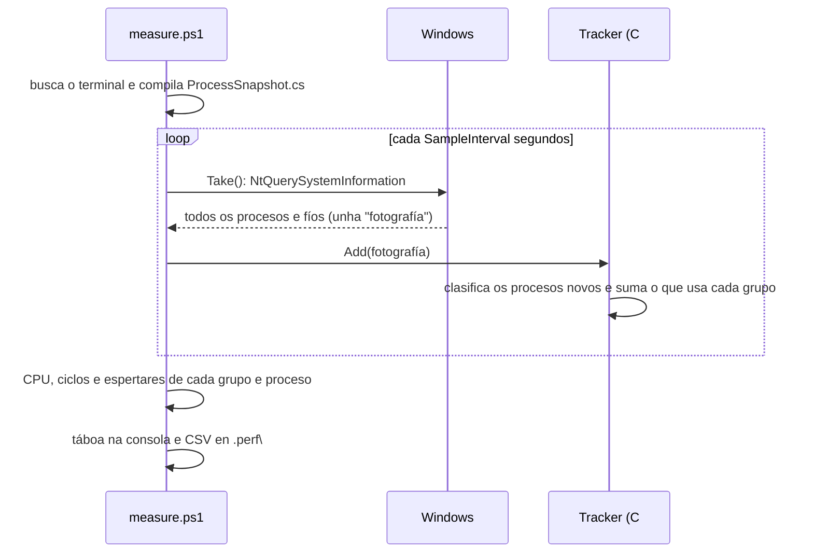

# Código › medición (`tools/perf/`)

> Estado: subfase 1.6.

Ferramentas para medir canto consome un terminal, sempre da mesma maneira. Non forman parte do programa: serven para comparar meiga co Warp e co Windows Terminal e para comprobar en cada fase que cumpre os orzamentos de rendemento. Os conceptos que se miden (tempo de CPU, ciclos, cambios de contexto, memoria privada…) explícanse en [Tecnoloxías › Medición do rendemento](../tecnoloxias.md#19-medición-do-rendemento).

| Arquivo | Para que |
|---|---|
| [`measure.ps1`](#toolsperfmeasureps1) | Medir un terminal e as partes de Windows que o poñen na pantalla, e gardar o resultado en CSV. |
| [`ProcessSnapshot.cs`](#toolsperfprocesssnapshotcs) | Ler dunha vez todos os procesos e fíos do sistema e facer as contas de cada grupo. Cárgao `measure.ps1`. |
| [`test-measure.ps1`](#toolsperftest-measureps1) | Comprobar que `measure.ps1` mide ben, con procesos que consomen unha cantidade coñecida. |
| [`measure-startup.ps1`](#toolsperfmeasure-startupps1) | Medir canto tarda meiga en abrir a súa xanela. |
| [`measure-frames.ps1`](#toolsperfmeasure-framesps1) | Medir canto custan a meiga e ao sistema os fotogramas parciais, os completos e os completos de texto. |

Os escenarios de carga (`scenarios/`) e os scripts que os usan (`run-scenario.ps1`, `gen-bigfile.ps1` e `test-scenarios.ps1`) explícanse en [Código › escenarios de carga](escenarios.md).

## Como se reparte o traballo



- `measure.ps1`, en PowerShell, organiza a medición e escribe os resultados.
- `ProcessSnapshot.cs`, en C#, fai o traballo que se repite en cada fotografía: ler os procesos e os fíos, clasificalos nos grupos e sumar. Cada fotografía ten centos de procesos e miles de fíos. Unha primeira versión facía estas contas en PowerShell, e a propia medición gastaba unha boa parte dun núcleo; en C# custan uns milisegundos por fotografía. Unha ferramenta que mide o consumo debe consumir o mínimo, para non mesturar o seu custo co que mide.

## `tools/perf/measure.ps1`

Mide un terminal durante un tempo e informa, por grupos, da CPU, os ciclos, os espertares, a memoria e os fíos:

```powershell
.\tools\perf\measure.ps1 warp                                                # o Warp durante 60 s
.\tools\perf\measure.ps1 WindowsTerminal -Duration 120 -Label repouso-5-tabs
.\tools\perf\measure.ps1 -Id 1234 -Duration 30                               # un proceso concreto, polo seu PID
```

| Parámetro | Por defecto | Que fai |
|---|---|---|
| `-Name` | — | Nome do executábel do terminal, con ou sen `.exe`: `warp`, `WindowsTerminal`, `meiga`… Non distingue maiúsculas. É o primeiro parámetro, así que se pode escribir sen o nome. |
| `-Id` | — | Os PID dos procesos que medir, separados por comas, en vez de `-Name`. |
| `-Duration` | 60 | Duración da medición, en segundos. |
| `-SampleInterval` | 5 | Segundos entre fotografías. |
| `-Delay` | 0 | Segundos de espera antes de empezar, por exemplo para preparar o escenario. |
| `-Label` | `manual` | Nome do escenario. Vai no CSV e no nome do arquivo, así que só admite letras, números, `_`, `.` e `-`. |
| `-OutDir` | `.perf\` | Cartafol do CSV. Git ignórao (`.gitignore`), porque os resultados describen a túa máquina. |
| `-StartedFile` | — | Arquivo que se crea cando empeza a medición, para que outro script (un escenario) empece ao mesmo tempo. |
| `-StopFile` | — | Arquivo que remata a medición antes de tempo cando aparece. O script búscao cada 0,1 s, e `-Duration` pasa a ser a duración máxima. |
| `-Quiet` | — | Non escribe as mensaxes nin a táboa, para os scripts que mostran o seu propio resumo. Os avisos si se escriben. |
| `-PassThru` | — | Devolve tamén as filas como obxectos, para usalas desde outro script. |

### Os grupos

| Grupo | Que contén | Como se atopa |
|---|---|---|
| `terminal` | O terminal. | Os procesos de `-Id`, ou os de `-Name` que non son fillos doutro co mesmo nome, e os seus fillos co mesmo executábel. O Warp, por exemplo, ten dous `warp.exe`, un fillo do outro. |
| `console` | Os anfitrións de consola (`OpenConsole.exe` ou `conhost.exe`) que lanzou o terminal, normalmente un por tab. | Fillos directos do terminal con eses nomes. |
| `shells` | Todo o demais que lanzou o terminal: as shells e os programas que corren nelas. | Os outros descendentes do terminal. É a carga de traballo, non o custo do terminal: infórmase para ter o contexto. |
| `dwm` | O *Desktop Window Manager* da túa sesión, que compón as xanelas na pantalla. | `dwm.exe` na mesma sesión de Windows que o script. |
| `termservice` | O servizo de Escritorio remoto. | O PID do servizo `TermService`. |
| `wudfhost` | Os procesos que aloxan *drivers* en modo usuario, entre eles o adaptador de pantalla do Escritorio remoto. | Todos os `WUDFHost.exe`. Algúns aloxan outros *drivers* que non teñen que ver coa pantalla, pero en repouso non gastan nada. |
| `harness` | O propio script (o arnés de medición). | O seu PID. Móstrase para saber canto custa medir. |
| `system` | Toda a máquina, sen o script. | CPU: o tempo no que os procesadores non estiveron desocupados. Memoria, fíos e espertares: a suma de todos os procesos. |

Por que se miden `dwm`, `termservice` e `wudfhost`: cando un terminal debuxa, o traballo non acaba no seu proceso. O DWM ten que compoñer a pantalla e, no Escritorio remoto, Windows ten que comprimir os cambios e envialos pola rede (ver [Tecnoloxías › O camiño ata a pantalla](../tecnoloxias.md#o-camiño-ata-a-pantalla-no-escritorio-remoto)).

### O resultado

Ao rematar, o script mostra unha táboa cos grupos e garda todas as filas nun CSV, `.perf\measure-<data>-<hora>-<label>.csv`:

```text
group       processes cpu_pct mcycles_per_s ctx_per_s private_mb_avg private_mb_max threads_max
-----       --------- ------- ------------- --------- -------------- -------------- -----------
terminal    …
…
CPU in % of one core over 60 s; Task Manager shows it divided by N.
Saved …\.perf\measure-20261107-120937-repouso.csv
```

`N` é o número de procesadores lóxicos da máquina.

| Columna do CSV | Que é |
|---|---|
| `run` | Data e hora do comezo (formato ISO 8601). |
| `label` | O `-Label`. |
| `remote` | `True` se a sesión é de Escritorio remoto. |
| `cpus` | Procesadores lóxicos da máquina. |
| `kind` | `group` (unha fila por grupo) ou `process` (unha fila por proceso de cada grupo, salvo `system`). |
| `group` | O grupo. |
| `pid`, `name` | O proceso. Baleiros nas filas `group`. |
| `processes` | Procesos do grupo que se viron durante a medición. |
| `exited` | Cantos remataron antes do final. |
| `seconds` | Duración real da medición. |
| `cpu_s` | Segundos de CPU. |
| `cpu_pct` | CPU en **% dun núcleo**: 100 é un núcleo ocupado todo o tempo. |
| `user_pct`, `kernel_pct` | A parte en modo usuario e en modo núcleo. |
| `mcycles_per_s` | Millóns de ciclos de procesador por segundo. |
| `ctx_switches` | Cambios de contexto: as veces que os fíos entraron nun procesador. |
| `ctx_per_s` | Cambios de contexto por segundo. En repouso, son os **espertares por segundo**. |
| `private_mb_avg`, `private_mb_max` | Memoria privada en MB: media e máximo das fotografías. |
| `working_set_mb_avg` | *Working set* en MB, media. |
| `threads_avg`, `threads_max` | Fíos: media e máximo. |
| `samples` | Fotografías nas que se viu o grupo ou o proceso. |

Na fila `system` quedan baleiras `user_pct`, `kernel_pct`, `mcycles_per_s` e `exited`, porque para toda a máquina só se calcula o tempo ocupado.

### Explicación por partes

O script empeza cun comentario de axuda (`<# … #>`) coas seccións `.SYNOPSIS`, `.DESCRIPTION`, `.PARAMETER` e `.EXAMPLE`, que mostra `Get-Help .\tools\perf\measure.ps1 -Detailed`. Despois dos parámetros vai a comprobación da versión de PowerShell que levan todos os scripts de `tools\`: en Windows PowerShell 5.1, o script non se executa e mostra o comando exacto para executalo con `pwsh` (ver [Tecnoloxías › PowerShell 7](../tecnoloxias.md#11-powershell-7)).

```powershell
[CmdletBinding(DefaultParameterSetName = 'Name')]
param(
    [Parameter(Mandatory, ParameterSetName = 'Name', Position = 0)]
    [string]$Name,

    [Parameter(Mandatory, ParameterSetName = 'Id')]
    [int[]]$Id,

    [ValidateRange(1, 86400)]
    [int]$Duration = 60,
```

- `ParameterSetName`: `-Name` e `-Id` son conxuntos de parámetros distintos, así que PowerShell non deixa usar os dous á vez, e esixe un deles.
- `Position = 0`: `measure.ps1 warp` é o mesmo que `measure.ps1 -Name warp`.
- `[int[]]`: unha lista de números, como `-Id 1234, 5678`.
- `ValidateRange` e `ValidatePattern` rexeitan os valores incorrectos antes de empezar. O de `-Label` (`^[\w.-]+$`) existe porque a etiqueta vai no nome do arquivo.

```powershell
if (-not [Environment]::Is64BitProcess) {
    throw 'Run this script in 64-bit PowerShell: it reads 64-bit Windows structures.'
}
if (-not ('Meiga.Perf.Tracker' -as [type])) {
    Add-Type -Path (Join-Path $PSScriptRoot 'ProcessSnapshot.cs')
}
```

- O código C# le estruturas de Windows nas posicións que teñen nun proceso de 64 bits; nun PowerShell de 32 bits serían outras.
- `Add-Type -Path` compila o arquivo C# en memoria e carga as súas clases. Unha clase non se pode cargar dúas veces na mesma sesión de PowerShell, así que só se compila se aínda non existe: `-as [type]` devolve `$null` cando o tipo non existe. Por iso, despois de cambiar `ProcessSnapshot.cs`, hai que abrir unha sesión de PowerShell nova.

```powershell
if (-not $OutDir) {
    $OutDir = Join-Path $PSScriptRoot '..\..\.perf'
}
$OutDir = [IO.Path]::GetFullPath($ExecutionContext.SessionState.Path.GetUnresolvedProviderPathFromPSPath($OutDir))
```

- O valor por defecto ponse eiquí e non en `param()`, onde Windows PowerShell 5.1 deixa `$PSScriptRoot` baleiro: o script fallaría antes de chegar á comprobación da versión.
- Primeiro resólvese a ruta contra o cartafol actual de PowerShell, como nos outros scripts (ver [Tecnoloxías › PowerShell 7](../tecnoloxias.md#11-powershell-7)). Despois, `GetFullPath` recibe unha ruta xa completa e só elimina os `..` (o valor por defecto é `tools\perf\..\..\.perf`), para que a mensaxe final mostre unha ruta limpa. `-StartedFile` e `-StopFile` resólvense igual.

```powershell
$cpuCount = [Meiga.Perf.ProcessSnapshot]::ProcessorCount
$termService = Get-CimInstance Win32_Service -Filter "Name = 'TermService'"
$termServiceId = if ($termService) { [int]$termService.ProcessId } else { 0 }
```

- `ProcessorCount`: os procesadores lóxicos de toda a máquina (ver [`ProcessSnapshot`](#processsnapshot)).
- CIM (a interface moderna de WMI) dá o PID do proceso onde corre o servizo de Escritorio remoto. Se o servizo non existe, o PID é 0 e o grupo `termservice` queda baleiro. A comprobación `if ($termService)` fai falta porque, con `Set-StrictMode`, ler unha propiedade de `$null` é un erro.

```powershell
$snapshot = [Meiga.Perf.ProcessSnapshot]::Take()
$self = $snapshot.Processes[$PID]
if ($PSCmdlet.ParameterSetName -eq 'Name') {
    $exe = if ($Name -match '\.exe$') { $Name } else { "$Name.exe" }
    $named = @($snapshot.Processes.Values | Where-Object { $_.Name -eq $exe -and $_.Id -ne $PID })
    # The roots are the processes with that name whose parent is not one of them.
    $roots = @($named | Where-Object {
            $child = $_
            -not ($named | Where-Object { $_.Id -eq $child.ParentId -and $_.CreateTime -le $child.CreateTime })
        })
    $target = $exe
}
```

- Unha primeira fotografía serve para atopar o terminal. `$PID` é o identificador do propio proceso de PowerShell, que nunca se mide como terminal.
- `-eq` non distingue maiúsculas en PowerShell: valen `warp`, `Warp` e `WARP.EXE`.
- As **raíces** son os procesos co nome indicado que non son fillos doutro co mesmo nome. O resto entra despois como descendente. Se tes dúas xanelas do mesmo terminal en procesos separados, as dúas son raíces.
- A comparación de `CreateTime` evita un erro sutil: Windows reutiliza os PID, así que o `ParentId` dun proceso cuxo pai xa rematou pode coincidir cun proceso novo que non ten nada que ver. Un pai de verdade sempre se creou antes ca o fillo.

```powershell
else {
    foreach ($missing in @($Id | Where-Object { -not $snapshot.Processes.ContainsKey($_) })) {
        Write-Warning "There is no process with id $missing."
    }
    $roots = @($Id | Where-Object { $_ -ne $PID -and $snapshot.Processes.ContainsKey($_) } |
            ForEach-Object { $snapshot.Processes[$_] })
    $target = "process $($Id -join ', ')"
}
if ($roots.Count -eq 0) {
    throw "No running process matches $target."
}
```

Con `-Id`, avisa dos PID que non existen e mide os demais. Se non queda ningún proceso, para cun erro.

```powershell
$tracker = [Meiga.Perf.Tracker]::new($self.SessionId, $termServiceId)
$tracker.AddHarness($self)
foreach ($root in $roots) {
    $tracker.AddTerminal($root)
}
```

O `Tracker` (en C#, ver [máis abaixo](#tracker)) leva a conta dos grupos. Recibe a sesión de Windows do script, para escoller o seu `dwm.exe`, e o PID do servizo de Escritorio remoto.

```powershell
if (-not $Quiet) {
    Write-Host "Measuring $target for $Duration s. Leave this window alone until it finishes."
}

# Start-up work goes on in the background for a moment after it ends: .NET
# optimizes the code that has just run, and that can cost this script more than
# 10 % of a core. Run the code of the window once and wait, so that it does not
# count. The wait also lets the terminal draw the line above.
[Meiga.Perf.Tracker]::new($self.SessionId, $termServiceId).Add($snapshot)
Start-Sleep -Seconds 2
```

- A mensaxe escríbese antes da medición, salvo con `-Quiet`. Durante a medición non se escribe nada, para que a consola onde corre o script non teña nada que debuxar.
- **Quecemento.** .NET compila cada método a código máquina a primeira vez que se usa e, un pouco despois, recompila en segundo plano os máis usados (ver [Tecnoloxías › C# dentro de PowerShell](../tecnoloxias.md#c-dentro-de-powershell)). Sen este paso, ese traballo caía dentro da medición, e nas medicións curtas podía custarlle ao script máis do 10 % dun núcleo. Para evitalo, o código da medición execútase unha vez cun `Tracker` que despois se descarta, e espérase 2 s. A espera tamén lle dá tempo ao terminal para debuxar a mensaxe.

```powershell
$first = [Meiga.Perf.ProcessSnapshot]::Take()
$run = [datetime]::Now
$tracker.Add($first)
if ($StartedFile) {
    New-Item -ItemType File -Force -Path $StartedFile | Out-Null
}
```

A medición empeza coa primeira fotografía. Xusto despois créase `-StartedFile`, se se indicou: así, un escenario que agarda por ese arquivo empeza dentro da medición, nunca antes.

```powershell
function Wait-Snapshot([double]$seconds) {
    $deadline = [Diagnostics.Stopwatch]::GetTimestamp() + $seconds * [Diagnostics.Stopwatch]::Frequency
    while ($true) {
        if ($StopFile -and (Test-Path -LiteralPath $StopFile)) {
            return $true
        }
        $left = ($deadline - [Diagnostics.Stopwatch]::GetTimestamp()) / [Diagnostics.Stopwatch]::Frequency
        if ($left -le 0) {
            return $false
        }
        $step = if ($StopFile) { [math]::Min($left, 0.1) } else { $left }
        Start-Sleep -Milliseconds ([int][math]::Ceiling($step * 1000))
    }
}

do {
    $elapsed = ([Diagnostics.Stopwatch]::GetTimestamp() - $first.Timestamp) / [Diagnostics.Stopwatch]::Frequency
    $stopped = Wait-Snapshot ([math]::Min($SampleInterval, $Duration - $elapsed))
    $current = [Meiga.Perf.ProcessSnapshot]::Take()
    $tracker.Add($current)
} while (-not $stopped -and $current.SecondsSince($first) -lt $Duration)
$seconds = $current.SecondsSince($first)
```

- A medición vai da primeira fotografía á última.
- Os tempos mídense co `Stopwatch` de .NET, un contador de alta resolución que nunca se axusta, desde o momento de cada fotografía. A hora do reloxo non serve, porque Windows pode corrixila durante a medición.
- A espera calcúlase desde o comezo, así que os atrasos non se acumulan: a última fotografía tómase ao cumprirse `-Duration`, aínda que non sexa un múltiplo de `-SampleInterval`.
- Mentres espera, o script dorme (`Start-Sleep`) sen gastar CPU. Con `-StopFile`, esperta cada 0,1 s para mirar se apareceu o arquivo; se apareceu, toma a última fotografía e a medición remata, aínda que non pasase `-Duration`. Así, a medición dun escenario que remata (imprimir un arquivo grande) dura o mesmo ca el, cunha décima de segundo de marxe como moito.

```powershell
foreach ($entry in $tracker.Processes.GetEnumerator()) {
    $start = $entry.Value.Start
    $end = $entry.Value.Last
    $user = $end.UserTime - $(if ($start) { $start.UserTime } else { 0 })
    $kernel = $end.KernelTime - $(if ($start) { $start.KernelTime } else { 0 })
    $one = @{
        Cpu       = [double]($user + $kernel)
        …
        Exited    = [int]($entry.Value.LastIndex -lt $tracker.Index)
    }
```

- O consumo de cada proceso é a diferenza entre a súa primeira mostra dentro da medición (`Start`) e a última (`Last`). Se o proceso naceu durante a medición, `Start` é `$null` e cóntase todo desde cero, porque todo pasou dentro da medición.
- Se a súa última mostra non é da última fotografía, o proceso rematou antes: cóntase en `exited` e pérdese o que gastou despois da súa última fotografía (como moito, `-SampleInterval` segundos).
- Despois súmase cada proceso ao seu grupo.

```powershell
$idle = $current.Processes[0].KernelTime - $first.Processes[0].KernelTime
$usage.system = @{
    Cpu       = [math]::Max(0.0, $cpuCount * $seconds * 1e7 - $idle - $usage.harness.Cpu)
    …
    Switches  = [double]($tracker.SystemSwitches - $usage.harness.Switches)
    Processes = $current.Processes.Count - 2
```

- O proceso de PID 0 (*Idle*) ten un fío por procesador, que corre cando non hai nada máis que facer: o seu tempo é o tempo libre da máquina. O tempo dispoñíbel é procesadores × segundos, e o ocupado, o dispoñíbel menos o libre. `1e7` pasa de segundos ás unidades de Windows, de 100 ns.
- Réstase o arnés, igual que na memoria e nos espertares, para que `system` non dependa do custo de medir. Por iso tamén se descontan dous procesos: *Idle* e o script.
- `[math]::Max(0.0, …)` evita valores negativos minúsculos por redondeo.

```powershell
function Get-Percent($time) {
    if ($null -eq $time) { return $null }
    [math]::Round($time / 1e5 / $seconds, 2)
}
```

Os tempos de CPU veñen en unidades de 100 ns: dividir entre `1e7` dá segundos, e multiplicar por 100 dá a porcentaxe; xuntos, dividir entre `1e5`. Ao dividir entre a duración da medición sae a **porcentaxe dun núcleo**.

```powershell
# The CSV uses the invariant culture: with the Galician or Spanish culture,
# Export-Csv would write 1,5 instead of 1.5.
New-Item -ItemType Directory -Force -Path $OutDir | Out-Null
$file = Join-Path $OutDir ('measure-{0}-{1}.csv' -f $run.ToString('yyyyMMdd-HHmmss', $invariant), $Label)
$rows | ForEach-Object {
    $text = [ordered]@{}
    foreach ($property in $_.PSObject.Properties) {
        $value = $property.Value
        $text[$property.Name] = if ($value -is [IFormattable]) { $value.ToString($null, $invariant) } else { $value }
    }
    [pscustomobject]$text
} | Export-Csv -LiteralPath $file -NoTypeInformation -Encoding utf8NoBOM
```

- `Export-Csv` escribe os números co formato do idioma de Windows: en galego, `1,5`. Outros programas lerían mal ese CSV. Por iso cada número (todos implementan `IFormattable`) pásase a texto coa **cultura invariante**, que sempre usa o punto: `1.5`. Comprobouse cunha configuración rexional galega (`gl-ES`).
- A táboa da consola, en cambio, usa o formato do teu idioma (`1,5`), porque é para lela ti. Con `-Quiet` non se escribe, nin tampouco as dúas liñas finais (o divisor do Xestor de tarefas e onde se gardou o CSV).
- `utf8NoBOM`: UTF-8 sen a marca de bytes ao comezo, que algúns programas mostran como caracteres estraños.

```powershell
foreach ($group in 'terminal', 'console') {
    if ($usage[$group].Exited -gt 0) {
        Write-Warning "$($usage[$group].Exited) $group processes exited during the window: the CPU that they used after the last snapshot is not counted."
    }
}
```

Se un proceso do terminal ou dunha consola remata durante a medición, o resultado está incompleto e o script avisa. Nas shells é normal: cada comando é un proceso que nace e remata, así que só se indica na columna `exited`.

## `tools/perf/ProcessSnapshot.cs`

Código C# que `measure.ps1` compila con `Add-Type`. Ten seis clases:

| Clase | Que é |
|---|---|
| [`ProcessSample`](#processsample) | Os datos dun proceso nunha fotografía. |
| [`Snapshot`](#snapshot) | Unha fotografía: todos os procesos nun instante. |
| [`ProcessSnapshot`](#processsnapshot) | Pide as fotografías a Windows. |
| [`MemoryStat`](#memorystat-e-trackedprocess) | A memoria e os fíos dun proceso ou dun grupo ao longo das fotografías. |
| [`TrackedProcess`](#memorystat-e-trackedprocess) | Un proceso dun grupo, seguido de fotografía en fotografía. |
| [`Tracker`](#tracker) | Clasifica os procesos nos grupos e suma o que usan. |

### `ProcessSample`

Os campos dun proceso e onde ver o mesmo dato no Xestor de tarefas (lapela *Details*) ou no [Process Explorer](https://learn.microsoft.com/sysinternals/downloads/process-explorer):

| Campo | Que é | Xestor de tarefas / Process Explorer |
|---|---|---|
| `Id`, `ParentId` | PID do proceso e do proceso que o creou. | *PID* |
| `Name` | Nome do executábel. | *Name* / *Process* |
| `SessionId` | Sesión de Windows. Cada usuario conectado ten a súa, e a 0 é a dos servizos. | *Session ID* |
| `CreateTime` | Cando se creou, en formato FILETIME (unidades de 100 ns desde 1601, en UTC). | — |
| `Key` | `PID:CreateTime`. Identifica o proceso aínda que Windows reutilice o PID. | — |
| `UserTime`, `KernelTime` | Tempo de CPU en modo usuario e en modo núcleo, en unidades de 100 ns. | *CPU time* |
| `CycleTime` | Ciclos de procesador de todos os seus fíos. | — / *Cycles* |
| `PrivateBytes` | Memoria privada. | *Commit size* / *Private Bytes* |
| `WorkingSet` | *Working set*. | *Working set (memory)* / *Working Set* |
| `PrivateWorkingSet` | A parte privada do *working set*. | *Memory (private working set)* / *WS Private* |
| `ThreadCount` | Fíos. | *Threads* |
| `HandleCount` | *Handles* abertos (arquivos, eventos, chaves do rexistro…). | *Handles* |
| `ContextSwitches` | Os cambios de contexto de cada fío, polo seu identificador. | — / *Context Switches* |

```csharp
public long SwitchesSince(ProcessSample earlier)
{
    long total = 0;
    foreach (KeyValuePair<long, uint> thread in ContextSwitches)
    {
        uint start;
        // A smaller count means that a new thread got the id of an exited one.
        if (earlier != null && earlier.ContextSwitches.TryGetValue(thread.Key, out start) && thread.Value >= start)
        {
            total += thread.Value - start;
        }
        else
        {
            total += thread.Value;
        }
    }
    return total;
}
```

Os cambios de contexto desde unha mostra anterior do mesmo proceso: para cada fío, o contador actual menos o anterior. Un fío novo conta desde cero. Se o contador é menor que antes, o identificador é dun fío novo que reutilizou o dun fío xa rematado, e tamén se conta desde cero. Os cambios dos fíos que remataron entre as dúas mostras pérdense.

### `Snapshot`

```csharp
/// <summary>Stopwatch timestamp of the moment of the snapshot.</summary>
public long Timestamp;

public double SecondsSince(Snapshot earlier)
{
    return (Timestamp - earlier.Timestamp) / (double)Stopwatch.Frequency;
}
```

Cada fotografía garda o instante no que se tomou, para calcular o tempo exacto entre dúas.

```csharp
public long SwitchesSince(Snapshot earlier)
{
    long total = 0;
    foreach (ProcessSample process in Processes.Values)
    {
        if (process.Id == 0)
        {
            continue;
        }
        ProcessSample before;
        if (!earlier.Processes.TryGetValue(process.Id, out before) || before.CreateTime != process.CreateTime)
        {
            before = null;
        }
        total += process.SwitchesSince(before);
    }
    return total;
}
```

Os cambios de contexto de toda a máquina, para o grupo `system`. Déixase fóra o proceso *Idle*: os seus fíos entran no procesador cada vez que este queda libre, e iso non é que esperte nada.

### `ProcessSnapshot`

Le as fotografías con `NtQuerySystemInformation`, unha función de `ntdll.dll`, coa clase `SystemProcessInformation` (5). O porqué desta función, e non outra, explícase en [Tecnoloxías › Como se le](../tecnoloxias.md#como-se-le-ntquerysysteminformation).

A función enche un búfer con todos os procesos seguidos. Cada proceso é unha estrutura `SYSTEM_PROCESS_INFORMATION` de 0x100 bytes, seguida dunha estrutura `SYSTEM_THREAD_INFORMATION` de 0x50 bytes por cada un dos seus fíos. Os campos que se len, coa súa posición (en hexadecimal) nun Windows de 64 bits:

| Posición | Campo de Windows | Campo de `ProcessSample` |
|---|---|---|
| 0x00 | `NextEntryOffset`: bytes ata o proceso seguinte (0 no último) | — |
| 0x04 | `NumberOfThreads` | `ThreadCount` |
| 0x08 | `WorkingSetPrivateSize` | `PrivateWorkingSet` |
| 0x18 | `CycleTime` | `CycleTime` |
| 0x20 | `CreateTime` | `CreateTime` |
| 0x28 | `UserTime` | `UserTime` |
| 0x30 | `KernelTime` | `KernelTime` |
| 0x38 | `ImageName.Length`: lonxitude do nome, en bytes | — |
| 0x40 | `ImageName.Buffer`: o nome, en UTF-16 | `Name` |
| 0x50 | `UniqueProcessId` | `Id` |
| 0x58 | `InheritedFromUniqueProcessId` | `ParentId` |
| 0x60 | `HandleCount` | `HandleCount` |
| 0x64 | `SessionId` | `SessionId` |
| 0x90 | `WorkingSetSize` | `WorkingSet` |
| 0xC8 | `PrivatePageCount`: a memoria privada, en bytes | `PrivateBytes` |
| fío + 0x30 | `ClientId.UniqueThread`: identificador do fío | clave de `ContextSwitches` |
| fío + 0x40 | `ContextSwitches` | valor de `ContextSwitches` |

As posicións son as das definicións públicas destas estruturas, que non cambiaron desde Windows 7 (cando se engadiu `CycleTime`). Comprobáronse comparando os valores con outras fontes (ver a [subfase 0.6](../subfases/0.6-medicion.md#resultados)).

```csharp
public static Snapshot Take()
{
    int length = 4 * 1024 * 1024;
    while (true)
    {
        IntPtr buffer = Marshal.AllocHGlobal(length);
        try
        {
            int needed;
            long before = Stopwatch.GetTimestamp();
            int status = NtQuerySystemInformation(SystemProcessInformation, buffer, length, out needed);
            long after = Stopwatch.GetTimestamp();
            if (status == StatusInfoLengthMismatch)
            {
                // Processes can start before the next call: leave some margin.
                length = Math.Max(length * 2, needed + 1024 * 1024);
                continue;
            }
```

- Reserva un búfer de 4 MB fóra da memoria de .NET (`AllocHGlobal`), que se libera sempre no `finally`.
- Se non chega, Windows devolve `STATUS_INFO_LENGTH_MISMATCH` (0xC0000004) e o tamaño necesario. Tamén pode ocorrer que entre unha chamada e a seguinte nazan procesos novos, así que se pide algo máis.
- `NtQuerySystemInformation` devolve un código `NTSTATUS`: 0 é éxito, e calquera outro valor detén a medición cun erro.
- O instante da fotografía é o punto medio da chamada (`before` e `after`).

```csharp
int threads = Marshal.ReadInt32(entry, NumberOfThreads);
int nameBytes = (ushort)Marshal.ReadInt16(entry, ImageNameLength);
IntPtr name = Marshal.ReadIntPtr(entry, ImageNameBuffer);
```

`Parse` percorre o búfer cos métodos `Marshal.Read…`, que len un número dunha posición de memoria. O nome é un `UNICODE_STRING`: a lonxitude en bytes e un punteiro ao texto en UTF-16, onde cada carácter ocupa 2 bytes (por iso `nameBytes / 2`). O proceso *Idle* non ten nome.

```csharp
for (int i = 0; i < threads; i++)
{
    IntPtr thread = IntPtr.Add(entry, ProcessInfoSize + i * ThreadInfoSize);
    long threadId = Marshal.ReadInt64(thread, UniqueThread);
    sample.ContextSwitches[threadId] = unchecked((uint)Marshal.ReadInt32(thread, ContextSwitchesOffset));
}
```

Os fíos están xusto despois da parte fixa do proceso. O contador de cambios de contexto é un enteiro sen signo de 32 bits; `unchecked` reinterpreta os bits sen comprobar o rango.

```csharp
public static int ProcessorCount
{
    get { return GetActiveProcessorCount(AllProcessorGroups); }
}

public static bool IsRemoteSession
{
    get { return GetSystemMetrics(SmRemoteSession) != 0; }
}
```

- `GetActiveProcessorCount(ALL_PROCESSOR_GROUPS)`: os procesadores lóxicos de toda a máquina. Non se usa `Environment.ProcessorCount` porque devolve só os que pode usar o proceso, que poden ser menos se ten unha afinidade limitada. Nas máquinas con máis de 64 procesadores lóxicos, Windows repárteos en grupos.
- `GetSystemMetrics(SM_REMOTESESSION)`: se a sesión é de Escritorio remoto.

### `MemoryStat` e `TrackedProcess`

- `MemoryStat` suma a memoria privada, o *working set* e os fíos de cada fotografía, e garda os máximos, para calcular as medias e os máximos do CSV.
- `TrackedProcess` é un proceso dun grupo: o grupo, a súa mostra ao comezo da medición (`Start`, nula se naceu despois), a última mostra (`Last`) e o número da súa fotografía, os cambios de contexto acumulados e a súa memoria.

### `Tracker`

```csharp
public static readonly string[] GroupNames =
{
    "terminal", "console", "shells", "dwm", "termservice", "wudfhost", "harness", "system"
};
```

Os grupos, na orde das filas do resultado.

```csharp
public void AddTerminal(ProcessSample process)
{
    groups[process.Key] = "terminal";
    terminalNames.Add(process.Name);
}
```

Marca un proceso como terminal e lembra o seu executábel, para recoñecer os fillos co mesmo nome. `groups` garda o grupo de cada proceso visto, pola súa clave: cando un proceso entra nun grupo, xa non sae aínda que o seu pai remate.

```csharp
private void Classify(Snapshot snapshot)
{
    // The descendants of the terminal: from the processes already in the
    // terminal groups down to their new children.
    var children = new Dictionary<int, List<ProcessSample>>();
    var queue = new Queue<ProcessSample>();
    foreach (ProcessSample p in snapshot.Processes.Values)
    {
        …
        children[p.ParentId] = list;
        …
        if (groups.TryGetValue(p.Key, out group) && IsTerminalGroup(group))
        {
            queue.Enqueue(p);
        }
    }
```

`Classify` busca os procesos novos de cada fotografía:

1. Fai unha táboa cos fillos de cada PID e mete nunha cola os procesos que xa están nos grupos do terminal (`terminal`, `console` ou `shells`).
2. Percorre a cola. Cada fillo que aínda non ten grupo e que se creou despois do pai entra nun grupo e tamén vai á cola, para buscar os seus fillos (un percorrido en anchura). Os fillos directos do terminal van a `terminal` se teñen o seu mesmo executábel, a `console` se son `OpenConsole.exe` ou `conhost.exe`, e a `shells` no resto dos casos. Os demais descendentes van a `shells`.
3. Ao final, os procesos que seguen sen grupo e que debuxan a pantalla: o `dwm.exe` da sesión do script, o proceso do servizo de Escritorio remoto e os `WUDFHost.exe`.

Os nomes compáranse sen distinguir maiúsculas (`StringComparer.OrdinalIgnoreCase`), como fai Windows.

```csharp
string group;
int g = groups.TryGetValue(p.Key, out group) ? Array.IndexOf(GroupNames, group) : -1;
// "system" is the whole machine without this script.
int[] targets = g < 0 ? new[] { system } : g == harness ? new[] { g } : new[] { system, g };
```

En `Add`, cada proceso (salvo *Idle*) súmase á memoria e aos fíos do seu grupo e de `system`; o arnés só ao seu.

```csharp
TrackedProcess tracked;
if (!Processes.TryGetValue(p.Key, out tracked))
{
    // What it uses counts from the start of the window, or from zero if
    // it started later.
    ProcessSample start;
    if (!First.Processes.TryGetValue(p.Id, out start) || start.CreateTime != p.CreateTime)
    {
        start = null;
    }
    tracked = new TrackedProcess { Group = group, Start = start, Last = start };
    Processes[p.Key] = tracked;
}
tracked.Switches += p.SwitchesSince(tracked.Last);
tracked.Last = p;
tracked.LastIndex = Index;
tracked.Memory.Add(p.PrivateBytes, p.WorkingSet, p.ThreadCount);
```

- A primeira vez que aparece un proceso dun grupo, búscase na primeira fotografía. Se estaba alí, o seu consumo conta desde ese momento; se non, naceu durante a medición e conta desde cero.
- Os cambios de contexto acumúlanse de fotografía en fotografía, non entre a primeira e a última: así tamén se contan os dos fíos que remataron durante a medición, ata a súa última fotografía.

## `tools/perf/test-measure.ps1`

Comproba que `measure.ps1` mide ben:

```powershell
.\tools\perf\test-measure.ps1               # medición de 10 s
.\tools\perf\test-measure.ps1 -Duration 5   # como na CI
```

Lanza dous procesos de PowerShell que consomen unha cantidade coñecida e mídeos con `measure.ps1 -Id … -SampleInterval 1`:

```powershell
$busy = Start-Loop 'while ($true) {}'
$sleep = Start-Loop 'while ($true) { Start-Sleep -Milliseconds 100 }'
```

- **busy**, un bucle baleiro sen fin: ocupa un núcleo enteiro, o 100 %.
- **sleep**, un bucle que dorme 100 ms: esperta unhas 10 veces por segundo e case non gasta CPU.

`Start-Loop` lánzaos con `-NoNewWindow`, na mesma consola, para non abrir xanelas. Antes de medir agárdase 3 s, para que rematen de arrancar.

Despois compara o resultado co esperado e con `Get-Process`, que le os mesmos contadores a través doutras funcións de Windows:

| Comprobación | Esperado | Por que |
|---|---|---|
| `busy: CPU` | 80–110 | Un bucle baleiro ocupa un núcleo. A marxe cobre o traballo de fondo de PowerShell e unha máquina cargada. |
| `busy: CPU, Get-Process` | o de `Get-Process` ± 5 | `Get-Process` calcula o tempo de CPU con `GetProcessTimes`, nun intervalo algo máis longo que o da medición. |
| `busy: private MB, Get-Process` | ± 20 % | A memoria privada, desde outra fonte. |
| `busy: threads, Get-Process` | ± 5 | Os fíos, desde outra fonte. PowerShell crea e remata fíos de fondo, así que pode variar algo. |
| `sleep: wakeups per second` | 8–200 | O fío do bucle esperta unhas 10 veces por segundo, e os fíos de fondo de .NET algunhas máis. Un contador mal lido daría valores moi distintos: 0 ou millóns. |
| `sleep: CPU` | menos de 20 | Durmir non gasta CPU. |
| `terminal: processes` | 2 | Os dous procesos medidos. |
| `system: CPU` | polo menos o de busy | O total da máquina inclúe o bucle. |
| `groups in order` | 8 | Hai unha fila por grupo, na orde de `GroupNames`. |
| `CSV: rows` | as filas que devolveu o script | O CSV contén todas as filas. |
| `CSV: numbers with a dot` | todos | Os números do CSV lense coa cultura invariante, sexa cal sexa o idioma de Windows. |
| `stop file: window, s` | 2–4 | Unha medición de ata 60 s que remata cando outro proceso crea `-StopFile`, 2 s despois de ver `-StartedFile`. |

```powershell
$reference = ((Get-Process -Id $busy.Id).TotalProcessorTime - $cpuBefore).TotalSeconds / $clock.Elapsed.TotalSeconds * 100
```

A referencia: o tempo de CPU que suma o bucle segundo `Get-Process`, dividido entre o tempo real que pasou, desde antes de chamar a `measure.ps1` ata despois.

```powershell
$helper = Start-Loop ("while (-not (Test-Path -LiteralPath '$quotedStarted')) { Start-Sleep -Milliseconds 50 }; " +
    "Start-Sleep -Seconds 2; New-Item -ItemType File -Path '$quotedStop' | Out-Null")
$stopRows = & (Join-Path $PSScriptRoot 'measure.ps1') -Id $sleep.Id -Duration 60 -SampleInterval 1 -Label self-test-stop `
    -OutDir $outDir -StartedFile $started -StopFile $stop -Quiet -PassThru
```

A última comprobación usa `-StartedFile` e `-StopFile` como `run-scenario.ps1` con bigfile: un terceiro proceso agarda a que apareza o arquivo de inicio e, 2 s despois, crea o de fin. A medición, de 60 s como moito, debe durar uns 2 s. As comiñas simples das rutas dóbranse (`''`), porque van dentro dunha cadea entre comiñas simples.

```powershell
finally {
    Stop-Process -Id $busy.Id, $sleep.Id -ErrorAction SilentlyContinue
    if ($helper) {
        Stop-Process -Id $helper.Id -ErrorAction SilentlyContinue
    }
    Remove-Item -LiteralPath $outDir -Recurse -Force -ErrorAction SilentlyContinue
}
```

Pase o que pase, os procesos de proba detéñense e bórrase o cartafol temporal dos CSV. Se falla algunha comprobación, o script remata cun erro e código de saída 1, e a CI márcase en vermello.

**Comprobación da proba.** Cunha copia de `ProcessSnapshot.cs` con dúas posicións cambiadas a propósito (os cambios de contexto lidos en 0x44 e o tempo de usuario en 0x20), a proba falla en tres comprobacións: `busy: CPU`, `busy: CPU, Get-Process` e `sleep: wakeups per second`.

A CI executa esta proba en cada PR (ver [Código › .github](github.md#comprobar-o-arnés-de-medición)).

## `tools/perf/measure-startup.ps1`

Mide canto tarda meiga en abrir a súa xanela: desde que se crea o proceso ata que a xanela está pintada e meiga agarda mensaxes. É o **tempo ata o primeiro fotograma** (ver [Tecnoloxías › Tempo ata o primeiro fotograma](../tecnoloxias.md#tempo-ata-o-primeiro-fotograma)). Desde a subfase 1.6, meiga lanza a súa shell por defecto antes do primeiro fotograma ([ADR 0013](../adr/0013-da-saida-a-pantalla.md)), así que o tempo inclúe tamén lanzar a sesión: non se pode comparar directamente co das subfases anteriores.

```powershell
.\tools\perf\measure-startup.ps1                            # 2 + 20 arranques de target\release\meiga.exe
.\tools\perf\measure-startup.ps1 -Runs 50 -Label meiga-1.1
.\tools\perf\measure-startup.ps1 -Runs 3 -Warmup 1          # como na CI
```

Saída:

```text
Starting meiga.exe 2 + 20 times...

runs min_ms median_ms p95_ms max_ms
---- ------ --------- ------ ------
  20      …         …      …      …

Time from starting meiga.exe until its window is painted and waits for input.
Saved …\.perf\startup-20261107-192244-meiga.csv
```

O CSV ten unha fila por arranque, co seu número (`run`) e os milisegundos (`ms`), co punto como separador decimal, como en [`measure.ps1`](#o-resultado). Gárdase en `.perf\`, fóra de Git, porque os tempos dependen da máquina.

| Parámetro | Por defecto | Que fai |
|---|---|---|
| `-Path` | `target\release\meiga.exe` | O executábel que se mide. |
| `-Runs` | 20 | Os arranques que contan. |
| `-Warmup` | 2 | Os arranques de antes, que non contan. |
| `-Label` | o nome do executábel | O nome da medición, para o CSV. |
| `-OutDir` | `.perf\` | O cartafol do CSV. |
| `-TimeoutSeconds` | 10 | O tempo máximo de cada espera. |

Explicación por partes:

```powershell
function Measure-Start {
    $info = [Diagnostics.ProcessStartInfo]::new($Path)
    $info.UseShellExecute = $false
    $clock = [Diagnostics.Stopwatch]::StartNew()
    $process = [Diagnostics.Process]::Start($info)
    try {
        $idle = try { $process.WaitForInputIdle($TimeoutSeconds * 1000) } catch { $false }
        $clock.Stop()
```

- `Stopwatch` é o cronómetro de alta resolución de .NET. Ponse en marcha xusto antes de crear o proceso, así que o tempo inclúe todo o arranque: que Windows cree o proceso e cargue `meiga.exe` e as súas DLL, e que meiga rexistre a clase, cree a xanela, lance a súa sesión e pinte a xanela. Lanzar a sesión, desde a subfase 1.6, é crear a pseudoconsola e arrancar nela a shell por defecto: PowerShell 7 ou, se non está, Windows PowerShell.
- `WaitForInputIdle` volta cando meiga quedou esperando mensaxes coa xanela xa pintada, como en [`check-window.ps1`](ferramentas.md#toolscheck-windowps1), e o cronómetro párase.
- O que non se conta: despois, o DWM compón a pantalla co fotograma novo e, por Escritorio remoto, envíao. Iso pasa fóra de meiga e mídeo `measure.ps1` cos grupos `dwm` e `termservice`. Tampouco se conta o que tarda a shell en arrancar e escribir o seu *prompt*: lanzala é rápido, pero ela tarda moito máis en escribir, e o que escribe chega a meiga despois do primeiro fotograma, coma calquera outra saída.

```powershell
        if (-not $process.CloseMainWindow()) {
            throw "Could not ask the window of $exe to close."
        }
        if (-not $process.WaitForExit($TimeoutSeconds * 1000)) {
            throw "$exe was still running $TimeoutSeconds s after its window was asked to close."
        }
        if ($process.ExitCode -ne 0) {
            throw "$exe ended with exit code $($process.ExitCode) instead of 0."
        }
    }
    finally {
        if (-not $process.HasExited) {
            $process.Kill()
        }
        $process.Dispose()
    }
    # Let the closed window disappear before the next start.
    Start-Sleep -Milliseconds 500
    $clock.Elapsed.TotalMilliseconds
}
```

- Cada arranque pecha a xanela e comproba que meiga remata co código 0, como `check-window.ps1`: o tempo dun programa que non funciona non vale de nada. Se falla, o script detense co erro.
- `Start-Sleep -Milliseconds 500`: deixa que a xanela pechada desapareza antes do seguinte arranque, para que a súa animación non se mesture coa medición.
- A última liña devolve os milisegundos: en PowerShell, o valor dunha expresión solta é o resultado da función.

```powershell
for ($run = 1; $run -le $Warmup; $run++) {
    $null = Measure-Start
}
$start = Get-Date
$times = for ($run = 1; $run -le $Runs; $run++) {
    [pscustomobject]@{ run = $run; ms = Measure-Start }
}
```

- O **quecemento**: o primeiro arranque despois de compilar ou de reiniciar le o executábel do disco, e o antivirus analiza o arquivo novo. Os seguintes atópano xa na memoria (a caché de arquivos de Windows). Os arranques de quecemento fanse pero non contan.
- `$times` recolle un obxecto por arranque.

```powershell
# Nearest-rank percentile of the sorted times.
$sorted = @($times.ms | Sort-Object)
function Get-Percentile([double]$Percent) {
    $sorted[[int][math]::Max(0, [math]::Ceiling($Percent / 100 * $sorted.Count) - 1)]
}
$middle = [int][math]::Floor($sorted.Count / 2)
$median = if ($sorted.Count % 2) { $sorted[$middle] } else { ($sorted[$middle - 1] + $sorted[$middle]) / 2 }
```

- `$times.ms` colle a propiedade `ms` de todos os obxectos, e `Sort-Object` ordénaos de menor a maior. `@(…)` garante un array aínda que só haxa un arranque.
- A **mediana** é o valor do medio: a metade dos arranques foi máis rápida e a outra metade máis lenta. Cun número par de arranques, a media dos dous do medio.
- O **percentil 95** (`p95`) é o tempo que non superou o 95 % dos arranques. Calcúlase polo método do rango máis próximo: na lista ordenada, o elemento da posición ⌈0,95 · n⌉, contando desde 1 (de aí o `- 1`, porque os arrays empezan en 0).
- Por que a mediana e o p95, e non a media: un só arranque lento, porque o antivirus ou outro programa colleron a CPU nese momento, moveríaa moito. A mediana di como é un arranque normal, e o p95, como son os lentos.

```powershell
$times | ForEach-Object {
    [pscustomobject]@{ run = $_.run; ms = $_.ms.ToString('0.000', $invariant) }
} | Export-Csv -LiteralPath $file -NoTypeInformation -Encoding utf8NoBOM
```

Os milisegundos escríbense con tres decimais e coa cultura invariante, para que o CSV leve sempre un punto decimal.

A CI executa o script con `-Runs 3 -Warmup 1` (ver [Código › .github](github.md#empaquetar-e-comprobar-o-executábel)), só para comprobar que segue funcionando: os tempos dunha máquina compartida non se comparan con nada.

## `tools/perf/measure-frames.ps1`

Mide canto custan os fotogramas de meiga: un **parcial**, que presenta unha parte pequena da xanela; un **completo**, que a presenta enteira; e un **completo de texto**, que ademais debuxa en cada cela a tinta do seu glifo. Abre meiga maximizado nun modo de medición ([`--bench`](meiga.md#cratesmeigasrcbenchrs)), que debuxa fotogramas sen parar, e co rexistro dos fotogramas ([`--trace-frames`](meiga.md#cratesmeigasrctracers)). Mentres tanto, [`measure.ps1`](#toolsperfmeasureps1) mide meiga, `dwm.exe` e o servizo de Escritorio remoto.

```powershell
.\tools\perf\measure-frames.ps1                             # os tres modos, 3 + 20 s cada un
.\tools\perf\measure-frames.ps1 -Mode text -Duration 60
.\tools\perf\measure-frames.ps1 -Duration 3 -Warmup 1       # como na CI
```

Mentres mide, non uses o equipo: as outras xanelas e o rato cambian o traballo de `dwm.exe` e do Escritorio remoto.

Saída:

```text
Measuring partial frames: 3 s of warm-up and 20 s of measurement...
Measuring full frames: 3 s of warm-up and 20 s of measurement...
Measuring text frames: 3 s of warm-up and 20 s of measurement...

mode    width height fps kpixels compose_us compose_p95_us present_us present_p95_us
----    ----- ------ --- ------- ---------- -------------- ---------- --------------
partial     …      …   …       …          …              …          …              …
full        …      …   …       …          …              …          …              …
text        …      …   …       …          …              …          …              …

mode    meiga_cpu_pct meiga_ctx_per_s meiga_mb dwm_cpu_pct rdp_cpu_pct
----    ------------- --------------- -------- ----------- -----------
partial             …               …        …           …           …
full                …               …        …           …           …
text                …               …        …           …           …

kpixels: thousands of pixels presented by a frame. Times in microseconds: median and 95th percentile.
CPU in % of one core: meiga, dwm.exe and the Remote Desktop service (rdp).
Saved …\.perf\frames-20261108-005924-meiga.csv
```

Unha fila por modo:

| Columna | Que é |
|---|---|
| `width` e `height` | O tamaño da xanela, maximizada. |
| `fps` | Os fotogramas por segundo: como moito 30 por Escritorio remoto e 60 en local, o intervalo de `max_fps = "auto"`. |
| `kpixels` | Os miles de píxeles que presenta un fotograma (a mediana). Nos parciais, uns 5: o cadrado e o sitio onde estaba son un rectángulo de 80 × 64. Nos completos e nos de texto, os da xanela enteira. |
| `compose_us` e `compose_p95_us` | O tempo de compoñer un fotograma, en microsegundos: a mediana e o percentil 95. |
| `present_us` e `present_p95_us` | O tempo de presentalo. |
| `meiga_cpu_pct`, `meiga_ctx_per_s` e `meiga_mb` | A CPU de meiga, en % dun núcleo, os seus espertares por segundo e a súa memoria privada máxima, en MB. |
| `dwm_cpu_pct` e `rdp_cpu_pct` | A CPU de `dwm.exe`, que compón as xanelas na pantalla, e a do servizo de Escritorio remoto, que envía a pantalla ao outro equipo. |

Comparar `partial` e `full` di canto custan os píxeles: a meiga, que os compón e os presenta, e ao resto do sistema, que os compón na pantalla e, por Escritorio remoto, os codifica e os envía. Comparar `full` e `text` di canto custa o texto: os dous presentan a xanela enteira, pero en `text` cada cela busca o seu glifo na caché e debuxa a súa tinta.

| Parámetro | Por defecto | Que fai |
|---|---|---|
| `-Mode` | `all` | `partial`, `full`, `text` ou `all`: os tres, un despois do outro. |
| `-Duration` | 20 | Os segundos de cada medición. |
| `-Warmup` | 3 | Os segundos entre que se abre meiga e empeza a medición. |
| `-Path` | `target\release\meiga.exe` | O executábel que se mide. |
| `-Label` | `meiga` | O nome da medición, para os arquivos. |
| `-OutDir` | `.perf\` | O cartafol dos arquivos. |

Garda, en `.perf\` e fóra de Git porque os números dependen da máquina:

- `frames-<data>-<nome>.csv`: a táboa, cunha fila por modo e co punto como separador decimal;
- `frames-<data>-<nome>-partial.trace.csv`, `…-full.trace.csv` e `…-text.trace.csv`: o rexistro dos fotogramas de cada modo;
- `measure-<data>-<nome>-frames-partial.csv`, `…-full.csv` e `…-text.csv`: o resultado completo de `measure.ps1`, con todos os grupos e procesos.

Explicación por partes:

```powershell
function Measure-Mode([string]$Bench) {
    $log = Join-Path $OutDir "frames-$stamp-$Label-$Bench.trace.csv"
    $info = [Diagnostics.ProcessStartInfo]::new($Path)
    $info.UseShellExecute = $true
    $info.WindowStyle = [Diagnostics.ProcessWindowStyle]::Maximized
    $info.Arguments = "--bench $Bench --trace-frames `"$log`""
    $process = [Diagnostics.Process]::Start($info)
```

- **Maximizada**, para medir sempre co tamaño da pantalla, que é o peor caso dos fotogramas completos.
- `UseShellExecute = $true`: Windows abre o programa como desde o Explorador ou un acceso directo, co modo de xanela de `WindowStyle`. meiga úsao ao mostrar a xanela (`SW_SHOWDEFAULT`, ver [Código › meiga-win](meiga-win.md#windowrun)).
- Os argumentos van nun só texto, e a ruta do rexistro entre comiñas, por se ten espazos.

```powershell
        $idle = try { $process.WaitForInputIdle(10000) } catch { $false }
        if (-not $idle) {
            throw "$exe did not open its window."
        }
        Start-Sleep -Seconds $Warmup
        $rows = @(& $measure -Id $process.Id -Duration $Duration -Label "$Label-frames-$Bench" -OutDir $OutDir -Quiet -PassThru)
        if (-not $process.CloseMainWindow() -or -not $process.WaitForExit(10000)) {
            throw "$exe did not close its window."
        }
```

- Espera a que se abra a xanela e, despois, o **quecemento**: os primeiros fotogramas, mentres Windows e meiga rematan de arrancar, non contan. En `text`, os glifos rasterízanse nos primeiros fotogramas, antes da medición, así que os que se miden só os buscan na caché.
- `measure.ps1` mide meiga polo seu número de proceso (`-Id`), sen mostrar nada (`-Quiet`), e devolve as filas como obxectos (`-PassThru`).
- Despois pecha a xanela e, como os outros scripts, comproba que meiga remata co código 0.

```powershell
    $frames = @(Import-Csv -LiteralPath $log | Where-Object {
            $_.kind -eq 'frame' -and [double]::Parse($_.time_ms, $invariant) -ge $Warmup * 1000
        })
    …
    $first = [double]::Parse($frames[0].time_ms, $invariant)
    $last = [double]::Parse($frames[-1].time_ms, $invariant)
```

- Só contan as liñas `frame` de despois do quecemento: non o `compose` nin os `paint` do arranque. `time_ms` conta desde que meiga abriu o rexistro, xusto antes de crear a xanela.
- `[double]::Parse(…, $invariant)` le os milisegundos co punto decimal do rexistro, sexa cal sexa o idioma de Windows.
- `fps`: os fotogramas que hai despois do primeiro, divididos polo tempo entre o primeiro e o último.
- As medianas e os percentís 95 calcúlanse como en [`measure-startup.ps1`](#toolsperfmeasure-startupps1).

```powershell
    $group = @{}
    foreach ($row in $rows | Where-Object kind -EQ 'group') {
        $group[$row.group] = $row
    }
```

Das filas de `measure.ps1` só se usan as dos grupos: `terminal`, que é o proceso medido, meiga; `dwm`; e `termservice`, o servizo de Escritorio remoto (ver [Os grupos](#os-grupos)).

A CI executa o script con `-Duration 3 -Warmup 1` (ver [Código › .github](github.md#empaquetar-e-comprobar-o-executábel)), só para comprobar que funciona: os números dunha máquina compartida non se comparan con nada.
