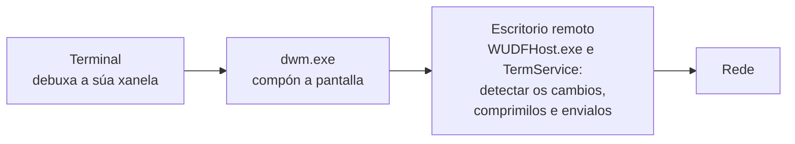

# Tecnoloxías

> Estado: subfase 0.7. Este documento crece con cada PR: cada tecnoloxía nova engádese cando se empeza a usar.

Para cada tecnoloxía explícase que é, por que a usamos e como está configurada en meiga. A explicación liña a liña de cada arquivo está en [Código](codigo/README.md).

## 1. Rust

**Que é.** Unha linguaxe de programación compilada a código máquina, coma C ou C++, pero sen os seus erros típicos de memoria. Non ten recolector de lixo (*garbage collector*): cada valor libérase automaticamente cando o seu dono sae de ámbito, nun punto que xa se coñece ao compilar. O compilador comproba as regras de **propiedade** (*ownership*: cada valor ten un único dono) e de **préstamos** (*borrowing*: pódese prestar un valor a moitos lectores ou a un único escritor, nunca aos dous á vez). Se o código as incumpre, non compila. Grazas a iso desaparecen erros como usar memoria xa liberada ou que dous fíos modifiquen o mesmo dato á vez (*data races*).

**Por que.**

- **Rendemento** comparábel ao de C e C++, sen pausas do recolector de lixo.
- **Seguridade de memoria.** Un terminal procesa texto que non controlamos (a saída de calquera programa); un erro de memoria podería converterse nunha vulnerabilidade.
- **Concorrencia segura.** O compilador impide compartir datos entre fíos de forma insegura.
- **Bindings oficiais de Microsoft** (os crates `windows` e `windows-sys`) para chamar ás APIs de Windows.
- **Ecosistema:** bibliotecas de terminal xa optimizadas, como `alacritty_terminal`.

**Alternativas descartadas:** C++ (mesmo rendemento, pero sen seguridade de memoria), Zig (ecosistema e bindings de Windows menos maduros), C# e .NET (recolector de lixo, máis memoria e arranque máis lento) e Electron ou tecnoloxías web (moito máis pesadas).

**Edición 2024.** As edicións de Rust permiten introducir cambios incompatíbeis na linguaxe sen romper o código antigo: cada crate declara a súa edición, e crates de edicións distintas poden usarse xuntos. A 2024 é a máis recente.

## 2. rustup e `rust-toolchain.toml`

**Que é.** `rustup` instala e xestiona versións do compilador de Rust (*toolchains*) e os seus compoñentes. O arquivo `rust-toolchain.toml` indica que versión usar nun proxecto: ao executar `cargo` dentro do cartafol, rustup usa esa versión e, se non está instalada, descárgaa. Tamén se pode instalar explicitamente con `rustup toolchain install`, que le o mesmo arquivo: é o que fai a CI.

**Configuración en meiga.**

- `channel = "1.99.1"`: unha versión exacta, non simplemente "a última estábel". Así todas as compilacións, en calquera equipo e na CI, usan o mesmo compilador, e unha versión nova de Rust non pode romper a compilación sen avisar. Para actualizala, cámbiase a versión nun PR propio.
- `components = ["clippy", "rustfmt"]`: instala tamén o analizador Clippy e o formateador rustfmt.
- `profile = "minimal"`: non descarga a documentación local nin outros extras, para que a instalación sexa máis rápida e pequena.

## 3. Cargo e os *workspaces*

**Cargo** é o xestor de paquetes e o sistema de compilación de Rust: descarga as dependencias, compila, executa as probas e as ferramentas.

**Un *workspace*** agrupa varios crates que comparten:

- un único `Cargo.lock`, polo que todos usan as mesmas versións das dependencias;
- un único cartafol `target/` coas compilacións;
- configuración común (perfís, *lints*, metadatos).

O `Cargo.toml` da raíz de meiga é un **manifesto virtual**: non describe ningún crate, só o workspace. Os crates están en `crates/`.

**Herdanza.** A sección `[workspace.package]` define valores comúns (versión, edición, licenza…), e cada crate recólleos con `version.workspace = true`. Do mesmo xeito, `[workspace.dependencies]` declara unha soa vez onde está cada dependencia.

**Resolvedor 3.** O *resolver* é o algoritmo que escolle que versión de cada dependencia se usa. A versión 3 ten en conta a versión mínima de Rust do proxecto (`rust-version`) e prefire versións das dependencias compatíbeis con ela.

**`Cargo.lock`.** Garda a versión exacta de cada dependencia, incluídas as indirectas. Súbese ao repositorio porque meiga é un programa: así cada compilación é reproducíbel. Coa opción `--locked`, Cargo falla se o `Cargo.lock` non está ao día, en vez de cambialo en silencio. Úsana a CI e os scripts de `tools/`.

## 4. Perfís de compilación

Un perfil é un conxunto de opcións do compilador.

| Perfil | Comando | Para que | Opcións |
|---|---|---|---|
| `dev` | `cargo build` | Desenvolvemento: compila rápido. | Sen optimizar e con información de depuración. |
| `release` | `cargo build --release` | O programa que se distribúe. | Optimización máxima (ver abaixo). |
| `profiling` | `cargo build --profile profiling` | Medir onde se vai o tempo. | Igual que `release` e, ademais, información de depuración. |

**Opcións do perfil `release`:**

- **`lto = "fat"`** (*Link-Time Optimization*). Normalmente cada crate optimízase por separado. Co LTO completo, o compilador optimiza o programa enteiro no momento de ligalo: pode integrar funcións dun crate dentro doutro (*inlining*) e eliminar o código que ninguén usa. O resultado é máis rápido e máis pequeno, a cambio de compilar máis lento.
- **`codegen-units = 1`.** Para compilar máis rápido, o compilador divide cada crate en varios anacos que procesa en paralelo, pero así perde oportunidades de optimización entre eses anacos. Con 1 non se divide nada.
- **`panic = "abort"`.** En Rust, un *pánico* é un erro irrecuperábel (por exemplo, acceder fóra dos límites dun vector). Por defecto, o programa "desenrola a pila" (*unwinding*): vai saíndo das funcións e liberando os recursos de cada unha. Con `abort`, o proceso remata no momento. O binario é máis pequeno e o código máis rápido, porque o compilador non ten que xerar o código e as táboas do desenrolado. A consecuencia é que un pánico pecha meiga enteiro, con todas as súas tabs. Por iso o código debe evitar os pánicos, e de aí veñen as regras contra `unwrap()` (sección 7).

O perfil `profiling` herda de `release` e engade `debug = "limited"`: os nomes das funcións e os números de liña. Con eles, ferramentas como WPR/WPA (o perfilador de Windows) poden mostrar en que funcións se gasta o tempo.

## 5. *Runtime* de C ligado estaticamente (`+crt-static`)

**Que é.** Os programas que se compilan para Windows co compilador de Microsoft (MSVC) usan o *runtime* de C (CRT): funcións básicas de memoria, cadeas… Por defecto ligan con el de forma dinámica, a través de `vcruntime140.dll` e do *Universal CRT*. Por iso moitos programas piden instalar o *Visual C++ Redistributable*.

**Configuración en meiga.** A opción `-C target-feature=+crt-static` mete o CRT dentro do propio `.exe`. Está en `.cargo/config.toml` (e non nunha variábel de contorno) para que forme parte do repo e se aplique sempre. A condición `cfg(all(windows, target_env = "msvc"))` limítaa ao compilador de Microsoft.

**Comprobación.** `dumpbin /dependents target\release\meiga.exe` mostra que só depende de `KERNEL32.dll`, `ntdll.dll` e `api-ms-win-core-synch-l1-2-0.dll`. Esta última non é unha DLL que haxa que instalar, senón un *API set*: un nome lóxico que Windows resolve internamente cara ás súas propias bibliotecas.

## 6. Subsistema de Windows

Cada `.exe` de Windows declara un subsistema:

- **`console`**: Windows asígnalle unha consola (ou a do terminal desde o que se lanza).
- **`windows`**: aplicación gráfica, sen consola.

meiga usa `#![cfg_attr(not(debug_assertions), windows_subsystem = "windows")]`. Na compilación *release* (`debug_assertions` desactivado) é unha aplicación gráfica: ao abrila non aparece ningunha xanela negra de consola. Na de depuración mantén a consola, para poder ver mensaxes de diagnóstico mentres se desenvolve.

## 7. *Lints*: rustc e Clippy

**Que é un *lint*.** Unha regra que detecta un patrón de código problemático. Cada *lint* ten un nivel: `allow` (ignorar), `warn` (aviso), `deny` (erro) ou `forbid` (erro que ningún arquivo pode desactivar). **Clippy** é o analizador oficial de Rust, con centos de *lints* adicionais aos do compilador.

**Onde se configuran.** En `[workspace.lints]` do `Cargo.toml` raíz, e cada crate adóptaos con `[lints] workspace = true`.

**Regras do compilador (rustc):**

- `rust_2018_idioms` (aviso): un grupo de regras de estilo moderno. Leva `priority = -1` para que se aplique primeiro e as regras concretas poidan sobrescribila.
- `unsafe_op_in_unsafe_fn` (erro): dentro dunha función marcada como `unsafe`, cada operación insegura tamén ten que ir no seu propio bloque `unsafe { … }`. Así, cada operación perigosa queda localizada e xustificada.

**Regras de Clippy:**

| Regra | Nivel | Por que |
|---|---|---|
| `unwrap_used` | erro | `unwrap()` provoca un pánico se o valor non existe. Con `panic = "abort"`, un pánico pecharía o terminal con todas as súas tabs. Os erros trátanse de forma explícita. |
| `expect_used` | aviso | Como `unwrap()`, pero cunha mensaxe. Pode estar xustificado nalgún caso (cun comentario que explique por que nunca falla). |
| `undocumented_unsafe_blocks` | erro | Cada bloque `unsafe` debe ir precedido dun comentario `// SAFETY:` que explique por que é seguro. |
| `dbg_macro`, `todo`, `unimplemented` | erro | Restos de depuración ou código a medias que non deben chegar a `main`. |

**`clippy.toml`** permite `unwrap()` e `expect()` nas probas, onde un pánico é xusto o comportamento que se busca: a proba falla.

Na validación úsase `cargo clippy … -- -D warnings`, que converte calquera aviso en erro.

## 8. rustfmt

**Que é.** O formateador oficial de Rust: reescribe o código cun estilo único (sangrías, espazos, saltos de liña). Así non hai discusións de estilo e os cambios nos PR son só cambios reais. `cargo fmt --all --check` comproba o formato sen modificar nada.

**Configuración** (`rustfmt.toml`):

- `use_field_init_shorthand = true`: escribe `Punto { x, y }` en vez de `Punto { x: x, y: y }`.
- `use_try_shorthand = true`: usa o operador `?` en vez da macro antiga `try!`.

**Saltos de liña.** O repo garda LF (ver a sección 12), pero en Windows os arquivos poden ter CRLF no cartafol de traballo. rustfmt usa por defecto `newline_style = "Auto"`, que respecta o que atopa en cada arquivo, así que funciona igual nos dous casos.

## 9. cargo-deny

**Que é.** Unha ferramenta que revisa as dependencias do proxecto en catro aspectos:

| Comprobación | Que revisa |
|---|---|
| `advisories` | Vulnerabilidades coñecidas (base de datos RustSec), crates abandonados e versións retiradas polo seu autor (*yanked*). |
| `licenses` | Que todas as licenzas estean na lista permitida. |
| `bans` | Versións duplicadas dunha mesma dependencia e versións con comodín (`*`). |
| `sources` | Que as dependencias só veñan de crates.io. |

**Por que só licenzas permisivas.** MIT, Apache-2.0, BSD, ISC, Zlib e similares permiten usar o código nun produto comercial e de código pechado, coa condición de incluír o seu aviso de licenza. As licenzas *copyleft* (GPL, LGPL, MPL…) poden obrigar a publicar o código propio ou complicar a venda. Por iso non se admiten.

**Configuración** (`deny.toml`):

- `[graph] targets`: só se teñen en conta as dependencias que se compilan para Windows x64.
- `yanked = "deny"`: unha versión retirada polo seu autor é un erro.
- `confidence-threshold = 0.93`: cando ten que recoñecer o texto dunha licenza, esixe un 93 % de coincidencia.
- `[licenses.private] ignore = true`: non revisa os nosos propios crates, que son propietarios e nunca se publican (`publish = false`).
- `unused-allowed-license = "allow"`: a lista é unha política, non un inventario, así que non avisa das licenzas que aínda non usa ningunha dependencia.
- `wildcards = "deny"`, con `allow-wildcard-paths = true`: prohíbe os comodíns nas versións, agás nas dependencias internas por ruta.
- `multiple-versions = "warn"`: avisa, sen bloquear, se se compilan dúas versións dun mesmo crate. Cada copia engade código ao binario, pero ás veces é inevitábel (dúas dependencias piden versións incompatíbeis), así que se revisa caso a caso.
- `unknown-registry` e `unknown-git` = `"deny"`, con `allow-registry` apuntando ao índice de crates.io: só se admiten dependencias de crates.io.

## 10. cargo-about e Handlebars

**Para que.** As licenzas permisivas obrigan a incluír o seu texto e o aviso de *copyright* cando se distribúe o programa. `cargo-about` recolle eses textos de todas as dependencias e xera o arquivo `THIRD-PARTY-NOTICES.txt` a partir dun modelo.

**Handlebars** é unha linguaxe de modelos sinxela:

- `{{#each licenses}} … {{/each}}` repite o bloque para cada elemento dunha lista.
- `{{#if crate.repository}} … {{/if}}` mostra o bloque só se o valor existe.
- `{{{text}}}`, con **tres chaves**, insire o texto tal cal. Con dúas chaves, Handlebars "escaparía" os caracteres especiais para HTML (`<` convertiríase en `&lt;`), e o arquivo de texto quedaría estragado.

**Configuración** (`about.toml`):

- `accepted`: as mesmas licenzas que `deny.toml`.
- `targets`: como en `deny.toml`, só as dependencias que se compilan para Windows x64.
- `ignore-build-dependencies = false`: inclúe tamén as dependencias que só se usan ao compilar. Algunhas xeran código que acaba dentro do binario, e é mellor que sobre un aviso a que falte.
- `ignore-dev-dependencies = true`: exclúe as dependencias que só usan as probas, porque non se distribúen.
- `private.ignore = true`: non inclúe os nosos crates.

**Comprobación.** Cunha dependencia temporal (`memchr`), o arquivo xerado incluíu a licenza MIT co seu aviso de *copyright* e sen caracteres escapados. O arquivo non se garda no repo: xérao `tools/package.ps1` ao empaquetar o programa.

## 11. PowerShell 7

Os scripts de `tools/` escríbense para PowerShell 7 (`pwsh`). Todos seguen o mesmo patrón para que un erro nunca pase desapercibido:

- `Set-StrictMode -Version Latest`: produce un erro ao usar variábeis que non existen, en vez de tratalas como baleiras.
- `$ErrorActionPreference = 'Stop'`: calquera erro dun *cmdlet* detén o script.
- Comprobación de `$LASTEXITCODE` despois de cada programa externo (`cargo`, `git`…): PowerShell non detén o script cando un programa externo falla, así que hai que comprobalo a man.
- As rutas relativas resólvense con `$ExecutionContext.SessionState.Path.GetUnresolvedProviderPathFromPSPath()`, nunca con funcións de .NET como `[System.IO.Path]::GetFullPath()`. Estas usan o cartafol de traballo do proceso, que PowerShell non actualiza ao facer `cd` (detalle en [Código › ferramentas](codigo/ferramentas.md#toolsthird-party-noticesps1)).

**PowerShell 7 e Windows PowerShell 5.1.** Windows trae Windows PowerShell 5.1 (`powershell.exe`), e PowerShell 7 (`pwsh.exe`) instálase á parte: son dous programas distintos que conviven. Se un script de `tools/` se abre con 5.1, non se executa e mostra o comando exacto para executalo con `pwsh`. Para que 5.1 chegue a mostrar esa mensaxe, os scripts:

- usan só a sintaxe que tamén entende 5.1, sen os operadores `?:`, `??` nin `&&`;
- están escritos en ASCII: 5.1 le os arquivos sen marca de bytes como Windows-1252, e algúns caracteres en UTF-8 converteríanse en comiñas tipográficas, que PowerShell trata como comiñas de verdade;
- non usan `$PSScriptRoot` nos valores por defecto dos parámetros, porque 5.1 o deixa baleiro nese momento.

`tools/check-powershell.ps1` compróbao en cada PR (ver [Código › ferramentas](codigo/ferramentas.md#toolscheck-powershellps1)).

## 12. Git e GitHub

**`.gitattributes`:**

- `* text=auto eol=lf`: Git detecta os arquivos de texto e gárdaos con saltos de liña LF. Ao extraelos no cartafol de traballo (*checkout*) tamén os deixa con LF, en Windows igual que en Linux.
- `*.bat` e `*.cmd` con CRLF, porque `cmd.exe` o necesita.
- Imaxes (`*.ico`, `*.png`) como binarios, para que Git nunca as modifique.

**`.gitignore`:** exclúe `target/` e `dist/` (compilacións e paquetes), `.perf/` (resultados de medicións locais, que conteñen datos da máquina) e os arquivos de editores e do sistema.

**Configuración do repositorio en GitHub:**

- **Só *squash merge*:** cada PR convértese nun único commit en `main`, así que o historial é lineal e lexíbel, cun commit por subfase.
- **Borrado automático da rama** ao integrar o PR.
- **Alertas e actualizacións de seguridade de Dependabot** (ver a [sección 16](#16-dependabot)).
- ***Secret scanning* con *push protection*:** GitHub rexeita un *push* que conteña un segredo (por exemplo, un *token*).
- **Notificación privada de vulnerabilidades:** permite informar dun problema de seguridade sen facelo público (ver `SECURITY.md`).
- **Regras da rama `main`** (ver a [sección 17](#17-regras-da-rama-main-rulesets)).

## 13. MSVC e o Windows SDK

Rust en Windows (o *target* `x86_64-pc-windows-msvc`) usa o ligador de Microsoft (`link.exe`) e as bibliotecas do Windows SDK. Instálanse con Visual Studio ou coas *Build Tools*, coa carga de traballo "Desenvolvemento para o escritorio con C++".

- **`dumpbin`**, das mesmas ferramentas, mostra a estrutura dun executábel, por exemplo as DLL das que depende (`/dependents`). Non está no `PATH` dunha consola normal, só na *Developer PowerShell for VS*.
- **`vswhere`** (`%ProgramFiles(x86)%\Microsoft Visual Studio\Installer\vswhere.exe`) é a ferramenta oficial para localizar as instalacións de Visual Studio. Os scripts úsana para atopar `dumpbin` sen depender dunha versión concreta de Visual Studio.

## 14. Preparar o contorno de desenvolvemento

1. Instalar [rustup](https://rustup.rs/). A versión de Rust do proxecto instálase soa a primeira vez que se executa `cargo` no cartafol.
2. Instalar Visual Studio ou as *Build Tools* coa carga de traballo de C++.
3. Instalar as ferramentas de revisión:

   ```powershell
   cargo install --locked cargo-deny
   cargo install --locked cargo-about --features cli
   ```

4. Comprobar que todo funciona:

   ```powershell
   cargo fmt --all --check
   cargo clippy --workspace --all-targets -- -D warnings
   cargo test --workspace
   cargo deny check
   .\tools\check-docs.ps1      # ligazóns da documentación
   .\tools\package.ps1         # compila en release e crea o zip en dist\
   .\tools\check-imports.ps1   # meiga.exe non depende do runtime de Visual C++
   ```

## 15. GitHub Actions

**Que é.** O sistema de integración continua (CI) de GitHub: executa tarefas automaticamente cando pasa algo no repositorio, como un PR, un *push* ou unha hora programada.

| Concepto | Que é |
|---|---|
| *Workflow* | Un proceso automático, definido nun arquivo YAML en `.github/workflows/`. |
| Evento | O que lanza o workflow: `pull_request`, `push`, `schedule`… |
| *Job* | Un conxunto de pasos que se executa nunha máquina. Os jobs dun workflow corren en paralelo, salvo que un dependa doutro. |
| *Runner* | A máquina virtual onde corre un job. GitHub crea unha nova e limpa para cada job e destrúea ao rematar. |
| Paso (*step*) | Un comando (`run`) ou unha *action* (`uses`). |
| *Action* | Un compoñente reutilizábel publicado nun repositorio de GitHub, como `actions/checkout`. |
| Artefacto | Un arquivo xerado por unha execución, que se pode descargar desde a web. |
| *Check* | O resultado, correcto ou fallido, de cada job. Aparece no PR. |

**Por que.** Cada PR compílase e próbase nunha máquina limpa e sempre igual, sen depender do estado do equipo de ninguén. Nos repositorios públicos é gratuíto.

**En meiga** hai un workflow (`ci.yml`) con dous jobs en paralelo:

- **Build and test (Windows):** ligazóns da documentación, proba do arnés de medición, formato, Clippy, probas, compilación *release*, paquete `.zip`, comprobación das DLL e subida do paquete como artefacto.
- **Dependency policy (cargo-deny):** a política de dependencias, nunha máquina Linux. Ademais de en cada PR, execútase cada semana para detectar vulnerabilidades novas.

A explicación liña a liña está en [Código › .github](codigo/github.md).

### Seguridade do workflow

Un workflow executa código de terceiros (as actions) cun *token* de acceso ao repositorio. Por iso protéxese en varias capas:

- **Permisos mínimos:** `permissions: contents: read`. O *token* só pode ler o código.
- **Actions fixadas por SHA.** Unha etiqueta como `v7.0.1` pódese mover: quen controle o repositorio da action pode apuntala a outro commit. Pasou en marzo de 2025 coa action `tj-actions/changed-files`: un atacante moveu as súas etiquetas a un commit malicioso que escribía os segredos dos workflows nos rexistros, en miles de repositorios. O SHA completo identifica un commit concreto e non se pode cambiar. A versión queda nun comentario, e Dependabot actualiza os dous.
- **Sen credenciais gardadas:** `persist-credentials: false` ao descargar o código.
- **Sen segredos:** a CI non usa ningún.
- **Tempo máximo** en cada job (`timeout-minutes`).
- **Ferramentas verificadas:** `taiki-e/install-action` comproba o SHA-256 de cada binario que descarga.
- **Sen `RUSTFLAGS`:** esa variábel anularía as opcións de `.cargo/config.toml` (ver [Código › .github](codigo/github.md#variábeis-de-contorno)).

Antes de subilo, o workflow revisouse con dúas ferramentas de análise:

- [actionlint](https://github.com/rhysd/actionlint): erros de sintaxe, expresións e referencias incorrectas.
- [zizmor](https://github.com/zizmorcore/zizmor): problemas de seguridade (permisos, credenciais, inxección de código, actions sen fixar…).

### Imaxes dos runners

Úsanse `windows-2025` e `ubuntu-24.04`, non `windows-latest` e `ubuntu-latest`. As etiquetas `-latest` cambian de versión do sistema cando GitHub o decide, e iso pode romper a compilación sen ningún cambio no repositorio. Coa versión fixada, o cambio faise nun PR cando GitHub anuncia a retirada dunha imaxe.

### Caché e artefactos

- **Caché:** `Swatinem/rust-cache` garda entre execucións as dependencias e as compilacións, e só se garda desde `main`.
- **Artefactos:** o `.zip` de cada execución consérvase 30 días. Mentres non haxa versións publicadas (mellora futura F5), é a forma de obter un `meiga.exe` compilado pola CI.

## 16. Dependabot

**Que é.** O servizo de GitHub que vixía as dependencias. Ten tres funcións:

| Función | Que fai | En meiga |
|---|---|---|
| Alertas | Avisa se unha dependencia ten unha vulnerabilidade coñecida. | Activadas desde a subfase 0.2. |
| Actualizacións de seguridade | Abre automaticamente un PR que actualiza unha dependencia vulnerábel. | Activadas na subfase 0.4. |
| Actualizacións de versión | Abre PR periódicos coas versións novas, aínda que non haxa vulnerabilidades. | Configuradas en `.github/dependabot.yml`. |

**Configuración.** Tres ecosistemas: os crates de Rust, as actions dos workflows e a versión de Rust de `rust-toolchain.toml`. Revísanse unha vez por semana, cun único PR por ecosistema. Para os crates e as actions, só se propoñen versións publicadas hai polo menos 7 días (*cooldown*): se unha versión resulta ser maliciosa ou estar rota, adoita retirarse nese tempo. Detalle en [Código › .github](codigo/github.md#githubdependabotyml).

Os PR de Dependabot pasan pola mesma CI e pola mesma revisión que calquera outro: nada se integra automaticamente.

## 17. Regras da rama `main` (*rulesets*)

**Que é.** Un *ruleset* é un conxunto de regras que GitHub aplica a unhas ramas concretas. É o mecanismo recomendado actualmente, en substitución da antiga "protección de ramas". As regras compróbanse no servidor de GitHub, así que se aplican sexa cal sexa a ferramenta coa que se traballe.

**Regras de `main`:**

| Regra | Efecto |
|---|---|
| PR obrigatorio | Ninguén pode facer *push* directo a `main`: todo cambio entra por un PR. Non se esixen aprobacións, porque en GitHub o autor dun PR non pode aprobalo, e o propietario do repositorio é quen abre os PR. A revisión faise igualmente antes de integrar. |
| Só *squash merge* | Cada PR entra como un único commit. |
| Conversas resoltas | Non se pode integrar un PR con comentarios de revisión pendentes. |
| *Checks* obrigatorios | Os dous jobs da CI teñen que pasar. Só contan se os informa GitHub Actions, non outra aplicación que use o mesmo nome. |
| Rama ao día | O PR ten que incluír o último commit de `main`, para que a CI valide exactamente o que quedará en `main`. |
| Historial lineal | Non se admiten *merge commits*. |
| Sen *force push* | Ninguén pode reescribir o historial de `main`. |
| Sen borrado | Ninguén pode borrar `main`. |
| Sen excepcións | As regras aplícanse tamén aos administradores. |
| Aprobación extra para PR de Copilot | Valor por defecto de GitHub: se o axente de Copilot abre un PR coa súa propia identidade, e non en nome dunha persoa, esíxese unha aprobación máis. Non afecta aos PR que abre a conta propietaria. |

Comprobación: un *push* directo a `main` é rexeitado con `GH013: Repository rule violations found for refs/heads/main`, indicando que os cambios deben entrar por un PR e que faltan os dous *checks* obrigatorios.

## 18. Markdown, Mermaid e ADR

**Markdown** é o formato de texto de toda a documentación: títulos con `#`, listas, táboas, ligazóns `[texto](destino)` e bloques de código. GitHub móstrao xa formatado.

**Anclas dos títulos.** GitHub crea unha ancla para cada título, e unha ligazón pode apuntar a ela con `#`: `tecnoloxias.md#16-dependabot`. A ancla sae do texto do título: en minúsculas, sen signos de puntuación e cos espazos cambiados por guións. As letras con acento mantéñense. Se dous títulos dan a mesma ancla, o segundo leva `-1`, o terceiro `-2`, etc.

**Mermaid** é unha linguaxe de texto para debuxar diagramas: fluxos, secuencias, dependencias… Escríbese dentro dun bloque de código marcado como `mermaid`, e GitHub debúxao directamente. Ao ser texto, os diagramas revísanse nos PR coma o resto da documentación.

**Comprobación automática.** `tools/check-docs.ps1` comproba en cada PR que as ligazóns internas apuntan a arquivos e anclas que existen, distinguindo maiúsculas e minúsculas como fai GitHub (ver [Código › ferramentas](codigo/ferramentas.md#toolscheck-docsps1)).

**ADR** (*Architecture Decision Record*): un documento curto por cada decisión importante, co seu contexto, alternativas e consecuencias. Están en [`docs/adr/`](adr/README.md).

## 19. Medición do rendemento

**Por que.** O rendemento é a prioridade número 1 de meiga, e só se pode comparar o que se mide. `tools/perf/measure.ps1` mide sempre da mesma maneira calquera terminal (meiga, o Warp, o Windows Terminal), para comparalos e para comprobar os orzamentos de cada fase. O código explícase en [Código › medición](codigo/perf.md).

### Que se mide

| Métrica | Que é | Por que importa |
|---|---|---|
| Tempo de CPU | O tempo que os fíos dun proceso estiveron nun procesador, en modo usuario (o código do programa) e en modo núcleo (o código de Windows ao que chama). Exprésase en **% dun núcleo**: 100 % é un núcleo ocupado todo o tempo, e 200 %, dous. | É o que fai que o equipo vaia lento. |
| Ciclos | Os ciclos de procesador que usaron os fíos. | Miden mellor os consumos moi pequenos (ver embaixo). |
| Cambios de contexto | As veces que un fío entrou nun procesador. Un fío que espera bloqueado non entra ata que ten algo que facer, así que, en repouso, cada cambio de contexto é un **espertar**. | O obxectivo de meiga en repouso son 0 espertares por segundo: cada espertar gasta CPU e non deixa descansar o procesador. |
| Memoria privada | A memoria que o proceso reservou só para el (*Private Bytes*; no Xestor de tarefas, *Commit size*), estea na RAM ou no arquivo de paxinación. | É o que consome de verdade o programa. |
| *Working set* | As páxinas do proceso que están na RAM nese momento, incluídas as que comparte con outros procesos, como as DLL do sistema. | Baixa cando Windows lle retira RAM ao proceso, así que serve de referencia, pero non como orzamento. |
| Fíos | Cantos fíos ten o proceso. | Un fío que espera non gasta, pero moitos fíos adoitan significar moito traballo en paralelo e moitos espertares. |

**% dun núcleo e o Xestor de tarefas.** O Xestor de tarefas mostra a CPU en porcentaxe de **toda** a máquina. Nunha máquina con 8 procesadores lóxicos, un núcleo ocupado aparece como 12,5 % (100 / 8). `measure.ps1` indica ao final entre canto hai que dividir.

**Tempo de CPU e ciclos.** Windows conta o tempo de CPU de cada fío ao ritmo do reloxo do sistema, que por defecto marca cada 15,625 ms. Un fío que esperta moitas veces para traballar uns microsegundos pode non sumar nada nalgúns tics e un tic enteiro noutros, así que, para consumos pequenos, o tempo de CPU é pouco preciso. Os ciclos lense dun contador do propio procesador (a instrución `RDTSC`), que nos procesadores actuais avanza a un ritmo constante ([QueryThreadCycleTime](https://learn.microsoft.com/windows/win32/api/realtimeapiset/nf-realtimeapiset-querythreadcycletime) e [o que conta en realidade](https://devblogs.microsoft.com/oldnewthing/20160429-00/?p=93385)). Non se deben converter a tempo, pero son a mellor forma de comparar consumos pequenos entre dúas medicións na mesma máquina.

### Como se le: `NtQuerySystemInformation`

Unha chamada a `NtQuerySystemInformation`, de `ntdll.dll`, coa clase `SystemProcessInformation`, devolve todos os procesos co detalle de todos os seus fíos: os mesmos datos que mostran o Xestor de tarefas e o Process Explorer. Leva uns milisegundos e non necesita abrir os procesos, así que funciona sen permisos de administrador tamén cos procesos protexidos, como `dwm.exe`.

| Alternativa | Por que non |
|---|---|
| `Get-Process` | Non pode ler a CPU dos procesos protexidos, como `dwm.exe`, sen permisos de administrador, e non dá os cambios de contexto. |
| Contadores de rendemento por WMI (`Win32_PerfRawData_PerfProc_Thread`) | Dan os cambios de contexto de cada fío, pero a consulta leva decenas de segundos. Usáronse para comprobar os valores. |
| `Get-Counter` | Os nomes dos contadores dependen do idioma de Windows, e os dos fíos tamén son lentos. |
| ETW, WPR e WPA | Rexistran cada evento do sistema con moito detalle. Serán a ferramenta para buscar onde se vai o tempo na Fase 9, pero son demasiado para unha medición de minutos que se repite moitas veces. |

Microsoft documenta esta función só en parte e avisa de que pode cambiar. Porén, as estruturas que se usan non cambiaron desde Windows 7, e moitas ferramentas dependen delas. Por iso os valores compróbanse con outras fontes (ver [Código › medición](codigo/perf.md#toolsperftest-measureps1)).

### C# dentro de PowerShell

`Add-Type -Path` compila un arquivo C# en memoria e carga as súas clases na sesión de PowerShell. Así, o traballo que se repite en cada fotografía vai en código compilado, moito máis rápido ca un bucle de PowerShell, e segue sendo un arquivo de texto que se le e se revisa como un script. Unha ferramenta en Rust tería que compilarse antes de cada medición e sería outro programa que manter.

.NET compila cada método a código máquina a primeira vez que se chama e, un pouco despois, recompila en segundo plano os que máis se usan, con máis optimizacións (*tiered compilation*). Ese traballo continúa uns instantes despois de que o script remate de preparar a medición. Por iso `measure.ps1` executa unha vez o código da medición e agarda 2 s antes de empezar a medir.

### O camiño ata a pantalla no Escritorio remoto

Cando un terminal debuxa, o traballo non acaba no seu proceso:



- **DWM** (*Desktop Window Manager*): compón as xanelas de todos os programas na imaxe final da pantalla.
- **Adaptador de pantalla do Escritorio remoto** (*Microsoft Remote Display Adapter*): un *driver* de pantalla que corre en modo usuario dentro dun `WUDFHost.exe`, o proceso que aloxa os *drivers* en modo usuario.
- **Servizo de Escritorio remoto** (`TermService`): xestiona a conexión e envía os cambios da pantalla.

Un terminal que redebuxa moito fai traballar tamén estes procesos, e iso tamén é custo do terminal. Por iso `measure.ps1` mídeos como grupos propios, ademais do total da máquina.

### Resultados en CSV

Windows en galego ou en castelán usa a coma como separador decimal, e `Export-Csv` escribiría `1,5`. O CSV usa sempre o punto (a **cultura invariante**), para que outros scripts e programas o lean igual en calquera máquina. A táboa que se mostra na consola si usa o formato do teu idioma.

### Limitacións

- Un proceso que nace e remata entre dúas fotografías non se ve. Na práctica só afecta ao grupo `shells`: un comando curto nunha shell pode non aparecer.
- Un proceso que remata perde a CPU que gastou despois da súa última fotografía, e un fío que remata, os seus cambios de contexto. Por iso existe a columna `exited`.
- Medir tamén consome: aparece no grupo `harness` e non se suma a `system`.
- O grupo `system` inclúe todo o que corre na máquina (antivirus, actualizacións…). Para comparar terminais, repítense as medicións e mírase cada grupo.

### Escenarios de carga

Para comparar terminais, todos teñen que facer o mesmo traballo. Os **escenarios de carga** de `tools/perf/scenarios/` son esa carga, reproducíbel e igual en PowerShell e en bash (WSL):

| Escenario | Imita | Que lle esixe ao terminal |
|---|---|---|
| `idle` | O terminal aberto sen facer nada, por exemplo con 5 tabs. | Nada: o ideal son 0 espertares por segundo. |
| `spinner` | O indicador de progreso dunha ferramenta que traballa. | Redebuxar unha liña 10 veces por segundo. |
| `ai-stream` | Unha IA que responde nun terminal. | Redebuxar unha zona de 4 liñas 10 veces por segundo, desprazar o texto e debuxar cores, emoji, caracteres CJK e de caixa. |
| `bigfile` | Imprimir un rexistro enorme. | Procesar e mostrar uns 50 MiB tan rápido como poida. |

Os escenarios debuxan con **secuencias de escape VT**, as mesmas que usan as ferramentas de liña de comandos: mover o cursor, borrar partes da pantalla e cambiar as cores (ver a táboa en [Código › escenarios de carga](codigo/escenarios.md#que-debuxan-as-secuencias-de-escape)).

`tools/perf/run-scenario.ps1` mide varias veces seguidas (por defecto, 3 medicións de 60 s) e dá un veredicto: os resultados son **estábeis** se os ciclos do terminal varían entre medicións como moito un 10 % da media, ou un millón por segundo se iso é máis; en bigfile, se o tempo de imprimir varía como moito un 10 %. Úsanse os ciclos e non o tempo de CPU polo explicado máis arriba en *Tempo de CPU e ciclos*: un terminal gasta tan pouco que o seu tempo de CPU dá saltos dunha medición a outra. Unha medición soa pode coincidir cunha actualización de Windows ou co antivirus; varias medicións parecidas dan confianza no resultado.

## 20. bash, WSL e ShellCheck

**WSL** (*Windows Subsystem for Linux*) executa distribucións de Linux, como Ubuntu, nunha máquina virtual lixeira integrada en Windows. Unha tab de Ubuntu nun terminal de Windows lanza `wsl.exe`, que conecta a consola co Linux da máquina virtual. Os escenarios de carga teñen unha versión en **bash**, a shell habitual de Linux, para medir tamén ese camiño.

- **bash 5.** Os scripts necesitan bash 5 ou posterior (Ubuntu tráeo desde a versión 20.04), pola variábel `EPOCHREALTIME`: a hora con microsegundos, que se le sen lanzar ningún proceso.
- **Sen procesos.** En bash é habitual lanzar programas para tarefas pequenas (`date`, `sleep`), e cada un custa milisegundos de CPU. Os escenarios non lanzan ningún mentres corren: a hora sae de `EPOCHREALTIME`, e as esperas fanse cun `read` con tempo máximo sobre unha tubaxe que nunca recibe datos.
- **O disco de Windows desde WSL.** O disco de Windows vese en `/mnt/c/` a través do protocolo **9P**, moito máis lento ca o disco propio de Linux. Por iso bigfile copia o arquivo a `/tmp` antes de imprimilo, e os escenarios só miran os arquivos de coordinación unha vez por segundo.
- **Rutas.** `wslpath` converte unha ruta de Windows na de WSL (`C:\Users` → `/mnt/c/Users`). A variábel `WSLENV` indica que variábeis de contorno pasan de Windows a WSL; coa opción `/p`, a ruta tradúcese ao pasar.
- **Fins de liña.** bash non acepta os fins de liña de Windows (CRLF). O `.gitattributes` do repositorio fai que Git garde e descargue todos os arquivos con LF, así que os scripts funcionan tamén desde `/mnt/c/`.

**ShellCheck** é un analizador estático de scripts de shell: atopa erros que bash non detecta ata que chega a executar a liña, como variábeis sen comiñas que se parten en varias palabras, comandos que fallan sen que ninguén o note ou sintaxe que non é de bash. A CI pásao aos scripts de bash coas regras por defecto. Cada aviso ten un código (por exemplo, `SC2034`) cunha páxina que o explica na [wiki de ShellCheck](https://www.shellcheck.net/wiki/). Cando un aviso non se aplica, desactívase só nesa liña cun comentario `# shellcheck disable=…` e unha explicación.
