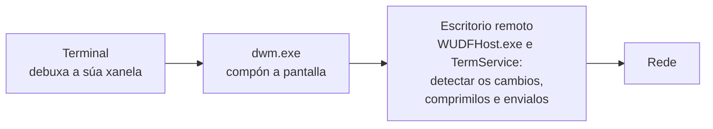

# Tecnoloxías

> Estado: subfase 1.3. Este documento crece con cada PR: cada tecnoloxía nova engádese cando se empeza a usar.

Para cada tecnoloxía explícase que é, por que a usamos e como está configurada en meiga. A explicación liña a liña de cada arquivo está en [Código](codigo/README.md).

## 1. Rust

**Que é.** Unha linguaxe de programación compilada a código máquina, coma C ou C++, pero sen os seus erros típicos de memoria. Non ten recolector de lixo (*garbage collector*): cada valor libérase automaticamente cando o seu dono sae de ámbito, nun punto que xa se coñece ao compilar. O compilador comproba as regras de **propiedade** (*ownership*: cada valor ten un único dono) e de **préstamos** (*borrowing*: pódese prestar un valor a moitos lectores ou a un único escritor, nunca aos dous á vez). Se o código as incumpre, non compila. Grazas a iso desaparecen erros como usar memoria xa liberada ou que dous fíos modifiquen o mesmo dato á vez (*data races*).

**Por que.**

- **Rendemento** comparábel ao de C e C++, sen pausas do recolector de lixo.
- **Seguridade de memoria.** Un terminal procesa texto que non controlamos (a saída de calquera programa); un erro de memoria podería converterse nunha vulnerabilidade.
- **Concorrencia segura.** O compilador impide compartir datos entre fíos de forma insegura.
- **Bindings oficiais de Microsoft** (os crates `windows` e `windows-sys`) para chamar ás APIs de Windows.
- **Ecosistema:** bibliotecas de terminal xa optimizadas, como `alacritty_terminal`.

**Alternativas descartadas:** C++ (mesmo rendemento, pero sen seguridade de memoria), Zig (ecosistema e bindings de Windows menos maduros), C# e .NET (recolector de lixo, máis memoria e arranque máis lento) e Electron ou tecnoloxías web (moito máis pesadas).

**Edición 2024.** As edicións de Rust permiten introducir cambios incompatíbeis na linguaxe sen romper o código antigo: cada crate declara a súa edición, e crates de edicións distintas poden usarse xuntos. A 2024 é a máis recente.

## 2. rustup e `rust-toolchain.toml`

**Que é.** `rustup` instala e xestiona versións do compilador de Rust (*toolchains*) e os seus compoñentes. O arquivo `rust-toolchain.toml` indica que versión usar nun proxecto: ao executar `cargo` dentro do cartafol, rustup usa esa versión e, se non está instalada, descárgaa. Tamén se pode instalar explicitamente con `rustup toolchain install`, que le o mesmo arquivo: é o que fai a CI.

**Configuración en meiga.**

- `channel = "1.99.1"`: unha versión exacta, non simplemente "a última estábel". Así todas as compilacións, en calquera equipo e na CI, usan o mesmo compilador, e unha versión nova de Rust non pode romper a compilación sen avisar. Para actualizala, cámbiase a versión nun PR propio.
- `components = ["clippy", "rustfmt"]`: instala tamén o analizador Clippy e o formateador rustfmt.
- `profile = "minimal"`: non descarga a documentación local nin outros extras, para que a instalación sexa máis rápida e pequena.

## 3. Cargo e os *workspaces*

**Cargo** é o xestor de paquetes e o sistema de compilación de Rust: descarga as dependencias, compila, executa as probas e as ferramentas.

**Un *workspace*** agrupa varios crates que comparten:

- un único `Cargo.lock`, polo que todos usan as mesmas versións das dependencias;
- un único cartafol `target/` coas compilacións;
- configuración común (perfís, *lints*, metadatos).

O `Cargo.toml` da raíz de meiga é un **manifesto virtual**: non describe ningún crate, só o workspace. Os crates están en `crates/`.

**Herdanza.** A sección `[workspace.package]` define valores comúns (versión, edición, licenza…), e cada crate recólleos con `version.workspace = true`. Do mesmo xeito, `[workspace.dependencies]` declara unha soa vez onde está cada dependencia.

**Resolvedor 3.** O *resolver* é o algoritmo que escolle que versión de cada dependencia se usa. A versión 3 ten en conta a versión mínima de Rust do proxecto (`rust-version`) e prefire versións das dependencias compatíbeis con ela.

**`Cargo.lock`.** Garda a versión exacta de cada dependencia, incluídas as indirectas. Súbese ao repositorio porque meiga é un programa: así cada compilación é reproducíbel. Coa opción `--locked`, Cargo falla se o `Cargo.lock` non está ao día, en vez de cambialo en silencio. Úsana a CI e os scripts de `tools/`.

## 4. Perfís de compilación

Un perfil é un conxunto de opcións do compilador.

| Perfil | Comando | Para que | Opcións |
|---|---|---|---|
| `dev` | `cargo build` | Desenvolvemento: compila rápido. | Sen optimizar e con información de depuración. |
| `release` | `cargo build --release` | O programa que se distribúe. | Optimización máxima (ver abaixo). |
| `profiling` | `cargo build --profile profiling` | Medir onde se vai o tempo. | Igual que `release` e, ademais, información de depuración. |

**Opcións do perfil `release`:**

- **`lto = "fat"`** (*Link-Time Optimization*). Normalmente cada crate optimízase por separado. Co LTO completo, o compilador optimiza o programa enteiro no momento de ligalo: pode integrar funcións dun crate dentro doutro (*inlining*) e eliminar o código que ninguén usa. O resultado é máis rápido e máis pequeno, a cambio de compilar máis lento.
- **`codegen-units = 1`.** Para compilar máis rápido, o compilador divide cada crate en varios anacos que procesa en paralelo, pero así perde oportunidades de optimización entre eses anacos. Con 1 non se divide nada.
- **`panic = "abort"`.** En Rust, un *pánico* é un erro irrecuperábel (por exemplo, acceder fóra dos límites dun vector). Por defecto, o programa "desenrola a pila" (*unwinding*): vai saíndo das funcións e liberando os recursos de cada unha. Con `abort`, o proceso remata no momento. O binario é máis pequeno e o código máis rápido, porque o compilador non ten que xerar o código e as táboas do desenrolado. A consecuencia é que un pánico pecha meiga enteiro, con todas as súas tabs. Por iso o código debe evitar os pánicos, e de aí veñen as regras contra `unwrap()` (sección 7).

O perfil `profiling` herda de `release` e engade `debug = "limited"`: os nomes das funcións e os números de liña. Con eles, ferramentas como WPR/WPA (o perfilador de Windows) poden mostrar en que funcións se gasta o tempo.

## 5. *Runtime* de C ligado estaticamente (`+crt-static`)

**Que é.** Os programas que se compilan para Windows co compilador de Microsoft (MSVC) usan o *runtime* de C (CRT): funcións básicas de memoria, cadeas… Por defecto ligan con el de forma dinámica, a través de `vcruntime140.dll` e do *Universal CRT*. Por iso moitos programas piden instalar o *Visual C++ Redistributable*.

**Configuración en meiga.** A opción `-C target-feature=+crt-static` mete o CRT dentro do propio `.exe`. Está en `.cargo/config.toml` (e non nunha variábel de contorno) para que forme parte do repo e se aplique sempre. A condición `cfg(all(windows, target_env = "msvc"))` limítaa ao compilador de Microsoft.

**Comprobación.** `dumpbin /dependents target\release\meiga.exe` mostra que só depende de DLL do sistema. Da biblioteca estándar de Rust veñen `KERNEL32.dll`, `ntdll.dll` e `api-ms-win-core-synch-l1-2-0.dll`. Esta última non é unha DLL que haxa que instalar, senón un *API set*: un nome lóxico que Windows resolve internamente cara ás súas propias bibliotecas. Desde a subfase 1.1, a xanela engade `user32.dll` e `gdi32.dll` e, en minúsculas, outra vez `kernel32.dll` (ver a [sección 21](#21-windows-sys-as-apis-de-windows-desde-rust)). Ningunha é do *Visual C++ Redistributable*.

## 6. Subsistema de Windows

Cada `.exe` de Windows declara un subsistema:

- **`console`**: Windows asígnalle unha consola (ou a do terminal desde o que se lanza).
- **`windows`**: aplicación gráfica, sen consola.

meiga usa `#![cfg_attr(not(debug_assertions), windows_subsystem = "windows")]`. Na compilación *release* (`debug_assertions` desactivado) é unha aplicación gráfica: ao abrila non aparece ningunha xanela negra de consola. Na de depuración mantén a consola, para poder ver mensaxes de diagnóstico mentres se desenvolve. A CI comproba o subsistema do `meiga.exe` de *release* en cada cambio, con `tools/check-window.ps1` (ver [Código › ferramentas](codigo/ferramentas.md#toolscheck-windowps1)).

## 7. *Lints*: rustc e Clippy

**Que é un *lint*.** Unha regra que detecta un patrón de código problemático. Cada *lint* ten un nivel: `allow` (ignorar), `warn` (aviso), `deny` (erro) ou `forbid` (erro que ningún arquivo pode desactivar). **Clippy** é o analizador oficial de Rust, con centos de *lints* adicionais aos do compilador.

**Onde se configuran.** En `[workspace.lints]` do `Cargo.toml` raíz, e cada crate adóptaos con `[lints] workspace = true`.

**Regras do compilador (rustc):**

- `rust_2018_idioms` (aviso): un grupo de regras de estilo moderno. Leva `priority = -1` para que se aplique primeiro e as regras concretas poidan sobrescribila.
- `unsafe_op_in_unsafe_fn` (erro): dentro dunha función marcada como `unsafe`, cada operación insegura tamén ten que ir no seu propio bloque `unsafe { … }`. Así, cada operación perigosa queda localizada e xustificada.

**Regras de Clippy:**

| Regra | Nivel | Por que |
|---|---|---|
| `unwrap_used` | erro | `unwrap()` provoca un pánico se o valor non existe. Con `panic = "abort"`, un pánico pecharía o terminal con todas as súas tabs. Os erros trátanse de forma explícita. |
| `expect_used` | aviso | Como `unwrap()`, pero cunha mensaxe. Pode estar xustificado nalgún caso (cun comentario que explique por que nunca falla). |
| `undocumented_unsafe_blocks` | erro | Cada bloque `unsafe` debe ir precedido dun comentario `// SAFETY:` que explique por que é seguro. |
| `dbg_macro`, `todo`, `unimplemented` | erro | Restos de depuración ou código a medias que non deben chegar a `main`. |

**`clippy.toml`** permite `unwrap()` e `expect()` nas probas, onde un pánico é xusto o comportamento que se busca: a proba falla.

Na validación úsase `cargo clippy … -- -D warnings`, que converte calquera aviso en erro.

## 8. rustfmt

**Que é.** O formateador oficial de Rust: reescribe o código cun estilo único (sangrías, espazos, saltos de liña). Así non hai discusións de estilo e os cambios nos PR son só cambios reais. `cargo fmt --all --check` comproba o formato sen modificar nada.

**Configuración** (`rustfmt.toml`):

- `use_field_init_shorthand = true`: escribe `Punto { x, y }` en vez de `Punto { x: x, y: y }`.
- `use_try_shorthand = true`: usa o operador `?` en vez da macro antiga `try!`.

**Saltos de liña.** O repo garda LF (ver a sección 12), pero en Windows os arquivos poden ter CRLF no cartafol de traballo. rustfmt usa por defecto `newline_style = "Auto"`, que respecta o que atopa en cada arquivo, así que funciona igual nos dous casos.

## 9. cargo-deny

**Que é.** Unha ferramenta que revisa as dependencias do proxecto en catro aspectos:

| Comprobación | Que revisa |
|---|---|
| `advisories` | Vulnerabilidades coñecidas (base de datos RustSec), crates abandonados e versións retiradas polo seu autor (*yanked*). |
| `licenses` | Que todas as licenzas estean na lista permitida. |
| `bans` | Versións duplicadas dunha mesma dependencia e versións con comodín (`*`). |
| `sources` | Que as dependencias só veñan de crates.io. |

**Por que só licenzas permisivas.** MIT, Apache-2.0, BSD, ISC, Zlib e similares permiten usar o código nun produto comercial e de código pechado, coa condición de incluír o seu aviso de licenza. As licenzas *copyleft* (GPL, LGPL, MPL…) poden obrigar a publicar o código propio ou complicar a venda. Por iso non se admiten.

**Configuración** (`deny.toml`):

- `[graph] targets`: só se teñen en conta as dependencias que se compilan para Windows x64.
- `yanked = "deny"`: unha versión retirada polo seu autor é un erro.
- `confidence-threshold = 0.93`: cando ten que recoñecer o texto dunha licenza, esixe un 93 % de coincidencia.
- `[licenses.private] ignore = true`: non revisa os nosos propios crates, que son propietarios e nunca se publican (`publish = false`).
- `unused-allowed-license = "allow"`: a lista é unha política, non un inventario, así que non avisa das licenzas que aínda non usa ningunha dependencia.
- `wildcards = "deny"`, con `allow-wildcard-paths = true`: prohíbe os comodíns nas versións, agás nas dependencias internas por ruta.
- `multiple-versions = "warn"`: avisa, sen bloquear, se se compilan dúas versións dun mesmo crate. Cada copia engade código ao binario, pero ás veces é inevitábel (dúas dependencias piden versións incompatíbeis), así que se revisa caso a caso.
- `unknown-registry` e `unknown-git` = `"deny"`, con `allow-registry` apuntando ao índice de crates.io: só se admiten dependencias de crates.io.

## 10. cargo-about e Handlebars

**Para que.** As licenzas permisivas obrigan a incluír o seu texto e o aviso de *copyright* cando se distribúe o programa. `cargo-about` recolle eses textos de todas as dependencias e xera o arquivo `THIRD-PARTY-NOTICES.txt` a partir dun modelo.

**Handlebars** é unha linguaxe de modelos sinxela:

- `{{#each licenses}} … {{/each}}` repite o bloque para cada elemento dunha lista.
- `{{#if crate.repository}} … {{/if}}` mostra o bloque só se o valor existe.
- `{{{text}}}`, con **tres chaves**, insire o texto tal cal. Con dúas chaves, Handlebars "escaparía" os caracteres especiais para HTML (`<` convertiríase en `&lt;`), e o arquivo de texto quedaría estragado.

**Configuración** (`about.toml`):

- `accepted`: as mesmas licenzas que `deny.toml`.
- `targets`: como en `deny.toml`, só as dependencias que se compilan para Windows x64.
- `ignore-build-dependencies = false`: inclúe tamén as dependencias que só se usan ao compilar. Algunhas xeran código que acaba dentro do binario, e é mellor que sobre un aviso a que falte.
- `ignore-dev-dependencies = true`: exclúe as dependencias que só usan as probas, porque non se distribúen.
- `private.ignore = true`: non inclúe os nosos crates.

**Comprobación.** Cunha dependencia temporal (`memchr`), o arquivo xerado incluíu a licenza MIT co seu aviso de *copyright* e sen caracteres escapados. O arquivo non se garda no repo: xérao `tools/package.ps1` ao empaquetar o programa.

## 11. PowerShell 7

Os scripts de `tools/` escríbense para PowerShell 7 (`pwsh`). Todos seguen o mesmo patrón para que un erro nunca pase desapercibido:

- `Set-StrictMode -Version Latest`: produce un erro ao usar variábeis que non existen, en vez de tratalas como baleiras.
- `$ErrorActionPreference = 'Stop'`: calquera erro dun *cmdlet* detén o script.
- Comprobación de `$LASTEXITCODE` despois de cada programa externo (`cargo`, `git`…): PowerShell non detén o script cando un programa externo falla, así que hai que comprobalo a man.
- As rutas relativas resólvense con `$ExecutionContext.SessionState.Path.GetUnresolvedProviderPathFromPSPath()`, nunca con funcións de .NET como `[System.IO.Path]::GetFullPath()`. Estas usan o cartafol de traballo do proceso, que PowerShell non actualiza ao facer `cd` (detalle en [Código › ferramentas](codigo/ferramentas.md#toolsthird-party-noticesps1)).

**PowerShell 7 e Windows PowerShell 5.1.** Windows trae Windows PowerShell 5.1 (`powershell.exe`), e PowerShell 7 (`pwsh.exe`) instálase á parte: son dous programas distintos que conviven. Se un script de `tools/` se abre con 5.1, non se executa e mostra o comando exacto para executalo con `pwsh`. Para que 5.1 chegue a mostrar esa mensaxe, os scripts:

- usan só a sintaxe que tamén entende 5.1, sen os operadores `?:`, `??` nin `&&`;
- están escritos en ASCII: 5.1 le os arquivos sen marca de bytes como Windows-1252, e algúns caracteres en UTF-8 converteríanse en comiñas tipográficas, que PowerShell trata como comiñas de verdade;
- non usan `$PSScriptRoot` nos valores por defecto dos parámetros, porque 5.1 o deixa baleiro nese momento.

`tools/check-powershell.ps1` compróbao en cada PR (ver [Código › ferramentas](codigo/ferramentas.md#toolscheck-powershellps1)).

## 12. Git e GitHub

**`.gitattributes`:**

- `* text=auto eol=lf`: Git detecta os arquivos de texto e gárdaos con saltos de liña LF. Ao extraelos no cartafol de traballo (*checkout*) tamén os deixa con LF, en Windows igual que en Linux.
- `*.bat` e `*.cmd` con CRLF, porque `cmd.exe` o necesita.
- Imaxes (`*.ico`, `*.png`) como binarios, para que Git nunca as modifique.

**`.gitignore`:** exclúe `target/` e `dist/` (compilacións e paquetes), `.perf/` (resultados de medicións locais, que conteñen datos da máquina) e os arquivos de editores e do sistema.

**Configuración do repositorio en GitHub:**

- **Só *squash merge*:** cada PR convértese nun único commit en `main`, así que o historial é lineal e lexíbel, cun commit por subfase.
- **Borrado automático da rama** ao integrar o PR.
- **Alertas e actualizacións de seguridade de Dependabot** (ver a [sección 16](#16-dependabot)).
- ***Secret scanning* con *push protection*:** GitHub rexeita un *push* que conteña un segredo (por exemplo, un *token*).
- **Notificación privada de vulnerabilidades:** permite informar dun problema de seguridade sen facelo público (ver `SECURITY.md`).
- **Regras da rama `main`** (ver a [sección 17](#17-regras-da-rama-main-rulesets)).

## 13. MSVC e o Windows SDK

Rust en Windows (o *target* `x86_64-pc-windows-msvc`) usa o ligador de Microsoft (`link.exe`) e as bibliotecas do Windows SDK. Instálanse con Visual Studio ou coas *Build Tools*, coa carga de traballo "Desenvolvemento para o escritorio con C++".

- **`dumpbin`**, das mesmas ferramentas, mostra a estrutura dun executábel, por exemplo as DLL das que depende (`/dependents`). Non está no `PATH` dunha consola normal, só na *Developer PowerShell for VS*.
- **`vswhere`** (`%ProgramFiles(x86)%\Microsoft Visual Studio\Installer\vswhere.exe`) é a ferramenta oficial para localizar as instalacións de Visual Studio. Os scripts úsana para atopar `dumpbin` sen depender dunha versión concreta de Visual Studio.
- **O manifesto.** `link.exe` pode incrustar o manifesto da aplicación no `.exe` (`/MANIFEST:EMBED`); `meiga` pídello desde o seu `build.rs` (ver a [sección 23](#23-manifesto-da-aplicación-e-dpi)). **`mt.exe`**, do Windows SDK, traballa cos manifestos: `mt.exe -inputresource:meiga.exe;#1 -out:arquivo.manifest` extrae o que leva un executábel. Tampouco está no `PATH` dunha consola normal: está en `%ProgramFiles(x86)%\Windows Kits\10\bin\<versión>\x64\`.

## 14. Preparar o contorno de desenvolvemento

1. Instalar [rustup](https://rustup.rs/). A versión de Rust do proxecto instálase soa a primeira vez que se executa `cargo` no cartafol.
2. Instalar Visual Studio ou as *Build Tools* coa carga de traballo de C++.
3. Instalar as ferramentas de revisión:

   ```powershell
   cargo install --locked cargo-deny
   cargo install --locked cargo-about --features cli
   ```

4. Comprobar que todo funciona:

   ```powershell
   cargo fmt --all --check
   cargo clippy --workspace --all-targets -- -D warnings
   cargo test --workspace
   cargo deny check
   .\tools\check-docs.ps1      # ligazóns da documentación
   .\tools\package.ps1         # compila en release e crea o zip en dist\
   .\tools\check-imports.ps1   # meiga.exe non depende do runtime de Visual C++
   .\tools\check-window.ps1    # meiga.exe abre a súa xanela e péchase ben
   ```

## 15. GitHub Actions

**Que é.** O sistema de integración continua (CI) de GitHub: executa tarefas automaticamente cando pasa algo no repositorio, como un PR, un *push* ou unha hora programada.

| Concepto | Que é |
|---|---|
| *Workflow* | Un proceso automático, definido nun arquivo YAML en `.github/workflows/`. |
| Evento | O que lanza o workflow: `pull_request`, `push`, `schedule`… |
| *Job* | Un conxunto de pasos que se executa nunha máquina. Os jobs dun workflow corren en paralelo, salvo que un dependa doutro. |
| *Runner* | A máquina virtual onde corre un job. GitHub crea unha nova e limpa para cada job e destrúea ao rematar. |
| Paso (*step*) | Un comando (`run`) ou unha *action* (`uses`). |
| *Action* | Un compoñente reutilizábel publicado nun repositorio de GitHub, como `actions/checkout`. |
| Artefacto | Un arquivo xerado por unha execución, que se pode descargar desde a web. |
| *Check* | O resultado, correcto ou fallido, de cada job. Aparece no PR. |

**Por que.** Cada PR compílase e próbase nunha máquina limpa e sempre igual, sen depender do estado do equipo de ninguén. Nos repositorios públicos é gratuíto.

**En meiga** hai un workflow (`ci.yml`) con tres jobs en paralelo:

- **Build and test (Windows):** ligazóns da documentación, a comprobación de que os scripts piden PowerShell 7, as probas do arnés de medición e dos escenarios de carga en PowerShell, formato, Clippy, probas, compilación *release*, paquete `.zip`, comprobación das DLL e subida do paquete como artefacto.
- **Load scenarios (bash):** ShellCheck e as probas dos escenarios de carga en bash, nunha máquina Linux.
- **Dependency policy (cargo-deny):** a política de dependencias, nunha máquina Linux. Ademais de en cada PR, execútase cada semana para detectar vulnerabilidades novas.

A explicación liña a liña está en [Código › .github](codigo/github.md).

### Seguridade do workflow

Un workflow executa código de terceiros (as actions) cun *token* de acceso ao repositorio. Por iso protéxese en varias capas:

- **Permisos mínimos:** `permissions: contents: read`. O *token* só pode ler o código.
- **Actions fixadas por SHA.** Unha etiqueta como `v7.0.1` pódese mover: quen controle o repositorio da action pode apuntala a outro commit. Pasou en marzo de 2025 coa action `tj-actions/changed-files`: un atacante moveu as súas etiquetas a un commit malicioso que escribía os segredos dos workflows nos rexistros, en miles de repositorios. O SHA completo identifica un commit concreto e non se pode cambiar. A versión queda nun comentario, e Dependabot actualiza os dous.
- **Sen credenciais gardadas:** `persist-credentials: false` ao descargar o código.
- **Sen segredos:** a CI non usa ningún.
- **Tempo máximo** en cada job (`timeout-minutes`).
- **Ferramentas verificadas:** `taiki-e/install-action` comproba o SHA-256 de cada binario que descarga.
- **Sen `RUSTFLAGS`:** esa variábel anularía as opcións de `.cargo/config.toml` (ver [Código › .github](codigo/github.md#variábeis-de-contorno)).

Antes de subilo, o workflow revisouse con dúas ferramentas de análise:

- [actionlint](https://github.com/rhysd/actionlint): erros de sintaxe, expresións e referencias incorrectas.
- [zizmor](https://github.com/zizmorcore/zizmor): problemas de seguridade (permisos, credenciais, inxección de código, actions sen fixar…).

### Imaxes dos runners

Úsanse `windows-2025` e `ubuntu-24.04`, non `windows-latest` e `ubuntu-latest`. As etiquetas `-latest` cambian de versión do sistema cando GitHub o decide, e iso pode romper a compilación sen ningún cambio no repositorio. Coa versión fixada, o cambio faise nun PR cando GitHub anuncia a retirada dunha imaxe.

### Caché e artefactos

- **Caché:** `Swatinem/rust-cache` garda entre execucións as dependencias e as compilacións, e só se garda desde `main`.
- **Artefactos:** o `.zip` de cada execución consérvase 30 días. Mentres non haxa versións publicadas (mellora futura F5), é a forma de obter un `meiga.exe` compilado pola CI.

## 16. Dependabot

**Que é.** O servizo de GitHub que vixía as dependencias. Ten tres funcións:

| Función | Que fai | En meiga |
|---|---|---|
| Alertas | Avisa se unha dependencia ten unha vulnerabilidade coñecida. | Activadas desde a subfase 0.2. |
| Actualizacións de seguridade | Abre automaticamente un PR que actualiza unha dependencia vulnerábel. | Activadas na subfase 0.4. |
| Actualizacións de versión | Abre PR periódicos coas versións novas, aínda que non haxa vulnerabilidades. | Configuradas en `.github/dependabot.yml`. |

**Configuración.** Tres ecosistemas: os crates de Rust, as actions dos workflows e a versión de Rust de `rust-toolchain.toml`. Revísanse unha vez por semana, cun único PR por ecosistema. Para os crates e as actions, só se propoñen versións publicadas hai polo menos 7 días (*cooldown*): se unha versión resulta ser maliciosa ou estar rota, adoita retirarse nese tempo. Detalle en [Código › .github](codigo/github.md#githubdependabotyml).

Os PR de Dependabot pasan pola mesma CI e pola mesma revisión que calquera outro: nada se integra automaticamente.

## 17. Regras da rama `main` (*rulesets*)

**Que é.** Un *ruleset* é un conxunto de regras que GitHub aplica a unhas ramas concretas. É o mecanismo recomendado actualmente, en substitución da antiga "protección de ramas". As regras compróbanse no servidor de GitHub, así que se aplican sexa cal sexa a ferramenta coa que se traballe.

**Regras de `main`:**

| Regra | Efecto |
|---|---|
| PR obrigatorio | Ninguén pode facer *push* directo a `main`: todo cambio entra por un PR. Non se esixen aprobacións, porque en GitHub o autor dun PR non pode aprobalo, e o propietario do repositorio é quen abre os PR. A revisión faise igualmente antes de integrar. |
| Só *squash merge* | Cada PR entra como un único commit. |
| Conversas resoltas | Non se pode integrar un PR con comentarios de revisión pendentes. |
| *Checks* obrigatorios | Os tres jobs da CI teñen que pasar (o de bash, desde a subfase 0.7). Só contan se os informa GitHub Actions, non outra aplicación que use o mesmo nome. |
| Rama ao día | O PR ten que incluír o último commit de `main`, para que a CI valide exactamente o que quedará en `main`. |
| Historial lineal | Non se admiten *merge commits*. |
| Sen *force push* | Ninguén pode reescribir o historial de `main`. |
| Sen borrado | Ninguén pode borrar `main`. |
| Sen excepcións | As regras aplícanse tamén aos administradores. |
| Aprobación extra para PR de Copilot | Valor por defecto de GitHub: se o axente de Copilot abre un PR coa súa propia identidade, e non en nome dunha persoa, esíxese unha aprobación máis. Non afecta aos PR que abre a conta propietaria. |

Comprobación: un *push* directo a `main` é rexeitado con `GH013: Repository rule violations found for refs/heads/main`, indicando que os cambios deben entrar por un PR e que faltan os *checks* obrigatorios.

## 18. Markdown, Mermaid e ADR

**Markdown** é o formato de texto de toda a documentación: títulos con `#`, listas, táboas, ligazóns `[texto](destino)` e bloques de código. GitHub móstrao xa formatado.

**Anclas dos títulos.** GitHub crea unha ancla para cada título, e unha ligazón pode apuntar a ela con `#`: `tecnoloxias.md#16-dependabot`. A ancla sae do texto do título: en minúsculas, sen signos de puntuación e cos espazos cambiados por guións. As letras con acento mantéñense. Se dous títulos dan a mesma ancla, o segundo leva `-1`, o terceiro `-2`, etc.

**Mermaid** é unha linguaxe de texto para debuxar diagramas: fluxos, secuencias, dependencias… Escríbese dentro dun bloque de código marcado como `mermaid`, e GitHub debúxao directamente. Ao ser texto, os diagramas revísanse nos PR coma o resto da documentación.

**Comprobación automática.** `tools/check-docs.ps1` comproba en cada PR que as ligazóns internas apuntan a arquivos e anclas que existen, distinguindo maiúsculas e minúsculas como fai GitHub (ver [Código › ferramentas](codigo/ferramentas.md#toolscheck-docsps1)).

**ADR** (*Architecture Decision Record*): un documento curto por cada decisión importante, co seu contexto, alternativas e consecuencias. Están en [`docs/adr/`](adr/README.md).

## 19. Medición do rendemento

**Por que.** O rendemento é a prioridade número 1 de meiga, e só se pode comparar o que se mide. `tools/perf/measure.ps1` mide sempre da mesma maneira calquera terminal (meiga, o Warp, o Windows Terminal), para comparalos e para comprobar os orzamentos de cada fase. O código explícase en [Código › medición](codigo/perf.md).

### Que se mide

| Métrica | Que é | Por que importa |
|---|---|---|
| Tempo de CPU | O tempo que os fíos dun proceso estiveron nun procesador, en modo usuario (o código do programa) e en modo núcleo (o código de Windows ao que chama). Exprésase en **% dun núcleo**: 100 % é un núcleo ocupado todo o tempo, e 200 %, dous. | É o que fai que o equipo vaia lento. |
| Ciclos | Os ciclos de procesador que usaron os fíos. | Miden mellor os consumos moi pequenos (ver embaixo). |
| Cambios de contexto | As veces que un fío entrou nun procesador. Un fío que espera bloqueado non entra ata que ten algo que facer, así que, en repouso, cada cambio de contexto é un **espertar**. | O obxectivo de meiga en repouso son 0 espertares por segundo: cada espertar gasta CPU e non deixa descansar o procesador. |
| Memoria privada | A memoria que o proceso reservou só para el (*Private Bytes*; no Xestor de tarefas, *Commit size*), estea na RAM ou no arquivo de paxinación. | É o que consome de verdade o programa. |
| *Working set* | As páxinas do proceso que están na RAM nese momento, incluídas as que comparte con outros procesos, como as DLL do sistema. | Baixa cando Windows lle retira RAM ao proceso, así que serve de referencia, pero non como orzamento. |
| Fíos | Cantos fíos ten o proceso. | Un fío que espera non gasta, pero moitos fíos adoitan significar moito traballo en paralelo e moitos espertares. |

**% dun núcleo e o Xestor de tarefas.** O Xestor de tarefas mostra a CPU en porcentaxe de **toda** a máquina. Nunha máquina con 8 procesadores lóxicos, un núcleo ocupado aparece como 12,5 % (100 / 8). `measure.ps1` indica ao final entre canto hai que dividir.

**Tempo de CPU e ciclos.** Windows conta o tempo de CPU de cada fío ao ritmo do reloxo do sistema, que por defecto marca cada 15,625 ms. Un fío que esperta moitas veces para traballar uns microsegundos pode non sumar nada nalgúns tics e un tic enteiro noutros, así que, para consumos pequenos, o tempo de CPU é pouco preciso. Os ciclos lense dun contador do propio procesador (a instrución `RDTSC`), que nos procesadores actuais avanza a un ritmo constante ([QueryThreadCycleTime](https://learn.microsoft.com/windows/win32/api/realtimeapiset/nf-realtimeapiset-querythreadcycletime) e [o que conta en realidade](https://devblogs.microsoft.com/oldnewthing/20160429-00/?p=93385)). Non se deben converter a tempo, pero son a mellor forma de comparar consumos pequenos entre dúas medicións na mesma máquina.

### Como se le: `NtQuerySystemInformation`

Unha chamada a `NtQuerySystemInformation`, de `ntdll.dll`, coa clase `SystemProcessInformation`, devolve todos os procesos co detalle de todos os seus fíos: os mesmos datos que mostran o Xestor de tarefas e o Process Explorer. Leva uns milisegundos e non necesita abrir os procesos, así que funciona sen permisos de administrador tamén cos procesos protexidos, como `dwm.exe`.

| Alternativa | Por que non |
|---|---|
| `Get-Process` | Non pode ler a CPU dos procesos protexidos, como `dwm.exe`, sen permisos de administrador, e non dá os cambios de contexto. |
| Contadores de rendemento por WMI (`Win32_PerfRawData_PerfProc_Thread`) | Dan os cambios de contexto de cada fío, pero a consulta leva decenas de segundos. Usáronse para comprobar os valores. |
| `Get-Counter` | Os nomes dos contadores dependen do idioma de Windows, e os dos fíos tamén son lentos. |
| ETW, WPR e WPA | Rexistran cada evento do sistema con moito detalle. Serán a ferramenta para buscar onde se vai o tempo na Fase 9, pero son demasiado para unha medición de minutos que se repite moitas veces. |

Microsoft documenta esta función só en parte e avisa de que pode cambiar. Porén, as estruturas que se usan non cambiaron desde Windows 7, e moitas ferramentas dependen delas. Por iso os valores compróbanse con outras fontes (ver [Código › medición](codigo/perf.md#toolsperftest-measureps1)).

### C# dentro de PowerShell

`Add-Type -Path` compila un arquivo C# en memoria e carga as súas clases na sesión de PowerShell. Así, o traballo que se repite en cada fotografía vai en código compilado, moito máis rápido ca un bucle de PowerShell, e segue sendo un arquivo de texto que se le e se revisa como un script. Unha ferramenta en Rust tería que compilarse antes de cada medición e sería outro programa que manter.

.NET compila cada método a código máquina a primeira vez que se chama e, un pouco despois, recompila en segundo plano os que máis se usan, con máis optimizacións (*tiered compilation*). Ese traballo continúa uns instantes despois de que o script remate de preparar a medición. Por iso `measure.ps1` executa unha vez o código da medición e agarda 2 s antes de empezar a medir.

### O camiño ata a pantalla no Escritorio remoto

Cando un terminal debuxa, o traballo non acaba no seu proceso:



- **DWM** (*Desktop Window Manager*): compón as xanelas de todos os programas na imaxe final da pantalla.
- **Adaptador de pantalla do Escritorio remoto** (*Microsoft Remote Display Adapter*): un *driver* de pantalla que corre en modo usuario dentro dun `WUDFHost.exe`, o proceso que aloxa os *drivers* en modo usuario.
- **Servizo de Escritorio remoto** (`TermService`): xestiona a conexión e envía os cambios da pantalla.

Un terminal que redebuxa moito fai traballar tamén estes procesos, e iso tamén é custo do terminal. Por iso `measure.ps1` mídeos como grupos propios, ademais do total da máquina.

### Resultados en CSV

Windows en galego ou en castelán usa a coma como separador decimal, e `Export-Csv` escribiría `1,5`. O CSV usa sempre o punto (a **cultura invariante**), para que outros scripts e programas o lean igual en calquera máquina. A táboa que se mostra na consola si usa o formato do teu idioma.

### Limitacións

- Un proceso que nace e remata entre dúas fotografías non se ve. Na práctica só afecta ao grupo `shells`: un comando curto nunha shell pode non aparecer.
- Un proceso que remata perde a CPU que gastou despois da súa última fotografía, e un fío que remata, os seus cambios de contexto. Por iso existe a columna `exited`.
- Medir tamén consome: aparece no grupo `harness` e non se suma a `system`.
- O grupo `system` inclúe todo o que corre na máquina (antivirus, actualizacións…). Para comparar terminais, repítense as medicións e mírase cada grupo.

### Tempo ata o primeiro fotograma

Canto tarda un programa en abrir a súa xanela, desde que se crea o proceso ata que a xanela está pintada. `tools/perf/measure-startup.ps1` mídeo con [`WaitForInputIdle`](https://learn.microsoft.com/windows/win32/api/winuser/nf-winuser-waitforinputidle), unha función de Windows que agarda a que o fío da interface dun proceso remate de arrancar e quede esperando mensaxes, sen ningunha pendente.

- Funciona porque meiga pinta a xanela **antes** de entrar no bucle de mensaxes (`UpdateWindow`, ver [Código › meiga-win](codigo/meiga-win.md#windowrun)). Un programa que pintase despois, desde o bucle, daría un tempo menor có real.
- Inclúe todo o que pasa dentro do proceso: crealo, cargar o executábel e as DLL, e o código de meiga ata o primeiro fotograma. Non inclúe o que pasa despois fóra del: que o DWM compoña a pantalla e, por Escritorio remoto, que se envíe.
- Crear un proceso xa custa uns milisegundos, que dependen da máquina e do antivirus. Por iso o script fai varios arranques, descarta os primeiros (o quecemento) e dá a mediana e o percentil 95, en vez da media (ver [Código › medición](codigo/perf.md#toolsperfmeasure-startupps1)).

### Escenarios de carga

Para comparar terminais, todos teñen que facer o mesmo traballo. Os **escenarios de carga** de `tools/perf/scenarios/` son esa carga, reproducíbel e igual en PowerShell e en bash (WSL):

| Escenario | Imita | Que lle esixe ao terminal |
|---|---|---|
| `idle` | O terminal aberto sen facer nada, por exemplo con 5 tabs. | Nada: o ideal son 0 espertares por segundo. |
| `spinner` | O indicador de progreso dunha ferramenta que traballa. | Redebuxar unha liña 10 veces por segundo. |
| `ai-stream` | Unha IA que responde nun terminal. | Redebuxar unha zona de 4 liñas 10 veces por segundo, desprazar o texto e debuxar cores, emoji, caracteres CJK e de caixa. |
| `bigfile` | Imprimir un rexistro enorme. | Procesar e mostrar uns 50 MiB tan rápido como poida. |

Os escenarios debuxan con **secuencias de escape VT**, as mesmas que usan as ferramentas de liña de comandos: mover o cursor, borrar partes da pantalla e cambiar as cores (ver a táboa en [Código › escenarios de carga](codigo/escenarios.md#que-debuxan-as-secuencias-de-escape)).

`tools/perf/run-scenario.ps1` mide varias veces seguidas (por defecto, 3 medicións de 60 s) e dá un veredicto: os resultados son **estábeis** se os ciclos do terminal varían entre medicións como moito un 10 % da media, ou un millón por segundo se iso é máis; en bigfile, se o tempo de imprimir varía como moito un 10 %. Úsanse os ciclos e non o tempo de CPU polo explicado máis arriba en *Tempo de CPU e ciclos*: un terminal gasta tan pouco que o seu tempo de CPU dá saltos dunha medición a outra. Unha medición soa pode coincidir cunha actualización de Windows ou co antivirus; varias medicións parecidas dan confianza no resultado.

## 20. bash, WSL e ShellCheck

**WSL** (*Windows Subsystem for Linux*) executa distribucións de Linux, como Ubuntu, nunha máquina virtual lixeira integrada en Windows. Unha tab de Ubuntu nun terminal de Windows lanza `wsl.exe`, que conecta a consola co Linux da máquina virtual. Os escenarios de carga teñen unha versión en **bash**, a shell habitual de Linux, para medir tamén ese camiño.

- **bash 5.** Os scripts necesitan bash 5 ou posterior (Ubuntu tráeo desde a versión 20.04), pola variábel `EPOCHREALTIME`: a hora con microsegundos, que se le sen lanzar ningún proceso.
- **Sen procesos.** En bash é habitual lanzar programas para tarefas pequenas (`date`, `sleep`), e cada un custa milisegundos de CPU. Os escenarios non lanzan ningún mentres corren: a hora sae de `EPOCHREALTIME`, e as esperas fanse cun `read` con tempo máximo sobre unha tubaxe que nunca recibe datos.
- **O disco de Windows desde WSL.** O disco de Windows vese en `/mnt/c/` a través do protocolo **9P**, moito máis lento ca o disco propio de Linux. Por iso bigfile copia o arquivo a `/tmp` antes de imprimilo, e os escenarios só miran os arquivos de coordinación unha vez por segundo.
- **Rutas.** `wslpath` converte unha ruta de Windows na de WSL (`C:\Users` → `/mnt/c/Users`). A variábel `WSLENV` indica que variábeis de contorno pasan de Windows a WSL; coa opción `/p`, a ruta tradúcese ao pasar.
- **Fins de liña.** bash non acepta os fins de liña de Windows (CRLF). O `.gitattributes` do repositorio fai que Git garde e descargue todos os arquivos con LF, así que os scripts funcionan tamén desde `/mnt/c/`.

**ShellCheck** é un analizador estático de scripts de shell: atopa erros que bash non detecta ata que chega a executar a liña, como variábeis sen comiñas que se parten en varias palabras, comandos que fallan sen que ninguén o note ou sintaxe que non é de bash. A CI pásao aos scripts de bash coas regras por defecto. Cada aviso ten un código (por exemplo, `SC2034`) cunha páxina que o explica na [wiki de ShellCheck](https://www.shellcheck.net/wiki/). Cando un aviso non se aplica, desactívase só nesa liña cun comentario `# shellcheck disable=…` e unha explicación.

## 21. `windows-sys`: as APIs de Windows desde Rust

**Que é.** Microsoft publica dous crates coas declaracións das APIs de Windows para Rust. Xéranse automaticamente desde os metadatos oficiais de Windows, así que cobren todas as funcións, estruturas e constantes, cos mesmos nomes da documentación:

| Crate | Que trae | Cando convén |
|---|---|---|
| `windows-sys` | Só as declaracións, igual que en C: funcións, estruturas, constantes e tipos. Todas as funcións son `unsafe`, e os erros indícanse como en C. | Win32 clásico: xanelas, mensaxes, GDI, procesos, arquivos. Compila en segundos. |
| `windows` | O mesmo con envoltorios máis cómodos: erros como `Result`, cadeas, e as interfaces COM con conta de referencias automática. | APIs baseadas en COM, como DirectWrite. Compila máis lento. |

**Por que `windows-sys` en `meiga-win` e `meiga-render`.** A xanela, o bucle de mensaxes e a presentación con GDI usan unhas poucas ducias de funcións Win32, que os dous crates envolven en funcións seguras. `windows-sys` non engade capas e compila moi rápido. Desde a subfase 1.3, `meiga-render` usa tamén o crate `windows`, só para DirectWrite, que é unha API COM na que os seus envoltorios aforran moito código delicado ([§28](#28-com-e-o-crate-windows)). Os dous son de Microsoft, coa licenza MIT ou Apache-2.0, e están permitidos na política de dependencias ([ADR 0006](adr/0006-licenzas-e-dependencias.md)).

**Features.** `windows-sys` divide as APIs nos mesmos espazos de nomes da documentación de Microsoft, e cada *feature* activa un (por exemplo, `Win32_UI_WindowsAndMessaging`). Só se compila o que se activa. As listas de cada crate explícanse en [Código › meiga-win](codigo/meiga-win.md#cratesmeiga-wincargotoml) e [Código › meiga-render](codigo/meiga-render.md#cratesmeiga-rendercargotoml).

**Sen bibliotecas de importación.** Para chamar a unha función dunha DLL, o ligador necesita normalmente unha **biblioteca de importación** (`.lib`) que diga en que DLL está. `windows-sys` non as usa: declara cada función co nome da súa DLL, e o compilador de Rust xera a importación el mesmo (`raw-dylib`). Encárgase o pequeno crate `windows-link`, tamén de Microsoft. Por iso `dumpbin /dependents` mostra `kernel32.dll`, de `windows-sys`, e `KERNEL32.dll`, da biblioteca estándar, que usa a biblioteca de importación do Windows SDK: son dúas entradas para a mesma DLL, que Windows carga unha soa vez, porque non distingue maiúsculas nos nomes dos arquivos.

**Versión.** A 0.61.2, declarada no `Cargo.toml` raíz ([Código › workspace](codigo/workspace.md#cargotoml-raíz)), coma a 0.62.2 do crate `windows`: as dúas usan a mesma versión de `windows-link`. Dependabot propón as versións novas.

## 22. Xanelas Win32 e o bucle de mensaxes

**Win32** é a API clásica de Windows para os programas con xanelas. Segue sendo a base de todo: os *frameworks* modernos (WinUI, WPF, Electron, os navegadores) crean xanelas Win32 por debaixo. meiga úsaa directamente, sen ningún *framework* ([ADR 0002](adr/0002-windows-e-renderizado-cpu.md)).

| Concepto | Que é |
|---|---|
| Xanela | Un rectángulo que recibe mensaxes. Identifícase cun *handle*, o `HWND`. |
| Clase de xanela | O molde das xanelas: o nome, o *window procedure*, o cursor e a brocha do fondo. Rexístrase unha vez (`RegisterClassExW`) e cada xanela créase a partir dunha clase (`CreateWindowExW`). |
| Mensaxe | Un aviso de Windows ao programa: un número (`WM_PAINT`, `WM_SIZE`, `WM_KEYDOWN`…) e dous datos, `wParam` e `lParam`. Unhas mensaxes chegan pola cola do fío (o teclado, o rato, `WM_PAINT`, `WM_QUIT`) e outras envíanse directamente ao *window procedure* (por exemplo, as do cambio de tamaño). |
| *Window procedure* | A función que trata as mensaxes das xanelas dunha clase. O que non trata pásallo a `DefWindowProcW`, o comportamento por defecto de Windows. |
| Bucle de mensaxes | Coller a seguinte mensaxe (`GetMessageW` ou `PeekMessageW`) → `TranslateMessage` → `DispatchMessageW`, ata que chega `WM_QUIT`. Cando non hai mensaxes, o fío espera. |
| Fío da interface | Unha xanela pertence ao fío que a crea, e as súas mensaxes só se tratan nese fío. Por iso meiga ten un único fío para a interface, e os outros fíos avisarano publicando unha mensaxe ([ADR 0005](adr/0005-fios-e-fotogramas.md)). |

**Por que non gasta nada en repouso.** Mentres espera, o fío está bloqueado dentro do núcleo de Windows: Windows non o planifica, e o fío non usa ningún ciclo nin esperta. `GetMessageW` espera así ata que chega unha mensaxe. meiga, desde a subfase 1.2, espera con `MsgWaitForMultipleObjectsEx`, que esperta tamén co temporizador dos fotogramas; o temporizador só está activo mentres hai un fotograma pendente (ver [§26](#26-temporizadores-e-a-espera-do-fío-da-interface)). Se ninguén toca a xanela, non chega ningunha mensaxe. A alternativa, preguntar unha e outra vez se hai mensaxes (`PeekMessageW` nun bucle, como fan moitos xogos), ocuparía un núcleo enteiro ou, cunha pausa entre preguntas, espertaría o fío decenas de veces por segundo. Por iso meiga non usa temporizadores periódicos nin *polling*: o obxectivo de 0 espertares por segundo en repouso depende diso.

**Como se pinta.** Windows non garda o contido das xanelas dos programas: cando hai que mostrar unha parte (a xanela aparece, medra…), márcaa como **inválida** e envía `WM_PAINT`.

- `WM_ERASEBKGND`: antes de pintar, Windows pide borrar o fondo. `DefWindowProcW` énchea coa brocha da clase.
- `WM_PAINT`: o programa pinta a parte inválida. `DefWindowProcW` só a marca como válida, sen pintar nada.
- `UpdateWindow`: envía `WM_PAINT` no momento, se hai algo inválido, en vez de agardar á cola.
- Co DWM, cada xanela debúxase nunha superficie propia que o DWM compón na pantalla. Por iso, cando outra xanela deixa de tapala, non fai falta voltar pintala.

Na subfase 1.1, a brocha da clase pintaba toda a xanela. Desde a 1.2, meiga pinta desde o seu propio *framebuffer*, e a clase xa non ten brocha (ver [§25](#25-pintar-nunha-xanela-wm_paint-e-dwm)).

**GDI** (*Graphics Device Interface*) é a API clásica de debuxo en 2D de Windows: brochas, *bitmaps* e copias de rectángulos entre eles (`BitBlt`). Na subfase 1.1, meiga usábaa para pintar o fondo; desde a 1.2, para presentar o seu *framebuffer* ([ADR 0002](adr/0002-windows-e-renderizado-cpu.md), ver [§24](#24-dib-sections-e-gdi-o-framebuffer-e-a-súa-presentación)).

**Textos.** As funcións de Win32 existen en dúas versións: as que rematan en `A`, que usan a páxina de códigos do sistema, e as que rematan en `W` (*wide*), que usan UTF-16. meiga usa sempre as `W`, para que calquera carácter funcione igual en calquera Windows. Os textos de Rust son UTF-8, así que hai que convertelos (ver [Código › meiga-win](codigo/meiga-win.md#conversións)).

## 23. Manifesto da aplicación e DPI

**O manifesto** é un XML que vai dentro do `.exe`, como un recurso (de tipo `RT_MANIFEST` e número 1). Windows leo ao crear o proceso, antes de executar ningunha instrución do programa, e decide con el como executalo: os permisos, a compatibilidade e a escala. O de meiga explícase en [Código › meiga](codigo/meiga.md#cratesmeigameigaexemanifest).

**Como se incrusta.** O `build.rs` de `meiga` pídelle ao ligador que o incruste (`/MANIFEST:EMBED` e `/MANIFESTINPUT`, ver [Código › meiga](codigo/meiga.md#cratesmeigabuildrs)).

| Alternativa | Por que non |
|---|---|
| Un arquivo de recursos (`.rc`) compilado con `rc.exe`, cun crate como `embed-resource` | Unha dependencia e outra ferramenta para algo que xa fai o ligador. |
| O crate `embed-manifest` | Unha dependencia para algo que xa fai o ligador. |
| Un arquivo `meiga.exe.manifest` xunto ao `.exe` | Pódese perder ao copiar o programa. |
| Chamar a `SetProcessDpiAwarenessContext` ao comezo de `main` | Funciona, pero Microsoft recomenda o manifesto: aplícase antes de que se execute nada, tamén o código das DLL que se cargan ao arrancar. |

**UAC.** O Control de contas de usuario (*User Account Control*) fai que os programas corran cos permisos limitados do usuario, aínda que sexa administrador. Para correr como administrador, un programa ten que pedilo (elevación), e Windows mostra un aviso. `asInvoker` declara que meiga nunca o pide.

**DPI e escala.** A densidade dun monitor mídese en **DPI** (puntos por polgada). Para que as cousas teñan o mesmo tamaño físico en todos os monitores, Windows aplica unha **escala**: ao 150 %, cada píxel lóxico ocupa 1,5 píxeles reais. Cada programa declara como a trata:

| Modo | Que fai Windows | Resultado |
|---|---|---|
| Sen declarar | Debuxa o programa ao 100 % e estira a imaxe. | Borroso en pantallas con escala. |
| *System aware* | O programa escala ao arrancar segundo o monitor principal; nos outros, Windows estira a imaxe. | Borroso ao mover a xanela a un monitor con outra escala. |
| *Per monitor* (v1) | O programa escala en cada monitor e recibe `WM_DPICHANGED`. Windows non escala nada, nin a barra de título. | Nítido, pero o programa ten que escalar ata a barra de título. |
| *Per monitor* v2 | Como a v1 e, ademais, Windows escala a barra de título, os bordos e as caixas de diálogo. | Nítido e co mínimo traballo. É o que recomenda Microsoft. |

meiga usa ***per monitor* v2**: o texto ten que verse nítido a calquera escala, tamén por Escritorio remoto, e os glifos debúxanse ao seu tamaño real. A fonte créase co DPI do monitor da xanela, que dá [`GetDpiForWindow`](https://learn.microsoft.com/en-us/windows/win32/api/winuser/nf-winuser-getdpiforwindow): 96 ao 100 %, 120 ao 125 % e 144 ao 150 %. Del sae o tamaño da cela ([§27](#27-directwrite-fontes-e-glifos)). Cando a xanela pasa a un monitor con outra escala, chega `WM_DPICHANGED`, e meiga aplica o tamaño que suxire Windows (ver [Código › meiga-win](codigo/meiga-win.md#window_proc)); cambiar tamén a fonte chegará coa subfase 1.9.

**Como se comproba.** `tools/check-window.ps1` pídelle a Windows o contexto de escala da xanela de meiga (`GetWindowDpiAwarenessContext`). Tamén se ve no Xestor de tarefas, na lapela *Detalles*, engadindo a columna *DPI Awareness*: para `meiga.exe`, *Per-Monitor (v2)*.

## 24. *DIB sections* e GDI: o *framebuffer* e a súa presentación

**O *framebuffer*.** meiga debuxa todo nunha imaxe propia en memoria, do tamaño da xanela, cun número de 32 bits por píxel. Debuxar é escribir nesa memoria, sen chamar a Windows; **presentar** é copiar á xanela as zonas que cambiaron. Así, o traballo de cada fotograma depende dos píxeles que cambian, e non do tamaño da xanela ([ADR 0002](adr/0002-windows-e-renderizado-cpu.md)).

**A *DIB section*.** Un DIB (*Device-Independent Bitmap*) é unha imaxe cun formato descrito por unha cabeceira, `BITMAPINFOHEADER`: o ancho, o alto e os bits por píxel. Unha ***DIB section***, creada con [`CreateDIBSection`](https://learn.microsoft.com/windows/win32/api/wingdi/nf-wingdi-createdibsection), é un DIB que serve para as dúas cousas á vez: GDI pode copiar desde el, e o programa pode ler e escribir os seus píxeles directamente, porque `CreateDIBSection` lle dá a súa dirección. É a forma clásica de ter un *framebuffer* propio en Windows e presentalo con GDI.

| Formato | Que significa |
|---|---|
| 32 bits por píxel, sen compresión (`BI_RGB`) | Cada píxel ocupa 4 bytes: azul, verde, vermello e un byte que non se usa. Lido como un número de 32 bits, `0x00RRGGBB`. |
| Alto negativo | As filas van na memoria de arriba abaixo (*top-down*), como as coordenadas da xanela. Cun alto positivo, a primeira fila da memoria sería a de abaixo ([`BITMAPINFOHEADER`](https://learn.microsoft.com/windows/win32/api/wingdi/ns-wingdi-bitmapinfoheader)). |

- **A memoria.** 4 bytes por píxel: unha xanela de 1920 × 1080 son uns 8 MB. É memoria do proceso, así que conta na súa memoria privada, como a que mide `measure.ps1`.
- **Os contextos de dispositivo.** GDI debuxa e copia entre **contextos de dispositivo** (`HDC`): unha xanela ten o seu, e a *DIB section* selecciónase nun contexto en memoria (`CreateCompatibleDC` e `SelectObject`).

**Presentar con `BitBlt`.** [`BitBlt`](https://learn.microsoft.com/windows/win32/api/wingdi/nf-wingdi-bitblt) (*bit block transfer*) copia un rectángulo de píxeles dun contexto a outro. meiga fai unha copia por cada zona que cambiou, desde o contexto da *DIB section* ata o da xanela, ao mesmo sitio e sen escalar. Por iso convén xuntar as zonas próximas: cada copia ten un custo fixo, ademais do dos seus píxeles (ver [Código › meiga-core](codigo/meiga-core.md#cratesmeiga-coresrcdamagers)).

**`GdiFlush`.** GDI pode acumular operacións e facelas máis tarde. Mentres unha copia estea pendente, o programa non debe cambiar os píxeles da *DIB section*: [`GdiFlush`](https://learn.microsoft.com/windows/win32/api/wingdi/nf-wingdi-gdiflush) espera a que rematen todas. meiga chámaa cada vez que copia á xanela (ver [Código › meiga-render](codigo/meiga-render.md#fit-e-surface)).

**Por que GDI.** Sen GPU, como nunha máquina virtual por Escritorio remoto, Direct2D e Direct3D debuxan por software, cun rasterizador xeral (WARP). GDI fai xusto o que meiga necesita, copiar rectángulos dunha imaxe á xanela, e nada máis. O backend para equipos con GPU (F2) presentará doutra forma, detrás da mesma interface ([ADR 0002](adr/0002-windows-e-renderizado-cpu.md)).

## 25. Pintar nunha xanela: `WM_PAINT` e DWM

**A rexión inválida.** Windows leva a conta das partes de cada xanela que hai que pintar: a **rexión inválida**. Crece cando a xanela aparece ou medra, ou cando o programa chama a `InvalidateRect`. Mentres non estea baleira, a cola do fío dá [`WM_PAINT`](https://learn.microsoft.com/windows/win32/gdi/wm-paint), pero só cando non hai outras mensaxes: varias peticións xúntanse nun só repintado.

**`BeginPaint` e `EndPaint`.** Ao tratar `WM_PAINT`, [`BeginPaint`](https://learn.microsoft.com/windows/win32/api/winuser/nf-winuser-beginpaint) dá o contexto de dispositivo da xanela, recortado á rexión inválida, e o rectángulo que a contén (`rcPaint`). Ademais, valida a rexión: se o programa non a validase, Windows enviaría `WM_PAINT` unha e outra vez. `EndPaint` remata o repintado.

- O rectángulo pode incluír partes que non hai que pintar: cando a xanela medra en ancho e en alto, a rexión ten forma de L, e o rectángulo é o que a contén. meiga copia o rectángulo enteiro, e GDI recórtao á rexión.
- **`WM_ERASEBKGND`.** Dentro de `BeginPaint`, se fai falta, Windows pide borrar o fondo. `DefWindowProcW` faino coa brocha da clase, que meiga xa non ten. meiga contesta que o fondo xa está borrado e non fai nada: o seu `WM_PAINT` copia o *framebuffer* enteiro na zona pedida, e un borrado antes só faría pestanexar a xanela.

**Pintar fóra de `WM_PAINT`.** Un programa tamén pode pintar cando quere: [`GetDC`](https://learn.microsoft.com/windows/win32/api/winuser/nf-winuser-getdc) dá o contexto da xanela, e `ReleaseDC` devólveo. É o que fai meiga en cada fotograma: presenta as zonas que cambiaron no momento, sen pasar por `WM_PAINT`. `WM_PAINT` queda para cando o pide Windows: cando a xanela aparece, medra ou se restaura.

**DWM.** Desde Windows 8, o ***Desktop Window Manager*** compón sempre a pantalla: cada xanela pinta nunha superficie propia, fóra da pantalla, e DWM xúntaas todas, cos seus efectos, na imaxe que se ve ([Desktop Window Manager](https://learn.microsoft.com/windows/win32/dwm/dwm-overview)). Para meiga, iso significa que:

- o que pinta non chega á pantalla no momento, senón cando DWM compón a seguinte imaxe;
- unha xanela tapada segue pintando na súa superficie, e Windows non lle avisa de que está tapada ([ADR 0009](adr/0009-xanela-que-non-se-ve.md));
- cando outra xanela deixa de tapala, DWM usa a superficie que garda, e non fai falta voltar pintala;
- ao restaurar unha xanela minimizada, Windows pide pintala enteira: comprobouse co rexistro dos fotogramas.

**Por Escritorio remoto.** O servizo de Escritorio remoto envía ao outro equipo as zonas da pantalla que cambian, codificadas. Canto máis píxeles cambian, máis traballo ten: un fotograma completo de meiga custa ao servizo moito máis ca un parcial (mídese con [`measure-frames.ps1`](codigo/perf.md#toolsperfmeasure-framesps1)). É o motivo principal de presentar só o que cambia.

## 26. Temporizadores e a espera do fío da interface

**O reloxo do sistema.** Windows planifica os fíos e fai vencer os temporizadores nos **tics** do reloxo do sistema: por defecto, 64 por segundo, un cada 15,625 ms. Un temporizador normal só vence nun tic: un de 33,3 ms adoita vencer no terceiro, aos 46,9 ms.

| Temporizador | Como avisa | Cando vence |
|---|---|---|
| [`SetTimer`](https://learn.microsoft.com/windows/win32/api/winuser/nf-winuser-settimer) | Cunha mensaxe, `WM_TIMER`, que só se entrega cando non hai outras mensaxes. | No seguinte tic. |
| *Waitable timer* ([`CreateWaitableTimerExW`](https://learn.microsoft.com/windows/win32/api/synchapi/nf-synchapi-createwaitabletimerexw) e `SetWaitableTimer`) | É un obxecto do núcleo, que se sinala: un fío pode esperar por el. | No seguinte tic. |
| *Waitable timer* de alta resolución (`CREATE_WAITABLE_TIMER_HIGH_RESOLUTION`, desde Windows 10 1803) | Igual. | Case no momento pedido, sen cambiar o reloxo do sistema. |
| [`timeBeginPeriod(1)`](https://learn.microsoft.com/windows/win32/api/timeapi/nf-timeapi-timebeginperiod) | Non é un temporizador: fai que o reloxo vaia máis rápido. | Cada milisegundo, para os temporizadores do proceso, a cambio de máis cambios de tarefa e menos aforro de enerxía. |

meiga usa un *waitable timer* de alta resolución para os fotogramas, e só o activa mentres hai un fotograma pendente ([ADR 0008](adr/0008-temporizador-dos-fotogramas.md)).

**A espera do fío da interface.** O fío da interface ten que esperar dúas cousas á vez: as mensaxes da xanela e o temporizador. [`MsgWaitForMultipleObjectsEx`](https://learn.microsoft.com/windows/win32/api/winuser/nf-winuser-msgwaitformultipleobjectsex) bloquea o fío ata que chega unha mensaxe ou se sinala un dos obxectos que se lle pasan, que en meiga é só o temporizador. Sen fotogramas pendentes, o temporizador non está activo, e a espera é coma a de `GetMessageW`: o fío non esperta ([§22](#22-xanelas-win32-e-o-bucle-de-mensaxes)).

**Os bucles modais.** Mentres o usuario move ou redimensiona unha xanela, ou ten aberto o seu menú, Windows executa un bucle de mensaxes propio, ata que remata. Ese bucle trata as mensaxes, pero non espera polo temporizador de meiga. Por iso, entre `WM_ENTERSIZEMOVE` e `WM_EXITSIZEMOVE`, e entre `WM_ENTERMENULOOP` e `WM_EXITMENULOOP`, meiga programa tamén os fotogramas con `SetTimer`: mentres tanto, van ao ritmo dos tics, un cada 47 ms aproximadamente.

**As sesións remotas.** `GetSystemMetrics(SM_REMOTESESSION)` di se o programa corre nunha sesión de Escritorio remoto. meiga pregúntao en cada fotograma para escoller o intervalo de `max_fps = "auto"`: 30 fotogramas por segundo en remoto e 60 en local ([ADR 0005](adr/0005-fios-e-fotogramas.md)). Pregúntase cada vez porque unha sesión pode pasar de local a remota sen pechar os programas: abonda con conectarse a ela por Escritorio remoto.

## 27. DirectWrite: fontes e glifos

**Que é.** DirectWrite é a API de texto de Windows: atopa as fontes instaladas, mide os seus glifos e rasterízaos. Úsana Direct2D, o Windows Terminal e os navegadores. meiga úsaa para dúas cousas: medir a fonte, para saber o tamaño da cela, e rasterizar cada glifo unha vez ([ADR 0010](adr/0010-texto-con-directwrite.md)). Está en `dwrite.dll`, que vén con Windows, e é unha API COM ([§28](#28-com-e-o-crate-windows)).

| Concepto | Que é |
|---|---|
| Factoría | O punto de entrada, que crea os demais obxectos (`DWriteCreateFactory`). A factoría compartida é a do proceso, coas súas cachés. meiga usa `IDWriteFactory2`, de Windows 8.1, a primeira co *fallback* de fontes do sistema e con antialiasing en grises en `CreateGlyphRunAnalysis`. |
| Colección de fontes do sistema | As fontes instaladas, agrupadas en familias. |
| Familia e cara (*font face*) | Unha familia, como Cascadia Mono, ten varias fontes: normal, negra, cursiva… A cara (`IDWriteFontFace`) é unha delas, coa que se miden e se debuxan os glifos. |
| Glifo | O debuxo dun carácter nunha fonte, identificado polo seu número dentro dela. `GetGlyphIndices` dá o número de cada carácter, e o 0 indica que a fonte non o ten. |
| Unidades de deseño | As medidas dunha fonte danse en unidades dun cadrado, o *em*: en Cascadia Mono, 2 048 por em. |

**De puntos a píxeles.** Un punto tipográfico é 1/72 de polgada, e o DPI di cantos píxeles ten unha polgada ([§23](#23-manifesto-da-aplicación-e-dpi)). Por iso o em mide `puntos × DPI / 72` píxeles: unha fonte de 12 puntos ten un em de 16 píxeles a 96 DPI (100 %), de 20 a 120 DPI (125 %) e de 24 a 144 DPI (150 %).

**A cela.** `GetMetrics` dá as medidas verticais da fonte: o **ascenso**, canto sobe por riba da **liña base**, a liña sobre a que se apoian as letras; o **descenso**, canto baixa por debaixo dela, para letras como a `g`; e o **espazo entre liñas** (*line gap*). `GetDesignGlyphMetrics` dá o **avance** de cada glifo: canto se move o cursor despois del, que nunha fonte monoespazada é igual para todos. meiga calcula a cela así ([Código › meiga-render](codigo/meiga-render.md#typeface)):

- o ancho, o avance do `0`, redondeado;
- a liña base, o ascenso máis a metade do espazo entre liñas, redondeada primeiro, para que o descenso tamén caiba;
- o alto, a liña base máis o descenso e a outra metade do espazo, redondeado.

| Escala | DPI | Cela de Cascadia Mono a 12 puntos |
|---|---|---|
| 100 % | 96 | 9 × 19 píxeles |
| 125 % | 120 | 12 × 24 píxeles |
| 150 % | 144 | 14 × 28 píxeles |

**Rasterizar un glifo.** `IDWriteFactory2::CreateGlyphRunAnalysis` recibe unha secuencia de glifos (*glyph run*: a cara, o tamaño do em e os números dos glifos) e a posición da liña base, e calcula a **cobertura** de cada píxel: canto o tapa o glifo, de 0 (nada) a 255 (enteiro). `GetAlphaTextureBounds` dá o rectángulo que ocupa a cobertura, e `CreateAlphaTexture` escríbea nun búfer en memoria. Non fai falta ningún dispositivo gráfico: todo é cálculo na CPU.

| Opción | En meiga | Que significa |
|---|---|---|
| Modo de renderizado | `NATURAL_SYMMETRIC` | Antialiasing en horizontal e en vertical: os bordos curvos e inclinados quedan suaves nas dúas direccións. |
| Modo de medida | `NATURAL` | As posicións dos glifos son as do deseño, sen axustalas a píxeles enteiros. |
| Axuste á grella | `ENABLED` | O *hinting* da fonte: instrucións que moven un pouco os contornos para que caian nos píxeles, e que fan nítido o texto pequeno. |
| Antialiasing | `GRAYSCALE` | Unha cobertura por píxel. ClearType daría tres, unha por subpíxel ([ADR 0010](adr/0010-texto-con-directwrite.md)). |
| Textura | `DWRITE_TEXTURE_ALIASED_1x1` | Un byte por píxel. A documentación descríbea para o texto sen antialiasing, no que cada byte vale 0 ou 255; co antialiasing en grises leva tamén os valores intermedios, como comproba unha proba. |

**O *fallback* de fontes.** Ningunha fonte ten todos os caracteres. Cando á da cela lle falta un, o *fallback* do sistema (`GetSystemFontFallback`) di, con `MapCharacters`, que fonte instalada o ten: por exemplo, unha fonte xaponesa, chinesa ou coreana para os ideogramas, ou Segoe UI Symbol para moitos símbolos. Para escoller entre varias, ten en conta a configuración rexional (*locale*): o mesmo ideograma debúxase distinto en chinés e en xaponés. DirectWrite le o texto a través dunha interface que implementa o programa, `IDWriteTextAnalysisSource` ([§28](#28-com-e-o-crate-windows)). A primeira consulta dun proceso carga os datos do *fallback* e leva uns milisegundos; as seguintes, microsegundos. Se ningunha fonte ten o carácter, debúxase o glifo 0 da fonte da cela, o dos caracteres que faltan (*.notdef*), normalmente un rectángulo.

**Por que unha caché.** Rasterizar un glifo leva microsegundos; copiar os seus píxeles xa calculados, moito menos. Por iso meiga rasteriza cada glifo a primeira vez que o debuxa e garda a súa cobertura nunha caché ([Código › meiga-render](codigo/meiga-render.md#cratesmeiga-rendersrcglyphsrs)).

## 28. COM e o crate `windows`

**COM** (*Component Object Model*) é o modelo de obxectos binarios de Windows: unha forma de usar os obxectos doutro código, escrito en calquera linguaxe, compartindo só unha táboa de funcións. Moitas APIs de Windows son COM: DirectWrite, Direct2D, Direct3D, WIC…

| Concepto | Que é |
|---|---|
| Interface | Un conxunto de métodos, identificado por un GUID. Un obxecto é un punteiro a unha táboa de punteiros ás súas funcións, a *vtable*. |
| `IUnknown` | A interface base de todas: `QueryInterface` (pedir outra interface do mesmo obxecto), `AddRef` e `Release`. |
| Conta de referencias | Quen garda un obxecto chama a `AddRef`, e a `Release` cando o deixa. Cando a conta chega a cero, o obxecto destrúese. |
| `HRESULT` | O resultado dun método: un número de 32 bits, negativo se é un erro. Por exemplo, `0x8007000E` significa que non hai memoria. |

**O crate `windows`.** Como `windows-sys` ([§21](#21-windows-sys-as-apis-de-windows-desde-rust)), xérase desde os metadatos oficiais de Windows, pero envolve as interfaces COM en tipos de Rust:

- cada interface é un tipo, como `IDWriteFontFace`, que fai `AddRef` ao clonalo e `Release` ao destruílo (`Drop`): a conta de referencias non se pode esquecer;
- os métodos que devolven un `HRESULT` devolven un `windows_core::Result`, cuxo erro garda o `HRESULT` e a súa mensaxe;
- un parámetro de saída que recibe un obxecto pasa a ser o valor de retorno, cando é posíbel: `DWriteCreateFactory` devolve a factoría.

Chamar aos métodos segue sendo `unsafe`, porque o compilador non pode comprobar os punteiros que se lles pasan, e cada bloque explica por que é seguro nun comentario `// SAFETY:` ([Código › meiga-render](codigo/meiga-render.md#cratesmeiga-rendersrcdwriters)). O crate divide as APIs en *features*, como `windows-sys`.

**Estruturas con obxectos.** Algunhas estruturas levan dentro un obxecto COM, como a cara dun *glyph run* (`DWRITE_GLYPH_RUN`). O crate `windows` declara eses campos como `ManuallyDrop<Option<…>>`: a estrutura non libera o obxecto ao destruírse, porque en C estas estruturas só o prestan. Quen a enche cun obxecto propio ten que liberalo despois de usala.

**Implementar unha interface: `#[implement]`.** O *fallback* de fontes pídelle o texto ao programa a través de `IDWriteTextAnalysisSource`, así que meiga ten que crear un obxecto COM. A macro `#[implement(IDWriteTextAnalysisSource)]`, sobre unha estrutura de Rust, xera a *vtable*, `IUnknown` e a conta de referencias, e o programa só escribe os métodos da interface, no trait `IDWriteTextAnalysisSource_Impl`. O código que xera nomea o crate `windows-core`, e por iso `meiga-render` depende tamén del.

**As DLL.** Como `windows-sys`, o crate `windows` importa as funcións sen bibliotecas de importación (`windows-link`). Ademais de `dwrite.dll`, por el `meiga.exe` importa dúas DLL do sistema:

- `combase.dll`, polo *free-threaded marshaler* de COM (`CoCreateFreeThreadedMarshaler`). Os obxectos de `#[implement]` pódense usar desde calquera fío (son *áxiles*), e o código que lles pide interfaces inclúeo sempre, tamén para as referencias débiles. Desactivalo (`Agile = false`) non quita a importación, comprobouse;
- `oleaut32.dll`, polas descricións dos erros: ao converter un `HRESULT` nun erro, `windows-core` le a que deixou o obxecto, se a hai (`GetErrorInfo`), nunha cadea de COM (`SysStringLen` e `SysFreeString`).

## 29. O ancho dos caracteres: `unicode-width`

Nun terminal, cada carácter ocupa unha cela ou dúas, e algúns ningunha. Unicode dá a cada carácter unha propiedade, o seu **ancho de Asia oriental** ([UAX #11](https://www.unicode.org/reports/tr11/)), e os terminais decídeno con ela:

| Caracteres | Celas | Exemplos |
|---|---|---|
| Anchos (*Wide*) e de ancho completo (*Fullwidth*) | 2 | Os ideogramas CJK (`中`), os silabarios xaponeses, o hangul e a maioría dos emoji (`😀`). |
| Os demais | 1 | As letras latinas, gregas e cirílicas, os díxitos, a puntuación, as frechas e as liñas de caixa. |
| Sen ancho | 0 | Os acentos que se combinan coa letra anterior (`e` seguida de U+0301 vese como `é`), o espazo de ancho cero e o *zero width joiner*. |
| De control | — | O tabulador, o salto de liña… Non se debuxan: son ordes para o terminal. |

- Os caracteres **ambiguos** (*Ambiguous*), como as letras gregas ou `°`, ocupan unha cela fóra dos contextos CJK, como recomenda o propio UAX #11.
- **Por que importa.** O ancho co que meiga debuxa ten que ser o mesmo que usan o núcleo do terminal, para colocar os caracteres na grella, e ConPTY, para mover o cursor. Se non coinciden, o cursor desaxústase e o texto móvese. `alacritty_terminal` usa o crate **`unicode-width`** ([ADR 0003](adr/0003-nucleo-vt-alacritty-terminal.md)), e meiga usa o mesmo, na mesma versión 0.2. ConPTY medirá igual co *flag* `PSEUDOCONSOLE_GLYPH_WIDTH_WCSWIDTH` (subfase 1.4).
- **Sen a *feature* `cjk`.** Por defecto, `unicode-width` trae tamén táboas para os contextos CJK, nos que os ambiguos ocupan dúas celas. meiga non as usa, e desactívaas (`default-features = false`).
- **Os grafemas.** O que unha persoa ve como un carácter pode ser varios: unha letra e un acento que se combina con ela, unha bandeira (dous indicadores rexionais) ou unha familia de emoji unidos con *zero width joiner*. Xuntalos nunha cela é traballo da subfase 8.1; ata entón, os caracteres sen ancho non ocupan ningunha cela e non se debuxan.

## 30. Mesturar o texto co fondo: gamma e contraste

**A cobertura dá a cor.** Un píxel cunha cobertura do 50 % está a metade dentro do glifo. A súa cor ten que estar entre a do fondo e a do texto, pero onde?

- **Mestura lineal:** a media dos valores dos dous píxeles, canle a canle. É o máis simple, pero os valores dos píxeles non son proporcionais á luz que emite a pantalla: o espazo de cor sRGB codifícaa cun gamma de arredor de 2,2, e 128 é moito menos da metade da luz de 255. Por iso, coa mestura lineal, o texto claro sobre fondo escuro vese máis fino, e o escuro sobre fondo claro, máis groso.
- **Mestura con gamma:** as dúas cores elévanse a un expoñente, o **gamma**, mestúranse segundo a cobertura e o resultado elévase ao inverso. É mesturar en algo máis próximo á luz. DirectWrite e Direct2D fano co gamma do sistema, así que o resultado depende da cor do texto.
- **Contraste:** ademais, DirectWrite reforza a cobertura do texto escuro, que co gamma quedaría demasiado fino.

**A táboa de tons.** meiga fai a mestura unha vez por cada par de cores: calcula os 256 tons entre o fondo e o texto, un por cada cobertura, e gárdaos nunha táboa (ver [Código › meiga-render](codigo/meiga-render.md#blending-e-shades)). Debuxar un píxel de texto é ler a táboa coa súa cobertura. Para a cobertura *a*, cun gamma *γ* e un contraste *k*:

- a cobertura reforzada é *a′* = *a* (*k* + 1) / (*a k* + 1);
- en cada canle, coas cores entre 0 e 1, o ton é ((1 − *a′*) · fondo^*γ* + *a′* · texto^*γ*)^(1/*γ*);
- o contraste só se aplica ao texto escuro: *k* = 0,5 × (1 − luminosidade), coa luminosidade (0,30 R + 0,59 G + 0,11 B) / 255. Para o texto branco, *k* é 0, e para o negro, 0,5.

**Os valores.** γ = 1,5 e un contraste de 0,5, escollidos comparando capturas de meiga e do Windows Terminal coa mesma fonte, o mesmo tamaño e as mesmas cores. A rasterización é exactamente a mesma (o mesmo número de píxeles cubertos, enteiros e parciais), e a suma da cobertura dunha liña, a súa **tinta**, coincide cunha diferenza menor do 0,5 %, en texto claro sobre fondo escuro e ao revés. Serán configurábeis na subfase 8.3 ([ADR 0010](adr/0010-texto-con-directwrite.md)).

**Por que non os valores do sistema.** `CreateRenderingParams` dá o gamma e o contraste que o usuario axusta co axustador de texto ClearType, pero leva uns milisegundos ao arrancar, e a corrección que aplica Direct2D é máis complexa. A táboa simple, axustada contra o Windows Terminal, dá a mesma tinta.
