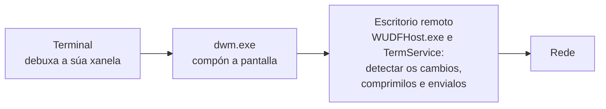

# Tecnoloxías

> Estado: subfase 2.2. Este documento crece con cada PR: cada tecnoloxía nova engádese cando se empeza a usar.

Para cada tecnoloxía explícase que é, por que a usamos e como está configurada en meiga. A explicación liña a liña de cada arquivo está en [Código](codigo/README.md).

## 1. Rust

**Que é.** Unha linguaxe de programación compilada a código máquina, coma C ou C++, pero sen os seus erros típicos de memoria. Non ten recolector de lixo (*garbage collector*): cada valor libérase automaticamente cando o seu dono sae de ámbito, nun punto que xa se coñece ao compilar. O compilador comproba as regras de **propiedade** (*ownership*: cada valor ten un único dono) e de **préstamos** (*borrowing*: pódese prestar un valor a moitos lectores ou a un único escritor, nunca aos dous á vez). Se o código as incumpre, non compila. Grazas a iso desaparecen erros como usar memoria xa liberada ou que dous fíos modifiquen o mesmo dato á vez (*data races*).

**Por que.**

- **Rendemento** comparábel ao de C e C++, sen pausas do recolector de lixo.
- **Seguridade de memoria.** Un terminal procesa texto que non controlamos (a saída de calquera programa); un erro de memoria podería converterse nunha vulnerabilidade.
- **Concorrencia segura.** O compilador impide compartir datos entre fíos de forma insegura.
- **Bindings oficiais de Microsoft** (os crates `windows` e `windows-sys`) para chamar ás APIs de Windows.
- **Ecosistema:** bibliotecas de terminal xa optimizadas, como `alacritty_terminal`.

**Alternativas descartadas:** C++ (mesmo rendemento, pero sen seguridade de memoria), Zig (ecosistema e bindings de Windows menos maduros), C# e .NET (recolector de lixo, máis memoria e arranque máis lento) e Electron ou tecnoloxías web (moito máis pesadas).

**Edición 2024.** As edicións de Rust permiten introducir cambios incompatíbeis na linguaxe sen romper o código antigo: cada crate declara a súa edición, e crates de edicións distintas poden usarse xuntos. A 2024 é a máis recente.

## 2. rustup e `rust-toolchain.toml`

**Que é.** `rustup` instala e xestiona versións do compilador de Rust (*toolchains*) e os seus compoñentes. O arquivo `rust-toolchain.toml` indica que versión usar nun proxecto: ao executar `cargo` dentro do cartafol, rustup usa esa versión e, se non está instalada, descárgaa. Tamén se pode instalar explicitamente con `rustup toolchain install`, que le o mesmo arquivo: é o que fai a CI.

**Configuración en meiga.**

- `channel = "1.100.0"`: unha versión exacta, non simplemente "a última estábel". Así todas as compilacións, en calquera equipo e na CI, usan o mesmo compilador, e unha versión nova de Rust non pode romper a compilación sen avisar. Para actualizala, cámbiase a versión nun PR propio.
- `components = ["clippy", "rustfmt"]`: instala tamén o analizador Clippy e o formateador rustfmt.
- `profile = "minimal"`: non descarga a documentación local nin outros extras, para que a instalación sexa máis rápida e pequena.

## 3. Cargo e os *workspaces*

**Cargo** é o xestor de paquetes e o sistema de compilación de Rust: descarga as dependencias, compila, executa as probas e as ferramentas.

**Un *workspace*** agrupa varios crates que comparten:

- un único `Cargo.lock`, polo que todos usan as mesmas versións das dependencias;
- un único cartafol `target/` coas compilacións;
- configuración común (perfís, *lints*, metadatos).

O `Cargo.toml` da raíz de meiga é un **manifesto virtual**: non describe ningún crate, só o workspace. Os crates están en `crates/`.

**Herdanza.** A sección `[workspace.package]` define valores comúns (versión, edición, licenza…), e cada crate recólleos con `version.workspace = true`. Do mesmo xeito, `[workspace.dependencies]` declara unha soa vez onde está cada dependencia.

**Resolvedor 3.** O *resolver* é o algoritmo que escolle que versión de cada dependencia se usa. A versión 3 ten en conta a versión mínima de Rust do proxecto (`rust-version`) e prefire versións das dependencias compatíbeis con ela.

**`Cargo.lock`.** Garda a versión exacta de cada dependencia, incluídas as indirectas. Súbese ao repositorio porque meiga é un programa: así cada compilación é reproducíbel. Coa opción `--locked`, Cargo falla se o `Cargo.lock` non está ao día, en vez de cambialo en silencio. Úsana a CI e os scripts de `tools/`.

## 4. Perfís de compilación

Un perfil é un conxunto de opcións do compilador.

| Perfil | Comando | Para que | Opcións |
|---|---|---|---|
| `dev` | `cargo build` | Desenvolvemento: compila rápido. | Sen optimizar e con información de depuración. |
| `release` | `cargo build --release` | O programa que se distribúe. | Optimización máxima (ver abaixo). |
| `profiling` | `cargo build --profile profiling` | Medir onde se vai o tempo. | Igual que `release` e, ademais, información de depuración. |

**Opcións do perfil `release`:**

- **`lto = "fat"`** (*Link-Time Optimization*). Normalmente cada crate optimízase por separado. Co LTO completo, o compilador optimiza o programa enteiro no momento de ligalo: pode integrar funcións dun crate dentro doutro (*inlining*) e eliminar o código que ninguén usa. O resultado é máis rápido e máis pequeno, a cambio de compilar máis lento.
- **`codegen-units = 1`.** Para compilar máis rápido, o compilador divide cada crate en varios anacos que procesa en paralelo, pero así perde oportunidades de optimización entre eses anacos. Con 1 non se divide nada.
- **`panic = "abort"`.** En Rust, un *pánico* é un erro irrecuperábel (por exemplo, acceder fóra dos límites dun vector). Por defecto, o programa "desenrola a pila" (*unwinding*): vai saíndo das funcións e liberando os recursos de cada unha. Con `abort`, o proceso remata no momento. O binario é máis pequeno e o código máis rápido, porque o compilador non ten que xerar o código e as táboas do desenrolado. A consecuencia é que un pánico pecha meiga enteiro, con todas as súas tabs. Por iso o código debe evitar os pánicos, e de aí veñen as regras contra `unwrap()` (sección 7).

O perfil `profiling` herda de `release` e engade `debug = "limited"`: os nomes das funcións e os números de liña. Con eles, ferramentas como WPR/WPA (o perfilador de Windows) poden mostrar en que funcións se gasta o tempo.

## 5. *Runtime* de C ligado estaticamente (`+crt-static`)

**Que é.** Os programas que se compilan para Windows co compilador de Microsoft (MSVC) usan o *runtime* de C (CRT): funcións básicas de memoria, cadeas… Por defecto ligan con el de forma dinámica, a través de `vcruntime140.dll` e do *Universal CRT*. Por iso moitos programas piden instalar o *Visual C++ Redistributable*.

**Configuración en meiga.** A opción `-C target-feature=+crt-static` mete o CRT dentro do propio `.exe`. Está en `.cargo/config.toml` (e non nunha variábel de contorno) para que forme parte do repo e se aplique sempre. A condición `cfg(all(windows, target_env = "msvc"))` limítaa ao compilador de Microsoft.

**Comprobación.** `dumpbin /dependents target\release\meiga.exe` mostra que só depende de DLL do sistema. Da biblioteca estándar de Rust veñen `KERNEL32.dll`, `ntdll.dll` e `api-ms-win-core-synch-l1-2-0.dll`. Esta última non é unha DLL que haxa que instalar, senón un *API set*: un nome lóxico que Windows resolve internamente cara ás súas propias bibliotecas. Desde a subfase 1.1, a xanela engade `user32.dll` e `gdi32.dll` e, en minúsculas, outra vez `kernel32.dll`; desde a 1.5, as dúas entradas de `kernel32.dll` son unha soa (ver a [sección 21](#21-windows-sys-as-apis-de-windows-desde-rust)). Ningunha é do *Visual C++ Redistributable*.

## 6. Subsistema de Windows

Cada `.exe` de Windows declara un subsistema:

- **`console`**: Windows asígnalle unha consola (ou a do terminal desde o que se lanza).
- **`windows`**: aplicación gráfica, sen consola.

meiga usa `#![cfg_attr(not(debug_assertions), windows_subsystem = "windows")]`. Na compilación *release* (`debug_assertions` desactivado) é unha aplicación gráfica: ao abrila non aparece ningunha xanela negra de consola. Na de depuración mantén a consola, para poder ver mensaxes de diagnóstico mentres se desenvolve. A CI comproba o subsistema do `meiga.exe` de *release* en cada cambio, con `tools/check-window.ps1` (ver [Código › ferramentas](codigo/ferramentas.md#toolscheck-windowps1)).

## 7. *Lints*: rustc e Clippy

**Que é un *lint*.** Unha regra que detecta un patrón de código problemático. Cada *lint* ten un nivel: `allow` (ignorar), `warn` (aviso), `deny` (erro) ou `forbid` (erro que ningún arquivo pode desactivar). **Clippy** é o analizador oficial de Rust, con centos de *lints* adicionais aos do compilador.

**Onde se configuran.** En `[workspace.lints]` do `Cargo.toml` raíz, e cada crate adóptaos con `[lints] workspace = true`.

**Regras do compilador (rustc):**

- `rust_2018_idioms` (aviso): un grupo de regras de estilo moderno. Leva `priority = -1` para que se aplique primeiro e as regras concretas poidan sobrescribila.
- `unsafe_op_in_unsafe_fn` (erro): dentro dunha función marcada como `unsafe`, cada operación insegura tamén ten que ir no seu propio bloque `unsafe { … }`. Así, cada operación perigosa queda localizada e xustificada.

**Regras de Clippy:**

| Regra | Nivel | Por que |
|---|---|---|
| `unwrap_used` | erro | `unwrap()` provoca un pánico se o valor non existe. Con `panic = "abort"`, un pánico pecharía o terminal con todas as súas tabs. Os erros trátanse de forma explícita. |
| `expect_used` | aviso | Como `unwrap()`, pero cunha mensaxe. Pode estar xustificado nalgún caso (cun comentario que explique por que nunca falla). |
| `undocumented_unsafe_blocks` | erro | Cada bloque `unsafe` debe ir precedido dun comentario `// SAFETY:` que explique por que é seguro. |
| `dbg_macro`, `todo`, `unimplemented` | erro | Restos de depuración ou código a medias que non deben chegar a `main`. |

**`clippy.toml`** permite `unwrap()` e `expect()` nas probas, onde un pánico é xusto o comportamento que se busca: a proba falla.

Na validación úsase `cargo clippy … -- -D warnings`, que converte calquera aviso en erro.

## 8. rustfmt

**Que é.** O formateador oficial de Rust: reescribe o código cun estilo único (sangrías, espazos, saltos de liña). Así non hai discusións de estilo e os cambios nos PR son só cambios reais. `cargo fmt --all --check` comproba o formato sen modificar nada.

**Configuración** (`rustfmt.toml`):

- `use_field_init_shorthand = true`: escribe `Punto { x, y }` en vez de `Punto { x: x, y: y }`.
- `use_try_shorthand = true`: usa o operador `?` en vez da macro antiga `try!`.

**Saltos de liña.** O repo garda LF (ver a sección 12), pero en Windows os arquivos poden ter CRLF no cartafol de traballo. rustfmt usa por defecto `newline_style = "Auto"`, que respecta o que atopa en cada arquivo, así que funciona igual nos dous casos.

## 9. cargo-deny

**Que é.** Unha ferramenta que revisa as dependencias do proxecto en catro aspectos:

| Comprobación | Que revisa |
|---|---|
| `advisories` | Vulnerabilidades coñecidas (base de datos RustSec), crates abandonados e versións retiradas polo seu autor (*yanked*). |
| `licenses` | Que todas as licenzas estean na lista permitida. |
| `bans` | Versións duplicadas dunha mesma dependencia e versións con comodín (`*`). |
| `sources` | Que as dependencias só veñan de crates.io. |

**Por que só licenzas permisivas.** MIT, Apache-2.0, BSD, ISC, Zlib e similares permiten usar o código nun produto comercial e de código pechado, coa condición de incluír o seu aviso de licenza. As licenzas *copyleft* (GPL, LGPL, MPL…) poden obrigar a publicar o código propio ou complicar a venda. Por iso non se admiten.

**Configuración** (`deny.toml`):

- `[graph] targets`: só se teñen en conta as dependencias que se compilan para Windows x64.
- `yanked = "deny"`: unha versión retirada polo seu autor é un erro.
- `confidence-threshold = 0.93`: cando ten que recoñecer o texto dunha licenza, esixe un 93 % de coincidencia.
- `[licenses.private] ignore = true`: non revisa os nosos propios crates, que son propietarios e nunca se publican (`publish = false`).
- `unused-allowed-license = "allow"`: a lista é unha política, non un inventario, así que non avisa das licenzas que aínda non usa ningunha dependencia.
- `wildcards = "deny"`, con `allow-wildcard-paths = true`: prohíbe os comodíns nas versións, agás nas dependencias internas por ruta.
- `multiple-versions = "warn"`: avisa, sen bloquear, se se compilan dúas versións dun mesmo crate. Cada copia engade código ao binario, pero ás veces é inevitábel (dúas dependencias piden versións incompatíbeis), así que se revisa caso a caso. Desde a subfase 1.5 hai un: `windows-sys` 0.59, que pide `alacritty_terminal` para o seu propio PTY, que meiga non usa, e 0.61, a de meiga e doutras dependencias. Do que non se chama, o ligador non deixa nada no binario.
- `unknown-registry` e `unknown-git` = `"deny"`, con `allow-registry` apuntando ao índice de crates.io: só se admiten dependencias de crates.io.

## 10. cargo-about e Handlebars

**Para que.** As licenzas permisivas obrigan a incluír o seu texto e o aviso de *copyright* cando se distribúe o programa. `cargo-about` recolle eses textos de todas as dependencias e xera o arquivo `THIRD-PARTY-NOTICES.txt` a partir dun modelo.

**Handlebars** é unha linguaxe de modelos sinxela:

- `{{#each licenses}} … {{/each}}` repite o bloque para cada elemento dunha lista.
- `{{#if crate.repository}} … {{/if}}` mostra o bloque só se o valor existe.
- `{{{text}}}`, con **tres chaves**, insire o texto tal cal. Con dúas chaves, Handlebars "escaparía" os caracteres especiais para HTML (`<` convertiríase en `&lt;`), e o arquivo de texto quedaría estragado.

**Configuración** (`about.toml`):

- `accepted`: as mesmas licenzas que `deny.toml`.
- `targets`: como en `deny.toml`, só as dependencias que se compilan para Windows x64.
- `ignore-build-dependencies = false`: inclúe tamén as dependencias que só se usan ao compilar. Algunhas xeran código que acaba dentro do binario, e é mellor que sobre un aviso a que falte.
- `ignore-dev-dependencies = true`: exclúe as dependencias que só usan as probas, porque non se distribúen.
- `private.ignore = true`: non inclúe os nosos crates.

**Comprobación.** Cunha dependencia temporal (`memchr`), o arquivo xerado incluíu a licenza MIT co seu aviso de *copyright* e sen caracteres escapados. O arquivo non se garda no repo: xérao `tools/package.ps1` ao empaquetar o programa.

## 11. PowerShell 7

Os scripts de `tools/` escríbense para PowerShell 7 (`pwsh`). Todos seguen o mesmo patrón para que un erro nunca pase desapercibido:

- `Set-StrictMode -Version Latest`: produce un erro ao usar variábeis que non existen, en vez de tratalas como baleiras.
- `$ErrorActionPreference = 'Stop'`: calquera erro dun *cmdlet* detén o script.
- Comprobación de `$LASTEXITCODE` despois de cada programa externo (`cargo`, `git`…): PowerShell non detén o script cando un programa externo falla, así que hai que comprobalo a man.
- As rutas relativas resólvense con `$ExecutionContext.SessionState.Path.GetUnresolvedProviderPathFromPSPath()`, nunca con funcións de .NET como `[System.IO.Path]::GetFullPath()`. Estas usan o cartafol de traballo do proceso, que PowerShell non actualiza ao facer `cd` (detalle en [Código › ferramentas](codigo/ferramentas.md#toolsthird-party-noticesps1)).

**PowerShell 7 e Windows PowerShell 5.1.** Windows trae Windows PowerShell 5.1 (`powershell.exe`), e PowerShell 7 (`pwsh.exe`) instálase á parte: son dous programas distintos que conviven. Se un script de `tools/` se abre con 5.1, non se executa e mostra o comando exacto para executalo con `pwsh`. Para que 5.1 chegue a mostrar esa mensaxe, os scripts:

- usan só a sintaxe que tamén entende 5.1, sen os operadores `?:`, `??` nin `&&`;
- están escritos en ASCII: 5.1 le os arquivos sen marca de bytes como Windows-1252, e algúns caracteres en UTF-8 converteríanse en comiñas tipográficas, que PowerShell trata como comiñas de verdade;
- non usan `$PSScriptRoot` nos valores por defecto dos parámetros, porque 5.1 o deixa baleiro nese momento.

`tools/check-powershell.ps1` compróbao en cada PR (ver [Código › ferramentas](codigo/ferramentas.md#toolscheck-powershellps1)).

## 12. Git e GitHub

**`.gitattributes`:**

- `* text=auto eol=lf`: Git detecta os arquivos de texto e gárdaos con saltos de liña LF. Ao extraelos no cartafol de traballo (*checkout*) tamén os deixa con LF, en Windows igual que en Linux.
- `*.bat` e `*.cmd` con CRLF, porque `cmd.exe` o necesita.
- Imaxes (`*.ico`, `*.png`) como binarios, para que Git nunca as modifique.

**`.gitignore`:** exclúe `target/` e `dist/` (compilacións e paquetes), `.perf/` (resultados de medicións locais, que conteñen datos da máquina) e os arquivos de editores e do sistema.

**Configuración do repositorio en GitHub:**

- **Só *squash merge*:** cada PR convértese nun único commit en `main`, así que o historial é lineal e lexíbel, cun commit por subfase.
- **Borrado automático da rama** ao integrar o PR.
- **Alertas e actualizacións de seguridade de Dependabot** (ver a [sección 16](#16-dependabot)).
- ***Secret scanning* con *push protection*:** GitHub rexeita un *push* que conteña un segredo (por exemplo, un *token*).
- **Notificación privada de vulnerabilidades:** permite informar dun problema de seguridade sen facelo público (ver `SECURITY.md`).
- **Regras da rama `main`** (ver a [sección 17](#17-regras-da-rama-main-rulesets)).

## 13. MSVC e o Windows SDK

Rust en Windows (o *target* `x86_64-pc-windows-msvc`) usa o ligador de Microsoft (`link.exe`) e as bibliotecas do Windows SDK. Instálanse con Visual Studio ou coas *Build Tools*, coa carga de traballo "Desenvolvemento para o escritorio con C++".

- **`dumpbin`**, das mesmas ferramentas, mostra a estrutura dun executábel, por exemplo as DLL das que depende (`/dependents`). Non está no `PATH` dunha consola normal, só na *Developer PowerShell for VS*.
- **`vswhere`** (`%ProgramFiles(x86)%\Microsoft Visual Studio\Installer\vswhere.exe`) é a ferramenta oficial para localizar as instalacións de Visual Studio. Os scripts úsana para atopar `dumpbin` sen depender dunha versión concreta de Visual Studio.
- **O manifesto.** `link.exe` pode incrustar o manifesto da aplicación no `.exe` (`/MANIFEST:EMBED`); `meiga` pídello desde o seu `build.rs` (ver a [sección 23](#23-manifesto-da-aplicación-e-dpi)). **`mt.exe`**, do Windows SDK, traballa cos manifestos: `mt.exe -inputresource:meiga.exe;#1 -out:arquivo.manifest` extrae o que leva un executábel. Tampouco está no `PATH` dunha consola normal: está en `%ProgramFiles(x86)%\Windows Kits\10\bin\<versión>\x64\`.

## 14. Preparar o contorno de desenvolvemento

1. Instalar [rustup](https://rustup.rs/). A versión de Rust do proxecto instálase soa a primeira vez que se executa `cargo` no cartafol.
2. Instalar Visual Studio ou as *Build Tools* coa carga de traballo de C++.
3. Instalar as ferramentas de revisión:

   ```powershell
   cargo install --locked cargo-deny
   cargo install --locked cargo-about --features cli
   ```

4. Comprobar que todo funciona:

   ```powershell
   cargo fmt --all --check
   cargo clippy --workspace --all-targets -- -D warnings
   cargo test --workspace
   cargo deny check
   .\tools\check-docs.ps1      # ligazóns da documentación
   .\tools\package.ps1         # compila en release e crea o zip en dist\
   .\tools\check-imports.ps1   # meiga.exe non depende do runtime de Visual C++
   .\tools\check-window.ps1    # meiga.exe abre a súa xanela e péchase ben
   ```

## 15. GitHub Actions

**Que é.** O sistema de integración continua (CI) de GitHub: executa tarefas automaticamente cando pasa algo no repositorio, como un PR, un *push* ou unha hora programada.

| Concepto | Que é |
|---|---|
| *Workflow* | Un proceso automático, definido nun arquivo YAML en `.github/workflows/`. |
| Evento | O que lanza o workflow: `pull_request`, `push`, `schedule`… |
| *Job* | Un conxunto de pasos que se executa nunha máquina. Os jobs dun workflow corren en paralelo, salvo que un dependa doutro. |
| *Runner* | A máquina virtual onde corre un job. GitHub crea unha nova e limpa para cada job e destrúea ao rematar. |
| Paso (*step*) | Un comando (`run`) ou unha *action* (`uses`). |
| *Action* | Un compoñente reutilizábel publicado nun repositorio de GitHub, como `actions/checkout`. |
| Artefacto | Un arquivo xerado por unha execución, que se pode descargar desde a web. |
| *Check* | O resultado, correcto ou fallido, de cada job. Aparece no PR. |

**Por que.** Cada PR compílase e próbase nunha máquina limpa e sempre igual, sen depender do estado do equipo de ninguén. Nos repositorios públicos é gratuíto.

**En meiga** hai un workflow (`ci.yml`) con tres jobs en paralelo:

- **Build and test (Windows):** ligazóns da documentación, a comprobación de que os scripts piden PowerShell 7, as probas do arnés de medición e dos escenarios de carga en PowerShell, formato, Clippy, probas, compilación *release*, paquete `.zip`, comprobación das DLL e subida do paquete como artefacto.
- **Load scenarios (bash):** ShellCheck e as probas dos escenarios de carga en bash, nunha máquina Linux.
- **Dependency policy (cargo-deny):** a política de dependencias, nunha máquina Linux. Ademais de en cada PR, execútase cada semana para detectar vulnerabilidades novas.

A explicación liña a liña está en [Código › .github](codigo/github.md).

### Seguridade do workflow

Un workflow executa código de terceiros (as actions) cun *token* de acceso ao repositorio. Por iso protéxese en varias capas:

- **Permisos mínimos:** `permissions: contents: read`. O *token* só pode ler o código.
- **Actions fixadas por SHA.** Unha etiqueta como `v7.0.1` pódese mover: quen controle o repositorio da action pode apuntala a outro commit. Pasou en marzo de 2025 coa action `tj-actions/changed-files`: un atacante moveu as súas etiquetas a un commit malicioso que escribía os segredos dos workflows nos rexistros, en miles de repositorios. O SHA completo identifica un commit concreto e non se pode cambiar. A versión queda nun comentario, e Dependabot actualiza os dous.
- **Sen credenciais gardadas:** `persist-credentials: false` ao descargar o código.
- **Sen segredos:** a CI non usa ningún.
- **Tempo máximo** en cada job (`timeout-minutes`).
- **Ferramentas verificadas:** `taiki-e/install-action` comproba o SHA-256 de cada binario que descarga.
- **Sen `RUSTFLAGS`:** esa variábel anularía as opcións de `.cargo/config.toml` (ver [Código › .github](codigo/github.md#variábeis-de-contorno)).

Antes de subilo, o workflow revisouse con dúas ferramentas de análise:

- [actionlint](https://github.com/rhysd/actionlint): erros de sintaxe, expresións e referencias incorrectas.
- [zizmor](https://github.com/zizmorcore/zizmor): problemas de seguridade (permisos, credenciais, inxección de código, actions sen fixar…).

### Imaxes dos runners

Úsanse `windows-2025` e `ubuntu-24.04`, non `windows-latest` e `ubuntu-latest`. As etiquetas `-latest` cambian de versión do sistema cando GitHub o decide, e iso pode romper a compilación sen ningún cambio no repositorio. Coa versión fixada, o cambio faise nun PR cando GitHub anuncia a retirada dunha imaxe.

### Caché e artefactos

- **Caché:** `Swatinem/rust-cache` garda entre execucións as dependencias e as compilacións, e só se garda desde `main`.
- **Artefactos:** o `.zip` de cada execución consérvase 30 días. Mentres non haxa versións publicadas (mellora futura F5), é a forma de obter un `meiga.exe` compilado pola CI.

## 16. Dependabot

**Que é.** O servizo de GitHub que vixía as dependencias. Ten tres funcións:

| Función | Que fai | En meiga |
|---|---|---|
| Alertas | Avisa se unha dependencia ten unha vulnerabilidade coñecida. | Activadas desde a subfase 0.2. |
| Actualizacións de seguridade | Abre automaticamente un PR que actualiza unha dependencia vulnerábel. | Activadas na subfase 0.4. |
| Actualizacións de versión | Abre PR periódicos coas versións novas, aínda que non haxa vulnerabilidades. | Configuradas en `.github/dependabot.yml`. |

**Configuración.** Tres ecosistemas: os crates de Rust, as actions dos workflows e a versión de Rust de `rust-toolchain.toml`. Revísanse unha vez por semana, cun único PR por ecosistema. Para os crates e as actions, só se propoñen versións publicadas hai polo menos 7 días (*cooldown*): se unha versión resulta ser maliciosa ou estar rota, adoita retirarse nese tempo. Ademais, desde o mantemento M1, Dependabot non propón as versións *minor* nin *major* de `windows-core`, só os seus parches, porque ten que ser a versión que usa o crate `windows` ([§28](#28-com-e-o-crate-windows)). Detalle en [Código › .github](codigo/github.md#githubdependabotyml).

Os PR de Dependabot pasan pola mesma CI e pola mesma revisión que calquera outro: nada se integra automaticamente.

## 17. Regras da rama `main` (*rulesets*)

**Que é.** Un *ruleset* é un conxunto de regras que GitHub aplica a unhas ramas concretas. É o mecanismo recomendado actualmente, en substitución da antiga "protección de ramas". As regras compróbanse no servidor de GitHub, así que se aplican sexa cal sexa a ferramenta coa que se traballe.

**Regras de `main`:**

| Regra | Efecto |
|---|---|
| PR obrigatorio | Ninguén pode facer *push* directo a `main`: todo cambio entra por un PR. Non se esixen aprobacións, porque en GitHub o autor dun PR non pode aprobalo, e o propietario do repositorio é quen abre os PR. A revisión faise igualmente antes de integrar. |
| Só *squash merge* | Cada PR entra como un único commit. |
| Conversas resoltas | Non se pode integrar un PR con comentarios de revisión pendentes. |
| *Checks* obrigatorios | Os tres jobs da CI teñen que pasar (o de bash, desde a subfase 0.7). Só contan se os informa GitHub Actions, non outra aplicación que use o mesmo nome. |
| Rama ao día | O PR ten que incluír o último commit de `main`, para que a CI valide exactamente o que quedará en `main`. |
| Historial lineal | Non se admiten *merge commits*. |
| Sen *force push* | Ninguén pode reescribir o historial de `main`. |
| Sen borrado | Ninguén pode borrar `main`. |
| Sen excepcións | As regras aplícanse tamén aos administradores. |
| Aprobación extra para PR de Copilot | Valor por defecto de GitHub: se o axente de Copilot abre un PR coa súa propia identidade, e non en nome dunha persoa, esíxese unha aprobación máis. Non afecta aos PR que abre a conta propietaria. |

Comprobación: un *push* directo a `main` é rexeitado con `GH013: Repository rule violations found for refs/heads/main`, indicando que os cambios deben entrar por un PR e que faltan os *checks* obrigatorios.

## 18. Markdown, Mermaid e ADR

**Markdown** é o formato de texto de toda a documentación: títulos con `#`, listas, táboas, ligazóns `[texto](destino)` e bloques de código. GitHub móstrao xa formatado.

**Anclas dos títulos.** GitHub crea unha ancla para cada título, e unha ligazón pode apuntar a ela con `#`: `tecnoloxias.md#16-dependabot`. A ancla sae do texto do título: en minúsculas, sen signos de puntuación e cos espazos cambiados por guións. As letras con acento mantéñense. Se dous títulos dan a mesma ancla, o segundo leva `-1`, o terceiro `-2`, etc.

**Mermaid** é unha linguaxe de texto para debuxar diagramas: fluxos, secuencias, dependencias… Escríbese dentro dun bloque de código marcado como `mermaid`, e GitHub debúxao directamente. Ao ser texto, os diagramas revísanse nos PR coma o resto da documentación.

**Comprobación automática.** `tools/check-docs.ps1` comproba en cada PR que as ligazóns internas apuntan a arquivos e anclas que existen, distinguindo maiúsculas e minúsculas como fai GitHub (ver [Código › ferramentas](codigo/ferramentas.md#toolscheck-docsps1)).

**ADR** (*Architecture Decision Record*): un documento curto por cada decisión importante, co seu contexto, alternativas e consecuencias. Están en [`docs/adr/`](adr/README.md).

## 19. Medición do rendemento

**Por que.** O rendemento é a prioridade número 1 de meiga, e só se pode comparar o que se mide. `tools/perf/measure.ps1` mide sempre da mesma maneira calquera terminal (meiga, o Warp, o Windows Terminal), para comparalos e para comprobar os orzamentos de cada fase. O código explícase en [Código › medición](codigo/perf.md).

### Que se mide

| Métrica | Que é | Por que importa |
|---|---|---|
| Tempo de CPU | O tempo que os fíos dun proceso estiveron nun procesador, en modo usuario (o código do programa) e en modo núcleo (o código de Windows ao que chama). Exprésase en **% dun núcleo**: 100 % é un núcleo ocupado todo o tempo, e 200 %, dous. | É o que fai que o equipo vaia lento. |
| Ciclos | Os ciclos de procesador que usaron os fíos. | Miden mellor os consumos moi pequenos (ver embaixo). |
| Cambios de contexto | As veces que un fío entrou nun procesador. Un fío que espera bloqueado non entra ata que ten algo que facer, así que, en repouso, cada cambio de contexto é un **espertar**. | O obxectivo de meiga en repouso son 0 espertares por segundo: cada espertar gasta CPU e non deixa descansar o procesador. |
| Memoria privada | A memoria que o proceso reservou só para el (*Private Bytes*; no Xestor de tarefas, *Commit size*), estea na RAM ou no arquivo de paxinación. | É o que consome de verdade o programa. |
| *Working set* | As páxinas do proceso que están na RAM nese momento, incluídas as que comparte con outros procesos, como as DLL do sistema. | Baixa cando Windows lle retira RAM ao proceso, así que serve de referencia, pero non como orzamento. |
| Fíos | Cantos fíos ten o proceso. | Un fío que espera non gasta, pero moitos fíos adoitan significar moito traballo en paralelo e moitos espertares. |

**% dun núcleo e o Xestor de tarefas.** O Xestor de tarefas mostra a CPU en porcentaxe de **toda** a máquina. Nunha máquina con 8 procesadores lóxicos, un núcleo ocupado aparece como 12,5 % (100 / 8). `measure.ps1` indica ao final entre canto hai que dividir.

**Tempo de CPU e ciclos.** Windows conta o tempo de CPU de cada fío ao ritmo do reloxo do sistema, que por defecto marca cada 15,625 ms. Un fío que esperta moitas veces para traballar uns microsegundos pode non sumar nada nalgúns tics e un tic enteiro noutros, así que, para consumos pequenos, o tempo de CPU é pouco preciso. Os ciclos lense dun contador do propio procesador (a instrución `RDTSC`), que nos procesadores actuais avanza a un ritmo constante ([QueryThreadCycleTime](https://learn.microsoft.com/windows/win32/api/realtimeapiset/nf-realtimeapiset-querythreadcycletime) e [o que conta en realidade](https://devblogs.microsoft.com/oldnewthing/20160429-00/?p=93385)). Non se deben converter a tempo, pero son a mellor forma de comparar consumos pequenos entre dúas medicións na mesma máquina.

### Como se le: `NtQuerySystemInformation`

Unha chamada a `NtQuerySystemInformation`, de `ntdll.dll`, coa clase `SystemProcessInformation`, devolve todos os procesos co detalle de todos os seus fíos: os mesmos datos que mostran o Xestor de tarefas e o Process Explorer. Leva uns milisegundos e non necesita abrir os procesos, así que funciona sen permisos de administrador tamén cos procesos protexidos, como `dwm.exe`.

| Alternativa | Por que non |
|---|---|
| `Get-Process` | Non pode ler a CPU dos procesos protexidos, como `dwm.exe`, sen permisos de administrador, e non dá os cambios de contexto. |
| Contadores de rendemento por WMI (`Win32_PerfRawData_PerfProc_Thread`) | Dan os cambios de contexto de cada fío, pero a consulta leva decenas de segundos. Usáronse para comprobar os valores. |
| `Get-Counter` | Os nomes dos contadores dependen do idioma de Windows, e os dos fíos tamén son lentos. |
| ETW, WPR e WPA | Rexistran cada evento do sistema con moito detalle. Serán a ferramenta para buscar onde se vai o tempo na Fase 9, pero son demasiado para unha medición de minutos que se repite moitas veces. |

Microsoft documenta esta función só en parte e avisa de que pode cambiar. Porén, as estruturas que se usan non cambiaron desde Windows 7, e moitas ferramentas dependen delas. Por iso os valores compróbanse con outras fontes (ver [Código › medición](codigo/perf.md#toolsperftest-measureps1)).

### C# dentro de PowerShell

`Add-Type -Path` compila un arquivo C# en memoria e carga as súas clases na sesión de PowerShell. Así, o traballo que se repite en cada fotografía vai en código compilado, moito máis rápido ca un bucle de PowerShell, e segue sendo un arquivo de texto que se le e se revisa como un script. Unha ferramenta en Rust tería que compilarse antes de cada medición e sería outro programa que manter.

.NET compila cada método a código máquina a primeira vez que se chama e, un pouco despois, recompila en segundo plano os que máis se usan, con máis optimizacións (*tiered compilation*). Ese traballo continúa uns instantes despois de que o script remate de preparar a medición. Por iso `measure.ps1` executa unha vez o código da medición e agarda 2 s antes de empezar a medir.

### O camiño ata a pantalla no Escritorio remoto

Cando un terminal debuxa, o traballo non acaba no seu proceso:



- **DWM** (*Desktop Window Manager*): compón as xanelas de todos os programas na imaxe final da pantalla.
- **Adaptador de pantalla do Escritorio remoto** (*Microsoft Remote Display Adapter*): un *driver* de pantalla que corre en modo usuario dentro dun `WUDFHost.exe`, o proceso que aloxa os *drivers* en modo usuario.
- **Servizo de Escritorio remoto** (`TermService`): xestiona a conexión e envía os cambios da pantalla.

Un terminal que redebuxa moito fai traballar tamén estes procesos, e iso tamén é custo do terminal. Por iso `measure.ps1` mídeos como grupos propios, ademais do total da máquina.

### Resultados en CSV

Windows en galego ou en castelán usa a coma como separador decimal, e `Export-Csv` escribiría `1,5`. O CSV usa sempre o punto (a **cultura invariante**), para que outros scripts e programas o lean igual en calquera máquina. A táboa que se mostra na consola si usa o formato do teu idioma.

### Limitacións

- Un proceso que nace e remata entre dúas fotografías non se ve. Na práctica só afecta ao grupo `shells`: un comando curto nunha shell pode non aparecer.
- Un proceso que remata perde a CPU que gastou despois da súa última fotografía, e un fío que remata, os seus cambios de contexto. Por iso existe a columna `exited`.
- Medir tamén consome: aparece no grupo `harness` e non se suma a `system`.
- O grupo `system` inclúe todo o que corre na máquina (antivirus, actualizacións…). Para comparar terminais, repítense as medicións e mírase cada grupo.

### Tempo ata o primeiro fotograma

Canto tarda un programa en abrir a súa xanela, desde que se crea o proceso ata que a xanela está pintada. `tools/perf/measure-startup.ps1` mídeo con [`WaitForInputIdle`](https://learn.microsoft.com/windows/win32/api/winuser/nf-winuser-waitforinputidle), unha función de Windows que agarda a que o fío da interface dun proceso remate de arrancar e quede esperando mensaxes, sen ningunha pendente.

- Funciona porque meiga pinta a xanela **antes** de entrar no bucle de mensaxes (`UpdateWindow`, ver [Código › meiga-win](codigo/meiga-win.md#windowrun)). Un programa que pintase despois, desde o bucle, daría un tempo menor có real.
- Inclúe todo o que pasa dentro do proceso: crealo, cargar o executábel e as DLL, e o código de meiga ata o primeiro fotograma. Non inclúe o que pasa despois fóra del: que o DWM compoña a pantalla e, por Escritorio remoto, que se envíe.
- Crear un proceso xa custa uns milisegundos, que dependen da máquina e do antivirus. Por iso o script fai varios arranques, descarta os primeiros (o quecemento) e dá a mediana e o percentil 95, en vez da media (ver [Código › medición](codigo/perf.md#toolsperfmeasure-startupps1)).

### Escenarios de carga

Para comparar terminais, todos teñen que facer o mesmo traballo. Os **escenarios de carga** de `tools/perf/scenarios/` son esa carga, reproducíbel e igual en PowerShell e en bash (WSL):

| Escenario | Imita | Que lle esixe ao terminal |
|---|---|---|
| `idle` | O terminal aberto sen facer nada, por exemplo con 5 tabs. | Nada: o ideal son 0 espertares por segundo. |
| `spinner` | O indicador de progreso dunha ferramenta que traballa. | Redebuxar unha liña 10 veces por segundo. |
| `ai-stream` | Unha IA que responde nun terminal. | Redebuxar unha zona de 4 liñas 10 veces por segundo, desprazar o texto e debuxar cores, emoji, caracteres CJK e de caixa. |
| `bigfile` | Imprimir un rexistro enorme. | Procesar e mostrar uns 50 MiB tan rápido como poida. |

Os escenarios debuxan con **secuencias de escape VT**, as mesmas que usan as ferramentas de liña de comandos: mover o cursor, borrar partes da pantalla e cambiar as cores (ver a táboa en [Código › escenarios de carga](codigo/escenarios.md#que-debuxan-as-secuencias-de-escape)).

`tools/perf/run-scenario.ps1` mide varias veces seguidas (por defecto, 3 medicións de 60 s) e dá un veredicto: os resultados son **estábeis** se os ciclos do terminal varían entre medicións como moito un 10 % da media, ou un millón por segundo se iso é máis; en bigfile, se o tempo de imprimir varía como moito un 10 %. Úsanse os ciclos e non o tempo de CPU polo explicado máis arriba en *Tempo de CPU e ciclos*: un terminal gasta tan pouco que o seu tempo de CPU dá saltos dunha medición a outra. Unha medición soa pode coincidir cunha actualización de Windows ou co antivirus; varias medicións parecidas dan confianza no resultado.

## 20. bash, WSL e ShellCheck

**WSL** (*Windows Subsystem for Linux*) executa distribucións de Linux, como Ubuntu, nunha máquina virtual lixeira integrada en Windows. Unha tab de Ubuntu nun terminal de Windows lanza `wsl.exe`, que conecta a consola co Linux da máquina virtual. Os escenarios de carga teñen unha versión en **bash**, a shell habitual de Linux, para medir tamén ese camiño.

- **bash 5.** Os scripts necesitan bash 5 ou posterior (Ubuntu tráeo desde a versión 20.04), pola variábel `EPOCHREALTIME`: a hora con microsegundos, que se le sen lanzar ningún proceso.
- **Sen procesos.** En bash é habitual lanzar programas para tarefas pequenas (`date`, `sleep`), e cada un custa milisegundos de CPU. Os escenarios non lanzan ningún mentres corren: a hora sae de `EPOCHREALTIME`, e as esperas fanse cun `read` con tempo máximo sobre unha tubaxe que nunca recibe datos.
- **O disco de Windows desde WSL.** O disco de Windows vese en `/mnt/c/` a través do protocolo **9P**, moito máis lento ca o disco propio de Linux. Por iso bigfile copia o arquivo a `/tmp` antes de imprimilo, e os escenarios só miran os arquivos de coordinación unha vez por segundo.
- **Rutas.** `wslpath` converte unha ruta de Windows na de WSL (`C:\Users` → `/mnt/c/Users`). A variábel `WSLENV` indica que variábeis de contorno pasan de Windows a WSL; coa opción `/p`, a ruta tradúcese ao pasar.
- **Fins de liña.** bash non acepta os fins de liña de Windows (CRLF). O `.gitattributes` do repositorio fai que Git garde e descargue todos os arquivos con LF, así que os scripts funcionan tamén desde `/mnt/c/`.

**ShellCheck** é un analizador estático de scripts de shell: atopa erros que bash non detecta ata que chega a executar a liña, como variábeis sen comiñas que se parten en varias palabras, comandos que fallan sen que ninguén o note ou sintaxe que non é de bash. A CI pásao aos scripts de bash coas regras por defecto. Cada aviso ten un código (por exemplo, `SC2034`) cunha páxina que o explica na [wiki de ShellCheck](https://www.shellcheck.net/wiki/). Cando un aviso non se aplica, desactívase só nesa liña cun comentario `# shellcheck disable=…` e unha explicación.

## 21. `windows-sys`: as APIs de Windows desde Rust

**Que é.** Microsoft publica dous crates coas declaracións das APIs de Windows para Rust. Xéranse automaticamente desde os metadatos oficiais de Windows, así que cobren todas as funcións, estruturas e constantes, cos mesmos nomes da documentación:

| Crate | Que trae | Cando convén |
|---|---|---|
| `windows-sys` | Só as declaracións, igual que en C: funcións, estruturas, constantes e tipos. Todas as funcións son `unsafe`, e os erros indícanse como en C. | Win32 clásico: xanelas, mensaxes, GDI, procesos, arquivos. Compila en segundos. |
| `windows` | O mesmo con envoltorios máis cómodos: erros como `Result`, cadeas, e as interfaces COM con conta de referencias automática. | APIs baseadas en COM, como DirectWrite. Compila máis lento. |

**Por que `windows-sys` en `meiga-win` e `meiga-render`.** A xanela, o bucle de mensaxes e a presentación con GDI usan unhas poucas ducias de funcións Win32, que os dous crates envolven en funcións seguras. `windows-sys` non engade capas e compila moi rápido. Desde a subfase 1.3, `meiga-render` usa tamén o crate `windows`, só para DirectWrite, que é unha API COM na que os seus envoltorios aforran moito código delicado ([§28](#28-com-e-o-crate-windows)). Os dous son de Microsoft, coa licenza MIT ou Apache-2.0, e están permitidos na política de dependencias ([ADR 0006](adr/0006-licenzas-e-dependencias.md)).

**Features.** `windows-sys` divide as APIs nos mesmos espazos de nomes da documentación de Microsoft, e cada *feature* activa un (por exemplo, `Win32_UI_WindowsAndMessaging`). Só se compila o que se activa. As listas de cada crate explícanse en [Código › meiga-win](codigo/meiga-win.md#cratesmeiga-wincargotoml) e [Código › meiga-render](codigo/meiga-render.md#cratesmeiga-rendercargotoml).

**Sen bibliotecas de importación.** Para chamar a unha función dunha DLL, o ligador necesita normalmente unha **biblioteca de importación** (`.lib`) que diga en que DLL está. `windows-sys` non as usa: declara cada función co nome da súa DLL, e o compilador de Rust xera a importación el mesmo (`raw-dylib`). Encárgase o pequeno crate `windows-link`, tamén de Microsoft. Por iso `dumpbin /dependents` mostra `kernel32.dll`, de `windows-sys`, e `KERNEL32.dll`, da biblioteca estándar, que usa a biblioteca de importación do Windows SDK: son dúas entradas para a mesma DLL, que Windows carga unha soa vez, porque non distingue maiúsculas nos nomes dos arquivos. Iso foi así ata a subfase 1.4. Desde a 1.5, `alacritty_terminal` trae outra versión, `windows-sys` 0.59, que si usa unha biblioteca de importación, a do crate `windows-targets` (`windows.0.52.0.lib`), cos nomes en minúsculas. O ligador colle cada función da primeira biblioteca que a ten, e esta vai antes ca a do Windows SDK: as funcións da biblioteca estándar tamén saen dela, e `kernel32.dll` queda nunha soa entrada.

**Versión.** A 0.61.2, declarada no `Cargo.toml` raíz ([Código › workspace](codigo/workspace.md#cargotoml-raíz)), coma a 0.62.2 do crate `windows`: as dúas usan a mesma versión de `windows-link`. Dependabot propón as versións novas.

**A versión 0.100.** En setembro de 2026, o proxecto windows-rs pasou o resto dos seus crates, coma `windows-core`, á versión 0.100, con metadatos novos sacados directamente das cabeceiras do Windows SDK, e deixou `windows` e `windows-sys` para máis tarde, ata probalos ben ([Rust for Windows, agosto de 2026](https://github.com/microsoft/windows-rs/issues/4867)). Cando saian, cambiarán moito: as *features* levarán o nome das cabeceiras, coma `endpointvolume` en vez de `Win32_Media_Audio_Endpoints`, e moitas funcións cambiarán a súa forma. Adaptar meiga a eles será un PR propio; outra opción será xerar só as funcións que usa con `windows-bindgen`, coma o proxecto lles recomenda ás bibliotecas.

## 22. Xanelas Win32 e o bucle de mensaxes

**Win32** é a API clásica de Windows para os programas con xanelas. Segue sendo a base de todo: os *frameworks* modernos (WinUI, WPF, Electron, os navegadores) crean xanelas Win32 por debaixo. meiga úsaa directamente, sen ningún *framework* ([ADR 0002](adr/0002-windows-e-renderizado-cpu.md)).

| Concepto | Que é |
|---|---|
| Xanela | Un rectángulo que recibe mensaxes. Identifícase cun *handle*, o `HWND`. |
| Clase de xanela | O molde das xanelas: o nome, o *window procedure*, o cursor e a brocha do fondo. Rexístrase unha vez (`RegisterClassExW`) e cada xanela créase a partir dunha clase (`CreateWindowExW`). |
| Mensaxe | Un aviso de Windows ao programa: un número (`WM_PAINT`, `WM_SIZE`, `WM_KEYDOWN`…) e dous datos, `wParam` e `lParam`. Unhas mensaxes chegan pola cola do fío (o teclado, o rato, `WM_PAINT`, `WM_QUIT`) e outras envíanse directamente ao *window procedure* (por exemplo, as do cambio de tamaño). |
| *Window procedure* | A función que trata as mensaxes das xanelas dunha clase. O que non trata pásallo a `DefWindowProcW`, o comportamento por defecto de Windows. |
| Bucle de mensaxes | Coller a seguinte mensaxe (`GetMessageW` ou `PeekMessageW`) → `TranslateMessage` → `DispatchMessageW`, ata que chega `WM_QUIT`. Cando non hai mensaxes, o fío espera. |
| Fío da interface | Unha xanela pertence ao fío que a crea, e as súas mensaxes só se tratan nese fío. Por iso meiga ten un único fío para a interface, e os outros fíos avisarano publicando unha mensaxe ([ADR 0005](adr/0005-fios-e-fotogramas.md)). |

**Por que non gasta nada en repouso.** Mentres espera, o fío está bloqueado dentro do núcleo de Windows: Windows non o planifica, e o fío non usa ningún ciclo nin esperta. `GetMessageW` espera así ata que chega unha mensaxe. meiga, desde a subfase 1.2, espera con `MsgWaitForMultipleObjectsEx`, que esperta tamén co temporizador dos fotogramas; o temporizador só está activo mentres hai un fotograma pendente (ver [§26](#26-temporizadores-e-a-espera-do-fío-da-interface)). Se ninguén toca a xanela, non chega ningunha mensaxe. A alternativa, preguntar unha e outra vez se hai mensaxes (`PeekMessageW` nun bucle, como fan moitos xogos), ocuparía un núcleo enteiro ou, cunha pausa entre preguntas, espertaría o fío decenas de veces por segundo. Por iso meiga non usa temporizadores periódicos nin *polling*: o obxectivo de 0 espertares por segundo en repouso depende diso.

**Como se pinta.** Windows non garda o contido das xanelas dos programas: cando hai que mostrar unha parte (a xanela aparece, medra…), márcaa como **inválida** e envía `WM_PAINT`.

- `WM_ERASEBKGND`: antes de pintar, Windows pide borrar o fondo. `DefWindowProcW` énchea coa brocha da clase.
- `WM_PAINT`: o programa pinta a parte inválida. `DefWindowProcW` só a marca como válida, sen pintar nada.
- `UpdateWindow`: envía `WM_PAINT` no momento, se hai algo inválido, en vez de agardar á cola.
- Co DWM, cada xanela debúxase nunha superficie propia que o DWM compón na pantalla. Por iso, cando outra xanela deixa de tapala, non fai falta voltar pintala.

Na subfase 1.1, a brocha da clase pintaba toda a xanela. Desde a 1.2, meiga pinta desde o seu propio *framebuffer*, e a clase xa non ten brocha (ver [§25](#25-pintar-nunha-xanela-wm_paint-e-dwm)).

**GDI** (*Graphics Device Interface*) é a API clásica de debuxo en 2D de Windows: brochas, *bitmaps* e copias de rectángulos entre eles (`BitBlt`). Na subfase 1.1, meiga usábaa para pintar o fondo; desde a 1.2, para presentar o seu *framebuffer* ([ADR 0002](adr/0002-windows-e-renderizado-cpu.md), ver [§24](#24-dib-sections-e-gdi-o-framebuffer-e-a-súa-presentación)).

**Textos.** As funcións de Win32 existen en dúas versións: as que rematan en `A`, que usan a páxina de códigos do sistema, e as que rematan en `W` (*wide*), que usan UTF-16. meiga usa sempre as `W`, para que calquera carácter funcione igual en calquera Windows. Os textos de Rust son UTF-8, así que hai que convertelos (ver [Código › meiga-win](codigo/meiga-win.md#conversións)).

## 23. Manifesto da aplicación e DPI

**O manifesto** é un XML que vai dentro do `.exe`, como un recurso (de tipo `RT_MANIFEST` e número 1). Windows leo ao crear o proceso, antes de executar ningunha instrución do programa, e decide con el como executalo: os permisos, a compatibilidade e a escala. O de meiga explícase en [Código › meiga](codigo/meiga.md#cratesmeigameigaexemanifest).

**Como se incrusta.** O `build.rs` de `meiga` pídelle ao ligador que o incruste (`/MANIFEST:EMBED` e `/MANIFESTINPUT`, ver [Código › meiga](codigo/meiga.md#cratesmeigabuildrs)).

| Alternativa | Por que non |
|---|---|
| Un arquivo de recursos (`.rc`) compilado con `rc.exe`, cun crate como `embed-resource` | Unha dependencia e outra ferramenta para algo que xa fai o ligador. |
| O crate `embed-manifest` | Unha dependencia para algo que xa fai o ligador. |
| Un arquivo `meiga.exe.manifest` xunto ao `.exe` | Pódese perder ao copiar o programa. |
| Chamar a `SetProcessDpiAwarenessContext` ao comezo de `main` | Funciona, pero Microsoft recomenda o manifesto: aplícase antes de que se execute nada, tamén o código das DLL que se cargan ao arrancar. |

**UAC.** O Control de contas de usuario (*User Account Control*) fai que os programas corran cos permisos limitados do usuario, aínda que sexa administrador. Para correr como administrador, un programa ten que pedilo (elevación), e Windows mostra un aviso. `asInvoker` declara que meiga nunca o pide.

**DPI e escala.** A densidade dun monitor mídese en **DPI** (puntos por polgada). Para que as cousas teñan o mesmo tamaño físico en todos os monitores, Windows aplica unha **escala**: ao 150 %, cada píxel lóxico ocupa 1,5 píxeles reais. Cada programa declara como a trata:

| Modo | Que fai Windows | Resultado |
|---|---|---|
| Sen declarar | Debuxa o programa ao 100 % e estira a imaxe. | Borroso en pantallas con escala. |
| *System aware* | O programa escala ao arrancar segundo o monitor principal; nos outros, Windows estira a imaxe. | Borroso ao mover a xanela a un monitor con outra escala. |
| *Per monitor* (v1) | O programa escala en cada monitor e recibe `WM_DPICHANGED`. Windows non escala nada, nin a barra de título. | Nítido, pero o programa ten que escalar ata a barra de título. |
| *Per monitor* v2 | Como a v1 e, ademais, Windows escala a barra de título, os bordos e as caixas de diálogo. | Nítido e co mínimo traballo. É o que recomenda Microsoft. |

meiga usa ***per monitor* v2**: o texto ten que verse nítido a calquera escala, tamén por Escritorio remoto, e os glifos debúxanse ao seu tamaño real. A fonte créase co DPI do monitor da xanela, que dá [`GetDpiForWindow`](https://learn.microsoft.com/en-us/windows/win32/api/winuser/nf-winuser-getdpiforwindow): 96 ao 100 %, 120 ao 125 % e 144 ao 150 %. Del sae o tamaño da cela ([§27](#27-directwrite-fontes-e-glifos)). Cando a xanela pasa a un monitor con outra escala, chega `WM_DPICHANGED`, e meiga aplica o tamaño que suxire Windows (ver [Código › meiga-win](codigo/meiga-win.md#window_proc)); desde a subfase 1.9, crea antes a fonte para a escala nova ([§50](#50-a-escala-cambia-wm_dpichanged)).

**Como se comproba.** `tools/check-window.ps1` pídelle a Windows o contexto de escala da xanela de meiga (`GetWindowDpiAwarenessContext`). Tamén se ve no Xestor de tarefas, na lapela *Detalles*, engadindo a columna *DPI Awareness*: para `meiga.exe`, *Per-Monitor (v2)*.

## 24. *DIB sections* e GDI: o *framebuffer* e a súa presentación

**O *framebuffer*.** meiga debuxa todo nunha imaxe propia en memoria, do tamaño da xanela, cun número de 32 bits por píxel. Debuxar é escribir nesa memoria, sen chamar a Windows; **presentar** é copiar á xanela as zonas que cambiaron. Así, o traballo de cada fotograma depende dos píxeles que cambian, e non do tamaño da xanela ([ADR 0002](adr/0002-windows-e-renderizado-cpu.md)).

**A *DIB section*.** Un DIB (*Device-Independent Bitmap*) é unha imaxe cun formato descrito por unha cabeceira, `BITMAPINFOHEADER`: o ancho, o alto e os bits por píxel. Unha ***DIB section***, creada con [`CreateDIBSection`](https://learn.microsoft.com/windows/win32/api/wingdi/nf-wingdi-createdibsection), é un DIB que serve para as dúas cousas á vez: GDI pode copiar desde el, e o programa pode ler e escribir os seus píxeles directamente, porque `CreateDIBSection` lle dá a súa dirección. É a forma clásica de ter un *framebuffer* propio en Windows e presentalo con GDI.

| Formato | Que significa |
|---|---|
| 32 bits por píxel, sen compresión (`BI_RGB`) | Cada píxel ocupa 4 bytes: azul, verde, vermello e un byte que non se usa. Lido como un número de 32 bits, `0x00RRGGBB`. |
| Alto negativo | As filas van na memoria de arriba abaixo (*top-down*), como as coordenadas da xanela. Cun alto positivo, a primeira fila da memoria sería a de abaixo ([`BITMAPINFOHEADER`](https://learn.microsoft.com/windows/win32/api/wingdi/ns-wingdi-bitmapinfoheader)). |

- **A memoria.** 4 bytes por píxel: unha xanela de 1920 × 1080 son uns 8 MB. É memoria do proceso, así que conta na súa memoria privada, como a que mide `measure.ps1`.
- **Os contextos de dispositivo.** GDI debuxa e copia entre **contextos de dispositivo** (`HDC`): unha xanela ten o seu, e a *DIB section* selecciónase nun contexto en memoria (`CreateCompatibleDC` e `SelectObject`).

**Presentar con `BitBlt`.** [`BitBlt`](https://learn.microsoft.com/windows/win32/api/wingdi/nf-wingdi-bitblt) (*bit block transfer*) copia un rectángulo de píxeles dun contexto a outro. meiga fai unha copia por cada zona que cambiou, desde o contexto da *DIB section* ata o da xanela, ao mesmo sitio e sen escalar. Por iso convén xuntar as zonas próximas: cada copia ten un custo fixo, ademais do dos seus píxeles (ver [Código › meiga-core](codigo/meiga-core.md#cratesmeiga-coresrcdamagers)).

**`GdiFlush`.** GDI pode acumular operacións e facelas máis tarde. Mentres unha copia estea pendente, o programa non debe cambiar os píxeles da *DIB section*: [`GdiFlush`](https://learn.microsoft.com/windows/win32/api/wingdi/nf-wingdi-gdiflush) espera a que rematen todas. meiga chámaa cada vez que copia á xanela (ver [Código › meiga-render](codigo/meiga-render.md#fit-e-surface)).

**Por que GDI.** Sen GPU, como nunha máquina virtual por Escritorio remoto, Direct2D e Direct3D debuxan por software, cun rasterizador xeral (WARP). GDI fai xusto o que meiga necesita, copiar rectángulos dunha imaxe á xanela, e nada máis. O backend para equipos con GPU (F2) presentará doutra forma, detrás da mesma interface ([ADR 0002](adr/0002-windows-e-renderizado-cpu.md)).

## 25. Pintar nunha xanela: `WM_PAINT` e DWM

**A rexión inválida.** Windows leva a conta das partes de cada xanela que hai que pintar: a **rexión inválida**. Crece cando a xanela aparece ou medra, ou cando o programa chama a `InvalidateRect`. Mentres non estea baleira, a cola do fío dá [`WM_PAINT`](https://learn.microsoft.com/windows/win32/gdi/wm-paint), pero só cando non hai outras mensaxes: varias peticións xúntanse nun só repintado.

**`BeginPaint` e `EndPaint`.** Ao tratar `WM_PAINT`, [`BeginPaint`](https://learn.microsoft.com/windows/win32/api/winuser/nf-winuser-beginpaint) dá o contexto de dispositivo da xanela, recortado á rexión inválida, e o rectángulo que a contén (`rcPaint`). Ademais, valida a rexión: se o programa non a validase, Windows enviaría `WM_PAINT` unha e outra vez. `EndPaint` remata o repintado.

- O rectángulo pode incluír partes que non hai que pintar: cando a xanela medra en ancho e en alto, a rexión ten forma de L, e o rectángulo é o que a contén. meiga copia o rectángulo enteiro, e GDI recórtao á rexión.
- **`WM_ERASEBKGND`.** Dentro de `BeginPaint`, se fai falta, Windows pide borrar o fondo. `DefWindowProcW` faino coa brocha da clase, que meiga xa non ten. meiga contesta que o fondo xa está borrado e non fai nada: o seu `WM_PAINT` copia o *framebuffer* enteiro na zona pedida, e un borrado antes só faría pestanexar a xanela.

**Pintar fóra de `WM_PAINT`.** Un programa tamén pode pintar cando quere: [`GetDC`](https://learn.microsoft.com/windows/win32/api/winuser/nf-winuser-getdc) dá o contexto da xanela, e `ReleaseDC` devólveo. É o que fai meiga en cada fotograma: presenta as zonas que cambiaron no momento, sen pasar por `WM_PAINT`. `WM_PAINT` queda para cando o pide Windows: cando a xanela aparece, medra ou se restaura.

**DWM.** Desde Windows 8, o ***Desktop Window Manager*** compón sempre a pantalla: cada xanela pinta nunha superficie propia, fóra da pantalla, e DWM xúntaas todas, cos seus efectos, na imaxe que se ve ([Desktop Window Manager](https://learn.microsoft.com/windows/win32/dwm/dwm-overview)). Para meiga, iso significa que:

- o que pinta non chega á pantalla no momento, senón cando DWM compón a seguinte imaxe;
- unha xanela tapada segue pintando na súa superficie, e Windows non lle avisa de que está tapada ([ADR 0009](adr/0009-xanela-que-non-se-ve.md));
- cando outra xanela deixa de tapala, DWM usa a superficie que garda, e non fai falta voltar pintala;
- ao restaurar unha xanela minimizada, Windows pide pintala enteira: comprobouse co rexistro dos fotogramas.

**Por Escritorio remoto.** O servizo de Escritorio remoto envía ao outro equipo as zonas da pantalla que cambian, codificadas. Canto máis píxeles cambian, máis traballo ten: un fotograma completo de meiga custa ao servizo moito máis ca un parcial (mídese con [`measure-frames.ps1`](codigo/perf.md#toolsperfmeasure-framesps1)). É o motivo principal de presentar só o que cambia.

## 26. Temporizadores e a espera do fío da interface

**O reloxo do sistema.** Windows planifica os fíos e fai vencer os temporizadores nos **tics** do reloxo do sistema: por defecto, 64 por segundo, un cada 15,625 ms. Un temporizador normal só vence nun tic: un de 33,3 ms adoita vencer no terceiro, aos 46,9 ms.

| Temporizador | Como avisa | Cando vence |
|---|---|---|
| [`SetTimer`](https://learn.microsoft.com/windows/win32/api/winuser/nf-winuser-settimer) | Cunha mensaxe, `WM_TIMER`, que só se entrega cando non hai outras mensaxes. | No seguinte tic. |
| *Waitable timer* ([`CreateWaitableTimerExW`](https://learn.microsoft.com/windows/win32/api/synchapi/nf-synchapi-createwaitabletimerexw) e `SetWaitableTimer`) | É un obxecto do núcleo, que se sinala: un fío pode esperar por el. | No seguinte tic. |
| *Waitable timer* de alta resolución (`CREATE_WAITABLE_TIMER_HIGH_RESOLUTION`, desde Windows 10 1803) | Igual. | Case no momento pedido, sen cambiar o reloxo do sistema. |
| [`timeBeginPeriod(1)`](https://learn.microsoft.com/windows/win32/api/timeapi/nf-timeapi-timebeginperiod) | Non é un temporizador: fai que o reloxo vaia máis rápido. | Cada milisegundo, para os temporizadores do proceso, a cambio de máis cambios de tarefa e menos aforro de enerxía. |

meiga usa un *waitable timer* de alta resolución para os fotogramas, e só o activa mentres hai un fotograma pendente ([ADR 0008](adr/0008-temporizador-dos-fotogramas.md)).

**A espera do fío da interface.** O fío da interface ten que esperar dúas cousas á vez: as mensaxes da xanela e o temporizador. [`MsgWaitForMultipleObjectsEx`](https://learn.microsoft.com/windows/win32/api/winuser/nf-winuser-msgwaitformultipleobjectsex) bloquea o fío ata que chega unha mensaxe ou se sinala un dos obxectos que se lle pasan, que en meiga é só o temporizador. Sen fotogramas pendentes, o temporizador non está activo, e a espera é coma a de `GetMessageW`: o fío non esperta ([§22](#22-xanelas-win32-e-o-bucle-de-mensaxes)).

**Os bucles modais.** Mentres o usuario move ou redimensiona unha xanela, ou ten aberto o seu menú, Windows executa un bucle de mensaxes propio, ata que remata. Ese bucle trata as mensaxes, pero non espera polo temporizador de meiga. Por iso, entre `WM_ENTERSIZEMOVE` e `WM_EXITSIZEMOVE`, e entre `WM_ENTERMENULOOP` e `WM_EXITMENULOOP`, meiga programa tamén os fotogramas con `SetTimer`: mentres tanto, van ao ritmo dos tics, un cada 47 ms aproximadamente.

**As sesións remotas.** `GetSystemMetrics(SM_REMOTESESSION)` di se o programa corre nunha sesión de Escritorio remoto. meiga pregúntao en cada fotograma para escoller o intervalo de `max_fps = "auto"`: 30 fotogramas por segundo en remoto e 60 en local ([ADR 0005](adr/0005-fios-e-fotogramas.md), [ADR 0017](adr/0017-os-fotogramas-por-escritorio-remoto.md)). Pregúntase cada vez porque unha sesión pode pasar de local a remota sen pechar os programas: abonda con conectarse a ela por Escritorio remoto.

**O límite do Escritorio remoto.** Por defecto, o Escritorio remoto non lle envía ao cliente máis de 30 fotogramas por segundo, faga o que faga o programa. O valor `DWMFRAMEINTERVAL` (`REG_DWORD`) da clave `HKLM\SYSTEM\CurrentControlSet\Control\Terminal Server\WinStations`, no equipo ao que se conecta, sobe ese límite a 60 cando vale 15 ([Microsoft Learn](https://learn.microsoft.com/troubleshoot/windows-server/remote/frame-rate-limited-to-30-fps)). meiga non o le: aínda que a sesión permita 60, usa 30, porque, cando a xanela enteira cambia en cada fotograma, coma cando o texto se despraza durante moito tempo, 60 custarían arredor do dobre a meiga e máis ao DWM e ao Escritorio remoto, e para escribir ou cos *spinners* non cambian nada ([ADR 0017](adr/0017-os-fotogramas-por-escritorio-remoto.md)).

## 27. DirectWrite: fontes e glifos

**Que é.** DirectWrite é a API de texto de Windows: atopa as fontes instaladas, mide os seus glifos e rasterízaos. Úsana Direct2D, o Windows Terminal e os navegadores. meiga úsaa para dúas cousas: medir a fonte, para saber o tamaño da cela, e rasterizar cada glifo unha vez ([ADR 0010](adr/0010-texto-con-directwrite.md)). Está en `dwrite.dll`, que vén con Windows, e é unha API COM ([§28](#28-com-e-o-crate-windows)).

| Concepto | Que é |
|---|---|
| Factoría | O punto de entrada, que crea os demais obxectos (`DWriteCreateFactory`). A factoría compartida é a do proceso, coas súas cachés. meiga usa `IDWriteFactory2`, de Windows 8.1, a primeira co *fallback* de fontes do sistema e con antialiasing en grises en `CreateGlyphRunAnalysis`. |
| Colección de fontes do sistema | As fontes instaladas, agrupadas en familias. |
| Familia e cara (*font face*) | Unha familia, como Cascadia Mono, ten varias fontes: normal, negra, cursiva… A cara (`IDWriteFontFace`) é unha delas, coa que se miden e se debuxan os glifos. |
| Glifo | O debuxo dun carácter nunha fonte, identificado polo seu número dentro dela. `GetGlyphIndices` dá o número de cada carácter, e o 0 indica que a fonte non o ten. |
| Unidades de deseño | As medidas dunha fonte danse en unidades dun cadrado, o *em*: en Cascadia Mono, 2 048 por em. |

**De puntos a píxeles.** Un punto tipográfico é 1/72 de polgada, e o DPI di cantos píxeles ten unha polgada ([§23](#23-manifesto-da-aplicación-e-dpi)). Por iso o em mide `puntos × DPI / 72` píxeles: unha fonte de 12 puntos ten un em de 16 píxeles a 96 DPI (100 %), de 20 a 120 DPI (125 %) e de 24 a 144 DPI (150 %).

**A cela.** `GetMetrics` dá as medidas verticais da fonte: o **ascenso**, canto sobe por riba da **liña base**, a liña sobre a que se apoian as letras; o **descenso**, canto baixa por debaixo dela, para letras como a `g`; e o **espazo entre liñas** (*line gap*). `GetDesignGlyphMetrics` dá o **avance** de cada glifo: canto se move o cursor despois del, que nunha fonte monoespazada é igual para todos. meiga calcula a cela así ([Código › meiga-render](codigo/meiga-render.md#typeface)):

- o ancho, o avance do `0`, redondeado;
- a liña base, o ascenso máis a metade do espazo entre liñas, redondeada primeiro, para que o descenso tamén caiba;
- o alto, a liña base máis o descenso e a outra metade do espazo, redondeado.

| Escala | DPI | Cela de Cascadia Mono a 12 puntos |
|---|---|---|
| 100 % | 96 | 9 × 19 píxeles |
| 125 % | 120 | 12 × 24 píxeles |
| 150 % | 144 | 14 × 28 píxeles |

**Rasterizar un glifo.** `IDWriteFactory2::CreateGlyphRunAnalysis` recibe unha secuencia de glifos (*glyph run*: a cara, o tamaño do em e os números dos glifos) e a posición da liña base, e calcula a **cobertura** de cada píxel: canto o tapa o glifo, de 0 (nada) a 255 (enteiro). `GetAlphaTextureBounds` dá o rectángulo que ocupa a cobertura, e `CreateAlphaTexture` escríbea nun búfer en memoria. Non fai falta ningún dispositivo gráfico: todo é cálculo na CPU.

| Opción | En meiga | Que significa |
|---|---|---|
| Modo de renderizado | `NATURAL_SYMMETRIC` | Antialiasing en horizontal e en vertical: os bordos curvos e inclinados quedan suaves nas dúas direccións. |
| Modo de medida | `NATURAL` | As posicións dos glifos son as do deseño, sen axustalas a píxeles enteiros. |
| Axuste á grella | `ENABLED` | O *hinting* da fonte: instrucións que moven un pouco os contornos para que caian nos píxeles, e que fan nítido o texto pequeno. |
| Antialiasing | `GRAYSCALE` | Unha cobertura por píxel. ClearType daría tres, unha por subpíxel ([ADR 0010](adr/0010-texto-con-directwrite.md)). |
| Textura | `DWRITE_TEXTURE_ALIASED_1x1` | Un byte por píxel. A documentación descríbea para o texto sen antialiasing, no que cada byte vale 0 ou 255; co antialiasing en grises leva tamén os valores intermedios, como comproba unha proba. |

**O *fallback* de fontes.** Ningunha fonte ten todos os caracteres. Cando á da cela lle falta un, o *fallback* do sistema (`GetSystemFontFallback`) di, con `MapCharacters`, que fonte instalada o ten: por exemplo, unha fonte xaponesa, chinesa ou coreana para os ideogramas, ou Segoe UI Symbol para moitos símbolos. Para escoller entre varias, ten en conta a configuración rexional (*locale*): o mesmo ideograma debúxase distinto en chinés e en xaponés. DirectWrite le o texto a través dunha interface que implementa o programa, `IDWriteTextAnalysisSource` ([§28](#28-com-e-o-crate-windows)). A primeira consulta dun proceso carga os datos do *fallback* e leva uns milisegundos; as seguintes, microsegundos. Se ningunha fonte ten o carácter, debúxase o glifo 0 da fonte da cela, o dos caracteres que faltan (*.notdef*), normalmente un rectángulo.

**Por que unha caché.** Rasterizar un glifo leva microsegundos; copiar os seus píxeles xa calculados, moito menos. Por iso meiga rasteriza cada glifo a primeira vez que o debuxa e garda a súa cobertura nunha caché ([Código › meiga-render](codigo/meiga-render.md#cratesmeiga-rendersrcglyphsrs)).

**A negra e a cursiva.** Cada fonte dunha familia ten un peso (*weight*: 400 a normal, 700 a negra), un estilo (normal, cursiva ou oblicua) e un ancho. `IDWriteFontFamily::GetFirstMatchingFont` dá a fonte da familia máis parecida a un peso, un ancho e un estilo. Se a familia non ten negra ou cursiva, DirectWrite simúlaas: engrosa os contornos ou inclínaos, e `GetSimulations` dío. Cascadia Mono, nas versións actuais de Windows, é unha fonte variábel: un só arquivo cun eixe de peso, e DirectWrite mostra as súas instancias con nome (Light, Regular, SemiBold, Bold…), tamén as cursivas, coma fontes da familia. Consolas ten catro arquivos: normal, negra, cursiva e negra cursiva. meiga crea a negra, a cursiva e a negra cursiva só a primeira vez que as necesita, co tamaño de cela e a liña base da normal, para que todas encaixen na mesma grella ([Código › meiga-render](codigo/meiga-render.md#cratesmeiga-rendersrctextrs)).

**O subliñado e o riscado.** As métricas da fonte (`DWRITE_FONT_METRICS`) dan a posición e o grosor do subliñado (`underlinePosition` e `underlineThickness`) e do riscado (`strikethroughPosition` e `strikethroughThickness`), en unidades de deseño e desde a liña base cara arriba: a do subliñado é negativa, debaixo dela. meiga toma a posición coma o bordo superior da liña, como di a táboa `post` de OpenType, convértea a píxeles e mantena dentro da cela, cun grosor dun píxel polo menos.

## 28. COM e o crate `windows`

**COM** (*Component Object Model*) é o modelo de obxectos binarios de Windows: unha forma de usar os obxectos doutro código, escrito en calquera linguaxe, compartindo só unha táboa de funcións. Moitas APIs de Windows son COM: DirectWrite, Direct2D, Direct3D, WIC…

| Concepto | Que é |
|---|---|
| Interface | Un conxunto de métodos, identificado por un GUID. Un obxecto é un punteiro a unha táboa de punteiros ás súas funcións, a *vtable*. |
| `IUnknown` | A interface base de todas: `QueryInterface` (pedir outra interface do mesmo obxecto), `AddRef` e `Release`. |
| Conta de referencias | Quen garda un obxecto chama a `AddRef`, e a `Release` cando o deixa. Cando a conta chega a cero, o obxecto destrúese. |
| `HRESULT` | O resultado dun método: un número de 32 bits, negativo se é un erro. Por exemplo, `0x8007000E` significa que non hai memoria. |

**O crate `windows`.** Como `windows-sys` ([§21](#21-windows-sys-as-apis-de-windows-desde-rust)), xérase desde os metadatos oficiais de Windows, pero envolve as interfaces COM en tipos de Rust:

- cada interface é un tipo, como `IDWriteFontFace`, que fai `AddRef` ao clonalo e `Release` ao destruílo (`Drop`): a conta de referencias non se pode esquecer;
- os métodos que devolven un `HRESULT` devolven un `windows_core::Result`, cuxo erro garda o `HRESULT` e a súa mensaxe;
- un parámetro de saída que recibe un obxecto pasa a ser o valor de retorno, cando é posíbel: `DWriteCreateFactory` devolve a factoría.

Chamar aos métodos segue sendo `unsafe`, porque o compilador non pode comprobar os punteiros que se lles pasan, e cada bloque explica por que é seguro nun comentario `// SAFETY:` ([Código › meiga-render](codigo/meiga-render.md#cratesmeiga-rendersrcdwriters)). O crate divide as APIs en *features*, como `windows-sys`.

**Estruturas con obxectos.** Algunhas estruturas levan dentro un obxecto COM, como a cara dun *glyph run* (`DWRITE_GLYPH_RUN`). O crate `windows` declara eses campos como `ManuallyDrop<Option<…>>`: a estrutura non libera o obxecto ao destruírse, porque en C estas estruturas só o prestan. Quen a enche cun obxecto propio ten que liberalo despois de usala.

**Implementar unha interface: `#[implement]`.** O *fallback* de fontes pídelle o texto ao programa a través de `IDWriteTextAnalysisSource`, así que meiga ten que crear un obxecto COM. A macro `#[implement(IDWriteTextAnalysisSource)]`, sobre unha estrutura de Rust, xera a *vtable*, `IUnknown` e a conta de referencias, e o programa só escribe os métodos da interface, no trait `IDWriteTextAnalysisSource_Impl`. O código que xera nomea o crate `windows-core`, e por iso `meiga-render` depende tamén del. Ten que ser o mesmo `windows-core` que usa o crate `windows`: con dúas versións, as interfaces de `windows` implementan o trait `Interface` dunha, a macro pide o da outra, e non compila. Por iso Dependabot só propón os parches de `windows-core`, que valen coa versión de `windows`; as versións novas soben a man, xunto co `windows` ([§16](#16-dependabot)).

**As DLL.** Como `windows-sys`, o crate `windows` importa as funcións sen bibliotecas de importación (`windows-link`). Ademais de `dwrite.dll`, por el `meiga.exe` importa dúas DLL do sistema:

- `combase.dll`, polo *free-threaded marshaler* de COM (`CoCreateFreeThreadedMarshaler`). Os obxectos de `#[implement]` pódense usar desde calquera fío (son *áxiles*), e o código que lles pide interfaces inclúeo sempre, tamén para as referencias débiles. Desactivalo (`Agile = false`) non quita a importación, comprobouse;
- `oleaut32.dll`, polas descricións dos erros: ao converter un `HRESULT` nun erro, `windows-core` le a que deixou o obxecto, se a hai (`GetErrorInfo`), nunha cadea de COM (`SysStringLen` e `SysFreeString`).

## 29. O ancho dos caracteres: `unicode-width`

Nun terminal, cada carácter ocupa unha cela ou dúas, e algúns ningunha. Unicode dá a cada carácter unha propiedade, o seu **ancho de Asia oriental** ([UAX #11](https://www.unicode.org/reports/tr11/)), e os terminais decídeno con ela:

| Caracteres | Celas | Exemplos |
|---|---|---|
| Anchos (*Wide*) e de ancho completo (*Fullwidth*) | 2 | Os ideogramas CJK (`中`), os silabarios xaponeses, o hangul e a maioría dos emoji (`😀`). |
| Os demais | 1 | As letras latinas, gregas e cirílicas, os díxitos, a puntuación, as frechas e as liñas de caixa. |
| Sen ancho | 0 | Os acentos que se combinan coa letra anterior (`e` seguida de U+0301 vese como `é`), o espazo de ancho cero e o *zero width joiner*. |
| De control | — | O tabulador, o salto de liña… Non se debuxan: son ordes para o terminal. |

- Os caracteres **ambiguos** (*Ambiguous*), como as letras gregas ou `°`, ocupan unha cela fóra dos contextos CJK, como recomenda o propio UAX #11.
- **Por que importa.** O ancho co que meiga debuxa ten que ser o mesmo que usan o núcleo do terminal, para colocar os caracteres na grella, e ConPTY, para mover o cursor. Se non coinciden, o cursor desaxústase e o texto móvese. `alacritty_terminal` usa o crate **`unicode-width`** ([ADR 0003](adr/0003-nucleo-vt-alacritty-terminal.md)), e meiga usa o mesmo, na mesma versión 0.2. O ConPTY empaquetado mide igual co *flag* `PSEUDOCONSOLE_GLYPH_WIDTH_WCSWIDTH`; o de Windows ignórao ([§31](#31-conpty-a-pseudoconsola-de-windows)).
- **Sen a *feature* `cjk`.** Por defecto, `unicode-width` trae tamén táboas para os contextos CJK, nos que os ambiguos ocupan dúas celas. meiga non as usa, e desactívaas (`default-features = false`). Pero Cargo compila cada crate unha soa vez, coa unión das *features* que piden todos os que o usan, e desde a subfase 1.5 `alacritty_terminal` pide as de por defecto: as táboas CJK voltan estar, cerca de 1 KB máis en `meiga.exe`. O ancho que dá `width()`, o que usan meiga e `alacritty_terminal`, é o mesmo con elas ou sen elas.
- **Os grafemas.** O que unha persoa ve como un carácter pode ser varios: unha letra e un acento que se combina con ela, unha bandeira (dous indicadores rexionais) ou unha familia de emoji unidos con *zero width joiner*. Xuntalos nunha cela é traballo da subfase 8.1; ata entón, os caracteres sen ancho non ocupan ningunha cela e non se debuxan.

## 30. Mesturar o texto co fondo: gamma e contraste

**A cobertura dá a cor.** Un píxel cunha cobertura do 50 % está a metade dentro do glifo. A súa cor ten que estar entre a do fondo e a do texto, pero onde?

- **Mestura lineal:** a media dos valores dos dous píxeles, canle a canle. É o máis simple, pero os valores dos píxeles non son proporcionais á luz que emite a pantalla: o espazo de cor sRGB codifícaa cun gamma de arredor de 2,2, e 128 é moito menos da metade da luz de 255. Por iso, coa mestura lineal, o texto claro sobre fondo escuro vese máis fino, e o escuro sobre fondo claro, máis groso.
- **Mestura con gamma:** as dúas cores elévanse a un expoñente, o **gamma**, mestúranse segundo a cobertura e o resultado elévase ao inverso. É mesturar en algo máis próximo á luz. DirectWrite e Direct2D fano co gamma do sistema, así que o resultado depende da cor do texto.
- **Contraste:** ademais, DirectWrite reforza a cobertura do texto escuro, que co gamma quedaría demasiado fino.

**A táboa de tons.** meiga fai a mestura unha vez por cada par de cores: calcula os 256 tons entre o fondo e o texto, un por cada cobertura, e gárdaos nunha táboa (ver [Código › meiga-render](codigo/meiga-render.md#blending-e-shades)). Debuxar un píxel de texto é ler a táboa coa súa cobertura. Para a cobertura *a*, cun gamma *γ* e un contraste *k*:

- a cobertura reforzada é *a′* = *a* (*k* + 1) / (*a k* + 1);
- en cada canle, coas cores entre 0 e 1, o ton é ((1 − *a′*) · fondo^*γ* + *a′* · texto^*γ*)^(1/*γ*);
- o contraste só se aplica ao texto escuro: *k* = 0,5 × (1 − luminosidade), coa luminosidade (0,30 R + 0,59 G + 0,11 B) / 255. Para o texto branco, *k* é 0, e para o negro, 0,5.

**Os valores.** γ = 1,5 e un contraste de 0,5, escollidos comparando capturas de meiga e do Windows Terminal coa mesma fonte, o mesmo tamaño e as mesmas cores. A rasterización é exactamente a mesma (o mesmo número de píxeles cubertos, enteiros e parciais), e a suma da cobertura dunha liña, a súa **tinta**, coincide cunha diferenza menor do 0,5 %, en texto claro sobre fondo escuro e ao revés. Serán configurábeis na subfase 8.3 ([ADR 0010](adr/0010-texto-con-directwrite.md)).

**Por que non os valores do sistema.** `CreateRenderingParams` dá o gamma e o contraste que o usuario axusta co axustador de texto ClearType, pero leva uns milisegundos ao arrancar, e a corrección que aplica Direct2D é máis complexa. A táboa simple, axustada contra o Windows Terminal, dá a mesma tinta.

## 31. ConPTY: a pseudoconsola de Windows

**Que é.** En Unix, un terminal fala cos programas a través dun **pseudoterminal**: o programa escribe texto con secuencias de escape (VT) para mover o cursor, cambiar a cor ou borrar, e o terminal interprétaas e debúxaas. O que escribe o usuario chega ao programa polo mesmo camiño. Os programas de consola de Windows non funcionan así: chaman á API de consola (escribir nunha posición, cambiar a cor dunha cela, ler os eventos do teclado…), que atende o **anfitrión da consola**, `conhost.exe`, e este debuxa na súa propia xanela. **ConPTY** (Windows 10 1809) é un anfitrión da consola sen xanela: atende a API de consola dos programas e traduce o que mostran a texto con secuencias VT, que escribe nunha tubaxe. Ao revés, le doutra tubaxe o que envía o terminal (texto e as secuencias das teclas) e convérteo en eventos de entrada.

| Concepto | Que é |
|---|---|
| Pseudoconsola (`HPCON`) | O *handle* que devolve `CreatePseudoConsole`, que recibe o tamaño en celas, as dúas tubaxes e uns *flags*. |
| Anfitrión | O proceso que fai de consola: `conhost.exe`, o de Windows, ou `OpenConsole.exe`, o empaquetado. ConPTY arráncao sen xanela (`--headless`), un por pseudoconsola. |
| Programa | O que se lanza na pseudoconsola, con `CreateProcessW` e o atributo `PROC_THREAD_ATTRIBUTE_PSEUDOCONSOLE`. El e os programas que lance conéctanse á consola. |
| Tubaxe de entrada | meiga escribe nela, e ConPTY le. |
| Tubaxe de saída | ConPTY escribe nela texto UTF-8 con secuencias VT, e meiga le. |
| Pechar | `ClosePseudoConsole` envía `CTRL_CLOSE_EVENT` a cada programa conectado. Cando remataron todos, o anfitrión remata e a tubaxe de saída péchase. |

**Os dous ConPTY** ([ADR 0004](adr/0004-conpty-empaquetado.md) e [ADR 0011](adr/0011-fin-e-peche-das-sesions.md)):

| | O de Windows | O empaquetado |
|---|---|---|
| Onde está | En `kernel32.dll`: `CreatePseudoConsole`, `ClosePseudoConsole`… | En `conpty.dll`, ao lado de `meiga.exe`: `ConptyCreatePseudoConsole`, `ConptyClosePseudoConsole`… |
| Anfitrión | `conhost.exe`, de Windows. | `OpenConsole.exe`, ao lado de `conpty.dll`. |
| Versión | A do Windows de cada máquina. | A do paquete NuGet, a mesma en todas ([§33](#33-nuget-e-as-sinaturas-authenticode)). |
| `ClosePseudoConsole` | Volta de inmediato desde Windows 11 24H2; antes, espera ata que remata o anfitrión. | Volta de inmediato. |
| Medir os caracteres con `wcswidth` | Non: ignora o *flag*. | Si. |

meiga usa o empaquetado se os dous arquivos están ao lado de `meiga.exe`, e se non, o de Windows. Fan falta os dous: sen `OpenConsole.exe`, `conpty.dll` arrancaría sen avisar o `conhost.exe` de Windows.

**Os *flags*.** O ConPTY empaquetado acepta estes, que declara o `conpty.h` do paquete:

| *Flag* | Valor | Que fai |
|---|---|---|
| `PSEUDOCONSOLE_INHERIT_CURSOR` | `0x1` | Empeza na posición do cursor que xa tiña o terminal, e espera a que o terminal lla diga. meiga non o usa. |
| `PSEUDOCONSOLE_GLYPH_WIDTH_GRAPHEMES` | `0x08` | Mide o texto por grafemas, como o Windows Terminal. |
| `PSEUDOCONSOLE_GLYPH_WIDTH_WCSWIDTH` | `0x10` | Mide cada carácter co seu ancho de Unicode, como `wcswidth` e como `unicode-width` ([§29](#29-o-ancho-dos-caracteres-unicode-width)). meiga usa este. |
| `PSEUDOCONSOLE_GLYPH_WIDTH_CONSOLE` | `0x18` | Mide como a consola clásica. |
| `PSEUDOCONSOLE_AMBIGUOUS_IS_WIDE` | `0x20` | Os caracteres ambiguos ocupan dúas celas. |

O ConPTY empaquetado pásalle a medida ao seu anfitrión como unha opción (`--textMeasurement wcswidth`). O de Windows non coñece estes *flags*: a pseudoconsola créase igual, sen ningunha opción para o anfitrión.

**O que escribe ao arrancar.** Antes de nada, o ConPTY empaquetado escribe `ESC [ 1 t`, unha orde *XTWINOPS* que di que a xanela non está minimizada. Despois pídelle ao terminal os seus atributos (*DA1*, `ESC [ c`) e activa os eventos de foco (`ESC [ ? 1004 h`) e o **win32-input-mode** (`ESC [ ? 9001 h`), co que o terminal pode enviar cada tecla como un evento completo de Windows ([ADR 0004](adr/0004-conpty-empaquetado.md)). Non espera a resposta de DA1, pero desde a versión 1.25.261109001 úsaa cando chega, para saber se o terminal fai operacións rectangulares, coma copiar unha rexión da pantalla (*DECCRA*); ata entón ignorábaa, por un erro ([microsoft/terminal#20772](https://github.com/microsoft/terminal/issues/20772)). A resposta de meiga, `ESC [ ? 6 c`, é a dun VT102, que non as fai. Ao rematar, desactiva os dous modos (`ESC [ ? 1004 l` e `ESC [ ? 9001 l`). O de Windows activa os mesmos modos, sen DA1, e empeza borrando a pantalla (`ESC [ 2 J`). Desde a subfase 1.5, o terminal de meiga entende todo isto e responde a DA1 ([§35](#35-as-secuencias-de-control)); o exemplo da 1.4 móstrao tal cal ([Código › meiga-win](codigo/meiga-win.md#cratesmeiga-winexamplesconptyrs)).

**Os desprazamentos.** Un programa da consola pode mover unha rexión da pantalla con [`ScrollConsoleScreenBuffer`](https://learn.microsoft.com/windows/console/scrollconsolescreenbuffer), coma vi ao desprazar o texto, ou PowerShell con `$Host.UI.RawUI.ScrollBufferContents`. O ConPTY ten que facelo na súa consola e contarllo ao terminal: se o terminal fai operacións rectangulares, con elas; se non, lendo a rexión e escribíndoa outra vez no seu sitio. Ata a versión 1.25.260930003, ese segundo camiño escribía as filas desaliñadas cando o destino quedaba en parte fóra da rexión permitida: ao subir unha rexión unha fila, as filas quedaban onde estaban e a última perdíase baixo o recheo, na consola e na pantalla do terminal ([microsoft/terminal#20773](https://github.com/microsoft/terminal/issues/20773)). A 1.25.261109001 arránxao; e cando o programa despraza a pantalla enteira e enche con espazos, envía `ESC [ H` e `ESC [ n M` ou `ESC [ n L`, borrar ou inserir *n* liñas arriba, en vez de escribila enteira. meiga usa esa versión desde o mantemento M1 ([Subfases › M1](subfases/m1-mantemento.md)).

**A entrada.** O ConPTY acepta tanto texto e secuencias VT clásicas como os eventos do win32-input-mode. Intro envíase como `CR` (`\r`), que é o que envía esa tecla nun terminal.

**Pechar.** `ClosePseudoConsole` envía `CTRL_CLOSE_EVENT` aos programas conectados, como cando se pecha a xanela dunha consola: dun en dun, do máis novo ao máis vello. Windows dálle a cada un o tempo de `SPI_GETHUNGAPPTIMEOUT`, 5 s, para atendelo, e despois remátao e pasa ao seguinte. Un programa que remata así sae co código `0xC000013A` ([§32](#32-procesos-tubaxes-e-eventos)).

- Antes de Windows 11 24H2, o `ClosePseudoConsole` de Windows espera ata que remata o anfitrión, e o anfitrión non remata mentres teña saída pendente que ninguén le. Por iso non se pode chamar no fío da interface nin no fío que le a saída.
- Se a pseudoconsola se pecha nos primeiros milisegundos dun programa, mentres aínda se está a conectar a ela, o anfitrión e o programa poden quedar esperando un polo outro. Pode ser o programa da sesión ou un que este acaba de arrancar. Se pasan 10 s sen que remate ningún dos programas que tiña a sesión ao pechala, meiga remata todos os do seu *job* ([§32](#32-procesos-tubaxes-e-eventos) e [ADR 0011](adr/0011-fin-e-peche-das-sesions.md)).

**Liberar a referencia.** O Windows Terminal chama a `ConptyReleasePseudoConsole` despois de arrancar a shell: así, o anfitrión remata cando se desconecta o último programa da consola, aínda que a shell xa saíse. meiga non o fai: as súas sesións rematan cando remata a shell ([ADR 0011](adr/0011-fin-e-peche-das-sesions.md)).

## 32. Procesos, tubaxes e eventos

**Os *handles*.** Windows identifica cada obxecto do núcleo que abre un programa (un proceso, unha tubaxe, un evento, un arquivo…) cun *handle*, e o obxecto vive mentres alguén teña un aberto. Cada *handle* péchase unha vez, con `CloseHandle`. En Rust, `OwnedHandle`, da biblioteca estándar, é un *handle* que se pecha só ao destruílo.

**As tubaxes.** `CreatePipe` crea unha tubaxe anónima: dous *handles*, un para escribir e outro para ler, cun búfer entre eles do tamaño que se pide, aproximadamente.

- `ReadFile` bloquea o fío ata que hai algo que ler, e devolve o que haxa, ata o tamaño do búfer. Cando se pecharon todos os *handles* do outro extremo e xa non queda nada, falla con `ERROR_BROKEN_PIPE`: é o fin da tubaxe. Unha lectura de 0 bytes non é o fin: significa que o outro lado escribiu 0 bytes.
- `WriteFile` bloquea ata que o escribiu todo. Se o búfer está cheo, espera a que o outro lado lea.
- Son **síncronas**: cada operación bloquea o fío ata que remata. Un fío bloqueado non gasta CPU, e por iso cada sesión ten un fío para ler e outro para escribir ([ADR 0005](adr/0005-fios-e-fotogramas.md)). A alternativa, a E/S **solapada** (`OVERLAPPED`), permite que un mesmo fío faga varias operacións á vez, a cambio de bastante máis código.

**A herdanza.** Un *handle* pode ser herdábel: cando un proceso crea outro con `bInheritHandles` a `TRUE`, o novo recibe unha copia de todos os herdábeis. Se un programa herdase o extremo de escritura da tubaxe de saída, a tubaxe non se pecharía cando remata o ConPTY, e `ReadFile` esperaría para sempre. Por iso meiga crea as tubaxes sen herdanza e lanza os programas con `bInheritHandles` a `FALSE`.

**Lanzar un programa.** `CreateProcessW` recibe a liña de comandos (o programa e os seus argumentos, nun único texto que pode modificar, así que ten que ser unha copia escribíbel) e unha `STARTUPINFOEXW`:

- Se o programa non leva ruta, búscao no cartafol de meiga, no cartafol actual, nos do sistema e no `PATH`, e engade `.exe` se non ten extensión.
- A **lista de atributos** leva opcións extra para o proceso novo. `InitializeProcThreadAttributeList` chámase dúas veces: a primeira só di cantos bytes necesita para o número de atributos que se lle pide, e a segunda prepara a lista na memoria reservada. `UpdateProcThreadAttribute` engade un atributo, e `DeleteProcThreadAttributeList` libera a lista ao final. meiga usa dous: `PROC_THREAD_ATTRIBUTE_PSEUDOCONSOLE`, co `HPCON` como valor, e `PROC_THREAD_ATTRIBUTE_JOB_LIST`, co *job* da sesión. O valor dun atributo pode ser un punteiro, e entón o que apunta ten que durar tanto coma a lista.
- `EXTENDED_STARTUPINFO_PRESENT` dille que a estrutura é a ampliada, a que leva a lista.
- `STARTF_USESTDHANDLES` con *handles* nulos: o programa non ten entrada nin saída estándar propias, e usa as da pseudoconsola. Sen isto, podería quedar coas de meiga.
- Devolve dous *handles*, o do proceso e o do seu primeiro fío, e o identificador do proceso.

**Os eventos e as esperas.** Un **evento** (`CreateEventW`) é un obxecto que está sinalado ou non. `SetEvent` sinálao. Se é de **reinicio automático**, a espera que o atopa sinalado volta deixalo sen sinalar; se é de **reinicio manual**, segue sinalado ata que alguén o reinicia, e todas as esperas o atopan sinalado. `WaitForSingleObject` e `WaitForMultipleObjects` bloquean o fío ata que se sinala un dos obxectos, ou ata un tempo máximo; se hai varios sinalados, `WaitForMultipleObjects` di o primeiro da lista. Con `bWaitAll` a `TRUE`, `WaitForMultipleObjects` espera ata que estean sinalados todos. O *handle* dun proceso sinálase cando o proceso remata: un fío pode esperar á vez por un evento e polo fin dun proceso, sen gastar nada mentres tanto.

**Os *jobs*.** Un *job* (`CreateJobObjectW`) agrupa procesos para tratalos xuntos. Un proceso pode crearse xa nun *job*, co atributo `PROC_THREAD_ATTRIBUTE_JOB_LIST` (desde Windows 10), e os procesos que crea entran nel tamén. Un proceso non pode saír dun *job*, pero os que crea si, se o piden (`CREATE_BREAKAWAY_FROM_JOB`) e o *job* o permite: `JOB_OBJECT_LIMIT_BREAKAWAY_OK`, un dos límites **estendidos**, que se fixan con `SetInformationJobObject` e a estrutura `JOBOBJECT_EXTENDED_LIMIT_INFORMATION`. Se non o permite, o programa que o pide non arranca. `TerminateJobObject` remata todos os procesos do *job* á vez, co código que se lle diga, e `QueryInformationJobObject` con `JobObjectBasicProcessIdList` dá a lista dos seus procesos. Para esperar por un proceso que non creou, un programa ábreo con `OpenProcess`, pedindo só o dereito `SYNCHRONIZE`: mentres teña ese *handle*, Windows non reutiliza o identificador do proceso. Pechar o último *handle* dun *job* non remata os seus procesos, salvo co límite `JOB_OBJECT_LIMIT_KILL_ON_JOB_CLOSE`. Desde Windows 8, un proceso pode estar en varios *jobs* aniñados, así que meiga pode crealos aínda que el mesmo xa corra nun *job*. Cada sesión de meiga ten un, sen ese límite: só se usa para rematar unha sesión bloqueada ([ADR 0011](adr/0011-fin-e-peche-das-sesions.md)).

**Os códigos de saída.** `GetExitCodeProcess` dá o código co que rematou un proceso, ou `STILL_ACTIVE` (259) se aínda non rematou. `TerminateProcess` remata un proceso no momento, co código que se lle diga, sen deixarlle facer nada máis; `TerminateJobObject` fai o mesmo con todos os do *job*.

| Código | Que significa |
|---|---|
| 0 | O programa rematou sen erros. |
| 1, 2… | O programa rematou cun erro; cada programa ten os seus códigos. meiga remata co 1 os programas dunha sesión bloqueada ([ADR 0011](adr/0011-fin-e-peche-das-sesions.md)). |
| `0xC000013A` (`STATUS_CONTROL_C_EXIT`) | Un programa de consola que rematou por un Ctrl+C ou porque se pechou a súa consola. |
| `0xC0000142` (`STATUS_DLL_INIT_FAILED`) | O programa non chegou a arrancar: por exemplo, porque a súa consola se pechou mentres se conectaba a ela. |

**Cargar unha DLL.** `LoadLibraryExW` carga unha DLL e `GetProcAddress` dá a dirección dunha das súas funcións, que en Rust se converte nun punteiro a función coa súa firma (`mem::transmute`). meiga carga `conpty.dll` coa ruta completa e coas opcións `LOAD_LIBRARY_SEARCH_DLL_LOAD_DIR` e `LOAD_LIBRARY_SEARCH_SYSTEM32`: as DLL que ela necesite só se buscan no seu cartafol e en System32, nunca no cartafol actual nin no `PATH`, onde alguén podería deixar unha DLL falsa.

**Os fíos en Rust.** `std::thread::Builder` crea un fío cun nome, que se ve nos depuradores e nos perfís de WPA. Os datos que comparten varios fíos van nun `Arc`, unha conta de referencias atómica, e, se cambian, nun `Mutex`. Se un fío falla (*panic*) co `Mutex` collido, o `Mutex` queda **envelenado**, e quen o colla despois recibe un erro. En meiga, os datos dos seus `Mutex` nunca quedan a medias, así que se collen igual (`PoisonError::into_inner`).

## 33. NuGet e as sinaturas Authenticode

**NuGet** é o xestor de paquetes de .NET, e nuget.org, o seu repositorio público. Microsoft publica alí o ConPTY do Windows Terminal, `Microsoft.Windows.Console.ConPTY`, coa licenza MIT ([ADR 0004](adr/0004-conpty-empaquetado.md)).

- **O paquete** (`.nupkg`) é un arquivo zip cos arquivos do paquete, un `.nuspec` cos seus datos (versión, licenza, autores) e a sinatura de nuget.org (`.signature.p7s`). O do ConPTY leva `conpty.dll` e `OpenConsole.exe` para x86, x64 e ARM64, e o `conpty.h` coas declaracións das funcións. meiga só usa os dous arquivos de x64.
- **As versións** do ConPTY seguen as do Windows Terminal: a 1.25.261109001, a que usa meiga desde o mantemento M1, é a do Windows Terminal 1.25.3131.0, da serie 1.25. As de proba levan un sufixo, como `1.26.260930004-preview`, e as demais son **estábeis**. Microsoft segue publicando arranxos da serie anterior (1.24), así que a última versión publicada non é sempre a estábel máis nova.
- **As APIs.** nuget.org ten a API v3, en `api.nuget.org`, e mantén a v2, en `www.nuget.org/api/v2`: `package/<id>/<versión>` descarga un paquete, e `FindPackagesById()` lista as versións dun paquete nun XML (Atom), en páxinas unidas por ligazóns `next`. `tools/fetch-conpty.ps1` usa a v2, porque nalgunhas redes a conexión con `api.nuget.org` falla.

**O SHA-256** é unha función *hash* criptográfica: o mesmo arquivo dá sempre os mesmos 32 bytes, e na práctica é imposíbel atopar outro arquivo co mesmo resultado. O script garda a versión e o SHA-256 do paquete (`Get-FileHash`), e falla se o arquivo descargado non é exactamente o mesmo. Así, a versión fixada non pode cambiar sen que se note, nin por un erro nin por un ataque.

**Authenticode** é a sinatura de código de Windows: unha sinatura dixital dentro do propio `.exe` ou `.dll`, co certificado de quen o asina. `Get-AuthenticodeSignature` comproba que o arquivo non cambiou despois de asinalo e que o certificado é de confianza (`Status` `Valid`), e di quen o asinou (`SignerCertificate.Subject`). O script comproba que `conpty.dll` e `OpenConsole.exe` están asinados por Microsoft Corporation: se algún día se fixase por erro un paquete que non fose de Microsoft, fallaría.

## 34. `alacritty_terminal` e `vte`: o núcleo do terminal

Dous crates do proxecto Alacritty fan o traballo central do terminal ([ADR 0003](adr/0003-nucleo-vt-alacritty-terminal.md)), detrás da fachada de meiga ([ADR 0012](adr/0012-fachada-do-terminal.md)):

| Crate | Que fai | Licenza |
|---|---|---|
| `vte` 0.15.0 | O **parser**: separa o texto das secuencias de control e chama a unha función por cada orde. | Apache-2.0 ou MIT |
| `alacritty_terminal` 0.26.0 | O **terminal**: a grella, o historial, o cursor, os modos e as respostas. Usa `vte`, e reexpórtao. | Apache-2.0 |

**O parser.** `vte` é unha máquina de estados, a que describiu Paul Williams para os terminais VT de DEC: le byte a byte e, segundo o estado no que está (texto, despois dun ESC, dentro dunha secuencia CSI, dentro dunha cadea OSC…), cada byte é texto, parte dunha secuencia ou unha orde. Garda o estado entre unha lectura e a seguinte, así que unha secuencia partida en dúas lecturas lese igual. Tamén decodifica o UTF-8. Enriba, `ansi::Processor` entende cada secuencia e chama ao método correspondente dun `Handler`: `input` para cada carácter, `goto` para mover o cursor, `set_title`, `terminal_attribute` para as cores e os estilos… O `Term` de `alacritty_terminal` é un `Handler`.

**A grella.** `Term` garda a pantalla nunha `Grid` de filas (`Row`) de celas (`Cell`), e enriba dela o historial, ata as liñas que se lle digan: meiga garda 10 000. Cada cela ten:

| Campo | Que é |
|---|---|
| `c` | O carácter. Unha cela baleira ten un espazo, e a cela onde empezou un tabulador, `\t`. |
| `fg`, `bg` | As cores do texto e do fondo: unha con nome (`Named`: as 16 da paleta e as cores por defecto), unha das 256 da paleta (`Indexed`) ou unha RGB (`Spec`). |
| `flags` | Os estilos (negra, tenue, cursiva, os subliñados, riscado, inverso e oculto) e as marcas dos caracteres anchos: `WIDE_CHAR` na metade esquerda, `WIDE_CHAR_SPACER` na dereita, e `LEADING_WIDE_CHAR_SPACER` na última cela dunha fila cando un carácter ancho non cabía nela e pasou á seguinte. |
| `extra` | O que teñen poucas celas: os caracteres de ancho cero que se combinan co anterior, a cor do subliñado e a ligazón (OSC 8). |

**O tamaño.** `Term::new` e `Term::resize` reciben o tamaño a través do trait `Dimensions`: as filas da pantalla, as columnas e o total de liñas. O mínimo son dúas columnas (`MIN_COLUMNS`) e unha fila: un carácter ancho ocupa dúas celas, e nunha grella dunha columna escribiríase fóra da fila. Cando cambia o ancho, `alacritty_terminal` volta repartir o texto das liñas longas (*reflow*).

**O que cambia (*damage*).** `Term::damage` di que cambiou desde que se lle dixo que xa se leu (`reset_damage`): a pantalla enteira (`Full`) ou, para cada fila, a columna da esquerda e a da dereita do que cambiou (`Partial`). Márcase a pantalla enteira cando todo se move ou pode cambiar: ao desprazar o texto (un salto de liña na última fila desprázao), ao cambiar á pantalla alternativa, ao borrala, ao cambiar o tamaño ou a paleta e ao reiniciar o terminal. O texto que se escribe non se marca cela a cela: márcanse as posicións polas que pasa o cursor, e as columnas do medio quedan dentro do rango da fila. Algúns efectos secundarios quedan fóra: escribir sobre unha metade dun carácter ancho borra a outra metade, e esa cela non se marca. Por iso meiga compara as filas enteiras que cambiaron ([ADR 0012](adr/0012-fachada-do-terminal.md)).

**Os eventos.** O que non é a grella, o `Term` avísao a un `EventListener`, que recibe cada `Event` por referencia (`&self`):

| Evento | Que é | En meiga |
|---|---|---|
| `PtyWrite` | Unha resposta para o programa ([§35](#35-as-secuencias-de-control)). | Gárdase, para enviarlla. |
| `Title`, `ResetTitle` | O programa cambiou o título, ou volta ao do terminal. | O título que dá o programa. |
| `Bell` | A campá. | Un aviso, desde a fase 2. |
| `ClipboardStore` | Copiar un texto (OSC 52) ao portapapeis ou á selección primaria. | Só ao portapapeis. |
| `ClipboardLoad` | Ler o portapapeis para o programa. | Nunca chega: `Osc52::OnlyCopy`. |
| `ColorRequest`, `TextAreaSizeRequest` | Preguntas polas cores e polo tamaño en píxeles, que necesitan o renderizador. | Respóndense coa paleta e co tamaño da cela, no seu lugar entre as outras respostas ([ADR 0013](adr/0013-da-saida-a-pantalla.md)). |
| `CursorBlinkingChange`, `MouseCursorDirty`, `Wakeup`, `Exit`, `ChildExit` | Para a interface e o bucle de eventos de Alacritty. | Non se usan. |

**O que meiga non usa.** `alacritty_terminal` ten tamén o seu propio PTY e o seu bucle de eventos (`tty` e `event_loop`, cos crates `polling`, `miow` e `piper`), a selección, o modo vi e a busca con expresións regulares (`regex-automata`). meiga só usa o `Term` e o parser: compílase todo, pero o ligador elimina o que non se chama. Sen as *features* por defecto, non usa `serde`.

**A memoria.** Cada `Processor` reserva 2 MiB ao crearse, para gardar a saída das actualizacións sincronizadas ([§35](#35-as-secuencias-de-control)), aínda que o programa nunca as use. Esa memoria cóntase como reservada (*commit*), pero non entra no *working set* mentres ninguén a escribe.

## 35. As secuencias de control

Os programas de consola mesturan co texto **secuencias de control**, que o terminal non mostra, senón que executa. Todas empezan cun carácter de control, case sempre ESC (`0x1B`):

| Tipo | Forma | Exemplos |
|---|---|---|
| Carácter de control (C0) | Un byte de `0x00` a `0x1F` | `BEL` (`0x07`) fai soar a campá; `CR` leva o cursor ao principio da liña; `LF` báixao unha liña; `HT` é o tabulador e `BS` retrocede unha cela. |
| Escape | `ESC` e un carácter | `ESC c` (*RIS*) reinicia o terminal; `ESC 7` e `ESC 8` gardan e recuperan a posición do cursor. |
| CSI | `ESC [`, números separados por `;` (ou por `:`, os subparámetros), algún byte intermedio e un byte final | `ESC [ 2 ; 3 H` leva o cursor á fila 2, columna 3; `ESC [ 31 m` pon o texto en vermello. |
| OSC | `ESC ]`, un número, `;`, un texto, e `BEL` ou `ESC \` ao final | `ESC ] 0 ; título BEL` cambia o título. |

CAN (`0x18`) e SUB (`0x1A`) cancelan a secuencia que se estaba a ler, e un ESC no medio dunha secuencia empeza outra. Os outros caracteres de control execútanse sen interromper a secuencia. `vte` ignora unha secuencia CSI con máis de 32 números ou con máis de 2 bytes intermedios.

**Cores e estilos** (*SGR*, `ESC [ … m`):

| Código | Que fai |
|---|---|
| `0` | Volta ao texto normal. |
| `1`, `2`, `3` | Negra, tenue, cursiva. |
| `4`, e `4:2`, `4:3`, `4:4` ou `4:5` | Subliñado; dobre, ondulado, de puntos ou de trazos. |
| `7`, `8`, `9` | Inverso (troca as cores do texto e do fondo), oculto, riscado. |
| `30`–`37`, `90`–`97` | A cor do texto: as 8 normais e as 8 brillantes, as 16 primeiras da paleta. |
| `40`–`47`, `100`–`107` | O mesmo, para o fondo. |
| `38;5;n`, `48;5;n` | Unha das 256 cores da paleta: 0–15, as anteriores; 16–231, un cubo de 6 × 6 × 6; e 232–255, grises. |
| `38;2;r;g;b`, `48;2;r;g;b` | Unha cor polas súas compoñentes (*truecolor*). |
| `39`, `49` | A cor por defecto do texto e do fondo. |

**Os modos.** `ESC [ ? n h` activa o modo privado *n*, e `ESC [ ? n l` desactívao (*DECSET* e *DECRST*). Os que meiga ofrece:

| Modo | Para que |
|---|---|
| `1` | As frechas envían as secuencias do modo aplicación. |
| `25` | Mostrar o cursor. |
| `1000`, `1002`, `1003` | O programa quere os clics do rato; tamén os movementos cun botón premido; ou todos os movementos. Activar un desactiva os outros. |
| `1004` | Avisar ao programa cando a xanela gaña ou perde o foco. |
| `1005`, `1006` | Os informes do rato en UTF-8 ou co formato SGR. Activar un desactiva o outro. |
| `1007` | Na pantalla alternativa, a roda do rato envía frechas. Está activo ao principio. |
| `1049` | A pantalla alternativa, a dos programas a pantalla completa, como vim, htop ou less. |
| `2004` | *Bracketed paste*: marcar o principio e o fin do texto pegado. |
| `2026` | As actualizacións sincronizadas, máis abaixo. |
| `9001` | *win32-input-mode*: as teclas como eventos completos de Windows ([§31](#31-conpty-a-pseudoconsola-de-windows)). `alacritty_terminal` ignórao, e sígueo o escáner de meiga. |

Ademais, `ESC =` e `ESC >` activan e desactivan o modo aplicación do teclado numérico; `ESC [ 20 h`, que un salto de liña leve tamén o cursor ao principio da liña (*LNM*); e `ESC [ n SP q` (*DECSCUSR*) cambia a forma do cursor: bloque (1 e 2), subliñado (3 e 4) ou barra (5 e 6), pestanexando (os impares) ou fixo (os pares). O 0 volta á forma por defecto, que en meiga é a barra que pestanexa ([§38](#38-o-cursor-de-windows-pestanexo-tempo-e-grosor)).

**As respostas.** Algunhas secuencias son preguntas, e o terminal responde escribindo na entrada do programa, como se fose o teclado:

| Pregunta | Resposta | Que di |
|---|---|---|
| `ESC [ c` (*DA1*) | `ESC [ ? 6 c` | Que terminal é: un compatíbel co VT102. O ConPTY pregunta ao arrancar. |
| `ESC [ > c` (*DA2*) | `ESC [ > 0 ; 2600 ; 1 c` | A versión: a de `alacritty_terminal`, 0.26.0. |
| `ESC [ 5 n` (*DSR*) | `ESC [ 0 n` | Que todo está ben. |
| `ESC [ 6 n` (*DSR*) | `ESC [ fila ; columna R` | A posición do cursor. |
| `ESC [ 18 t` (*XTWINOPS*) | `ESC [ 8 ; filas ; columnas t` | O tamaño da grella. |
| `ESC [ 14 t` (*XTWINOPS*) | `ESC [ 4 ; alto ; ancho t` | O tamaño da grella en píxeles: as celas polo tamaño dunha cela. |
| `ESC ] 4 ; n ; ? ST` | `ESC ] 4 ; n ; rgb:rrrr/gggg/bbbb ST` | A cor *n* da paleta, con catro cifras hexadecimais por compoñente: `#16181D` é `rgb:1616/1818/1d1d`. |
| `ESC ] 10 ; ? ST`, `ESC ] 11 ; ? ST` e `ESC ] 12 ; ? ST` | `ESC ] 10 ; rgb:… ST`, e o mesmo co 11 e o 12 | A cor do texto, a do fondo e a do cursor. |

`ST` é o final dunha OSC: a resposta remata coma a pregunta, con `BEL` ou con `ESC \`. A orde das respostas é a das preguntas: moitos programas preguntan pola cor do fondo e despois polos atributos do terminal (`ESC [ c`), á que responden todos, para saber, se esta chega primeiro, que o terminal non responde a outra ([ADR 0013](adr/0013-da-saida-a-pantalla.md)).

`ESC [ 22 t` e `ESC [ 23 t` gardan e recuperan o título. `ESC [ 1 t`, que o ConPTY envía ao arrancar, pide restaurar a xanela se está minimizada, e ignórase.

**O título e o portapapeis.** `ESC ] 0 ; texto BEL` e `ESC ] 2 ; texto BEL` cambian o título; con un texto baleiro, a tab volta ao seu. `ESC ] 52 ; c ; base64 BEL` copia ao portapapeis un texto codificado en base64. Con `?` no lugar do texto, pediría lelo, e meiga nunca o permite: calquera programa, tamén un servidor remoto ao que te conectas por SSH, podería ler o que copiaches. `p` e `s` no lugar de `c` son a selección primaria de X11, que Windows non ten.

**As actualizacións sincronizadas.** Un programa que redebuxa moito, como un editor ou unha IA que reescribe a súa zona de estado, pode escribir `ESC [ ? 2026 h` antes e `ESC [ ? 2026 l` despois: o terminal garda o que hai entre as dúas e móstrao de vez, sen fotogramas a medio debuxar. Se o fin non chega, móstrao igual aos 150 ms, ou cando xa garda 2 MiB. `vte` garda a saída e coñece a hora límite, pero non ten temporizador: antes de cada fotograma, meiga consúltaa (`sync_deadline`) e, se xa pasou, remata a actualización (`end_sync`); se non, programa o temporizador dos fotogramas para esa hora ([ADR 0012](adr/0012-fachada-do-terminal.md), [ADR 0013](adr/0013-da-saida-a-pantalla.md)). Faino tamén coa xanela minimizada, que non debuxa fotogramas: mentres a actualización está aberta, `vte` garda tamén as preguntas do programa, e este esperaría a resposta ata que se restaurase a xanela.

**O escáner de meiga.** Antes do parser, un escáner le os mesmos bytes para seguir os modos que `alacritty_terminal` ignora, polo de agora só `?9001` ([ADR 0007](adr/0007-integracion-coa-shell.md)). Segue as mesmas regras ca `vte` (un ESC empeza outra secuencia, CAN e SUB cancelan, despois dun ESC os caracteres de control e os bytes desde 0x7f non contan, os mesmos límites, e `?` só conta xusto despois de `ESC [`), así que ve un cambio de modo só cando `vte` o vería. Só le byte a byte as secuencias `ESC [ ?`: para chegar á seguinte, busca o ESC con `memchr`, un crate que compara 16 ou 32 bytes á vez con instrucións SIMD ([Código › meiga-core](codigo/meiga-core.md#cratesmeiga-coresrctermscannerrs)).

## 36. Avisar á xanela desde outro fío: `PostMessage`

Cada xanela pertence ao fío que a creou: só ese fío recibe as súas mensaxes, e é o que debe debuxar nela ([§22](#22-xanelas-win32-e-o-bucle-de-mensaxes)). Os outros fíos, como o lector dunha sesión, teñen que pedirllo. Windows ofrece tres formas:

| Función | Que fai | Por que non, ou por que si |
|---|---|---|
| [`SendMessageW`](https://learn.microsoft.com/windows/win32/api/winuser/nf-winuser-sendmessagew) | Chama ao procedemento da xanela, no fío da xanela, e agarda a que remate. | O fío que a envía queda bloqueado: se a interface agarda por algo que ten ese fío, ningún dos dous avanza. |
| [`PostThreadMessageW`](https://learn.microsoft.com/windows/win32/api/winuser/nf-winuser-postthreadmessagew) | Deixa a mensaxe na cola do fío, sen xanela, e volta de inmediato. | Microsoft avisa de que se perde se o fío está nun bucle modal, como o que fai Windows mentres se move ou se redimensiona a xanela ([§26](#26-temporizadores-e-a-espera-do-fío-da-interface)). |
| [`PostMessageW`](https://learn.microsoft.com/windows/win32/api/winuser/nf-winuser-postmessagew) | Deixa a mensaxe na cola da xanela e volta de inmediato. | A que usa meiga. A cola admite como moito 10 000 mensaxes publicadas, así que non se pode enviar unha por cada bloque de saída. |

**As mensaxes propias.** Os números desde [`WM_APP`](https://learn.microsoft.com/windows/win32/winmsg/wm-app) (`0x8000`) ata `0xBFFF` son para as mensaxes privadas dun programa, que ningún control nin Windows usa; os desde `WM_USER` (`0x0400`) son das clases de xanela, e os controles úsanos. meiga usa `WM_APP` para o aviso do fío lector, `WM_WAKE`.

**Cando chega.** A mensaxe espera na cola ata que o fío da interface a colle: se chega antes de que empece o bucle de mensaxes, por exemplo porque o programa escribiu moi rápido, atende cando empeza. `MsgWaitForMultipleObjectsEx` esperta cunha mensaxe publicada ([§26](#26-temporizadores-e-a-espera-do-fío-da-interface)). Se a xanela xa non existe, `PostMessageW` falla sen máis.

**Un aviso, non unha cola de traballo.** O aviso só leva un dato, no `wParam`, que ten 64 bits: desde a 2.2, o número da tab do fío lector. Só di «mira o terminal desta tab». O fío lector só o envía se non había outro pendente, cunha marca que comparte coa interface baixo o mesmo *lock* ca o terminal, e a interface quítaa cando o le. Así, por moita saída que chegue, nunca hai máis dun aviso de cada tipo e de cada tab na cola ([ADR 0013](adr/0013-da-saida-a-pantalla.md)). Mentres unha tab está oculta, a interface non quita as marcas da súa pantalla, do seu título nin do seu portapapeis, e a saída do seu programa non a volta espertar por elas ([ADR 0019](adr/0019-varias-sesions-e-tabs-en-segundo-plano.md)).

## 37. A paleta e os estilos das celas

**As 16 cores.** As secuencias de cor do terminal (*SGR*, [§35](#35-as-secuencias-de-control)) non din que cor exacta é «vermello»: cada terminal ten a súa paleta. meiga usa a do esquema *Campbell*, a de por defecto no Windows Terminal e na consola de Windows, coas súas propias cores para o texto e o fondo:

| | Normais (`30`–`37`) | Brillantes (`90`–`97`) |
|---|---|---|
| Negro | `#0C0C0C` | `#767676` |
| Vermello | `#C50F1F` | `#E74856` |
| Verde | `#13A10E` | `#16C60C` |
| Amarelo | `#C19C00` | `#F9F1A5` |
| Azul | `#0037DA` | `#3B78FF` |
| Magenta | `#881798` | `#B4009E` |
| Cian | `#3A96DD` | `#61D6D6` |
| Branco | `#CCCCCC` | `#F2F2F2` |

O texto e o fondo por defecto (`39` e `49`) non son ningunha delas: en meiga, `#D4D7DD` e `#16181D`. O cursor é da cor do texto.

**As 256 cores.** Despois das 16 vén un cubo de 6 × 6 × 6 cores, da 16 á 231: a cor `16 + 36 r + 6 g + b`, onde cada compoñente, de 0 a 5, vale `00`, `5F`, `87`, `AF`, `D7` ou `FF`. Da 232 á 255, 24 grises, de `8` a `238` en pasos de 10. Son as do xterm, e todos os terminais as usan. As cores *truecolor* (`38;2;r;g;b`) non pasan pola paleta.

**Cambiar a paleta.** Un programa pode cambiar a cor *n* da paleta (`ESC ] 4 ; n ; cor ST`), a do texto (`ESC ] 10`), a do fondo (`ESC ] 11`) e a do cursor (`ESC ] 12`), e voltar á orixinal (`ESC ] 104`, `110`, `111` e `112`). A cor escríbese como `#RRGGBB` ou `rgb:RR/GG/BB`. As celas gardan o número da cor, non a cor, así que o texto que xa está na pantalla cambia tamén, coma no xterm: meiga compara a paleta en cada copia do que cambiou, e se cambiou, volta debuxalo todo, marxes incluídas.

**Os estilos.** Así debuxa meiga cada cela ([Código › meiga](codigo/meiga.md#cratesmeigasrcviewrs)):

| Estilo | Como se debuxa |
|---|---|
| Negra (`1`), cursiva (`3`) | Coa fonte negra, cursiva ou negra cursiva da familia ([§27](#27-directwrite-fontes-e-glifos)), sen cambiar a cor. |
| Inverso (`7`) | O texto coa cor do fondo, e o fondo coa do texto. |
| Tenue (`2`) | A cor do texto, despois do inverso, un terzo do camiño cara á do fondo. |
| Oculto (`8`) | Só o fondo. |
| Subliñado (`4`, `4:2`–`4:5`) | Unha liña simple, dobre, ondulada, de puntos ou de trazos, da cor do texto, onde di a fonte. Os puntos e as ondas van sempre nos mesmos sitios da fila, contados desde a esquerda da xanela, aínda que un fotograma debuxe só unha parte dela. |
| Riscado (`9`) | Unha liña da cor do texto, onde di a fonte. |
| Carácter ancho | Ocupa dúas celas ([§29](#29-o-ancho-dos-caracteres-unicode-width)), e o cursor sobre el tamén. |

Os terminais non coinciden en todo: o xterm, por exemplo, pode debuxar a negra coa cor brillante en vez de coa fonte negra.

## 38. O cursor de Windows: pestanexo, tempo e grosor

Windows chama *caret* ao cursor do texto (o *cursor* é o do rato), e ten catro axustes del:

| Axuste | Como se le | Que é |
|---|---|---|
| Pestanexo activado | [`GetSystemMetrics`](https://learn.microsoft.com/windows/win32/api/winuser/nf-winuser-getsystemmetrics)`(SM_CARETBLINKINGENABLED)` | Distinto de 0 se o cursor debe pestanexar. O Escritorio remoto pode desactivalo, para aforrar eses fotogramas. |
| Tempo do pestanexo | [`GetCaretBlinkTime`](https://learn.microsoft.com/windows/win32/api/winuser/nf-winuser-getcaretblinktime) | Os milisegundos de cada metade do pestanexo, visíbel e oculto: 530 por defecto. `INFINITE` se non pestanexa, e 0 se hai un erro. |
| Tempo de espera | [`SystemParametersInfoW`](https://learn.microsoft.com/windows/win32/api/winuser/nf-winuser-systemparametersinfow)`(SPI_GETCARETTIMEOUT)` | Os milisegundos sen actividade despois dos que o cursor deixa de pestanexar: 5 000 por defecto. |
| Grosor | `SystemParametersInfoW(SPI_GETCARETWIDTH)` | O ancho do cursor en píxeles á escala do 100 %: o «grosor do cursor de texto» da configuración de accesibilidade, 1 por defecto. |

**Como os usa meiga** ([ADR 0013](adr/0013-da-saida-a-pantalla.md)). O cursor só pestanexa se a xanela ten o foco, se o pestanexo está activado e o seu tempo vai de 1 a 10 000 ms, coma no Windows Terminal, e se o programa non pediu un cursor fixo. Deixa de pestanexar, visíbel, cando pasa o tempo de espera sen ningún cambio na pantalla: así, en repouso, a xanela non esperta. O grosor da barra, do subliñado e do contorno escálase co DPI da xanela, redondeado: 2 píxeles ao 150 % co grosor de 1. meiga le os axustes ao arrancar e cada vez que a xanela recupera o foco, porque poden cambiar mentres corre: por exemplo, ao conectarse á sesión por Escritorio remoto.

**As formas.** O programa escolle a forma con *DECSCUSR* ([§35](#35-as-secuencias-de-control)) e ocúltao con `ESC [ ? 25 l`. Sen o foco, meiga debuxa sempre un rectángulo baleiro, que non pestanexa, coma o Windows Terminal. Co bloque, o carácter de debaixo debúxase coa cor do fondo sobre a do cursor.

## 39. O foco e o título da xanela

**O foco** é a xanela que recibe o teclado. Cando unha xanela o gaña, Windows envíalle [`WM_SETFOCUS`](https://learn.microsoft.com/windows/win32/inputdev/wm-setfocus), e cando o perde, `WM_KILLFOCUS`. meiga usa o foco para o cursor ([§38](#38-o-cursor-de-windows-pestanexo-tempo-e-grosor)) e, desde a subfase 1.7, para avisar ao programa que o pediu (`ESC [ ? 1004 h`, [§42](#42-as-teclas-no-terminal-win32-input-mode-e-vt)). Só a xanela que ten o foco recibe o teclado ([§41](#41-o-teclado-en-windows)).

**O primeiro plano.** A xanela de primeiro plano é a que está a usar a persoa, a da barra de título activa ([`GetForegroundWindow`](https://learn.microsoft.com/windows/win32/api/winuser/nf-winuser-getforegroundwindow)). Cada fío ten a súa xanela activa e a súa xanela co foco, que normalmente son a de primeiro plano ou ningunha. Pero unha xanela que abre un programa en segundo plano, coma unha comprobación automática, pode ser a activa do seu fío e recibir `WM_SETFOCUS` sen estar en primeiro plano; e pode non haber ningunha en primeiro plano, por exemplo co cliente do Escritorio remoto minimizado. Por iso, antes de deixar que un programa copie ao portapapeis, meiga mira as dúas cousas ([ADR 0015](adr/0015-o-rato-a-seleccion-e-o-portapapeis.md)).

**O título.** [`SetWindowTextW`](https://learn.microsoft.com/windows/win32/api/winuser/nf-winuser-setwindowtextw) cambia o texto da barra de título, que tamén mostra a barra de tarefas. Envíalle `WM_SETTEXT` á xanela, así que meiga chámaa desde o fío da interface, cando o fío lector avisa de que o programa cambiou o título ([§36](#36-avisar-á-xanela-desde-outro-fío-postmessage)). Se o programa non pon ningún, o título é «meiga».

## 40. A liña de comandos en Windows

**Un texto, non unha lista.** En Windows, un programa recibe a súa liña de comandos coma un só texto ([`GetCommandLineW`](https://learn.microsoft.com/windows/win32/api/processenv/nf-processenv-getcommandlinew)), e é el quen a divide en argumentos. Os programas en C e en Rust (`std::env::args_os`) divídena coas regras do *runtime* de C de Microsoft, as mesmas ca [`CommandLineToArgvW`](https://learn.microsoft.com/windows/win32/api/shellapi/nf-shellapi-commandlinetoargvw):

- os espazos e os tabuladores separan os argumentos, salvo entre comiñas dobres;
- unha barra invertida só é especial xusto antes dunhas comiñas: `2n` barras e unhas comiñas son `n` barras e o principio ou o fin dun texto entre comiñas; `2n + 1` barras e unhas comiñas son `n` barras e unhas comiñas no argumento;
- o primeiro, o nome do programa, é distinto: chega ata o seguinte espazo, ou vai entre comiñas, sen barras especiais. Por iso non pode ter comiñas.

**Lanzar un programa cos seus argumentos.** [`CreateProcessW`](https://learn.microsoft.com/windows/win32/api/processthreadsapi/nf-processthreadsapi-createprocessw) tamén recibe un só texto. meiga recibe o programa e os seus argumentos xa divididos, e ten que xuntalos outra vez de forma que o programa os divida igual ([Código › meiga-core](codigo/meiga-core.md#cratesmeiga-coresrcshellrs)): un argumento sen espazos, tabuladores nin comiñas, e non baleiro, vai tal cal; os outros, entre comiñas, cunha barra antes de cada comiña e as barras que van antes dunha comiña, ou do final, dobradas. Así, `C:\my scripts\a.ps1` vai como `"C:\my scripts\a.ps1"`, e `say "hi"` como `"say \"hi\""`. `cmd.exe` é a excepción: le o resto da liña coas súas propias regras (`cmd /?`).

**Onde busca o programa.** Se o nome non leva ruta, `CreateProcessW` búscao no cartafol de `meiga.exe`, no cartafol actual, nos cartafoles do sistema e de Windows e, por último, nos do `PATH`, e engádelle `.exe` se non ten extensión. Se non o atopa, falla co erro 2, «non se atopa o arquivo»: é o que fai que meiga probe Windows PowerShell (`powershell`) cando PowerShell 7 (`pwsh`) non está instalado.

**O fin das opcións.** `--` é un costume dos programas de Unix, que tamén segue meiga: o que vén despois non son opcións, aínda que empece por `-`. meiga le as súas opcións ata o primeiro argumento que non o é, que é o programa: as opcións que veñen despois son do programa.

## 41. O teclado en Windows

**As mensaxes das teclas.** A xanela que ten o foco ([§39](#39-o-foco-e-o-título-da-xanela)) recibe unha mensaxe cando unha tecla baixa e outra cando sobe ([*Keyboard Input Overview*](https://learn.microsoft.com/windows/win32/inputdev/about-keyboard-input)):

| Mensaxe | Cando |
|---|---|
| [`WM_KEYDOWN`](https://learn.microsoft.com/windows/win32/inputdev/wm-keydown) e `WM_KEYUP` | Unha tecla baixa ou sobe. Mentres segue premida, o teclado repítea, e chegan máis `WM_KEYDOWN`. |
| [`WM_SYSKEYDOWN`](https://learn.microsoft.com/windows/win32/inputdev/wm-syskeydown) e `WM_SYSKEYUP` | O mesmo, con Alt premido, e para F10: as **teclas do sistema**. |
| [`WM_CHAR`](https://learn.microsoft.com/windows/win32/inputdev/wm-char) e `WM_SYSCHAR` | O carácter que escribe unha tecla, sen Alt ou con el. |
| [`WM_DEADCHAR`](https://learn.microsoft.com/windows/win32/inputdev/wm-deadchar) e `WM_SYSDEADCHAR` | Unha tecla morta, máis abaixo. |

As das teclas levan dous datos:

- **O código de tecla virtual** (*virtual-key code*, `VK_…`, no `wParam`): que tecla é na distribución do teclado. A tecla que escribe A é `0x41` en calquera distribución; as que non teñen unha letra nin un número levan códigos `OEM`, e a ñ do teclado español é `VK_OEM_3` ([lista](https://learn.microsoft.com/windows/win32/inputdev/virtual-key-codes)). Alt é `VK_MENU`.
- **O `lParam`:** as repeticións (bits 0–15), o **código de exploración** (*scan code*, bits 16–23), que di onde está a tecla no teclado, sexa cal sexa a distribución; se é unha **tecla estendida** (bit 24): as que non tiñan os primeiros teclados do PC, coma as frechas, Insert, Supr, Inicio, Fin, RePáx e AvPáx fóra do teclado numérico, o Ctrl e o Alt dereitos, e o Intro e a / do teclado numérico; se Alt está premido (bit 29); se a tecla xa estaba abaixo (bit 30); e se sobe (bit 31).

**Os caracteres.** O bucle de mensaxes chama a [`TranslateMessage`](https://learn.microsoft.com/windows/win32/api/winuser/nf-winuser-translatemessage) antes de lle dar a mensaxe á xanela ([§22](#22-xanelas-win32-e-o-bucle-de-mensaxes)). Se a tecla que baixa escribe algo na distribución do fío, `TranslateMessage` publica na cola `WM_CHAR`, co carácter en UTF-16: unha unidade ou, para os de fóra do plano básico, coma a maioría dos emoji, dúas mensaxes, unha con cada metade (*surrogate*). Ctrl cunha letra escribe o seu código de control (Ctrl+C, `0x03`). Na cola, as mensaxes publicadas van antes ca as do teclado e do rato, así que, co teclado de verdade, o carácter é a seguinte mensaxe que recibe a xanela.

**As teclas mortas.** No teclado español e galego, ´ e ¨ non escriben nada ao baixar: `TranslateMessage` publica `WM_DEADCHAR`, e a tecla seguinte escribe o carácter composto (´ e a, á). Se non se poden xuntar, a tecla seguinte escribe dous: ´ e x escriben ´x. A tecla morta pendente é parte do estado do teclado do fío.

**AltGr.** Windows describe AltGr coma o Ctrl esquerdo e o Alt dereito premidos á vez. Por iso Ctrl e Alt cunha tecla poden escribir un carácter: AltGr+2, @, no teclado español.

**O teclado numérico con Alt.** Alt e un número no teclado numérico, por exemplo 0225, escriben ese carácter, á, cando Alt sobe: o `WM_CHAR` chega despois de soltar Alt, a única tecla que escribe ao subir.

**O estado das teclas.** [`GetKeyboardState`](https://learn.microsoft.com/windows/win32/api/winuser/nf-winuser-getkeyboardstate) dá 256 bytes, un por tecla: o bit alto, se está abaixo, e o baixo, se está activada (Bloq Maiús, Bloq Num e Bloq Despr). É o estado de cando se publicou a mensaxe que se está a tratar, non o do teclado neste instante. [`ToUnicodeEx`](https://learn.microsoft.com/windows/win32/api/winuser/nf-winuser-tounicodeex) di que escribe unha tecla cun estado; desde Windows 10 1607, cun *flag* (o bit 2), sen cambiar a tecla morta pendente.

**As teclas do sistema.** `DefWindowProcW` dálles significado: Alt+F4 pecha a xanela; Alt+Espazo abre o seu menú; Alt só e F10 entran no modo do menú; e Alt cunha letra busca no menú unha tecla de acceso e, se non a hai, fai soar un aviso. meiga só lle pasa as dúas primeiras ([ADR 0014](adr/0014-o-teclado.md)).

**A distribución do teclado.** Cada fío ten unha distribución activa, que identifica un número (*HKL*): o idioma na metade baixa e o teclado na alta. `040A0456`, por exemplo, é o galego (`0x0456`) co teclado español (`0x040A`). Por defecto, cambiar a distribución cámbiaa en toda a sesión, salvo que se permita unha por xanela (en *Configuración*, *Hora e idioma*, *Escritura*, *Configuración avanzada do teclado*). Unha xanela pídelle a outra que cambie a súa con `WM_INPUTLANGCHANGEREQUEST`.

**Simular teclas.** `SendInput` simula o teclado de verdade, pero as teclas van á xanela que ten o foco. Outro programa tamén pode publicar as mensaxes das teclas nunha xanela, sen o foco, con `PostMessageW`, e `TranslateMessage` convérteas en caracteres coma as de verdade. Hai dúas diferenzas: as mensaxes publicadas non cambian o estado das teclas, así que as modificadoras hai que poñelas á parte, con [`AttachThreadInput`](https://learn.microsoft.com/windows/win32/api/winuser/nf-winuser-attachthreadinput), que fai que dous fíos compartan ese estado, e [`SetKeyboardState`](https://learn.microsoft.com/windows/win32/api/winuser/nf-winuser-setkeyboardstate); e os caracteres que publica `TranslateMessage` quedan despois das mensaxes que xa estaban publicadas, así que a seguinte mensaxe pode ser outra tecla. Así funciona `check-keyboard.ps1` ([Código › ferramentas](codigo/ferramentas.md#toolscheck-keyboardps1)).

## 42. As teclas no terminal: win32-input-mode e VT

**Os eventos da consola.** Os programas de consola de Windows len cada tecla coma un evento ([`KEY_EVENT_RECORD`](https://learn.microsoft.com/windows/console/key-event-record-str)): se baixa ou sobe, as repeticións, o código de tecla virtual, o de exploración, o carácter en UTF-16 e as teclas modificadoras e de bloqueo:

| Bit | Tecla |
|---|---|
| `0x0001`, `0x0002` | Alt dereito, Alt esquerdo. |
| `0x0004`, `0x0008` | Ctrl dereito, Ctrl esquerdo. |
| `0x0010` | Maiús. |
| `0x0020`, `0x0040`, `0x0080` | Bloq Num, Bloq Despr e Bloq Maiús activados. |
| `0x0100` | Unha tecla estendida ([§41](#41-o-teclado-en-windows)). |

Cada pulsación son polo menos dous eventos, ao baixar e ao subir, e tamén as teclas modificadoras teñen os seus. Ao subir, o evento leva o carácter que escribe a tecla.

**O win32-input-mode.** O ConPTY pídelle ao terminal eses eventos tal cal ao arrancar, con `ESC [ ? 9001 h` ([§31](#31-conpty-a-pseudoconsola-de-windows)): cada un nunha secuencia `ESC [ Vk ; Sc ; Uc ; Kd ; Cs ; Rc _`, co código de tecla virtual, o de exploración, o carácter, 1 ou 0 para baixar ou subir, as modificadoras e as repeticións, en decimal ([especificación](https://github.com/microsoft/terminal/blob/v1.25.2733.0/doc/specs/%234999%20-%20Improved%20keyboard%20handling%20in%20Conpty.md)). A tecla A do teclado español, por exemplo, é `ESC [ 65 ; 30 ; 97 ; 1 ; 0 ; 1 _` ao baixar e `ESC [ 65 ; 30 ; 97 ; 0 ; 0 ; 1 _` ao subir. Un número que falta vale 0, e as repeticións, 1. O ConPTY convérteas de novo en eventos para os programas.

**Como as le .NET.** PowerShell e PSReadLine len as teclas con `[Console]::ReadKey`, que dá un `ConsoleKeyInfo`: o carácter, a tecla (`ConsoleKey`, que son os códigos de tecla virtual) e as modificadoras, Alt, Maiús e Ctrl. Só dá os eventos das teclas que baixan, e non os das modificadoras soas; dos que soben, só o de Alt cun carácter, o do teclado numérico. AltGr chega coma Ctrl e Alt, e unha tecla morta, coma unha tecla sen carácter.

**As teclas en VT.** Un terminal de Unix só envía texto: o carácter da tecla, en UTF-8, ou unha secuencia para as que non escriben ningún. Son as do xterm ([*XTerm Control Sequences*](https://invisible-island.net/xterm/ctlseqs/ctlseqs.html), *PC-Style Function Keys*):

| Tecla | Envía |
|---|---|
| Intro, Tab, Esc | `CR`, `HT`, `ESC`. Maiús+Tab, `ESC [ Z`. |
| Retroceso | `DEL` (`0x7F`); con Ctrl, `BS` (`0x08`). |
| Frechas, Inicio e Fin | `ESC [ A`–`D`, `H` e `F`; no modo aplicación (`?1`, [§35](#35-as-secuencias-de-control)), `ESC O` en vez de `ESC [`. |
| Insert, Supr, RePáx, AvPáx | `ESC [ 2 ~`, `3 ~`, `5 ~` e `6 ~`. |
| F1–F4 | `ESC O P`–`S`. |
| F5–F12 | `ESC [ 15 ~`, `17 ~`, `18 ~`, `19 ~`, `20 ~`, `21 ~`, `23 ~` e `24 ~`: saltan algúns números por razóns históricas. |
| Coas modificadoras | Un parámetro, 1 máis 1 por Maiús, 2 por Alt e 4 por Ctrl: Ctrl+frecha esquerda é `ESC [ 1 ; 5 D`, e Maiús+Supr, `ESC [ 3 ; 2 ~`. |
| Alt cunha tecla | Un `ESC` diante do que envía a tecla: Alt+f é `ESC f`. |
| Ctrl cunha tecla | O código de control: Ctrl+A–Z, do 1 ao 26; Ctrl+Espazo e Ctrl+2, `NUL`; Ctrl+3 a Ctrl+7, de `ESC` a `US`; Ctrl+8, `DEL`. |

En VT non hai teclas que soben nin modificadoras soas, e moitas combinacións envían o mesmo: Maiús+Intro e Intro, ou Ctrl+Espazo e Ctrl+2. Por iso o ConPTY prefire o win32-input-mode, e por iso meiga só usa VT antes de que o ConPTY o active, ou se un programa o desactiva ([ADR 0014](adr/0014-o-teclado.md)).

**Os eventos de foco.** Se o programa os pide (`ESC [ ? 1004 h`), o terminal envíalle `ESC [ I` cando a xanela gaña o foco e `ESC [ O` cando o perde. O ConPTY pídeos ao arrancar ([§31](#31-conpty-a-pseudoconsola-de-windows)).

## 43. O IME e o panel de emoji

**Que é un IME.** Un método de entrada (*Input Method Editor*) serve para escribir en linguas con moitos caracteres, coma o chinés, o xaponés ou o coreano: as teclas compoñen un texto nunha xanela de composición, e o usuario escolle os caracteres que van ao programa. O panel de emoji (Win + .) e o ditado (Win + H) tamén son servizos de texto. Windows ofrece dúas APIs para os programas: a moderna, o [*Text Services Framework*](https://learn.microsoft.com/windows/win32/tsf/text-services-framework) (TSF), e a antiga, o [*Input Method Manager*](https://learn.microsoft.com/windows/win32/intl/input-method-manager) (IMM32). Cun programa que non coñece o TSF, Windows tradúceo a IMM32.

**Como lle chega o texto a meiga.** meiga non usa ningunha das dúas: as mensaxes do IME (`WM_IME_STARTCOMPOSITION`, `WM_IME_COMPOSITION`…) van a `DefWindowProcW`, que mostra a composición nunha xanela propia e converte o texto escollido en `WM_IME_CHAR` e despois en `WM_CHAR`: caracteres que chegan sen ningunha tecla. Mentres un IME colle unha tecla, a xanela recibe `VK_PROCESSKEY` no seu lugar, que meiga non envía ao programa.

**O que custa.** Windows carga a pila de entrada de texto, uns 11 módulos, cando se crea a xanela, non cando recibe o foco. Despois non fai nada mentres non se usa: con foco e en repouso, meiga segue sen espertar. [`ImmDisableIME`](https://learn.microsoft.com/windows/win32/api/imm/nf-imm-immdisableime), antes de crear a xanela, evitaría cargala e aforraría uns milisegundos no arranque, pero o panel de emoji deixaría de escribir, e os IME non funcionarían. meiga mantena ([ADR 0014](adr/0014-o-teclado.md)).

**A xanela de composición** vai onde Windows decide, porque meiga non lle di onde está o cursor: queda para as melloras futuras.

## 44. O rato en Windows

**As mensaxes do rato.** Windows envíalle á xanela que está debaixo do punteiro unha mensaxe por cada cousa que fai o rato ([*About Mouse Input*](https://learn.microsoft.com/windows/win32/inputdev/about-mouse-input)):

| Mensaxe | Cando |
|---|---|
| [`WM_LBUTTONDOWN`](https://learn.microsoft.com/windows/win32/inputdev/wm-lbuttondown) e `WM_LBUTTONUP` | O botón esquerdo baixa ou sobe. Co dereito, `WM_RBUTTONDOWN` e `WM_RBUTTONUP`, e co do medio, `WM_MBUTTONDOWN` e `WM_MBUTTONUP`. |
| [`WM_MOUSEMOVE`](https://learn.microsoft.com/windows/win32/inputdev/wm-mousemove) | O punteiro móvese por riba da área cliente. |
| [`WM_MOUSEWHEEL`](https://learn.microsoft.com/windows/win32/inputdev/wm-mousewheel) e [`WM_MOUSEHWHEEL`](https://learn.microsoft.com/windows/win32/inputdev/wm-mousehwheel) | A roda xira, ou inclínase cara a un lado. |

Levan o punto no `lParam`, en píxeles desde a esquina superior esquerda da área cliente e con signo: fóra da xanela pode ser negativo. No `wParam`, os botóns que están premidos (`MK_LBUTTON`, `MK_RBUTTON` e `MK_MBUTTON`), Maiús (`MK_SHIFT`) e Ctrl (`MK_CONTROL`). Alt non vai nas mensaxes: dio o estado da tecla, `GetKeyState(VK_MENU)`, tal como estaba cando se publicou a mensaxe ([§41](#41-o-teclado-en-windows)). As da roda son distintas: van á xanela que ten o foco ou, coa opción de Windows que despraza as xanelas inactivas ao pasar por riba delas, activa por defecto, á que está debaixo do punteiro; o punto vén en coordenadas da pantalla, e hai que pasalo á área cliente (`ScreenToClient`); e o xiro, con signo, vai na metade alta do `wParam`, en 120 avos dunha parte (*notch*, `WHEEL_DELTA`): adiante e á dereita son positivos. Algúns ratos e *touchpads* xiran a anacos, que hai que sumar ata facer unha parte enteira.

**A captura.** Cando o punteiro sae da xanela, ela deixa de recibir as mensaxes do rato. Unha xanela que chama a [`SetCapture`](https://learn.microsoft.com/windows/win32/api/winuser/nf-winuser-setcapture) cando baixa un botón recíbeas todas, tamén fóra dela, ata que chama a `ReleaseCapture` ou outra xanela colle o rato; entón recibe [`WM_CAPTURECHANGED`](https://learn.microsoft.com/windows/win32/inputdev/wm-capturechanged). Así pode seguir unha selección que se arrastra ata fóra da xanela. Windows tamén envía `WM_MOUSEMOVE` sen que o rato se mova, por exemplo cando cambia a captura, coa posición do punteiro nese momento: un programa non pode supor que cada `WM_MOUSEMOVE` é un movemento.

**Os dobres clics.** Se a clase da xanela ten `CS_DBLCLKS`, Windows converte o segundo clic en `WM_LBUTTONDBLCLK` cando chega dentro do tempo do dobre clic ([`GetDoubleClickTime`](https://learn.microsoft.com/windows/win32/api/winuser/nf-winuser-getdoubleclicktime), 500 ms por defecto) e dentro dun rectángulo arredor do primeiro (`SM_CXDOUBLECLK` e `SM_CYDOUBLECLK`, 4 × 4 píxeles por defecto). Non detecta os triplos clics. meiga non usa `CS_DBLCLKS`: conta os clics coas mesmas medidas ([ADR 0015](adr/0015-o-rato-a-seleccion-e-o-portapapeis.md)).

**A roda.** As preferencias do rato din cantas liñas despraza cada parte da roda ([`SystemParametersInfoW`](https://learn.microsoft.com/windows/win32/api/winuser/nf-winuser-systemparametersinfow) con `SPI_GETWHEELSCROLLLINES`: 3 por defecto, ou unha pantalla, se dá `WHEEL_PAGESCROLL`) e cantos caracteres cara aos lados (`SPI_GETWHEELSCROLLCHARS`: 3). Estas preferencias e as dos dobres clics poden cambiar mentres meiga corre, por exemplo ao conectarse por Escritorio remoto: meiga léas outra vez cada vez que a xanela recupera o foco, coma as do cursor ([§38](#38-o-cursor-de-windows-pestanexo-tempo-e-grosor)).

**O punteiro.** Cada vez que o rato se move por riba dunha xanela, Windows envíalle [`WM_SETCURSOR`](https://learn.microsoft.com/windows/win32/menurc/wm-setcursor) para que escolla o punteiro, e `DefWindowProcW` pon o da clase. meiga pon a barra de texto (`IDC_IBEAM`) cando os clics seleccionan texto, e a frecha (`IDC_ARROW`) cando van ao programa, só na área cliente (`HTCLIENT`): nos bordos e na barra de título, Windows pon os seus. O punteiro novo vese no seguinte movemento.

**Simular o rato.** Coma coas teclas ([§41](#41-o-teclado-en-windows)), outro programa pode publicar as mensaxes do rato nunha xanela con `PostMessageW`, sen mover o punteiro. Hai dúas trampas. Windows escala as coordenadas coa escala do fío que as publica: a comprobación pon o seu fío *per monitor* v2, coma meiga ([§23](#23-manifesto-da-aplicación-e-dpi)). E os `WM_MOUSEMOVE` que crea Windows coa posición real do punteiro poden mesturarse coas mensaxes publicadas: por iso `check-mouse.ps1` publica cada acción de vez, co fío de meiga suspendido, e aparta o punteiro á barra de título ([Código › ferramentas](codigo/ferramentas.md#toolscheck-mouseps1)).

## 45. O rato nos programas: modos e formatos

**Os modos.** Un programa que quere o rato pídeo cun modo privado ([§35](#35-as-secuencias-de-control)): `?1000`, os clics e a roda; `?1002`, tamén os movementos cun botón premido; e `?1003`, todos os movementos. Mentres un está activo, o terminal non selecciona texto co rato: envíalle ao programa un **informe** de cada clic ou movemento, na súa entrada, coma se fose unha tecla ([*Mouse Tracking*](https://invisible-island.net/xterm/ctlseqs/ctlseqs.html#h2-Mouse-Tracking)). O modo máis antigo, `?9`, só cos clics, non o ofrece `alacritty_terminal`.

**O informe** leva o que fixo o rato nun número, e a columna e a fila:

| Número | Que fixo |
|---|---|
| 0, 1, 2 | Premeu o botón esquerdo, o do medio ou o dereito. |
| 3 | Soltou un botón, nos formatos que non din cal. |
| 32 + o botón, ou 35 | Moveuse cun botón premido, ou sen ningún. |
| 64, 65 | A roda, adiante e atrás; 66 e 67, cara á esquerda e cara á dereita. |
| + 4, + 8, + 16 | Con Maiús, con Alt e con Ctrl. |

**Os formatos.** A columna e a fila contan desde 1:

| Formato | Modo | Forma | Ata |
|---|---|---|---|
| O do primeiro xterm | ningún | `ESC [ M` e tres bytes: o número, a columna e a fila, cada un con 32 máis | A columna e a fila 223, que caben nun byte. |
| UTF-8 | `?1005` | O mesmo, coa columna e a fila coma caracteres en UTF-8 | 2 015: os caracteres de ata dous bytes. |
| SGR | `?1006` | `ESC [ < número ; columna ; fila M`, en decimal, e `m` ao soltar | Sen límite, e a soltura di o botón. |

Un clic co botón dereito na columna 5 e na fila 3 é `ESC [ M " % #` no primeiro formato (34, 37 e 35) e `ESC [ < 2 ; 5 ; 3 M` en SGR, e ao soltalo, `ESC [ M # % #` e `ESC [ < 2 ; 5 ; 3 m`.

**O que fai o ConPTY.** Comprobado de extremo a extremo co 1.25:

- **Os programas que len a entrada coma un terminal**, coma os de WSL: o ConPTY pásalle ao terminal os modos que activan, e a eles, os informes tal cal, en calquera formato.
- **Os programas da consola de Windows** len o rato coma eventos ([`MOUSE_EVENT_RECORD`](https://learn.microsoft.com/windows/console/mouse-event-record-str)), se activan `ENABLE_MOUSE_INPUT` e desactivan a edición rápida con [`SetConsoleMode`](https://learn.microsoft.com/windows/console/setconsolemode). Entón, o ConPTY pídelle ao terminal `ESC [ ? 1003 ; 1006 h`, e converte cada informe SGR nun evento: a posición desde 0, os botóns que están premidos (`0x1` o esquerdo e `0x2` o dereito), as teclas modificadoras e un *flag*: `MOUSE_MOVED`, `MOUSE_WHEELED`, co xiro na metade alta dos botóns, ou `DOUBLE_CLICK`, que calcula o ConPTY. Só le os informes SGR: os outros chegarían ao programa coma texto.
- **A entrada é UTF-8.** Un byte desde 128 só non é un carácter, e o ConPTY convérteo noutro: no primeiro formato, a columna 96 (o byte 128) xa non chega ben. meiga non envía os informes que non caben: nese formato, alén da columna ou da fila 95.

**A roda sen o rato** (`?1007`). Na pantalla alternativa, un programa que non pediu o rato, coma `less`, recibe a roda coma frechas: por cada parte, as liñas das preferencias de Windows ([§44](#44-o-rato-en-windows)). Está activo ao principio, coma no xterm e no Windows Terminal.

**Maiús.** Con Maiús, os clics seleccionan texto aínda que o programa teña o rato, coma no xterm e no Windows Terminal. Desde a subfase 1.9, a roda con Maiús, ou co punteiro sobre a barra de desprazamento, tamén é de meiga: despraza o historial ([§52](#52-a-barra-de-desprazamento-e-o-zoom)).

## 46. O portapapeis de Windows

**Os formatos.** O portapapeis garda un dato en varios formatos á vez ([*Standard Clipboard Formats*](https://learn.microsoft.com/windows/win32/dataxchg/standard-clipboard-formats)). O texto vai en `CF_UNICODETEXT`, en UTF-16, con CR LF ao final de cada liña e un NUL ao final de todo, e Windows convérteo aos formatos antigos (`CF_TEXT` e `CF_OEMTEXT`) para os programas que os piden. A constante, 13, está na *feature* `Win32_System_Ole` de `windows-sys`, que traería miles de declaracións por ela: meiga defínea no seu código ([§21](#21-windows-sys-as-apis-de-windows-desde-rust)).

**Copiar e pegar** ([*Using the Clipboard*](https://learn.microsoft.com/windows/win32/dataxchg/using-the-clipboard)):

1. [`OpenClipboard`](https://learn.microsoft.com/windows/win32/api/winuser/nf-winuser-openclipboard) abre o portapapeis para unha xanela. Só o pode ter aberto un programa á vez: se outro o ten, falla. meiga téntao outra vez despois de 10, 20, 40 e 80 ms, como moito 150 ms, coma o Windows Terminal.
2. Para copiar, `EmptyClipboard` baleira o portapapeis e fai a xanela a súa dona, e [`SetClipboardData`](https://learn.microsoft.com/windows/win32/api/winuser/nf-winuser-setclipboarddata) pon o texto: unha memoria global ([`GlobalAlloc`](https://learn.microsoft.com/windows/win32/api/winbase/nf-winbase-globalalloc) con `GMEM_MOVEABLE`), que desde ese momento é do portapapeis.
3. Para pegar, `GetClipboardData(CF_UNICODETEXT)` dá a memoria do texto, que se le entre `GlobalLock` e `GlobalUnlock` mentres o portapapeis está aberto. Se non hai texto, por exemplo cunha imaxe, non dá nada.
4. `CloseClipboard` pécha o portapapeis.

**Quen máis o le.** O historial do portapapeis (Win + V) e a sincronización entre dispositivos len cada texto novo, e para iso abren o portapapeis un intre. O Escritorio remoto tamén o le, para levalo ao outro equipo.

## 47. Pegar no terminal: o filtro e o *bracketed paste*

**Pegar é teclear.** O terminal envía o texto pegado á entrada do programa, coma se se tecleara. Un texto podería levar caracteres de control que o programa tomaría por teclas, coma Esc ou Ctrl+C, ou secuencias enteiras. E cada fin de liña é un Intro: nunha shell, executa a liña.

**O filtro,** o mesmo do Windows Terminal: quítanse os caracteres de control C0 (`0x00`–`0x1F`), DEL (`0x7F`) e C1 (`0x80`–`0x9F`), salvo o tabulador e os fins de liña; CR LF e LF pasan a ser CR, o que envía Intro. Se o programa non pediu o *bracketed paste*, un texto dunha liña perde tamén os brancos do final, e con eles o seu fin de liña: unha liña copiada enteira non se executa soa.

**O *bracketed paste*** (`?2004`, [*Bracketed Paste Mode*](https://invisible-island.net/xterm/ctlseqs/ctlseqs.html#h2-Bracketed-Paste-Mode)). O programa pídelle ao terminal que marque o texto pegado entre `ESC [ 200 ~` e `ESC [ 201 ~`. Así sabe que non se tecleou, e non executa as liñas ao recibilas: bash e vim, por exemplo. Como o filtro quita os ESC, o texto non pode pechar a marca antes de tempo. Un pegado baleiro envíase igual: algúns programas, ao recibilo, len unha imaxe do portapapeis.

**Na consola de Windows non hai *bracketed paste*.** O ConPTY non o coñece: aos programas que len a entrada coma un terminal pásalles as marcas tal cal, pero aos da consola de Windows quítallas, e o texto chega coma teclas. PSReadLine, por exemplo, executa cada liña cando lle chega o seu Intro. Por iso, se o programa non pediu o *bracketed paste*, meiga pregunta antes de pegar varias liñas ([ADR 0015](adr/0015-o-rato-a-seleccion-e-o-portapapeis.md)).

**A caixa de mensaxe.** [`MessageBoxW`](https://learn.microsoft.com/windows/win32/api/winuser/nf-winuser-messageboxw) mostra unha caixa de Windows cun texto e uns botóns, coma *OK* e *Cancel*, cun deles escollido, e espera a resposta. Mentres está aberta, o seu propio bucle de mensaxes reparte tamén as da xanela de meiga, pero o código que a abriu segue esperando: as mensaxes da xanela non chegan a el. Ao pechala, meiga redebuxa a xanela e le o que cambiou mentres tanto, e, desde a subfase 1.9, colle o tamaño e a escala que ten entón a xanela.

**OSC 52.** Un programa pode copiar texto ao portapapeis ([§35](#35-as-secuencias-de-control)). meiga só o permite desde a xanela que se está a usar, a que ten o foco e está en primeiro plano ([§39](#39-o-foco-e-o-título-da-xanela)).

## 48. Cambiar o tamaño do ConPTY: o seu *reflow* e a pregunta polo cursor

**`ResizePseudoConsole`.** O tamaño dunha pseudoconsola cámbiase con [`ResizePseudoConsole`](https://learn.microsoft.com/windows/console/resizepseudoconsole), co tamaño novo en celas nun `COORD`, coma ao creala ([§31](#31-conpty-a-pseudoconsola-de-windows)); no ConPTY empaquetado, `ConptyResizePseudoConsole`, coa mesma firma. Escribe o tamaño na tubaxe de sinais que a une co anfitrión, e volta sen esperar: o anfitrión aplícao cando le a mensaxe.

**O búfer do anfitrión.** Nunha pseudoconsola, o búfer da consola ten o tamaño da pseudoconsola: non ten historial, e as filas que saen por arriba pérdense para o anfitrión. O historial gárdao o terminal. Ao cambiar o tamaño, o anfitrión volta repartir as liñas longas ao ancho novo (*reflow*), co texto arriba:

| Cambio | Que fai o anfitrión |
|---|---|
| Máis estreito | As liñas longas pártense en máis filas, que baixan cara ás baleiras de abaixo. As de arriba só se perden cando o texto e o cursor xa non caben. |
| Máis ancho | As filas dunha liña partida xúntanse, e quedan filas baleiras abaixo. |
| Máis baixo | Quítanse primeiro as filas baleiras de abaixo, e despois as de arriba, pero nunca a do cursor. |
| Máis alto | Engádense filas baleiras abaixo. |

As filas que se perden non voltan. Para o anfitrión, unha fila só de espazos está baleira, aínda que teñan cor, e os espazos do final dunha liña quítanse ao repartila. Comprobouse co ConPTY 1.25, comparando despois de cada cambio o búfer da consola coa pantalla do terminal.

**Non lle escribe nada ao terminal.** Ao cambiar o tamaño, o anfitrión non redebuxa a pantalla nin move o cursor do terminal: supón que o terminal repartiu o texto coma el. Só apunta que a posición do cursor pode estar mal ([`screenInfo.cpp`](https://github.com/microsoft/terminal/blob/v1.25.2733.0/src/host/screenInfo.cpp#L1380-L1392)).

**A pregunta polo cursor.** Coa posición apuntada coma dubidosa, a seguinte vez que un programa pide os datos do búfer ([`GetConsoleScreenBufferInfo`](https://learn.microsoft.com/windows/console/getconsolescreenbufferinfo)), o anfitrión pregúntalle ao terminal onde ten o cursor, con `ESC [ 6 n` ([`VtIo.cpp`](https://github.com/microsoft/terminal/blob/v1.25.2733.0/src/host/VtIo.cpp#L740-L750)), espera ata 500 ms a resposta, `ESC [ fila ; columna R`, e colle esa posición ([`screenInfo.cpp`](https://github.com/microsoft/terminal/blob/v1.25.2733.0/src/host/screenInfo.cpp#L1456-L1516)). Así, o cursor do anfitrión segue o do terminal, pero o resto do texto non: se o terminal colocou as filas noutro sitio, o que escribe despois o programa cae onde non debe. Por iso meiga coloca a pantalla e o cursor coma o anfitrión, e responde a pregunta coma as outras, desde o fío lector ([ADR 0013](adr/0013-da-saida-a-pantalla.md) e [ADR 0016](adr/0016-o-historial-o-tamano-e-o-zoom.md)).

**A pantalla alternativa.** Mentres un programa mostra a pantalla alternativa (`?1049h`, [§35](#35-as-secuencias-de-control)), o anfitrión non reparte a principal: garda o último tamaño ([`screenInfo.cpp`](https://github.com/microsoft/terminal/blob/v1.25.2733.0/src/host/screenInfo.cpp#L612-L619)) e dállo unha vez, cando o programa volta a ela ([`screenInfo.cpp`](https://github.com/microsoft/terminal/blob/v1.25.2733.0/src/host/screenInfo.cpp#L1855-L1891)). A alternativa nunca se reparte: córtase ou énchese pola dereita e por abaixo.

**Os programas.** Con cada cambio, o anfitrión pon na entrada da consola un evento [`WINDOW_BUFFER_SIZE_EVENT`](https://learn.microsoft.com/windows/console/window-buffer-size-record-str) co tamaño novo ([`output.cpp`](https://github.com/microsoft/terminal/blob/v1.25.2733.0/src/host/output.cpp#L260-L272)), para os programas que o pediron (`ENABLE_WINDOW_INPUT`), que poden mostrarse de novo para el. Os programas a pantalla completa, coma Copilot CLI, redebuxan todo. O tamaño tamén se pode preguntar en calquera momento: en cmd, `mode con` móstrao.

**O Windows Terminal** coloca a súa pantalla coma o anfitrión: a primeira fila é a que era a primeira, salvo que o texto e o cursor non caiban, e mentres se ve a pantalla alternativa deixa a principal para cando o programa volta a ela ([`Terminal.cpp`](https://github.com/microsoft/terminal/blob/v1.25.2733.0/src/cascadia/TerminalCore/Terminal.cpp#L293-L477)). Cambia primeiro o seu búfer e despois o ConPTY ([`ControlCore.cpp`](https://github.com/microsoft/terminal/blob/v1.25.2733.0/src/cascadia/TerminalControl/ControlCore.cpp#L1230-L1260)). meiga fai o mesmo ([§49](#49-o-historial-de-alacritty_terminal-a-vista-e-o-reflow)).

## 49. O historial de `alacritty_terminal`: a vista e o *reflow*

**O historial.** A grella de `alacritty_terminal` ([§34](#34-alacritty_terminal-e-vte-o-núcleo-do-terminal)) garda as filas da pantalla e, enriba delas, as que saíron por arriba, ata un límite: en meiga, 10 000. As filas cóntanse cun `Line`: desde 0, as da pantalla, e con números negativos, as do historial, desde −1, a máis recente. Só a pantalla principal ten historial. A memoria resérvase a medida que se enche, polo menos 1 000 filas de cada vez, e cada cela ocupa 24 bytes, aínda que estea baleira: un historial cheo de 100 columnas son uns 24 MB.

**A vista.** O que se mostra pode empezar máis arriba ca a pantalla: `display_offset` di cantas filas, e con 0 vese a pantalla, onde escribe o programa. `scroll_display` móvea unhas filas (`Delta`, cara arriba se son positivas), unha pantalla (`PageUp` e `PageDown`), ao principio do historial (`Top`) ou á pantalla (`Bottom`), sen pasar dos extremos. Mentres a vista está arriba, as filas que entran no historial súbena tamén, e segue mostrando as mesmas filas. Cunha rexión de desprazamento que non empeza na primeira fila (`ESC [ superior ; inferior r`), as filas que saen dela non entran no historial, pero `alacritty_terminal` sube igual a vista: con cada fila, a vista mostraría a de enriba, e podería pasar do principio do historial. meiga déixaa onde estaba: segue onde empeza a rexión, que `alacritty_terminal` garda nun campo privado, e devolve a vista despois de cada orde que a despraza ([Código › meiga-core](codigo/meiga-core.md#manter-a-vista-view_to_keep-e-keep_view)). meiga move a vista coa roda, coas teclas e coa barra de desprazamento ([§52](#52-a-barra-de-desprazamento-e-o-zoom)).

**O *reflow*.** `Term::resize` cambia primeiro as columnas e despois as filas. A última cela dunha fila que continúa na seguinte leva o *flag* `WRAPLINE`: ao estreitar, as liñas longas pártense en máis filas, e ao ensanchar, xúntanse. Reparte a pantalla e o historial enteiros, así que canto máis longo é o historial, máis leva. Pero coloca a pantalla doutra maneira ca o ConPTY ([§48](#48-cambiar-o-tamaño-do-conpty-o-seu-reflow-e-a-pregunta-polo-cursor)): mantén abaixo a fila do cursor. Cando a pantalla medra, trae filas do historial; cando as liñas se parten, empurra as de arriba ao historial, aínda que haxa filas baleiras debaixo do cursor; e reparte tamén a pantalla principal mentres se ve a alternativa. Se moitas filas debaixo do cursor se parten, o cursor sae da pantalla por arriba, e `alacritty_terminal` déixao na primeira fila, que xa non é a súa.

**Como segue meiga as filas** ([ADR 0016](adr/0016-o-historial-o-tamano-e-o-zoom.md)). Antes de repartir, marca dúas celas: a primeira da pantalla e a do cursor. Para iso usa un *flag* que `alacritty_terminal` non usa, o último dos 16 bits de `Flags` (`0x8000`); e na cela do cursor pon, ademais, U+FFFF, un carácter que Unicode reserva para usos internos (*noncharacter*) e que os programas non escriben: así a cela está ocupada, e o *reflow* consérvaa coma texto, cos brancos de antes dela, coma o ConPTY. Despois de repartir, busca as marcas, de abaixo arriba, e move a pantalla: `Grid::scroll_up` sobe filas ao historial, e `Grid::resize` sen *reflow* trae filas del. Ao final, quita as marcas e devólvelle á cela do cursor o seu carácter.

**A pantalla principal, á parte.** Mentres se ve a pantalla alternativa, meiga garda a principal á parte, sen repartila, e deixa no seu sitio unha grella baleira sen historial. `alacritty_terminal` só a dá a través de `swap_alt`, o cambio entre as dúas pantallas. Cando o programa volta á principal (`?1049l`), ou reinicia o terminal (`ESC c`), meiga ten que devolvela nese momento, porque a saída que vén despois xa é para ela. Por iso pon o seu propio `Handler` ([§34](#34-alacritty_terminal-e-vte-o-núcleo-do-terminal)) entre o parser e o `Term`: pásalle todas as ordes e, despois desas dúas, devolve a principal ([Código › meiga-core](codigo/meiga-core.md#cratesmeiga-coresrctermhandlerrs)).

**A selección.** `alacritty_terminal` move a selección co texto ao cambiar o tamaño, pero meiga quítaa, coma o Windows Terminal.

## 50. A escala cambia: `WM_DPICHANGED`

**Cando chega.** Unha xanela *per monitor* v2 ([§23](#23-manifesto-da-aplicación-e-dpi)) recibe [`WM_DPICHANGED`](https://learn.microsoft.com/windows/win32/hidpi/wm-dpichanged) cando pasa a un monitor con outra escala, ou cando cambia a escala do seu monitor, por exemplo en *Configuración › Sistema › Pantalla › Escala*. Nunha sesión de Escritorio remoto, a escala vén do cliente, e tamén pode cambiar ao reconectarse desde outra pantalla.

**O que leva.** No `wParam`, o DPI novo dúas veces, o horizontal e o vertical, que son iguais; no `lParam`, un punteiro a un `RECT` co tamaño e a posición que suxire Windows para que a xanela manteña o seu tamaño físico. O programa aplícao con `SetWindowPos`, e `WM_SIZE` chega dentro desa chamada, antes de que volte.

**En meiga, primeiro a escala.** A xanela pásalle o DPI novo á vista antes de aplicar o tamaño suxerido (`Event::DpiChanged`), e a vista crea a fonte, a barra de desprazamento e o cursor para el; despois, o cambio de tamaño (`Event::Resized`) calcula a grella coas celas novas. Ao revés, a grella cambiaría dúas veces, a primeira coas celas vellas, e o terminal e o programa repartirían o texto para un tamaño que non dura. Polo mesmo, entre os dous non se debuxa: un fotograma no medio daríalles a grella das celas novas na xanela vella. meiga pídelle o fotograma ao temporizador, que vence despois do tamaño novo; se o tamaño da xanela non cambia, ese fotograma dálles a grella das celas novas na mesma xanela.

**O que depende do DPI:** o tamaño da fonte e da cela ([§27](#27-directwrite-fontes-e-glifos)), o grosor do cursor ([§38](#38-o-cursor-de-windows-pestanexo-tempo-e-grosor)), as medidas da barra de desprazamento e a velocidade da selección que se despraza soa ([§52](#52-a-barra-de-desprazamento-e-o-zoom)), que se dan en píxeles ao 100 %.

**Como se comproba.** `WM_DPICHANGED` leva un punteiro, e non se pode publicar desde outro programa: unha proba de `meiga-win` envíalla á xanela desde o seu propio fío, e comproba a orde dos eventos ([Código › meiga-win](codigo/meiga-win.md#window_proc)). Na revisión do código da 1.9, unha copia temporal de meiga envioulla á súa xanela desde outro fío, coma Windows, cun programa no terminal que apuntaba os tamaños que recibía ([Subfase 1.9](subfases/1.9-historial.md)). O resto compróbase a man, cambiando a escala.

## 51. O punteiro sae da xanela: `TrackMouseEvent`

**Sen aviso.** Windows envía `WM_MOUSEMOVE` mentres o punteiro se move por riba da área cliente ([§44](#44-o-rato-en-windows)), pero nada cando sae dela: salvo que teña o rato capturado, a xanela non sabe que o punteiro xa non está.

**`TrackMouseEvent`.** Unha xanela pode pedir un aviso con [`TrackMouseEvent`](https://learn.microsoft.com/windows/win32/api/winuser/nf-winuser-trackmouseevent) e `TME_LEAVE`: cando o punteiro sae da área cliente, Windows envíalle unha vez [`WM_MOUSELEAVE`](https://learn.microsoft.com/windows/win32/inputdev/wm-mouseleave), e o seguimento remata; para a seguinte, hai que pedilo outra vez. A captura do rato tamén pode rematalo: meiga pídeo outra vez ao soltar o botón sobre a franxa da barra.

**A constante.** `TrackMouseEvent` e `TME_LEAVE` están na *feature* de `windows-sys` que meiga xa usa para o teclado e o rato, pero `WM_MOUSELEAVE` (`0x02A3`) está en `Win32_UI_Controls`, que traería miles de declaracións por ela: meiga defínea no seu código, coma `CF_UNICODETEXT` ([§46](#46-o-portapapeis-de-windows)).

**En meiga.** Só o usa a barra de desprazamento: o polgar ensánchase cando o punteiro entra na franxa e estréitase cando sae, tamén cando sae da xanela directamente desde ela, cando non chega ningún outro `WM_MOUSEMOVE`. meiga só pide o aviso ao entrar na franxa: fóra dela, nin mensaxes nin temporizadores.

## 52. A barra de desprazamento e o zoom

**A barra de Windows.** Unha xanela co estilo `WS_VSCROLL` ten unha barra de desprazamento de Windows, fóra da área cliente, que se move con `SetScrollInfo` e avisa con `WM_VSCROLL`. Windows debúxaa co seu tema, clara e con frechas, tan ancha coma `SM_CXVSCROLL`. O Windows Terminal debuxa a súa, fina, e meiga tamén ([ADR 0016](adr/0016-o-historial-o-tamano-e-o-zoom.md)).

**A de meiga.** Unha franxa á dereita da área cliente, sempre reservada: a grella non a usa. As súas medidas danse en píxeles ao 100 % e escálanse co DPI, redondeando, polo menos a un píxel:

| Medida | Ao 100 % | Ao 150 % |
|---|---|---|
| A franxa | 12 | 18 |
| O polgar, fino e ancho | 3 e 8 | 5 e 12 |
| A marxe por riba e por debaixo do polgar | 2 | 3 |
| O polgar máis curto | 24 | 36 |

**O polgar** mide o que se ve: da franxa sen as marxes, a parte que son as filas da pantalla entre todas, as do historial e as da pantalla, polo menos o polgar máis curto. Está abaixo de todo cando a vista mostra a pantalla, e arriba de todo no principio do historial. É fino (`#4E535C`), ancho mentres o punteiro está sobre a franxa (`#6E747F`), e máis claro mentres se arrastra (`#8E949F`). Arrastralo leva a vista á fila máis próxima.

**As páxinas.** Un clic na franxa, fóra do polgar, despraza unha pantalla cara ao punteiro; mentres o botón segue premido, repítese aos 250 ms e despois cada 50 ms, co temporizador dos fotogramas ([§26](#26-temporizadores-e-a-espera-do-fío-da-interface)), ata que o polgar chega ao punteiro, coma nas barras de Windows.

**Debuxala.** meiga debuxa a franxa no seu *framebuffer*, despois da grella, e só cando o polgar se move, cambia de tamaño ou de aspecto: entón, o fotograma presenta o rectángulo que xunta o polgar de antes e o novo ([§24](#24-dib-sections-e-gdi-o-framebuffer-e-a-súa-presentación)).

**O zoom.** O tamaño da fonte cámbiase en puntos, e o em mide `puntos × DPI / 72` píxeles ([§27](#27-directwrite-fontes-e-glifos)). meiga crea a fonte outra vez, e coa cela nova cambia a grella que enche a xanela, que mantén o seu tamaño. A fonte nova ten a súa caché de glifos, baleira: os glifos rasterízanse de novo a medida que se debuxan. Se DirectWrite non pode crear a fonte, queda a de antes.

**As teclas do zoom.** Os atallos usan os códigos de tecla virtual, non os caracteres ([§41](#41-o-teclado-en-windows)): `VK_OEM_PLUS` (`0xBB`) é a tecla de `+` no teclado español e a de `=` no estadounidense; `VK_OEM_MINUS` (`0xBD`), a de `-` nos dous; `VK_ADD` e `VK_SUBTRACT`, as do teclado numérico; e `VK_0` e `VK_NUMPAD0`, os dous ceros. Así, o zoom usa as mesmas teclas en calquera distribución, teñan o carácter que teñan.

## 53. Xenéricos e contadores atómicos

**Os xenéricos.** Un tipo xenérico ten un parámetro que é outro tipo: `Window<T>` é unha xanela cun contido de tipo `T` en cada tab, e quen a usa escolle `T`. Nas probas, `T` é un texto (`Window<&str>`) ou un número; no exemplo `tabs`, un `String`; e no programa, desde a subfase 2.2, o terminal e a sesión de cada tab. O compilador xera unha copia do código para cada tipo que se usa (*monomorfización*), así que ao executar non hai ningún custo: nin punteiros a funcións nin conversións, coma se o código se escribise á man para ese tipo. O custo está na compilación, que compila unha copia por tipo.

**Os contadores atómicos.** Unha variábel `static` existe unha soa vez en todo o programa. Para que calquera fío poida cambiala, sen `unsafe` e sen un `Mutex`, ten que ser atómica: `AtomicU64::fetch_add(1, …)` súmalle 1 e devolve o valor de antes nunha soa instrución do procesador (`lock xadd` en x86-64), así que dous fíos nunca reciben o mesmo número. O segundo argumento, a orde da memoria (`Ordering`), di que outras escrituras teñen que verse antes ou despois desta noutros fíos. Un contador que só ten que dar números distintos non necesita ningunha, e chega `Relaxed`, a máis barata. Rust numera así os seus fíos (`std::thread::ThreadId`): os números nunca se repiten, aínda que o fío remate.

**As funcións coma parámetro.** Unha función pode recibir outra, normalmente unha *closure* (`|id| …`, unha función sen nome que pode levar dentro valores do sitio onde se escribe). `impl FnOnce(TabId) -> Result<T, E>` acepta calquera que reciba un `TabId` e devolva un `T` ou un erro. Tamén é un xenérico: cada *closure* ten o seu propio tipo, e o compilador xera unha copia para cada unha, así que a chamada pode ir en liña, sen punteiro a función. `FnOnce` di que se chama unha vez como moito, así que a *closure* pode mover ao seu resultado o que leva dentro; `FnMut` e `Fn` deixarían chamala varias veces, pero non mover o que leva.

**En meiga.** O modelo das tabs (`meiga_core::model`, desde a 2.1) é xenérico no contido de cada tab, e os identificadores das tabs e das xanelas saen de dous contadores atómicos ([ADR 0018](adr/0018-o-modelo-das-tabs.md)). Con 64 bits, a un millón de tabs por segundo, o contador duraría máis de 500 000 anos. `Window::try_open_with` recibe a *closure* que fai o contido dunha tab nova co seu identificador. Explícase en [Código › meiga-core](codigo/meiga-core.md#cratesmeiga-coresrcmodelmodrs).

## 54. A prioridade dos fíos: `SetThreadPriority`

**Como escolle Windows.** Cada fío ten unha prioridade, de 0 a 31. Windows dálles o procesador, por quendas, aos fíos de máis prioridade que están listos para correr, e só cando ningún deles o está, aos da seguinte. Se un fío de máis prioridade queda listo, colle o procesador no momento, sen esperar a que remate a quenda do que corría ([*Scheduling Priorities*](https://learn.microsoft.com/en-us/windows/win32/procthread/scheduling-priorities)). Un fío bloqueado, coma un lector que espera en `ReadFile`, non está listo: non compite con ninguén.

**A prioridade base** sae de dúas cousas: a clase de prioridade do proceso, que case sempre é `NORMAL_PRIORITY_CLASS`, e o nivel do fío dentro dela, que cambia [`SetThreadPriority`](https://learn.microsoft.com/en-us/windows/win32/api/processthreadsapi/nf-processthreadsapi-setthreadpriority). Todos os fíos nacen co nivel normal. Nun proceso normal:

| Nivel do fío | Valor | Prioridade base |
|---|---|---|
| `THREAD_PRIORITY_IDLE` | -15 | 1 |
| `THREAD_PRIORITY_LOWEST` | -2 | 6 |
| `THREAD_PRIORITY_BELOW_NORMAL` | -1 | 7 |
| `THREAD_PRIORITY_NORMAL` | 0 | 8 |
| `THREAD_PRIORITY_ABOVE_NORMAL` | 1 | 9 |
| `THREAD_PRIORITY_HIGHEST` | 2 | 10 |
| `THREAD_PRIORITY_TIME_CRITICAL` | 15 | 15 |

**As subidas.** Windows escolle coa prioridade dinámica, que empeza na base. Sóbea un momento para que o sistema responda e para que ningún fío quede sen procesador ([*Priority Boosts*](https://learn.microsoft.com/en-us/windows/win32/procthread/priority-boosts)): a do proceso da xanela en primeiro plano, a do fío dunha xanela que recibe unha tecla, o rato ou un temporizador, e a dun fío cuxa espera remata, coma a dunha lectura do disco ou do teclado. Despois, baixa un nivel con cada quenda que corre o fío, ata a súa base, nunca por debaixo.

**A inversión de prioridades** ([*Priority Inversion*](https://learn.microsoft.com/en-us/windows/win32/procthread/priority-inversion)). Un fío de prioridade alta espera por un recurso, coma un *lock*, que ten un fío de prioridade baixa; e un terceiro, de prioridade media e sen nada que ver, non deixa correr o de baixa, que non pode soltar o recurso: o de alta queda esperando por el. Windows aténuao co *AutoBoost*: mentres un fío de máis prioridade espera por un recurso, coma unha sección crítica, o que o ten sobe á prioridade do que espera, ata que o solta.

**En meiga.** Os fíos lectores das tabs ocultas corren con `THREAD_PRIORITY_BELOW_NORMAL`, e o da tab que se ve, co nivel normal, coma a interface ([ADR 0019](adr/0019-varias-sesions-e-tabs-en-segundo-plano.md)). A prioridade non aforra CPU: o lector le e analiza a mesma saída, e se hai procesadores libres corre igual. Só fai que, coa máquina ocupada, vaian primeiro a interface e o lector da tab que se ve. Coa máis baixa, `THREAD_PRIORITY_IDLE`, un lector oculto podería quedar moito tempo sen correr, e o seu programa pararía coa tubaxe chea. Antes de coller o *lock* do terminal dunha tab, a interface sobe o seu lector ao nivel normal: ao mostrar a tab, e tamén cando atende unha oculta, para rematar a súa actualización sincronizada, e entón o lector volta baixar en canto a interface solta o *lock*. Así, a interface nunca espera por un fío de menos prioridade ca ela. Non pode contar co *AutoBoost*: en Windows, o `Mutex` da biblioteca estándar de Rust ([§32](#32-procesos-tubaxes-e-eventos)) é un byte co seu estado, sen o fío que o ten, e espera con [`WaitOnAddress`](https://learn.microsoft.com/en-us/windows/win32/api/synchapi/nf-synchapi-waitonaddress), que dorme o fío mentres o byte teña o mesmo valor, ata que outro o esperte con `WakeByAddressSingle`. Windows só ve un enderezo da memoria, e non sabe a quen subir. `Pty::set_reader_priority` cambia a prioridade desde a interface, co *handle* do fío que garda o seu `JoinHandle`: vale no momento, tamén mentres o lector traballa, e se o lector xa rematou non fai nada. Explícase en [Código › meiga-win](codigo/meiga-win.md#cratesmeiga-winsrcconptyrs).